[全部演讲](../README.md) · [选看索引](index.md) · [下一场](02-lydia-hallie.md)

# What Will You Build When AI Is 10x Faster?

**Natalie Serrino** · Gimlet Labs · Co-Founder

AIE Code Summit 2026  ·  11 月 11 日  ·  主舞台  ·  补录 00:00:06–00:08:17  ·  原录屏 00:02:43–00:03:26

> 补录文件为「2026-11-12 20-32-48.mov」，以 2× 播放录制。转写前已把音频放慢到正常节奏。补录末尾接回「2026-11-12 01-26-00.mov」的原速结尾。文中的「补录」和「原录屏」分别指两份文件的播放位置。安全演示中少量操作细节已略去，截图中的命令区已遮盖。

[官方议程](<https://ai.engineer/code/2026/schedule>)   ·   [Day 1 官方回放](<https://www.youtube.com/watch?v=ZZ19zhYnDKY>)

## 本场目录

- [补录 00:00:06](#section-1) 开场、自我介绍和 Figma 改幻灯片演示
- [补录 00:01:29](#section-2) 网页邮箱对照、用户等待和 63 秒 Agent 回合
- [补录 00:03:02](#section-3) 算力约束、Token Mint Factory 和速度与吞吐量的取舍
- [补录 00:04:05](#section-4) 异构推理、贪吃蛇演示和工具调用瓶颈
- [补录 00:06:10](#section-5) 普通速度和超低延迟的防护对照
- [补录 00:07:37](#section-6) 从网页邮箱到高清串流，再谈实时交互
- [原录屏 00:02:43](#section-7) 交互补全、更多智能体和致谢

## 演讲实录

> 英文源自录屏音频，经轻度校订。每段英文下方为中文译文。

### 开场、自我介绍和 Figma 改幻灯片演示

**补录 00:00:06**　Hello, everyone. It's so good to be here. Thank you for being with me this morning. First session of the day. I see everyone here is a morning person. So I’m here to talk about what you’ll build when AI is 10 times faster. We're all builders here, so we're all thinking about what's next.

大家好，很高兴来到这里。谢谢大家一大早就来听。今天第一场，看来大家都挺能早起。我今天想聊聊，等 AI 快上 10 倍，你们会做什么？在座的都是做东西的人，大家都在想接下来还能做点什么。

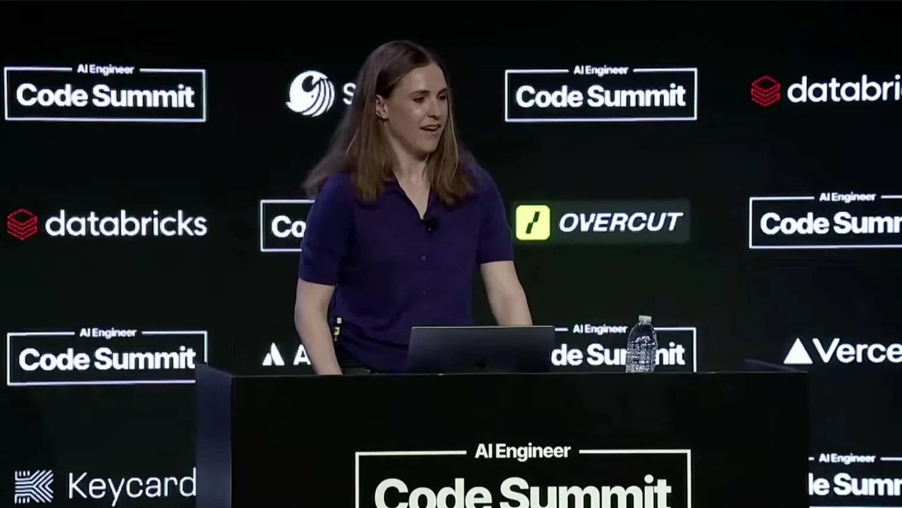

_现场 01  ·  补录 00:00:08_

**补录 00:00:17**　Just a bit about me. My name is Natalie. I'm a co-founder of Gimlet Labs. At Gimlet, we're building an inference cloud that's designed to produce much, much faster tokens at high efficiency, leveraging different categories and types of chips. At Gimlet, I work on our kernel generation side of things across different hardware types. Another thing about me is I love agents. I use my coding agents for everything, but I really, really hate waiting.

先简单介绍一下自己。我叫 Natalie，是 Gimlet Labs 的联合创始人。我们在做一个推理云，想用不同类型的芯片，更高效地、更快地生成 token。我在 Gimlet 负责的是在不同硬件上生成计算内核。还有一点，我很喜欢智能体，什么事都想交给我的编程智能体做，但我真的特别讨厌等。

**补录 00:00:32**　And one thing that kind of surprises me is when you're building an ultra-fast inference cloud, people ask me this all the time actually. They’re like, “Isn’t inference already fast enough?” And I’m like, “What?” But they have a point, right? Because I can do things and we can all do things with our agents so much faster than we could have done before.

有一件事让我挺意外的。你在做一个超高速的推理云，偏偏总有人问：“推理现在还不够快吗？”我会想：“什么？”但他们这么问也有道理，对吧？有了智能体，我能做的事，大家能做的事，都比过去快多了。

**补录 00:00:42**　For example, I made this slide look pretty using my agent. It took much less time with my agent than it would have taken me to do it by myself. I'm not very good at design. And so I think that from an end-to-end perspective, obviously we're getting more done, but as for whether it’s fast enough, that’s still a question. So let's take a look at what happened when I used my agent to make that slide look pretty. You can see the ugly before slide on the right.

举个例子，这页幻灯片就是我用智能体做得好看了些。用它比我自己做省了不少时间，毕竟我不太擅长设计。所以从头到尾看，我们当然能做更多事。可这个速度到底够不够快，还是要问一问。我们来看我是怎么让智能体把这页改好看的。右边就是原来那张不太好看的。

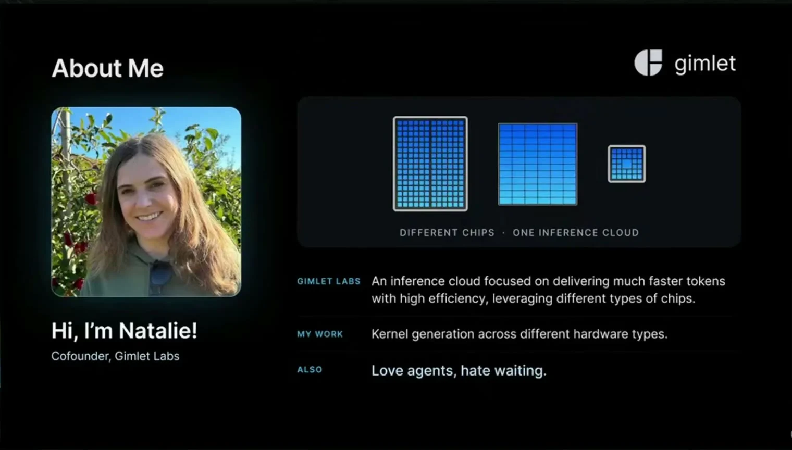

_截图 02  ·  补录 00:00:43_

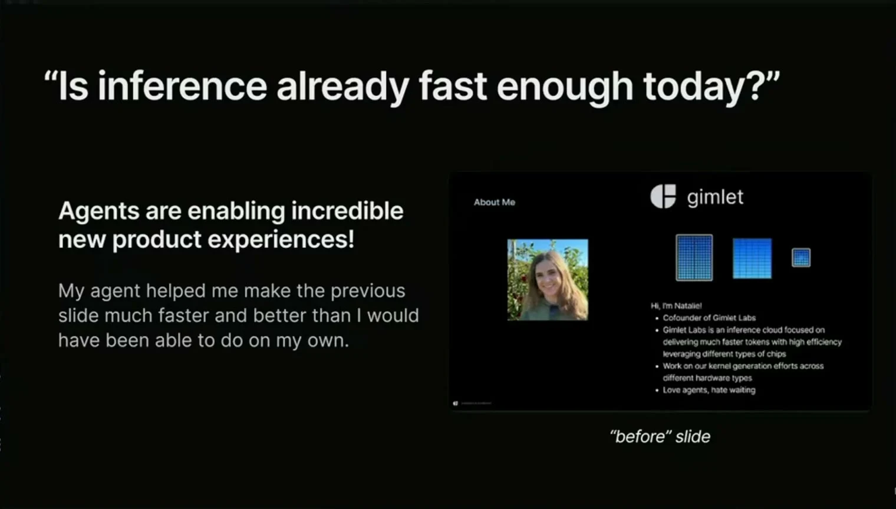

_截图 03  ·  补录 00:00:47_

**补录 00:00:57**　So we're going to press play here. And I said to my agent, “Can you improve the visual look of this slide?” I love Figma, I use Figma for everything. So of course I'm going to use it with my agents. So what we can see on the bottom here is the timeline of what happened. And the text is a little small to see, but red is inference. Red is the time the model spends on inference. Green is the time it spends making tool calls, and blue is the time it spends taking my input.

我们点一下播放。我对智能体说：“能把这页幻灯片做得好看一点吗？”我很喜欢 Figma，做什么都用它，所以用智能体时当然也要用 Figma。底下这条是整个过程的时间线。字有点小，红色是模型花在推理上的时间，绿色是调用工具的时间，蓝色是接收我输入的时间。

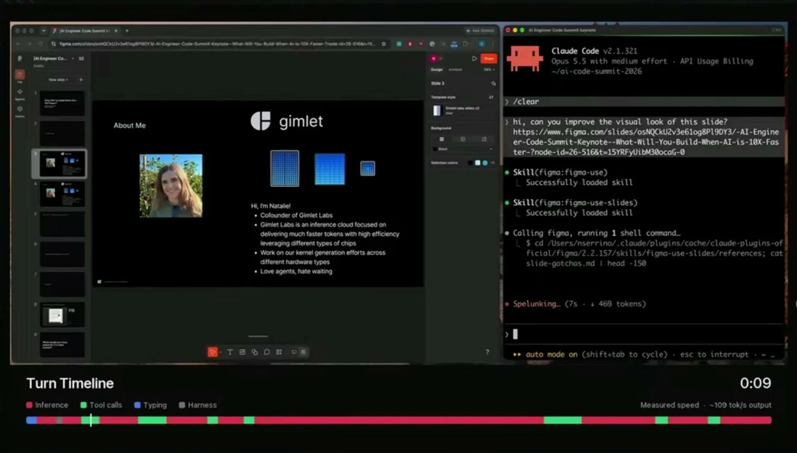

_截图 04  ·  补录 00:01:04_

**补录 00:01:12**　We can see that this agent is doing good work. It's doing a lot of thinking, but I'm waiting here. I'm actually waiting so long that I sped up this video 9× because I didn't want all of you to have to wait for the full turn to end. It ended up being about two minutes long. We can see at the end of this, after my one input, we have this nice pretty slide at the end. On one hand, this is actually much faster than a human can do. On the other hand, in those about two minutes, I have probably moved on to another task. I'm not really focused on this anymore. I’ve switched contexts.

大家能看到，智能体干得不错，想了挺多，但我在这儿等着。等得实在有点久，所以我把这段演示加速了 9 倍，免得大家跟我一样等这一轮跑完。这一轮原本用了差不多两分钟。最后，我只给了一次输入，就拿到了这一张漂亮的幻灯片。它确实比人手做快多了。但这两分钟里，我可能已经去做另一件事了，注意力早就转走了。

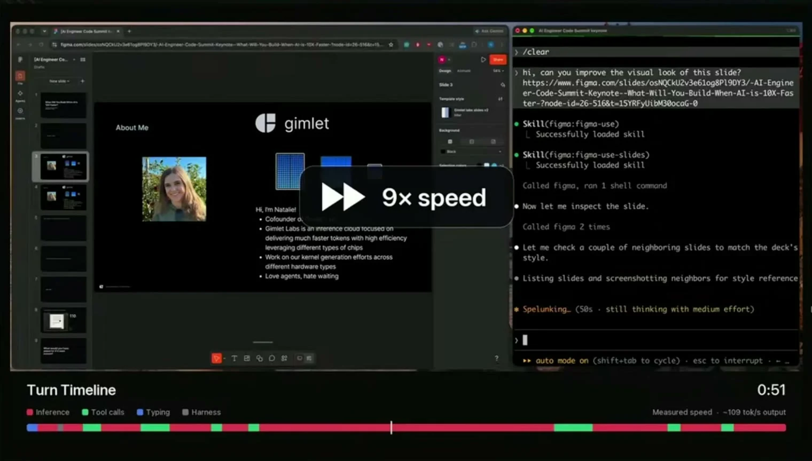

_截图 05  ·  补录 00:01:16_

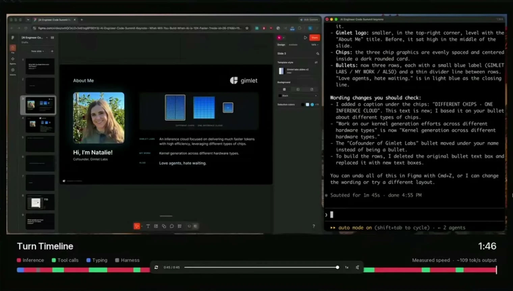

_截图 06  ·  补录 00:01:24_

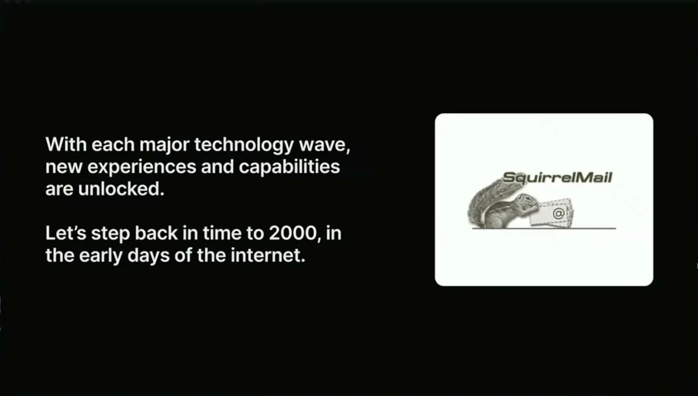

_截图 07  ·  补录 00:01:29_

### 网页邮箱对照、用户等待和 63 秒 Agent 回合

**补录 00:01:29**　When we look to the inevitable progression of inference getting faster and faster, I think it helps to look back in time and look back to the Internet era. I mean, we're still on the Internet, but what people canonically call the web era. What we always see with a new shift is that with each new major wave, new capabilities are unlocked. So we do things that weren't possible before that technology like using an agent to edit my slide.

推理的速度肯定会越来越快。要想想这意味着什么，我觉得可以回头看看互联网刚兴起的那段时间。我们当然还在用互联网，我指的是大家通常说的网页时代。每次遇到大的技术变化，都会多出一些以前没有的能力。原来做不了的事，现在能做了，比如让智能体来改我的幻灯片。

**补录 00:01:42**　I think we should take a step back to 2000 in the early days of the internet. I think many people here weren't even alive, so it'll be a history lesson for you. And we're going to look at a little application called SquirrelMail. SquirrelMail is actually open source, so you can run it today. It was a web application for doing your email back then.

我们退回 2000 年，看看互联网早期的样子。在座很多人那时候可能还没出生，就当是上一堂历史课吧。我们要看一个叫 SquirrelMail 的小应用。它是开源的，现在还能跑。那时候，人们用这个网页应用来处理邮件。

**补录 00:01:51**　So on the left, what we have here is I'm running SquirrelMail, and I'm running it with simulated 2000 dial-up speed. And then on the right, it’ll run at 2026 speed, the speed we’re used to today. Both sides are going to take the same actions, but on the left I’m using that simulated slower internet. We can see that it’s doing its job. Back in 2000, loading an image like this would have blown people’s minds. But to us now, it’s like, “Wow, that took forever to show up.” And so we can see these lags, we can notice the difference. But at the same time, someone might have looked at this back in 2000 and said, “This is fast enough. I don’t actually need this to be faster.”

左边跑的是 SquirrelMail，模拟的是 2000 年的拨号上网速度。右边用的是 2026 年的速度，也就是我们今天习惯的速度。两边做同样的操作，只是左边模拟了比较慢的网络。它确实也在正常运行。放到 2000 年，能这样加载一张图片就足够让人惊叹了。可我们今天看，会觉得“哇，这图怎么等了半天才出来”。延迟的差别很明显。不过在 2000 年，也可能有人看了之后说：“已经够快了，我不需要再快了。”

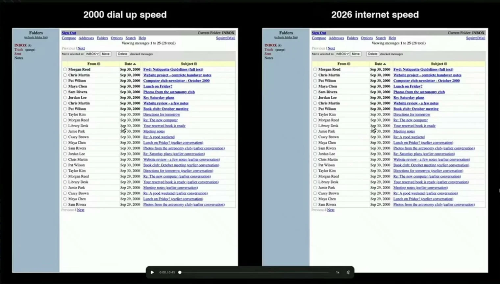

_截图 08  ·  补录 00:01:54_

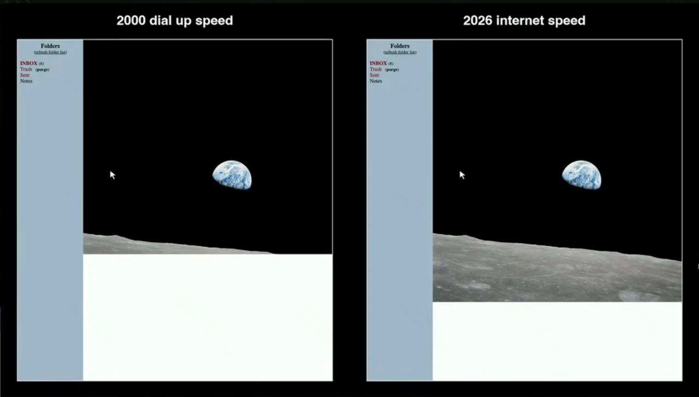

_截图 09  ·  补录 00:02:06_

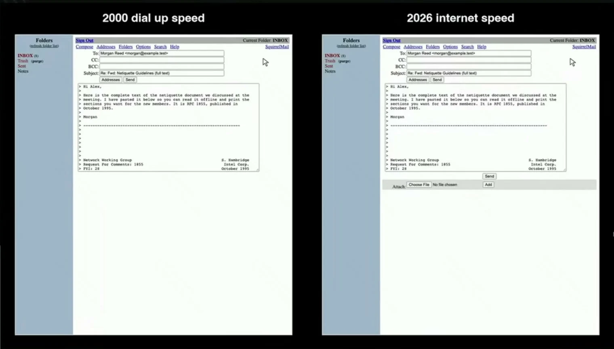

_截图 10  ·  补录 00:02:14_

**补录 00:02:16**　The thing is, though, all of the major giants back in that era did find out it mattered. Pretty much every major company, from Amazon to Yahoo to Google to Bing or Microsoft, all of them found that even very small delays cost them users. It cost them people coming back. It cost them people doing as many clicks. It cost them literal money. Even 100 milliseconds of delay added on to the typical experience had a demonstrable impact on the bottom line. Even when you got rid of that delay, those same users didn't come back to the platform as often as they did without that delay.

可那个时代的大公司后来都发现，速度确实有影响。从亚马逊、雅虎、谷歌，到必应或者说微软，几乎每家都发现，哪怕只慢一点，也会流失用户，回来的人少了，点击也少了，最后是真的少赚了钱。平常的体验里只要多出 100 毫秒，就能看到经营结果受影响。就算后来把这段延迟去掉，那些用户回来的次数也没恢复到原来的水平。

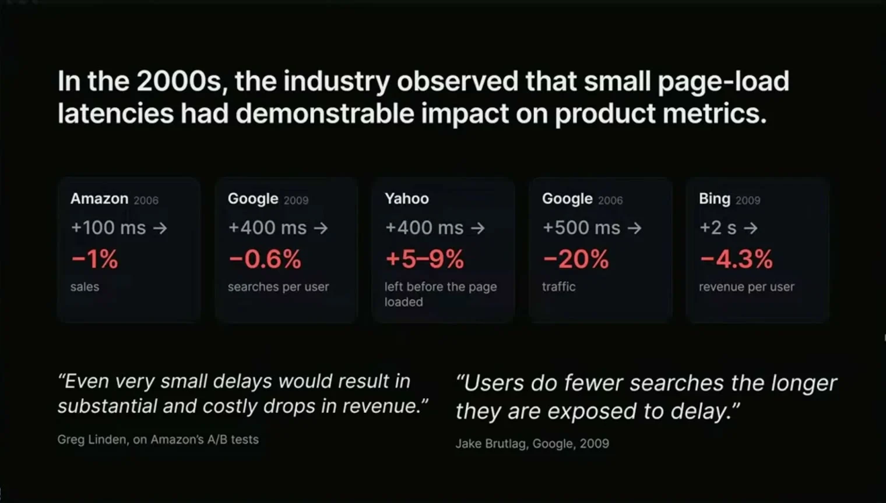

_截图 11  ·  补录 00:02:19_

**补录 00:02:38**　And this makes sense because fast products keep us in a flow state. They provide a stickier UX. About 100 milliseconds feels instant to us. With one second of waiting, I still keep my train of thought. It's not a big deal. I don't really notice it. At ten seconds, we’re going to start turning to something else from a psychology perspective. Maybe we pull out our phone. Maybe we switch to another agent. From data from June, the median coding agent turn is 63 seconds.

这也好理解。产品够快，人就比较容易保持心流，也更愿意继续用。100 毫秒左右，我们会觉得几乎是瞬间发生的。等一秒，我的思路还能接上，没什么大不了的，我甚至不太会留意。等十秒，人就会开始转头干别的了。可能拿起手机，也可能切去另一个智能体。按 6 月的数据，编程智能体跑完一轮的用时中位数是 63 秒。

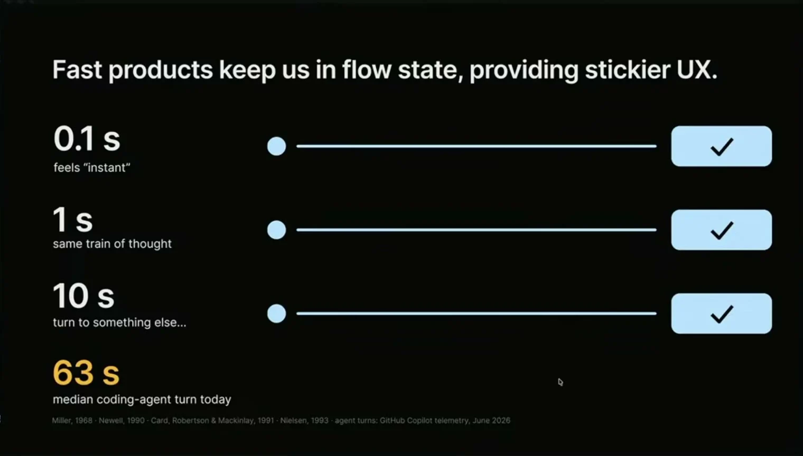

_截图 12  ·  补录 00:02:44_

**补录 00:02:53**　Each workload has different speed requirements. We don't need the same speed for everything, but over time our expectations do rise. And the fastest internet in the SquirrelMail days would feel incredibly slow to us and we can expect that trend to continue for inference speed as well.

不同的工作负载，对速度的要求也不同。不是每件事都要跑得一样快，但时间久了，我们对速度的要求会越来越高。SquirrelMail 那个年代最快的网络，现在用起来也会觉得特别慢。我想推理速度也会有同样的变化。

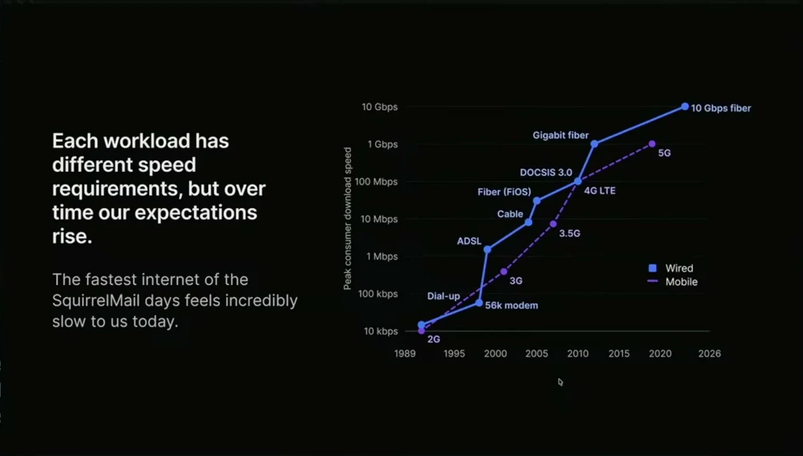

_截图 13  ·  补录 00:02:56_

### 算力约束、Token Mint Factory 和速度与吞吐量的取舍

**补录 00:03:02**　There's a problem though. And the problem is everyone knows that we have massive compute scarcity. Today's infrastructure is under incredible pressure to deliver two things at the same time, more tokens and faster tokens. Unfortunately, these goals are fundamentally at odds because faster tokens require more energy to produce than slower tokens. So with the same energy footprint, you can't make as many of them.

不过这里有个问题。大家都知道，算力非常紧缺。现在的基础设施压力很大，要同时做到两件事，一是多产出一些 token，二是把 token 产出得更快。麻烦的是，这两个目标本来就互相牵制。更快地产出 token 需要更多能量，所以在耗能相同的情况下，能产出的总量就没那么多。

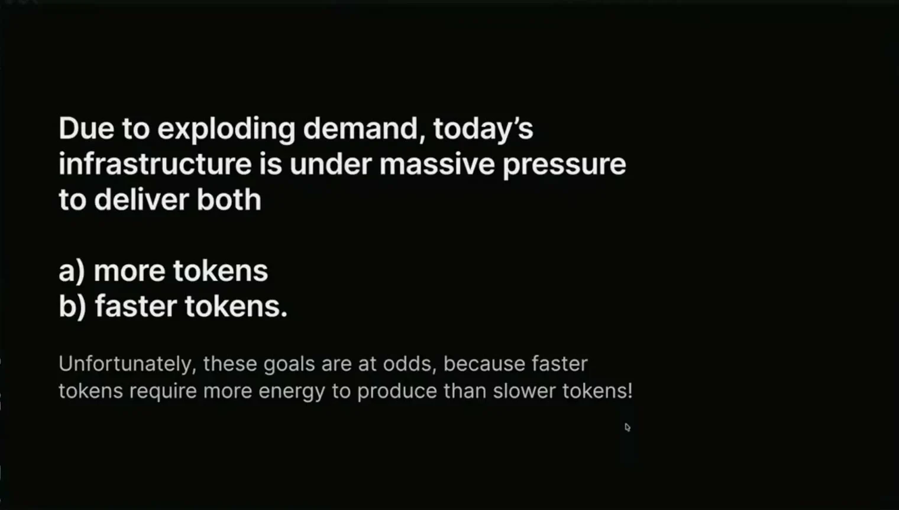

_截图 14  ·  补录 00:03:04_

**补录 00:03:15**　Back when this was a session and not a keynote (thanks for upgrading this to a keynote, everyone), we were going to play a game that I made called Token Mint Factory. And you can actually play this. I will not be offended if you play it right now even. But just so you know, it does not work on phones. It only works on your laptop.

这场原来安排的是普通演讲，后来升成了主题演讲，谢谢大家。我们本来打算一起玩一个我做的小游戏，叫 Token Mint Factory。你们可以自己玩，现在就玩我也不会介意。不过手机上玩不了，得用笔记本电脑。

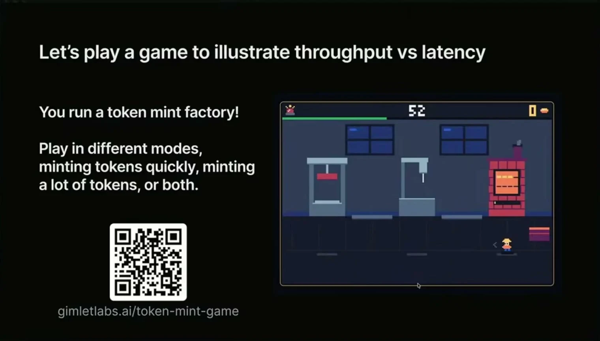

_截图 15  ·  补录 00:03:21_

**补录 00:03:24**　And basically, in this game, you're running a token mint factory. You're printing literal tokens. And there's different modes. The modes are you can play to maximize how quickly you can put out one single token, or you can maximize how many tokens you can put out in 60 seconds. Or you can play the SLA mode where you have to maintain a 20-second SLA on each token for it to count, but you're still trying to put out as many as you can.

在这个游戏里，你经营一家 token 工厂，真的要在游戏里把 token 一个个造出来。游戏有几种模式。你可以比谁最快造出一个，也可以比谁在 60 秒里造得最多。还有一种 SLA 模式，每个 token 要在 20 秒内做出来才算数，但你还是得尽量多造。

**补录 00:03:36**　And as you play, you'll quickly see that the strategy is extremely different for doing fast tokens versus doing slow tokens. And neither one is actually better or worse from a decision perspective. It’s just a matter of what the application needs and what makes sense for your factory.

玩一会儿你就会发现，想让 token 出得快，和允许它出得慢一点，用的是两套很不一样的策略。选哪种没有绝对的好坏，就看应用需要什么，以及什么办法适合你的工厂。

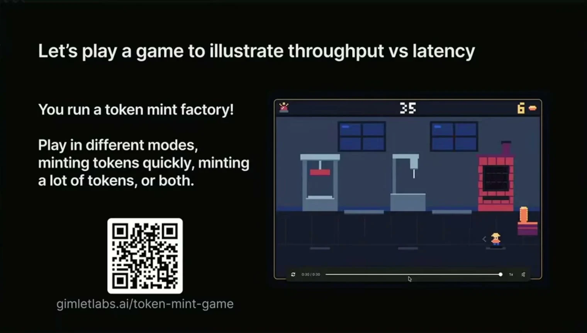

_截图 16  ·  补录 00:03:42_

**补录 00:03:44**　So I took real runs from people at my company that played this game, and I made a Pareto frontier of these tokens in the game. And we can see there's a real-life Pareto frontier of this game as well. If we have faster tokens, we don't have as many, and if we have more tokens, they're not as fast. But there is a way to get more up and to the right, and up and to the right is where we want to go. We want more faster tokens. I don't want to compromise. I want both.

我把公司同事实打实玩出来的结果收集起来，画出了游戏里 token 的帕累托前沿。游戏里就能看见这种取舍。token 出得越快，总量就越少，想出得更多，速度又没那么快。不过也有办法把边界往右上方推，那才是我们想去的地方。我们要更多、也更快的 token。我不想折中，两样都想要。

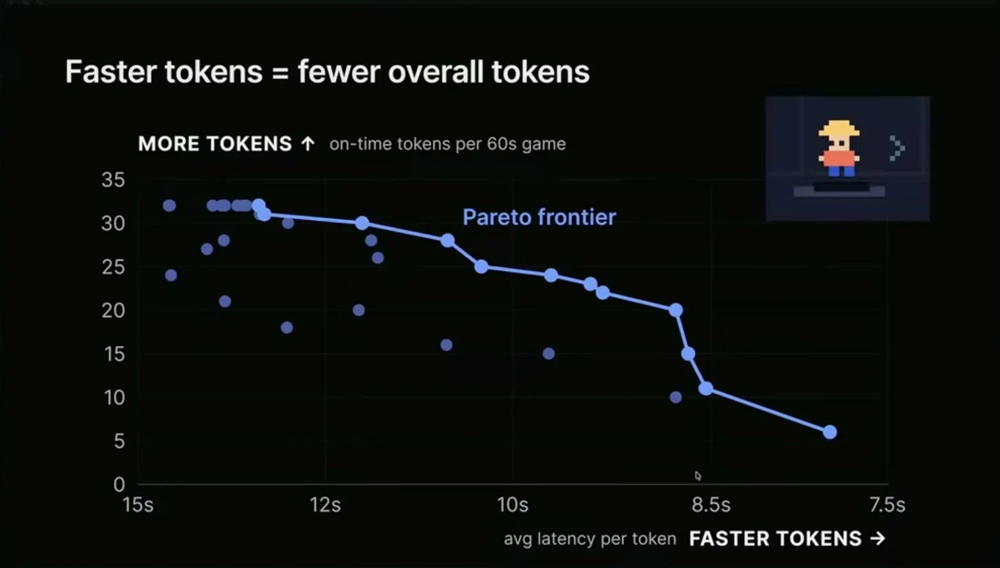

_截图 17  ·  补录 00:03:46_

**补录 00:03:57**　So the game has a concept of adding upgrades to your equipment. And what we can see is that compared to the no upgrade baseline, these technological innovations help drive us up and to the right and get more tokens and faster tokens.

所以游戏里可以给设备升级。跟完全不升级的情况一比，就能看到这些技术改进把边界往右上方推了。token 能做得更多，也能出得更快。

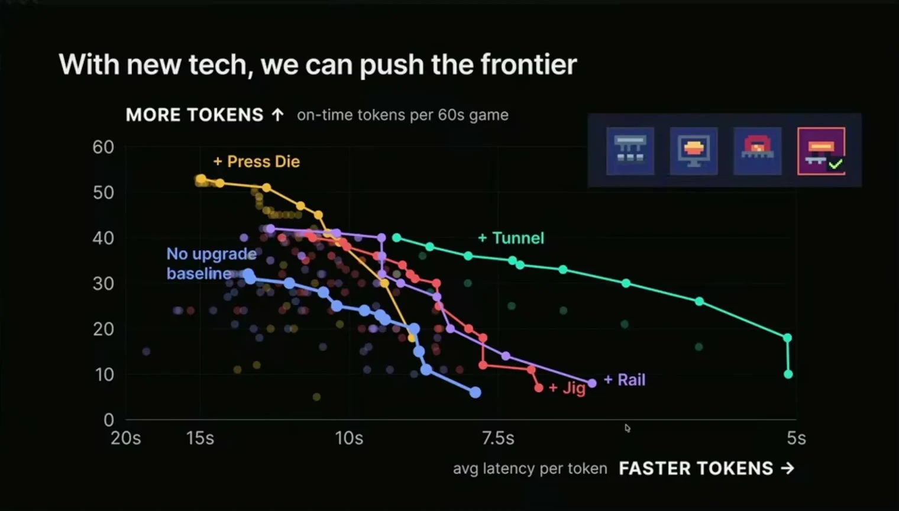

_截图 18  ·  补录 00:03:59_

### 异构推理、贪吃蛇演示和工具调用瓶颈

**补录 00:04:05**　So how do we upgrade our real-life assembly lines, so to speak, to make our actual tokens faster? One thing we do at Gimlet comes from our belief that you have to use the right accelerator for the right job. So we actually take models and we split them up into different pieces, and we run each piece on a different category of accelerator. So we might run one piece of the workload on a GPU and another piece of the workload on something like an SRAM-centric accelerator. And we find that even with the network overhead, this delivers dramatically faster tokens. It's essentially like the same thing as the upgrade to the equipment in the token factory when you better match the accelerator to the job. Unfortunately, we have ended the time of the free lunch of transistor scaling, right? So now we have to look to other approaches to make things faster.

那怎么给现实里的生产线升级，让真正的 token 出得更快呢？在 Gimlet，我们相信每项任务都要用合适的加速器。所以我们把模型拆成不同的部分，让每一部分在不同类型的加速器上跑。比如，一部分工作放在 GPU 上，另一部分放在以 SRAM 为核心的加速器上。我们发现，即使算上网络开销，token 还是能出得快很多。这就像给游戏里的工厂升级设备，让任务和加速器配得更好。可惜，单靠缩小晶体管就能白捡性能的日子已经过去了。现在我们得想别的办法把速度提上来。

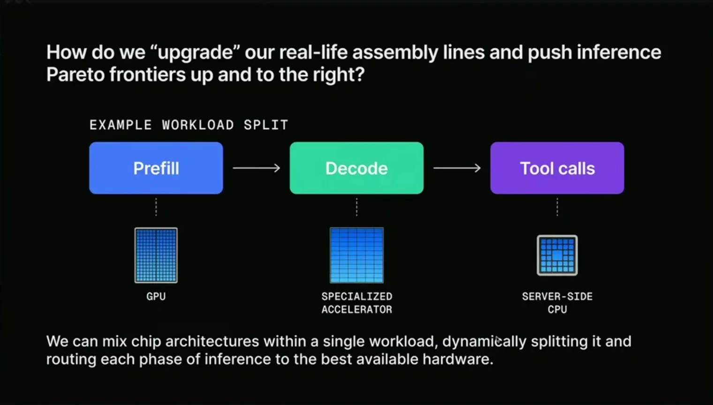

_截图 19  ·  补录 00:04:11_

**补录 00:04:30**　And so with this, it's a little hard to read, but we can see the same real-life Pareto frontier for a frontier model. If you look at, you know, simple homogeneous GPU inference, it's very high throughput. And then the latency drops off a little bit. You know, you can't get it as fast because the y axis is how many tokens that I can make and the x-axis is tokens per second for each user. And we can see that depending on how you split the model up, because there's different ways of doing it, you can get much faster tokens for the same power footprint. You can get many more tokens for the same speed. Or you can get more and faster tokens. So as an industry, we need to continue pushing, pushing, pushing on this, because otherwise our poor data centers are just going to keel over.

这张图不太好读，但它就是前沿模型在现实里的帕累托前沿。只用同一类 GPU 做推理，吞吐量很高。但再想往低延迟的方向走，就没法跑得那么快了。图的纵轴是我能生成多少 token，横轴是每个用户每秒能拿到多少 token。模型有好几种拆法。拆得合适，同样的功耗下，token 能出得快很多。速度相同，也能产出多得多的 token。或者两样都拿到，又多又快。我们整个行业得继续往前推，不然这些可怜的数据中心真要撑不住了。

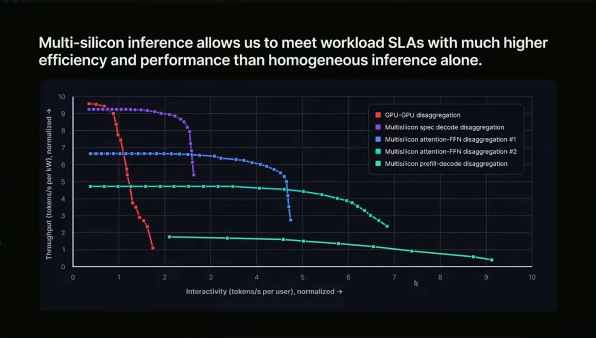

_截图 20  ·  补录 00:04:32_

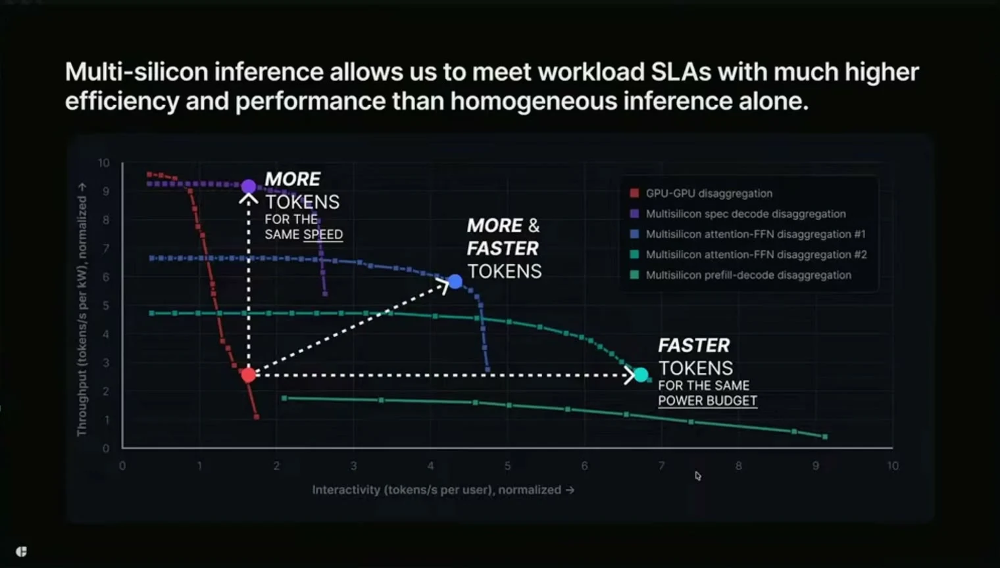

_截图 21  ·  补录 00:04:49_

**补录 00:04:54**　So I just wanted to show a quick demo of this. A coding agent builds the same app using heterogeneous inference, which uses different chip types, and using traditional inference. So this is gonna be the game Snake and we can see on the left that the faster, heterogeneous one is done. I can stay in my flow state, keep adding things, and keep playing. On the right side, it’s still going. And by the way I still think the left side is too slow.

我想简单演示一下。我们让编程智能体做同一个应用，一边用不同类型的芯片做异构推理，一边用传统推理。做的是贪吃蛇。左边用异构推理，比较快，已经做好了。我可以保持手头的节奏，继续加东西、继续玩。右边还在跑。顺便说一句，我还是觉得左边不够快。

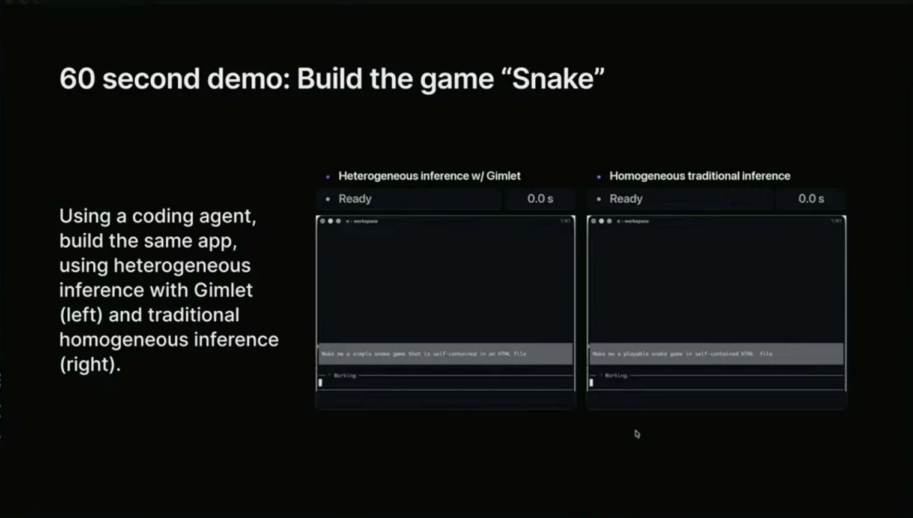

_截图 22  ·  补录 00:04:57_

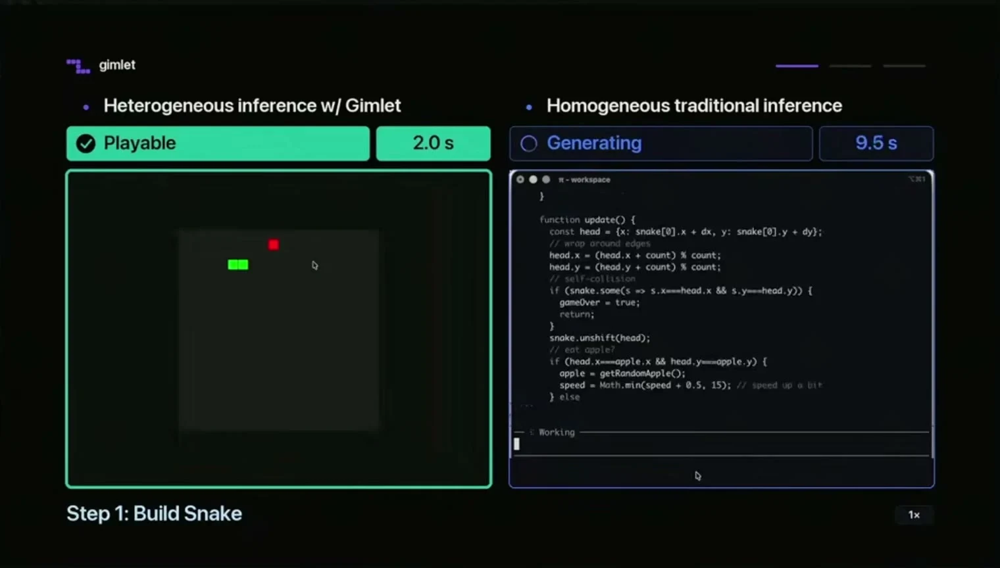

_截图 23  ·  补录 00:05:05_

**补录 00:05:07**　We need to make that even faster. Then we can add a competitor to the game. We can see that even with the tool calls, even with all the things that it's doing, it's going to complete, and then the other one will still be hanging. It’s fundamentally about how you can get more efficiency and better performance with the same resources. It's going to go on. I'm not going to make you guys wait for this.

左边也得再快点。然后我们可以在游戏里加个对手。即使还有工具调用，还有这些事要做，左边也会先完成，右边还卡着。说到底，问题是怎么用同样的资源，把效率和性能都提上去。右边还会跑一阵，我就不让大家等了。

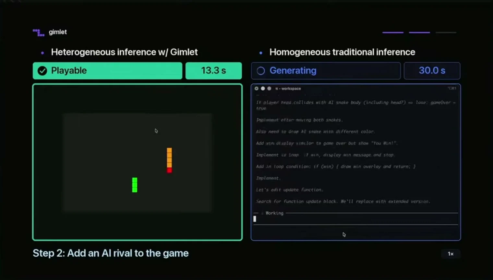

_截图 24  ·  补录 00:05:18_

**补录 00:05:20**　One thing people often ask is whether inference or tool calls are the bottleneck. And I think this is a great point. If we look back to the turn timeline from the time that I was spending updating my slide, we can see that 80% of it was inference and 18% of it was tool calls. If we simulate that same exact thing and have 10x faster inference, we can see that 67% of that will be tool calls at that point, if we don't optimize the tool calls.

还有个问题经常被问到：瓶颈到底是推理，还是调用工具？我觉得问得很好。回头看我改幻灯片那一轮的时间线，80% 的时间在推理，18% 在调用工具。如果模拟同样的任务，把推理提速 10 倍，同时让工具调用维持原样，那时工具调用就会占总用时的 67%。

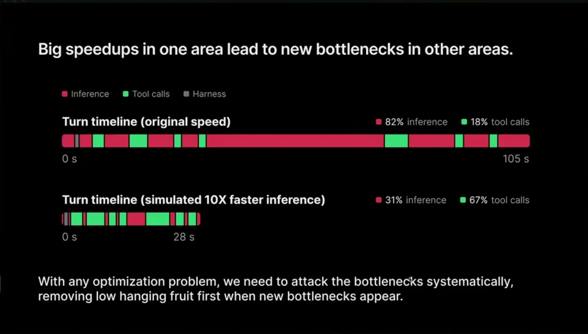

_截图 25  ·  补录 00:05:22  ·  推理占比口述为 80%，幻灯片标为 82%_

**补录 00:05:34**　That's why it's important that we have to constantly attack the bottlenecks of the application and get the low hanging fruit where we can. Today, people are focused on inference speed and maybe we haven't optimized the tool call side and how tools are called as much because it's not the bottleneck. If I cut away the tool calls on the upper one, it wouldn't even really matter to the end application. But once we get much faster, we have to think about how to call these tools much more efficiently because otherwise they're going to be the reason that we're all waiting around.

这就是为什么要一直盯着应用里的瓶颈，先处理那些比较容易改的地方。今天大家主要在提推理速度，可能没花太多精力改工具调用或调用方式，因为那还不是瓶颈。在上面那条时间线里，就算把工具调用的时间拿掉，对应用最后的表现也没多大影响。可一旦推理快得多了，我们就得想办法更高效地调用工具，不然以后等的就是它们了。

**补录 00:05:50**　I think the good news is that optimizing these speeds and what we're all collectively doing as an industry is a verifiable task. If I know what my inputs and outputs should be, I can have agents do this across the full stack. And that's where we're increasingly moving to. We're having self-improvement loops with these agents to drive better efficiency on the fly as our inference is running.

好消息是，提速这件事，包括行业里大家都在做的这些工作，是可以验证的。只要我知道输入和输出应该是什么，就能让智能体在整个技术栈里做这些事。我们正在往这个方向走，让智能体循环改进，在推理还在运行时就把效率提上去。

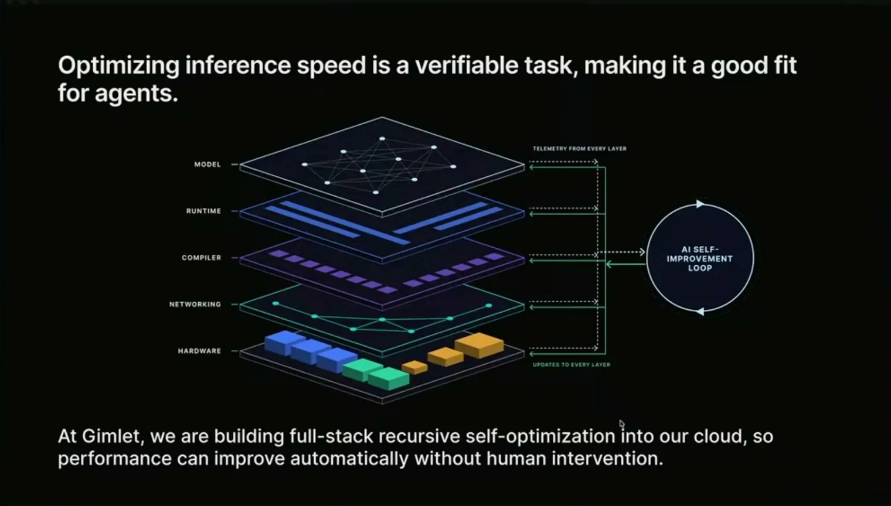

_截图 26  ·  补录 00:05:51_

**补录 00:06:01**　At Gimlet, we’re building recursive self-optimization for this that pulls from low level telemetry from our data centers all the way up to the model layer and trying to use all of it to improve the overall efficiency of the workload. Because if you just optimize one small piece, it might not make that much of a dent.

我们在 Gimlet 正做这套递归自优化。它从数据中心底层的遥测数据一路看到模型层，试着把这些信息都用上，提升整个工作负载的效率。因为只优化一小块，效果可能没那么明显。

### 普通速度和超低延迟的防护对照

**补录 00:06:10**　I want to show another demo because I think that cybersecurity is on everyone's mind right now. We're all seeing the huge incredible advances in AI driving awareness of all these vulnerabilities in our software. I think that this is an area where faster inference can really, really help.

我还想放一段演示。最近大家都挺关心网络安全。我们都看到了 AI 的巨大进步，它让更多软件漏洞被注意到。我觉得更快的推理在这里确实能帮上忙。

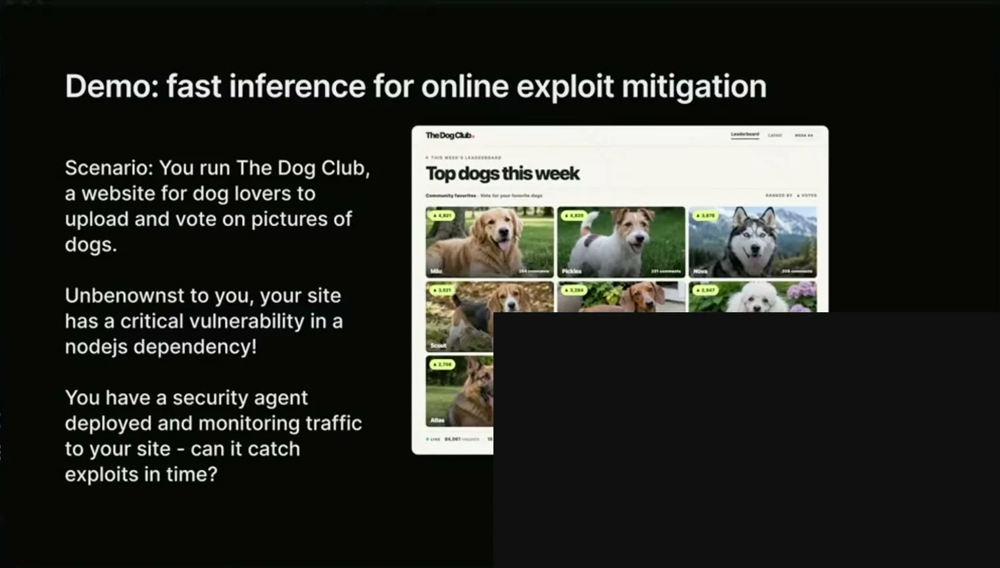

_演示界面局部 27  ·  补录 00:06:12_

**补录 00:06:20**　This is a dumb fake scenario, but it's a real application and a real demo. Imagine you’re running The Dog Club. It’s a website for dog lovers to upload and vote on pictures of dogs. However, unfortunately, like we often see, one of your Node.js dependencies has a vulnerability. This is a real vulnerability. It’s really in node-tar.

设定有点傻，是虚构的，但应用和演示是真的。想象一下，你在经营一个叫 The Dog Club 的网站。爱狗的人能在上面传狗狗的照片，再给照片投票。跟我们常见的情况一样，很不巧，你用的一个 Node.js 依赖有漏洞。这个漏洞是真的，就在 node-tar 里。

**补录 00:06:31**　And you’re running a security agent on your application. It monitors live traffic to see whether anything is going wrong that you don’t know about. This agent doesn't know about this vulnerability but it does know its job is to protect your application. So let's do a quick turn with normal user traffic.

你的应用上跑着一个安全智能体。它监控实时流量，看有没有你不知道的问题。它并不知道这个漏洞，但它知道自己要保护你的应用。先跑一轮普通用户流量试试。

**补录 00:06:40**　We’re going to upload a picture of a dog named Biscuit. At the top, we have the application logs. At the bottom, we have the defender. It’s monitoring, but it’s outside the critical path because it isn’t fast enough to respond to every user request in real time. It’s monitoring things asynchronously. And we can see Biscuit’s picture goes up. We can see it’s a normal upload. The defender doesn't see any problem.

我们要上传一只叫 Biscuit 的狗的照片。上面是应用日志，下面是防护智能体。它在监控，但不在请求的关键路径上，因为它没快到能实时处理每一条用户请求。它是异步监控的。现在 Biscuit 的照片传上去了，这次上传很正常，防护智能体也没发现问题。

_演示界面局部 28  ·  补录 00:06:45_

**补录 00:06:54**　But now what we're going to do is have this defender operating when there's a malicious upload. And this upload is exploiting the real vulnerability where in node-tar there was a release where you could basically overwrite files that you weren’t supposed to overwrite. \[Operational detail omitted\] So in this one, we have Ranger, a fake, bad, malicious dog, not really a dog. And what we're going to see is that the defender is going to figure out that this is a malicious thing. The agent is smart enough to detect that it's doing something that it shouldn't be doing, even though it hasn't seen this exact vulnerability before.

接下来，我们让这套防护遇到一次恶意上传。这次上传利用了一个真实漏洞。node-tar 有个版本会让原本不该被覆盖的文件遭到覆盖。〔略去可复现的操作细节〕这次的 Ranger 是只虚构的坏狗，带着恶意来的，其实也不算是只狗。大家马上就会看到，防护智能体能认出这是恶意行为。虽然没见过这个具体漏洞，它还是能看出这次上传在做不该做的事。

_演示界面局部 29  ·  补录 00:07:06_

**补录 00:07:13**　But unfortunately, the malicious upload has taken over. Your website’s gone. It’s too late. You didn't react in time.

可惜恶意上传已经得逞了，你的网站没了。已经太晚，你没能及时反应。

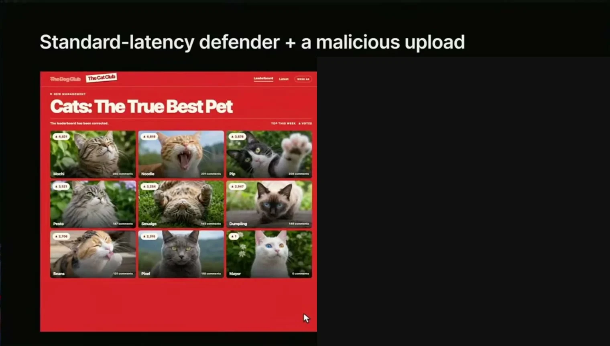

_演示界面局部 30  ·  补录 00:07:14_

**补录 00:07:19**　But if we retry this same exact malicious upload, but this time with an ultra-fast defender, and again, this is a real demo with a fake use case, we can see that with ultra-fast inference, we can react to things and do things online much more quickly. And this should change the way that we think about how to use agents in the first place. We're all thinking about how to use them in an async way, but we should think about how to use them in online ways as well. So we can see on the bottom that the worker blocked their request and it was like, what are you doing? This is obviously wrong.

如果把同一次恶意上传再试一遍，这次换一个超快的防护智能体呢？再说一次，演示是真的，使用场景是虚构的。大家能看到，推理足够快，就能更快地反应，在请求还没走完时就把事情处理掉。这也该改变我们一开始就怎么想智能体的用法。大家现在都在想怎么让它们异步跑，其实也可以想想怎么让它们实时参与。大家看下面，工作进程拦住了那条请求，像是在说：“你在干什么？这明显不对。”

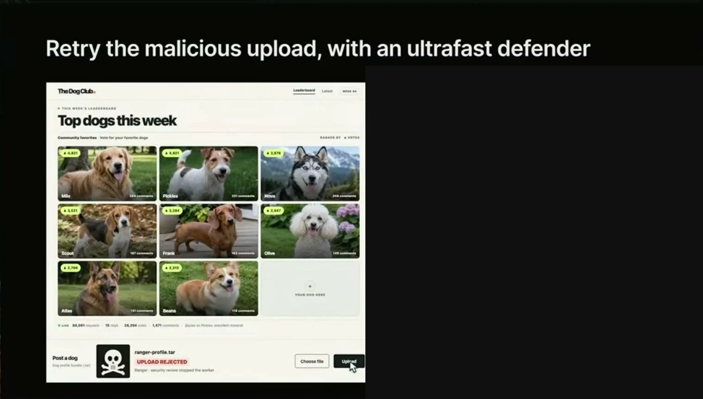

_演示界面局部 31  ·  补录 00:07:31_

### 从网页邮箱到高清串流，再谈实时交互

**补录 00:07:37**　So faster internet took us from SquirrelMail to on-demand high-resolution streaming. Right? If you just look from this to this, it's crazy. If you showed this to my five-year-old self or something, my mind would have been blown. And this is just one of many things that this can unlock.

所以，更快的网络让我们从 SquirrelMail 走到了按需播放高清串流，对吧？看看前后的差别，真的很夸张。要是给五岁的我看，肯定会惊得说不出话。这只是提速能带来的许多变化之一。

**补录 00:07:45**　So what does a world with 10,000 tokens per second look like? We’re in the low hundreds today. What does it look like when we do a million tokens per second? What does that unlock for us? And I think that we should all ask ourselves this too. It's important in AI to skate to where the puck is moving, right? It's changing so fast, we need to be ready. We need to think boldly. It's not enough to just do what we've always been doing.

那每秒 1 万个 token 的世界是什么样？我们现在还只是每秒一两百个左右。要是到了每秒 100 万个呢？我们又能做些什么？我觉得大家都可以问问自己。在 AI 领域，得滑向冰球接下来会去的地方，对吧？变化太快了，我们得准备好，想得大胆一些。光做一直在做的事已经不够了。

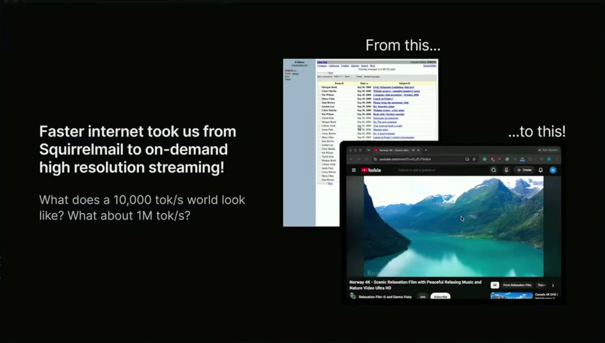

_截图 32  ·  补录 00:07:48_

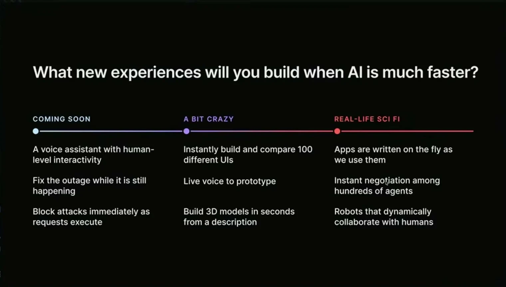

_截图 33  ·  补录 00:07:52_

**补录 00:07:57**　I think we've all had the experience where we make an audacious request to our agent and after the latest model release, it just works. And it's going to be the same thing with latency. And so I think that we can think about ideas that are both coming soon when we hit a certain latency threshold, what we can do, but also the stuff that is real life sci-fi. Like if you look at something like Jarvis or something, there's no way today's inference could be fast enough to power that experience for Iron Man. But we’ll get there.

我想大家都有过这样的经历。你给智能体提一个很大胆的要求，等最新的模型一发布，这个要求突然就能做成了。延迟也会是一样的。我们可以想一想，等延迟降到某个门槛，很快就能做成的事，还有那些真像科幻片一样的东西。拿贾维斯举例，今天的推理速度还撑不起《钢铁侠》里的那种体验，但总有一天会到的。

**补录 00:08:11**　So I'm really excited about online use cases, online security, and other things we can do in real time. I want to just tell my agent what I want to build, and it’s building it right in front of me. I don’t even have to type anything.

所以我很期待实时场景、实时安全，还有其他能实时做的事。比如我直接告诉智能体我想做什么，它就在我眼前做出来，我甚至不用打字。

### 交互补全、更多智能体和致谢

**原录屏 00:02:43**　I think we're going to have new patterns of interaction. You know, think tab complete for everything. How can we make things as quick and immediate as possible for users, now that inference is fast enough to keep up?

我觉得会出现新的交互方式。想象一下，什么都能像按 Tab 键一样自动补全。既然推理快到能跟得上了，怎么让用户这边的体验也尽可能直接、即时？

**原录屏 00:02:56**　And we're going to have so many more agents. We're going to have even maybe transformers driving robots, right? There's so much that we can build when this gets unlocked. And I think as builders on the frontier here, we should all be thinking about this too.

我们会有更多智能体。也许还会有 Transformer 驱动的机器人，对吧？一旦这些能力打开，我们能做的事就太多了。作为在前沿做东西的人，我觉得大家也都应该想想这件事。

**原录屏 00:03:11**　Thank you so much for being with me this morning. You can find me on X at \@nserrino. We're hiring at Gimlet. We'd love to talk to you all. And then if you want to play the Token Mint Factory game, you can also find that QR here.

很感谢大家今天一早过来听。你们可以在 X 上找到我，我的账号是 \@nserrino。Gimlet 正在招人，很想跟大家聊聊。要是想玩 Token Mint Factory，二维码也在这里。

_截图 34  ·  原录屏 00:03:15_

**原录屏 00:03:25**　Thank you so much, everyone.

非常感谢大家。

---

[全部演讲](../README.md) · [选看索引](index.md) · [下一场](02-lydia-hallie.md)
