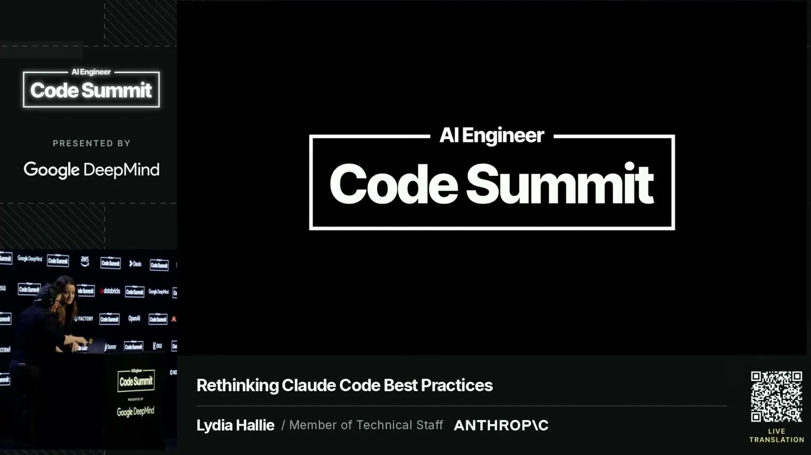
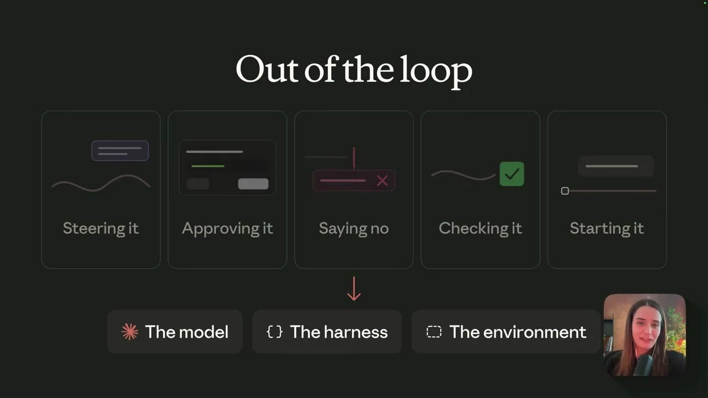
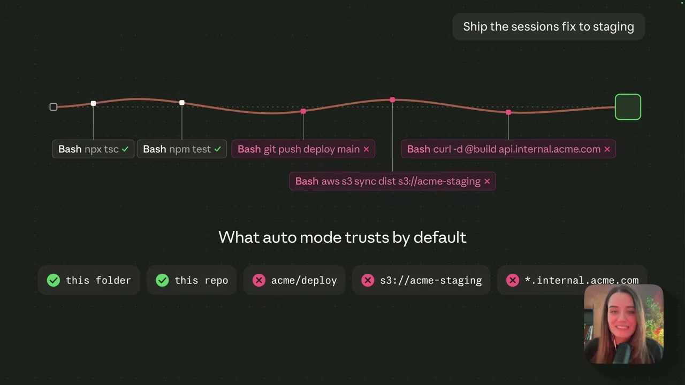
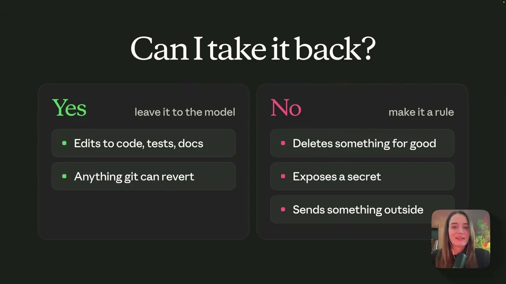
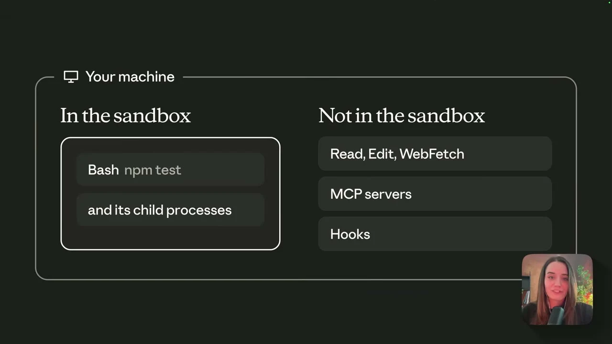
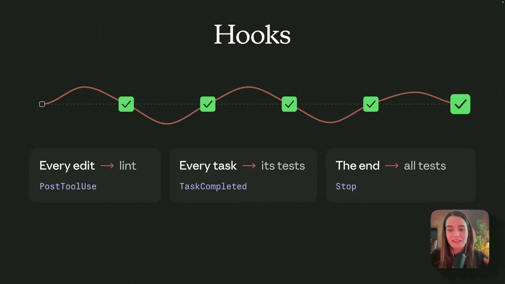
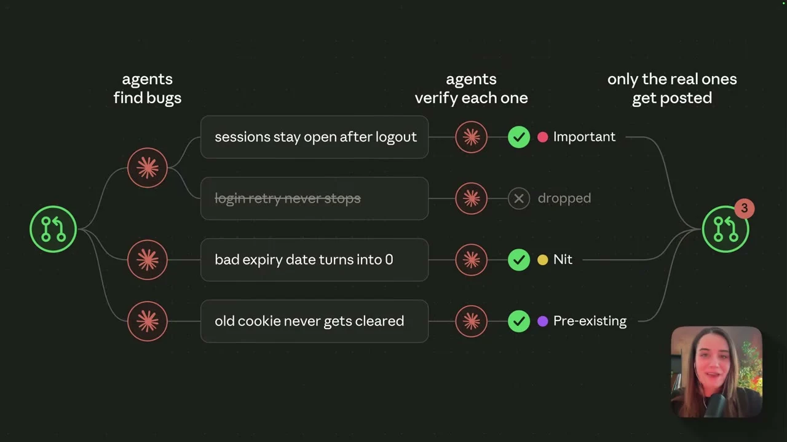
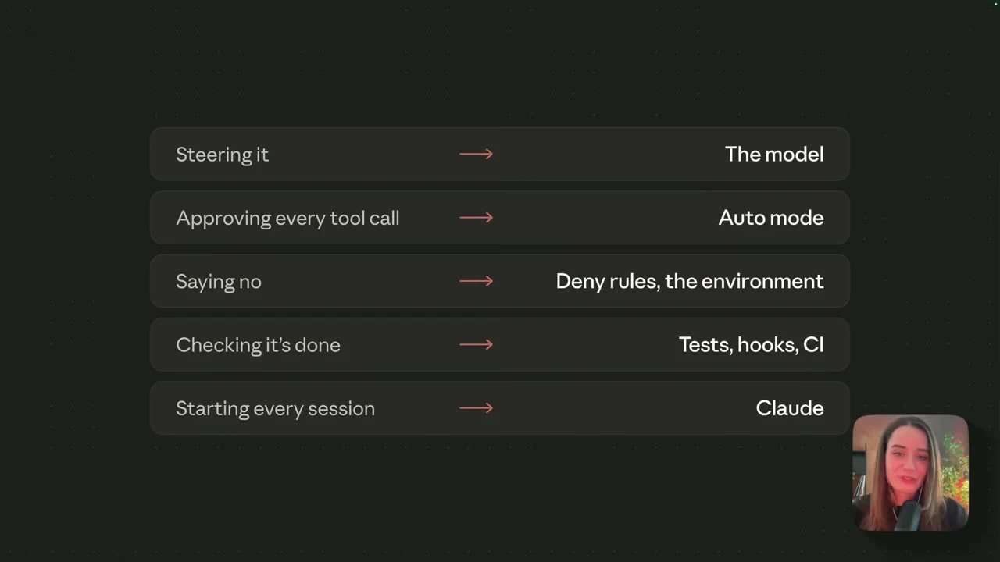

[全部演讲](../README.md) · [选看索引](index.md) · [上一场](01-natalie-serrino.md) · [下一场](03-michelle-chen.md)

# Rethinking Claude Code Best Practices

**Lydia Hallie** · Anthropic · Member of Technical Staff

AIE Code Summit 2026  ·  11 月 11 日  ·  主舞台  ·  录屏 00:04:09–00:13:13

> 现场电脑和投影出现故障。本地记录主要是临场发言和现场交谈，部分对话的说话人无法辨认。完整演讲可看 Lydia 后来重录的 AIE 单场版。

[官方议程](<https://ai.engineer/code/2026/schedule>)   ·   [Day 1 官方回放](<https://www.youtube.com/watch?v=ZZ19zhYnDKY>)

## 本场目录

- [00:04:52](#section-1) 与观众聊 Fable 和 Opus 的使用场景
- [00:08:48](#section-2) 临场谈长时间云端会话、模型自验与人的角色
- [00:09:55](#section-3) 排障和现场交流，随后结束

## 现场发言与交谈

> 英文源自录屏音频，经轻度校订。每段英文下方为中文译文。时间指向原始录屏。

**00:04:09**　Hi everyone. Oh, my microphone already works. Sorry. We have some technical issues this morning so hopefully everything works…

大家好。哦，我的麦克风已经可以正常使用了。抱歉，今天早上有一些技术问题，希望一切都能正常运作。

### 与观众聊 Fable 和 Opus 的使用场景

**00:04:51**　Yeah. Have you all tried Fable 5.2 yet? Yeah? Anyone? How is it? Like it? Yeah? Opus 5.5 better? Worse? Different use cases, right? Yeah, it's cheaper for sure. \[Unclear\]

是的。你们都试过 Fable 5.2 了吗？有吗？谁试过了？怎么样？喜欢吗？是的？Opus 5.5 更好吗？更差吗？使用场景不同，对吧？是的，价格肯定更便宜。〔听不清〕

_现场 01  ·  录屏 00:04:22_

**00:05:09**　It's all, it should be good. So this should be on that screen. We're looking down there. Right. Are you seeing anything, Jake?

就这些了，应该没问题。所以这应该显示在那个屏幕上。我们正往下看呢。对吧？你看到什么了吗，Jake？

**00:05:27**　Let me see. So this is supposed to be on my own. We need a Claude for IT. No, we got it. We're going to be fine. We got it. Everything's on the phone.

让我看看。所以这应该由我独自处理。我们需要一个 Claude来负责 IT 工作。不行，我们解决了。我们会没事的。都安排好了。所有事情都联系上了。

**00:05:46**　Let's make sure to hide this down. I want this to go small so we can drag over again.

让我们确保把这个隐藏起来。我希望它变得很小，这样就能再次拖动过去。

**00:05:59**　You can drag it? Start your slideshow. Yep, and then drag it down. Where? It's going to show up down there. Can you see anything yet, Chase?

你可以拖动它吗？开始你的幻灯片展示吧。没错，然后把它往下拖。在哪儿呢？它会出现在那里。你现在能看到什么了吗，Chase？

**00:06:22**　I did what you said.

我做了你说的那些事。

**00:06:55**　Okay.

好。

**00:07:27**　Uh can we do that? Go ahead install mirroring real quick and then. She actually needs it.

呃，我们可以这么做吗？赶紧安装镜像功能吧。她真的需要它。

**00:07:42**　I just plugged one in.

我刚接了一个进去。

**00:08:02**　Did it just die? I don't know. Can I unplug it real quick? Yeah, please. Did it just die? I think it just died. Oh, my gosh. Okay. I mean, I don't know what to do.

它刚刚死了吗？我不知道。我可以立刻拔掉它吗？可以，请吧。它刚刚死了吗？我觉得它真的死了。哦，天哪。好吧。我是说，我不知道该怎么做。

**00:08:15**　It shouldn’t have died. I had a battery. Yeah, now it's just died, I think. Should I just do my talk later today? We fix it. We don't. That's terrifying. I know.

它不应该坏掉。我有电池啊。现在它只是坏了而已，我觉得。我今天晚点再处理好吗？我们修一下吧。不，不行。太可怕了。我知道。

### 临场谈长时间云端会话、模型自验与人的角色

**00:08:34**　I know. I'm fine, but \[Unclear\]

我知道。我没事，但〔听不清〕

**00:08:52**　Okay, y’all, my laptop just died. So nothing is happening. I don't know what to do. Oh, it just restarted. Anyway. I feel like I've just spent 20 minutes just waiting here, and I don't want to take the next guy.

好吧，大家，我的笔记本电脑坏了。所以什么都没发生。我不知道该怎么做。哦，它又重启了。不管怎样，我觉得自己在这里等了20分钟，不想再面对下一个人了。

**00:09:05**　But TL;DR, we went from being super in the loop with our Claude Code sessions to running these long-running sessions that run for hours in the cloud with these models like Opus 5.5, Fable 5.2 that are so good at verifying themselves that the role of the human has really shifted.

但简而言之，我们从对 Claude Code 会话完全掌握的情况，变成了在云端使用像 Opus 5.5、Fable 5.2这样的模型，进行持续数小时的会话。这些模型非常擅长自我验证，因此人类的角色确实发生了转变。

**00:09:23**　Let's see.

让我们看看。

**00:09:33**　I don't think this is going to work.

我认为这不会成功。

**00:09:39**　Oh, it's so weird. I know.

哦，真奇怪。我知道。

### 排障和现场交流，随后结束

**00:09:45**　I don't know what this is doing.

我不知道这是怎么操作的。

**00:09:57**　Also, today, make sure you come by our Anthropic booth. We're there all day. We have good merch. We also have good demos and just fun stuff. We have like a photo booth there as well, which is fun.

另外，今天一定要来我们的“Anthropic”展台。我们整个一天都在那里。我们有不错的周边产品，还有有趣的演示内容。还有个拍照区，也很有趣。

**00:10:06**　You'll see me there as well if you have any questions. \[Overlapping speech, partly unclear\] Why did it restart? I don't know. WindowServer experienced a problem.

如果你有任何问题，也会在那里看到我。〔多人同时说话，部分听不清〕为什么又重启了？我不知道。WindowServer出现了问题。

**00:10:16**　What? Oh, Apple.

什么？哦，苹果。

**00:10:24**　Okay, now I'm just going to make sure I'm not... People often wonder what the story is behind what's the future of engineering in this space. And it turns out that fixing the computer and making it go, it's always a fun story.

好的，现在我就确保自己不会……人们常常好奇，这个领域的工程未来会如何发展。事实证明，修复计算机让它运转起来，总是一个有趣的故事。

**00:10:38**　The more advanced technology gets, the harder it is to basically make it do your bidding. And conferences are conferences, AV is AV and laptops are always going to laptop. I'm told that this might be the first time that an Anthropic employee has not been prodding an agent to wind up getting a computer to do that bidding.

技术越先进，要控制智能体按照你的要求行事就越困难。而会议就是会议，音频视频也是音频视频，笔记本电脑也始终还是笔记本电脑。我听说这可能是第一次有Anthropic员工没有试图让智能体使用电脑来完成这项任务。

**00:11:01**　That's what I'm saying when you say Claude for IT. I just see a little Claude robot helping me here. Let's see. Exactly. I don't want to step on your toes. Some people run agents, I run my mouth.

这就是当你说 Claude 用于 IT 时我的意思。我看到的只是个小小的 Claude 机器人在帮助我。没错。我不想打扰你。有些人管理智能体，而我则控制自己的嘴巴。

**00:11:17**　There's a production joke in there somewhere, but I'm too tired to find it. Things work in theory, but not in production. That's why I call the staging environment theory. All black.

里面肯定有个表演相关的笑话，但我太累了，找不到。理论上是可行的，但在实际生产中却不行。所以我把这种环境称为“理论环境”。全为黑色。

**00:11:26**　Okay. \[Unclear\]

好。〔听不清〕

**00:11:34**　It looks like you're up, maybe. I just have to see. I have my glasses with me. Remember, every code review is adversarial if you're a big enough jerk. Right. Yes. Wait, no, no, no, no.

看起来你可能醒了。我得看看。我带着眼镜。记住，如果你够混蛋的话，每次代码评审都是对抗性的。对吧。是的。等等，不，不是那样。

**00:11:50**　Oh, that's not. That's not good. No, that's good. Sorry, it was, yeah. And of course, the number one reason to found a company is that as a co-founder, main becomes your feature branch.

哦，不是这样的。那不好。不，那样很好。抱歉，确实如此。当然，成立公司的首要原因就是作为联合创始人，你的主要职责就是管理那个分支。

**00:12:00**　Good luck everyone else.

祝大家好运。

**00:12:16**　I want to see that on my screen real quick. Sorry. Because I don't know why it's not showing.

我想马上在屏幕上看到它。抱歉，因为我不知道为什么没有显示出来。

**00:12:27**　Should I go? We're going to…

我应该去吗？我们要去……

**00:12:35**　I just don't Oh They want to Can you close our mic so everyone can't hear us talking?

我只是不想……他们想要。你能关掉我们的麦克风吗？这样大家就听不到我们说话了？

**00:13:04**　Okay. Okay. I'll see you later. Hopefully I'll come back. You'll hear from me.

好的。好的。待会儿见。希望我能回来。你会收到我的消息的。

## 录屏缺失部分的官方画面

> 下列时间以官方视频为准。[打开 Lydia 的完整演讲](<https://www.youtube.com/watch?v=vlfCjWuv4es>)

_AIE 单场版  ·  00:02:17_

_AIE 单场版  ·  00:04:36_

_AIE 单场版  ·  00:06:40_

_AIE 单场版  ·  00:09:22_

_AIE 单场版  ·  00:12:45_

_AIE 单场版  ·  00:14:42_

_AIE 单场版  ·  00:16:54_

---

[全部演讲](../README.md) · [选看索引](index.md) · [上一场](01-natalie-serrino.md) · [下一场](03-michelle-chen.md)
