[全部演讲](../README.md) · [选看索引](index.md) · [上一场](02-lydia-hallie.md) · [下一场](04-lauren-tan.md)

# cloudflare is a neolab

**Michelle Chen** · Cloudflare · Group Product Manager

AIE Code Summit 2026  ·  11 月 11 日  ·  主舞台  ·  录屏 00:15:03–00:34:53

[官方议程](<https://ai.engineer/code/2026/schedule>)   ·   [Day 1 官方回放](<https://www.youtube.com/watch?v=ZZ19zhYnDKY>)

## 本场目录

- [00:16:30](#section-1) CDN、Workers、存储和模型服务的演进
- [00:23:04](#section-2) Jev、Clef、Clairic 与 System One 判断
- [00:28:45](#section-3) 分诊失败的 CI，比较大模型调用与混合流程

## 演讲实录

> 英文源自录屏音频，经轻度校订。每段英文下方为中文译文。时间指向原始录屏。

**00:15:04**　Hi, everyone. My name is Michelle Chen. I'm so excited to be here today at AI Engineer Code Summit, chatting a little bit more about why Cloudflare became a neolab. So at Cloudflare, I am the group PM here. I run on the product team working on products like Workers AI, AI Search, AI Gateway as well. Going to go through this little journey of how Cloudflare came to be.

大家好，我是 Michelle Chen。今天能参加 AI Engineer Code Summit非常兴奋，希望能进一步探讨为什么 Cloudflare 成为了一家 neolab。在 Cloudflare，我是团队项目经理。我还负责产品团队的工作，负责 Workers AI、AI Search、AI Gateway等产品的开发。接下来就来聊聊 Cloudflare 是如何发展起来的。

**00:15:24**　You might have heard that we launched and trained some models recently. I'm going to tell you a little bit more about why and what you can be doing with it. And so we're going to go through a little bit of a philosophical journey. When I was preparing for this talk, I wanted to use this quote, and then Anthropic launched a blog post last weekend and used my quote, but I'm still going to use it anyways.

你可能听说过我们最近推出了一些模型并进行了训练。接下来我会再详细说明一下原因以及你可以如何利用这些模型。我们将进行一次小小的哲学探索之旅。在准备这次演讲时，我想使用这句话；上周末Anthropic也发布了一篇博客文章，其中也使用了我的这句话，不过我仍然会继续使用它。

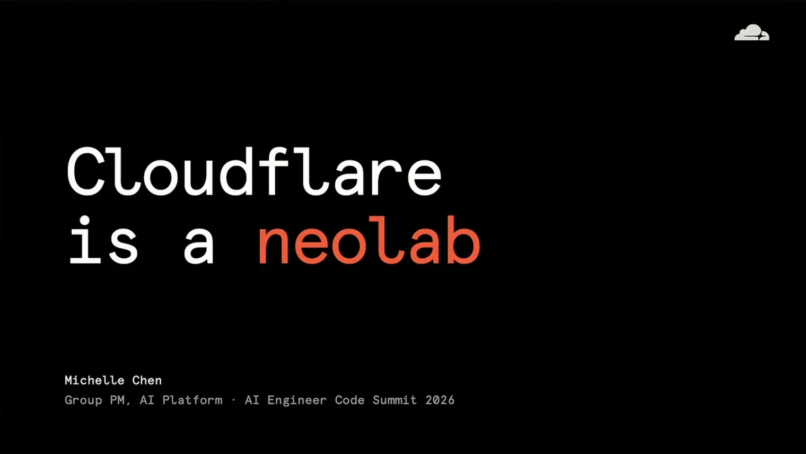

_截图 01  ·  录屏 00:15:25_

**00:15:44**　So the quote goes... In one second. The quote is from Kierkegaard, and it says, life can only be understood backwards, but it must be lived forwards. And I think this is a really, really apt quote here for us, because at Cloudflare, we're a 16-year-old company, and we've done so many things over the years, but somehow we got some of the pieces right, and we ended up having to become a neolab.

所以那句话是……在一秒钟内。这句话出自基尔克果的著作，他说：“生活只能从后往前理解，但必须向前去生活。”我认为这对我们来说非常贴切，因为在Cloudflare，我们是一家只有16年的公司。这些年来我们做了很多事情，但不知为何，我们还是把一些事情做对了，最终不得不成为一家新式实验室。

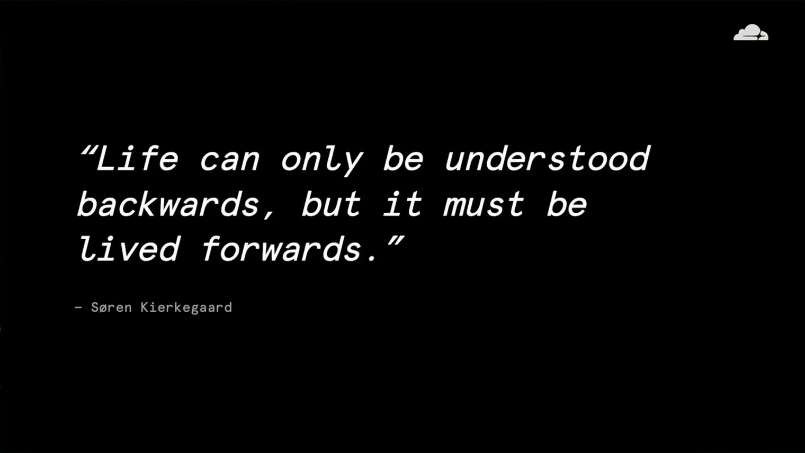

_截图 02  ·  录屏 00:16:02_

### CDN、Workers、存储和模型服务的演进

**00:16:08**　So we're going to go through a little bit journey. The first thing we're going to do is look backwards and talk through why Cloudflare became a neolab. Give me one second here. Perfect. We're going to go backwards and talk through why Cloudflare became a neolab. So Cloudflare is a 16-year-old CDN company. We just celebrated our 16th birthday at birthday week this year in September.

那么，我们接下来将回顾一下这一历程。首先，我们要回顾一下，为什么 Cloudflare 能成为一家 neolab。请给我一秒钟时间吧。完美。我们将从过去开始，探讨为什么 Cloudflare 能成为一家 neolab。其实，Cloudflare 是一家成立了16年的 CDN公司。今年9月的生日周期间，我们刚刚庆祝了它的16岁生日。

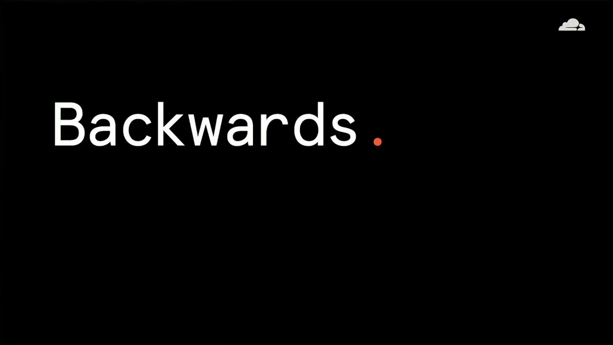

_截图 03  ·  录屏 00:16:31_

**00:16:41**　and we first started as a CDN. So as a CDN company, what you have to do is you have to serve content as quick to your users as possible. You sit between the user's request and the origin and you help sit in the middle and you can do things like cache and protect, do security and things like that. So that's kind of how Cloudflare started.

我们最初是作为 CDN 公司开始的。作为 CDN 公司，你的任务就是尽可能快速地为用户提供内容服务。你位于用户的请求和源服务器之间，起到中间连接的作用，可以执行缓存、保护、安全保护等功能。这就是 Cloudflare 的起步方式。

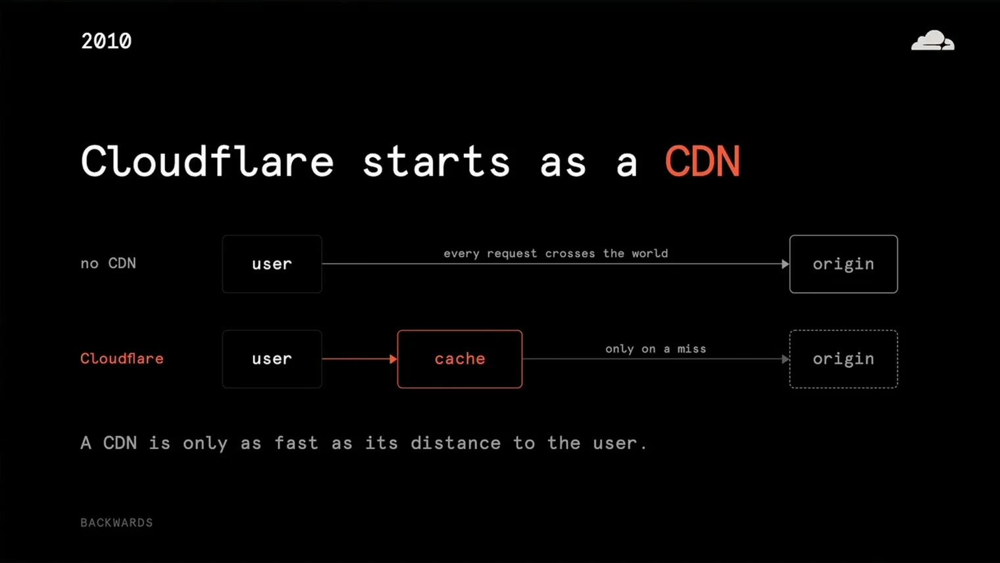

_截图 04  ·  录屏 00:16:48_

**00:17:00**　But Cloudflare's infrastructure had to be adaptable in order to become the CDN. And so what we did was 16 years ago in 2010, we launched with our own infrastructure. Our fast CDN had to be everywhere. And this looks really different than a traditional hyperscaler where compute is centralized in US East 1 or US West 1. Cloudflare's infrastructure is a completely different paradigm.

但 Cloudflare 的基础设施必须具备可适应性，才能成为 CDN。因此，16年前在2010年，我们便以自己的基础设施开始运营。我们的快速 CDN必须覆盖所有地方。这与传统的大型云服务商截然不同——在那些服务商中，计算资源通常集中在美国东部1或美国西部1区域。Cloudflare 的基础设施则属于完全不同的模式。

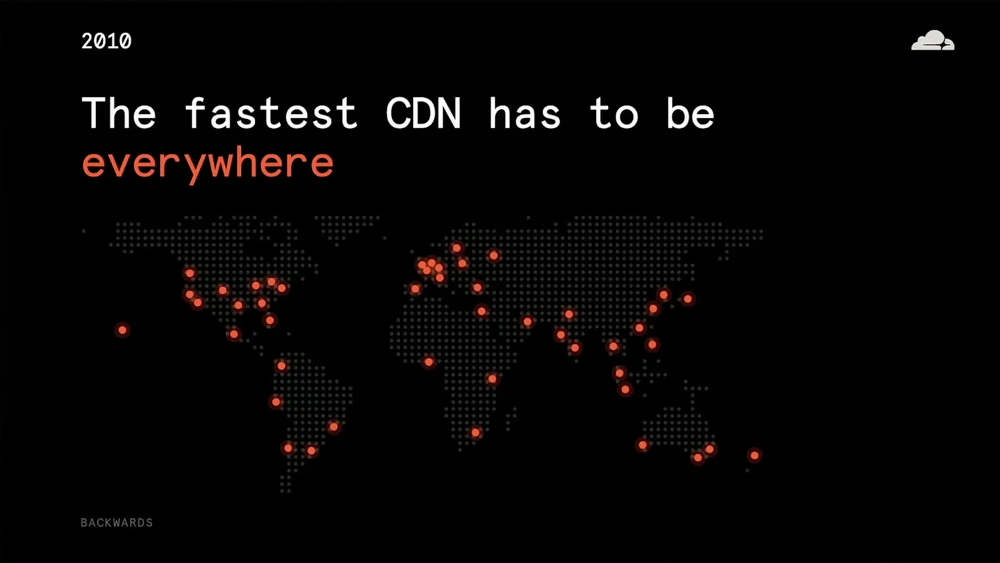

_截图 05  ·  录屏 00:17:13_

**00:17:21**　We have data centers all around the world as close to the user as possible. And this is really important in becoming a CDN. But now we have these computers basically running as close to the user as possible. So we thought to ourselves, what else can we be doing with these computers that people would want to build with? And so came compute.

我们在全球各地建立了尽可能靠近用户的数据中心。这是成为 CDN 的关键所在。但现在，这些计算机已经以尽可能靠近用户的方式运行了。于是我们思考：这些计算机还能被用于其他人们愿意投入开发的内容吗？于是“Compute”应运而生。

**00:17:39**　We started launching these compute primitives as well. And so in 2017, we launched a product called workers, which is basically like serverless functions that you can run. It contrasted VMs at that time where you had to rent a whole machine and pay for the whole machine, either you're using it or not using it. And so with workers, you just execute some code, and then the worker goes away, you don't have to pay for it.

我们也开始推出这些计算基础组件。因此，在2017年，我们推出了一个名为“workers”的产品，它本质上就是你可以运行的无服务器函数。与当时需要租用整个机器并支付全部费用的情况相比，使用 workers 时，你只需执行一些代码，然后 worker 就会自动消失，无需再支付任何费用。

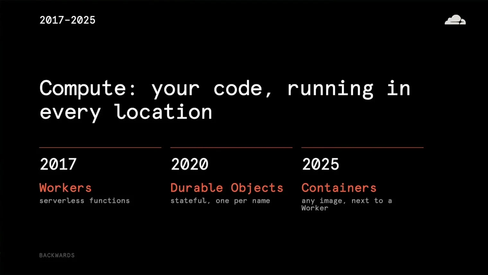

_截图 06  ·  录屏 00:17:55_

**00:18:00**　It takes milliseconds to start up, not seconds as well. And then we followed with other compute primitives like durable objects, which are more stateful. And then in 2025, we launched containers as well, because there are some workloads that do need something like a VM, and we want all of those workloads to be able to run on Cloudflare. So now, you know, 2017, start of our developer platform, we have these compute primitives.

启动过程只需几毫秒，甚至不需要几秒。之后我们又引入了其他计算基础元素，比如状态性更强的持久化对象。到了2025年，我们还推出了容器技术，因为有些工作负载确实需要虚拟机之类的支持，我们希望所有这类工作负载都能在Cloudflare上运行。所以，从2017年开始，也就是我们的开发者平台的起步阶段，我们就有了这些计算基础元素。

**00:18:21**　People started building more like static websites and things like that. So we thought to ourselves, how do we elevate this and take it to the next level? So we introduced storage as well. And so we have these storage primitives on Cloudflare's developer platform. We have KV, we have R2.ObjectStory, we have databases like D1 as well. And the idea here is that people should be able to build full stack applications all on Cloudflare.

人们开始创建更类似静态网站的网站之类的东西。于是我们思考：如何提升这一技术，将其推向更高水平呢？因此我们也引入了存储功能。现在，我们在 Cloudflare 的开发者平台上提供了各种存储基础服务。我们有 KV、R2.ObjectStory，还有像 D1 这样的数据库。我们的理念是，人们应该能够在 Cloudflare 上构建完整的全栈应用程序。

**00:18:46**　stateful applications where people can go on and start building full applications and web apps and platforms on Cloudflare's developer platform. So we have this infrastructure, we added compute primitives to it, we added storage primitives to it, and then came 2023. And if you guys remember what happened in 2023, ChatGPT kind of blew up a little bit, and it changed how we think about AI, right?

状态化应用：人们可以在 Cloudflare 的开发者平台上继续构建完整的应用、Web 应用和平台。因此，我们有了这样的基础设施，还为其添加了计算基础组件、存储基础组件，随后到了 2023 年。如果你们还记得 2023 年发生的事情，ChatGPT 稍微引起了一些关注，也改变了我们对于人工智能的看法，对吧？

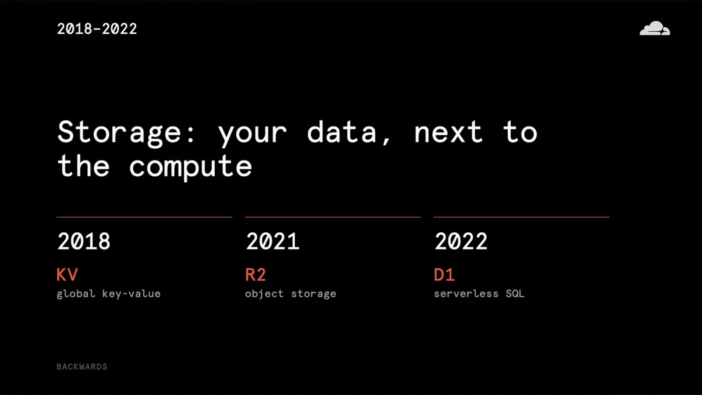

_截图 07  ·  录屏 00:18:49_

**00:19:12**　And I remember it being birthday week and three weeks before birthday week a lot of us sat together in a room and we were like what should we do now that ChatGPT is on the rise? What can Cloudflare play in here with our infrastructure and our primitives in order to be in this AI game? So in 2023 we launched a product called Workers AI where we added GPUs to our network and so again this is really distributed where GPUs are running as close to the user as possible.

我记得那是一周的生日活动期间，距离生日活动还有三周的时候，我们很多人聚在一起讨论：既然 ChatGPT 如此发展迅速，我们该怎么做呢？Cloudflare 可以利用我们的基础设施和基础技术在人工智能领域占据什么位置呢？因此，在 2023 年，我们推出了名为 Workers AI 的产品，在系统中加入了 GPU，这样 GPU 就能尽可能靠近用户运行。

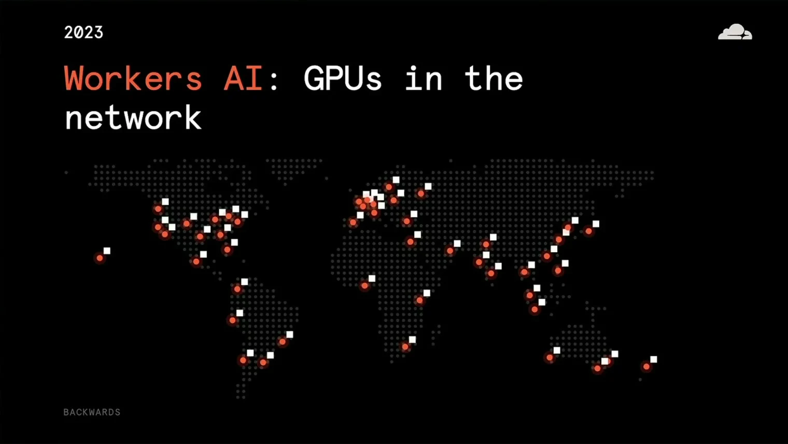

_截图 08  ·  录屏 00:19:35_

**00:19:39**　It's not US East 1 hyperscaler, for example, but it's running as close to the edge as possible. And we had a hypothesis when we started to work as AI. Our hypothesis was that models were going to get smaller, so that network latency was going to become more and more important. We launched with small models that could fit on our small hardware around the world that were super distributed, and we thought that people would have models get better and faster and smarter, and that network latency was going to play a much more bigger impact here.

它不是像 US East 1 这样的大型云服务提供商，但依然尽可能接近边缘环境。当我们开始研究人工智能时，就有一个假设：模型会变得更小，因此网络延迟将变得愈发重要。我们以能够适配全球各种小型硬件设备的小型模型作为起点，这些模型具有高度分布式特性，我们认为人们会拥有更好、更快、更智能的模型，而网络延迟也会产生更大的影响。

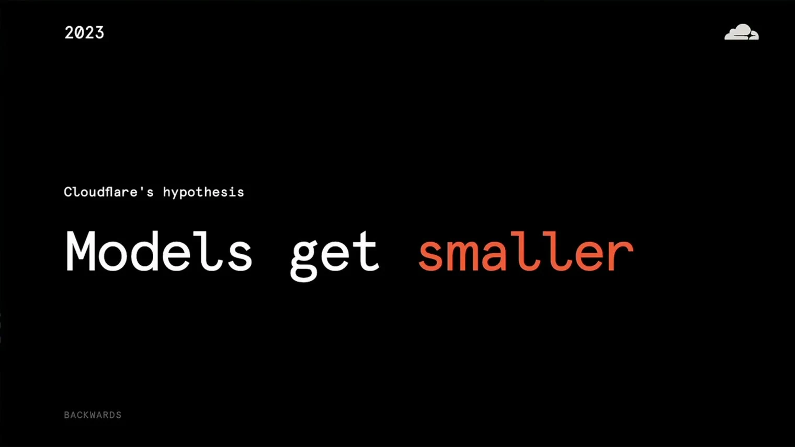

_截图 09  ·  录屏 00:19:55_

**00:20:11**　Well, actually, the opposite happened. And models got larger and larger. So we went from something like 7 billion parameters, which was frontier scale at the time, to being the 3 trillion parameter models that were getting launched. And I think this is not so shocking when you look back in time, because as we're on the way to AGI, if you're following scaling law, as you train on more data, as the models get larger, they're more generalizable.

其实，情况恰恰相反。模型规模越来越大，从当时只有70亿个参数的小模型，发展到现在有着3万亿个参数的大模型。回头看的话，这并不令人惊讶，因为随着我们朝着通用人工智能的方向发展，如果遵循缩放规律，当使用更多数据进行训练时，模型规模越大，其泛化能力也越强。

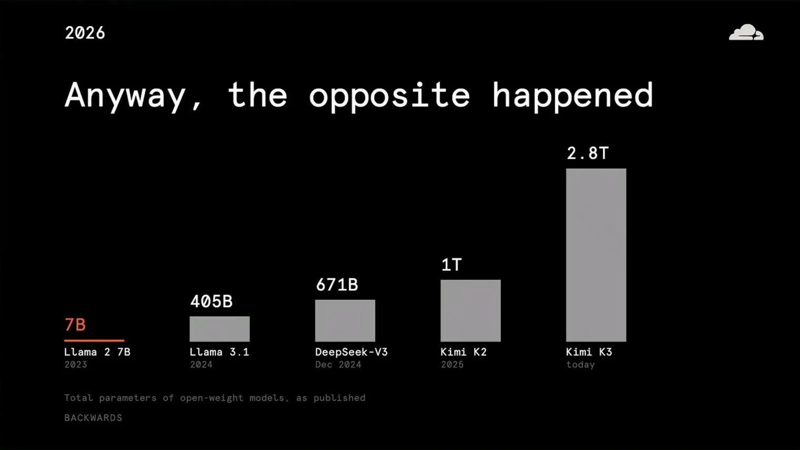

_截图 10  ·  录屏 00:20:29_

**00:20:37**　And so on the path to AGI, it makes sense that we're pushing the frontier of research here. In order to get larger and larger and smarter models. So this goes against our hypothesis, right, that the models were going to get smaller. The models actually ended up being larger, and the network latency mattered less and less. So what did we do? We ended up pivoting.

因此，在通往 AGI 的道路上，我们努力拓展研究领域是合乎逻辑的。为了获得更大、更智能的模型。这其实与我们的假设相反——我们原本认为模型会变得更小。但实际上，模型反而变得更大了，网络延迟也越来越不重要了。那么我们做了什么呢？我们最终改变了方向。

**00:20:59**　So Cloudflare got really good at serving these giant models as well. So in March 2026, we launched Kimi, and then we followed up with GLM and Deep Seek, and these large trillion parameter models hosted on our infrastructure. And so this is serverless. People hit an API call and get a token back. It actually took us a while in order to decide to do this.

因此，Cloudflare在提供这些大型模型的服务方面也做得非常出色。2026年3月，我们推出了Kimi，随后又推出了GLM和Deep Seek，这些都是运行在我们基础设施上的具有万亿参数的大型模型。因此，这就是无服务器模式。用户调用API后就能获得token。实际上，我们花了很长时间才决定采用这种方式。

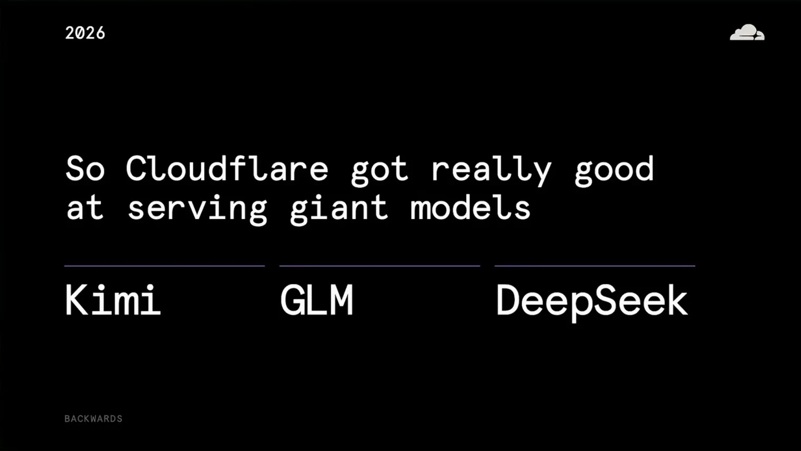

_截图 11  ·  录屏 00:21:10_

**00:21:19**　March 2026 is actually pretty late. To serving this model, but we were trying to make a conscious decision here on, does this actually make sense for us to be serving it? It didn't really fit with our infrastructure story, but it fit really well with the developer platform. So in 2026, we had all these primitives in place. We had the infrastructure, which is unique to Cloudflare, running close to users.

2026年3月其实已经很晚了。虽然我们试图为这个模型提供服务，但我们在思考：这样做真的有意义吗？这并不符合我们的基础设施规划，却与开发者平台非常契合。因此，在2026年时，我们已经具备了所有必要的基础条件。我们有属于Cloudflare的独特基础设施，并且这些基础设施已经部署在用户附近。

**00:21:42**　We had compute primitives where people were building agents on top of, so workers and durable objects, right? As your agent needs to complete a task. It goes on and it spins and does a task and then sleeps when it doesn't. We had storage primitives, so your agents can actually interact with data and storage. And then we had models, these large models that were powering agents.

我们有计算基础结构，人们利用这些结构来构建智能体，还有工人和持久化对象，对吧？因为你的智能体需要完成任务，它会持续运行、执行任务，然后在没有任务时就会休眠。还有存储基础结构，这样你的智能体就能与数据和存储进行交互。此外还有模型，那些庞大的模型为智能体提供动力。

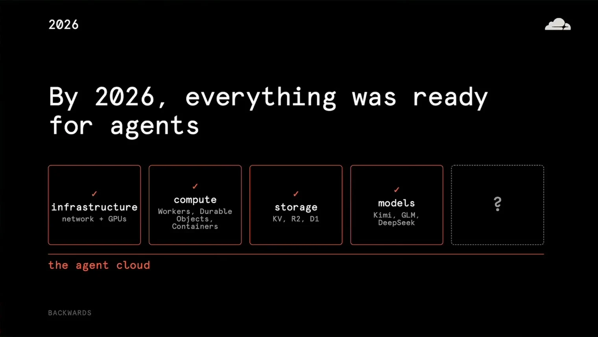

_截图 12  ·  录屏 00:21:52_

**00:22:01**　And so all of this fit into the Cloudflare agent cloud story. And so we started telling this narrative that we want to be the agent cloud. We want agents to be deployed on us, powered by models on us, using our compute and data primitives, all built on our infrastructure and our network. Quite right. We felt like we were always missing a piece here because the infrastructure pattern didn't necessarily fit in with what workers AI was designed for.

因此，所有这些都与 Cloudflare 智能体云的故事相契合。于是我们开始讲述这个故事：我们希望成为智能体云。我们希望让智能体部署在我们的平台上，依靠我们的模型、计算资源和数据基础技术运行，所有这些都建立在我们的基础设施和网络之上。确实如此。我们一直觉得缺少某个关键要素，因为基础设施模式并不一定符合 workers AI 的设计目标。

**00:22:28**　And so I'm just gonna sit here and give you my second philosophical quote which is a brisk considering that I'm a girl in Chinese and AI but I'm gonna give you this Chinese quote anyways. And it basically says which means everything is ready here all that's missing And one of the things about this is like you can't really predict where the wind is going to come from or how it's going to come.

所以我就坐在这里，给你我的第二个哲学观点。考虑到我是一个中国女孩兼AI用户，我觉得这很有趣，不过我还是会把这段中文观点分享给你。基本上就是说，现在一切都已经准备就绪了，所缺的也就不多了。而且其中一点是，你真的无法预测风会从哪里来，或者会如何变化。

_截图 13  ·  录屏 00:22:38_

### Jev、Clef、Clairic 与 System One 判断

**00:22:54**　But you need to be very reactive when it happens. And so in September 2026, the east wind came. TypeSafe launched a model called Jev and introduced this idea of System One models. And it contrasted what we typically knew with LLMs, which were autoregressive and taking a long time to generate tokens. It scales quadratically, etc. A System One model is a completely different paradigm where it actually just takes one forward pass through the inputs and generates an output that you can use to make decisions with it.

但出现这种情况时，你需要具备极强的反应能力。因此，在2026年9月，东风来临了。TypeSafe推出了名为Jev的模型，并提出了System One模型的理念。这与我们通常所熟知的自回归语言模型不同，后者需要很长时间才能生成令牌。而TypeSafe的模型则呈二次增长趋势。System One模型是一种完全不同的范式，它只需对输入进行一次前向处理，就能生成可用于决策的输出结果。

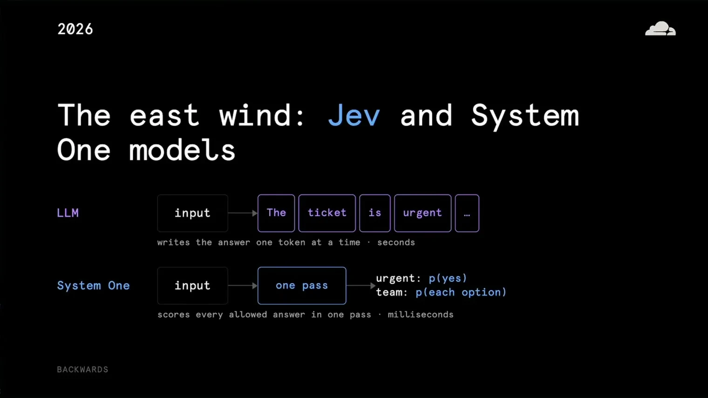

_截图 14  ·  录屏 00:23:07_

**00:23:25**　And so I really think that this came down to perfect timing. I think people were starting to get fed up a little bit with LLMs because they were so costly. It costs so many tokens. It's super time consuming. And I don't know about you, but when I read a reasoning trace, sometimes my blood pressure rises when the LLM doesn't get the things right.

所以我认为，这确实是在恰当的时机发生的。我觉得人们开始对 LLM 感到厌倦了，因为它们成本很高，需要大量的 token，而且非常耗时。我不知道你如何，但当我阅读推理过程时，如果 LLM 答错某些问题，我的血压就会升高。

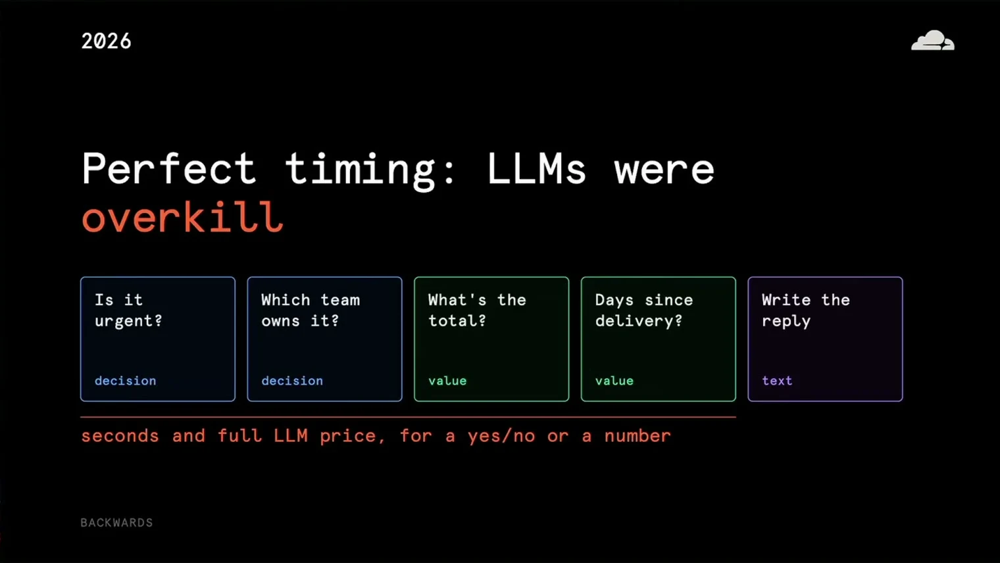

_截图 15  ·  录屏 00:23:36_

**00:23:43**　everything to LLMs and started getting frustrated with it. And so when the System One and Jev paradigm started coming on board, we were like, this makes so much sense for us to adopt, right? We don't have to send every request to an LLM. We can send some of it to a System One model. And so the System One models actually end up taking work off of the giant LLMs, and you give it to the small, fast models.

把所有内容交给LLM，结果开始感到沮丧。当System One和Jev的范式开始被采用时，我们觉得这非常合理，对吧？我们不必把所有请求都发送给LLM，可以把部分任务交给System One模型。因此，System One模型实际上减轻了大型LLM的负担，让小型、高效的模型能够承担更多工作。

**00:24:04**　And the two are supposed to work in tandem. They're supposed to complement each other and get to the end goal faster. And so if you look, we are back at these small and fast models. This was the original workers' AI hypothesis. And so Cloudflare was not wrong here. Were just early. With these small and fast models, the network latency became important again.

两者应该协同工作。它们应该相互补充，从而更快地实现最终目标。因此，我们又回到了那些小型、快速运行的模型上。这是最初的“工人AI”假设。所以Cloudflare在这里并没有犯错，只是处于早期阶段而已。借助这些小型、快速的模型，网络延迟再次变得重要起来。

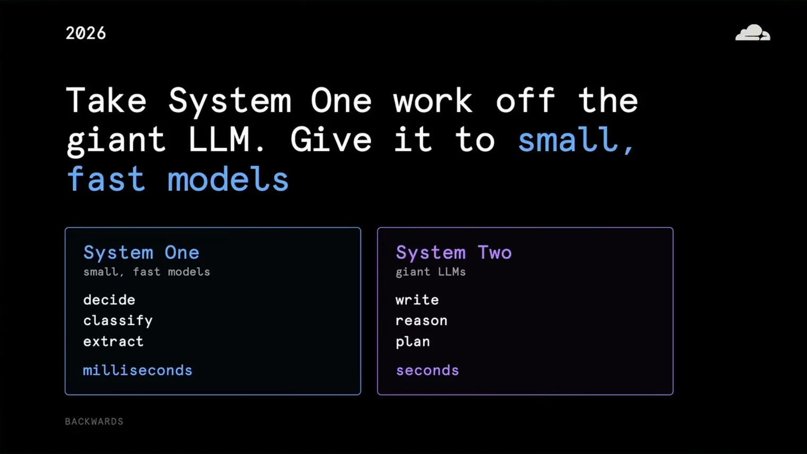

_截图 16  ·  录屏 00:24:05_

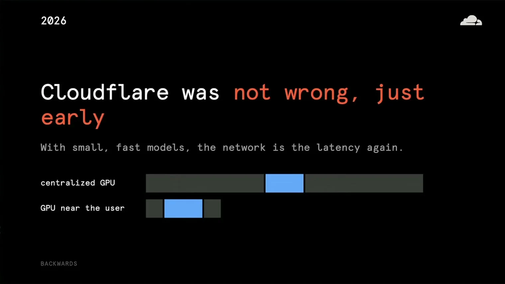

_截图 17  ·  录屏 00:24:26_

**00:24:26**　We want the model to be responding fast, but also the network latency to be even faster. And so we decided to do something here. But Jev was close source. Cloudflare couldn't actually host the Jev models and take advantage of our infrastructure. So what did we decide to do? We built our own version of Jev. So Jev launched on September 15th. On September 18th, just three and we launched our version of Jev, our first experiment of it.

我们希望模型能够快速响应，同时网络延迟也能更低。因此我们决定采取某种措施。但Jev是一个重要的来源。Cloudflare无法实际托管Jev模型并利用我们的基础设施。那么我们决定怎么做呢？我们自己开发了Jev的版本。于是Jev于9月15日上线了。9月18日，仅用三天时间，我们就推出了自己的Jev版本，这也是我们的首次尝试。

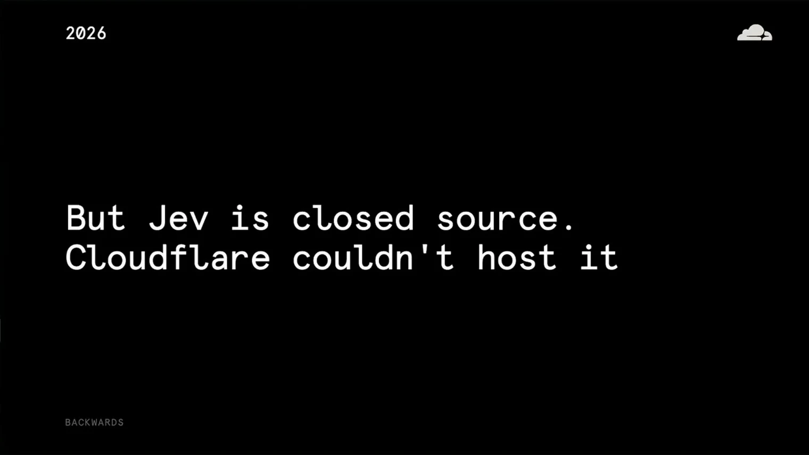

_截图 18  ·  录屏 00:24:39_

**00:24:56**　And then it took us a week of deliberation to decide, do we actually want to be going into this neolab territory? It's completely new to us. We don't know what we need to know. Are we going to set the expectation that we want to be a neolab? And are we going to live up to those expectations? But we decided to do it.

之后我们花了一周时间讨论，决定是否真的要进入这个新实验室的环境。这对我们来说完全是个新的领域，我们不知道自己需要了解什么。我们会设定一个期望，即希望成为新实验室的成员吗？又能否满足那些期望呢？但最终我们还是决定这么做。

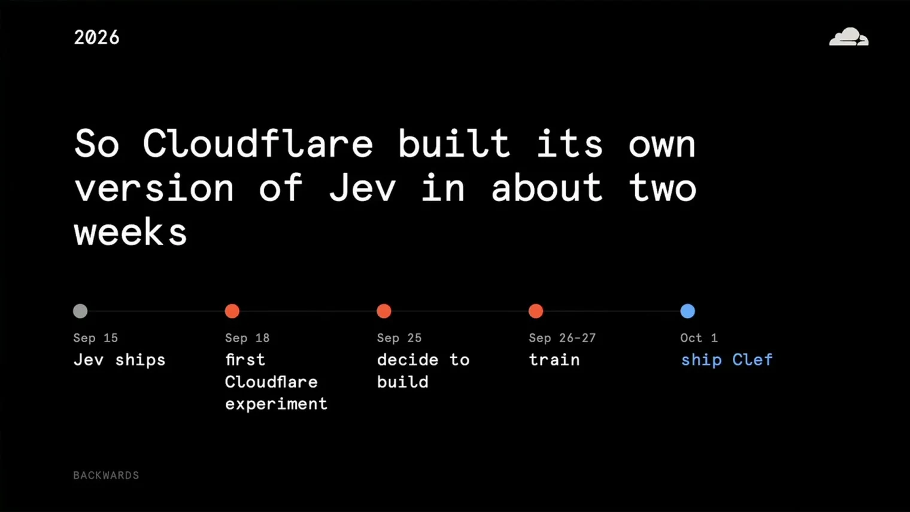

_截图 19  ·  录屏 00:25:00_

**00:25:13**　I remember on a Friday evening, we were like, let's just go for it. And we did it. And we ended up training the model over 48 hours over the weekend. And then we launched it the following week. And so we ended up with a model called Clef. Clef gave power back to the agents to be able to make decisions on their own.

我记得某个周五晚上，我们说：“那就试试吧。”于是我们真的这么做了。我们在周末的48小时内训练了模型，然后下周就发布了它。最终我们得到了名为Clef的模型。Clef让智能体能够重新拥有决策能力，能够自主做出决定。

**00:25:30**　So agents could act more autonomously. You didn't need to have an LLM reason through for minutes on if it should make this decision or not. You also didn't need to put a human in the loop and be interrupted by a human's sleep schedule when you want your agents to be running 24-7. So you can now programmatically, in code, decide, make decisions for your agent to take action on.

因此，智能体可以更自主地行动。你不需要让大语言模型花几分钟时间来思考是否应该做出这个决定；你也不需要让人类参与其中，因为当你希望智能体全天候运行时，不会受到人类睡眠时间的干扰。现在，你可以通过代码来编程性地决定，让智能体采取行动。

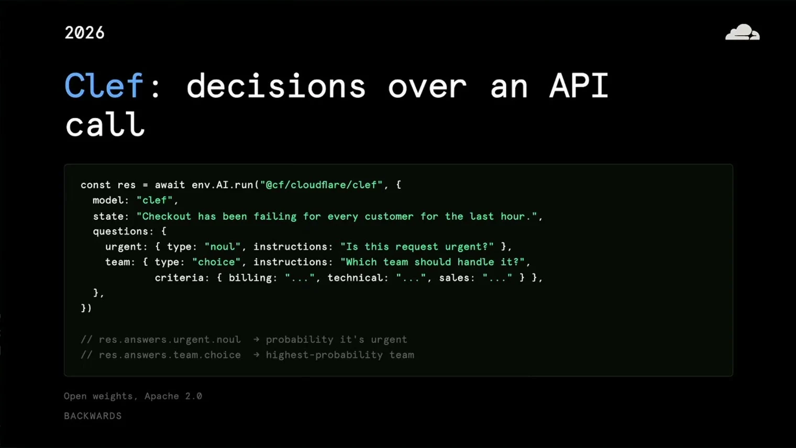

_截图 20  ·  录屏 00:25:33_

**00:25:52**　So these decision models countered LLM models because they were a lot faster, and they were also a lot cheaper as well. And so it actually, as an inference provider, takes a lot of pressure off the LLMs as well, because the LLMs were reserved for meaningful work, whereas the clef and decision models could be used for fast, intuitive thinking and work, right?

因此，这些决策模型与 LLM 模型形成对比，因为它们运行速度更快，成本也更低。作为推理提供方，这确实减轻了 LLM 的压力，因为 LLM 被用于具有意义的工作，而决策模型则可用于快速、直观的思考与工作，对吧？

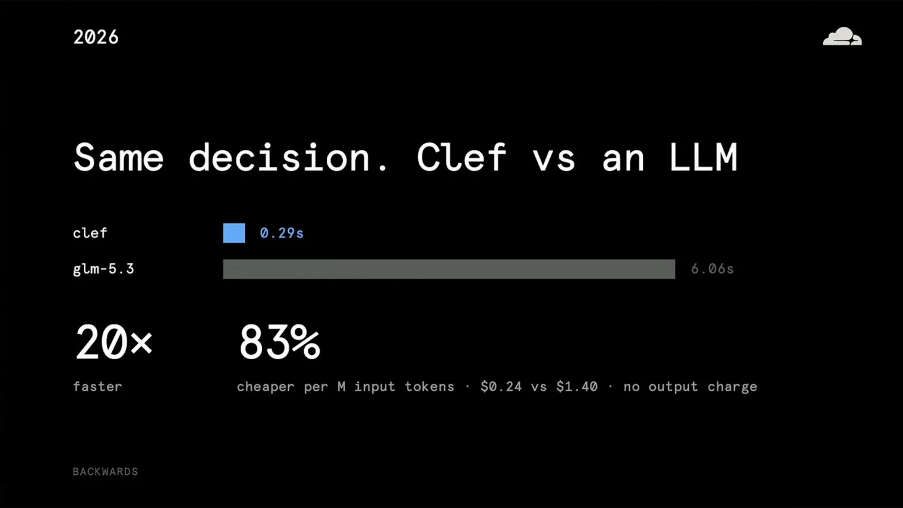

_截图 21  ·  录屏 00:25:58_

**00:26:13**　And so we also went back and thought to ourselves, You know, what else do agents and people use for LLMs that are overkill? So we came up with decisions, and there must be other workloads out there that are unsuitable for an LLM, both because they are either too expensive or take too long, or maybe that it just would get the answer wrong because the autoregressive nature of an LLM means that it would hallucinate.

于是我们又回过头来思考：你知道，智能体和人们还用哪些不必要的东西来支持LLM呢？于是我们提出了一些决策，肯定还有其他不适合LLM的工作负载，要么因为成本太高，要么处理时间过长，或者可能因为LLM的自回归特性导致答案错误，因为它会产生幻觉。

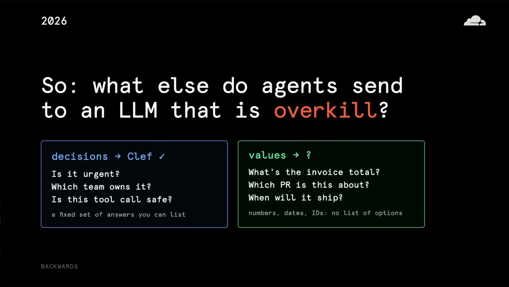

_截图 22  ·  录屏 00:26:23_

**00:26:38**　So we also launched a model three weeks later called Clairic. We actually ended up launching four models in the span of three weeks, good job as a new lab. But Clairic is a new model paradigm. So it's completely new. We're calling it an extraction model. But it's a System One model in the sense that it is just as fast and just as cheap, but it is also doing like one forward pass through the user.

因此，三周后我们又推出了一个名为Clairic的模型。实际上，在三周的时间里我们推出了四个模型，作为新实验室来说，这很不错。但Clairic是一种新的模型范式，因此完全是全新的。我们将其称为提取模型。不过它也是一种System One模型，因为它的速度和成本都同样低，而且只需要对用户进行一次前向处理。

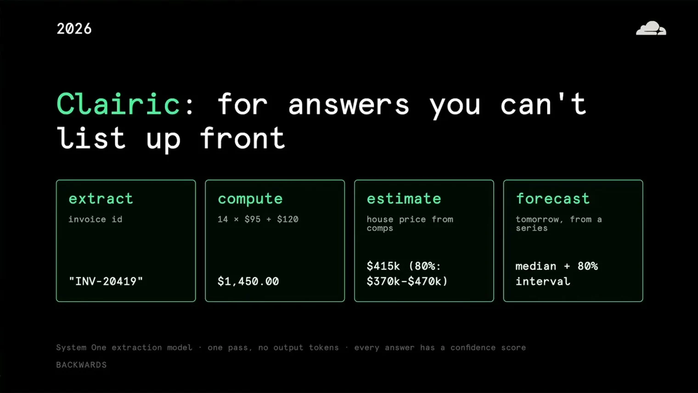

_截图 23  ·  录屏 00:26:56_

**00:27:01**　And the purpose of Clairic is when you're interacting with the world, you're not interacting in perfectly typed JSON objects. Sometimes you're getting an email, a tweet, a Slack message. But those people are not filling out perfect forms for you to extract inputs out of. So what Clairic does is it can take unstructured input and it can extract, compute, estimate, and forecast those inputs.

Clairic 的宗旨是：当与世界进行交互时，你并非在处理完全格式化的 JSON 对象。有时你会收到电子邮件、推文或 Slack 消息。但这些内容并没有完整的表单供你提取输入数据。因此，Clairic 能够处理非结构化的输入数据，并从中提取、计算、估算和预测相关信息。

**00:27:22**　And it gives you back a perfectly typed JSON object, which means the agents are able to do things with it. So we're kind of giving agents the ability to read here and take action with clef as well. And so in code, again, you're giving Clairic typed values from unstructured data. You can pass it in whatever kind of unstructured data. It can also take image input as well.

并且它会返回一个格式完美的 JSON 对象，这意味着智能体可以利用它完成各种操作。因此，我们实际上赋予了智能体在这里读取数据并有效执行操作的能力。在代码中，你同样可以将非结构化数据中的 Clairic 类型值传递进去。也可以接受图像输入。

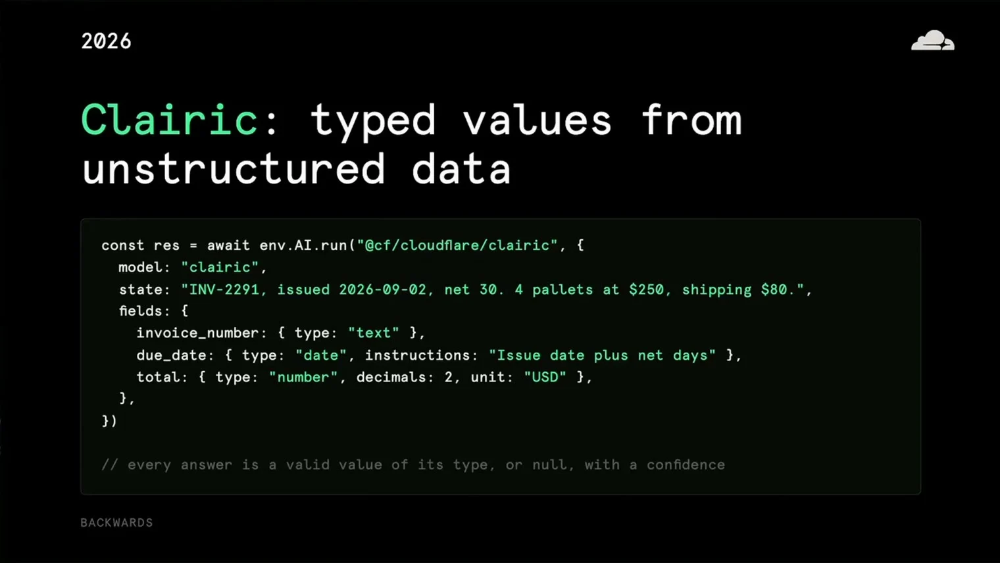

_截图 24  ·  录屏 00:27:42_

**00:27:44**　And so you can just tell it to read, basically, what's in text here, pass it to clef, decide LLM to decide what to do with the agent. And so Cloudflare had to become a neolab here. This was our missing bit. We had the infrastructure. We had the compute primitives. We had the data primitives. We had the large models powering the agents.

因此你可以直接告诉它读取这里的内容，将其传递给 clef，由 LLM 决定如何操作智能体。于是 Cloudflare 不得不成为新的实验室。这是我们缺失的部分。我们有基础设施，有计算基础单元，有数据基础单元，还有支持智能体的大型模型。

**00:28:06**　But in order to take advantage of all of that and our infrastructure that we were built on, we had to be a neolab and ship these System One models that fit perfectly with our infrastructure. And I think one of the more important things is that we're not limited to this. Being a neolab means that we can create what we are missing.

但为了充分利用这些优势以及我们现有的基础设施，我们必须成为一家新式实验室，推出与我们的基础设施完全匹配的 System One模型。我认为最重要的就是，我们并不局限于此。作为新式实验室，我们可以创造出我们所缺失的东西。

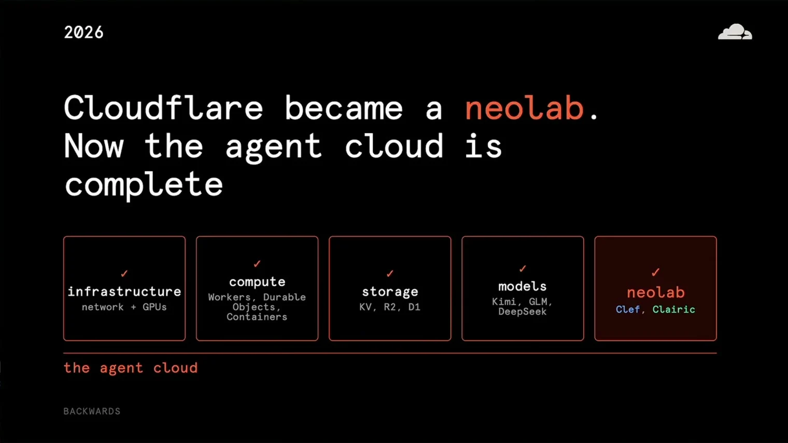

_截图 25  ·  录屏 00:28:11_

**00:28:22**　It means that if we're missing a System One model because we're at risk of things being closed source or regulatory risks or things like that, we can actually create and invent things. So I think being a neolab has actually opened a lot of doors for Cloudflare to do more in the AI world. So we went through backwards. We went through a little bit of a history lesson.

这意味着，如果我们因为源代码保密或监管风险等问题而缺少 System One 的模型，我们仍然可以创造和发明新的东西。因此，我认为作为 Neolab，Cloudflare在人工智能领域能够开展更多工作。所以我们从过去开始回顾，也进行了一些历史学习。

### 分诊失败的 CI，比较大模型调用与混合流程

**00:28:43**　I want to go forwards as well. I want to teach you guys what you guys can be doing with Clef and Clark. That I am at AI Engineer Code Summit. So in a room full of developers and engineers, how can you guys leverage Clef and Clairic and System One models in order to better use your workflows? So we'll do a quick demo here.

我也想向前推进。我想告诉你们，利用 Clef、Clark 和 System One 模型，你们能做些什么。我正在参加 AI Engineer Code Summit。在满是开发人员和工程师的房间里，你们如何利用这些工具来优化工作流程呢？所以我们就在这里做一个简短的演示。

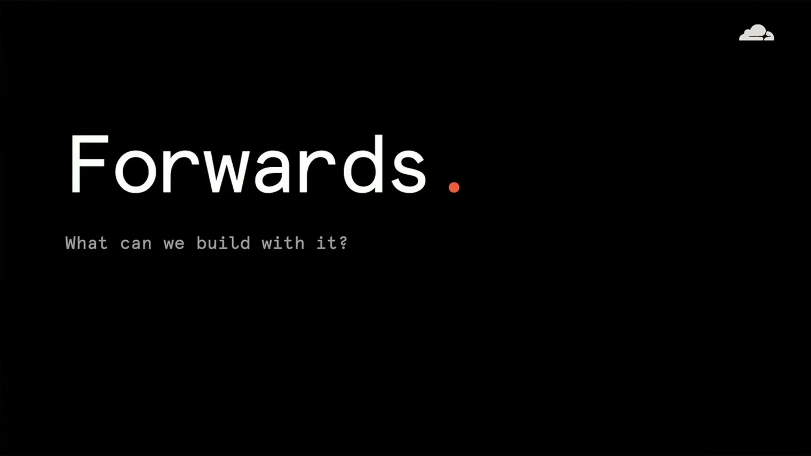

_截图 26  ·  录屏 00:28:45_

**00:29:03**　Let's think you have an agent. You're triaging a CI build that went wrong. Let's say you have 40 tools that are available to this agent. You have your PR that went wrong. And then you have your agent. Maybe it's running Pi Durable on a durable object. Is built on Cloudflare. So this is the setup here. Typically what you would do is you would take an LLM, and then the LLM would make a tool call.

假设你有一个智能体。你在处理一个失败的 CI 构建问题。假设你有 40 种工具可供这个智能体使用。你还有那个出问题的 PR。然后你就有这个智能体。它可能运行在 Cloudflare 平台上的持久化对象上，并使用了 Pi Durable 技术。这就是当前的设置。通常你会使用一个 LLM，然后该 LLM会进行工具调用。

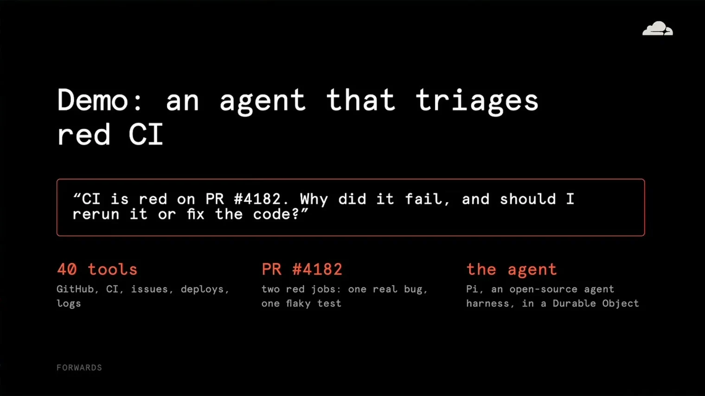

_截图 27  ·  录屏 00:29:05_

**00:29:27**　The tool call would go back to the LLM. LLM would make another tool call, et cetera, et cetera, until the issue is resolved. So this is like five back and forths with GLM 5.3. You're sending 40 tools every single time. And maybe you're blowing up the context, right? Because you're sending the same kind of inputs back and forth to the LLM.

工具调用会传回给 LLM。LLM 又会进行另一个工具调用，如此循环，直到问题得到解决。因此，这就像在 GLM 5.3 中反复进行五次这样的操作。每次你都会发送 40 个工具。也许你会让上下文变得混乱，对吧？因为你不断地把相同类型的输入传回给 LLM。

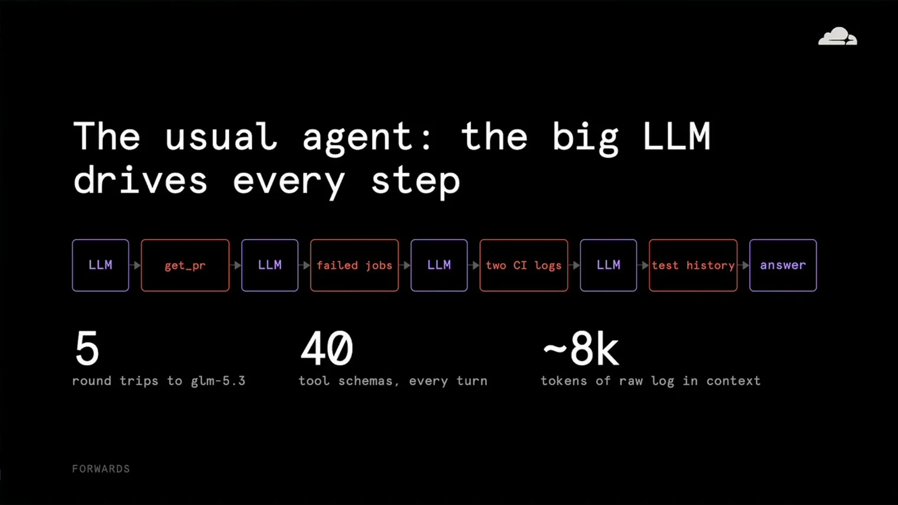

_截图 28  ·  录屏 00:29:30_

**00:29:44**　And so what if we augment this with System One models? With System One models, this could look a lot different. And so let's say we want speed. So we pick Clef Flash. Clef Flash can actually help you prune your tool list. Maybe it only needs 10 out of the 40 tools that are available. So you only need to pick 10 of those.

那么，如果我们用 System One 模型来补充它会怎样呢？使用 System One 模型后，效果可能会大不相同。假设我们想要速度，那我们就选择 Clef Flash。Clef Flash实际上可以帮助你精简工具列表。也许只需要从40种工具中挑选10种即可，这样你只需选择10种工具就够了。

**00:30:03**　Then let's say you take Clairic, and you use it to extract the values from the input. So it can get the PR number without reasoning and thinking about it too long. And then let's say you just orchestrate some code here to execute these API calls. And you can actually just get those answers back. Then you ask Clairic again to pull the data from the logs.

那么，假设你使用 Clairic 来从输入中提取值。它无需任何推理或长时间思考就能得到 PR 编号。再假设你在代码中调用这些 API 调用，就能直接得到那些答案。然后你再次让 Clairic 从日志中抓取数据。

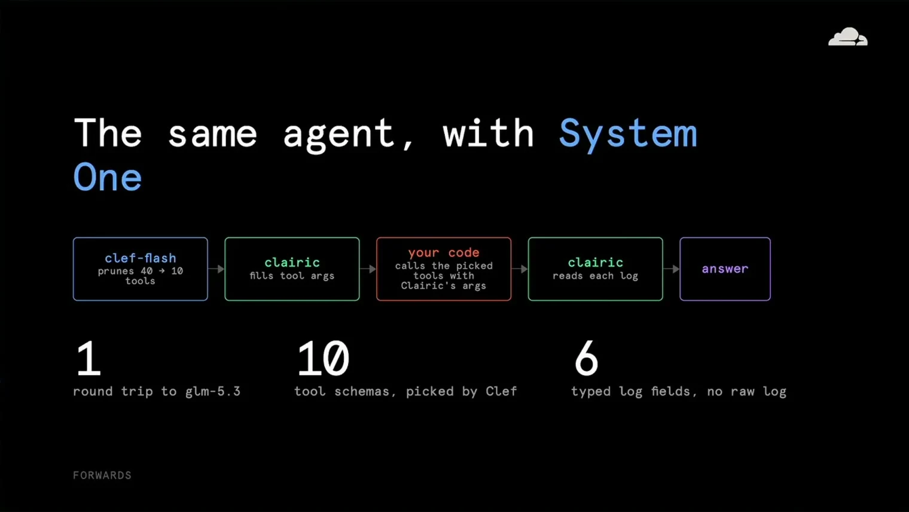

_截图 29  ·  录屏 00:30:12_

**00:30:24**　So normally when you're working with an LLM, you probably just paste in all of the logs, right? Like all 300, 600 lines of logs. But Clairic can actually just go through and read those and say, here's the exact error, here's the error message, here are the lines of code it's affecting. And you're basically shrinking your context a lot. And then finally, you use an LLM to actually do take action and make decisions and take action and extract values all together.

通常在使用 LLM 时，你只需要粘贴所有的日志文件，比如 300 到 600 行日志。但 Clairic 可以直接读取这些日志，并指出具体的错误、错误信息以及受影响的代码行。这样就能大幅缩小上下文范围。最后，你可以利用 LLM 来执行操作、做出决策、提取数据等。

**00:30:49**　agent can run with System One. Let's do a little bit of a live demo. Let's see how it goes. We're going to have to click Run Both here. And this is a live demo. And I will say that Cloudflare, our workers' AI, has a very diurnal usage pattern. So we're in the middle of the workday. So we'll see how this goes.

智能体可以使用 System One 运行。我们来进行一个简单的实时演示吧。看看效果如何。我们需要在这里点击“同时运行”。这是一次实时演示。我想说，Cloudflare 的工人用 AI 在一天中的使用模式非常明显。所以我们正处于工作日的中间阶段。让我们看看会怎样。

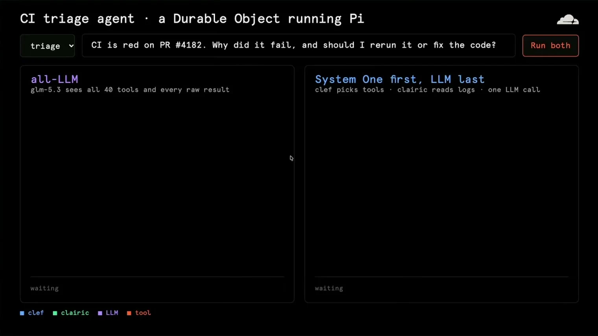

_截图 30  ·  录屏 00:30:58_

**00:31:09**　But it'll give you some illustrative example here of how it goes. And we're also dealing with conference Wi-Fi. So bear with me here. All right, the System One model side finished already. And the all LLM one is going. So I think even illustratively, you can see that the System One set of models is a lot faster. Even by just this simple waterfall chart, you can see that the System One part takes so much less time than the actual generation, which is the purple bars here.

但下面会给出一个示例，说明实际运作情况。我们还在处理会议用 Wi-Fi 问题。请稍等一下。好的，System One 模型的测试已经完成。而所有基于 LLM 的模型也正在进行中。因此，从示例来看，也可以看出 System One 的模型组速度要快得多。即使只是通过这个简单的瀑布图，也能看出 System One 的模型组所需时间比实际生成时间少得多，而实际生成时间用紫色条表示。

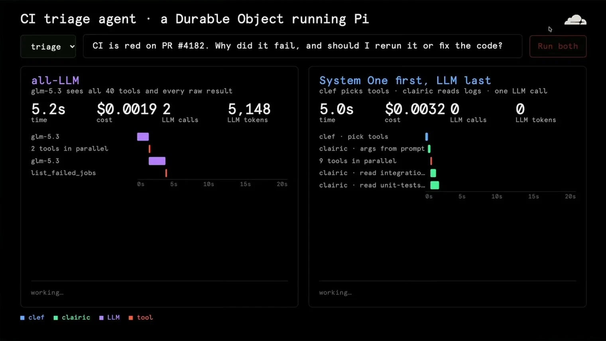

_截图 31  ·  录屏 00:31:10_

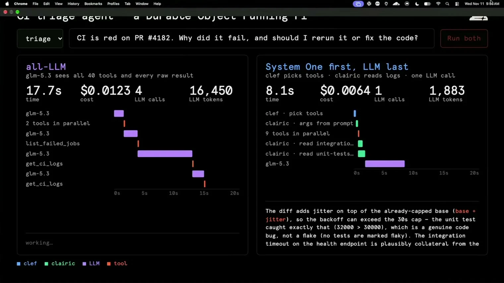

_截图 32  ·  录屏 00:31:23_

**00:31:37**　And I think they both ended up getting to the answer at the end, so the quality was not affected. But it took a lot less time. It was a lot cheaper. Six LLM calls versus one. 40,000 LLM tokens versus 1,800. And so you can see how you can use these kind of System One and system two models, even in like developer workflows, in order to get you to your answer faster.

我认为最终两者都得到了正确答案，因此质量没有受到影响。但所需时间少了很多，成本也低得多。六次LLM调用相比一次；40,000个LLM tokens相比1,800个。因此，你可以看到如何将这两种模型应用于开发者工作流程中，以更快地得到答案。

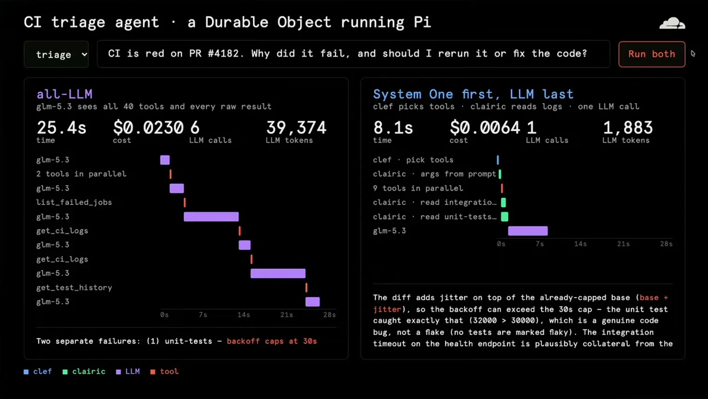

_截图 33  ·  录屏 00:31:40_

**00:32:01**　So the same answer, but it took a fraction of the LLM time and cost, right? I ran this when we were not doing conference Wi-Fi, but we had about 9.2 seconds and 17.2 seconds on the LLLM. It was almost two times faster. Less expensive. We shrunk our LLM calls from five down to one and it was about 94% less tokens.

所以答案还是一样的，但所需的 LLM 时间和成本却减少了很多，对吧？我们在没有会议 Wi-Fi 的情况下运行了这个测试，在 LLLM 上分别用了 9.2 秒和 17.2 秒，速度快了将近两倍。成本也更低了。我们将 LLM 调用次数从五个减少到了一个，使用的令牌量也减少了约 94%。

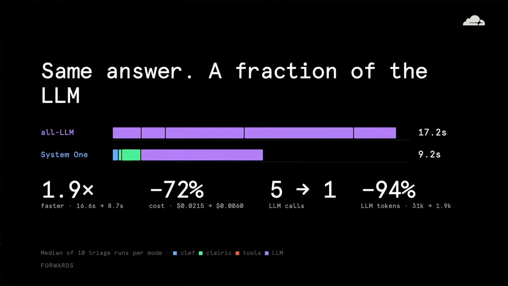

_截图 34  ·  录屏 00:32:21_

**00:32:25**　And so this is an illustrative example of how you could be using the System One and system two models in tandem. It's not intended to completely replace your LLM usage but it can augment it and make it better by making allowing you to free up time and compute for your other and more important tasks here and you can now do you know higher concurrency tasks because are able and capable to do so much more.

因此，这是一个说明性示例，展示如何同时使用 System One 和 System Two 模型。它并非旨在完全替代您的 LLM 使用，而是可以增强其功能，使其更加完善，让您能腾出时间用于其他更重要的任务，从而能够完成更高并发的任务，因为现在您具备实现更多任务的能力。

**00:32:51**　And so that was one illustrative example. I just wanted to flash on the screen really quickly as well. What else are people building with Clef and Clairic, right? There's a lot of routers that you can build and making decisions there. There's fraud that we've been seeing a lot, like spam or phishing. It can make decisions on there. With Clairic, you can use it to extract data from web pages or support tickets and things like that.

这就是一个例子。我也想快速地在屏幕上展示出来。人们还用 Clef 和 Clairic 构建其他什么东西呢？有很多可以构建的路由器，以及相关的决策功能。我们经常看到很多欺诈行为，比如垃圾邮件或网络钓鱼。这些功能也可以用来做出决策。使用 Clairic 的话，你可以用它从网页或支持工单等中提取数据。

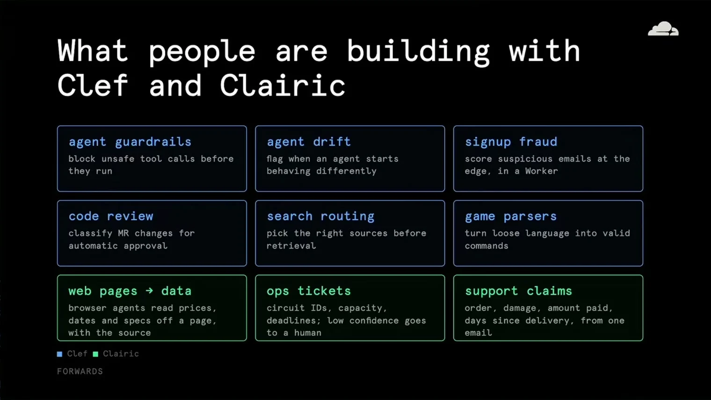

_截图 35  ·  录屏 00:33:07_

**00:33:13**　I'm excited to see. We actually have a new launch coming out for Clairic. We released an early preview, but it's coming out. So I think these use cases will grow as people are trying it out more and more. But the idea is that there's so much in the world, we're not limited to just LLMs. Now these new paradigms have been introduced, and I think we should all take advantage of that and try building with it.

我很期待。实际上，Clairic即将推出新产品。我们之前已经发布了早期预览版，现在正式发布即将到来。所以我认为，随着人们越来越多地尝试使用这些产品，其应用场景将会更加广泛。不过，我们的目标是在这个世界上存在如此多的可能性，我们不应只局限于LLM技术。现在这些新的范式已经出现，我认为我们都应该充分利用这一点，尝试用它来构建新的解决方案。

**00:33:34**　And so we went backwards, we went forwards, but I think the most important thing here is that we go onwards, right? We have to be very reactive in this industry, love it or hate it. Things just change on a whim. As Cloudflare back in the day said our hypothesis was wrong, we have to go and actually pivot and start serving these giant LLMs in order to take advantage of the fact that we want to be an agent cloud and that it makes sense for our story.

于是我们往回走，又往前走，但我认为最重要的是我们要继续前进，对吧？在这个行业里我们必须非常灵活应对，喜欢或讨厌都无所谓。事情随时都可能改变。就像 Cloudflare 当年说的那样，我们的假设是错的，我们必须做出调整，开始提供这些大型 LLM 服务，从而利用我们想要成为智能体云的目标，这对我们的发展也有意义。

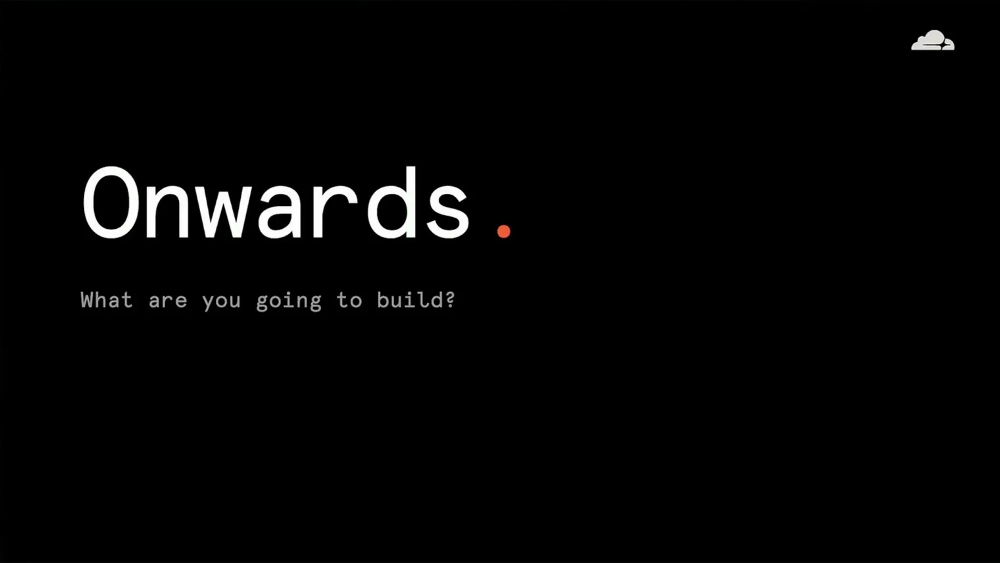

_截图 36  ·  录屏 00:33:53_

**00:34:02**　When an east wind comes and we need to have decision models because they fit perfectly with our infrastructure story, we have to pivot and be a neolab as well. So it's one thing to sit here and look back, but the more important thing is that we took it in stride and moved forward. So I'll leave you with one last quote here, from a story by Tolstoy.

东风来了，我们也需要决策模型，因为它们正好契合我们的基础设施。我们得转个方向，也成为一家 neolab。坐在这里回顾过去是一回事，更重要的是，我们适应了变化，继续向前。最后，我想留给大家一句话，出自托尔斯泰的一篇故事。

**00:34:27**　“Remember then, there is only one time that is important — now! It is the most important time because it is the only time when we have any power.” And so I’ll leave you with this quote and a question. What are you going to build today?

“记住，重要的时刻只有一个，就是现在！它最重要，因为只有在这一刻，我们才能有所作为。”我把这句话和一个问题留给大家。你今天打算做些什么？

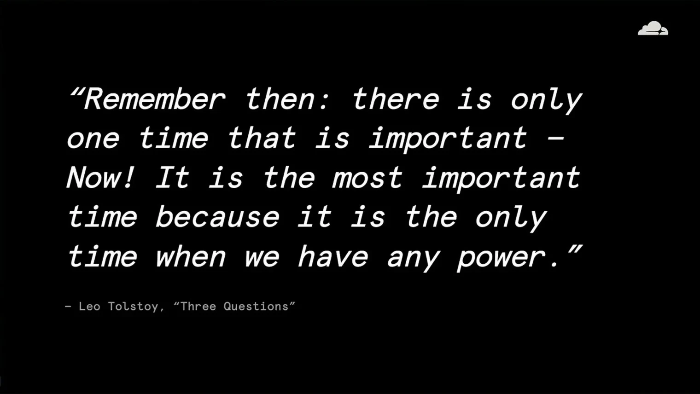

_截图 37  ·  录屏 00:34:30_

**00:34:50**　Thank you.

谢谢。

---

[全部演讲](../README.md) · [选看索引](index.md) · [上一场](02-lydia-hallie.md) · [下一场](04-lauren-tan.md)
