[全部演讲](../README.md) · [选看索引](index.md) · [上一场](03-michelle-chen.md) · [下一场](05-intrinsec.md)

# All Code Is Slop (Except Mine)

**Lauren Tan** · SpaceXSI · Principal Engineer

AIE Code Summit 2026  ·  11 月 11 日  ·  主舞台  ·  录屏 00:35:56–00:53:34

[官方议程](<https://ai.engineer/code/2026/schedule>)   ·   [Day 1 官方回放](<https://www.youtube.com/watch?v=ZZ19zhYnDKY>)

## 本场目录

- [00:36:50](#section-1) PR 规模与信任如何制约并行
- [00:38:27](#section-2) 用代码结构和静态检查减少重复踩坑
- [00:46:06](#section-3) 运行时验证、形式化验证和 UI 测试
- [00:49:43](#section-4) PR 产出、回退率与软件工厂的适用条件

## 演讲实录

> 英文源自录屏音频，经轻度校订。每段英文下方为中文译文。时间指向原始录屏。

**00:35:57**　Hello everyone. I don't know if you can see my slides, but my name is poteto, also known as Lauren, and I'm very excited to chat with all of you today. Maybe we can get a big round of applause for our tech team helping me with my laptop.

大家好。我不知道你们是否能看到我的幻灯片，我的名字是Poteto，也被称为Lauren，今天能和大家交流非常令人兴奋。也许我们的技术团队在帮助我使用笔记本电脑方面会得到热烈的掌声吧。

### PR 规模与信任如何制约并行

**00:36:22**　I don't see it. Ah, there you go. All right. So again, my name is poteto. I work on Grok Bot at SpaceX SI. And can I just give a quick show of hands? How many of you have ever looked at code that somebody else wrote? And you thought, that's all slop. Well, I have too. But today I'm going to convince you that you can turn that slop into gold.

我不明白。啊，原来如此。好的。那么，再次说明一下，我的名字是Poteto。我在SpaceX SI的Grok Bot项目工作。可以让我快速问几个问题吗？有谁曾经看过别人写的代码？你会觉得那些都是垃圾代码吧。其实我也这样过。但今天，我要证明给你们看，那些垃圾代码也可以变成价值连城的财富。

_截图 01  ·  录屏 00:36:40_

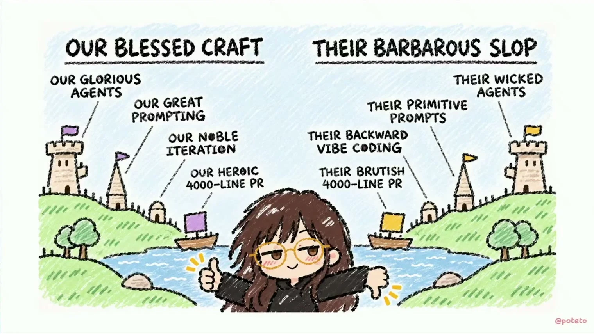

_截图 02  ·  录屏 00:36:56_

**00:37:01**　And so I did something crazy last month, and I shipped 3,000 deploy requests to production. Now, before agents, we never really cared about volume, except for the outliers. And at my previous company, we called these people coding machines. Taylor, who famously rewrote all of Google Maps in a weekend. Just an insanely productive engineer. And well with agents, anyone can now be a coding machine.

所以上个月我做了件疯狂的事，向生产环境发送了3,000个部署请求。以前在智能体出现之前，我们根本不关心请求量，除了那些异常情况。在我之前的公司里，我们把这些人称为“编程机器”。比如泰勒，他在周末就重新编写了整个谷歌地图系统。他真是个极其高效的工程师。现在有了智能体，任何人都能成为“编程机器”。

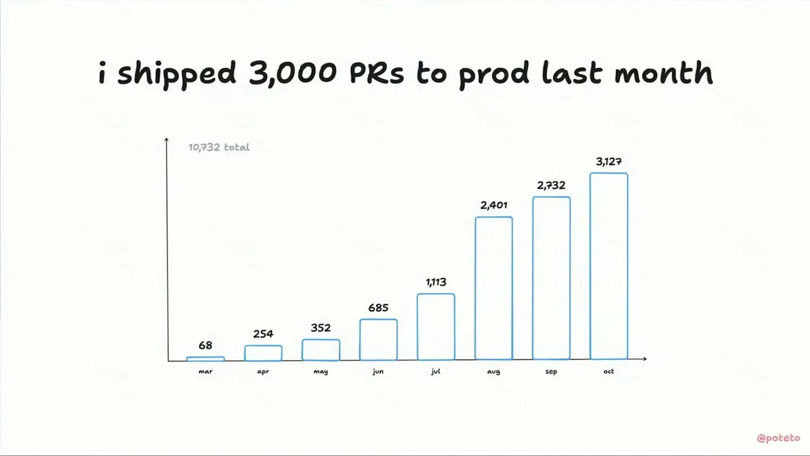

_截图 03  ·  录屏 00:37:05_

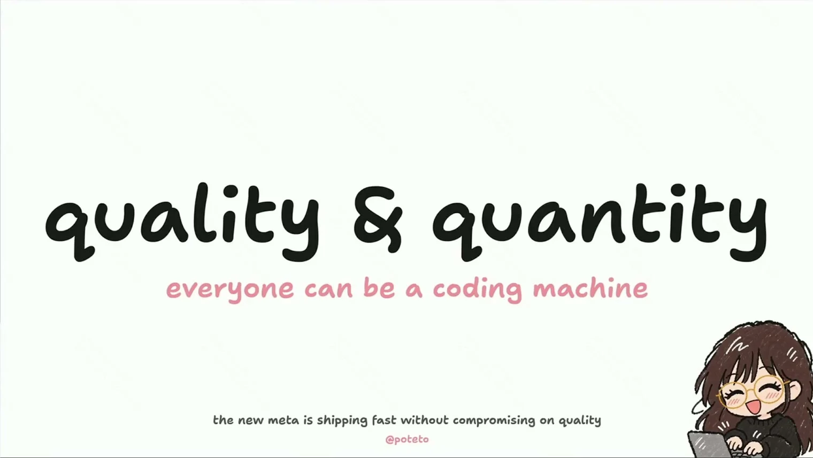

_截图 04  ·  录屏 00:37:21_

**00:37:28**　And my thesis is that the job of the software engineer, the meta of being a software engineer, is figuring out how to maintain or even improve the quality of your code while massively increasing your productivity. To get there, some people like to call this a software factory. But I like to keep it simple and I think of it as all about trust.

我的观点是，软件工程师的工作，作为软件工程师的本质，就是找到方法在大幅提高生产力的同时，保持或提升代码质量。有些人喜欢将这称为“软件工厂”，但我认为更简单的说法就是——一切都关乎信任。

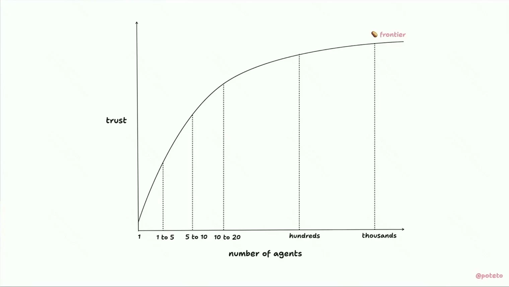

_截图 05  ·  录屏 00:37:46_

**00:37:52**　Not blind trust but investing in your agent's environment so you can trust that your agents are going to do the right thing. Now it takes quite a lot of effort to get there and it took me six months to get to a point where I could ship thousands of pull requests, a lot of them in my sleep, but it's certainly possible and it will take take you much less time than I did.

不是盲目信任，而是投资于智能体的环境，这样你就能相信你的智能体会做出正确的决定。现在达到这个水平需要相当多的努力，我花了六个月时间才达到能够处理数千个 Pull Request的程度，其中很多是在我睡觉时完成的，但这是完全可能的，对你来说所需的时间会比我少得多。

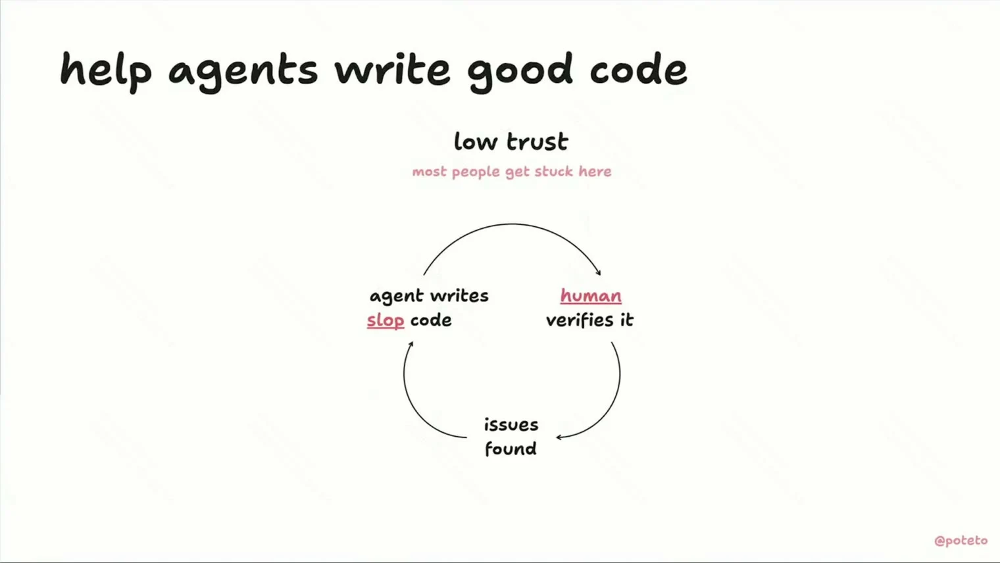

_截图 06  ·  录屏 00:37:55_

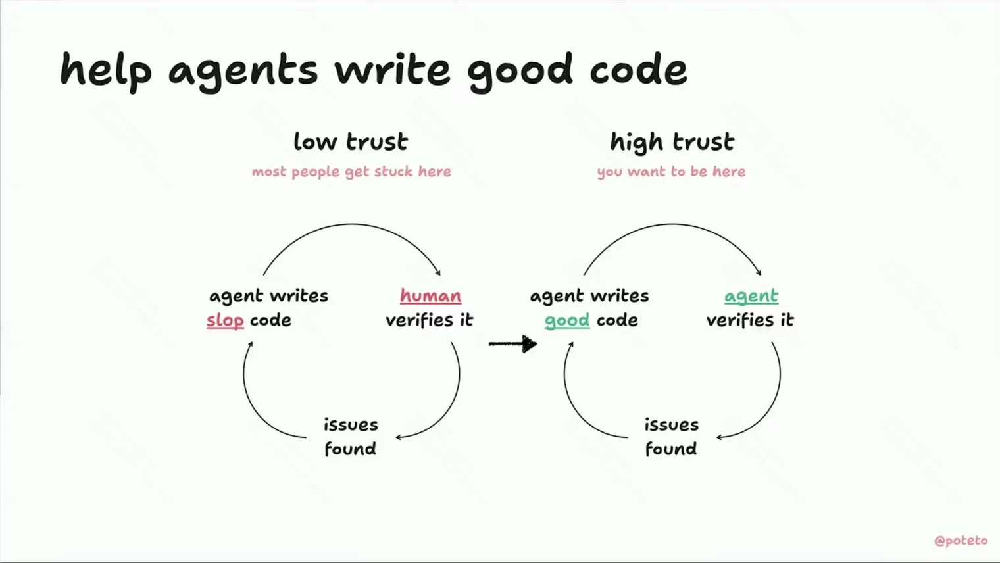

_截图 07  ·  录屏 00:38:07_

### 用代码结构和静态检查减少重复踩坑

**00:38:15**　So let's start by talking about how we move from a low trust environment to a high trust one. So this inverse pyramid is how I think about where to spend time on your agent's environment. The first two layers are deterministic, so using your code itself. So things like good API design, architecture, refactoring, or using lint rules, type systems, compilers, or different kinds of testing.

那么，我们先来讨论如何从低信任环境转向高信任环境。我认为这种逆向金字塔结构决定了在智能体环境中应投入哪些资源。前两层是确定性的，也就是使用代码本身。比如良好的API设计、架构、重构，或者采用lint规则、类型系统、编译器以及各种测试方式。

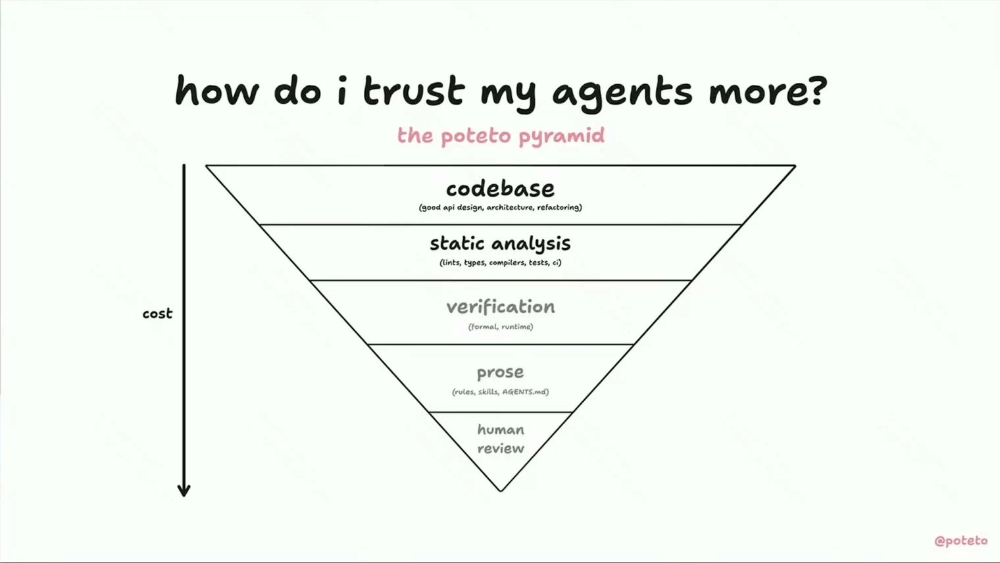

_截图 08  ·  录屏 00:38:28_

**00:38:43**　And you can use both of these layers together to constrain what agents can do and force them to do the right thing by default. Verification, both runtime and formal, are great tools to layer on to find bugs and check properties and the invariants in your system that you want to hold true. And also help you check whether or not the agent understood your goals and your intent.

你可以将这两层功能结合使用，限制智能体的行为，并让它们自动执行正确的操作。验证机制，包括运行时验证和形式化验证，都是很好的工具，可以用于发现错误、检查系统的属性及不变量，确保这些属性始终成立。同时，它还能帮助你判断智能体是否理解你的目标与意图。

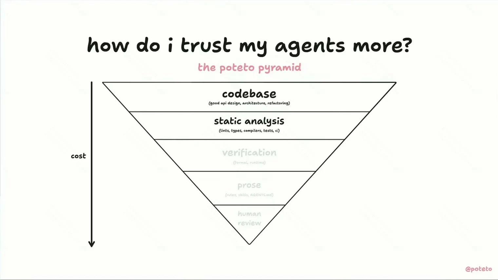

_截图 09  ·  录屏 00:38:45_

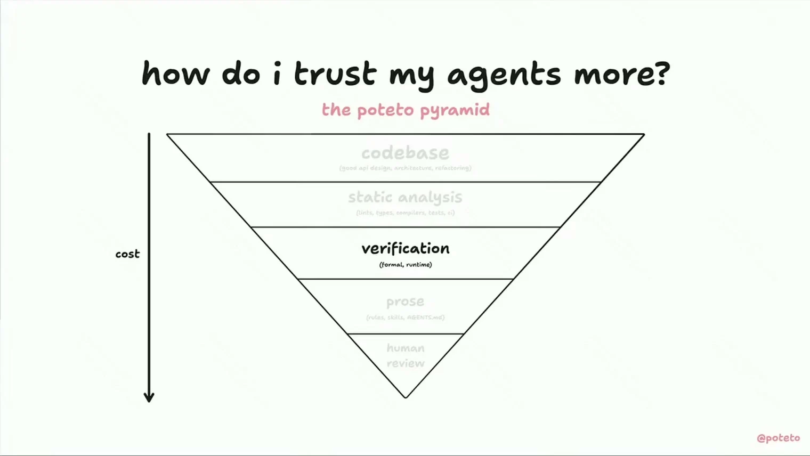

_截图 10  ·  录屏 00:38:57_

**00:39:07**　And then finally, you want to layer with a little bit of pros. So things like rules, skills, agents.md, things that require judgment. But let's start with your codebase. Agents generate their outputs based on their inputs. And so the quality of the input really matters, and it just so happens that your code base is one of the largest inputs. So whenever you're correcting your agent, think about how you can make that a deterministic check instead of adding another line to your rules or your agents.md, because it's far more reproducible when it's in code, and it lets you trust it more.

最后，你希望加入一些优势。比如规则、技能、agents.md等需要判断的内容。但我们先从你的代码库开始。智能体根据输入生成输出，因此输入的质量非常重要，而你的代码库恰好是最大的输入之一。所以当你修改智能体时，可以考虑如何将其变成可确定的检查方式，而不是在规则或agents.md中添加更多内容，因为这样在代码中更容易重复验证，也能让你更信任它。

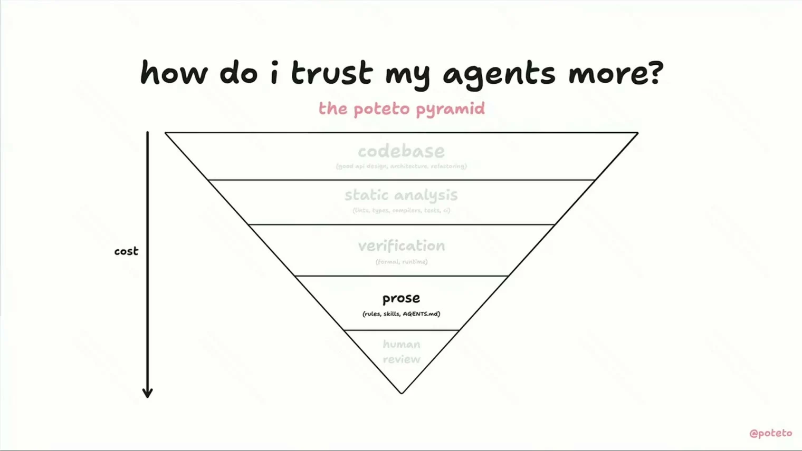

_截图 11  ·  录屏 00:39:10_

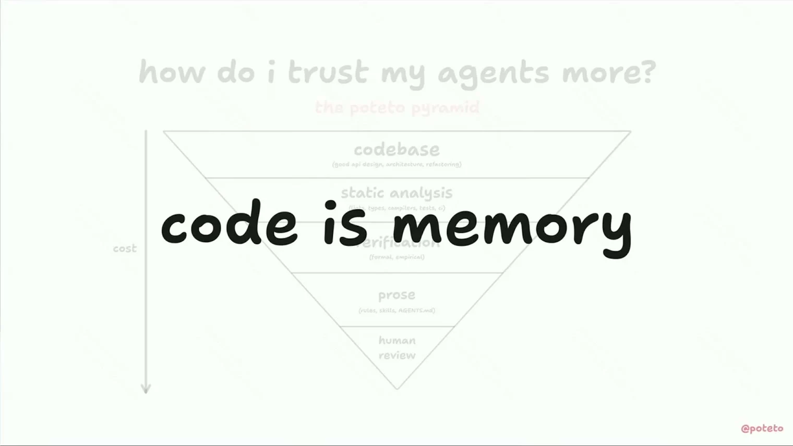

_截图 12  ·  录屏 00:39:26_

**00:39:46**　And the analogy that I like to use is kind of like a garden. Code used to arrive a few pull requests at a time. And I remember going into work in 2024 and reviewing the three pull requests that my colleagues wrote. And today, that number is more like 300. So every engineer is now a team of hundreds or even thousands of agents, and code is arriving so rapidly that it almost feels like a continuous stream, and it almost feels organic, like a living thing.

我喜欢用的一个类比就是花园。过去，代码会一次提交几份 Pull Request。我记得在2024年开始工作后，查看了同事们提交的三个Pull Request。现在，这个数字达到了300左右。因此，每个工程师现在都组成了一个由数百甚至数千个智能体组成的团队，代码提交速度如此之快，几乎就像一条持续不断的流，而且看起来就像一种自然、有生命力的东西。

_截图 13  ·  录屏 00:39:55_

**00:40:22**　And in this analogy, your code base, the constraints that you impose, the guardrails that you put up, are the concrete foundations that the new code that your agents write grow around, just like the building in this picture. And so in many ways, the job of being a software engineer is kind of becoming like gardening. Because code is the biggest input for agents, workarounds, anti-patterns, deprecated code, tech dep, it's now likely to be just copied by the next agent since it looks like the established pattern in your codebase.

在这种类比中，你的代码库、你设定的约束条件、你所设立的防护措施，就是新的智能体所编写的代码能够发展的具体基础，就像这幅图中的建筑一样。因此，从许多方面来看，成为软件工程师的工作就类似于园艺工作。因为代码是智能体最重要的输入来源，包括各种规避方法、反模式、被废弃的代码以及技术依赖问题，现在很可能被下一个智能体直接复制，因为这在你的代码库中似乎已成为一种既定模式。

_截图 14  ·  录屏 00:40:29_

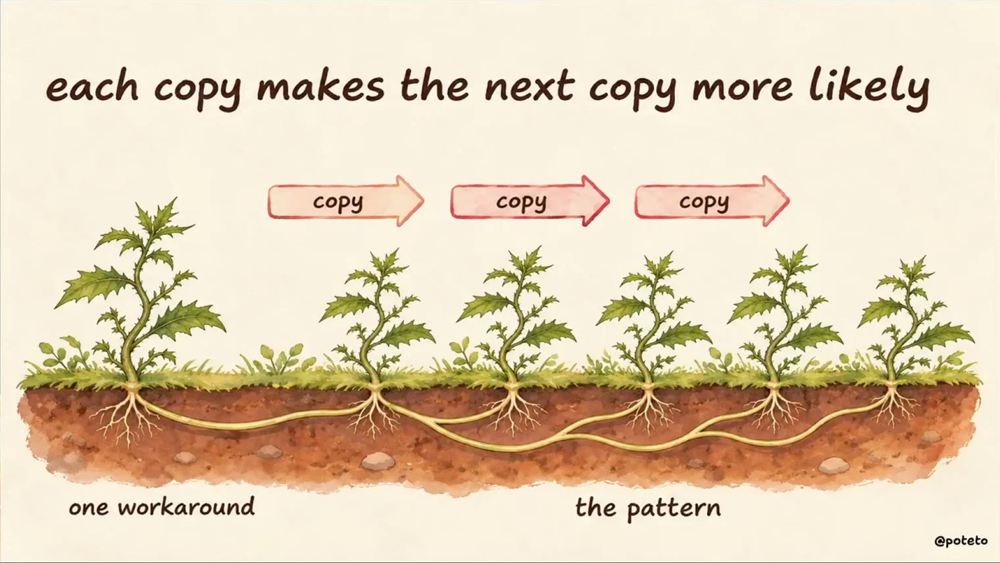

_截图 15  ·  录屏 00:40:54_

**00:40:59**　And it's like you have some weeds or pests growing in your garden, and then they spread everywhere before you know it. So you want to make your codebase as pristine as possible so that agents are always copying the good stuff. So let's look at some real examples. So Dune is a client framework that we created for Grok Bot to implement this idea for organic architecture.

就像你的花园里长了一些杂草或害虫一样，它们在你还没察觉之前就扩散到了各个地方。因此，你希望让代码库尽可能干净，这样智能体就能始终复制好的代码。让我们看看一些真实的例子。Dune是一个客户端框架，我们为 Grok Bot 开发了它，以便实现这种有机架构的理念。

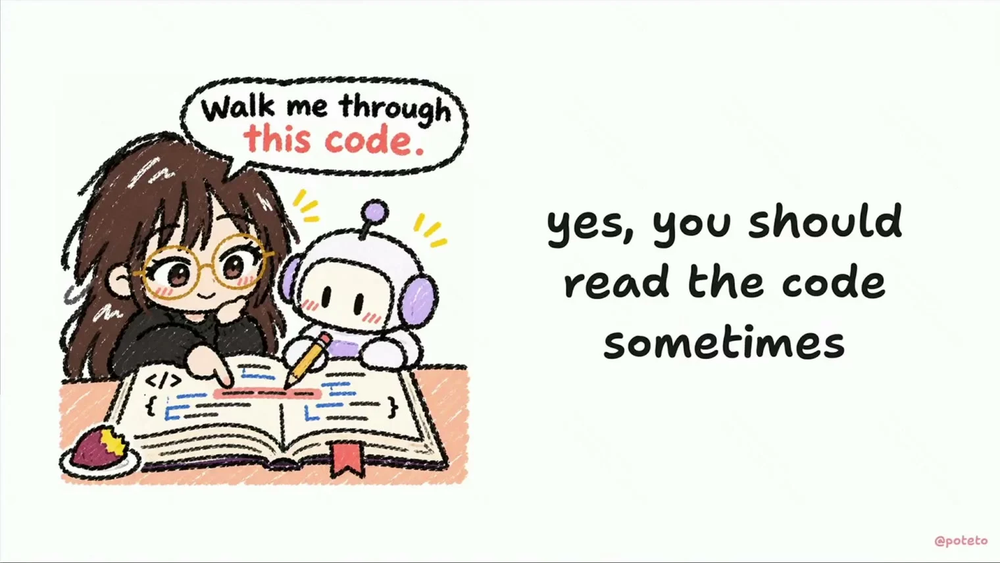

_截图 16  ·  录屏 00:41:10_

**00:41:27**　It's not really that interesting technically. You can kind of think of Dune as kind of like Next.js for Electron apps. But the interesting part of Dune is that it has a lot of constraints and lit rules that we've encoded a lot of the lessons that we've learned building desktop applications. And one such lesson is that anything that requires nuance to use well often leads to slop.

从技术层面来看，其实并没有那么有趣。你可以把 Dune 想象成 Electron 应用中的 Next.js。但 Dune 的妙处在于，它有着许多约束和规则，这些就是我们构建桌面应用时积累的经验教训。其中一个教训就是：任何需要细致处理才能有效使用的内容，往往会导致糟糕的结果。

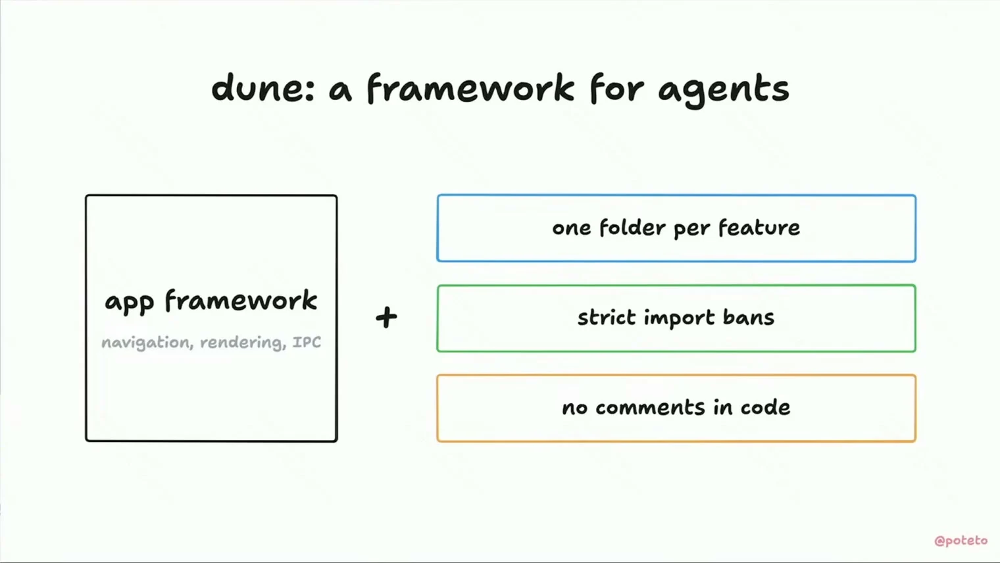

_截图 17  ·  录屏 00:41:27_

**00:41:52**　You know, your classic example is, you know, use effect in React, right? It has its use cases, but it's often misused. Some people joke that you need a PhD to use useEffect. And in other words, it really requires a lot of nuance to use well. And agents are not good at using it. So our solution has been to just ban it in product code.

你知道，你常见的例子就是使用 React 中的 useEffect，对吧？它确实有应用场景，但经常被误用。有些人开玩笑说，使用 useEffect 需要博士学位。换句话说，要正确使用它确实需要很多技巧。而智能体就不适合使用它。所以我们的解决方案就是在产品代码中完全禁止它的使用。

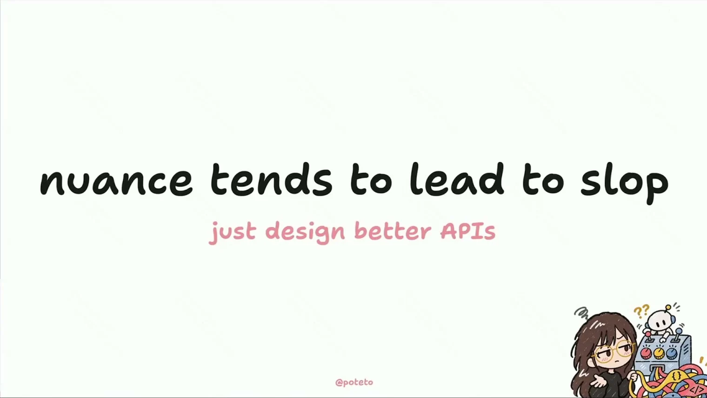

_截图 18  ·  录屏 00:42:00_

**00:42:16**　And it's really only allowed in some places inside of Dune APIs. Effectively, this problem has now been categorically eliminated, and we never need to catch that during code review again. Another interesting pattern that we use is context through directory structure. So one anti-pattern that we saw with Cursor, which is an Electron app, is that agents would often import main thread code into the render thread, which would cause long tasks and jank.

而且实际上在 Dune API 的某些地方才允许这样做。实际上，这个问题现在已经彻底解决了，我们在代码审查时再也不需要关注它了。我们使用的另一个有趣模式是通过目录结构来管理上下文。在 Cursor 这种 Electron 应用中，有一个反模式：智能体经常将主线程代码导入到渲染线程中，这会导致任务长时间运行和性能下降。

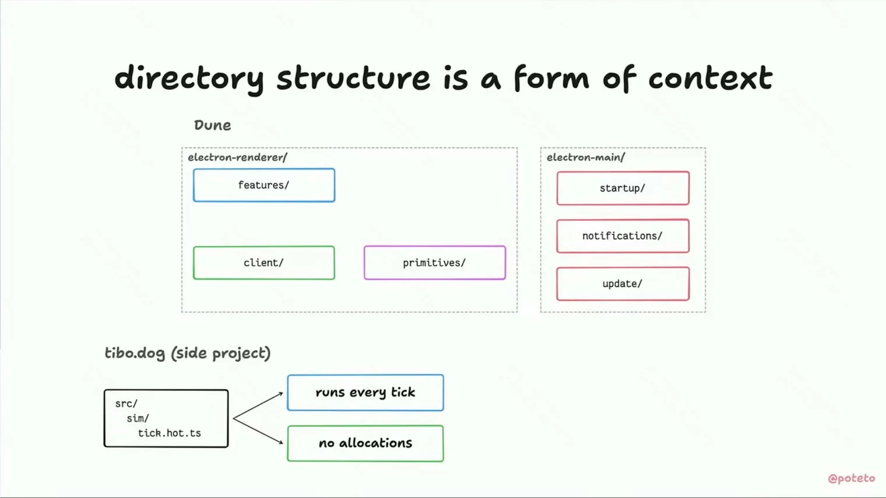

_截图 19  ·  录屏 00:42:34_

**00:42:47**　So in Grok Bot and in Dune apps, We've made this very, very conventional. We have these two top-level directories, literally called electron-renderer and electron-main, and imports between them are forbidden or banned by our dependency graph analyzer and some lint rules. And again, these are simple lint rules to set up, but it means one less thing that we need to review and think about during code view.

在 Grok Bot 和 Dune 应用中，我们采用了非常传统的做法。我们有两个顶层目录，分别名为 electron-renderer 和 electron-main，之间的导入行为被我们的依赖关系分析器和一些 lint 规则所禁止。不过这些只是简单的 lint 规则，意味着在代码查看过程中需要审查和处理的内容就少了一项。

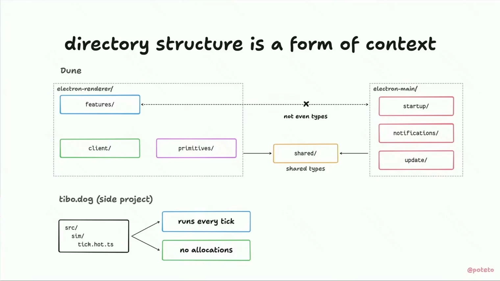

_截图 20  ·  录屏 00:42:59_

**00:43:16**　And then one more surprising thing that I've seen using markdown. So things like documentation, code comments, rules or skills. And they use this as a place to write down their justifications for not doing the right thing. Or, I don't know if you've ever seen this, but they'll over-rotate on some small correction that you made, and they treat it like a hard rule that can never be broken ever again.

还有另一个让我惊讶的用法——用 Markdown 表达的内容。比如文档、代码注释、规则或技能说明等。他们把这里当作记录“为何不采取正确做法”的理由的场合。或许你从未见过这种情况，但他们会因为你的一个小修改而过度反应，并把它当作永远不可打破的严格规则。

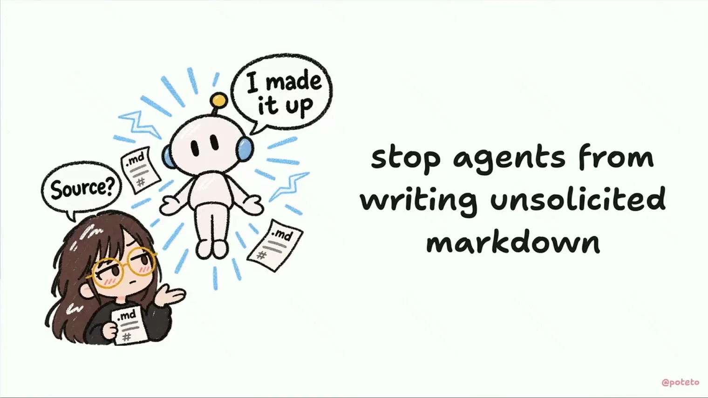

_截图 21  ·  录屏 00:43:24_

**00:43:41**　And here's another example from Cursor. So agents really loved using imperative timers, so things like setTimeout, requestAnimationFrame, requestIdleCallback, and they were using these as quick fixes because they were really patching over an architecture clash between VS code's imperative style and React's declarative style. So our choice of architecture actually made both the client and the agent performance much worse. And if you've ever done any performance work in JavaScript, you'll know that when you have tons of timers as being rapidly created and destroyed causes a lot of major garbage collection, which causes a lot of lag and jang.

这是另一个来自 Cursor 的例子。智能体非常喜欢使用命令式计时器，比如 setTimeout、requestAnimationFrame、requestIdleCallback 等。它们被用作快速解决方案，因为实际上是在解决 VS Code 的命令式风格和 React 的声明式风格之间的架构冲突。然而，我们选择的架构实际上让客户端和智能体的性能都变差了。如果你曾经从事过 JavaScript 的性能优化工作，就会知道当存在大量被快速创建和销毁的计时器时，会导致大量的垃圾收集操作，进而造成延迟和卡顿。

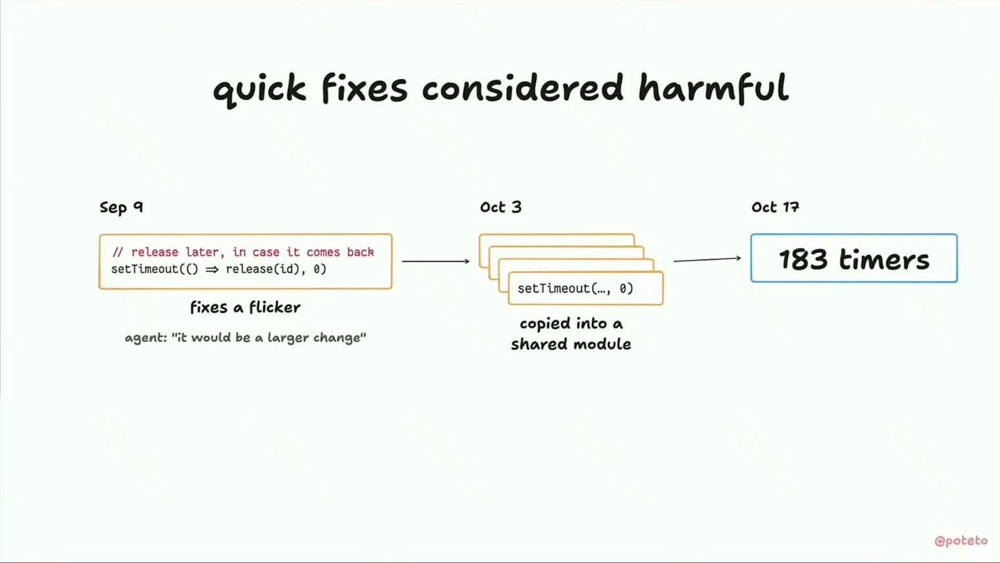

_截图 22  ·  录屏 00:44:01_

**00:44:22**　But the worst part is that agents wrote a lot of code comments, like you can see in red here, explaining why this quick fix was justified. And before you know it, we had timers spreading everywhere, and the performance of the app really suffered. Now, in Grok Bot, we learned our lesson there, and we decided to just ban 99% of comments because they go stale easily, you know, humans just really don't bother reading the comment slop anyway.

但最糟糕的是，智能体们写了很多代码注释，就像这里用红色标出的那样，解释为什么这种快速修复是合理的。不知不觉间，到处都是计时器，应用的性能真的受到了影响。现在，在 Grok Bot 中，我们吸取了教训，决定禁止 99% 的注释，因为这些注释很容易过时，你知道的，人类根本不会认真阅读那些废话。

**00:44:52**　And again, it gives an agent the an escape hatch to justify not doing the right thing because it's hard. And the worst part about comments, though, is that they're not enforceable. So what seems well-intentioned, like I'm gonna tell the next agent not to do something, never ends up actually being anything that you can trust. So in Grok Bot and in Dune, we now have lint rules that give good and very helpful error messages telling the agent to fix the root cause, the real problem, rather than just patch around it.

再次强调，这给智能体提供了一个逃避借口，让他们可以因困难而不做正确的事情。不过，评论最糟糕的地方在于它们不可执行。因此，那些看似出于好意的建议，比如我告诉下一个智能体不要做某事，最终往往无法成为你可以信赖的东西。在 Grok Bot 和 Dune 中，我们现在有了 lint 规则，这些规则能给出有用的错误提示，告诉智能体如何解决根本问题，而不是仅仅修补表面现象。

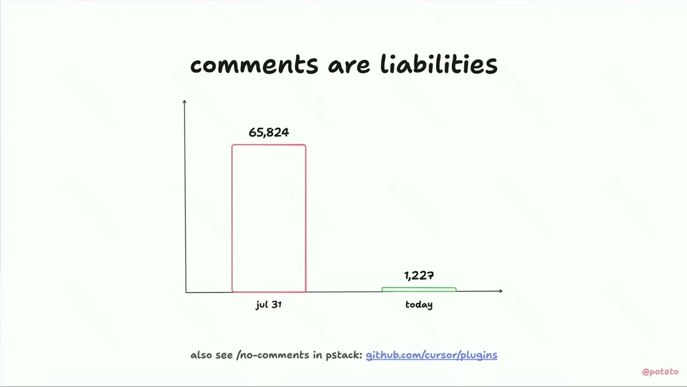

_截图 23  ·  录屏 00:44:55_

**00:45:29**　And so our general principle is that every time we correct our agents, it turns into one of these deterministic checks, or we think about how to categorically eliminate that problem in the code through better API design, through better architecture. And if you do this enough times, you'll find that you have just less things to look out for in code review. And at some point you'll realize there's nothing left to review.

因此，我们的基本原则是：每次我们修正智能体时，都会变成一种确定性检查。或者，我们会思考如何通过更好的 API 设计、更合理的架构来彻底解决代码中的这个问题。如果反复这样做，你会发现代码审查时需要关注的内容就越来越少。最终，你会意识到已经没有什么需要审查的了。

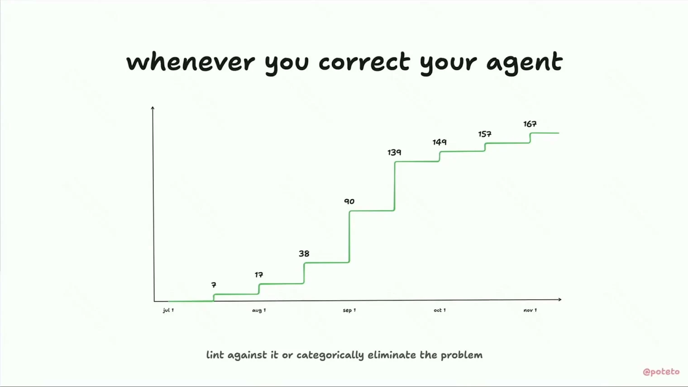

_截图 24  ·  录屏 00:45:37_

### 运行时验证、形式化验证和 UI 测试

**00:45:53**　And you can just let agents merge most of their own requests. All right, moving on. Verification is also a really big part of how we make our agents more autonomous and also increase our confidence and trust in their work. And our code review process has now really shrunk into looking at verification artifacts instead. So things like videos, screenshots, diagrams, formal verification.

你可以让智能体合并它们自己的大部分请求。好的，继续吧。验证也是我们提升智能体自主性、增强对其工作的信任的关键环节。现在，我们的代码审查流程实际上已经简化为对验证成果的审查。因此，像视频、截图、图表、形式验证等内容都不再重要了。

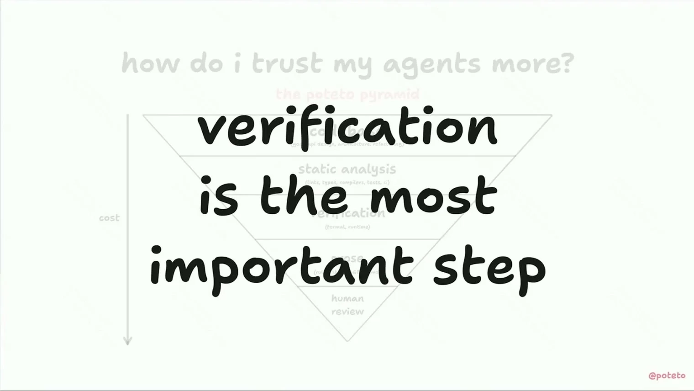

_截图 25  ·  录屏 00:46:06_

**00:46:21**　And the most basic example of this is runtime verification, which is just a fancy way of saying giving your agent a way to run the code for itself and use debugging tools that human developers use as well, like the Chrome DevTools protocol. In our runtime verification skills, we have this thing that we call a feature map. And that's basically kind of like a sitemap of all of the features that are available in your application from the user's point of view.

最基础的例子就是运行时验证，这其实只是另一种表述方式，意思是让智能体能够运行自己的代码，并使用人类开发者使用的调试工具，比如 Chrome DevTools 协议。在我们的运行时验证技能中，我们有一种叫做功能图的工具。从用户的角度来看，这基本上就像是一个应用中所有可用功能的网站地图。

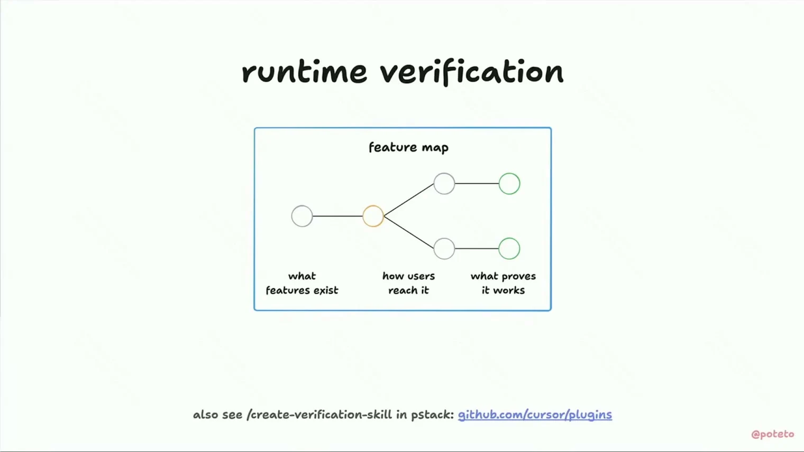

_截图 26  ·  录屏 00:46:31_

**00:46:48**　And so with this, agents don't need to guess when you say, you know, the thingy in the left sidebar. It gives you some shared vocabulary. And we also make use of custom CLIs inside these skills so that agents can reuse the CLI and the driver every time, which cuts down on token usage and is also testable. And then recently we've also started looking at formal verification.

因此，智能体无需猜测，当你提到左侧边栏中的那个东西时，它提供了一些共用的词汇。我们还在这些技能中使用了自定义命令行界面，这样智能体可以每次都使用命令行界面和驱动程序，从而减少token的使用量，并且易于测试。最近我们还开始研究形式验证。

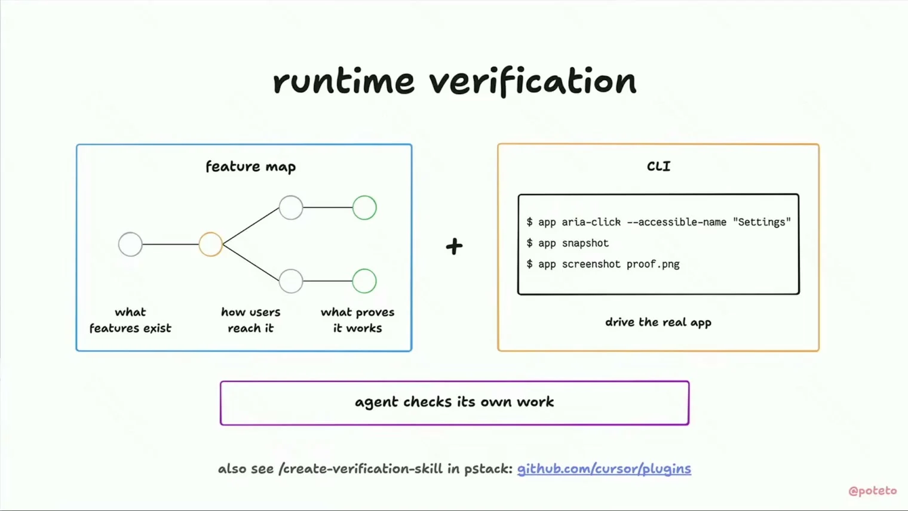

_截图 27  ·  录屏 00:47:00_

**00:47:13**　So we now use TLA Plus to do some model checking of major user flows, such as notifications across multiple devices and platforms. We use a lean as well for proving certain algorithms. For example, we have our own, we wrote our own custom virtualization library and we use a lean there to check that we don't have, you know, flickering or jittering problems.

因此，我们现在使用 TLA Plus 对主要用户流程进行模型验证，比如多设备与平台之间的通知功能。我们还使用 Lean 来验证某些算法。例如，我们自研了自定义虚拟化库，并借助 Lean 来确保不会出现闪烁或抖动问题。

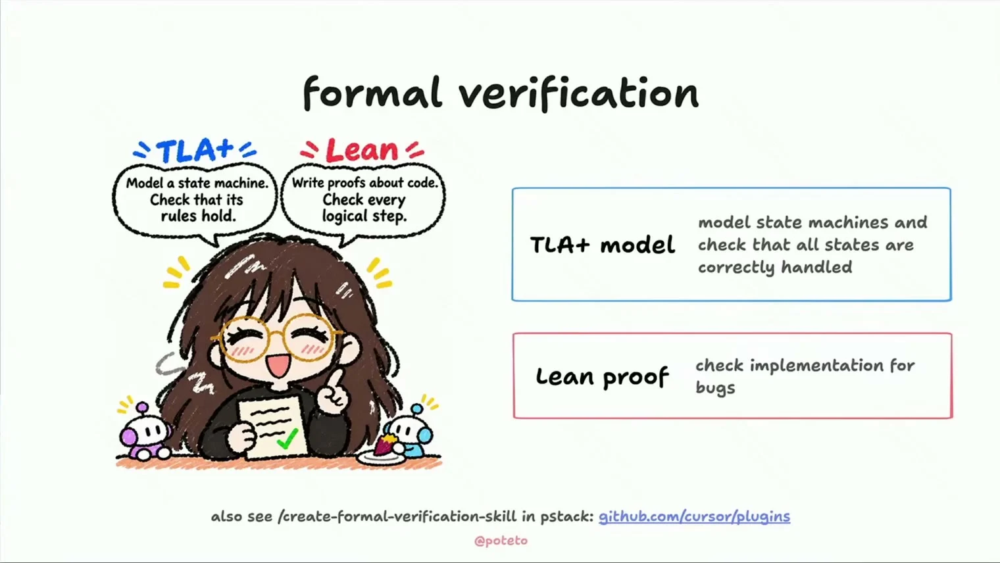

_截图 28  ·  录屏 00:47:21_

**00:47:35**　And we're still experimenting with this approach overall. It seems very promising. We've already found quite a few bugs with formal verification. But it's certainly not a silver bullet, and we're treating it as another tool, another layer in our agent's environment. And then this is a very fast video, but another thing that we just started looking at is property-based testing as well for UIs.

我们目前仍在尝试这种方法。看起来很有前景。我们在形式验证方面已经发现了不少问题。但这显然不是万能的解决方案，我们将其视为另一种工具，是智能体环境中的另一层结构。此外，这是一个非常快速的视频处理方案，我们还开始研究基于属性的测试方法，用于用户界面测试。

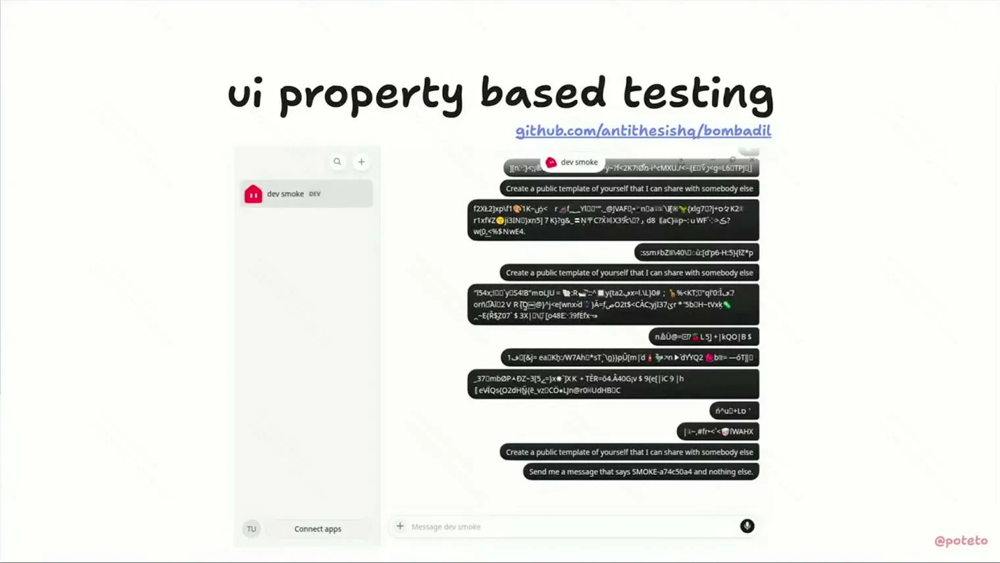

_截图 29  ·  录屏 00:47:55_

**00:48:02**　So we use this library called Bombadil, and this has also caught a few UI bugs for us already. Okay, so zooming out, I saw this tweet from Cindy, and six months ago she said that she was talking about not being able to trust her agents getting merged. And really what was missing for her in being able to trust her agents was the verification process.

所以我们使用了名为 Bombadil 的库，这个库已经帮我们解决了一些 UI 问题。好的，当缩放出来的时候，我看到了 Cindy 的推文，六个月前她说过无法信任她的智能体被合并。实际上，让她无法信任智能体的是验证流程的问题。

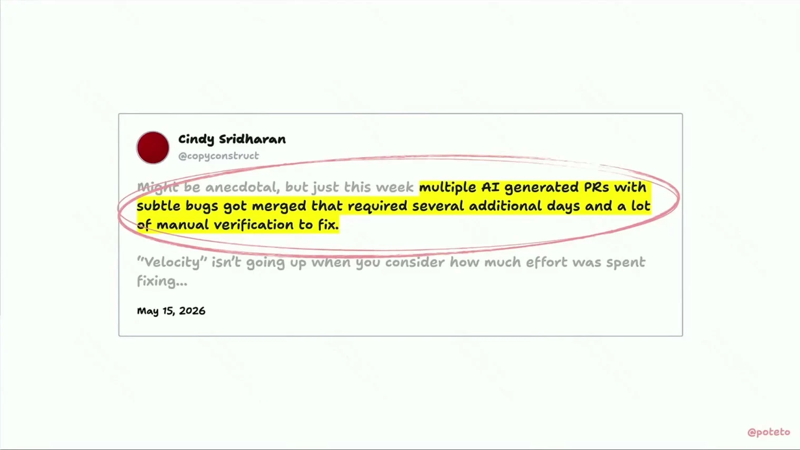

_截图 30  ·  录屏 00:48:15_

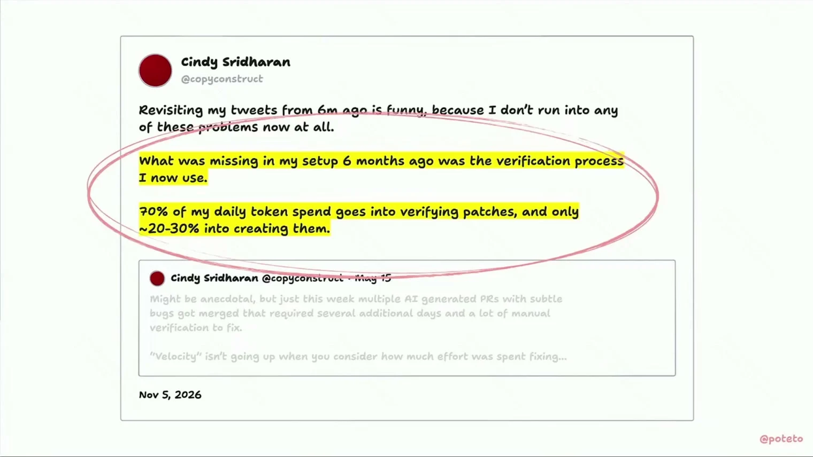

_截图 31  ·  录屏 00:48:28_

**00:48:29**　And now, six months later, she says that 70% of her daily tokens go into verification. And I'd say that that tracks with what I see as well, that most of my token usage goes to verification. And if you really look closely at her process, none of these things here are new or novel techniques that we've never had before. These are but ones that might have been prohibitively expensive to use before as they were hard to understand or write or maintain.

现在，六个月后，她说她每天使用的70%的代币用于验证。我认为这与我的观察也一致，我使用的代币大部分也是用于验证。如果仔细看看她的流程，这些做法都不是新的或以前没有过的技术。只是那些技术可能以前因为难以理解、编写或维护而成本过高。

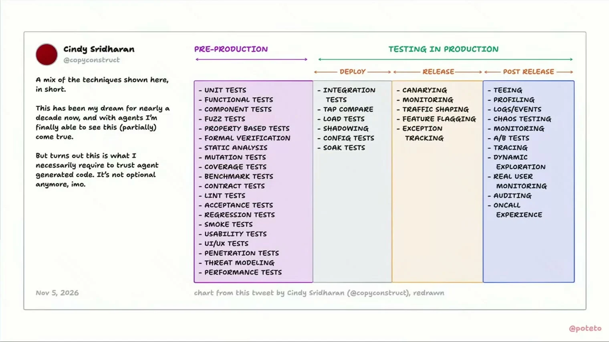

_截图 32  ·  录屏 00:48:45_

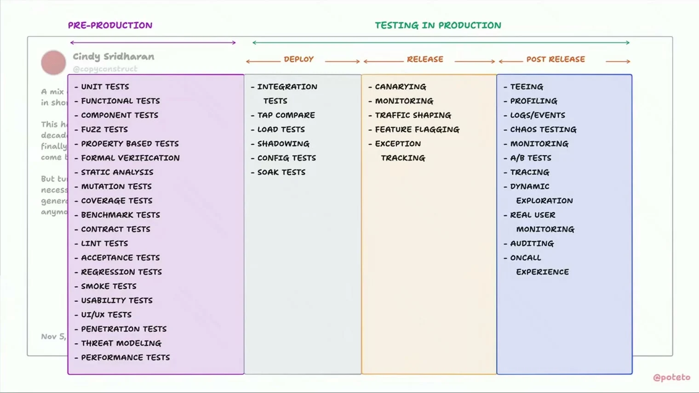

_截图 33  ·  录屏 00:48:57_

**00:49:00**　But agents drastically cut this cost down. And really, we're entering a golden age of software testing and verification because agents let us test everything to a much greater degree than used to be economical. And then formal verification can also help you better reason about how your product should work and whether your agents really understand your intent and goals. I made this new skill called StateChart in my plugin PStack, PotatoStack, which helps you visualize state machines from the user's point of view.

但智能体大幅降低了这一成本。实际上，我们正进入软件测试与验证的黄金时代，因为智能体让我们能够以比以往更高效的方式测试所有内容。此外，形式化验证还能帮助您更清晰地理解产品如何运行，以及您的智能体是否真正理解您的意图和目标。我在 PStack、PotatoStack 插件中开发了名为 StateChart 的新技能，它可以帮助您从用户的角度可视化状态机。

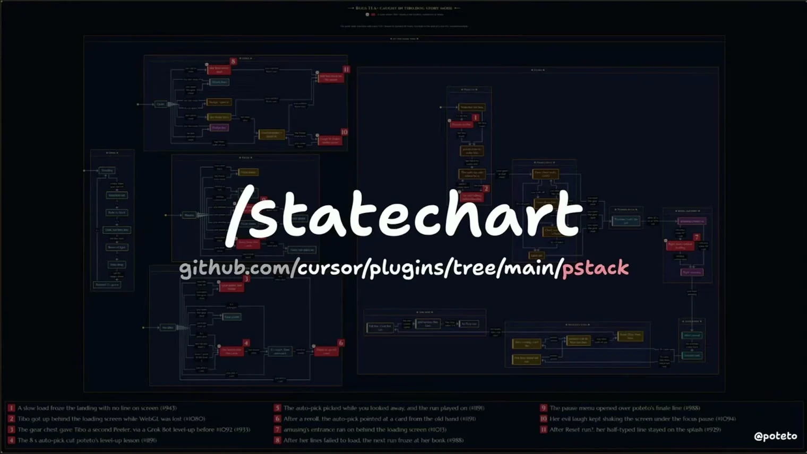

_截图 34  ·  录屏 00:49:22_

### PR 产出、回退率与软件工厂的适用条件

**00:49:32**　And I find this much easier to review alongside the videos and screenshots that we provide. And so that's been great. Sorry for the flashbang. Okay, now let's look at what the promised land looks like. What do you get in return for all of this investment? So on the GrofBot team, our velocity is taking off and rapidly increasing. And last month, our team shipped a ridiculous 11,000 pull requests to production, which is a wild number.

而且，与我们提供的视频和截图一起进行回顾起来要容易得多。这真是太好了。抱歉刚才的突然中断。好啦，现在让我们看看所谓的“理想状态”到底是什么样子的。这么大的投入，能换来什么呢？在 GrofBot 团队中，我们的效率正在迅速提升。上个月，我们团队向生产环境提交了 11,000 个 Pull Request，这个数字真是惊人。

_截图 35  ·  录屏 00:49:43_

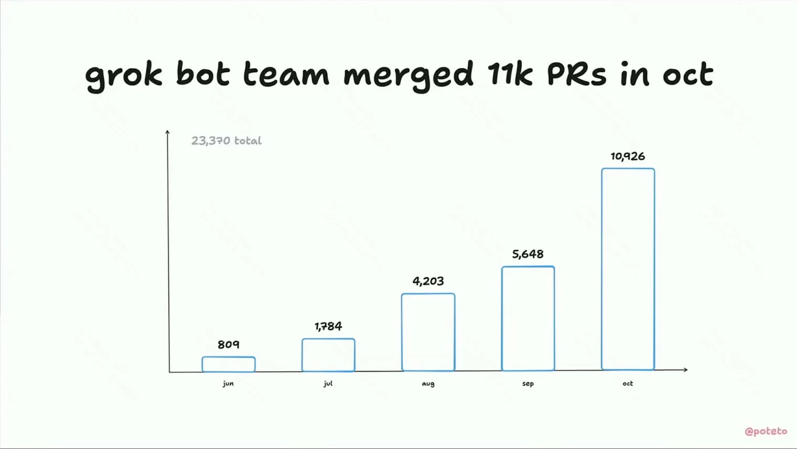

_截图 36  ·  录屏 00:49:55_

**00:50:04**　And our pace of releasing the client has also increased, and we cut a new stable version about once a day. And then the core team is also shipping much more, and we also have a lot more casual or drive-by contributors who don't always have a lot of context, but they're also contributing. And in October, we had about 227 people who contributed at least one pull request.

而且我们发布客户版本的频率也提高了，大约每天会推出一个新的稳定版本。此外，核心团队也发布了更多的内容，还有很多非正式的或随机的贡献者，他们不一定了解具体情况，但他们也在贡献。在十月期间，大约有227人至少贡献了一个拉取请求。

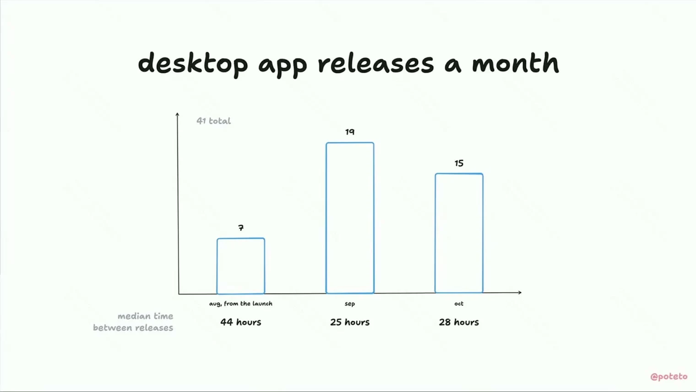

_截图 37  ·  录屏 00:50:08_

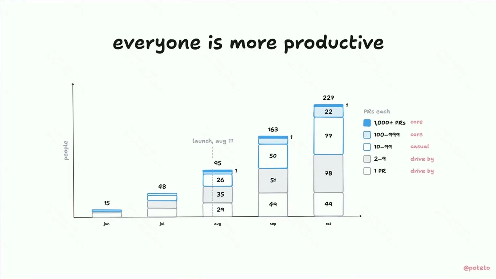

_截图 38  ·  录屏 00:50:20_

**00:50:33**　So despite this velocity accelerating, you might be thinking to yourself, like, isn't this going to be chaos? You know, isn't this going to be a bunch of slop? But actually, the number of PRs that get reverted has actually gotten lower on a relative basis and is steady at about half a percent. But I think the really interesting thing about this shipping pace and this volume of pull requests is that the performance of GraphBot has stayed not just stable, but has improved on multiple dimensions compared to when we launched.

所以，尽管这个速度在加快，你可能会想，这会不会变成一团混乱？你知道的，会不会变成一堆无用的代码？但实际上，被回退的 PR 数量相对减少了，稳定在约 0.5% 左右。不过我认为，关于这种开发速度和大量 PR 的情况，真正有趣的是，与启动时的状态相比，GraphBot 的性能不仅保持稳定，还在多个方面有所提升。

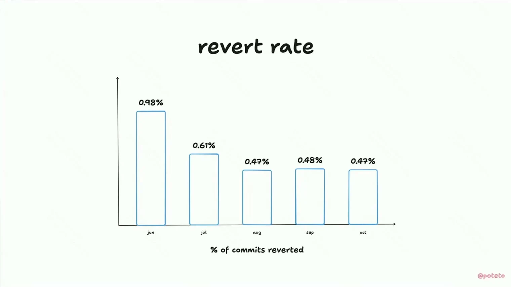

_截图 39  ·  录屏 00:50:41_

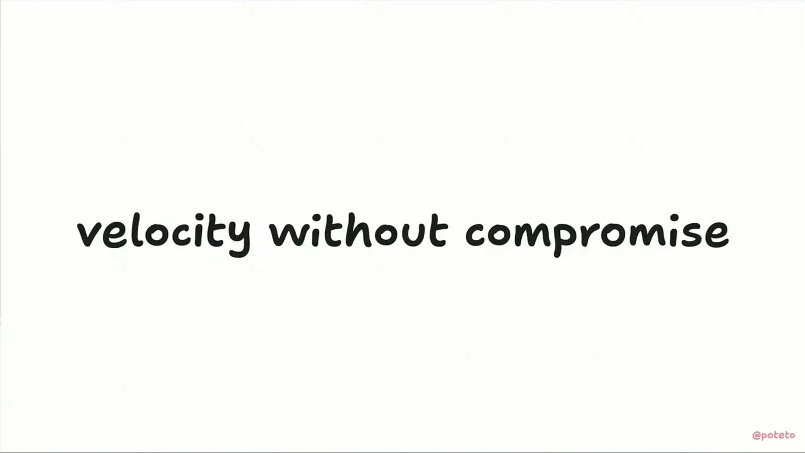

_截图 40  ·  录屏 00:50:50_

**00:51:03**　So startup, typing, opening new chats, switching chats, all of this has gotten faster. And keep in mind, Grok Bot is still an electron app for now. So there is a ceiling, right? But it's already much faster than many other agent UIs out there. And for an electron app with this high velocity and this many people contributing, I'd say that's pretty good. So before you jump into building out a software factory and automating everything that you can, whenever you correct your agent, try and do it by improving your code base first.

所以，启动、输入、打开新聊天窗口、切换聊天窗口，所有这些都变得更快了。请注意，Grok Bot目前仍是一个电子应用。因此，存在限制，对吧？但已经比许多其他智能体界面要快得多。对于这样一个高速度、有众多人参与的电子应用来说，我认为这相当不错。因此，在着手构建软件工厂并自动化所有你能做的事情之前，每当修改智能体时，先通过改进代码库来尝试实现它。

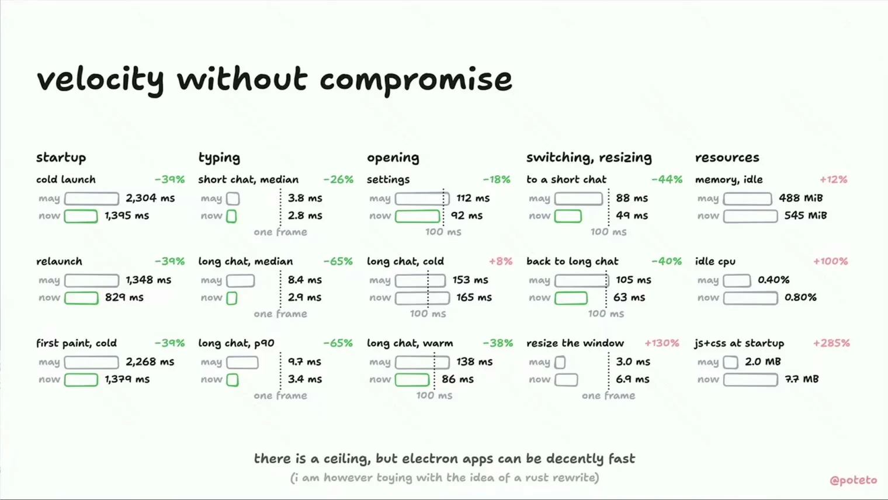

_截图 41  ·  录屏 00:51:06_

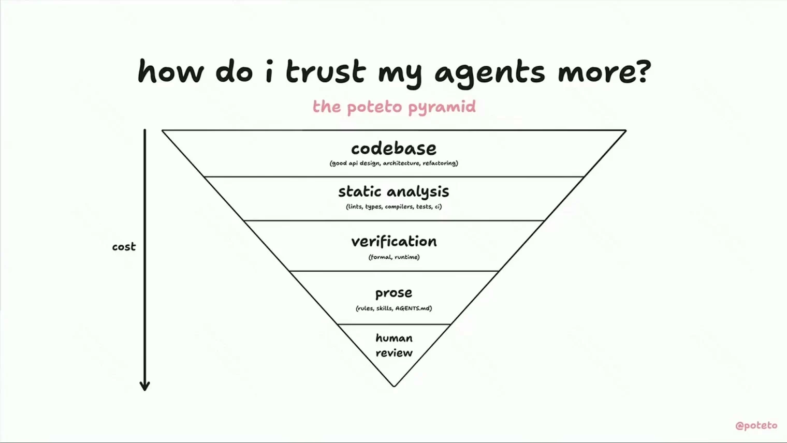

_截图 42  ·  录屏 00:51:35_

**00:51:40**　Start with a lint rule to prevent new occurrences of anti-patterns, and then clean up those old patterns as well. And then make sure that your verification story is really strong. A lot of this work is a prerequisite to automation anyway, and if your inner coding loop produces slop, then automating that loop just produces more slop, and you need to throw more and more and more tokens at the problem, which we all know is very expensive.

首先制定一个 lint规则来防止反模式再次出现，然后清理那些旧的模式。此外，要确保你的验证逻辑确实足够强大。其实，这些工作都是实现自动化的前提条件；如果内部编码循环产生大量错误代码，那么自动化该循环只会带来更多错误，你需要不断添加更多代码来解决问题，而我们知道这非常耗费资源。

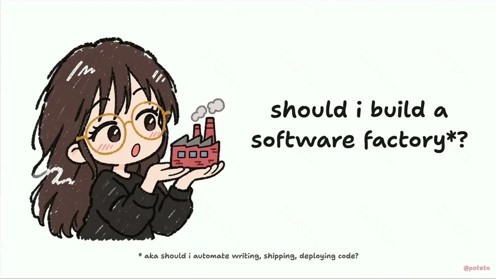

_截图 43  ·  录屏 00:51:56_

**00:52:08**　And once you've made these investments into your code base, static analysis, runtime informal verification, you'll start to find that many things become possible with these foundations and that you can really easily build your own factory on top of these foundations. And when you're ready, Grok Bot is a great way to build that outer loop. We have tons of connectors, routines that can kick off cursor, cloud agents, and projects which let you orchestrate thousands of hundreds or even thousands of agents.

一旦你在代码库中进行了这些投资，包括静态分析和运行时非正式验证，你就会发现许多事情变得可能，而且你可以非常轻松地在这些基础之上建立自己的系统。当一切准备就绪时，Grok Bot是构建外部循环的绝佳方式。我们有大量的连接器、可以启动Cursor的脚本以及项目，这些都能让你协调数千甚至数千个智能体。

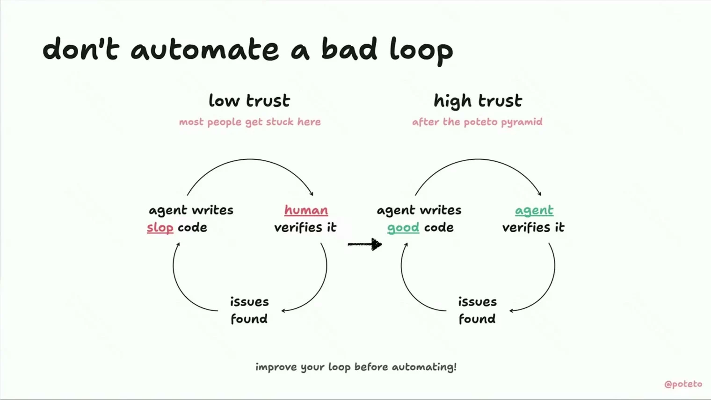

_截图 44  ·  录屏 00:52:13_

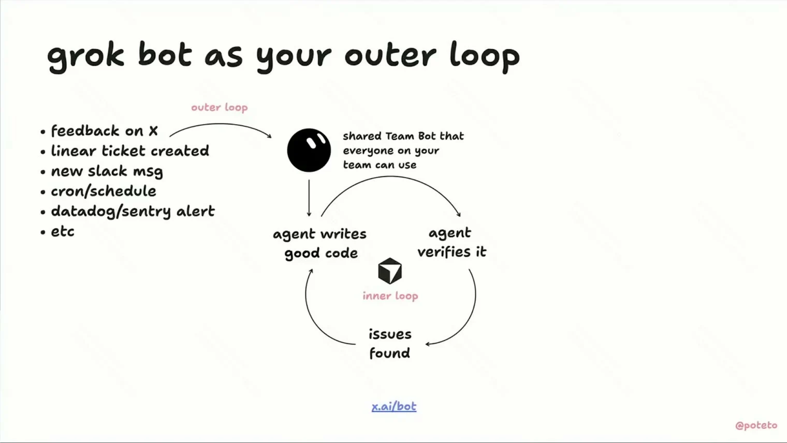

_截图 45  ·  录屏 00:52:30_

**00:52:40**　And as a quick example, you know, whenever we cut a new Grok Bot will automatically spin up a new cursor project for us that will fuzz the entire application, the entire build, and it will find bugs by running the app and using it like a real user. And then it's going to open fixed PRs for each of those bugs that it finds, and it's going to auto-merge it, as crazy as that sounds.

作为一个简单的例子，您知道吗？每当我们创建新的 Grok Bot 时，系统会自动生成一个新的 cursor 项目，它会对整个应用和整个构建过程进行优化。它还会通过像真实用户一样使用应用来发现错误。然后，系统会为每一个发现的错误打开固定的 PR 报告，并自动进行合并，尽管这听起来很不可思议。

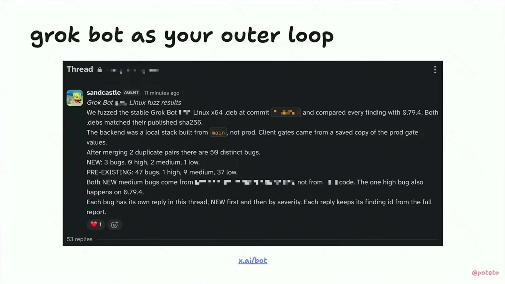

_截图 46  ·  录屏 00:52:50_

**00:53:03**　And that's because our code base is good enough that pull requests tend to just be good by default, and most product code that we land no longer really requires deep human review. So, when you have solid foundations and good organic architecture, you can turn slop into gold and you can ship with high quality, high velocity without compromising on quality. My name is poteto, also known as Lauren.

这是因为我们的代码基础足够好，所以Pull请求通常都质量不错。我们开发的产品代码也不再需要深度的人工审核。因此，当拥有稳固的基础和良好的有机架构时，就可以把低质量代码转化为高质量代码，并以高质量和高速度进行发布，同时不牺牲质量。我的名字是Poteto，也被称为Lauren。

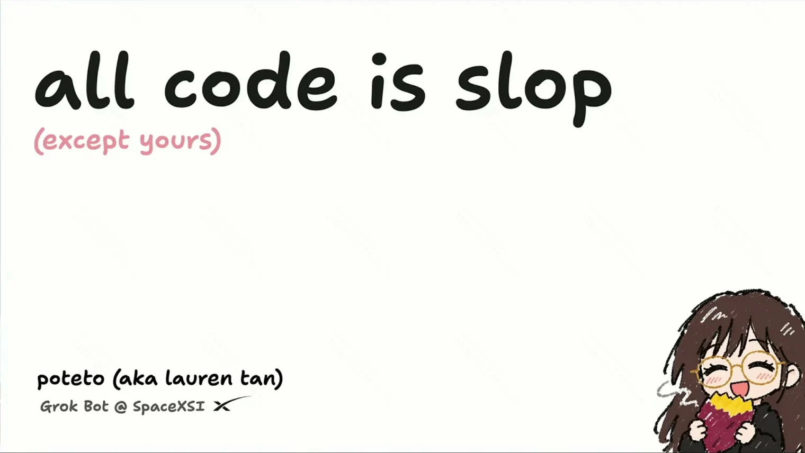

_截图 47  ·  录屏 00:53:20_

**00:53:30**　Thanks to you again for listening to my talk.

再次感谢你们听我的演讲。

---

[全部演讲](../README.md) · [选看索引](index.md) · [上一场](03-michelle-chen.md) · [下一场](05-intrinsec.md)
