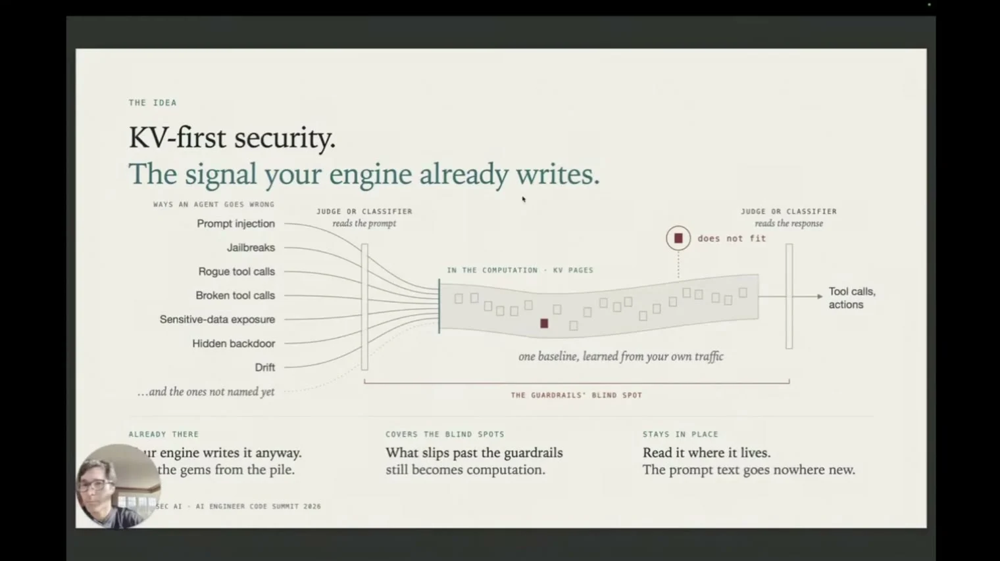
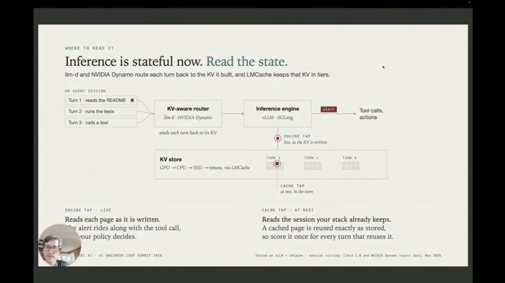
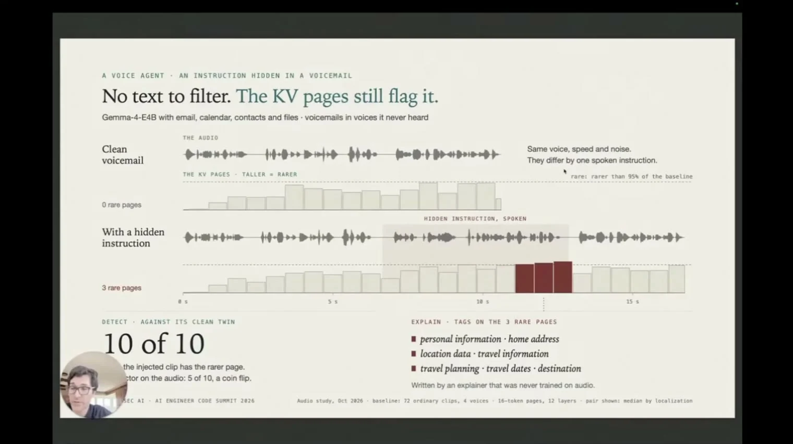
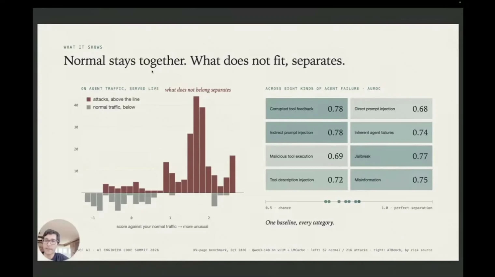
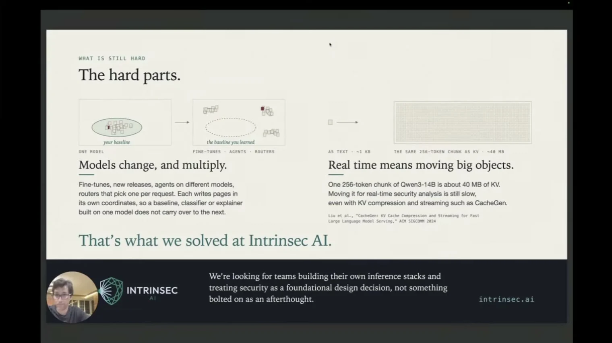

[全部演讲](../README.md) · [选看索引](index.md) · [上一场](04-lauren-tan.md) · [下一场](06-joey-wang.md)

# KV-first Security

**Ari Azarafrooz** · Intrinsec AI · Founder

AIE Code Summit 2026  ·  11 月 11 日  ·  Online Track 预录插播  ·  录屏 01:05:34–01:12:46

> 这场在直播休息时插播过多次。以下采用后续连续播出的版本。

[官方讲者资料](<https://ai.engineer/code/2026#speakers>)   ·   [Day 1 官方回放](<https://www.youtube.com/watch?v=ZZ19zhYnDKY>)

## 本场目录

- [01:05:35](#section-1) KV cache 可以补充哪些现有防护信号
- [01:07:41](#section-2) 基线、异常检测及推理栈中的接入位置
- [01:09:37](#section-3) 语音与文本场景的案例及部署难点

## 演讲实录

> 英文源自录屏音频，经轻度校订。每段英文下方为中文译文。时间指向原始录屏。

### KV cache 可以补充哪些现有防护信号

**01:05:35**　Hi, I'm Ari Azarafrooz, founder of Intrinsec AI. This talk is for people who build agents and run their own inference stack or plan to. And if that's you, you’re typically familiar with the KV cache, the bread and butter of modern inference. The keys and values are computed per token and kept so the model doesn't compute them again.

嗨，我是 Ari Azarafrooz，Intrinsec AI的创始人。本次演讲适合那些开发智能体、运行自己的推理栈或计划这样做的人。如果这就是你，那么你对KV缓存应该很熟悉了，这是现代推理的基础。键和值会根据每个token进行计算，并被保存下来，这样模型就不会再次计算它们了。

**01:05:58**　Today, I would like to show KV cache in a different light The ways AI agent applications can go wrong keep growing, right? Prompt injection jailbreaks broken tool calls sensitive tool calls, sensitive exposures hidden backdoors and drifts and so forth right so the way right now we typically guard against against these numerous ways that an AI agent application could go wrong is by guarding the edge by perhaps passing a judge model that checks the prompts, the inputs, and the response outputs against your policy, all right? Or you build a classifier for each case. But here’s a different way to look at it. The model turns every input into a computation before it acts, before it decodes, before it generates the response, before that response becomes another tool call.

今天，我想以不同的角度来介绍 KV 缓存。AI 智能体应用程序出现错误的方式越来越多了，对吧？提示注入、漏洞、错误的工具调用、敏感的信息泄露、隐藏的漏洞以及其他问题等等。因此，目前我们通常通过保护边界来防范 AI 智能体应用程序可能出现的各种错误，比如使用一个模型来检查提示、输入和输出结果是否符合我们的政策，对吧？或者为每种情况建立独立的分类器。但这里有一种不同的看待方式。该模型在做出反应之前，会先将每个输入转化为计算内容，然后再进行解码、生成响应，最后这个响应又成为另一个工具调用。

_截图 01  ·  录屏 01:06:27_

**01:06:47**　The KV cache is your engine's record of that computation, which modern inference engines already use and read. And therefore, in this talk, I would like to suggest as a complement to the way you're already using your own guardrails to use this data and integrate it with your KV cache infrastructure. I refer to this as a KV-first security signal and there are basically three reasons that matters, right?

KV缓存是引擎对该计算的记录，现代推理引擎已经使用并读取它。因此，在今天的演讲中，我想建议将这种数据与您现有的防护措施相结合，以利用这些数据并将其整合到您的KV缓存基础设施中。我将其称为“以KV为优先的安全信号”，主要有三个重要的原因，对吧？

**01:07:15**　So the data is already there. You pick the gems from the pile your inference stack was already throwing away. It covers the guardrail's blind spots because whatever slips past those guardrails, it still becomes computation. And it stays in place, so it's perfect for data privacy application for cases where you do not have the luxury to read the inputs and outputs. And the recipe is pretty straightforward, right?

所以数据已经存在了。你可以从推理栈上被丢弃的文件中选取有用的数据。这能覆盖防护措施的盲区，因为无论什么内容通过这些防护措施，最终仍会被处理为计算内容。而且它保持原样，因此非常适合用于数据隐私应用，尤其是在无法读取输入和输出数据的场景中。这个方法也很简单，对吧？

### 基线、异常检测及推理栈中的接入位置

**01:07:41**　It has three steps. You learn a baseline for your AI workload, for your AI inference traffic, what your KV pages typically look like, and then find the KV pages that are rare against your baseline, typically your anomalies. And then you can even classify and explain those. So first let's start with where in this stack this integration could happen. The interesting thing about the KV cache is that in a way having them makes inference stateful in a way, right?

它有三个步骤。你首先会了解AI工作负载的基线情况、AI推理流量的情况，以及KV页面通常的样貌；然后就能找出与基线相比较为罕见的KV页面，也就是所谓的异常点。之后你还可以对这些异常点进行分类和解释。那么首先，让我们看看在这个技术栈中，这种集成可以发生在哪里。关于KV缓存的有趣之处在于，以某种方式来说，使用它们可以让推理过程具有状态性，对吧？

**01:08:14**　So for example, things like KV cache management layers, such as LMCache, store them from GPU down to a remote storage, or llm-d and NVIDIA Dynamo route each new request towards the worker that already holds perhaps that cached KV page. So there are two integration points where you can integrate anomaly detection or those classifiers. Either you can implement it directly inside of your inference engine, vLLM, SGLang and so forth.

例如，像 KV 缓存管理层这样的组件，比如 LMCache，会将数据从 GPU 存储位置保存到远程存储中；而 llm-d 和 NVIDIA Dynamo 则会将每个新请求转发给已经持有该缓存 KV 页面的工作进程。因此，有两个集成点可以用于实现异常检测或相关分类器功能。你可以直接将其集成到你的推理引擎中，比如 vLLM、SGLang 等系统中。

_截图 02  ·  录屏 01:08:36_

**01:08:43**　The beauty of this approach is that it's real time and the alert that it would perhaps generate could ride along your future tool calls or your future policies so that you can harden basically your policies or guardrails by flagging the computational anomalies that you observe within your inference engines. And perhaps you can integrate it as a way of threat discovery in a sense.

这种方法的优点在于它是实时的，所生成的警报可以伴随你的未来工具调用或政策执行，从而通过标记你在推理引擎中发现的计算异常来强化你的政策或防护措施。或许你还可以将其作为发现威胁的一种手段来使用。

**01:09:12**　So you can integrate it with your LMCache. So it reads the stored KV pages and finds things that don't belong with the rest, right? I want to show you some numbers and just a very simple Hello World use case if this is actually working and this is a valid approach. And for that, let me use a use case that has no text to filter at all, a voice agent.

所以你可以将其与 LMCache 集成。这样它就能读取已存储的 KV 页面，找出那些不属于其他内容的部分，对吧？如果这真的有效且是一种有效的方案，我想给你展示一些数据，以及一个非常简单的 Hello World 使用案例。为了做到这一点，我会用一个没有任何文本过滤的语音智能体作为案例。

### 语音与文本场景的案例及部署难点

**01:09:37**　So here's a case study of a voice agent. In this case, it was a Gemma 4 E4B. Our baseline was 72 ordinary clips spoken in four voices. We're looking at 16-token pages. Obviously this granularity could change, but here we use shorter pages so we can have more data in the baseline. Then in the test, we have different voices. One clip is clean, and the other has a hidden instruction in it. As shown here, you can detect these cases using simple anomaly detection, and you can also see which page and which part of the request had the anomalous event.

这是一个智能体的案例研究。在这个例子中，使用的是Gemma 4 E4B模型。我们的基准数据是用四种声音播放的72个普通片段。我们关注的是16个词长的页面。显然，这种粒度可以调整，但在这里我们使用更短的页面，以便能在基准数据中获得更多数据。在测试中，我们使用了不同的声音。其中一个片段是干净的，另一个则包含隐藏的指令。如这里所示，可以通过简单的异常检测来识别这些情况，同时还可以看出是哪页、请求的哪部分出现了异常现象。

_截图 03  ·  录屏 01:10:00_

**01:10:22**　We even went further and we trained a model that uses the KV pages as features and we tried to explain it or tag it with things that are useful. In this case, although it wasn't even trained on audio, it was able to generate correct information about personal information, home address, location data, travel information, and destination. So now back to text agents.

我们还进一步训练了一个模型，该模型使用 KV 页面作为特征，并试图用有用的内容对其进行解释或标注。在这种情况下，尽管该模型并非基于音频进行训练，但它能够生成关于个人信息、家庭地址、位置数据、旅行信息及目的地的正确内容。现在回到文本智能体的话题。

**01:10:46**　In this case it was a Qwen3 14B, live on vLLM and LMCache. The one on the left shows you an idea of how attacks and normal traffic would typically separate from each other. And then the one on the right, which is perhaps more meaningful, it was using the AT bench and hugging face. It has its own baseline of benign agent traces and eight kinds of agent failure, from injected tool descriptions to misinformation and so forth.

在这种情况下，使用的是 Qwen3 14B模型，该模型运行在 vLLM和LMCache上。左边的图能让你了解攻击流量与正常流量通常如何区分。而右边的图则更有意义，它使用了AT测试环境，并展示了“拥抱面部”的行为。其中包含了一些正常的智能体痕迹以及八种智能体故障类型，包括工具描述注入、错误信息等。

_截图 04  ·  录屏 01:11:02_

**01:11:15**　We look at the top 10 alerts that anomaly detection would generate and about seven to eight times out of 10 of these alerts are actually anomalous, meaningful and useful anomalous activities. We even went further and we looked at whether there's any kind of anomalous event that stand out more than the rest. To make things hard in production, first, models change. Fine-tunes and new releases, but also agents that each run on a different model.

我们查看了异常检测会产生的前10个警报，其中大约7到8次是真正的异常、有意义的且有用的活动。我们甚至进一步研究了是否存在某种比其他更突出的异常事件。为了增加实际运行中的难度，首先模型会发生变化——有微调和新版本发布，还有每个都运行在不同模型上的智能体。

**01:11:51**　And routers that pick a specialist model per request. That means each model writes its pages in its own coordinates, so either you learn every baseline, classifier, and explainer, which is computationally prohibitive, or you have to find a way to map them all into one shared representation space. Second, real-time means moving big objects. For example, a 256-token chunk of Qwen3 14 billion is about 40 megabytes of KV.

以及那些根据请求选择专业模型的路由器。这意味着每个模型都用自己的坐标来编写页面，因此要么需要学习所有基础模型、分类器与解释器，这在计算上非常困难，要么就得找到一种方法，将所有这些模型映射到同一个共享表示空间中。其次，“实时”指的是处理大型对象。例如，256个token的Qwen3数据块包含140亿个元素，大约相当于40兆字节的KV数据。

_截图 05  ·  录屏 01:12:00_

**01:12:25**　Compression and streaming like CacheGen could help, but moving that for security analysis and acting in real time is still slow. And that's what we saw at Intrinsec AI. We are looking for teams building their own inference stacks who treat security as a foundational design decision. I hope this was helpful for you. Thank you so much for listening.

像 CacheGen 这样的压缩和流媒体技术或许会有帮助，但将其用于安全分析和实时操作仍然比较缓慢。这也是我们在 Intrinsec AI 所遇到的问题。我们正在寻找那些能够构建自己的推理栈的团队，这些团队会将安全作为基础设计决策来对待。希望这对你有帮助。非常感谢你的倾听。

---

[全部演讲](../README.md) · [选看索引](index.md) · [上一场](04-lauren-tan.md) · [下一场](06-joey-wang.md)
