[全部演讲](../README.md) · [选看索引](index.md) · [上一场](05-intrinsec.md) · [下一场](07-rajath-kotyal.md)

# 10,000 agent PRs later, what broke wasn’t the agents

**Joey Wang** · Harvey · Engineering Lead

AIE Code Summit 2026  ·  11 月 11 日  ·  Online Track 预录插播  ·  录屏 01:12:46–01:25:39

[官方讲者资料](<https://ai.engineer/code/2026#speakers>)   ·   [Day 1 官方回放](<https://www.youtube.com/watch?v=ZZ19zhYnDKY>)

## 本场目录

- [01:13:07](#section-1) 超过一万个 Agent PR 后，平台成了瓶颈
- [01:15:20](#section-2) Spectre 如何串起代码、环境、验证和交付
- [01:18:07](#section-3) 人和 Agent 都能发起任务，入口与使用习惯怎样变化
- [01:20:25](#section-4) 告警风暴、集群公平调度、合并队列

## 演讲实录

> 英文源自录屏音频，经轻度校订。每段英文下方为中文译文。时间指向原始录屏。

### 超过一万个 Agent PR 后，平台成了瓶颈

**01:12:46**　Let me start with one number from last month. On average, more than one agent has started on our platform every single minute, day and night. And honestly, the agents were the easy part. Hi, I'm Joey. I build Spectre, the cloud agent platform we built inside Harvey. After 10,000 PRs, the biggest lesson I can share is this. The thing that broke wasn’t the agents.

让我从上个月的一个数字开始讲。平均而言，每分钟、每天、每夜都有不止一个智能体在我们的平台上运行。说实话，智能体部分是最简单的。嗨，我是乔伊。我在 Harvey 内部开发了 Spectre 这个云智能体平台。经过 10,000 次公开演讲后，我能分享的最大教训就是这个。真正出问题的不是智能体。

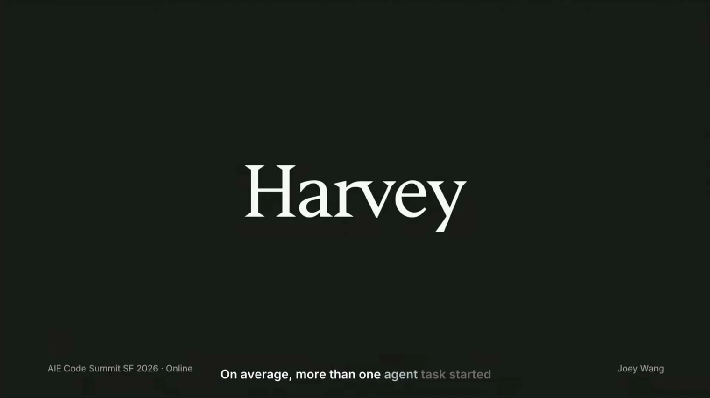

_截图 01  ·  录屏 01:12:50_

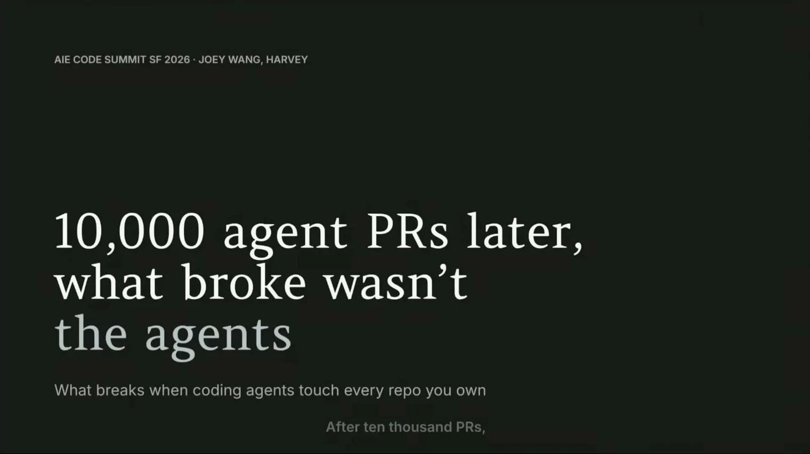

_截图 02  ·  录屏 01:13:07_

**01:13:14**　It was everything around them. So what does once a minute add up to? 10,000 PRs that an agent wrote. And it isn't just the DevEx team playing with a toy. Last month, about 460 different people at Harvey used it. And over the summer, it stopped being only about code. People start asking a data question in Slack and getting answers back. My favorite, recently someone on our marketing team dropped a prototype and a talk track into Slack and asked for a storybook for a product video.

就是他们周围的一切。那么，每分钟产生的10,000条由智能体撰写的PR内容又意味着什么？这不仅仅是DevEx团队在玩弄一个工具而已。上个月，哈维公司的约460名人员使用了它。而整个夏天，它不再仅仅与代码相关。人们开始在Slack上询问数据相关的问题并获得回应。我最喜欢的是，最近我们的市场团队有人把原型作品和讲解音频上传到Slack中，并要求制作产品视频的故事书。

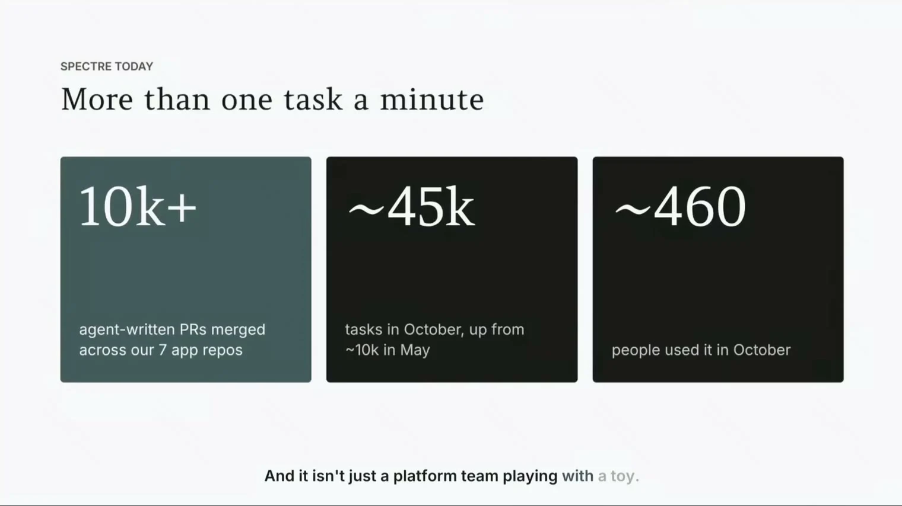

_截图 03  ·  录屏 01:13:28_

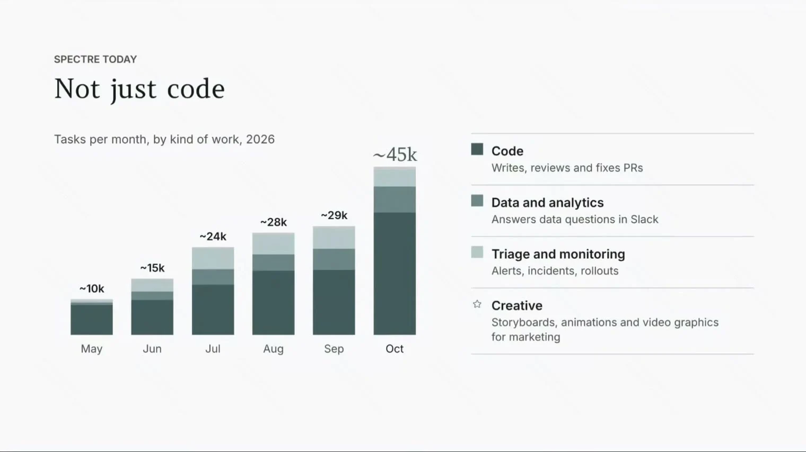

_截图 04  ·  录屏 01:13:45_

**01:13:55**　Once the harness exists, people bring the work that you never planned for. So a promise upfront, this is not a talk about models, evals, or leaderboard. This is talk about hardness, all the things around the model. Checking out the repo, holding the key, opening the PR, getting the merge. When we first wrote about Spectre back in April, we put it like this.

一旦 Harness 存在了，人们就会提出一些你原本没有计划要做的任务。所以先承诺一下，这不是关于模型、评估或排行榜的话题。这是关于难度、与模型相关的所有方面的讨论。查看代码仓库、持有密钥、打开 PR、完成合并。当我们在四月时第一次谈论 Spectre 时，我们就这么表述了。

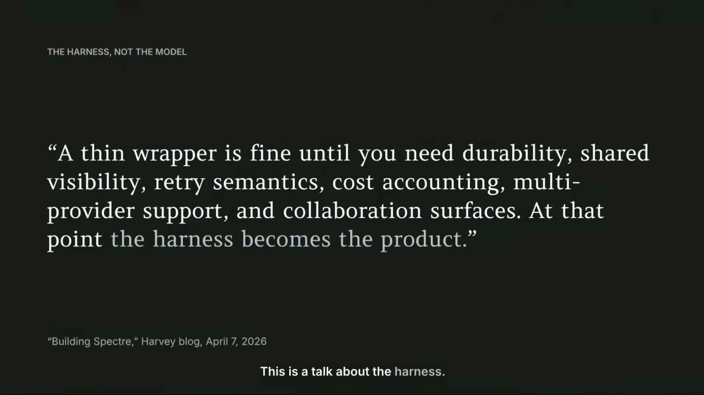

_截图 05  ·  录屏 01:14:10_

**01:14:24**　At some point, the harness becomes the product. Now whenever I tell people this, I get the same question. Why on earth would you build this when Claude Code or Cursor already exists? My answer, we don't compete with them, we run them. And here's how I see it, as my own view. Agents on your laptop are powerful, but they don't scale. You can realistically run 5 to 10 of them.

在某个时刻，Harness就成为了产品。每当我向人们解释这一点时，都会得到同样的问题：既然Claude Code和Cursor已经存在了，为什么还要开发这个呢？我的回答是：我们不会与它们竞争，而是负责运行它们。这就是我的看法。笔记本电脑上的智能体很强大，但无法扩展规模。实际上，你可以运行5到10个这样的智能体。

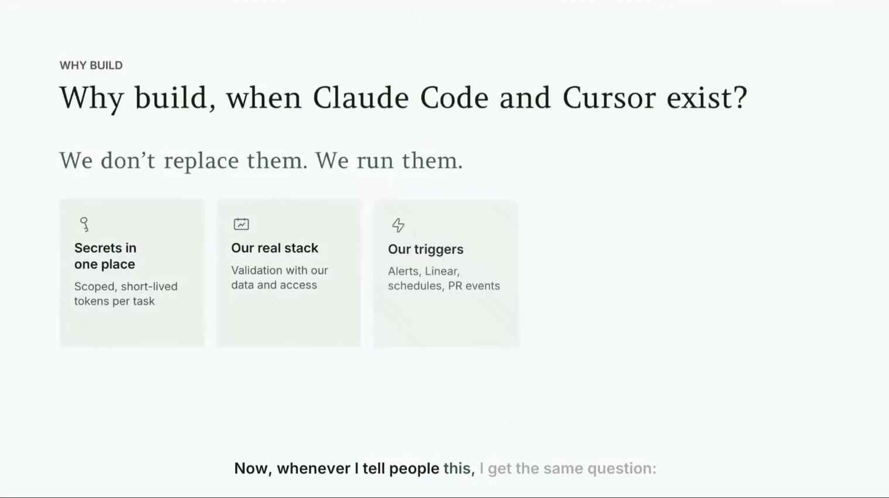

_截图 06  ·  录屏 01:14:30_

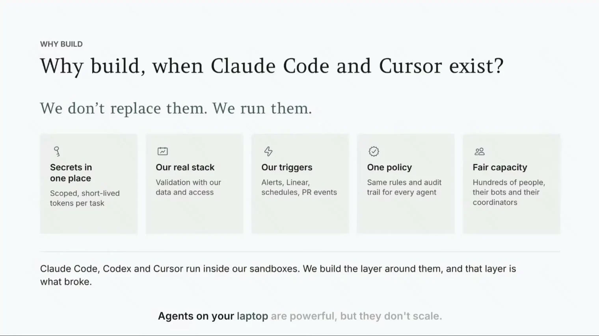

_截图 07  ·  录屏 01:14:47_

### Spectre 如何串起代码、环境、验证和交付

**01:14:53**　Past that, you need the cloud. And cloud needs our secrets, our real stack, our alerts and tickets, one set of rules, and enough capacity that nobody gets starved. No single tool owns that for us, so we built that layer, and that layer is exactly what broke. So I want to tell you three stories today. How we stopped competing on writing code, how we let any agent drive, and where it broke.

除此之外，你需要云技术。而云技术需要我们的秘密、真正的技术栈、警报和工单系统、统一的规则，以及足够的容量，避免任何人陷入困境。没有单一工具能拥有这些资源，所以我们构建了那个层，而那个层正是导致问题的根源。今天我想告诉你们三个故事：我们如何停止了通过编写代码来竞争，我们如何让任何智能体来运行，以及问题出现在哪里。

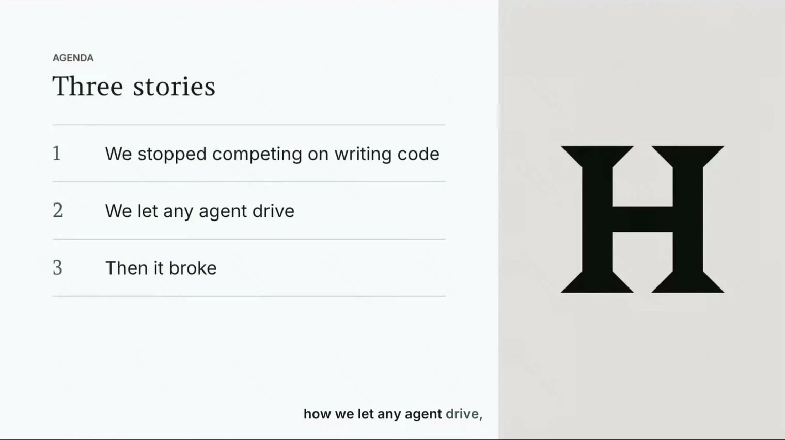

_截图 08  ·  录屏 01:15:20_

**01:15:23**　What they did? The first story starts with the question we keep hearing. More of our engineers were using Cursor and they asked, how do I get our secret there? How do I test against our real stack? We could have rebuilt all that inside Cursor and then again for the next two and the one after that. Instead, answer became one sentence. Just ask Cursor to use Spectre.

他们做了什么？第一个故事从我们一直听到的问题开始。更多的工程师使用Cursor，他们问：我如何获取我们的机密信息？我如何针对真实的栈进行测试？我们本可以把所有内容都重新在Cursor中构建，然后再重复两次、三次。但答案却变成了一句话。只需让Cursor使用Spectre即可。

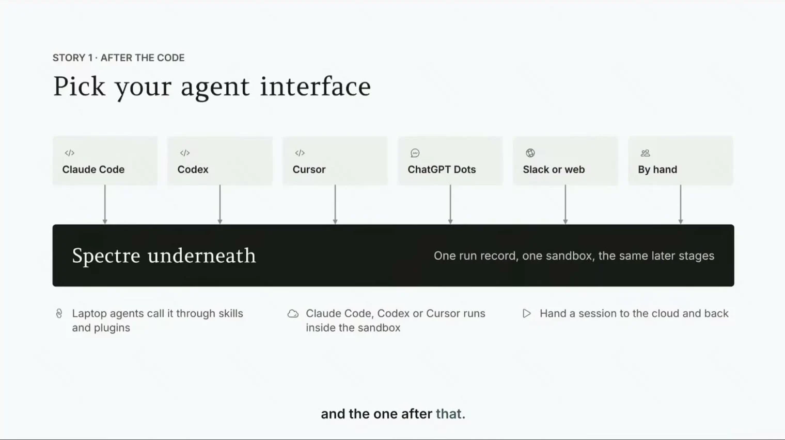

_截图 09  ·  录屏 01:15:45_

**01:15:53**　And that's really the whole idea. People will always have a favorite agent. And the favorite keeps changing. So pick yours. Claude Code, Codex, Cursor, ChaiGPT. Slack or your own hands. Start on your laptop. Push the session to the cloud. Pull it back. That's how Spectre sits underneath all of that. Once the code was written, the real work starts. Picture a PR state.

这就是整个概念。人们总会有一个最喜欢的智能体，而这个选择会不断变化。所以请选出你喜欢的那个。Claude Code、Codex、Cursor、ChaiGPT。通过 Slack 或自己动手。从笔记本电脑开始，将会话推送到云端，再取回来。这就是 Spectre 在这一切背后的运作方式。一旦代码编写完成，真正的工作就开始了。想象一下 PR 状态。

**01:16:21**　Alert finds in Slack at two in the morning. An agent picks up, nobody type a thing. It writes a fix, spins up real copy of our stack, and posts the proof on the PR. When CI fails, the follow-up loop reads the failure and pushes another fix while everyone still sleeps. By morning, the PR sits in one review queue under the same rule as other PR, whichever agent wrote it.

凌晨两点在 Slack 上收到警报。智能体接收了消息，没有人添加任何内容。它编写修复代码，启动我们系统的真实副本，并将证明内容发布到 PR 中。当 CI 失败时，后续流程会读取该失败信息，在所有人还在睡觉时推送另一个修复方案。到了早上，该 PR 会处于一个审查队列中，遵循与其他 PR 相同的规则，无论是由哪个智能体编写的。

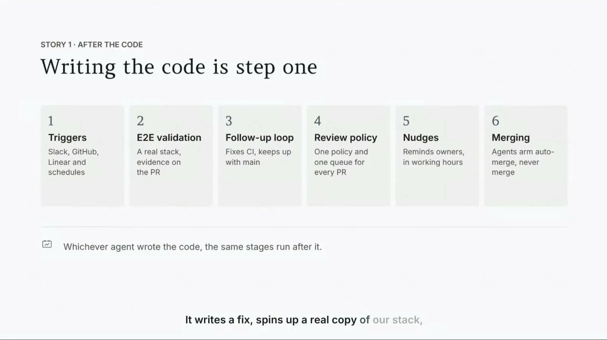

_截图 10  ·  录屏 01:16:31_

**01:16:52**　The owner gets a notch, and only once their working day starts. And when it's approved, an agent can auto-merge it. If you only build one of those stages that I described, build the follow-up loop. We switched on for everyone in early October and that month for all of five agent PRs merged into our backend PR had been through it.

所有者会获得一个等级，且仅在工作日开始时才会发生。当审批通过后，智能体可以自动合并它。如果你只构建了我描述的那些阶段之一，那就构建后续的循环。我们在10月初为所有人启用了这个功能，那个月里所有五个智能体PR都通过这一步骤合并到了我们的后端PR中。

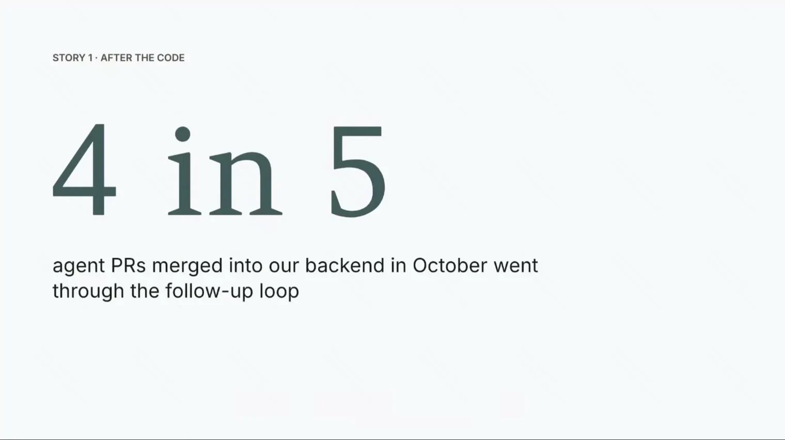

_截图 11  ·  录屏 01:17:09_

**01:17:20**　That's the difference between an agent that write code and an agent that finished the job. And then there's the knowledge. Every team has that one person who knows exactly how to test the tricky service, which flag you never touch. And that knowledge lives in their head or their laptop. So we gave it a whole projects. People write down what matters. Adrian writes down what they learn.

这就是编写代码的智能体与完成任务的智能体之间的区别。此外还有知识问题。每个团队都有那么一个人，他/她完全知道如何测试那些棘手的服务，那些你永远无法触及的内容。这种知识存在于他/她的头脑或笔记本电脑中。因此，我们为它设立了完整的项目。人们把重要的内容记录下来。Adrian则记录下他们学到的东西。

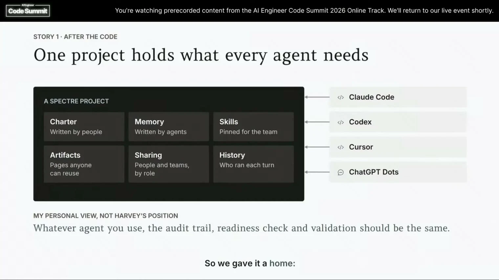

_截图 12  ·  录屏 01:17:42_

### 人和 Agent 都能发起任务，入口与使用习惯怎样变化

**01:17:49**　Tim pins the skills he trusts and there's a record of who ran what. Any agent working in a project reads the same page. My personal view. Whichever agent you pick, the audio trail and the tracks should be the same. The second story is about rule. Back in May, if you want Spectre to do something, you open a browser tab or tagging Slack.

Tim记录了他信任的技能，还有谁执行了什么操作的记录。任何参与项目的智能体都会看到同一页面。这是我的个人观点。无论选择哪个智能体，音频记录和轨迹都应该是相同的。第二个故事涉及规则。在五月时，如果你想让Spectre执行某件事，你可以打开浏览器标签页或标记Slack。

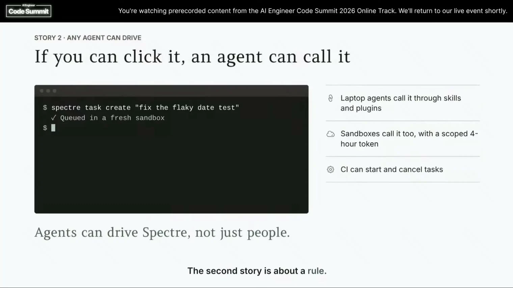

_截图 13  ·  录屏 01:18:07_

**01:18:15**　The whole month, exactly one task came out from terminal. So we made a rule, if a person can click it, an agent can call it. Start a task, turn on the follow-up loop, arm auto-merge, publish a page, or from CLI. Which means your laptop agent can call it, an agent inside the sandbox can also call it. Even CI can call it too.

整个月里，从终端上恰好出现了一个任务。因此我们制定了规则：如果有人可以点击它，智能体就可以调用它。无论是开始任务、启动后续循环、执行自动合并、发布页面，还是通过命令行界面，都可以实现。这意味着你的笔记本电脑上的智能体可以调用它，沙箱中的智能体也可以调用它。甚至 CI 也能调用它。

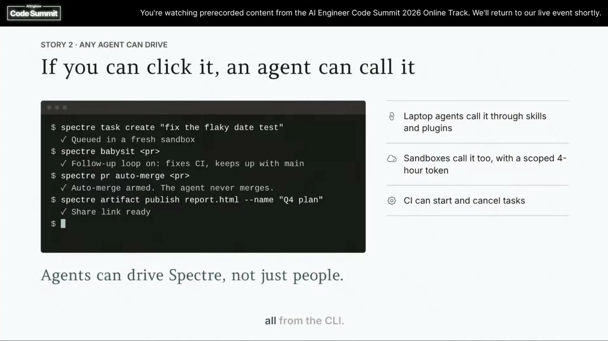

_截图 14  ·  录屏 01:18:32_

**01:18:42**　And then people ran with it. By October, the command line was starting about 6,500 tasks a month. The web app didn't shrink. Everyone else just grew around it. Tasks started from the terminal were merging more pairs than tasks started in browser. And a new kind of user showed up. People who started hundreds of tasks a month and never opened the app at all.

然后人们开始大量使用它。到了10月，命令行界面每月处理的任务数量达到了6,500个。网页应用并没有缩小，而是随着其他应用的发展而不断扩展。从终端开始的任务比通过浏览器开始的任务更多。还有一种新的用户群体出现了——他们每月会启动数百个任务，却根本不打开这个应用。

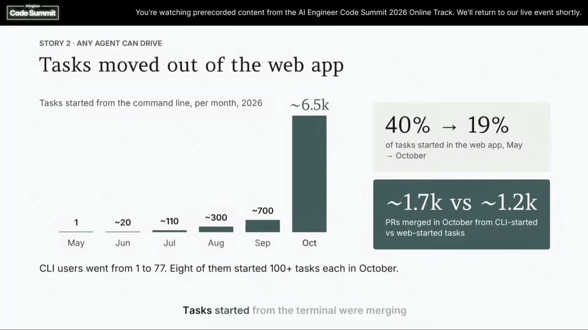

_截图 15  ·  录屏 01:18:57_

**01:19:10**　And this is where it gets fun. In October, I had a big task. So I bought a call code session and asked to be the coordinator. It split the tickets into 10 different milestones. Get one for me and the rest to Spectre with hundreds of tasks. Each has its own sandbox to validate end-to-end. Then at the end of the October, our IT gave everyone tragedy beauty dot.

这就是有趣的地方。十月份时，我有一个重要的任务。于是我参加了一次测试会议，被任命为协调人。任务被分为10个不同的阶段，其中一部分由我负责，其余的则交给Spectre团队处理，还有数百项任务需要完成。每个阶段都有自己的沙箱环境用于端到端测试。十月份结束时，我们的IT部门给每个人分配了“悲剧之美点”任务。

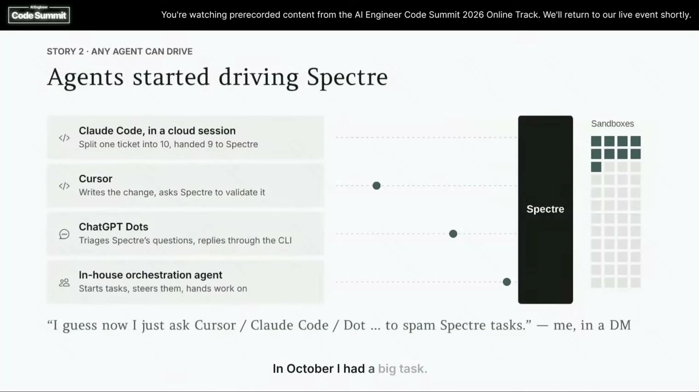

_截图 16  ·  录屏 01:19:14_

**01:19:38**　Mine now watch Spectre for me. It lists the questions Spectre is waiting on, draft my answers, and once I say yes, send them back. I actually DM to my friend like that. I just use Cursor, Claude Code, or whatever to spam Spectre now. Well, that's the dream, but it's also the problem. A quick detour. When we look at where a task time actually went, the slowest step wasn't model syncing, it was git.

现在由我负责看 Spectre 的内容。它列出了 Spectre 等待的问题，我起草答案，一旦同意就发送回去。实际上我是这样给朋友发私信的。我现在只是用 Cursor、Claude Code 或者别的工具来刷 Spectre。好吧，这是梦想，但也是问题。快速绕道一下。当我们查看任务实际完成时间时，最慢的步骤不是模型同步，而是 git。

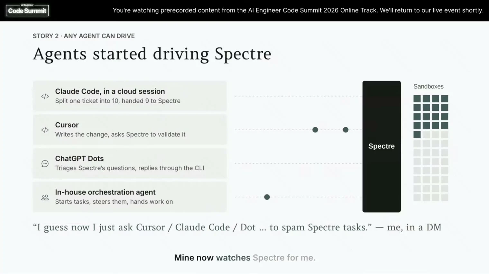

_截图 17  ·  录屏 01:19:39_

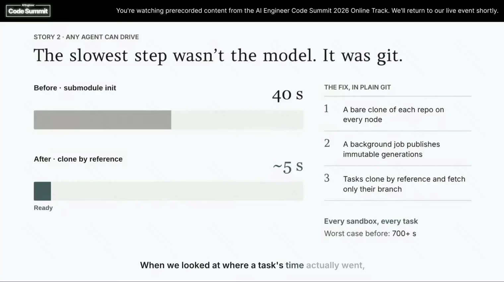

_截图 18  ·  录屏 01:20:04_

### 告警风暴、集群公平调度、合并队列

**01:20:10**　checking out every repo we own took over a minute on average. The fix keep a copy of every repo on every machine and let each task borrow it. The third story is the one where it broke. In mid August, our release goes out with a bug. That bug triggers the alert that files once per workspace. So one bug become hundreds of alerts, all landing in one single Slack channel.

检查我们拥有的每个仓库，平均需要超过一分钟的时间。该系统会在每台机器上保留每个仓库的副本，让每个任务可以借用这些副本。第三个问题就是它出故障了。8月中旬时，我们的发布版本出现了错误。这个错误引发了警报，文件会每工作区出现一次。因此，一个错误就导致数百个警报，所有警报都集中到了一个 Slack 频道中。

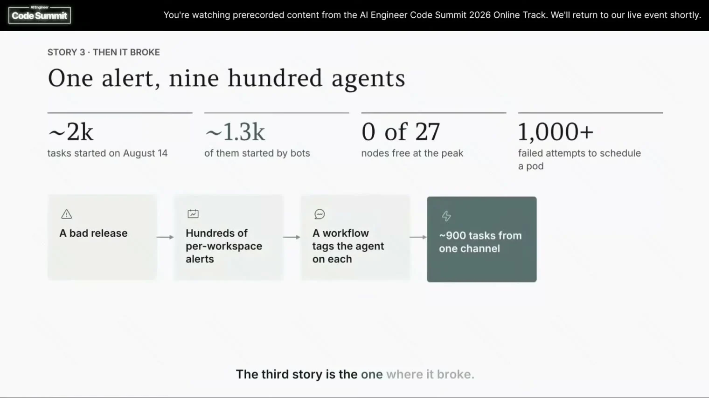

_截图 19  ·  录屏 01:20:25_

**01:20:40**　Someone has set up a workflow that tagged our agent on every alert, and every tag started a task. On a normal day, those tasks started about 50 tasks. That day, in about 4 hours, they started around 900. 900 agents are chasing the same bug until there wasn't room left for a single note. The fix was almost boring. A repeat alert now joins the investigation that's already open.

有人设置了一个工作流，每次警报都会给智能体添加标签，每个标签都会触发一个任务。正常日子里，这些任务会产生大约50个任务。那天，在大约4小时内，它们产生了约900个任务。900个智能体一直在处理同一个问题，直到没有剩余的空间可以添加任何备注。修复工作几乎毫无乐趣。现在又有一个重复的警报加入了已经进行的调查中。

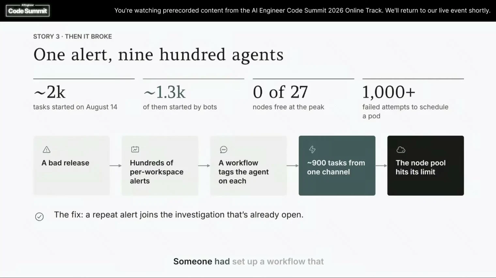

_截图 20  ·  录屏 01:20:41_

**01:21:10**　Two months later it happened again and this time it wasn't a bot. On October, the engineer did exactly what we've been asking everyone to do, hand work to Spectre. About 950 tasks from the command line in about 3 hours. Nothing in our platform can work. The cluster filled up and everyone else work sat in line behind one laptop. That's not a user problem, that's our problem.

两个月后又发生了同样的事情，但这次不是机器人。10月时，工程师按照我们要求的方式完成了工作，把任务交给了 Spectre。大约3小时内处理了来自命令行的950个任务。我们的平台上没有任何东西能正常运行。集群满了，其他人都坐在笔记本电脑后面排队工作。这不是用户的问题，而是我们自己的问题。

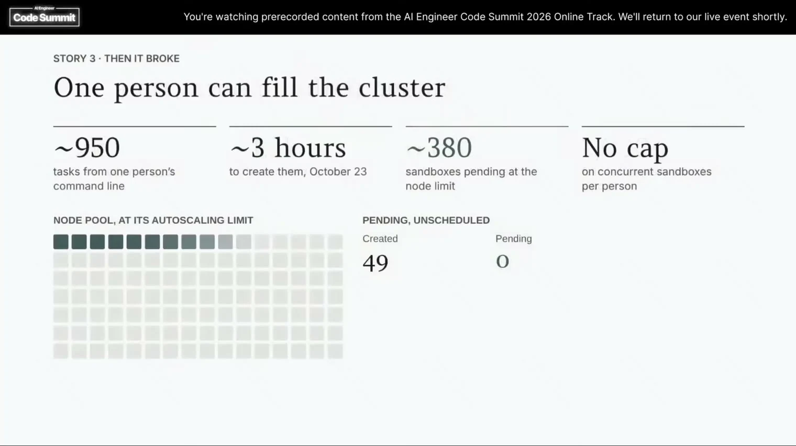

_截图 21  ·  录屏 01:21:10_

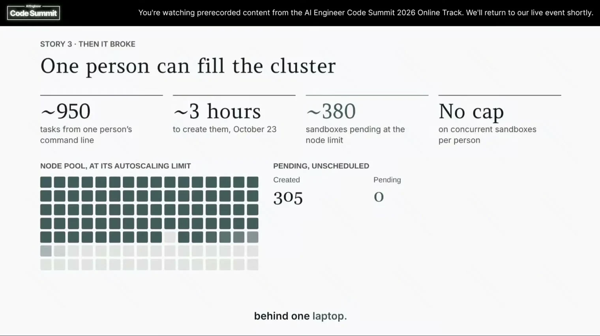

_截图 22  ·  录屏 01:21:40_

**01:21:44**　Four days later, we had a real fix, a fair launch queue. Now starting a task gives you a place in line, and the dispatcher started when there's room. People sitting at the keyboard goes first. Everyone gets a fair share and can borrow more than the cluster is quite. And whenever you start a task, you can see a place in line. When we hit it with a 300 task burst in low task, the task lead went from almost 2 seconds to 70 milliseconds.

四天后，问题得到了真正解决，任务队列变得公平合理。现在开始执行任务时，会为你分配一个排队位置，调度器在有空位时就会开始工作。坐在键盘前的人会优先处理。每个人都能得到公平的份额，而且可以借用超过集群容量的资源。每当你开始执行任务时，就能看到自己的排队位置。当我们在低任务量情况下使用300个任务的批量处理时，任务完成时间从几乎2秒缩短到了70毫秒。

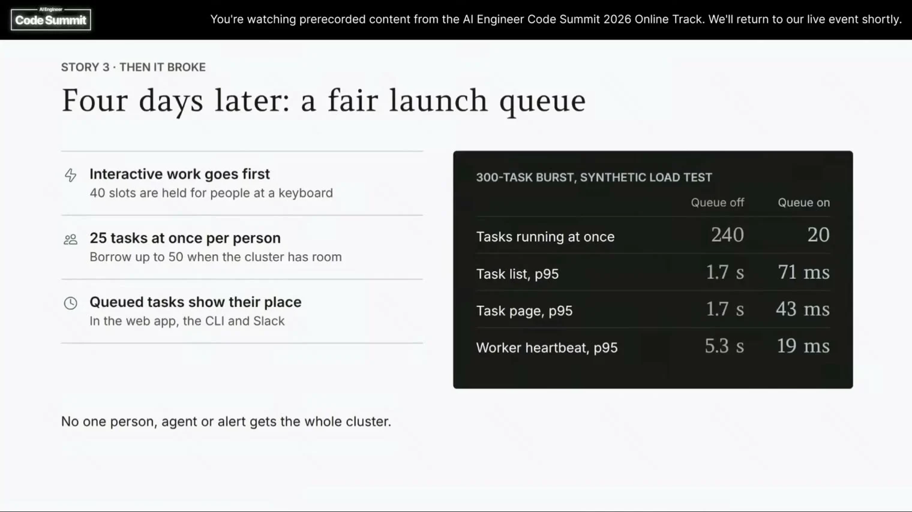

_截图 23  ·  录屏 01:21:56_

**01:22:17**　So did it work? When it's the best day of every week, back in August, two certain tasks and about one in 10 didn't finish. Then in November 4th, more than twice that and much better in the finish line, but we still have some room to grow. I will be modest, we changed several things at once, so I cannot tell you which fix mattered the most, but the burst kept getting bigger and the platform kept up.

那么，这有效了吗？在八月份那个每周最美好的日子里，有两项任务没有完成，大约十分之一的任务也未能完成。到了十一月第四周，这种情况减少了，完成率也提高了，但我们仍然有提升的空间。我会保持谦逊——我们同时改变了许多事情，所以无法说哪个改进最有效。不过，系统性能越来越好，平台也持续稳定运行。

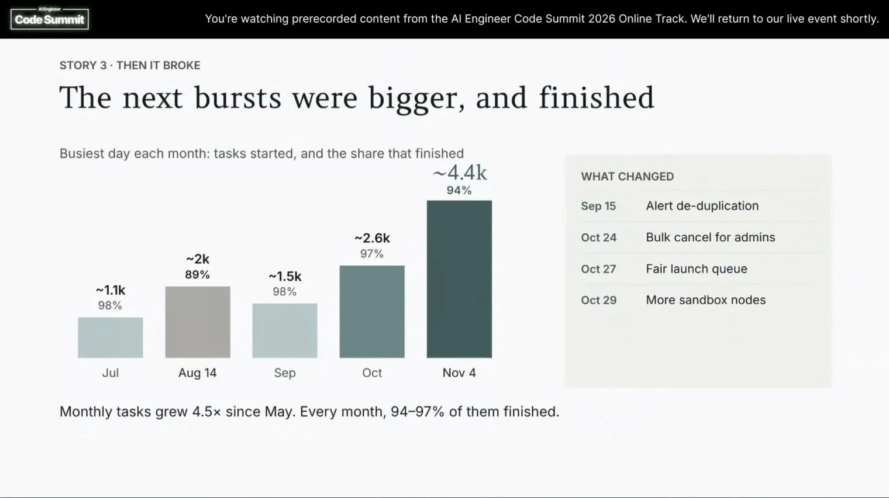

_截图 24  ·  录屏 01:22:30_

**01:22:51**　And just when that was under control, the model neck moves. At the end of October, our dev platform team raised an alarm. PRs across the company had jumped around 60% in a single month. A merge that used to take 15 to 30 minutes was taking over an hour now, and merge queue kept having to be switched off. So now, a PR rebates onto main, reruns CI, and merge if it's green.

就在这一切被控制住之后，模型颈部又开始动起来了。10月底时，我们的开发平台团队发出了警报：整个公司的PR数量在短短一个月内增长了约60%。原本需要15到30分钟的合并操作，现在却需要超过1小时；合并队列也不得不被关闭。所以现在，PR会直接进入主流程，重新运行CI，如果状态为绿色则进行合并。

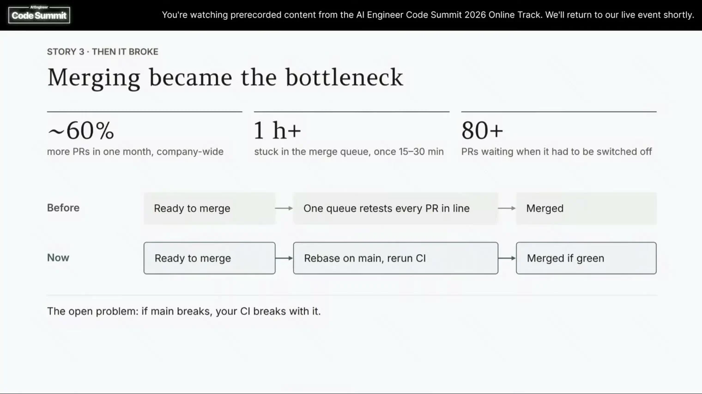

_截图 25  ·  录屏 01:23:07_

**01:23:22**　If main breaks, everyone's CIS breaks with it. Ultimately, we haven't cracked this one yet. But before I go, there's one more thing. While we were busy fixing all of it, something else was quietly growing. Most of what I've been showing you start with a person asking, the fastest growing source of the work on Spectre doesn't. Agents that wake up on schedule or an event and just do the work.

如果主智能体崩溃，所有人的 CIS 也会随之崩溃。归根结底，我们还没有破解这个。但在离开之前，还有一件事。当我们忙于修复一切时，其他事情也在悄悄发展。我给你们展示的大部分内容都是从一个人开始提问的，而 Spectre 项目中增长最快的来源并非如此。按照时间或事件自动醒来的智能体，只是完成工作而已。

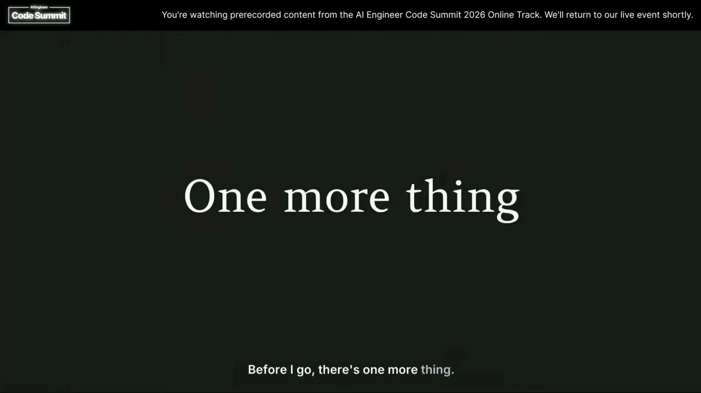

_截图 26  ·  录屏 01:23:32_

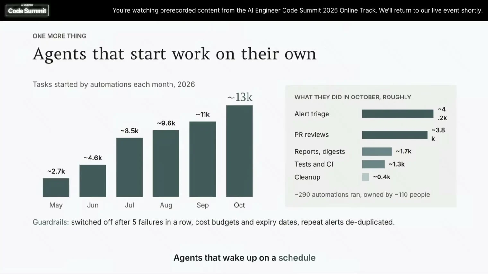

_截图 27  ·  录屏 01:23:53_

**01:23:56**　Trudget alert, review the PR, write the post. Last month, about 110 people had automation running and we learned to give them a guardrail on day one. If one fails five times in a row, it switches itself off. And it can carry a budget or expiry date because when no one's watching, an agent can start thousands of tasks too. So here's what I'm chasing next.

预算提醒，查看公告，撰写帖子。上个月约有110人使用自动化功能，我们在第一天就为他们设定了限制条件。如果某系统连续失败五次，它就会自动停止。它还可以处理预算或到期日期的问题，因为在没有人监管的情况下，智能体可以开始执行数千个任务。这就是我接下来要努力的方向。

**01:24:25**　And I don't have an answer yet honestly. What if every Slack channel had its own agent that never locks off? One that follows the computation and start work on its own? What if every peer proof it works before a human even look at it? Today only one merge in 20 carries that kind of proof. And how do you merge when agents never stop opening PRs?

说实话，我目前还没有答案。如果每个 Slack 频道都有自己的智能体，且不会锁定工作呢？一个能够跟随计算过程并自行开始工作的智能体会怎么样？如果每个智能体在人类查看之前就能证明其有效呢？今天只有 20 个合并中有一个包含这种证明。而当智能体不断打开 PR 时，又该如何进行合并呢？

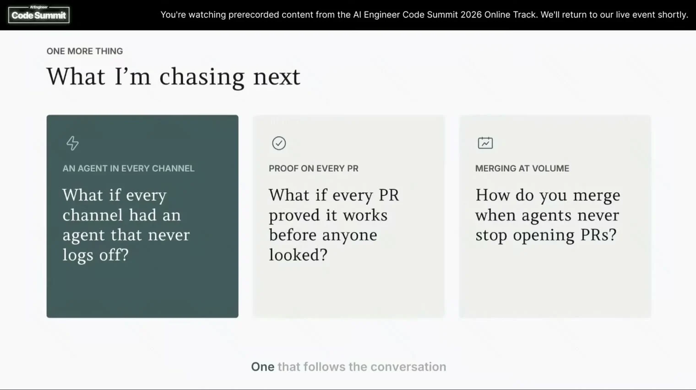

_截图 28  ·  录屏 01:24:35_

**01:24:53**　Ask me again in 6 months. I will tell you what broke. If you're building something like this when you work, here's 3 things I'd do again. Own what happens after the code is written. Make every action something an agent can call. And cap what an agent, human, or alert can start before they find out what they can do with it. And one last thought, that's my own view.

6个月后再问我吧。我会告诉你发生了什么。如果你在工作时正在构建类似的东西，以下是我会再次做的三件事：掌控代码编写之后的所有事情；让每个操作都能被智能体调用；限制智能体、人类或警报在了解其使用方式之前能进行的操作。最后一点，这只是我的个人观点。

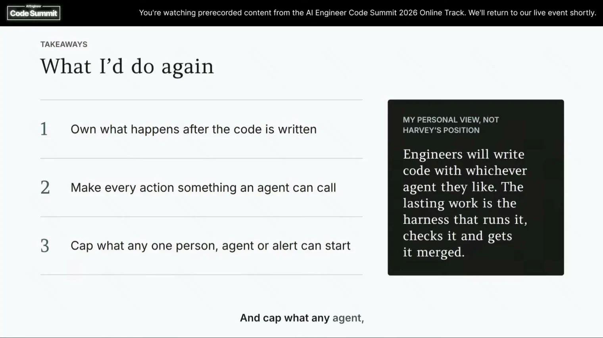

_截图 29  ·  录屏 01:25:12_

**01:25:22**　Engineers can write code with whichever agent they like. The work that's lost is the harness that runs it, checks it, and get it merged. Thank you so much for watching. Come find me on LinkedIn if you're building…

工程师们可以用他们喜欢的任何智能体来编写代码。所失去的，就是负责运行、检查并合并代码的工具。非常感谢您的观看。如果您正在开发相关项目，欢迎在 LinkedIn 上联系我。

---

[全部演讲](../README.md) · [选看索引](index.md) · [上一场](05-intrinsec.md) · [下一场](07-rajath-kotyal.md)
