[全部演讲](../README.md) · [选看索引](index.md) · [上一场](06-joey-wang.md) · [下一场](08-meta-on-call.md)

# Specs Have Bugs Too

**Rajath Kotyal** · Amazon Web Services · Software Developer II

AIE Code Summit 2026  ·  11 月 11 日  ·  Online Track 预录插播  ·  录屏 01:25:39–01:33:31

[官方讲者资料](<https://ai.engineer/code/2026#speakers>)   ·   [Day 1 官方回放](<https://www.youtube.com/watch?v=ZZ19zhYnDKY>)

## 本场目录

- [01:25:50](#section-1) 订单规则为何产生歧义
- [01:28:36](#section-2) LLM 翻译规格，SMT 求解器检查
- [01:29:51](#section-3) 对多种解释做聚类，定位冲突与遗漏
- [01:31:56](#section-4) 方法边界以及交给工程师的复核问题

## 演讲实录

> 英文源自录屏音频，经轻度校订。每段英文下方为中文译文。时间指向原始录屏。

### 订单规则为何产生歧义

**01:25:38**　similar things. Hi everyone. My name is Rajath Kotyal. I'm part of the automated reasoning group at AWS. And today I'm going to talk about a project I worked on recently called Kero specification analyzer. And we use certain techniques, which involves formal methods and automated reasoning to prove specification that goes to your coding agent before it writes code. So let's take a certain bug, right?

类似的事情。大家好，我是Rajath Kotyal。我属于AWS的自动化推理团队。今天我将介绍一个我最近参与的项目，名为Kero规范分析器。我们使用一些技术，包括形式化方法和自动化推理，来验证那些在代码编写之前会提交给编码智能体的规范。那么，让我们以某个错误为例吧？

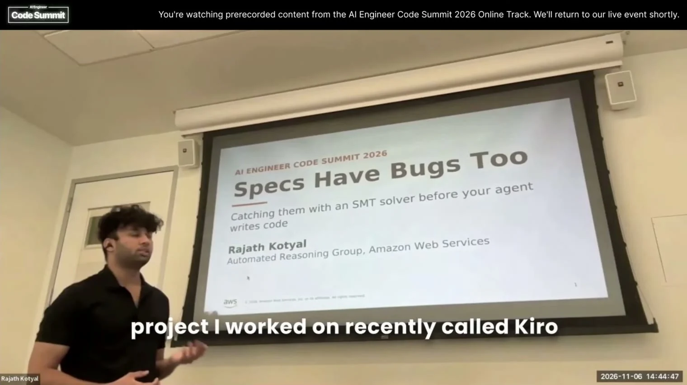

_截图 01  ·  录屏 01:25:50_

**01:26:15**　This is a specification snippet, and there are two rules, for example, and the rule two says when an order is submitted, and this is for a general e-commerce website, let's say. When an order is submitted and the inventory is unavailable, we place the order as a backorder, which makes sense when you read it individually. And there's also another rule in the same specification file, which you hand to the coding agent, which says, no order shall be placed as a backorder, and this is a rule we have set.

这是一份规范片段，其中包含两条规则。例如，第二条规则规定：当订单被提交时——假设这是一个通用的电子商务网站——如果库存不足，我们就会将订单列为延期订单。单独阅读这些规则就能明白其含义。此外，同一规范文件中还有另一条规则，要求不得将订单列为延期订单，这也是我们设定的规则。

**01:26:50**　So individually read, these two lines make sense, right? But in when an LLM reads this read both the rules together both cannot hold through at the same time. So we need to make sure we resolve this ambiguity that the LLM is observing. And the scope and the reason we put an effort into this project is based on public research recent research, we observed there's a 20 to 40% drop with unclear prompts on the accuracy the LLM generates and the code accuracy, right?

单独来看，这两行话是合理的，对吧？但当一个 LLM 同时阅读这些规则时，它无法同时满足两者。因此，我们必须解决 LLM 所遇到的这种歧义问题。我们投入这项研究的动机和范围，是基于近期的研究结果——我们发现，当提示不明确时，LLM 生成的准确性以及代码准确性会下降 20% 到 40%，对吧？

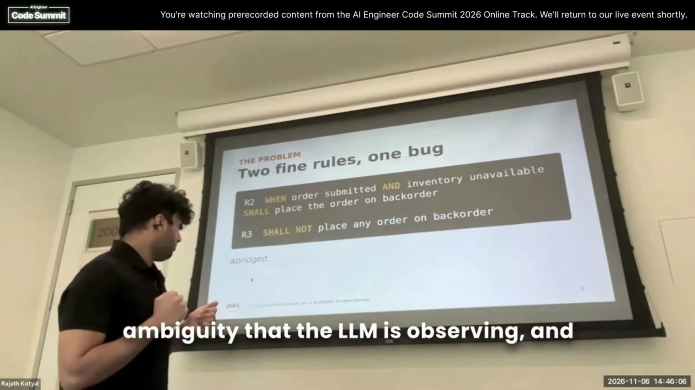

_截图 02  ·  录屏 01:27:09_

**01:27:32**　And 60 to 90% of valid code is still wrong after it writes it. And also in that case, we observed two times the more regressions when we deploy that code. So where do bugs like these hide, right? We want to detect these bugs before they reach the code base. And the only way to do that, it's similar to how we write design docs, similar to how we draw diagrams and flow charts to make sure the flow is set before we write any code.

而且，60%到90%的有效代码在编写完成后仍然存在错误。此外，在这种情况下，我们观察到代码部署后出现两次更多的回归问题。那么，这类错误究竟隐藏在何处呢？我们希望在它们进入代码库之前就能发现它们。而实现这一目标的唯一方法，就类似于我们编写设计文档的方式，也类似于我们绘制图表和流程图的方式，以便在编写任何代码之前确保流程正确。

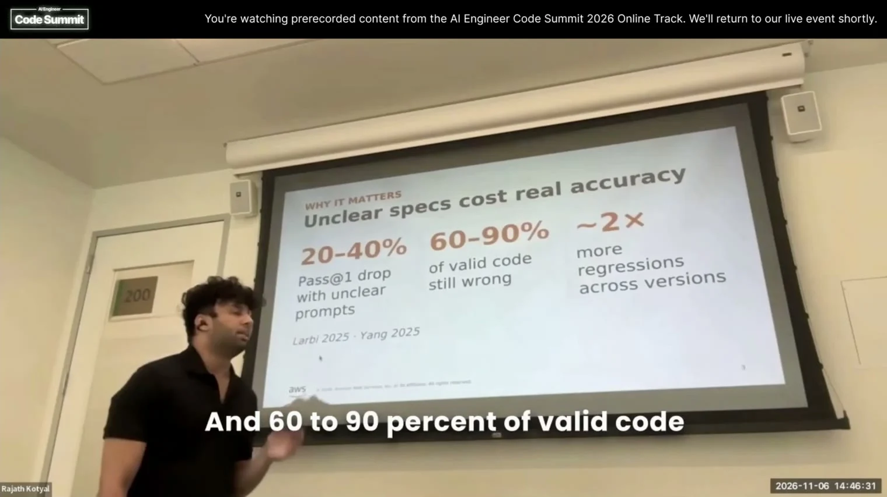

_截图 03  ·  录屏 01:27:34_

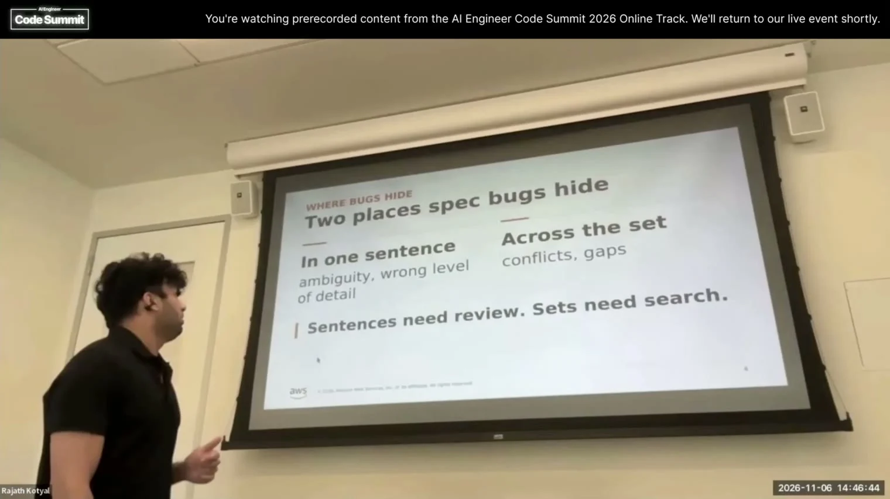

_截图 04  ·  录屏 01:27:46_

### LLM 翻译规格，SMT 求解器检查

**01:28:03**　We want to verify that without a human or anyone reading these files as the first reviewer. In one sentence, let's say the ambiguity and wording or wrong level of detail, but across sentences, we can observe conflicts and gaps in these specification or rules, right? Sentences need review, such need search between them and ambiguity searches. So we have a three-step process to do this, where the LLM will first refine it.

我们希望验证，没有人类或任何人作为第一位审查者来阅读这些文件的情况。用一句话来说，就是存在模糊性和表述不当、细节层次不足的问题；但从多个句子来看，可以观察到这些规范或规则中的冲突与空白，对吧？句子需要被审查，还需要在句子之间进行搜索，以及解决模糊性问题。因此，我们采用三步流程来完成这一工作，其中LLM会先对其进行优化。

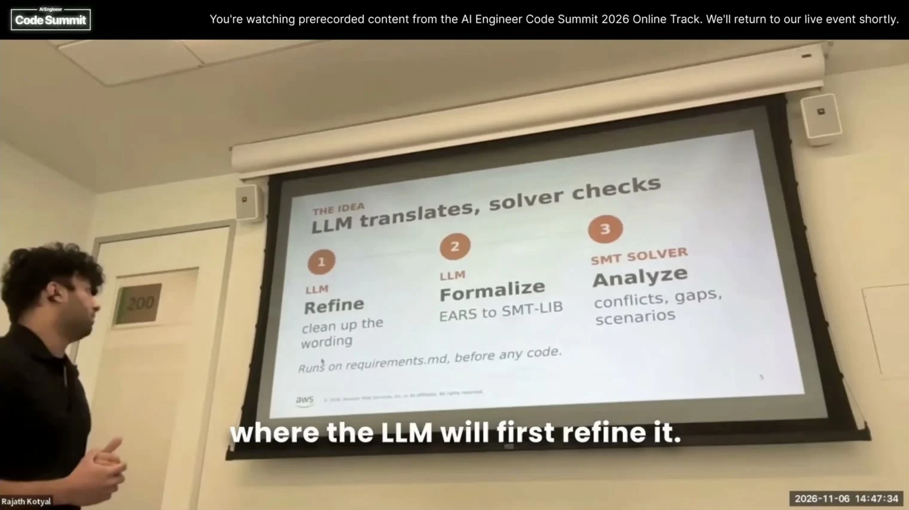

_截图 05  ·  录屏 01:28:36_

**01:28:37**　It'll try to clean up the wording on its own. And if it succeeds, then well and good, but if it cannot, we then formalize the English language into SMT formulas. So SMT lib is a certain type of function which we pass to a SAT solver, a satisfiability checker, where it's going to give out a Boolean saying this expression that you're giving me is valid, true, or false, invalid.

它会尝试自行优化措辞。如果成功的话，那当然很好；但如果不行，我们就把英语语言形式化为 SMT 公式。因此，SMT lib 是一种函数，我们将其传递给 SAT 求解器或满足性检查器，后者会给出一个布尔值，说明你提供的表达式是否有效、为真还是为假。

**01:29:08**　And then once the solver gets back to us, if that expression is valid, then we don't do anything. But if it detects any ambiguity between two sentences or within a sentence where there's two meanings to a sentence, then we detect that and tell the LLM to recheck that sentence, and it's going to reiterate on that. For example, the rules we saw.

然后，一旦求解器返回结果，如果该表达式有效，我们就不会做任何操作。但如果它发现两个句子之间或句子内部存在歧义，即该句子有两种含义，那么我们就会检测到这一点，并告诉大语言模型重新检查该句子，它也会重新进行验证。比如我们之前看到的那些规则。

### 对多种解释做聚类，定位冲突与遗漏

**01:29:30**　Now, we've seen when order is submitted and inventory is unavailable, we shall place the order as a backorder and in SMT format, it kind of looks like this, this like math formula, right? Once we go deeper, once we detect this, we also do a three-step process again where we sample the translations again and again. We ask the LLM to translate seven times or 10 times, and to understand whether this LLM is behaving this way, based on its inherent capabilities or is something affecting it to be here this way.

现在，我们已经看到当订单被提交但库存不足时，我们会以延期订单的形式进行处理，在 SMT 格式下，看起来就像这样的数学公式一样，对吧？一旦深入分析，一旦发现这种情况，我们还会再次进行三步流程：反复测试翻译结果。我们会让 LLM 翻译七次或十次，以了解该 LLM 是否真的如此表现，还是因为某些因素导致它呈现这种状态。

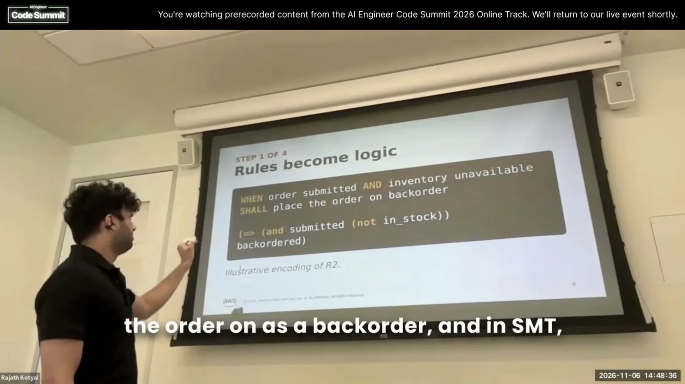

_截图 06  ·  录屏 01:29:39_

**01:30:14**　And then based on logical equivalence of these seven or 10 different set of interpretations We cluster them on logical equivalence, which entries came under which assumptions that the LLM made for itself. And then we accept or ask the user to clear out the ambiguity or abstain from implementing that in the code base. This is an example of asking the human what you want to do with that rule that was perhaps contradicting.

然后，基于这七种或十种不同解释方案的逻辑等价性，我们将它们按逻辑等价性进行分组，确定这些方案属于LLM为自己设定的哪些假设。接着，我们要么接受这一情况，要么要求用户消除模糊性，或者不在代码库中实施该规则。这是询问人类想要如何处理可能相互矛盾的规则的例子。

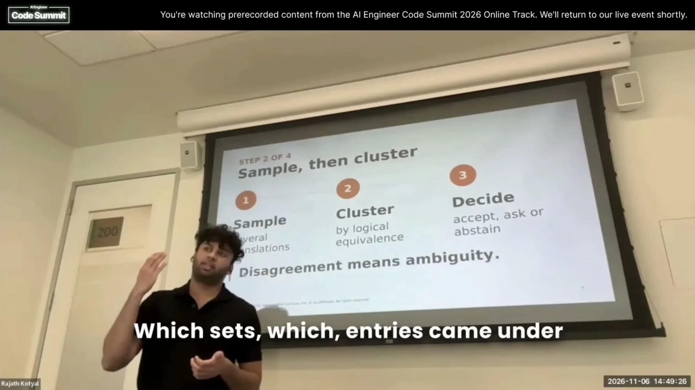

_截图 07  ·  录屏 01:30:29_

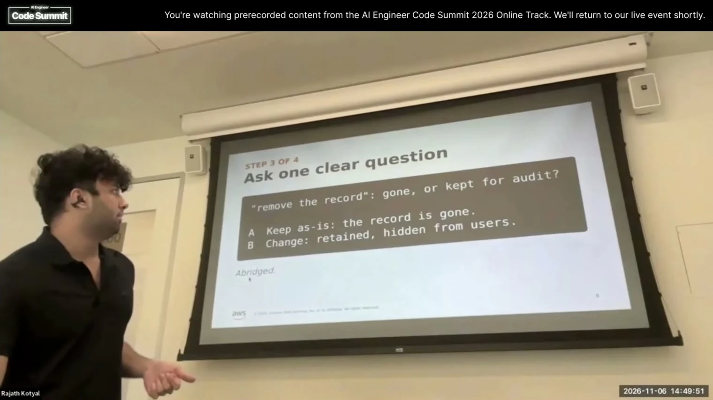

_截图 08  ·  录屏 01:30:54_

**01:30:58**　Remove the record is a very vague statement. The LLM can interpret anything it wants, but we shouldn't allow that to happen. And we either give two options. We keep it as is. The record is deleted, or we retain it but hide it from the users. Which one does the user prefer? A conflict is when the example we saw rule one is conflicting with rule three.

“删除记录”这一说法非常模糊。LLM可以任意解释，但我们不能允许这种情况发生。我们只有两种选择：要么保留当前状态，删除记录；要么保留记录，但向用户隐藏。用户更倾向于哪种？当看到的规则与规则三冲突时，就出现了矛盾。

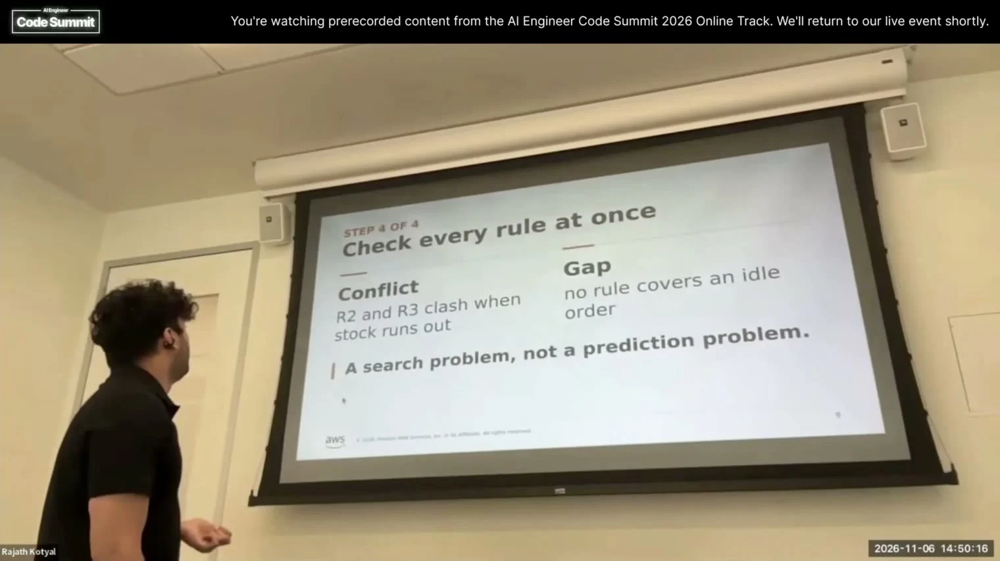

_截图 09  ·  录屏 01:31:19_

### 方法边界以及交给工程师的复核问题

**01:31:26**　And a gap is where no rule covers an idle order in this example where the LLM detected an actual, sorry, process or pipeline detected there's no entry for this rule where you are missing something. All in all, it cannot do a lot of things, end of the day. We want to make sure there is no oracle for specification correctness other than the user.

在示例中，当 LLM 检测到实际存在某个流程或管道时，没有对应的规则来应对这种情况，也就是说，您缺失了某些内容。总的来说，它无法完成太多事情。归根结底，除了用户之外，我们无法保证有任何其他机制来确保规范的准确性。

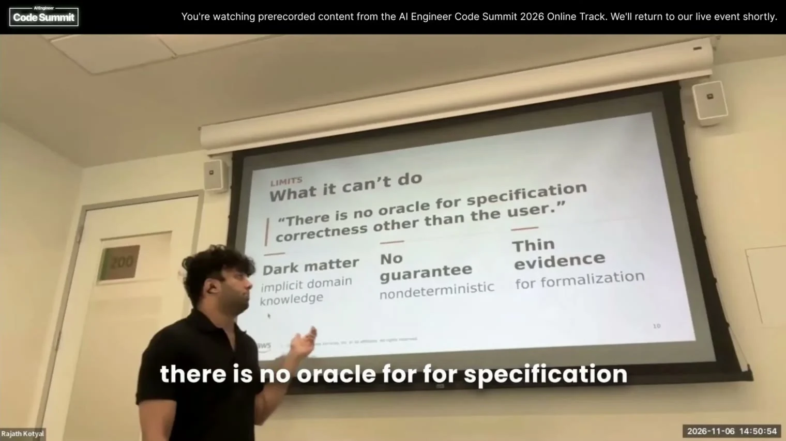

_截图 10  ·  录屏 01:31:56_

**01:31:59**　User needs to make sure to check every part of the snippet, part of the rulebook before sending it to the LLM. And we, as a tool, only can help them. And the user is more important here because of implicit domain knowledge. The LLM doesn't know a lot of domain knowledge and there's no guarantee. I mean, LLM only user can give that guarantee.

用户必须在将片段内容发送给大语言模型之前，仔细检查规则手册中的每一部分。作为工具，我们只能帮助他们。而用户更为重要，因为涉及隐含的领域知识。大语言模型并不了解太多领域知识，也没有任何保证。我的意思是，只有用户才能提供这样的保证。

**01:32:26**　And there's thin evidence right now for formalization and how it can be used in agents. We are emerging in this technology. What do we take back from this talk? Check the spec always before you pass it down to the agent. Cluster the translation. What we do is we cluster the translation by logical equivalents to determine the different LLM interpretations and where it's genuinely going wrong.

目前对于形式化以及其在智能体中的应用，只有有限的证据。我们正处于这项技术的探索阶段。从这次讨论中我们能得到什么？在将规范传递给智能体之前，务必先检查它。对翻译内容进行分类。我们的做法是通过逻辑等价项对翻译内容进行分类，从而确定不同的大语言模型解释方式以及真正出现错误的地方。

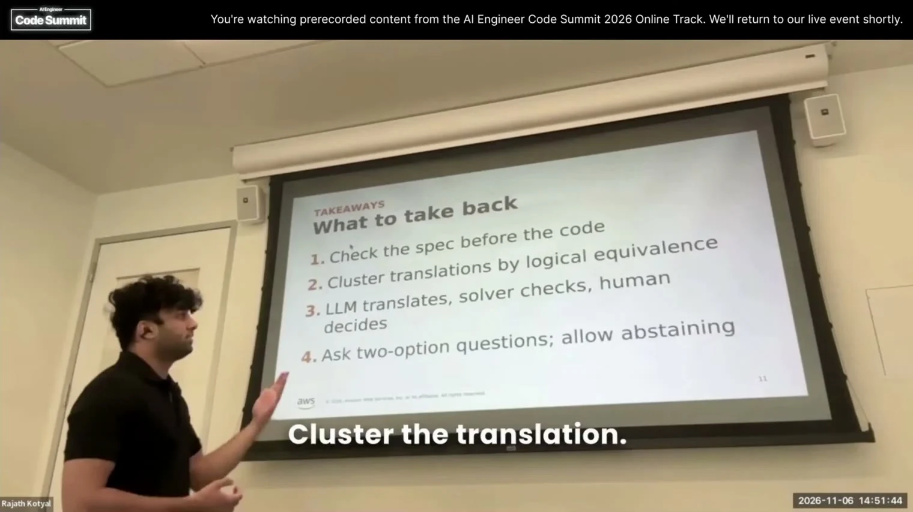

_截图 11  ·  录屏 01:32:46_

**01:32:57**　The LLM translates, the solver checks, and the human decides. We give the human options, and if there's no answer to that, we use LLM judges or abstain from implementing that piece. Here are the references, and this work has been majorly contributed by my team. Now, Andrila, Jot, and Stefan, Nadia, and Remy Delmos. You can check out their blog and the website link provided and delve deeper into that.

LLM进行翻译，求解器进行验证，最终由人类做出决定。我们为人类提供选项，如果没有合适的答案，我们就请LLM进行评判，或者选择不实施该方案。以下是相关参考资料，这项工作主要由我的团队完成。还有Andrila、Jot、Stefan、Nadia和Remy Delmos，你可以查看他们的博客以及提供的网站链接，进一步了解相关内容。

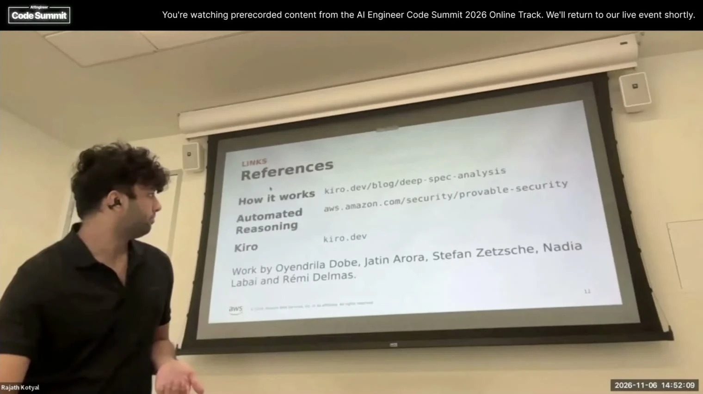

_截图 12  ·  录屏 01:33:11_

**01:33:30**　Thank you.

谢谢。

---

[全部演讲](../README.md) · [选看索引](index.md) · [上一场](06-joey-wang.md) · [下一场](08-meta-on-call.md)
