[全部演讲](../README.md) · [选看索引](index.md) · [上一场](07-rajath-kotyal.md) · [下一场](09-philipp-schmid.md)

# 3 Levels of Autonomy: Building an AI On-Call Teammate at Meta

**Chinmay Gandhi** · Meta · Sr. Engineering Manager

**Swaapnika Motapothula** · Meta · Software Engineer

**Vlad Tsvang** · Meta · Software Engineer

AIE Code Summit 2026  ·  11 月 11 日  ·  Online Track 预录插播  ·  录屏 01:33:31–01:49:10

[官方讲者资料](<https://ai.engineer/code/2026#speakers>)   ·   [Day 1 官方回放](<https://www.youtube.com/watch?v=ZZ19zhYnDKY>)

## 本场目录

- [01:33:53](#section-1) 发布更快以后，值班仍要拼接零散信号
- [01:38:45](#section-2) 三档自主权与人需要介入的地方
- [01:42:05](#section-3) 告警示例、自动化和共享 Agent
- [01:45:37](#section-4) 团队定制、值班反馈和后续计划

## 演讲实录

> 英文源自录屏音频，经轻度校订。每段英文下方为中文译文。时间指向原始录屏。

### 发布更快以后，值班仍要拼接零散信号

**01:33:31**　Hi, I'm Chinmay, and with me are Swaapnika and Vlad. We're excited to share our journey, as well as our learnings, around building an AI on-call teammate at Meta that now runs real on-call rotations every day and around the clock. We are part of the engineering team platform and infrastructure for incident response, on-call experience, and mitigations at Meta.

嗨，我是Chinmay，还有Swaapnika和Vlad和我一起。我们很兴奋分享我们在Meta构建AI值班团队的经验与收获，现在每天全天候进行真正的值班轮值。我们是Meta工程团队平台与基础设施的一部分，负责事件响应、值班体验及应对措施。

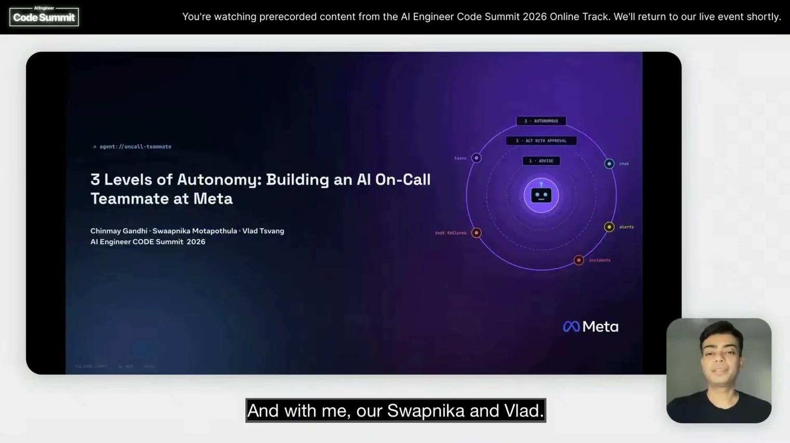

_截图 01  ·  录屏 01:33:32_

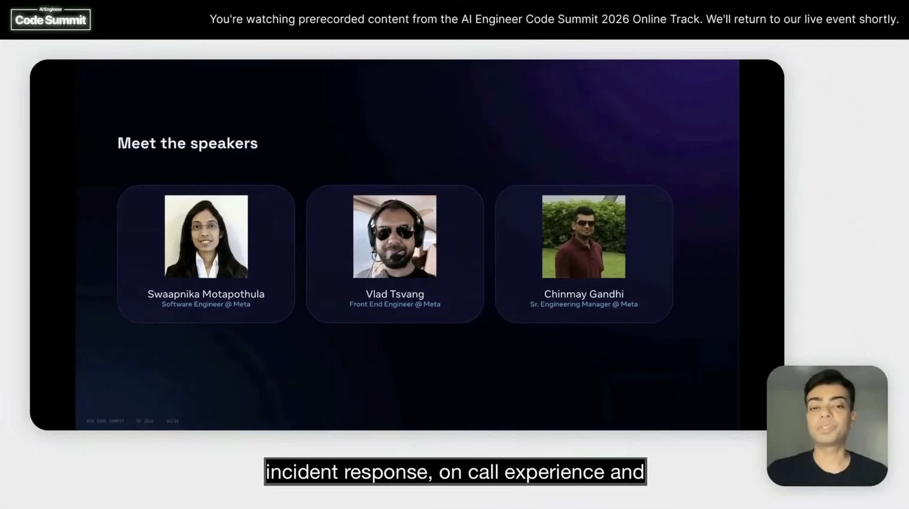

_截图 02  ·  录屏 01:33:53_

**01:33:56**　That space is evolving rapidly with the increase in AI capabilities. AI changed how fast we write code. About three quarters of new code is now written with AI, and more AI generated changes reach production every single day. And some of it can cause production failures, just like any other But on-call did not speed up with it. High quality code can pass review and still break in production and when it does, someone still gets paged at 2 AM.

随着人工智能能力的提升，这个领域正在迅速发展。人工智能改变了我们编写代码的速度。现在大约四分之三的新代码都是用人工智能生成的，而且每天都有更多由人工智能生成的修改内容被投入生产使用。其中一些修改可能会导致生产故障，就像其他情况一样。但“值班”机制并没有因此加快速度。高质量的代码虽然可以通过审查，但在生产环境中仍可能出问题，当问题出现时，总有人会在凌晨2点被叫去处理。

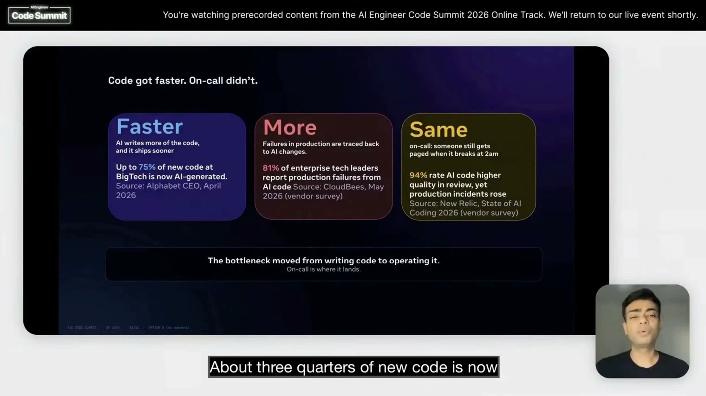

_截图 03  ·  录屏 01:34:05_

**01:34:31**　The bottleneck moved from writing code to operating it in production. And on-call is where that operational load lands. So we asked if AI is writing the code. Can AI also help operate it? And we think it can. Now let's quickly run through one of those on-call pages with a simplified example. It's 2 a.m. And 12 alerts are firing.

瓶颈从编写代码转移到了生产环境中的操作。而值班工作则承载了这些操作负担。于是我们询问：AI是否负责编写代码？AI能否帮助进行操作？我们认为可以。现在，让我们通过一个简化的例子快速回顾一下值班页面中的内容。现在是凌晨2点，有12个警报正在触发。

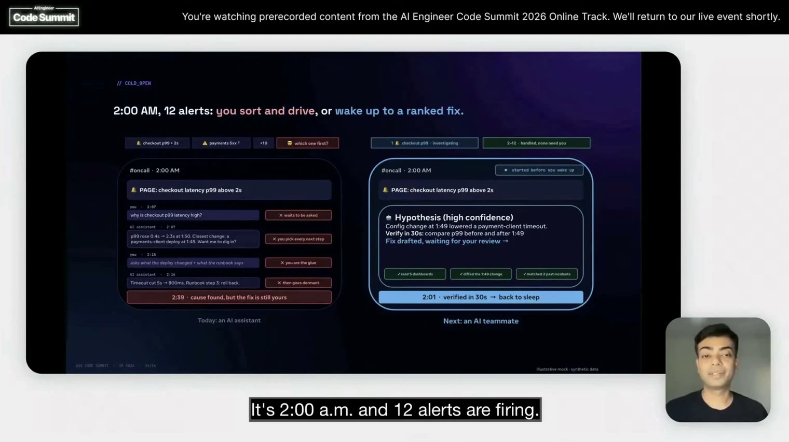

_截图 04  ·  录屏 01:35:00_

**01:35:01**　Same night, it can go two different ways. On the left is how most of us do this today and notice we already have good AI. First, you sort the alerts by yourself. Check out payments, disk, which one to pick first. Let's say you pick checkout.

同一晚，可以有两种不同的做法。在左侧，就是我们今天大多数人所采用的方式，我们会发现我们已经拥有不错的 AI 了。首先，你可以自己对警报进行排序。看看是支付相关还是磁盘相关，先选择哪一个呢？假设你选择了结账功能。

**01:35:16**　ask your assistant why p99 latency is high it's genuinely useful it pulls the metrics and finds the deployment at 149 and when you ask it reads what changed and checks the runbook it figured out that the time config was changed to a lower value and based on the runbook it suggests to roll back which is all very helpful however if you look at the shape of it it waited to be asked you picked every next step you were the glue between the questions and once it answered it went dormant at 239 you know the cause but the rollback the changes and the follow-ups are still yours now on the right the same 12 alerts but an AI teammate started before you woke up it had…

询问你的助手为什么 p99 延迟很高，其实这很有用——它会收集各种指标，找出部署在 149 的位置，当你询问时，它会显示有什么变化，并查看运行手册，最终发现是配置时间被改成了更低的值。根据运行手册，它建议回退操作，这非常有帮助。不过，如果观察其行为模式，就会发现它在等待被询问时才会行动。你负责每一步操作，你是连接各个问题的纽带。一旦回答完问题后，它就会在 239 时停止工作。你知道原因了，但回退操作、更改以及后续步骤仍然由你负责。同样，有 12 个警报，但你的 AI 队友在你醒来之前就已经开始工作了……

**01:36:14**　already ranked them checkouts first, payments merged in as the same cost, and the other 10 handled separately. It read the dashboards, diffed the same 149 AM config change, and matched two past incidents. You get a hypothesis, a 30-second way to verify it, and a fix waiting for your review. At 201, you verified it, and you're back to sleep. That gap is what this talk is about.

他们已经将 Checkouts 排在首位，支付功能也合并为同一成本项，其余 10 项则单独处理。通过仪表盘查看，对相同的 149 AM 配置进行了调整，同时匹配了两次之前的事件。你可以得到一个假设，30 秒内就能验证它，还有一项修复方案等待你的审核。在 201 时，你验证了该假设，之后就可以安心休息了。这个差距就是本次讨论的主题。

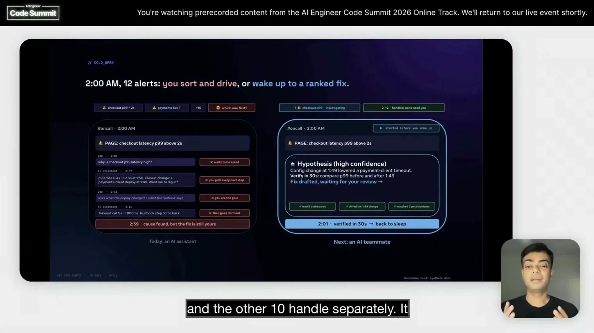

_截图 05  ·  录屏 01:36:23_

**01:36:48**　So why were you the glue? Every team was bolting automation onto on-call, one silo at a time. An alert script for alerts, a triage bot for tickets, a deploy bot for deploys, a fixit agent for incidents. Each one solves its slice, keeps its own context and forgets it. Now replaying your 2AM page. The alert script saw P99 latency about two seconds.

那么为什么你是那根“黏合剂”呢？每个团队都开始将自动化技术应用到“值班”功能上，一个一个地实现。有用于警报的脚本、用于工单的优先级分配智能体、用于部署的机器人、以及用于故障修复的智能体。每个都只负责自己的部分工作，保持自己的上下文，然后就忘掉它了。现在重新播放你凌晨2点的页面。那个警报脚本的P99延迟大约是两秒。

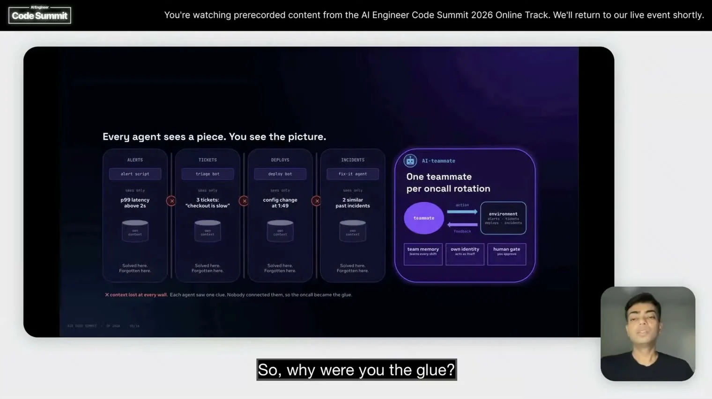

_截图 06  ·  录屏 01:36:48_

**01:37:17**　The triage bot saw three tickets saying checkout is slow. The deploy bot knew about a config change at 149 and the incident history had two similar past incidents. Every clue existed, but nothing connected them. So the on-call became the glue exactly as we saw on the left side of the previous slide. Our bet was one AI teammate per rotation instead.

分级机器人发现了三张关于结账速度慢的工单。部署机器人知道在 149 时有配置变更，而事件记录中也有两起类似的类似事件。每个线索都存在，但没有任何关联。因此，值班机制就像之前幻灯片左侧所展示的那样起到了连接作用。我们的预测是每次轮值时有一个 AI 同事参与。

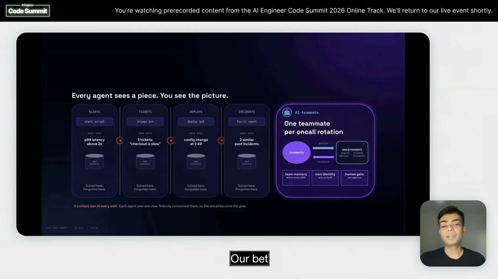

_截图 07  ·  录屏 01:37:42_

**01:37:47**　One loop across every signal, one team memory that learns every shift, its own identity so it acts as itself, and a human gate so you approve instead of operate. But giving one agent all that context and reach raises the stakes, which is why autonomy has to be earned. Under the hood, the teammate or the AI teammate is the simplest agent there is.

每个信号都有一个循环，一个能够记住每次轮班情况的团队记忆，拥有自己的身份，从而能够按照自身方式行事，还有一个人机接口，让你进行审批而非直接操作。但让一个智能体拥有所有这些背景信息并实现扩展能力，就会增加难度，这就是自主性需要被逐步获得的原因。实际上，队友或AI队友就是最简单的智能体形式。

**01:38:16**　Model using tools in the loop, acting on an environment and reading the feedback. Everything else in this talk is what we build around that loop to make it safe to leave it running. And for that, I will hand over to Swaapnika and Vlad next to get into the actual details of how it works. To achieve this, we started with an autonomy ladder.

模型在循环中使用各种工具，作用于环境并读取反馈信息。本次演讲中的其他内容都是围绕这个循环展开的，目的是确保其能够持续运行。为此，我将把话题交给 Swaapnika 和 Vlad，让他们详细说明其运作机制。为了实现这一点，我们从自主性层级开始着手。

### 三档自主权与人需要介入的地方

**01:38:41**　Think about how you onboard a new engineer to on-call. First, the shadow. They investigate and suggest, but they don't touch production. Then, they pair. They write the fix and another engineer approves it. With time, they gain knowledge. We give our agent exactly the same ladder. At level 1, it investigates and tells you what it found. It changes nothing. At level 2, it acts with approval.

想想如何将新工程师安排到值班岗位。首先，是“影子”阶段：他们进行调查并提出建议，但不会直接参与生产工作。然后，他们进行配对合作：他们编写修复方案，另一名工程师会批准该方案。随着时间的推移，他们会获得更多知识。我们给智能体同样的成长路径。在一级阶段，它进行调查并告知发现的内容，但不会改变任何事情。在二级阶段，它在得到批准的情况下行动。

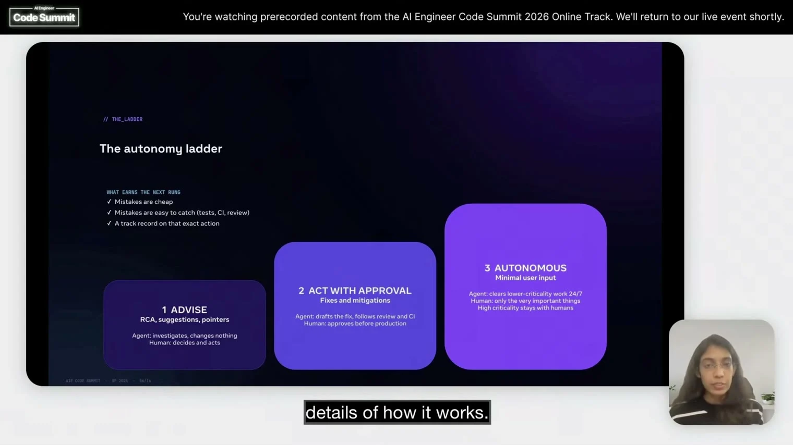

_截图 08  ·  录屏 01:38:45_

**01:39:08**　It drafts the fix but nothing reaches production until a human approves. At level 3, it clears lower criticality work on its own and only interrupts you for what matters. Work stays with humans. So what earns the next run? We use a simple test. How costly is a mistake and how easy is it to catch? So an action climbs only when mistakes are cheap, they are caught by test, CI or review and the agent already has a track record on that exact action.

它会起草修复方案，但直到人类审批之前，没有任何内容能进入生产环境。在3级水平下，它能自行处理低优先级工作，只会在重要问题上中断你的工作。所有工作仍由人类负责。那么，什么能带来下一次运行收益呢？我们使用一个简单的测试方法：错误代价有多大？发现错误的难度如何？因此，只有当错误成本低、可通过测试、持续集成或审查来发现时，某个操作才会被纳入其中，而且智能体在针对该操作已有相关记录。

**01:39:44**　That's why the agent can close a noisy alert on its own while a production mitigation still waits for a human. At level 1, the investigation is layered and stops at the first confident answer. The agent investigated the issue using the team's memory and runbook. It also shared the root cause analysis, but human had to apply the fix. At level 2, it writes the fix with the root cause and a test plan.

因此，智能体可以自行关闭嘈杂的警报，而生产缓解措施仍需人工处理。在一级级别中，调查是分层的，会在第一个可靠的答案处停止。智能体利用团队的记忆和操作手册对问题进行了调查，还分享了根本原因分析，但仍需人工应用修复方案。在二级级别中，它会将修复方案、根本原因和测试计划记录下来。

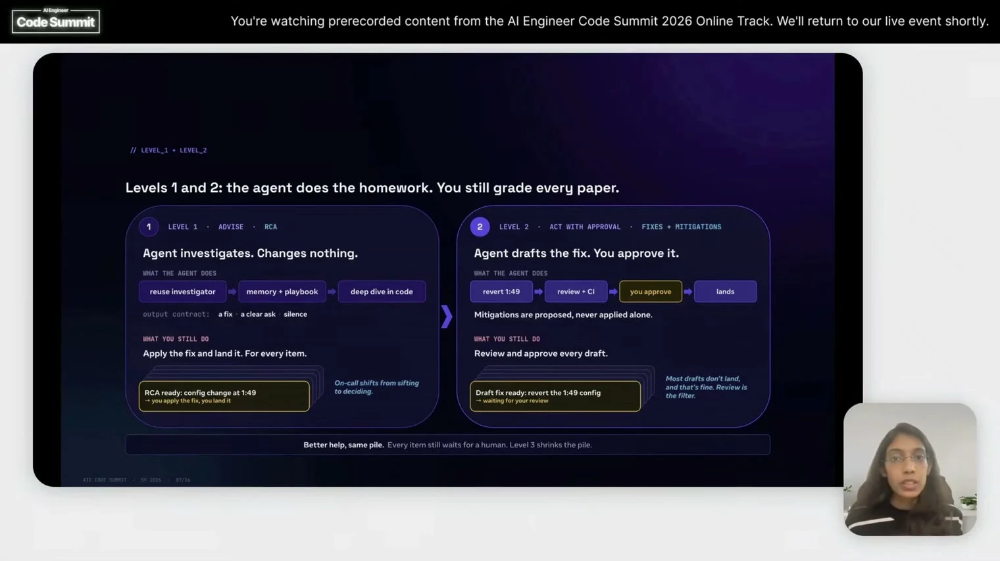

_截图 09  ·  录屏 01:40:12_

**01:40:14**　It answers reviewers' comments and fixes CI. But nothing reaches prediction until a human approves. Most drafts don't land and that's fine. Review is the filter. At both levels the agent does the homework but you still had to grade every single paper. They have got much better but the tasks requiring human input didn't get smaller. Level 3 shrinks the pile. Look at this example.

它回应了评审者的意见并修复了 CI。但直到人类审核之前，没有任何内容能进入预测阶段。大多数草稿无法完成，这也没关系。评审就是筛选过程。在两个层面上，智能体都完成了工作，但你仍然需要对每一篇论文进行评分。虽然他们做得更好了，但需要人类参与的任务并没有减少。第三级减少了工作量。看看这个例子吧。

**01:40:47**　23 items came in, but only 3 need you. On the right, the agent handles the long tail, noisy alerts, duplicates, routine fixes that went through normal review and CI. Two more are still being worked. You don't have to drive each one to completion. In the middle is your much smaller decision queue. Each item makes clear what it needs from you with a run this button that has a call to action.

23个项目已收到，但只有3个需要你的处理。在右侧，智能体负责处理长尾问题、噪音较大的警报、重复项以及经过常规审核和CI流程的常规修复工作。还有2个项目正在处理中。你不必逐一完成所有任务。中间是你的更小的决策队列，每个项目都明确说明了需要你做什么，并提供了执行按钮和具体操作指引。

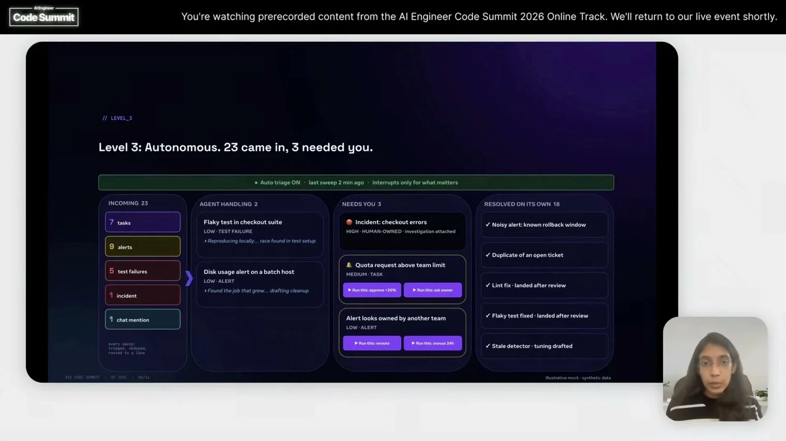

_截图 10  ·  录屏 01:41:02_

**01:41:16**　And remember our 2am checkout page? That still stays human owned. The agent brings the investigation, the human owns the critical decision. It's the new hire ladder again. Trusted to handle routine work, ready with the homework when it needs help, not just less work per item but fewer items waiting on you. That board is where the work lives, but nobody stares at a board all the time, right?

还记得凌晨2点点的结账页面吗？那仍然属于人类所有。智能体负责调查，关键决策由人类做出。这又是一段新员工的成长之路。被信任去处理日常工作，在需要帮助时准备好任务，不是每个项目都少一些工作，而是等待你的任务变少。那个决策板就是工作的所在，但没人会一直盯着它看，对吧？

### 告警示例、自动化和共享 Agent

**01:41:46**　So the agent is also available across many surfaces like chat and native incident surfaces. At 9 every morning, it posts a digest. 23 came in, 3 need you, 18 handled. Each thing that needs you, come with a one click next step. So, approving the quota bump takes one tap from your phone. The 18 it handled are summarized, not listed. And the two that are still in progress, tell you what it's doing about them.

因此，智能体可以在多种界面上使用，比如聊天界面和原生事件界面。每天上午9点，它会发布一份摘要。有23项任务需要处理，3项需要你的帮助，18项已经完成。每个需要你处理的任务都配有一键操作选项。因此，批准配额提升只需在手机上轻按一下即可。那18项已完成的任务会被汇总，不会列出出来。而那两项仍在处理中的任务，也会告诉你它们目前的状态。

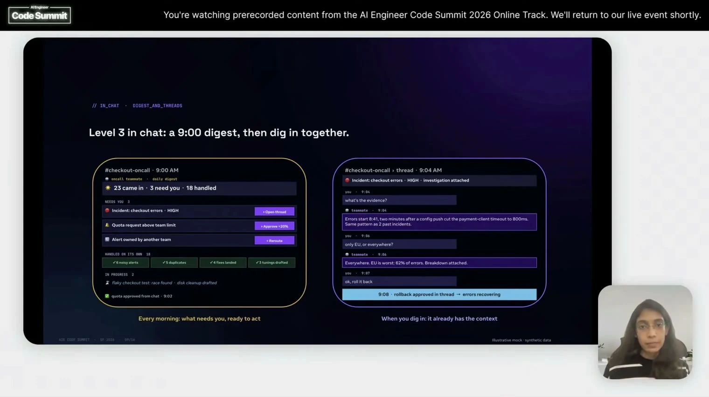

_截图 11  ·  录屏 01:42:05_

**01:42:18**　And when you want to dig in, you just reply in the thread. As you see on the right, here you open the checkout incident and ask for the evidence. It already has it. Errors start at 8.41, 2 minutes after a config push cut the payment client timeout. The same pattern as two past incidents. You ask a follow up, is it only EU?

当你想提交报告时，只需在讨论区回复即可。如右图所示，这里你打开结账问题并要求提供证据。证据已经准备好了。错误出现在8.41处，即配置推送后2分钟导致支付客户端超时。这与之前的两个案例模式相同。你询问是否仅针对欧盟地区？

**01:42:40**　And it answers with a breakdown. It drafts the roll back, you approve it right there and errors start recovering. You never opened a dashboard and you never had to explain the context because it was already there. That's what a teammate feels like. A morning handoff, a colleague you can ask. Now, under the hood of this AI teammate is AI automations. The first, Investigates.

并且会给出详细的分析。它会生成回滚方案，你可以直接批准，然后错误就会开始修正。你从未打开过仪表盘，也无需解释背景信息，因为一切都已经存在了。这就是团队成员的感受。早晨的交接工作，你可以向同事询问。实际上，在AI团队成员的背后，是AI自动化技术。首先，就是调查。

**01:43:08**　On every new signal, auto triage classifies it, checks its criticality and kicks off the right agent. An alert goes to the incident investigator, a task to the team's own agent, a test failure to a coding agent, a lookup to memory and code search. The second keeps the system healthy. Unintended automation fails quietly. So on a schedule, it looks for stuck or failed runs, retrace and repairs broken schedules, and it only peaches a human if it can't fix it itself.

每收到新的信号，自动分诊系统就会对其进行分类、评估其重要性，并启动相应的智能体。警报会发送给事件调查员，任务会分配给团队内部的智能体，测试失败则由编码智能体处理，查找操作则通过内存和代码搜索来完成。第二系统负责保持系统的正常运行。非预期的自动化故障会悄无声息地解决。因此，按照计划，它会查找陷入困境或失败的运行过程、追溯并修复损坏的安排，只有当无法自行修复时才会调用人类帮助。

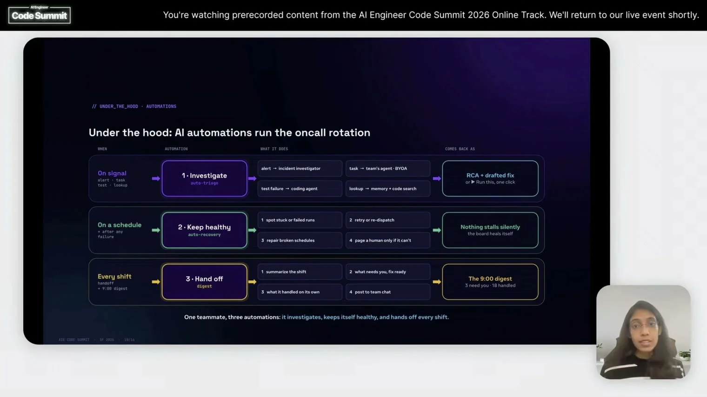

_截图 12  ·  录屏 01:43:28_

**01:43:45**　Nothing stalls silently. The third hands off. At every shift change and every morning at 9, it summarizes the shift. What needs you with the fix ready and what it handled on its own, post it to the team chat. Not only in the morning, but every urgent issue that needs user attention gets notified in chat with findings and draft fixes. It also tags the next on-call in the chat during handoff, but the entire cycle still continues.

没有任何事情会默默被搁置。第三次交接时，每次换班和每天上午9点，都要总结一下该班次的工作内容。有什么需要处理的任务已经准备就绪，又有什么事情可以自行完成，就将其发布到团队聊天中。不仅是在早上，任何需要用户关注的紧急问题也会通过聊天通知，包含发现情况和初步解决方案。在交接过程中，还会在聊天中标记下一位值班人员，但整个流程仍然继续进行。

**01:44:18**　And because it belongs to the team, it runs the agents and the skills the team already trusts. That's the slot in the middle. Bring your own agent, add your own skills. If a team already has an agent that has the team's runbooks and the knowledge base, the automations leverage it. Alongside that, it has our own incident investigator and a deep dive coding session.

而且因为属于该团队，所以能够运行该团队已经信任的智能体和技能。这就是中间的那个位置。可以带来自己的智能体，添加自己的技能。如果某个团队已经拥有具备团队运行手册和知识库的智能体，那么自动化功能就能充分利用它。此外，我们还有自己的事件调查员以及深度编程训练课程。

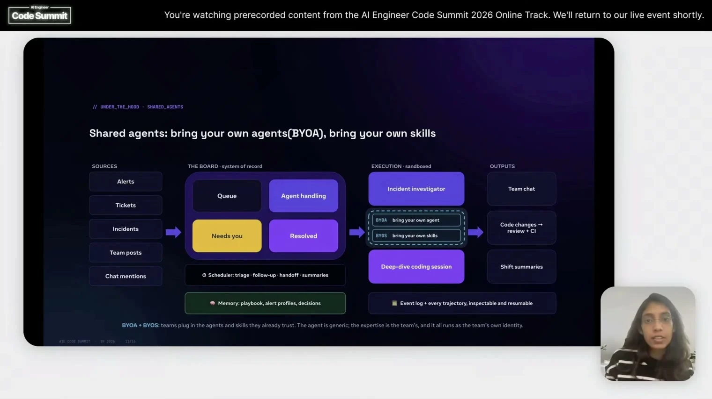

_截图 13  ·  录屏 01:44:35_

**01:44:43**　Work comes in from alerts, tickets, incidents, team posts and chat. The agent itself is generic. What makes it good at an on-call rotation is the team's agent's skills, memory and playbook. And every run is logged so anyone on the team can inspect the trajectory or resume the conversation. Now, I'm handing off to my teammate Vlad to talk more on the shared agent.

工作信息来自警报、工单、事件、团队帖子以及聊天内容。智能体本身是通用的。在值班轮值中表现良好的关键在于团队的智能体技能、记忆能力和操作手册。而且每次运行都会被记录下来，因此团队中的任何人都可以查看过程或恢复对话。现在，我将工作交给我的同事Vlad，让他更多介绍关于共享智能体的内容。

### 团队定制、值班反馈和后续计划

**01:45:14**　An on-call agent can't belong to just a single person because the on-call itself doesn't. So it belongs to the team. There is one teammate per rotation on one board. Whoever is on-call can ask it, correct it, or pick up its work mid-investigation. It carries the team's on-call expertise, the playbook of load profiles and past decisions from one shift to the next one the way a good handoff should.

值班智能体不能只属于一个人，因为值班本身不是个人的。因此，它属于团队。每个轮次在一个板上都有一名队友。任何在值班的人都可以询问它、纠正它，或在调查过程中接手它的工作。它承载着团队的值班经验、负载概况的操作手册以及从一个班次到下一个班次的历史决策，就像良好的交接一样。

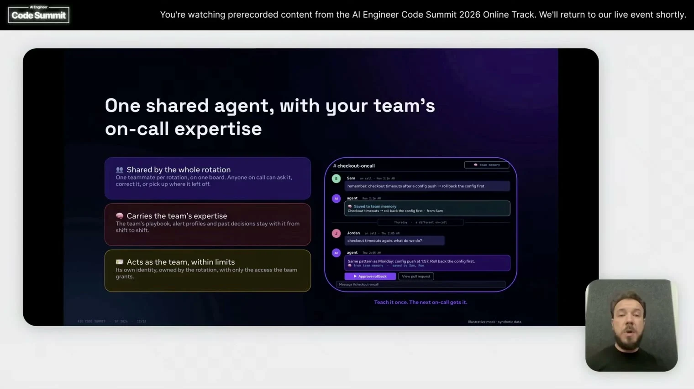

_截图 14  ·  录屏 01:45:37_

**01:45:39**　Here's what that looks like. Monday at 2 am, Sam is on-call and tells it, remember, if checkout times out after a config push, roll back the config first. It saves it to the memory. Three days later, Jordan is on-call, hits the exact same alert, and just asks for a fix. The agent answers with same fix, says where it came from, and has the role back drafted.

这就是实际情况。周一凌晨2点，Sam在值班，他告诉大家：记住，如果配置推送后结账时间出现问题，要先回退配置。这会被保存到内存中。三天后，Jordan在值班，看到完全相同的警报，只是要求修复。智能体给出了同样的修复方案，说明其来源，并重新分配了角色。

**01:46:05**　Teach it once, the next on-call gets it. And it accesses the team. Its own identity, owned by the rotation, with only the access the team is comfortable granting it. And it learns from every uncle shift handoffs decisions and corrections all flow into memory so shift number 30 is better than the shift number one the same way a new uncle gets better every week but memory erodes over time so ours has to earn its place it retrieves semantically uses what it finds scores where it actually helped and promotes or retires entries automatically.

教一次即可，下一个值班人员就能掌握。它可以访问团队资源。其身份由轮值制度决定，只有团队愿意授予的访问权限才被允许。它会从每次换班时的决策和修正中学习，所有信息都会存入记忆中，因此第30次换班会比第一次更好。就像新人员每周都能进步一样，但记忆会随时间消失，所以我们的系统必须赢得自己的位置，它能语义化地使用所找到的内容，对实际有帮助的条目进行评分，并自动推广或淘汰那些不合适的条目。

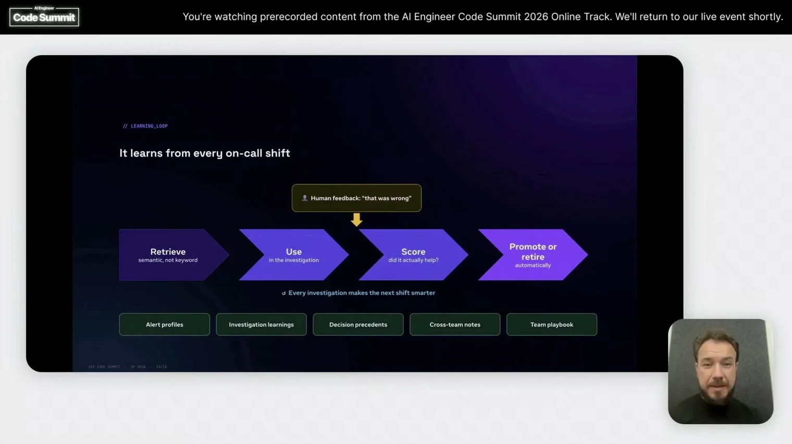

_截图 15  ·  录屏 01:46:31_

**01:46:47**　When someone says that was wrong, the item reopens and the correction becomes memory. Three things made this work be on our team. First, a loop that never stops listening. Every piece of feedback or course correction reopens the item and ultimately gets absorbed into memory. Feedback is an input to the system, not a sorry read once a quarter. Second, customize instead of forking.

当有人说那是错误的时，该项目会重新打开，修正内容就会成为记忆。我们团队能够实现这一点，是因为三个原因。首先，有一个永不停歇的监听循环。每一份反馈或课程修正都会让项目重新启动，最终被纳入记忆中。反馈是系统的输入，而不是每季度一次的抱怨。其次，选择自定义而非分叉。

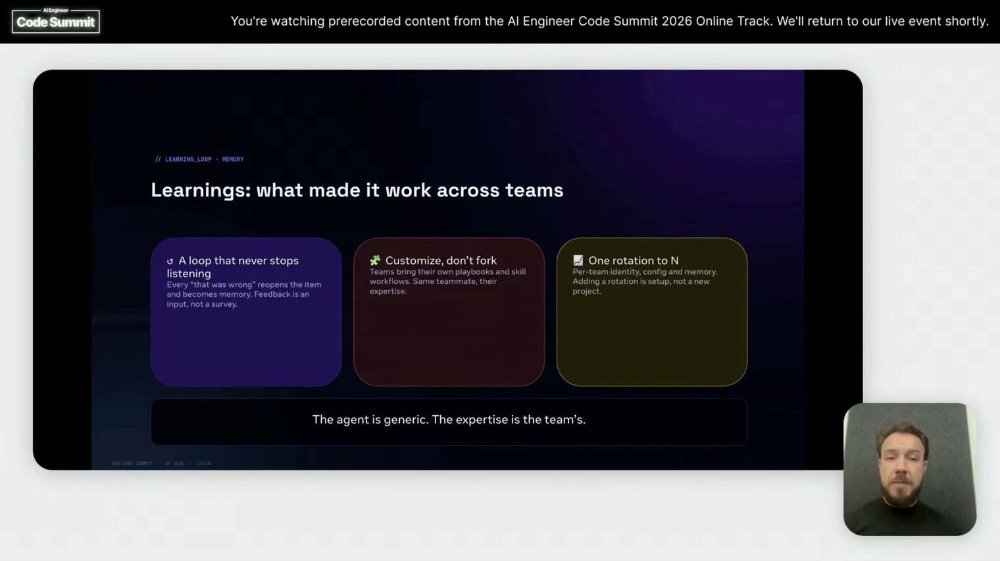

_截图 16  ·  录屏 01:47:09_

**01:47:16**　Teams bring their own playbooks and skill workflows, and it's still the same teammate underneath. Third, what we call one rotation to end. Identity, config, and memory are per team, so add a rotation becomes a setup, not a new project. The agent is generic while the expertise is owned by the team. So what has changed for the people on-call? Well, first, their job shifted from driving deep investigations to making key decisions.

团队会带上自己的策略书和技能工作流程，但内部的队友却保持不变。第三，我们所说的“一次循环”就结束了。身份、配置和内存是按团队划分的，因此增加一个循环只是设置流程，而不是新的项目。智能体是通用的，而专业知识则由团队拥有。那么对于值班人员来说，有什么变化呢？首先，他们的工作从进行深入调查转变为做出关键决策。

**01:47:48**　They start from a hypothesis with linked evidence, not a blank task or dashboard. Second, the load is getting lighter. Early signs of on-call load reduction are promising for teams that run it autonomously, and we want to measure it rigorously before we put a number on it. And the third, every change that agent writes still meets a human. Fixes land only through normal review and continuous integration.

他们从基于关联证据的假设出发，而不是从空白任务或仪表盘开始。其次，负担正在减轻。对于自主运行的团队来说，值班负担减少的初步迹象很有希望，我们在给这一数字之前需要严格地测量它。第三，智能体撰写的每一个变更都经过人类审核，并通过常规审查和持续集成得以实现。

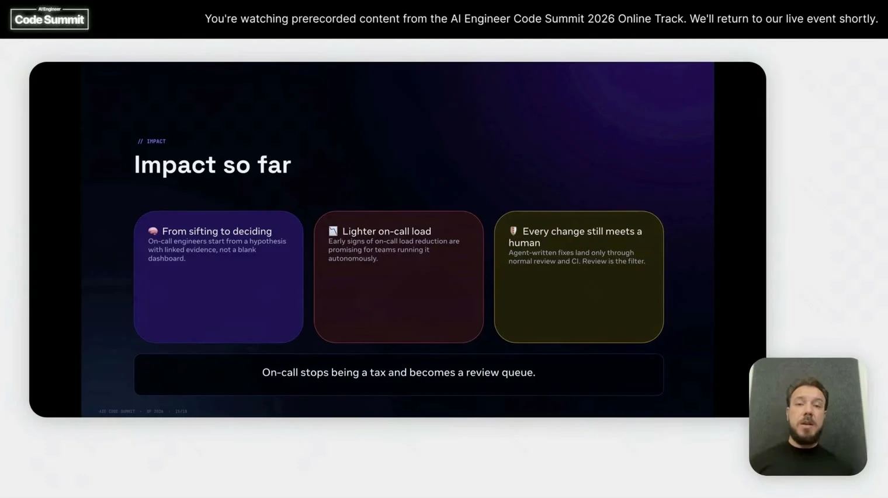

_截图 17  ·  录屏 01:47:55_

**01:48:16**　and most drafts don't land. That's the point. Review is the filter. On-call stops being a tax and becomes a review queue. Here's what we're focusing on next. First, mitigations that get approved, not just drafted. We grade every mitigation that agent proposes and feed the outcome back, so it earns its next level instead of being handed it. Second, skills are written from the chat, so a team can turn its runbooks into skills without rating any code.

而且大多数草案都无法实现。这就是关键所在。审核就是筛选机制。值班不再是一种负担，而是变成了一个审核队列。接下来我们重点关注两点：第一，只有被批准的缓解措施才被考虑，而不是仅仅停留在草案阶段。我们对智能体提出的每一种缓解措施进行评估，并将结果反馈回去，这样它就能获得更高等级，而不是直接被接受。第二，技能是根据聊天内容编写的，因此团队可以直接将运行手册转化为技能，而不需要评估任何代码。

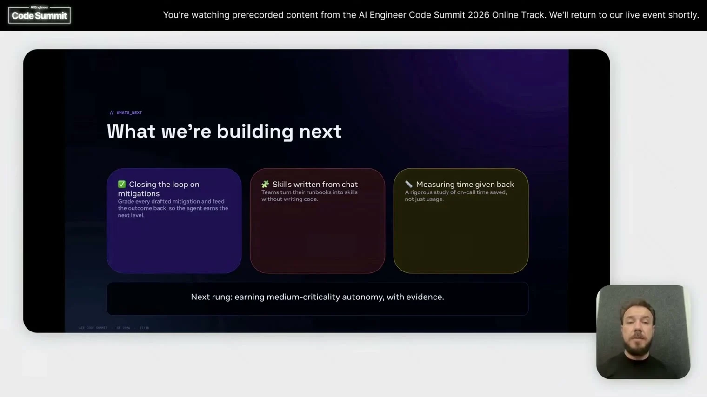

_截图 18  ·  录屏 01:48:40_

**01:48:48**　And third, measuring the time we give back properly with a rigorous study of on-call time saved rather than usage counts. And the next rung on the latter is earning medium criticality autonomy with evidence. On that, thank you so much for listening to us, and hopefully that was helpful. Bye.

第三，正确衡量时间，通过严格研究值班时节省的时间，而不是使用次数来统计。而后续的步骤则是以证据支持获得中等关键性的自主性。非常感谢您倾听我们的发言，希望这对您有帮助。再见。

---

[全部演讲](../README.md) · [选看索引](index.md) · [上一场](07-rajath-kotyal.md) · [下一场](09-philipp-schmid.md)
