[全部演讲](../README.md) · [选看索引](index.md) · [上一场](08-meta-on-call.md) · [下一场](10-ankit-mathur.md)

# I deleted 90% of my harness (And It Got Better)

**Philipp Schmid** · Google DeepMind · Member of the Technical Staff

AIE Code Summit 2026  ·  11 月 11 日  ·  主舞台  ·  录屏 01:55:35–02:11:51

> 标题页约 01:55:37 出现。开头的录屏音频难以辨认，首段可辨发言约从 01:56:11 开始。

[官方议程](<https://ai.engineer/code/2026/schedule>)   ·   [Day 1 官方回放](<https://www.youtube.com/watch?v=ZZ19zhYnDKY>)

## 本场目录

- [01:56:11](#section-1) 模型变化与 Gemini Decisions API
- [01:58:57](#section-2) 四次重做 Harness，从显式流程到一个工具
- [02:02:21](#section-3) 同模型同任务的调用比较与评测
- [02:05:12](#section-4) 实机演示及如何衡量每个已解决任务的成本

## 演讲实录

> 英文源自录屏音频，经轻度校订。每段英文下方为中文译文。时间指向原始录屏。

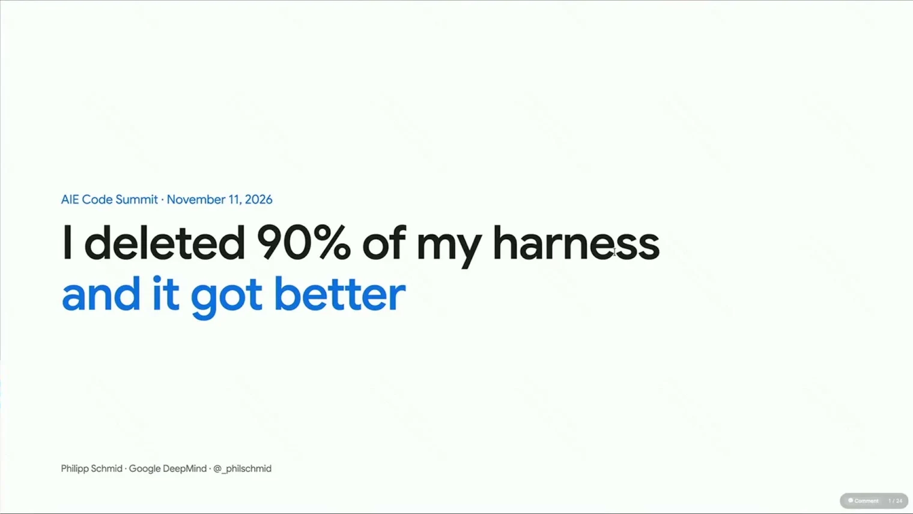

_截图 01  ·  录屏 01:55:41_

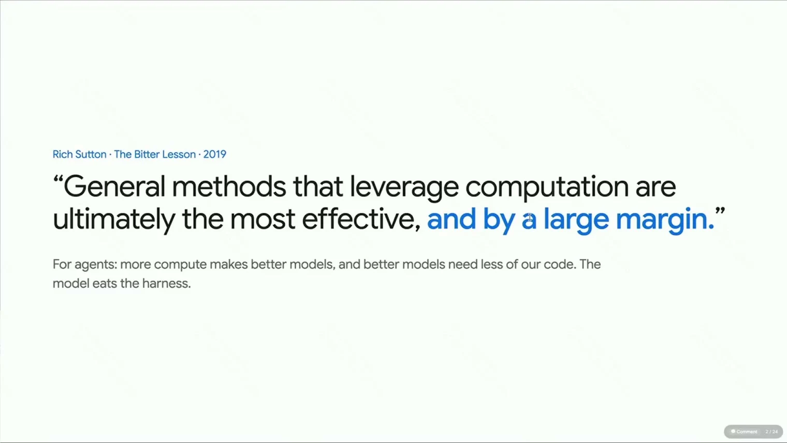

_截图 02  ·  录屏 01:55:58_

### 模型变化与 Gemini Decisions API

**01:56:11**　… and harness and the less code we need. And if we look at what we have been doing at Google DeepMind for the last six months, so in May we had Google I.O., and today it's November 11, and we have been shipping relentlessly, basically. Just earlier today we announced our first decision model with Gemini Decision 1. Yesterday we made Gemini 4 Carbon available, and then if we just look at the last six months, we basically ship our models every few weeks.

……以及更少的代码需求。如果我们看看过去六个月在 Google DeepMind 所做的工作，五月份我们有了 Google I.O.，今天是11月11日，我们一直在持续推出产品。就在今天早些时候，我们发布了基于 Gemini Decision 1 的第一个决策模型。昨天我们推出了 Gemini 4 Carbon，从过去六个月的情况来看，我们几乎每几周就推出一个新模型。

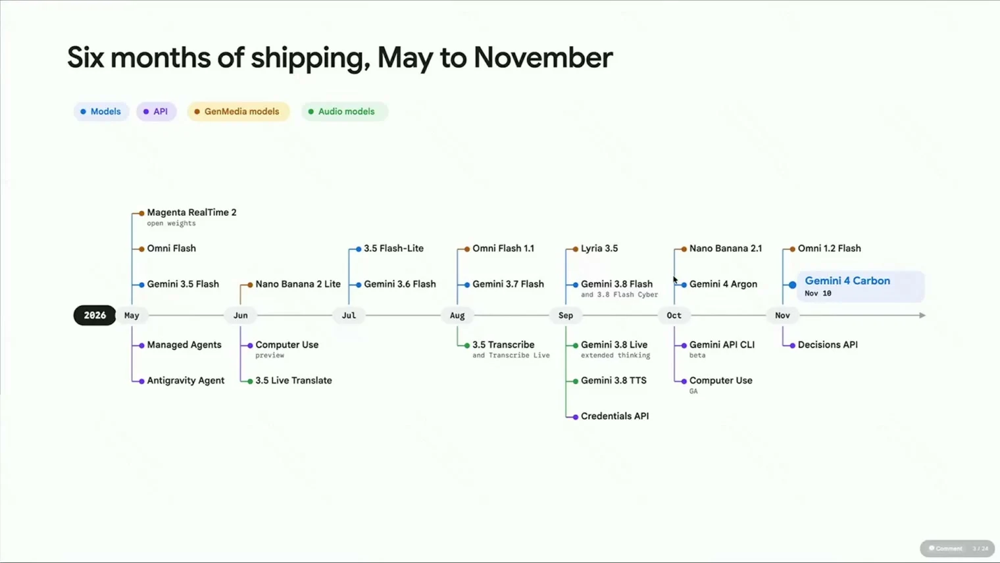

_截图 03  ·  录屏 01:56:23_

**01:56:39**　As already said, Gemini Carbon is now available for you. So if you are a Google AI Ultra subscriber, you can use it in Antigravity, you can use it in the Gemini app, you can use it in AI Studio. Carbon is number one on the Cursor Bench eval, and also number one on the Perplexity Benchmark. And internally at Google, we have been using it already a lot.

如之前所说，Gemini Carbon现已可供您使用。如果您是Google AI Ultra的订阅用户，可以在Antigravity中使用它，也可以在Gemini应用中使用，还能在AI Studio中使用。Carbon在Cursor Bench评测中排名第一，在Perplexity基准测试中也位居首位。在Google内部，我们已经大量使用了它。

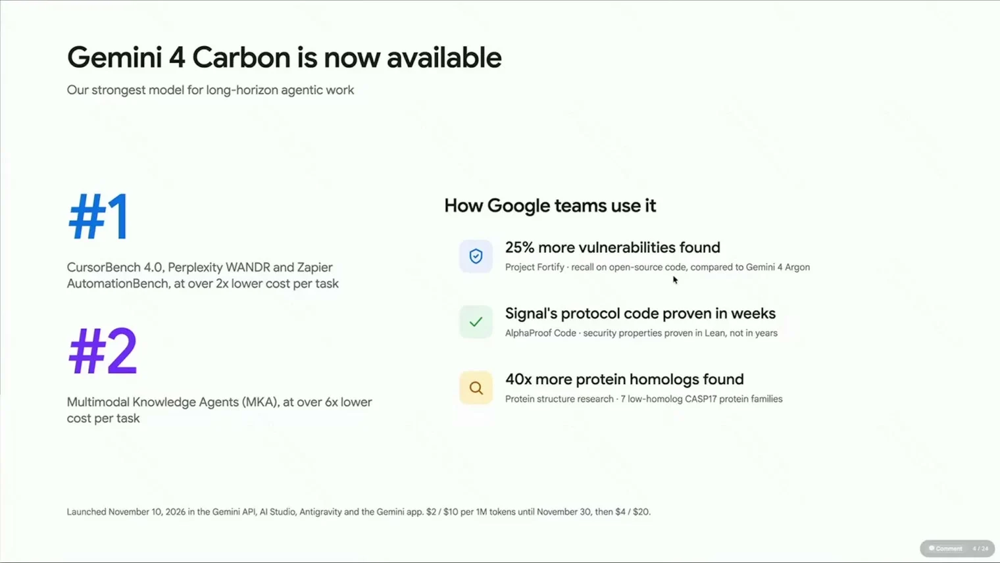

_截图 04  ·  录屏 01:56:44_

**01:57:00**　And much more exciting is that I'm happy to share that we launched the Gemini Decisions API roughly one hour ago with our new Gemini Decision 1 model. So it's a similar model to Jeff. You can provide all of the existing Gemini inputs, meaning it's multi-modal, so you can provide text, audio, images, video, and also provide up to 1,000 questions in a single request.

更令人兴奋的是，大约一小时前我们推出了基于新 Gemini Decision 1模型的 Gemini Decisions API。这是一个与 Jeff的模型类似的模型。你可以提供所有现有的 Gemini输入类型，即支持多模态输入，你可以提供文本、音频、图像和视频，还可以在一个请求中提供多达1,000个问题。

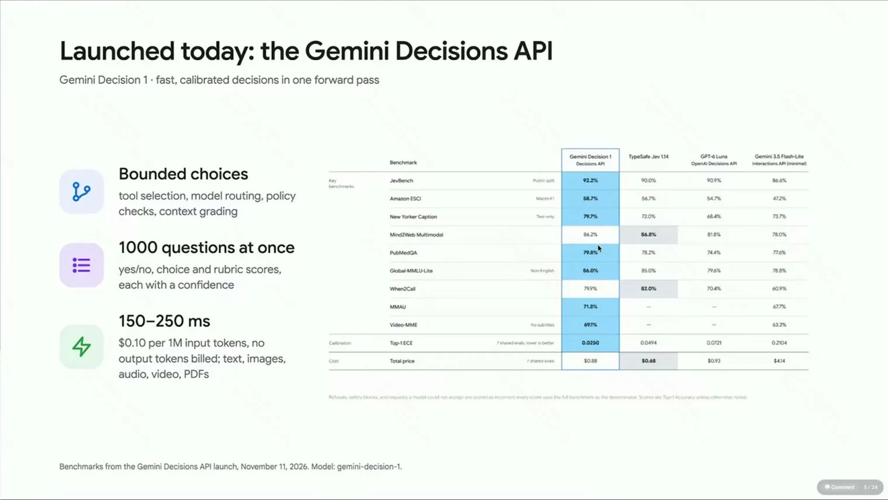

_截图 05  ·  录屏 01:57:13_

**01:57:24**　The average end-to-end latency, including all of the network overhead, is between 150 to 250 milliseconds, and it costs 10 cents per 1 million tokens. So how do models get good at agentic work? And that's a rough overview on how post-training works. So we have a task, we have our model, the model has a certain set of tools, and then we have some kind of compute environment, and at the end we have some verifier.

包括所有网络开销在内的平均端到端延迟在150到250毫秒之间，每100万个token需要10美分。那么，模型是如何在代理式工作中表现良好的呢？这只是关于训练后阶段的粗略概述。因此，我们有任务、有模型，模型拥有一定数量的工具，然后我们有某种计算环境，最后还有验证器。

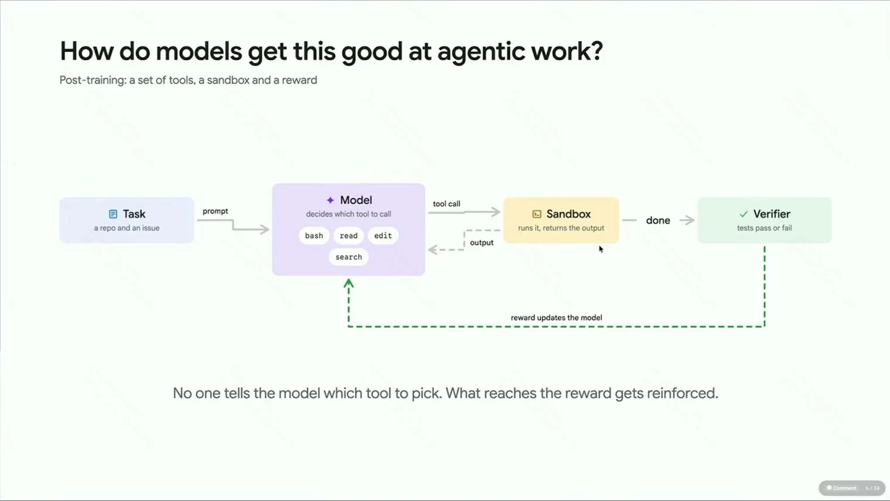

_截图 06  ·  录屏 01:57:46_

**01:57:52**　that task to use different tools and then based on the score from the verifier we update the model. But no one is telling the model which tools to use and basically it only receives that reward feedback. So if we look at two examples on how a model can do a certain tasks with tools, we have the path A where we have dedicated tools for file system control.

这个任务需要使用不同的工具，然后根据验证器的评分来更新模型。但没人会告诉模型应该使用哪些工具，它基本上只接收奖励反馈。因此，如果我们看看两个例子，说明模型如何使用工具完成特定任务，就有路径A，其中使用了专门用于文件系统控制的工具。

**01:58:14**　So you all have probably used coding agents and you have seen a read file call or an edit doing it, and the other way of doing it would be just using a single inline bash script for all of the changes. So on the left side, we roughly need around 10 terms to make the same changes to a coding repository, compared to the two terms on the right side just using bash.

所以你们可能都使用过编程智能体，也看到过读取文件或编辑文件的操作。另一种方式则是使用单个内联 bash 脚本来处理所有更改。因此，在左侧，我们大约需要 10 个术语才能对编程仓库进行相同的更改，而右侧仅使用 bash 则只需要两个术语即可。

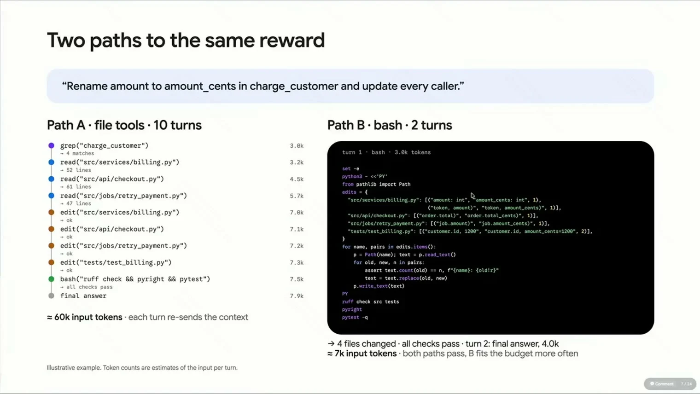

_截图 07  ·  录屏 01:58:20_

### 四次重做 Harness，从显式流程到一个工具

**01:58:38**　And it also reflects in the amount of tokens we need. So the left path takes around 10x more tokens than the right path, and it's doing the exact same thing at the end for tasks. So in my experiment, every roughly six months, I try to build a new coding agent harness from scratch, and I always ask myself, okay, how much of the harness do I really need to achieve the same task, and what is overhead to the model and we no longer need?

这也体现在我们所需的token数量上。因此，左侧路径所需的token大约是右侧路径的10倍，而最终在任务执行时也是同样的情况。所以在我的实验中，大约每六个月，我会尝试从零开始构建一个新的编码智能体 Harness 工具，我会不断问自己：为了完成相同的任务，我到底需要多少这个 Harness 工具？以及对模型来说有什么额外开销？我们是否需要这些？

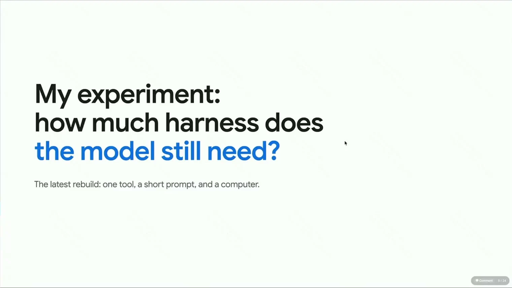

_截图 08  ·  录屏 01:58:57_

**01:59:08**　So if we look at the coding agent harness, which from 2025, we had roughly around 10 to 15 to 20 tools. We had dedicated tools for file editing. We had dedicated tools for planning, for to-do lists. And also we had a lot of dedicated rules in our system prompt, which told the model what to do and what not to do.

因此，如果我们看看 编码智能体 Harness，从 2025 年开始，我们大约有 10 到 15 到 20 种工具。我们有用于文件编辑的专用工具，也有用于计划、待办事项列表的专用工具。此外，我们的系统提示中还有许多专用规则，告诉模型该做什么以及不应做什么。

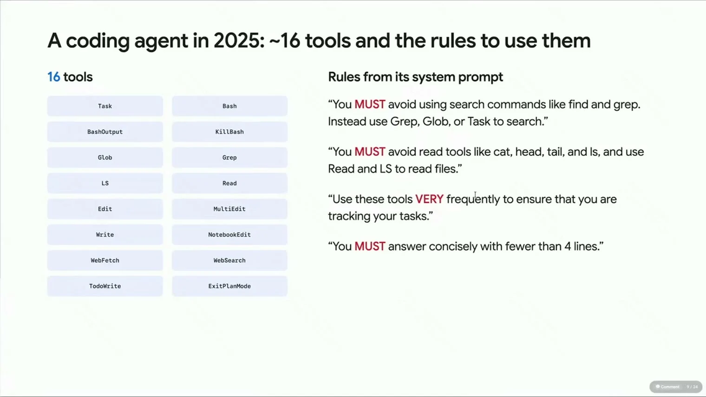

_截图 09  ·  录屏 01:59:18_

**01:59:31**　And that worked, of course. But since then, we made a lot of changes. So in my experiments, first one was done roughly now two years ago in February, where we did not really had agents. We had workflows. RUG applications back then were very popular. We had the planner, we had search, we reflected on whatever was found, and then we generated an answer.

当然，这确实有效。但从那以后，我们进行了许多修改。在我的实验中，最早的一次是在两年前的二月进行的，当时我们并没有使用智能体，而是使用工作流程。当时的 RUG 应用程序非常流行。我们有规划工具、搜索功能，对发现的内容进行整理，然后生成答案。

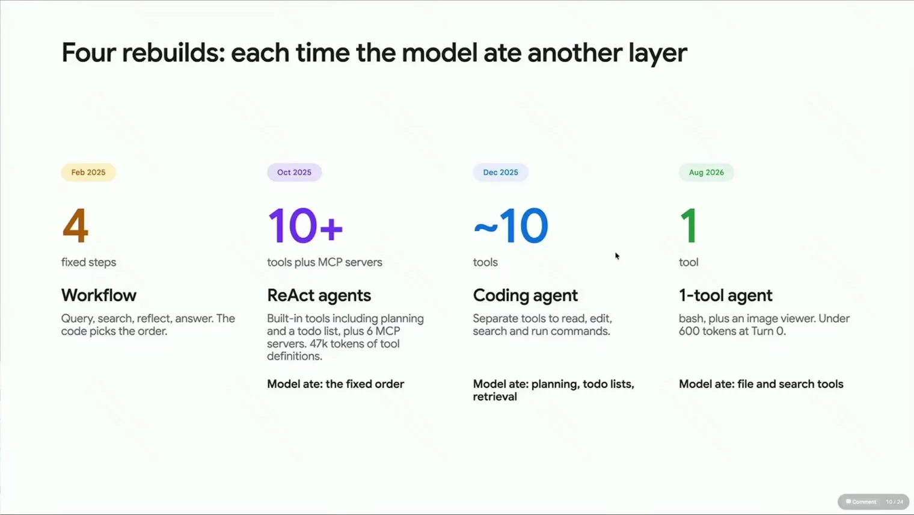

_截图 10  ·  录屏 01:59:47_

**01:59:52**　Then we started to see our first agents. We had many, many different tools for all sorts of fine-kernular actions. And then came the coding agents, where we had those roughly 10 to 20 tools. And now, in my last experiment, I tried to see, OK, what's going to happen if I provide only one tool to my agent? And the outcome was pretty exciting to me.

然后我们开始看到第一个智能体。我们有许多不同的工具，用于各种精细操作。接着是编码智能体，那时我们有大约10到20种工具。现在，在我的最后一项实验中，我试图看看，如果我只给智能体一个工具会怎样？结果让我非常兴奋。

**02:00:14**　So this one-tool agent works the same way as every other agent, except that it only has one tool, which is Bash. And the model can use that tool for any sort of task. And the bash tool is very simple, so it runs in a separate clean subshell, and it supports the command argument. I also added a description so that it's nice and easier to display to the user what the model is actually doing, and then some async parameters.

所以这个单工具智能体与其他智能体一样运作，只是它只有一种工具，即 Bash。模型可以使用该工具完成各种任务。Bash工具非常简单，因此会在独立的干净子shell中运行，并且支持命令参数。我还添加了描述内容，以便用户更容易理解模型实际在做什么，以及一些异步参数。

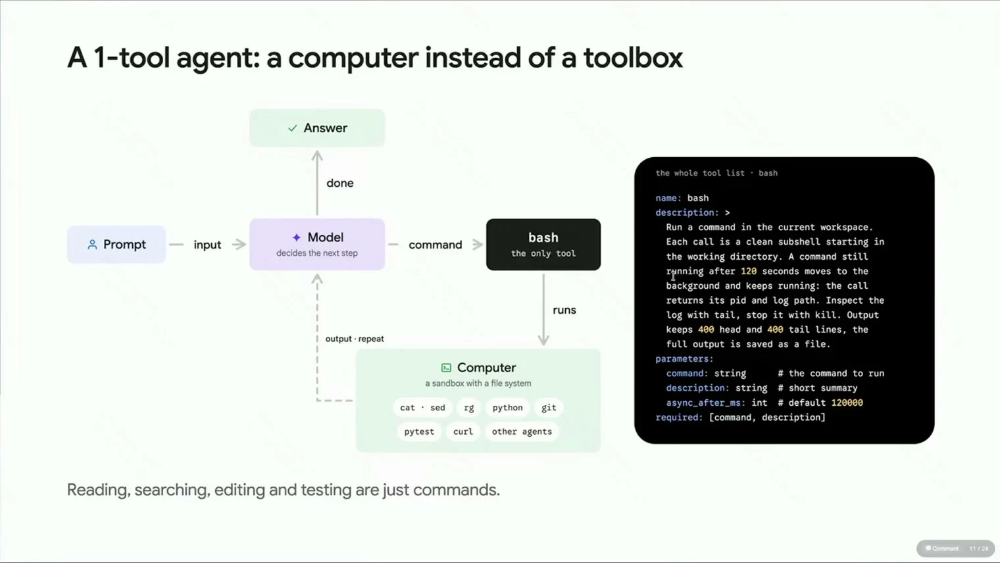

_截图 11  ·  录屏 02:00:29_

**02:00:39**　So basically when the model runs a bash command, the parameter tells the model, okay, if it is the command longer running than this milliseconds, It's being that the tool call resolves and the model receives a local file handle where it can look up later, okay, if the process is still running. That's very interesting if you do like all sorts of like web development, for example.

所以实际上，当模型执行一个 bash 命令时，这个参数告诉模型：如果命令的运行时长超过这个毫秒数，说明工具调用已经完成，模型会获得一个本地文件句柄，之后可以从中查询数据。如果你从事各种 Web 开发相关工作，这非常有趣。

**02:01:02**　And the single bash tool actually works for all of the things we are using, so we can have long running work where we can start on the foreground and then automatically move it to the background. The model receives some file handle and since it has bash available, it can read the logs which are being streamed. If the agent itself is a CLI, it can call itself using Bash, so there's practically no need to create subagent tools for it because it can invoke itself.

而且那个简单的 bash工具实际上可以处理我们使用的所有功能，因此我们可以进行长时间运行的工作，可以在前台开始操作，然后自动将其转移到后台。该模型会获得某个文件句柄，由于有 bash可用，它就可以读取正在流式传输的日志。如果智能体本身就是命令行工具，它就可以使用 Bash来调用自己，所以实际上不需要创建子智能体工具，因为它可以自行调用自己。

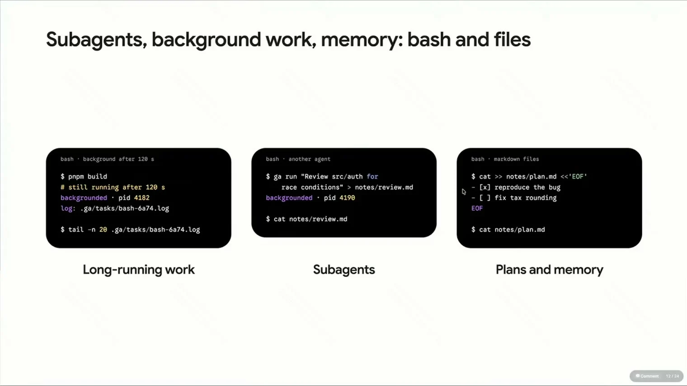

_截图 12  ·  录屏 02:01:15_

**02:01:31**　And then, of course, we don't need dedicated planning or memory tools because we have our file system available. We can provide some context to the model so the model can keep track of its own work with the file system and using the Bash tools. In addition, of course, to our tools, we have system prompts. Similar to tools, system prompts evolved over time.

当然，我们不需要专门的规划或记忆工具，因为我们有文件系统可用。我们可以为模型提供一些上下文，这样模型就能利用文件系统和 Bash工具来记录自己的工作成果。此外，当然还有系统提示词。与工具类似，系统提示词也是随着时间逐渐发展而来的。

**02:01:52**　Every dot here is roughly around 100 tokens, and you can see that coding agents mid-2025 had a lot of context we needed to send in every request. Of course, this also improved, and similar story here is like, okay, what do I really need to provide to my agent to make it successful and work, and what of all of the system information and details we had in the past the model.

这里的每个点大约对应100 个 token，你可以看到，在2025年中期进行智能体编程时，每次请求都需要提供大量上下文信息。当然，这种情况也有所改善，类似的道理是：我真正需要为我的智能体提供什么才能使其成功并正常运行？以及模型过去所拥有的所有系统信息和细节又有什么用呢？

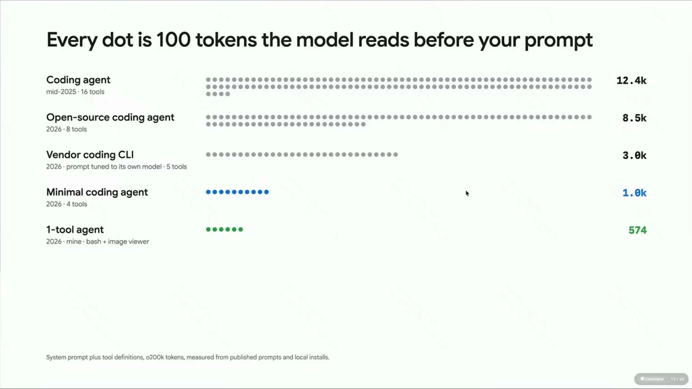

_截图 13  ·  录屏 02:01:56_

### 同模型同任务的调用比较与评测

**02:02:18**　So how much of the harness helps and how much is in the way? And to find that out, I was running a lot of different evaluations of a lot of different agent harnesses with a lot of different tools. And one example I like to show here, which was done with Gemini for Carbon from an eval task from DeepSVE is like, okay, what happens if I provide my existing coding agent tools with read, write, search, grab, and my bash only tool?

那么，Harness的帮助程度是多少？又有多少是障碍呢？为了弄清楚这一点，我使用多种工具对许多不同的智能体Harness进行了大量不同的评测。这里我想展示一个例子，该例子是用DeepSVE的评估任务在Gemini for Carbon上完成的，结果是怎样的？如果我把现有的编码智能体工具与read、write、search、grab以及仅使用bash的工具一起使用，会怎么样呢？

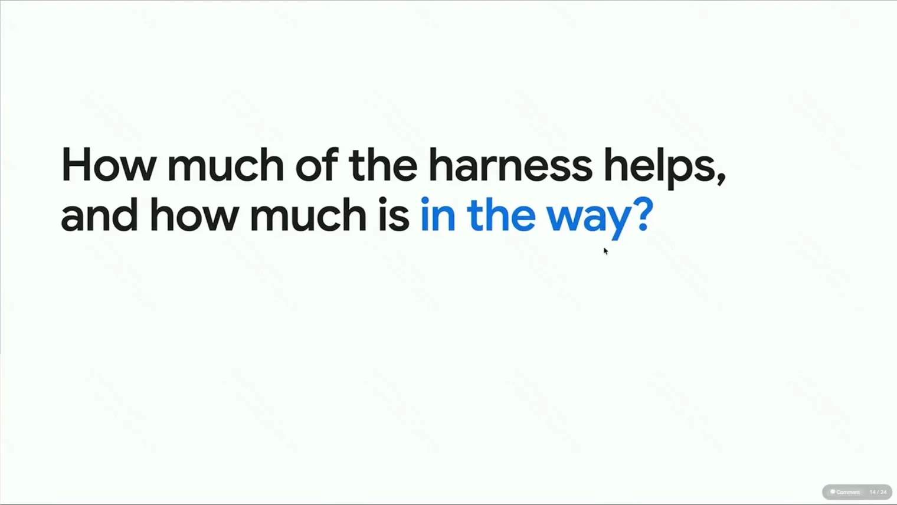

_截图 14  ·  录屏 02:02:21_

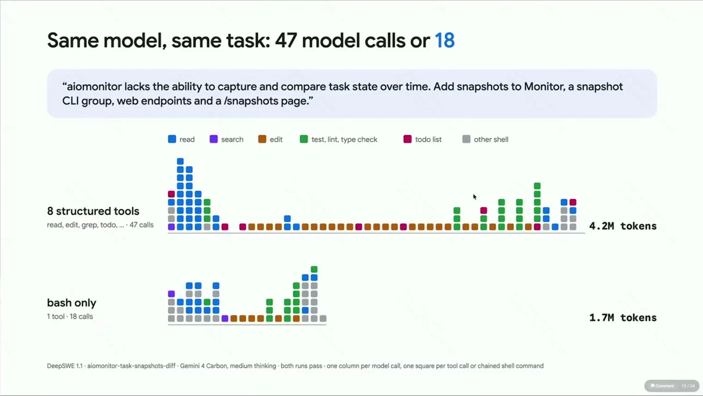

_截图 15  ·  录屏 02:02:42_

**02:02:46**　And I clearly see that the top line is taking a lot of more tokens, a lot of more turns, and a lot of more times to achieve the same task. And what stood out really well is that, okay, reading is done in parallel in the beginning, but as soon as we start going into making code changes, we see that same behavior that the model is making turn by turn a single edit, which of course consumes a lot of time and a lot of tokens.

我明显看到，要实现相同的任务，顶部行需要消耗更多的token和更多的迭代次数。特别值得注意的是，虽然阅读操作在初期是并行进行的，但一旦开始进行代码修改，模型就会逐次进行单个编辑操作，这自然需要大量的时间和token。

**02:03:16**　So how does this look at Protoscope? So I have my own eval set of around 350 tasks for coding, knowledge work, and terminal commands, all run with Gemini 4 Argon here, and four different agent harnesses. One is the bash-only harness, and then, okay, with bash we still have that issue on how can I read images, right, if I'm, I cannot cut screenshot.png, it would return a binary, and it will fill my context, and the model cannot see the image.

那么这在 Protoscope 中表现如何呢？我准备了大约 350 个任务集，涵盖编程、知识工作和终端命令，所有任务都使用 Gemini 4 Argon 运行，还有四种不同的智能体框架。其中一个是仅支持 bash 的框架，那么，用 bash 的话，我们仍然面临一个问题：如何读取图像？如果我无法剪切 screenshot.png，它就会返回二进制数据，从而填满我的上下文，模型就无法看到图像。

**02:03:49**　a view media tool which basically returns the image in a way the model can see. Then we have two different agent harnesses with structure tools for file system operations. And if we just look at the score column, all of them look roughly identical, right? So if we would just evaluate our model in an agent harness looking at the score, it would basically not really matter which one of those we would pick.

一种视图媒体工具，能够以模型能够理解的方式返回图像。此外，我们有两种不同的智能体 Harness，它们都配备了用于文件系统操作的结构工具。如果只看评分列的话，所有结果大致相同，对吧？因此，如果我们仅通过智能体 Harness中的评分来评估模型，选择其中哪一个其实并不重要。

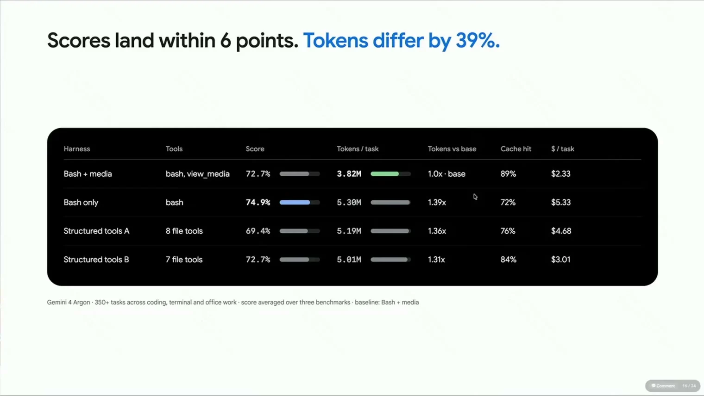

_截图 16  ·  录屏 02:03:53_

**02:04:16**　Of course, there's a slight variance in the scores, I only ran each task one time, so it might be just some noise or maybe something else, so you would probably need to run a few more samples per harness, but the score looks roughly the same. So how would we now know which harness should I choose? If we just look at all of the evals being shown, it's always mostly about score.

当然，分数会有一些差异，我只进行了一次每个任务的测试，所以可能只是一些随机误差，或者还有其他原因。因此，你可能需要对每个harness进行更多样本测试，但最终分数大致相同。那么，我们如何决定应该选择哪个harness呢？如果我们只看所有展示的测试结果，它们通常都是关于分数的。

**02:04:41**　But if we look at the token column, or even more at the dollar per task, there's a picture which is changing. Is getting lower, interestingly, if we just use bash, and then also the cache hit rate increases. So if we just compare like the bash media as the baseline, the tasks are almost 2x cheaper compared to more complex, more tools, agent harnesses, and we would not see it if we just look at the score.

但如果我们查看 token 列，或者更仔细地看每任务所需的费用，就会发现情况在变化。有趣的是，如果仅使用 bash，缓存命中率也会提高。因此，如果我们以 bash 作为基准，与更复杂、需要更多工具、智能体 Harness 的方案相比，任务成本几乎低了两倍，而仅从得分来看则无法看出这种差异。

### 实机演示及如何衡量每个已解决任务的成本

**02:05:11**　And to show you a few examples, I prepared some demos. So here I'm using the Pi harness, which makes it super simple to basically define what tools you want to use. I have the same prompt for 3.5 Flash, which we released roughly six months ago for all tools. So like whatever Pi ships out of the box. Then we have it for Bash only.

为了给你展示一些例子，我准备了几个演示。所以这里使用的是 Pi harness，使用它非常简单，基本上可以定义你想使用的工具。对于 3.5 Flash 也有同样的提示词，我们大约六个月前发布了这个提示词，适用于所有工具。然后还有仅针对 Bash的版本。

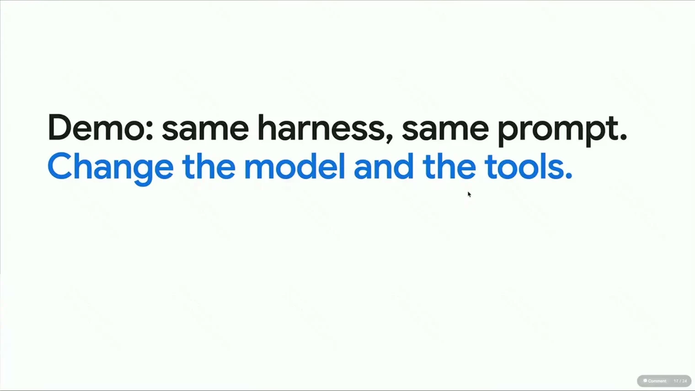

_截图 17  ·  录屏 02:05:12_

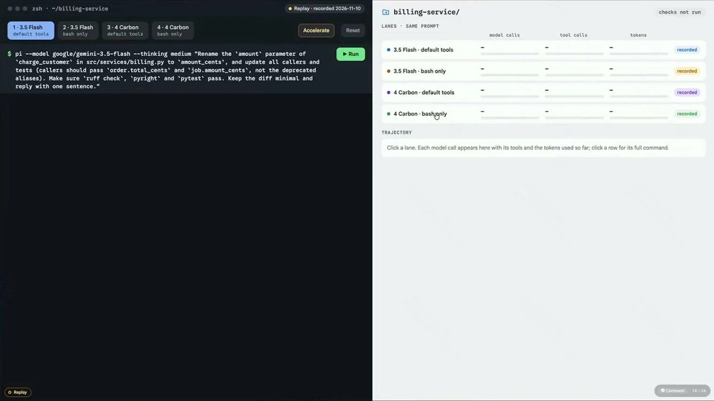

_截图 18  ·  录屏 02:05:20_

**02:05:35**　And then we have it for Carbon with the default tools and then with Bash only. This runs now since we only have roughly around 20 minutes. I recorded all of that and clicked that very nice accelerate button here. And what we can see on the right side is that the same paradigm basically applies when models get better they roughly need less tools.

然后我们有针对碳的版本，使用默认工具即可，也支持仅使用 Bash。现在可以运行了，因为我们只有大约20分钟的时间。我记录了所有内容，然后点击了那个很棒的加速按钮。从右侧可以看到，当模型性能提升后，基本上需要较少的工具即可。

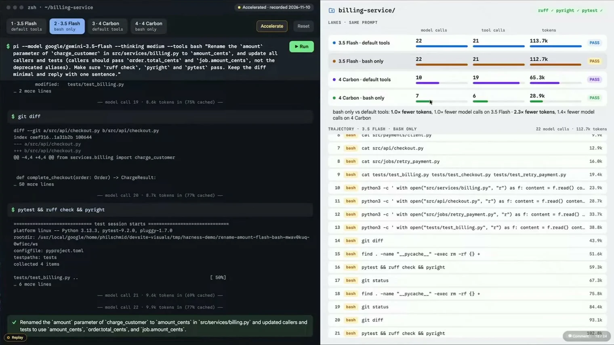

_截图 19  ·  录屏 02:05:58_

**02:06:03**　So with 3.5 flash we see with the default tools compared to bash only we had the same amount of model calls, we had the same amount of tool calls and we had roughly the same amount of tokens. And if we look at the auto traces we can see for bash only we have some cut commands to read different files, we have to make changes and then like some git changes.

所以，使用 3.5 flash 时，与仅使用 bash 的情况相比，模型调用次数、工具调用次数以及token数量都相同。从自动追踪结果来看，仅使用 bash 时，有一些命令用于读取不同文件，需要做一些修改，就像一些 git 操作一样。

**02:06:25**　If we look at the default tools, we can see roughly the same. We had read file commands, we used the edit tool and then had some git commands to make those changes. If we now look at carbon with the default tools that already used way less tool calls and model calls, so it's basically doing work in parallel but also trying to reduce it.

如果我们看看默认工具，会发现大致相同的情况。我们使用了读取文件命令，还使用了编辑工具，然后又使用了一些 git命令来实施这些更改。而使用默认工具时，carbon 使用的工具调用和模型调用则少得多，因此它实际上是在并行处理任务，同时也在努力减少这些操作。

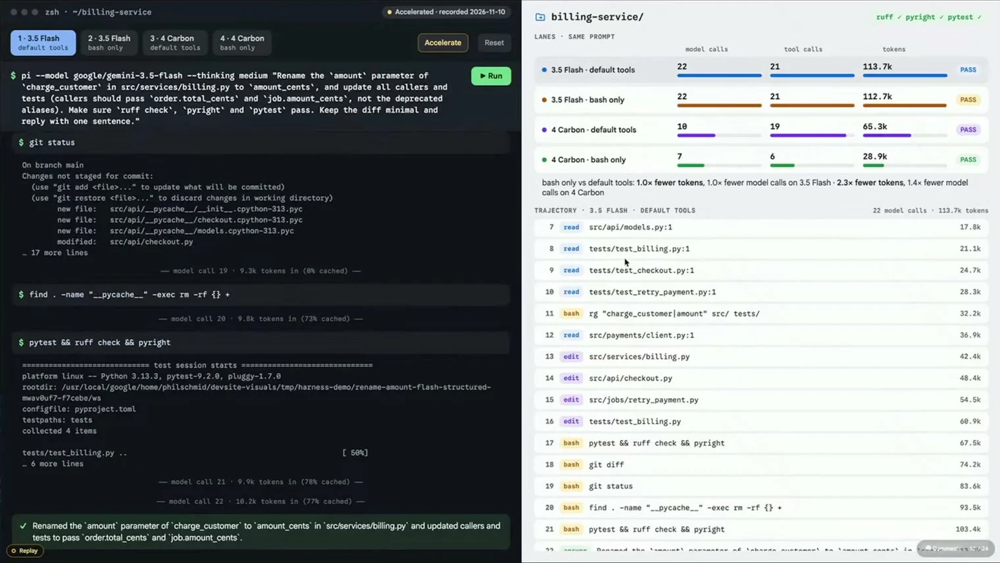

_截图 20  ·  录屏 02:06:27_

**02:06:47**　So we had, for example, the still same for read calls and also the edit calls. But what starts to get interesting if we are going to look into Bash? And in Bash, we had even less tool calls and model calls. And the interesting part here is that the model writes a single Python script to make all of that changes in one go and no longer needs to call multiple tools.

比如，对于读取调用和编辑调用来说，情况都是一样的。但如果我们深入研究 Bash的话，就会发现更有意思的事情。在 Bash中，工具调用和模型调用的数量更少。有趣的是，模型会编写一个 Python 脚本，从而一次性完成所有操作，不再需要调用多个工具。

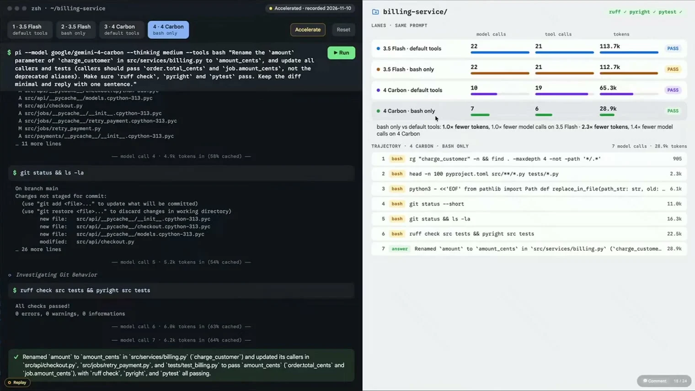

_截图 21  ·  录屏 02:06:56_

**02:07:11**　So if we go further, what does it mean in terms for Carbon here is that the better the model gets, or the more reasoning and like capability it gets, bash helps the model to be able to chain more commands in the single call. For carbon, it was roughly 2.2 to 3.7 commands per bash call, and for flash it was only 1.3 to 1.8.

那么，如果进一步探讨的话，从碳的角度来看，意味着模型越完善，或者其推理和类似能力越强，bash就能帮助模型在单次调用中执行更多命令。对于碳，每次 bash 调用大约需要 2.2 到 3.7 条命令；而对于 flash，则只需要 1.3 到 1.8 条命令。

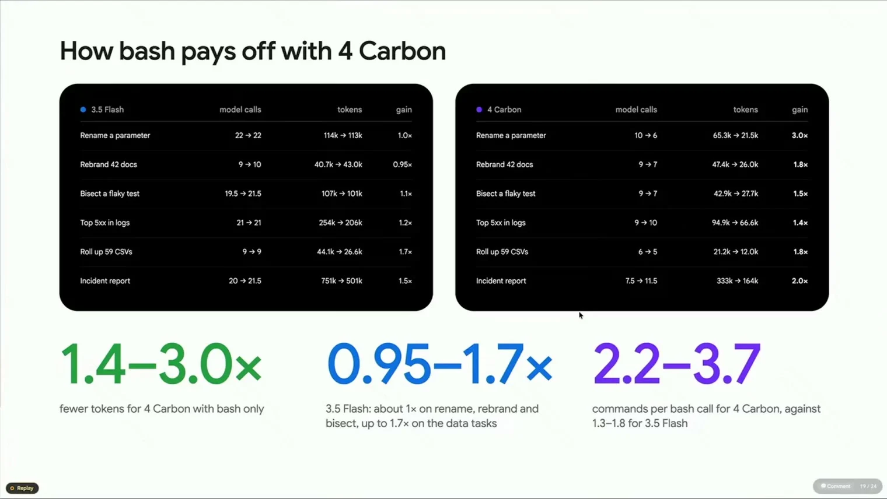

_截图 22  ·  录屏 02:07:25_

**02:07:38**　So we are seeing up to 3x less tokens by carbon to achieve the same task the same tools we need to use. So, two more examples to look at it as well, is like we have on the left side, Carbon with the default tools. So we see our coding agent tools with write, with edit, and we see, okay, it does some parallel work in turn two, some parallel work in turn three and four, and then we have all of the changes.

因此，使用碳技术可以减少高达3倍的token数量，同时仍需要相同的工具和任务。另外，还有两个例子可以说明这一点：在左侧，我们使用默认工具中的碳。我们可以看到我们的编码智能体工具，包括写入、编辑功能，在第二个、第三个和第四个步骤中进行了一些并行工作，然后所有更改都完成了。

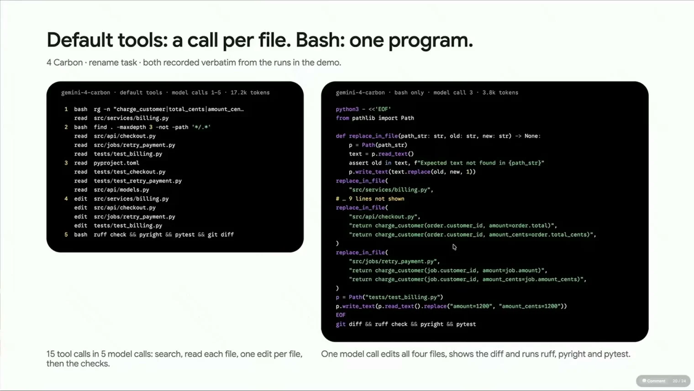

_截图 23  ·  录屏 02:07:59_

**02:08:09**　And on the right side, where it just has the bash tool, it uses Python to write an inline script to make all of the changes at the same time with much less token. And the same counts for if we compare Gemini 3.5 Flash to Gemini 4 Carbon. Flash with bash only is not chaining those commands. So here it doesn't matter if I'm having a retool, a write tool, an edit tool, and a bash tool, or if I have just a bash tool, because 3.5 Flash used to use bash for single-turn commands.

在右侧，只有 bash工具存在时，会使用 Python编写内联脚本，以更少的 token 同时完成所有操作。如果比较 Gemini 3.5 Flash 和 Gemini 4 Carbon，情况也是一样的。仅使用 bash的 Flash无法链接这些命令。因此，无论我使用的是 retool、编写工具、编辑工具还是仅有一个 bash工具，都无关紧要，因为 3.5 Flash 过去一直使用 bash来执行单次操作。

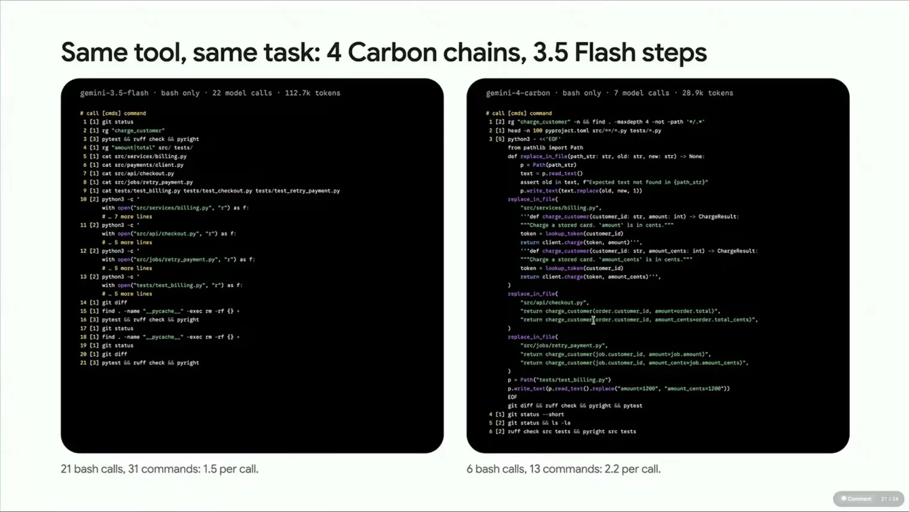

_截图 24  ·  录屏 02:08:36_

**02:08:44**　it had a single turn for writing, but if we look at Carbon, which here in this example is the exact same task, it needs less way turns, so the reading is not needed to read all of the different files completely, it just uses ripcrap and some intelligent searching to find where we need to make changes and then it writes a single python inline bash command to make all of those edits in one go saving us a lot of tokens so what does it bring us models will keep eating the harness and i'm pretty sure that 2027 will also be a lot more about how many tokens do we need to solve a or the few improvements we made between Argon and Carbon is the better model…

它只有一次写入操作，但如果我们看Carbon的话，在这个例子中任务完全相同，所需的操作次数更少，因此不需要完整读取所有不同的文件，它只是使用ripcrap和智能搜索功能来定位需要修改的地方，然后生成一个Python内联bash命令，一次性完成所有修改，从而节省了很多字符。那么这对我们有什么好处呢？模型会不断使用Harness，我相信2027年也会更多关注我们需要多少字符才能解决问题，或者与Argon相比，Carbon带来的少量改进是更好的模型……

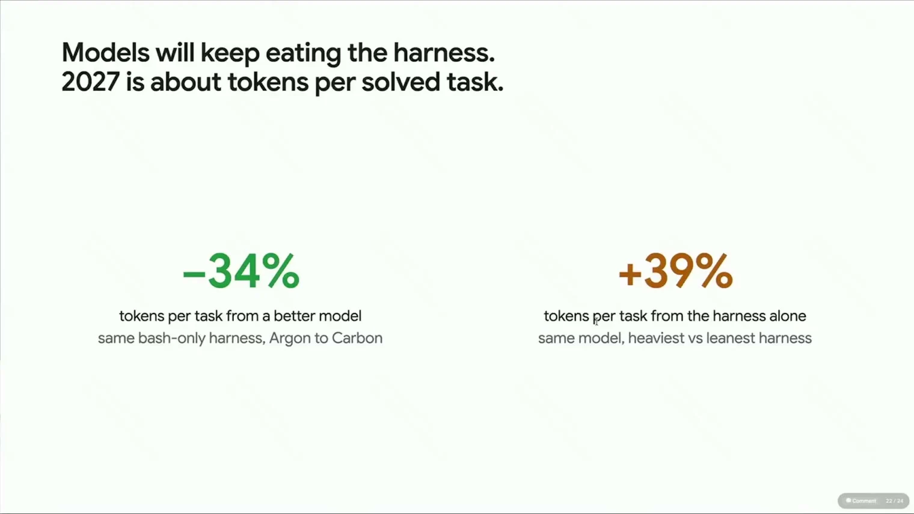

_截图 25  ·  录屏 02:09:26_

**02:09:26**　needs less tokens per task, which of course is very exciting for all of us because then we can use it more. And also it matters a lot what the harness provides. And we might not see it if we just look at the accuracy. It's also very important that we start measuring the token efficiency because harnesses can look the same on accuracy because our models are now very good.

每个任务所需的 tokens 较少，这对我们所有人来说非常令人兴奋，因为这样我们就可以更频繁地使用它。此外，harness 提供的功能也非常重要。如果我们只关注准确率，可能就看不到这一点。开始衡量 token 效率同样重要，因为虽然从准确率来看，harness 可能看起来没有区别，但我们的模型现在已经非常出色了。

**02:09:48**　So if your harness is more complex to use, around it, we'll find solutions around it, but needs more terms and more tokens to achieve the same results. And then also what comes afterwards, so I will try to do the same experiment six months from now, and currently the trend we see slowly rising, at least on social media and the industry, is that we might go back to some code mode tool that we, instead of of writing a bash commands that we write TypeScript or Python directly that MCP will come back.

所以，如果您的 harness 使用起来更复杂，我们会在其周围寻找解决方案，但需要更多的术语和参数才能达到相同的效果。此外，从现在开始六个月后，我也会尝试进行同样的实验。目前，我们在社交媒体和行业中看到的一个趋势是，我们可能会回到某种代码模式工具上，而不是编写 bash 命令，而是直接使用 TypeScript 或 Python，这样 MCP 就能重新发挥作用。

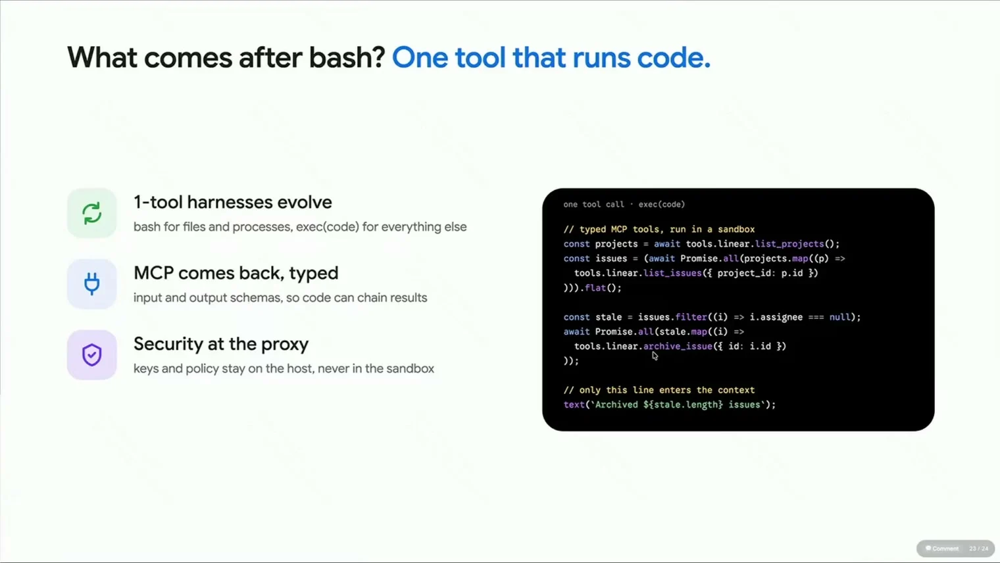

_截图 26  ·  录屏 02:10:16_

**02:10:24**　I'm a big fan of MCP and they are making great changes to make it more easily usable, especially interesting for all of that code mode work is MCP servers now allow you to return structured outputs so the model can write better scripts to take more actions in the single term and it also allows us to do some better proxy are very hard to understand, but if I have some abstracted layer in TypeScript, I can watch all of the commands being executed and make sure those are secure.

我是 MCP 的忠实粉丝，他们正在做出许多改进，让使用起来更加方便。尤其有趣的是，现在 MCP 服务器允许返回结构化输出，这样模型就能编写更高效的脚本，在单一命令中执行更多操作。此外，它还能让我们实现更好的代理功能。这些概念可能比较难以理解，但如果我在 TypeScript 中加入一个抽象层，就能监控所有执行的命令，并确保其安全性。

**02:10:58**　And for you, build to delete your code before the model does. Give your model to a computer, not a toolbox. And when a new model ships, I definitely recommend you trying to think a little bit outside of the box, be more ambitious, try to really see, okay, my complete harness and just give it one tool. And then also please scan the QR code.

对于你来说，在模型生成之前先构建并删除代码。把你的模型交给计算机，而不是工具箱。当新的模型发布时，我强烈建议你尝试跳出常规思维，更有抱负一些，真正去理解它，好吧，就使用完整的工具包，只用一个工具。另外，请扫描二维码。

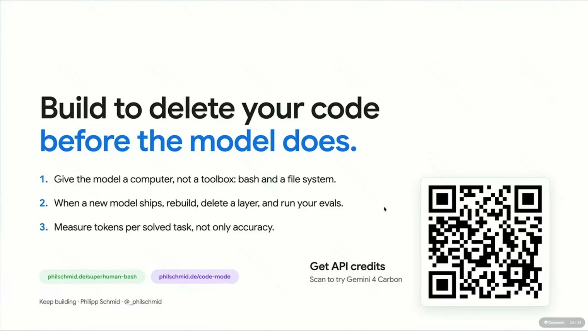

_截图 27  ·  录屏 02:11:15_

**02:11:22**　You will get free credits. We will send them out after the AI engineering event to try out Carbon and also to try out the new Gemini Decisions API. So if you have some time today, I really can recommend checking out the new Decisions model, Carbon, and thank you for your time.

您将获得免费积分。我们会在人工智能技术活动结束后发送这些积分，以便您尝试使用 Carbon 功能，同时也可以体验新的 Gemini Decisions API。如果您今天有时间的话，我真心推荐您去试试新的 Decisions 模型和 Carbon 功能。感谢您的关注。

**02:11:48**　Thank you.

谢谢。

---

[全部演讲](../README.md) · [选看索引](index.md) · [上一场](08-meta-on-call.md) · [下一场](10-ankit-mathur.md)
