[全部演讲](../README.md) · [选看索引](index.md) · [上一场](09-philipp-schmid.md) · [下一场](11-andrew-finch.md)

# The Rise of the Agent Workforce: Rethinking Agent Infrastructure

**Ankit Mathur** · Databricks · Member of Technical Staff

AIE Code Summit 2026  ·  11 月 11 日  ·  主舞台  ·  录屏 02:21:29–02:38:06

[官方议程](<https://ai.engineer/code/2026/schedule>)   ·   [Day 1 官方回放](<https://www.youtube.com/watch?v=ZZ19zhYnDKY>)

## 本场目录

- [02:21:30](#section-1) 从棋局多路径搜索讲到团队型 Agent
- [02:24:26](#section-2) 用分支和模拟验证真实工作流
- [02:28:20](#section-3) 对会话、记忆和沙箱文件系统建分支
- [02:35:12](#section-4) 用安全事件调查展示如何保留独立证据和推理分支

## 演讲实录

> 英文源自录屏音频，经轻度校订。每段英文下方为中文译文。时间指向原始录屏。

### 从棋局多路径搜索讲到团队型 Agent

**02:21:30**　All right. Well, super excited to be here. My name's Ankit. I'm from Databricks. I work on AI infrastructure there. And today I'm going to talk about the rise of the agent workforce and how we're building our agent infrastructure to support what we think is the next generation of agents. I wanted to start by taking a step back how we helped computers become good at other things, better even than humans.

好的，非常兴奋能在这里发言。我叫Ankit，来自Databricks。我在那里负责AI基础设施的工作。今天我将谈论智能体劳动力的兴起，以及我们如何构建智能体基础设施，以支持我们认为的下一代智能体。我想从回顾过去开始，看看我们是如何帮助计算机在其他领域变得更出色，甚至超过人类。

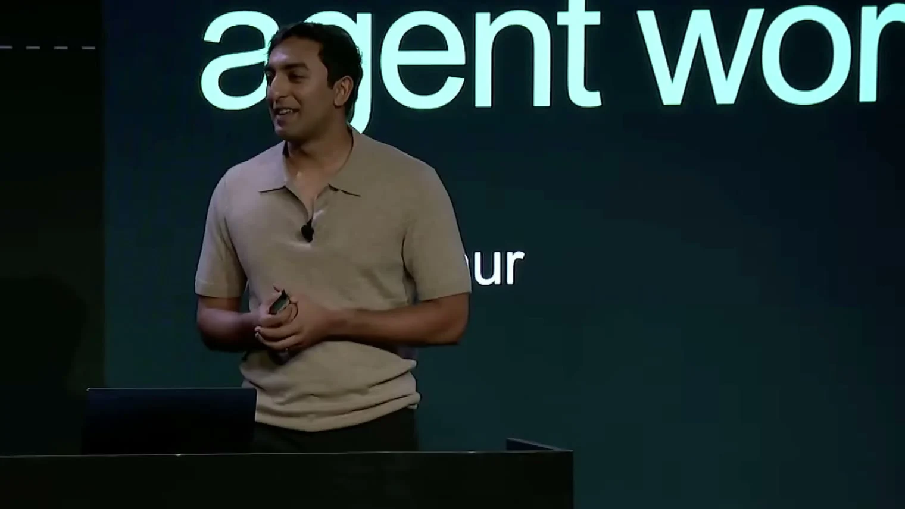

_截图 01  ·  录屏 02:21:31_

**02:21:56**　And one of the games I grew up playing a lot was chess. It's one of the great examples of something where computers became way better than humans a long time ago. But I think it's important to think about why that happened and how we can apply those lessons today. One of the biggest, to summarize at a high level, a lot of work went into it.

我小时候经常玩的游戏之一就是国际象棋。这是计算机比人类更出色的领域之一，早在很久以前就如此了。但我认为，思考为什么会出现这种情况，以及我们今天如何运用这些经验，非常重要。总的来说，为此投入了大量努力。

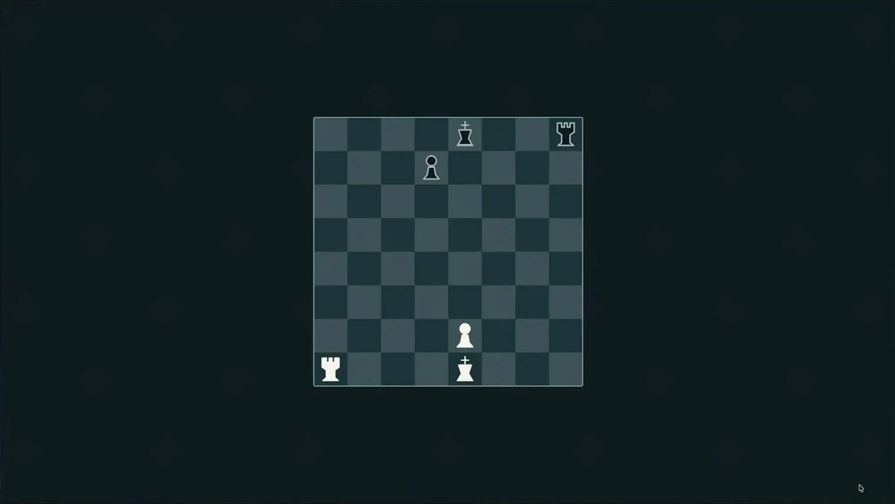

_截图 02  ·  录屏 02:22:05_

**02:22:15**　The biggest thing that agents were able to do, that computers were able to do, was explore the space of decisions much more effectively than humans. For most complex problems, there's actually a bunch of different ways you can solve the problem. And at each turn, you can kind of think of three more decisions that you can make. And really, it's the exploration of that space that all of us are engaged in.

智能体能够做到的最重要的事情，就是比人类更有效地探索决策的可能性。对于大多数复杂问题来说，实际上有多种解决方式。在每一个步骤中，你还可以考虑三种新的决策。实际上，我们所有人都在进行这种探索过程。

**02:22:36**　All of us who solve hard problems are engaged in the search space for what's an amazing product, what's the right solution to this math problem, and et cetera, right? And I think we've seen some really exciting progress from the labs, like Anthropic, OpenAI, and Google, on solving problems that are well-formed. So if you think about chess, it can be modeled effectively.

我们所有解决难题的人，都在探索什么才是出色的产品、什么是对应的解决方案，等等。我认为从实验室那里也取得了一些令人兴奋的进展，比如 Anthropic、OpenAI 和 Google 在解决结构合理的数学问题方面都取得了显著成果。所以如果你想想下棋这件事，它也可以被有效地建模出来。

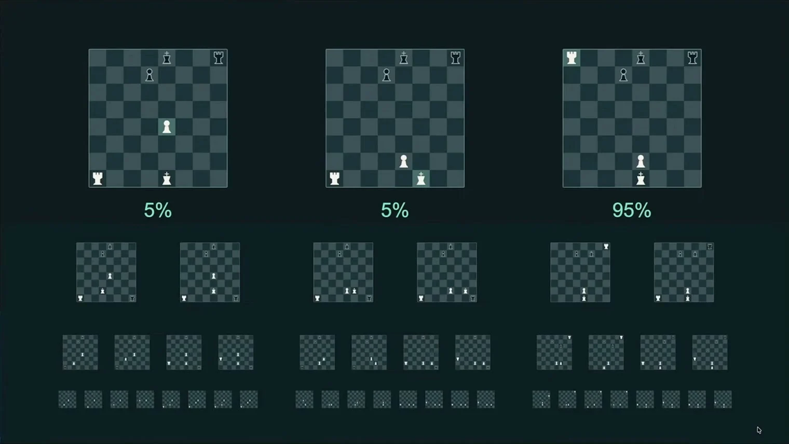

_截图 03  ·  录屏 02:22:38_

**02:22:56**　You can evaluate your position. You can actually simulate it. You can try different moves and safely think about all the different alternatives. Similarly, with math problems, often the ones that agents are really good at solving, you can actually verify if you got the result right. How do we then take that mindset and apply it to the problems that we actually face day to day?

你可以评估自己的位置。实际上可以进行模拟。可以尝试不同的策略，并安全地思考各种替代方案。同样，对于数学问题，那些智能体特别擅长解决的问题，你可以验证结果是否正确。那么，我们该如何将这种思维方式应用到日常遇到的问题中呢？

**02:23:20**　I think, like, let's, a lot, everyone here is an engineer, so let's take it to engineering for a bit. I think, you know, if you take it to the pre-AI days, most people think about solving a single problem, and they're kind of single-threaded on that problem for the time that they're writing code on it. And, you know, as a company or a product, if you wanted to solve more problems, you brought in more people.

我觉得，既然这里很多人都是工程师，那我们就把话题放在工程领域吧。我想，在AI出现之前，大多数人只专注于解决一个问题，他们在编写代码时也是针对那个问题进行单线程处理。而作为公司或产品，如果想要解决更多问题，就需要招募更多人。

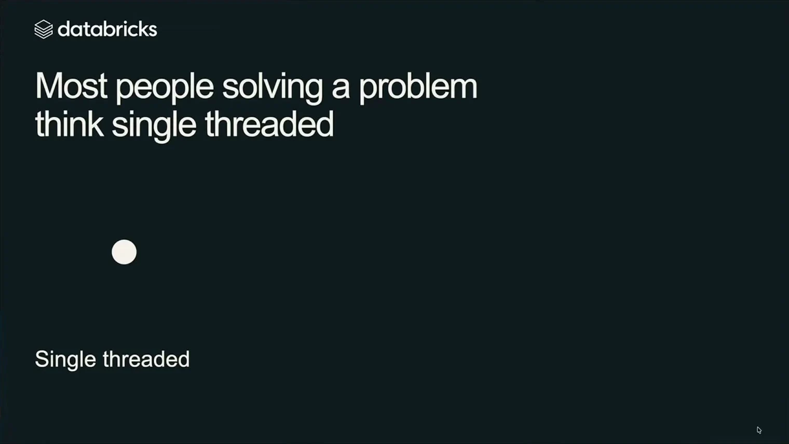

_截图 04  ·  录屏 02:23:28_

**02:23:41**　And the very basic version of agents just helps create leverage for that engineer. Now you can be single-threaded on three things at the same time, and ultimately that helps you explore new product ideas, ship faster, iterate faster, and that's obviously very exciting. But it's not actually close to what we needed to do to win a chess or any of these other problems.

而最基础的智能体概念，只是帮助工程师获得更多优势。现在你可以同时处理三件事，实现单线程运行，这能让你更容易探索新的产品创意、加快发布速度、更快速地进行迭代，显然非常令人兴奋。但这与我们赢得国际象棋比赛或解决其他问题所需的水平还相差甚远。

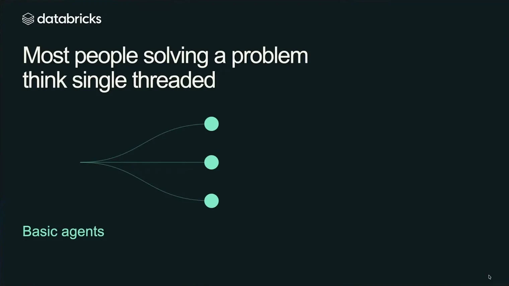

_截图 05  ·  录屏 02:23:53_

**02:24:03**　What we're seeing at the absolute frontier are these teams of agents that are able to make significant progress by exploring the decision space more effectively. So how do we move towards that world where we actually have these teams of agents that are coherently attempting to solve problems? It's actually quite complex, and we think it requires a little bit different type of infrastructure.

我们在最前沿看到的是这些智能体团队，它们通过更有效地探索决策空间取得了显著进展。那么，我们如何走向一个真正拥有这些智能体团队、一致地尝试解决问题的世界呢？这其实相当复杂，我们认为需要一种不同类型的基础设施。

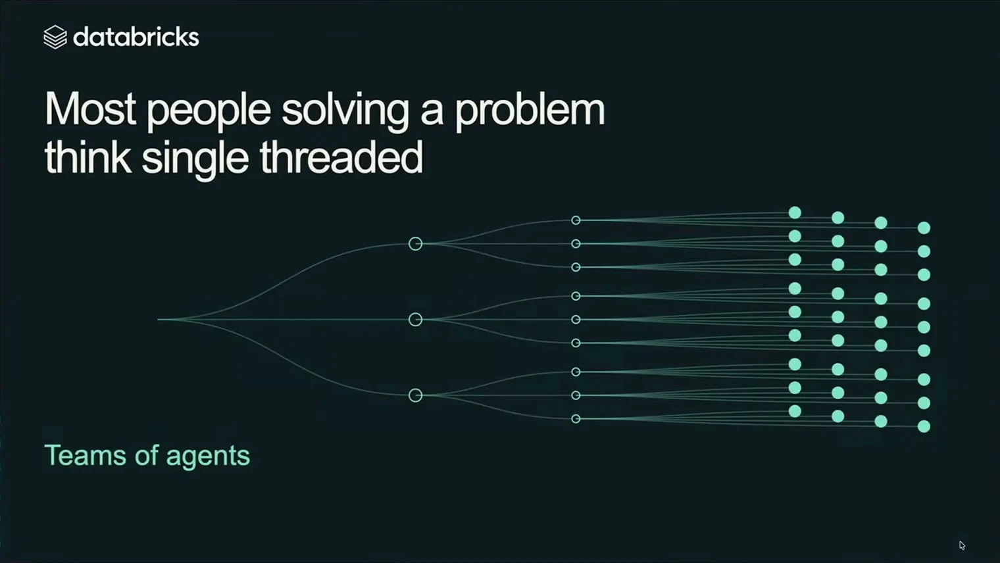

_截图 06  ·  录屏 02:24:14_

### 用分支和模拟验证真实工作流

**02:24:23**　Specifically, I think an important question to ask is how do we give agents a realistic world to explore? Because in other problems, we're able to help define that world very effectively. But even in software engineering, we actually really struggle to do that. Just consider this movement towards software factories, where you're away from the agents, and you're actually operating a bunch of agents that are working on a problem.

具体来说，我认为一个重要的问题是：我们如何为智能体提供一个可探索的现实世界？因为在其他问题中，我们能够非常有效地定义那个世界。但即使在软件工程领域，我们也确实很难做到这一点。只需想想这种向软件工厂的转变，在那里你不再依赖智能体，而是操作着一群正在解决某个问题的智能体。

_截图 07  ·  录屏 02:24:26_

**02:24:47**　How do you validate that those agents are effective? Or you had a branch, you had main, you branched your PR off of that, maybe you have an agent working on that PR, and you have some reasonable assertion that this is kind of a simul... You have some tests or something like that that help you guide your development. But if you're actually merging tens of PRs a minute, or even more, right?

如何验证这些智能体是否有效？或者你有分支，也有主分支，你将 PR 从主分支中分离出来，可能有一个智能体在处理那个 PR，并且有一些合理的断言表明这是某种模拟……你有一些测试或类似的东西来帮助你指导开发过程。但如果你实际上每分钟甚至更频繁地合并数十个 PR，对吧？

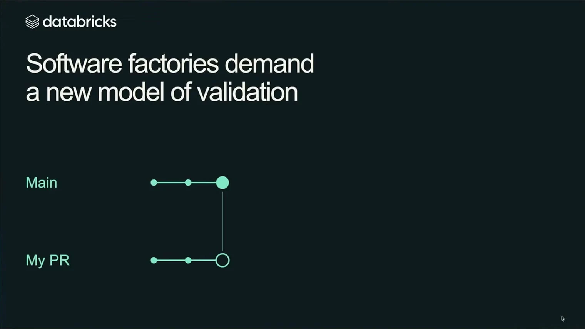

_截图 08  ·  录屏 02:24:55_

**02:25:13**　Like if you play out the future of factories of agents building code and software, your PR is just out of date the moment you branched. Started, you're already out of date. And so it demands a different mindset of thinking of how do we verify these things. You actually might want to move most of your verification to post-merge. And so that kind of brings me to this a little bit radical idea.

比如，如果你想象未来智能体如何构建代码和软件，那么你的PR在刚分支时就已经过时了。从一开始，你就已经过时了。因此，我们需要一种不同的思维方式来思考如何验证这些内容。实际上，你可能应该把大部分验证工作放在合并之后进行。这让我想到了一个稍微激进的想法。

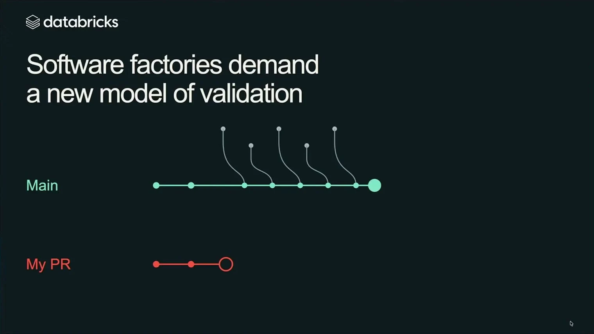

_截图 09  ·  录屏 02:25:16_

**02:25:35**　I don't think we should try to write hundreds or thousands of unit tests. Instead, I want to explore this idea of simulating reality. Can I give my agent a faithful reproduction of what's actually there in the real world, in my production code, in my production agent, and let it work on that. And when you can do that, you can actually do that at scale.

我认为我们不必尝试编写数百或数千个单元测试。相反，我想探索模拟现实的这一想法。我能否让我的智能体在我的生产代码中、生产智能体中，能够忠实地再现现实世界中的真实情况，并让它基于这些情况进行工作？当能够做到这一点时，就可以大规模地实现目标。

**02:25:58**　If you find a way to simulate reality, then you can actually do that across lots of different explorations. At Databricks, one of the big things that people do on our platform is build data pipelines. We've got tens of thousands of data pipelines on Databricks. And the biggest problem that happens with pipelines is that they break. And in this era of agents, what people want is they want to fix those broken pipelines with agents.

如果你能找到模拟现实的方法，那么就可以在多种不同探索中实现这一点。在 Databricks 上，人们使用我们的平台做的最重要的事情之一就是构建数据管道。我们在 Databricks 上拥有数万条数据管道。而管道最常见的问题就是会崩溃。在智能体时代，人们希望用智能体来修复那些损坏的管道。

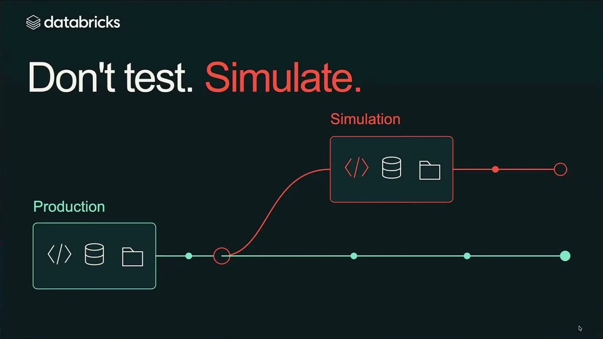

_截图 10  ·  录屏 02:25:58_

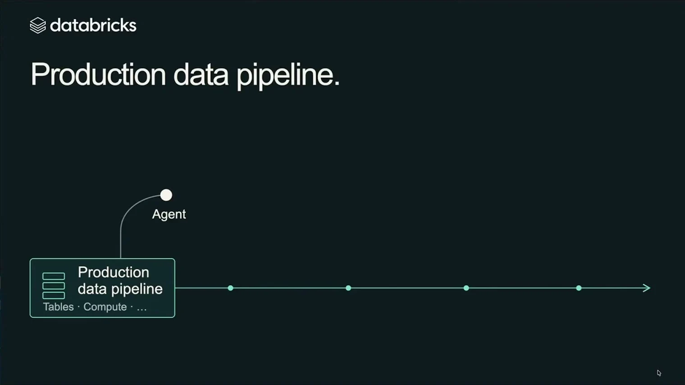

_截图 11  ·  录屏 02:26:10_

**02:26:23**　Because these are serious business problems that are caused by a broken pipeline. If a pipeline breaks, that business can't operate that day. And so this becomes a major emergency. But how do you actually validate this with an agent? Do you trust it on your production data pipeline? It's pretty risky because writes might not be idempotent. Even reads might be extremely expensive and affect other use cases in production, right?

因为这些是由管道故障导致的严重业务问题。如果管道出现故障，相关业务当天就无法运行，这就变成了重大紧急情况。但如何通过智能体来验证这一点呢？你能否信任它使用到你的生产数据管道中？这相当危险，因为写入操作可能并非幂等性，而读取操作也可能成本极高，影响生产环境中的其他使用场景，对吧？

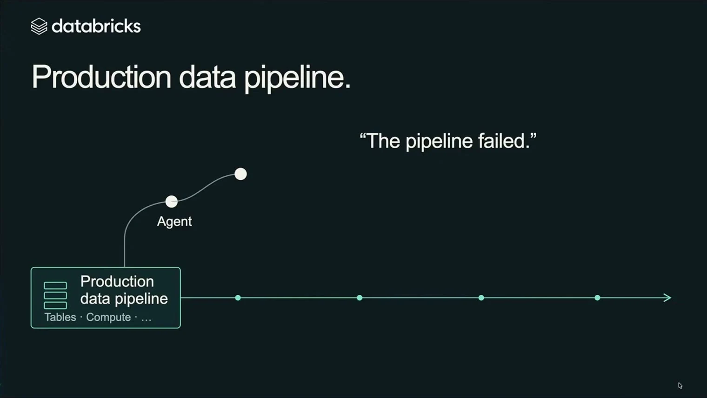

_截图 12  ·  录屏 02:26:31_

**02:26:48**　Sometimes it's not fully broken, it's just partially broken. One of the things we started doing was building on top of branchable infrastructure. And so what we did was we branched the entire data platform. We branched the tables, the compute, the governance, and we gave the agents a place where they can actually play with the data platform and explore different hypotheses. And these hypotheses can be ambitious.

有时它并非完全损坏，只是部分损坏而已。我们开始做的事情之一就是建立在可分支的基础设施之上。于是我们对整个数据平台进行了分支处理：对表格、计算资源、治理机制进行了分支，同时为智能体提供了可以实际使用数据平台、探索不同假设的空间。而这些假设可能非常具有挑战性。

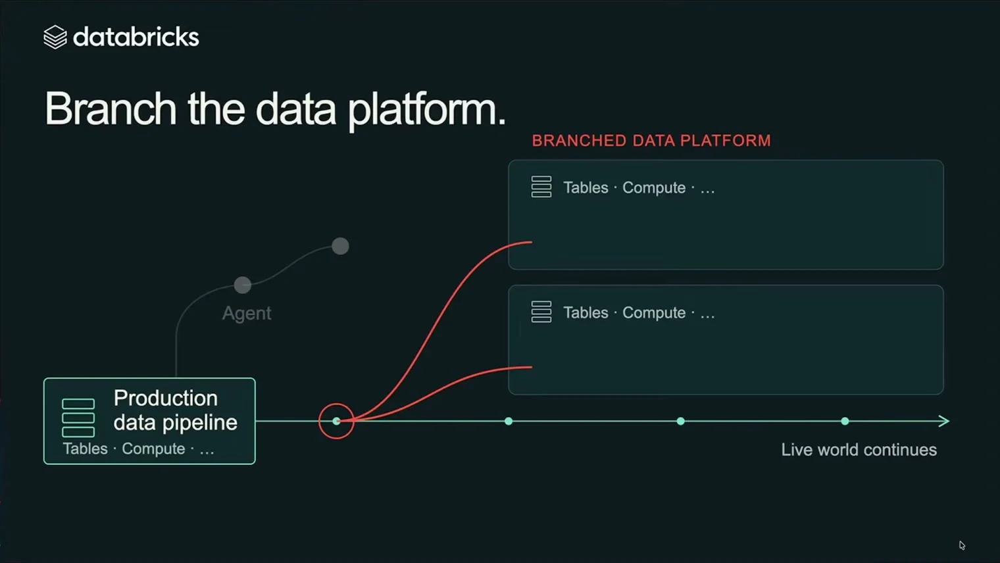

_截图 13  ·  录屏 02:27:00_

**02:27:13**　Like, can I investigate the upstream pipeline is healthy? Maybe I can do that by changing the pipeline code and running it again. In any reasonable data platform, you wouldn't do that with an upstream pipeline unless you had a bunch of engineers take a look at it and make sure it was super safe. With our branched data platform, you can actually do that now.

比如，我可以检查一下上游管道是否正常吗？也许可以通过修改管道代码然后重新运行来做到这一点。在任何合理的数据平台中，除非有许多工程师检查并确保其完全安全，否则不会对上游管道进行这样的操作。而我们的分支式数据平台，现在就可以做到这一点。

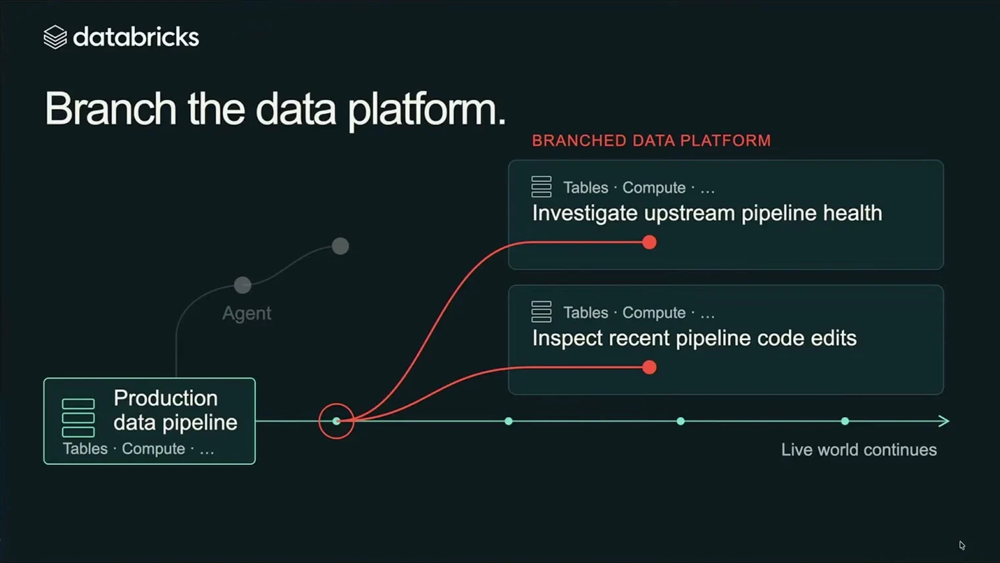

_截图 14  ·  录屏 02:27:21_

**02:27:30**　So it can investigate a bunch of different things. So we can investigate 10 ideas in parallel with our agents, actually get to a faithful conclusion about whether it fixed the real data pipeline, and then make that assumption, make that assertion back either to a main agent or to a human. And what we saw before was happening was that people would just like, LLMs would give us text back, some human would take a look at it and be like, okay, this might be an interesting theory.

因此它可以研究许多不同的内容。我们可以同时研究10种想法，从而得出关于是否真正修复了数据管道的可靠结论，然后把这个假设或断言反馈给主智能体或人类。之前我们看到的情况是，人们会让LLM返回文本，然后有人会仔细查看，心想：“好吧，这或许是一个有趣的理论。”

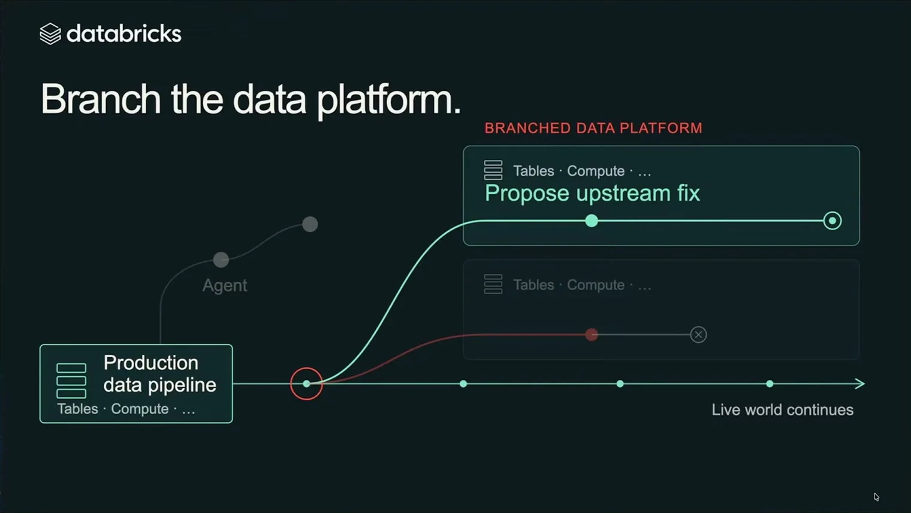

_截图 15  ·  录屏 02:27:50_

### 对会话、记忆和沙箱文件系统建分支

**02:27:54**　Then they would go apply that theory in some way. And ultimately, that became more of this AI-assisted version of fixing the data pipeline. But really, where we want to go is hands-off, full auto for this kind of problem. And we were struggling to do it without this branchable infrastructure. So how do we do it? In this talk. We built this on top of our Postgres native agent platform, which started with the Neon database, which is a branchable database that gives us a single place that we can actually use for our services and for our agents.

那么他们会以某种方式应用这一理论。最终，这变成了一种由人工智能辅助的数据管道修复方案。但实际上，我们真正想要的是完全自动化的处理方式，无需依赖这种可分支的基础设施。那么该如何实现呢？在本次演讲中，我们基于Postgres原生智能体平台进行了实现，该平台以Neon数据库为起点，Neon是一个可分支的数据库，为我们提供了一个可以实际用于服务和智能体运行的单一平台。

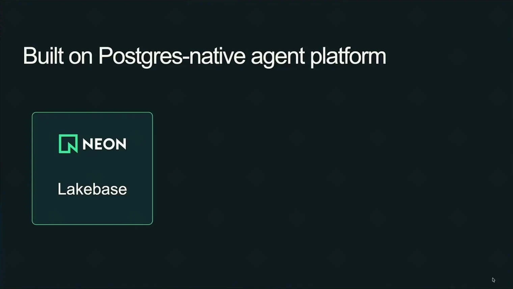

_截图 16  ·  录屏 02:28:20_

**02:28:28**　And then we added in a bunch of really core agent primitives that allow us to build sophisticated different types of agents. And those are ones that are probably familiar to all of you, things like memory, things like sandboxes, file systems, and ways to host those agents. And these low-level primitives, we can build with them, but the key is that we made just all of them branchable.

然后，我们加入了许多核心的智能体基本元素，这些元素让我们能够构建各种复杂的智能体。这些元素对大家来说应该都很熟悉，比如内存、沙箱环境、文件系统以及承载这些智能体的方式。虽然我们可以用这些低级基本元素来构建，但关键的是，我们让所有元素都具备分支能力。

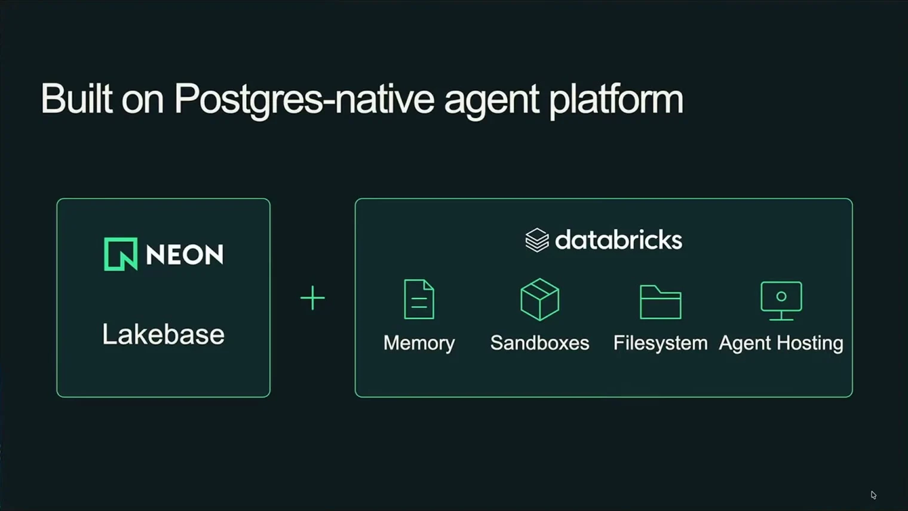

_截图 17  ·  录屏 02:28:40_

**02:28:48**　So you can branch the entire reality of stuff that's built on this platform for ourselves. So how do we actually do that? Well, let me walk it through, like, kind of case by case. The first thing is just the database, right? And, you know, we can take an example of application services, but here I'm going to talk about just even storing the conversation state for an agent.

所以你可以将基于这个平台构建的所有内容作为智能体来使用。那么我们实际上要如何做到这一点呢？让我一步一步地说明，按案例来讲。首先就是数据库，对吧？而且，我们可以以应用服务为例，但这里我打算讨论的是如何存储智能体的对话状态。

**02:29:09**　When you fork or branch an agent, you actually might want to inherit the history. And you might even, if you have a team of agents, give access to a given member of that team to what the other members of the team are doing. And we found the database to be a convenient abstraction for this. The key was that, hey, like when a new reply comes in on the branched agent, it shouldn't necessarily change anything about the other one.

当您创建或分支一个智能体时，实际上可能希望继承其历史记录。如果拥有多个智能体团队，甚至可以将该团队的特定成员访问权限授予其他团队成员正在进行的操作。我们发现数据库是实现这一功能的便捷抽象工具。关键在于，当分支智能体收到新回复时，不一定需要改变另一个智能体的任何内容。

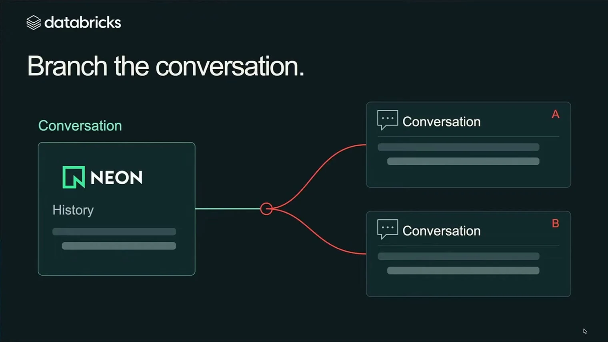

_截图 18  ·  录屏 02:29:22_

**02:29:31**　And this is possible because Neon has a branched database. But then we actually found that agents need more than just structured databases. Of course they need structured databases, but they also like to do this, you know, write these things called memories. And memories are, you know, at a very high level, they compile down to an unstructured database for agents. There are two ways that memories get generated.

这是可能的，因为 Neon 拥有分支式数据库。但后来我们发现，智能体需要的不仅仅是结构化数据库。当然，它们需要结构化数据库，但它们也喜欢创作那些被称为“记忆”的内容。从非常高层的角度来看，这些记忆最终会转化为智能体的非结构化数据库。记忆的生成有两种方式。

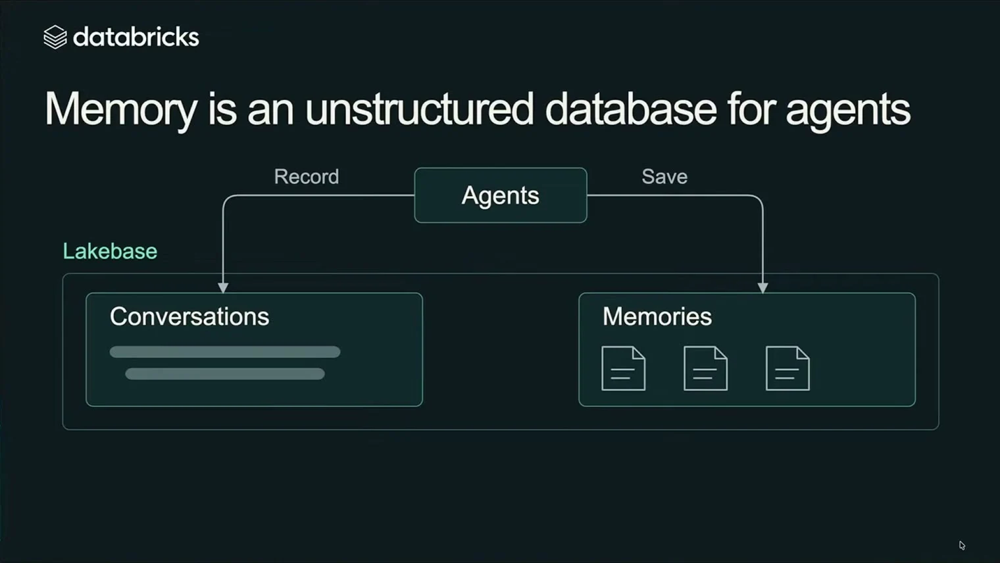

_截图 19  ·  录屏 02:29:51_

**02:29:52**　The first is just by synthesizing the context and the conversations that someone's already had with them. And the second, by agents actually explicitly saving content to an unstructured place. The key thing here is that you actually want to consolidate and distill that information. There's a ton of information coming in through there, and if you just give that, you know, if you just let it kind of go on its own, you have problems of staleness, you have conflicts in the information, and all of those can be extremely damaging to teams.

第一种方式是通过整合上下文以及某人之前与这些内容的对话来实现。第二种方式则是智能体实际上将内容保存到非结构化的地方。关键之处在于，你需要对这些信息进行整理和提炼。通过这种方式会收到大量信息，如果任由它们自由发展，就会出现信息过时的问题、信息冲突，所有这些都可能对团队造成极大损害。

**02:30:21**　So we have this thing that basically dreams overnight. We use offline compute, and it takes the conversations. A different agent essentially highlights things that are conflicts and consolidates the ad hoc notes that were written by various members of the team. And then all members of the team can actually recall from that memory database. And you can use this in a bunch of different ways.

因此，我们有一个能够在夜间进行处理的系统。我们使用离线计算能力，处理各种对话内容。另一个智能体会突出显示那些存在冲突的部分，并将团队成员撰写的临时笔记整合起来。然后，整个团队的所有成员都可以从这个记忆数据库中获取这些信息。你可以以多种不同的方式使用它。

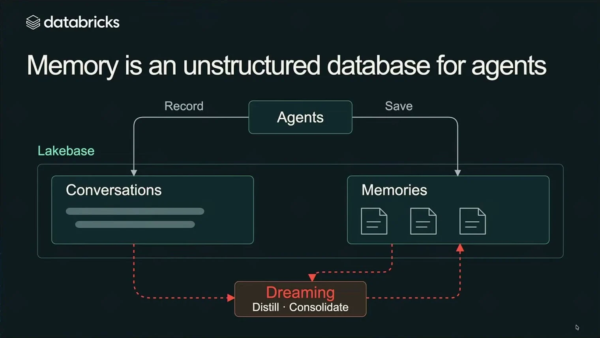

_截图 20  ·  录屏 02:30:25_

**02:30:43**　We use this within our Slack agents, but we also use this when we're launching a parallel set of agents to investigate a deep issue. Data platform. Now how does branching come into this? Well, some of the agents, like in many of the use cases, they propose memories. And it's not clear whether those memories generalize to the actual broader set of agents or if that's a specific thing for just that agent.

我们在 Slack 智能体中使用这一方法，但在启动一组并行智能体以研究深层问题时也会使用它。数据平台。那么，分支机制是如何与此相关的呢？嗯，一些智能体，就像在许多应用场景中一样，会提出记忆。目前还不清楚这些记忆是否能推广到更广泛的智能体集合中，或者只是该特定智能体的专属特性。

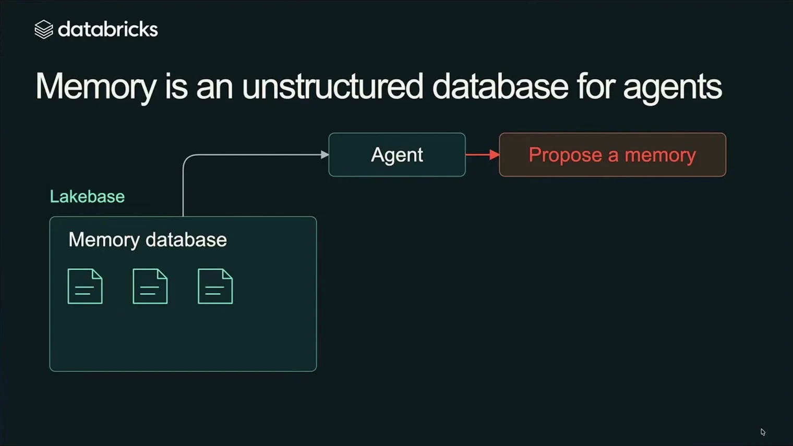

_截图 21  ·  录屏 02:31:02_

**02:31:07**　And so with the branchable database for memory, which is built on top of this NEON database, we can actually just propose that memory somewhere in there. And that branch can continue to iterate. And at some point, we can find a way to merge it back in if it's necessary. Found this to be an important layer of flexibility, because without the ability to completely branch the memory, we found it was very hard to maintain the memory for a team of agents.

因此，以这种 NEON 数据库为基础构建的可分支内存数据库，我们实际上可以将内存放在其中某个位置。而该分支可以继续迭代。在某个时刻，如果必要的话，我们可以找到将其重新合并的方法。我们发现这是灵活性的重要层面，因为如果没有完全分支内存的能力，维护一个由智能体组成的团队所使用的内存就会非常困难。

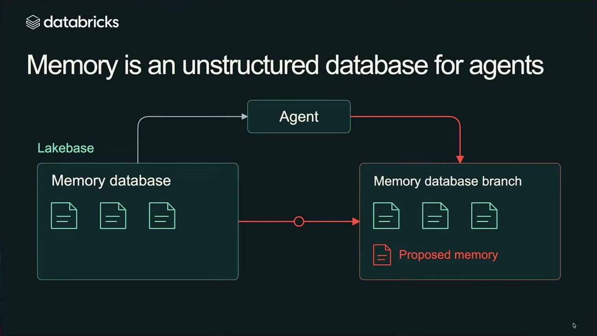

_截图 22  ·  录屏 02:31:27_

**02:31:32**　Especially as we increase parallelism, you can actually experience significantly reduced quality if all the agents are pursuing different goals. I like to think a little bit of it as kind of similar to dynamic programming. If you've explored a branch of exploration, and then you have a different agent that happens upon that same pathway, it's very damaging to always revisit that, but sometimes you want to.

尤其是当我们增加并行性时，如果所有智能体都追求不同的目标，质量可能会显著下降。我倾向于认为这有点类似于动态规划。如果你已经探索了某个分支，然后另一个智能体偶然发现相同的路径，反复访问该路径是非常有害的，但有时你确实希望这样做。

**02:31:54**　And so the ability to propose a memory is extremely important to us. How is all of this branchable database possible? Well, the way that Neon does is it separates compute from storage. Compute for Postgres is running in some separate place, and then we actually have the shared history and the storage in a different layer. And what that lets us do is copy and write for branching.

因此，能够提出一种记忆机制对我们来说非常重要。那么，这种可分支的数据库是如何实现的呢？Neon的实现方式是将计算与存储分离。Postgres的计算过程在独立的位置进行，而共享的历史记录和存储则位于不同的层面。这让我们能够实现分支复制和写入操作。

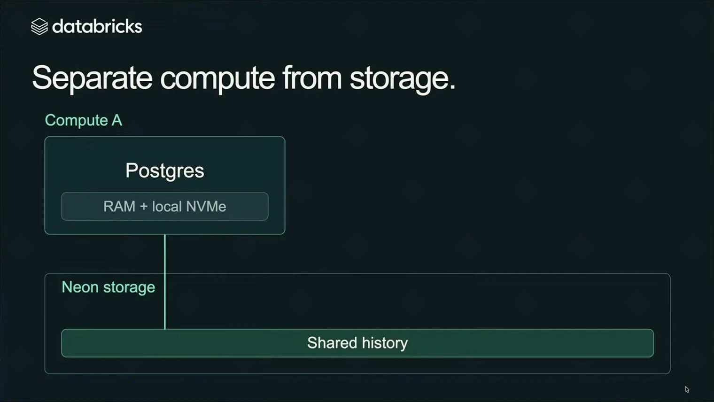

_截图 23  ·  录屏 02:32:05_

**02:32:19**　of the database. You can actually have Compute A's rights separated from Compute B. And that's the core layer of infrastructure that allows us to build these applications on top of that database. But then we found, obviously, agents are far more than storage. And branching storage wasn't enough. We also found that as they were running in sandboxes, agents like to take notes on stuff and write down scripts and use those to actually iterate on various kinds of problems.

数据库中的内容。实际上，Compute A和Compute B的权限可以分开设置。这就是允许我们在该数据库上构建这些应用程序的核心基础设施层。但后来我们发现，智能体远不止是存储工具。单纯的分支存储无法满足需求。我们还发现，当它们运行在沙箱环境中时，智能体会记录各种信息、编写脚本，并利用这些来解决不同类型的问题。

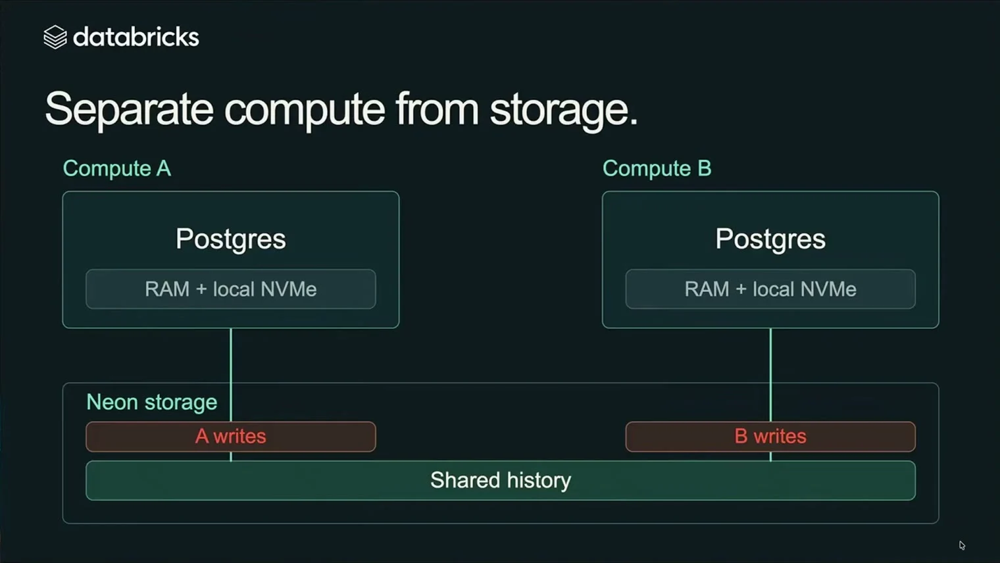

_截图 24  ·  录屏 02:32:21_

**02:32:49**　It's one of the most exciting things about agents that I've found, that they are able to generalize this capability that's needed maybe for testing code and things like that and solve other more broader general problems using that same construct. But then when you branch it, you actually need to give the future agent a similar context. We found that when we started the branched agents without the same files that that agent had to begin with, it just wasn't as effective.

我认为智能体最令人兴奋的特质之一在于，它们能够运用这种能力——可能用于测试代码等场景，并通过相同的结构解决更广泛、更通用的问题。但当你进行分支时，实际上需要为未来的智能体提供类似的上下文。我们发现，当没有使用该智能体原有的文件时，开始分支的智能体效果就不如以前那么好。

**02:33:15**　So when you're investigating an outage, for example, with an agent, you might have notes and plans. Agent might update those notes. It might find new things. But we don't want that to go back, because we're actually exploring 10 different pathways at the same time. So building a branchable file system was extremely important and allowed us to build what we call a branchable sandbox.

因此，当您使用智能体进行故障排查时，可能会有一些记录和计划。智能体可能会更新这些记录，也可能发现新情况。但我们不能让这些内容重新出现，因为我们实际上同时在探索10种不同的路径。因此，构建可分支的文件系统非常重要，它让我们能够创建我们所说的可分支沙箱。

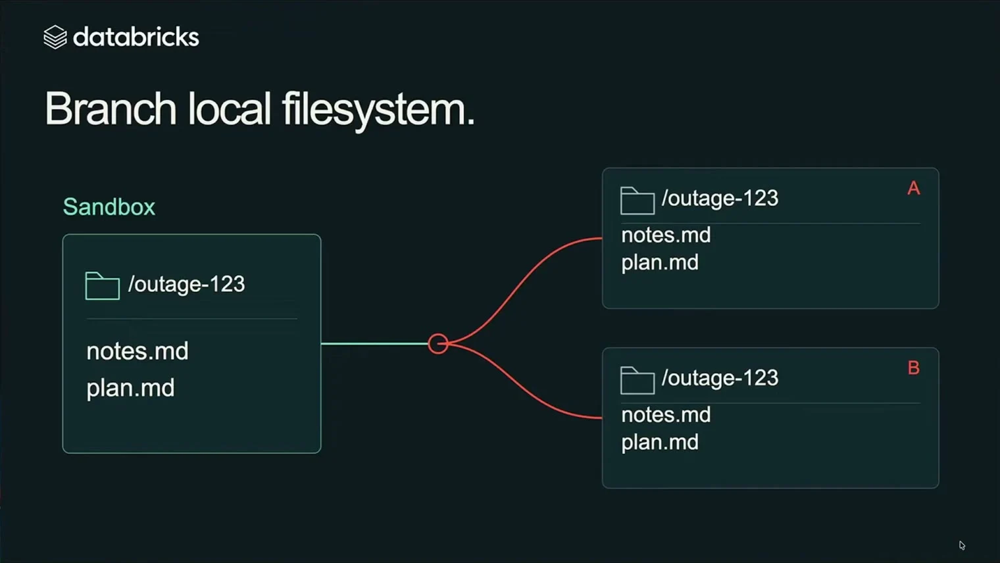

_截图 25  ·  录屏 02:33:15_

**02:33:37**　Because then what we can do is we can launch that sandbox compute. And that's a hard problem in and of itself. It's not one we're going to talk about today. But that compute can be attached to storage. And critically, the agents actually really aggressively very often. And so it can be very painful to make all your storage fully remote. And so the really core piece of what we've been building here is a syncing process between what we call a local cache and the remote cache.

因为那样的话，我们就能启动那个沙箱计算环境。这本身就是一个难题，不是我们今天要讨论的内容。不过，这种计算可以与存储系统相连。关键的是，智能体会非常积极地参与其中。因此，要让所有存储完全远程化会非常困难。所以，我们在这里构建的核心部分，就是所谓的本地缓存与远程缓存之间的同步过程。

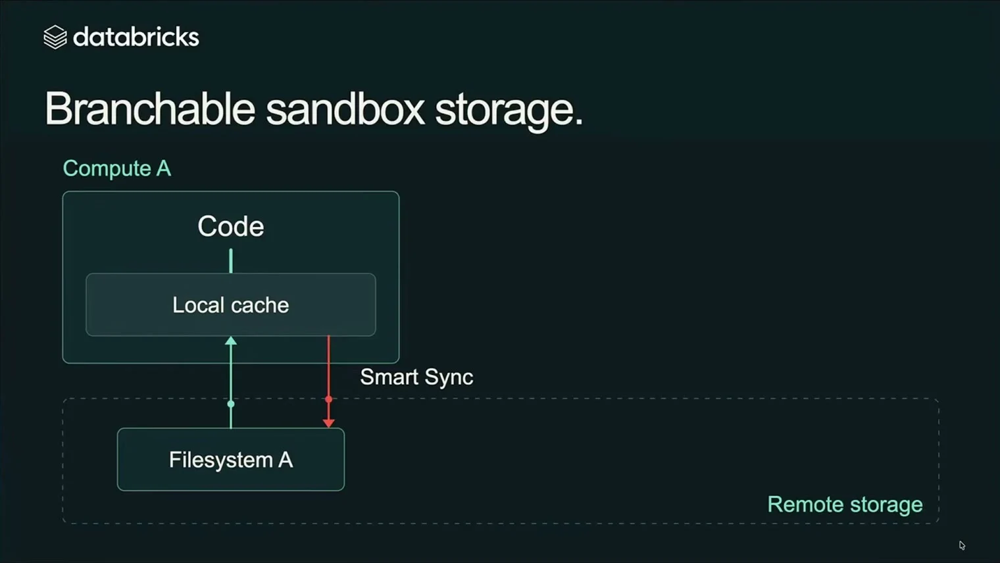

_截图 26  ·  录屏 02:33:49_

**02:34:05**　And then what that allows us to do is, as we're able to make progress on that, when we want to branch, we can actually branch a second sandbox, use that similar file system, and it reduces our latency for branching while also keeping performance of the regular agent reasonable. So what this allows us to do at a high level is branch the entire working state.

那么，这让我们能够做到的是：当我们想要进行分支时，我们可以创建第二个沙箱，使用类似的文件系统，这样既能降低分支时的延迟，又能保持普通智能体的性能水平。因此，从宏观层面来看，这允许我们对整个工作状态进行分支。

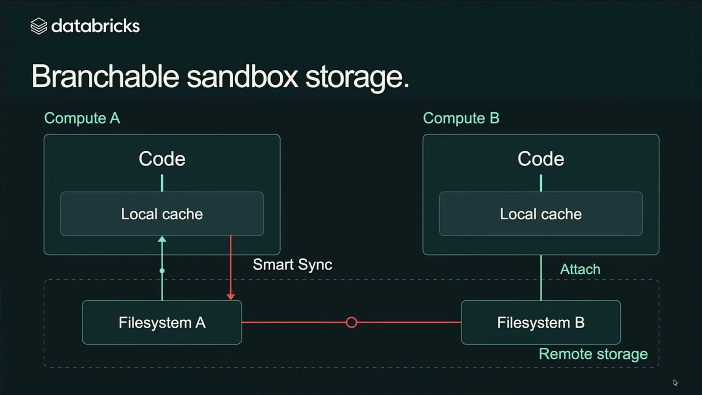

_截图 27  ·  录屏 02:34:18_

**02:34:28**　And this gives us the platform layer to actually go do that. Now, this isn't obviously sufficient. You're going to want to branch even more. If you're building on top of software, you want to find a way to branch that too. And so this is along the lines of how we're thinking. The data platform was built on top of some of these things, but there's a lot more that we've been able to branch there as well.

这为我们提供了实现该目标的平台层。不过，这显然还不够。你还需要进一步进行分支操作。如果你是在软件基础上进行开发，那就要找到一种方法来处理这些分支问题。这就是我们的思路。数据平台是建立在这些基础之上的，但我们还能够进行更多种类的分支操作。

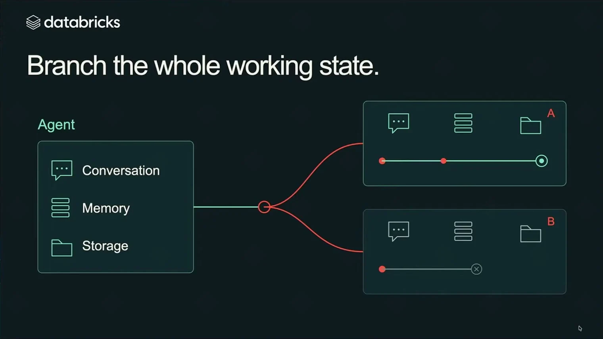

_截图 28  ·  录屏 02:34:35_

### 用安全事件调查展示如何保留独立证据和推理分支

**02:34:48**　But we're really excited about this layer for just even building agents. And just to kind of separate a little bit even from software development, another thing a lot of us are spending a lot of time thinking about is security. I mean, just taking a step back, I think this is probably the single most important thing for any product that anyone sells at this point, because trust is kind of the most important thing that we're selling when we work with other people.

但我们对这个用于构建智能体的层非常兴奋。另外，与软件开发有所区分的是，我们很多人也在花大量时间思考安全问题。说真的，退一步看，这可能是目前任何产品最重要的一点，因为当我们与其他人合作时，信任是我们所销售的最重要的东西。

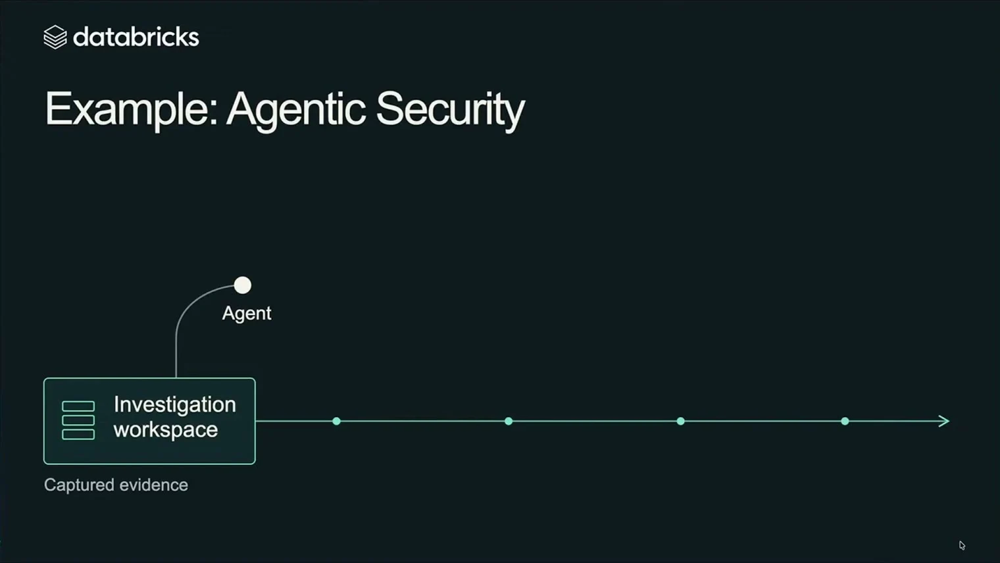

_截图 29  ·  录屏 02:35:12_

**02:35:14**　And with agents being the ones who generate the vulnerabilities, it's kind of impossible to find a different solution than having agents be the ones who are monitoring for those exact vulnerabilities in your code. So you should be thinking about how you can build an agent factory that's detecting security issues in your code base. And so this is something we're spending a lot of time on.

由于智能体是产生漏洞的源头，除了让智能体负责监控代码中的特定漏洞外，其他解决方案几乎不可能。因此，你应该思考如何建立一个能够检测代码库中安全问题的智能体工厂。这就是我们投入大量时间研究的内容。

**02:35:38**　So typically, what happens in a security incident? Well, let's say you suspect something. An agent might be always looking for it. Why is there this network traffic that's egressing all of a sudden from my control plane? Well, I can assemble an incident timeline, and that's obviously the first step in an investigation. But anyone who's been a part of a serious security investigation knows that time is of the essence.

那么，通常在安全事件发生时会怎样呢？假设你怀疑出了什么问题，智能体可能会一直在寻找原因。为什么突然会有网络流量从我的控制平面流出呢？我可以整理出事件时间线，这显然是调查的第一步。但任何参与过严肃安全调查的人都知道，时间至关重要。

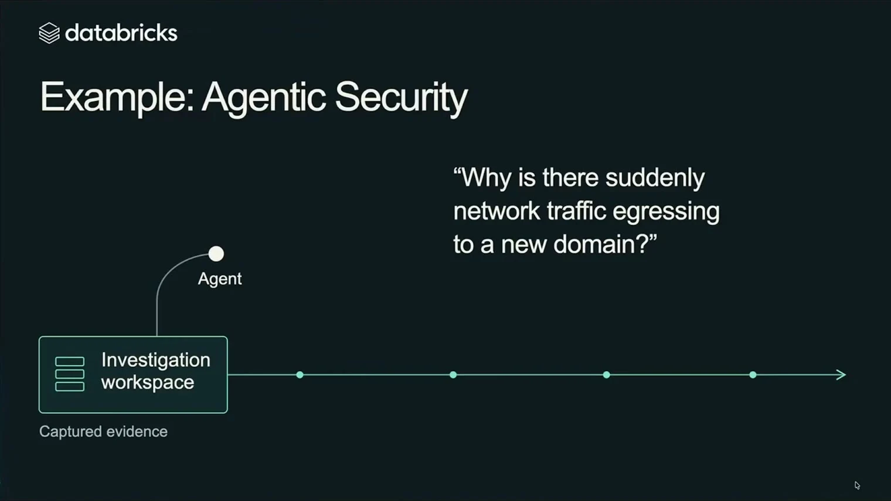

_截图 30  ·  录屏 02:35:45_

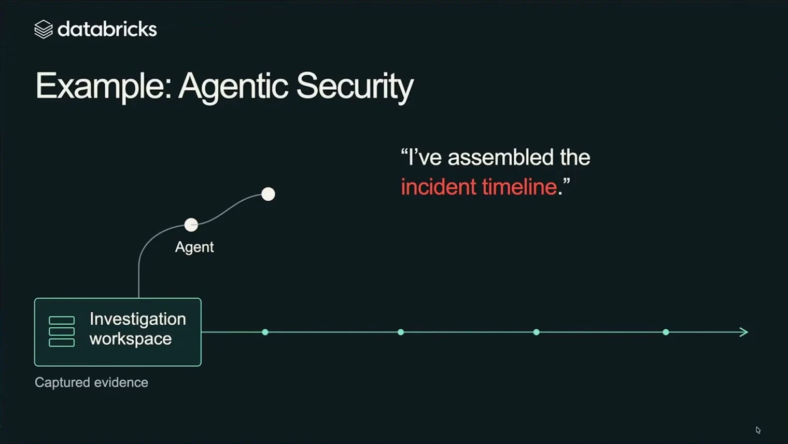

_截图 31  ·  录屏 02:35:58_

**02:35:59**　It's a perfect problem for parallelism, and that's exactly what you do when a security incident happens. You bring everyone online so you can explore 10, 15, 20 different theories at once. Because an hour earlier that you can detect the real issue is an hour that you're actually more safe. So OK, what if we did that with a branchable agent? Let's say there's two paths to investigate.

这是非常适合并行处理的难题，而安全事件发生时，你所做的正是如此。你将所有人重新上线，以便同时探索10、15或20种不同的理论。因为比实际发现问题早一小时，实际上会让你更加安全。那么，如果我们用可分支智能体来做到这一点会怎样呢？假设有两条路径可供调查。

**02:36:22**　So the agents assembled the incident timeline, and now you can ask two questions. Hey, did a recent deployment introduce some kind of new integration? Maybe I can go look at the code. Or I can explore a totally different theory. Is a compromised identity accessing this data? And the core thing that we are able to do here is we branch that whole original agent that was starting the investigation.

智能体们整理出了事件的时间线。现在你可以问两个问题。最近一次部署是不是引入了某个新集成？也许我可以去看看代码。或者我可以查一条完全不同的线索。有被攻陷的账号在访问这些数据吗？这里我们能做的一件关键的事，就是从启动调查的那个智能体的完整状态拉出分支。

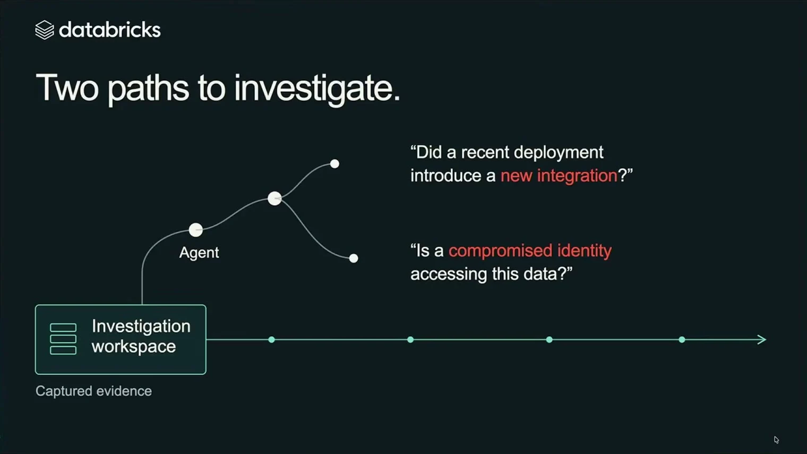

_截图 32  ·  录屏 02:36:31_

**02:36:45**　And then the new one is able to work the world. And in some cases, when we're able to, we can even branch the actual service that we're investigating. And so when you have this isolated copy of conversation, memory, and storage, you can fully explore that security risk and let the agent loop on its own. And that's kind of the key thing here.

然后，新的智能体就能运作整个系统。在某些情况下，如果我们能够做到这一点，甚至还可以对正在研究的实际服务进行分支处理。因此，当拥有这种独立的对话、记忆和存储副本时，就可以全面分析安全风险，让智能体自行循环运行。这就是关键所在。

**02:37:04**　The way that these agents are good is that they're able to loop, verify, try new theories. I think Andrej Karpathy said it really well. They're far more tenacious than any human probably And so they're able to just, but like we keep getting in the way by inserting ourselves as an approval layer. And so this is a solution that we think helps with that.

这些智能体的优势在于，它们能够循环思考、验证并尝试新的理论。我认为Andrej Karpathy说得非常到位。它们比任何人类都更坚韧，因此我们能够继续发挥作用，通过作为审核层来协助他们。我们认为，这就是有助于解决该问题的一种方法。

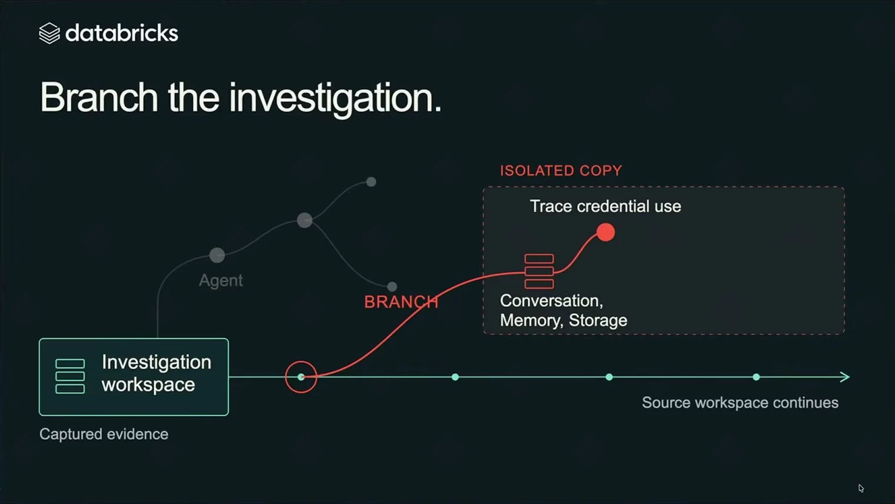

_截图 33  ·  录屏 02:37:05_

**02:37:28**　Just like take away the consequences of making a mistake a little bit. Branch the entire state so that you're not actually, you know, worrying about that same risk. And then you we've been able to find this to actually come to a reasonable conclusion as well. So what does this all add up to? For us, we think that your infrastructure needs to be branchable.

就像把犯错的后果降到最低一样。将整个状态分支开，这样你就不必担心那种风险了。然后我们就能得出一个合理的结论。那么这一切到底意味着什么？对我们来说，我们认为你的基础设施需要具备可分支性。

**02:37:50**　And that's what we're building with Neon, with Databricks. And we're super excited about that branchable future, because we think that teams are going to be the next generation of agents, both for software and the way that we actually build products. Thank you.

这就是我们与 Neon 和 Databricks 共同打造的内容。我们对这种可分支的未来感到非常兴奋，因为我们认为团队将成为下一代智能体，无论是对于软件还是我们构建产品的方式而言都是如此。谢谢。

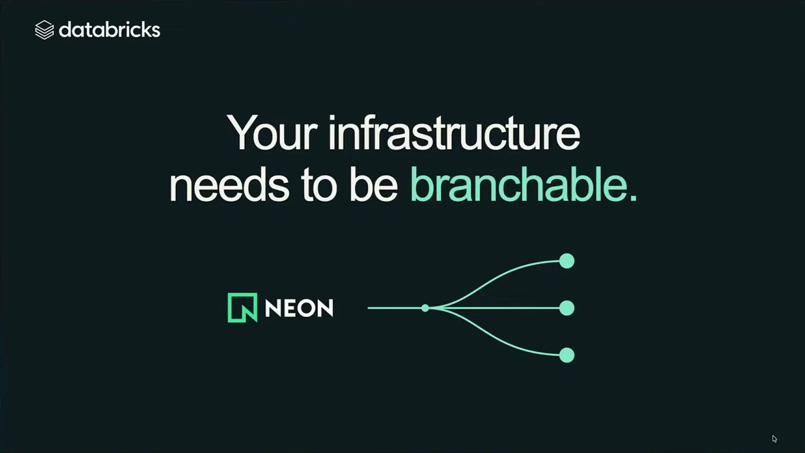

_截图 34  ·  录屏 02:37:50_

---

[全部演讲](../README.md) · [选看索引](index.md) · [上一场](09-philipp-schmid.md) · [下一场](11-andrew-finch.md)
