[全部演讲](../README.md) · [选看索引](index.md) · [上一场](10-ankit-mathur.md) · [下一场](12-luke-alvoeiro.md)

# Building a Safe Software Factory

**Andrew Finch** · Sonar · Staff Software Engineer

AIE Code Summit 2026  ·  11 月 11 日  ·  主舞台  ·  录屏 02:45:07–02:59:27

[官方议程](<https://ai.engineer/code/2026/schedule>)   ·   [Day 1 官方回放](<https://www.youtube.com/watch?v=ZZ19zhYnDKY>)

## 本场目录

- [02:46:31](#section-1) 从软件交付瓶颈引出验证回路
- [02:49:18](#section-2) PR 验证、扩展审查范围与合并门槛
- [02:54:18](#section-3) 上线后复查、定期扫描和维护
- [02:56:40](#section-4) 把审查发现反馈给编码 Agent

## 演讲实录

> 英文源自录屏音频，经轻度校订。每段英文下方为中文译文。时间指向原始录屏。

**02:45:07**　All right. My name is Andrew, and I think we're starting now. I don't know if there's a timer anywhere. My name is Andrew, and I'm excited to talk to you today about the Safe Software Factory. But first, a little bit about me. I am a staff software engineer at Sonar. I work on Guitar, which is Sonar's AI code review product. And previously, I was at Uber working on the driver trip experience and navigation.

好的。我叫安德鲁，现在开始吧。不知道有没有计时器？我叫安德鲁，今天很期待与大家讨论 Safe Software Factory。不过先简单介绍一下自己。我是 Sonar 公司的软件工程师。我负责开发 Guitar 产品，这是 Sonar 的 AI 代码审查工具。之前我在 Uber 工作，负责处理司机出行体验和导航相关的工作。

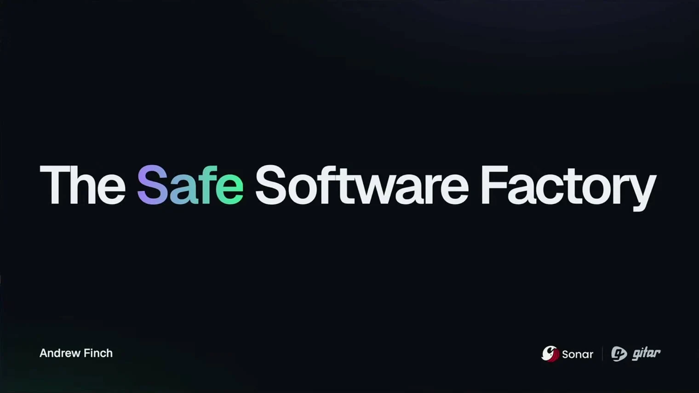

_截图 01  ·  录屏 02:45:16_

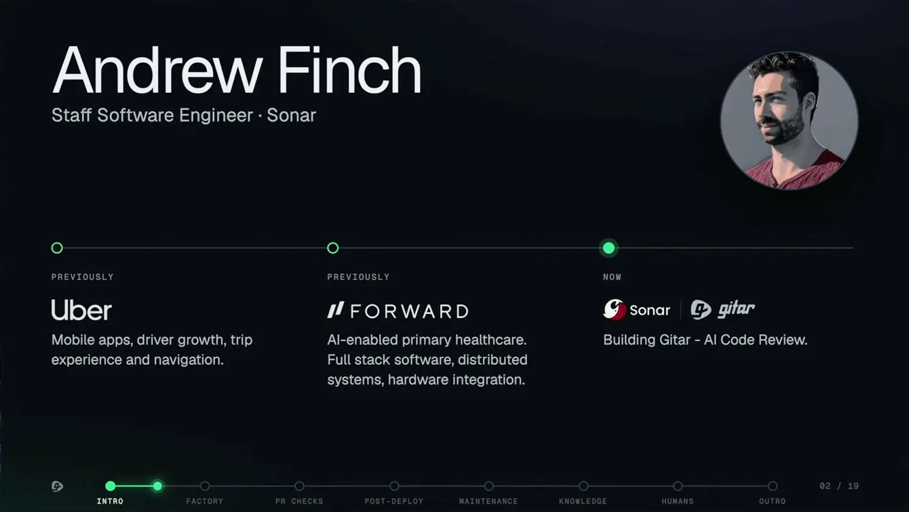

_截图 02  ·  录屏 02:45:33_

**02:45:40**　And then after that, I was at a health tech startup called Forward for a little while, building a sort of an AI-enabled primary health care system. Okay, so the software factory. This is like the hottest buzzword in our industry right now. Everyone's talking about software factories. Everyone's trying to build a software factory. And the question is, well, oh, so first of all, Most of you probably know what this is already, but if you don't, I'll just give a really quick overview.

之后，我在名为 Forward 的健康科技初创公司工作了一段时间，负责构建一种基于人工智能的初级医疗系统。没错，就是软件工厂。这是当前我们行业最热门的概念。每个人都在谈论软件工厂，每个人都在努力建立软件工厂。那么问题来了：首先，你们大多数人都已经了解这个概念了，但如果还不清楚，我就简单介绍一下吧。

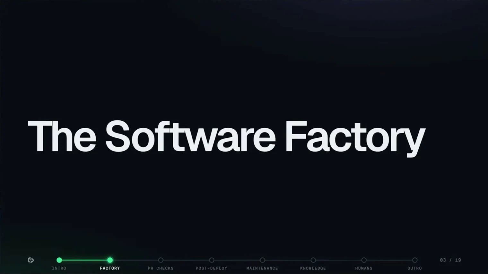

_截图 03  ·  录屏 02:45:58_

### 从软件交付瓶颈引出验证回路

**02:46:26**　This is sort of the main software development lifecycle loop as it existed before the AI era. So we have inputs, basically product specs, feature requests, tickets, things like that. We take those into the planning step especially if they're complicated and then we build, then we write the code and then we put up a PR and that PR gets reviewed and it goes through CI and then it eventually merges and then we deploy that to production and then users interact with our software and they give us feedback or they find bugs, or we might also get some monitoring and alerts as well.

这其实就是AI时代之前的主要软件开发生命周期流程。我们有各种输入，比如产品规格、功能需求、工单等。如果这些内容比较复杂，我们就会将其纳入规划阶段；然后我们进行开发，编写代码，提交PR，该PR会经过CI审核，最终合并后部署到生产环境。用户使用我们的软件时，会给我们反馈或发现错误，我们也可能收到一些监控和警报。

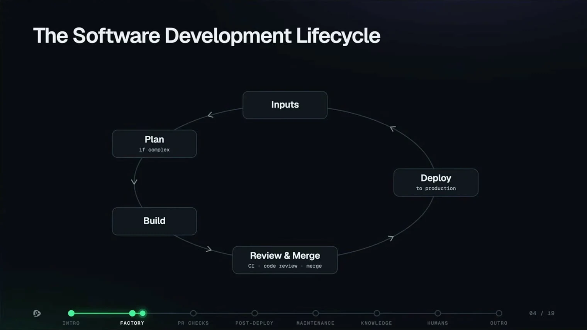

_截图 04  ·  录屏 02:46:31_

**02:47:17**　And then those go back in as more inputs. And the cycle continues. And so in the era of agentic coding and AI, automation has followed every bottleneck. So the bottleneck used to be the coding part, the building. Now with coding agents that's been automated and now the bottleneck has sort of shifted over to that review step and we're starting to introduce AI code review systems for that and then we're seeing AI systems and automation happen really at every step of this now so we're starting to see AI systems for monitoring deployments controlling rollouts triaging triaging you know tickets and incidents planning and so this this here is the sort of software factory that were that were creating.

然后这些被作为更多输入重新使用。循环继续下去。在智能体编程和人工智能的时代，自动化解决了每一个瓶颈问题。过去，瓶颈在于编码和开发过程。现在，通过智能体编程实现了自动化，瓶颈似乎转移到了审核阶段。我们正在引入人工智能代码审核系统，随后在每一个环节都能看到人工智能系统和自动化的应用。因此，我们开始看到用于监控部署、控制发布、处理任务、处理问题以及规划等功能的AI系统。这就是我们所创造的那种软件工厂。

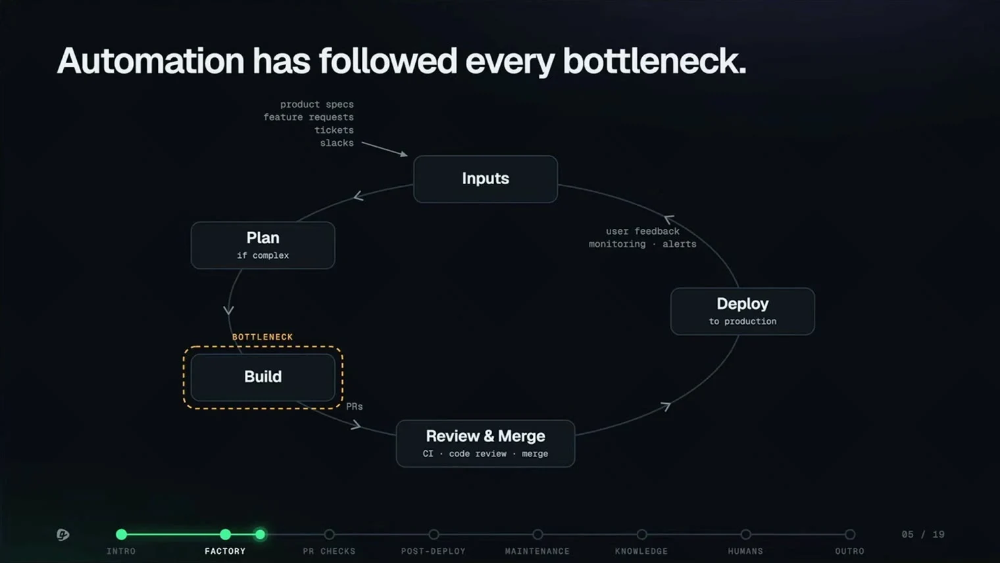

_截图 05  ·  录屏 02:47:30_

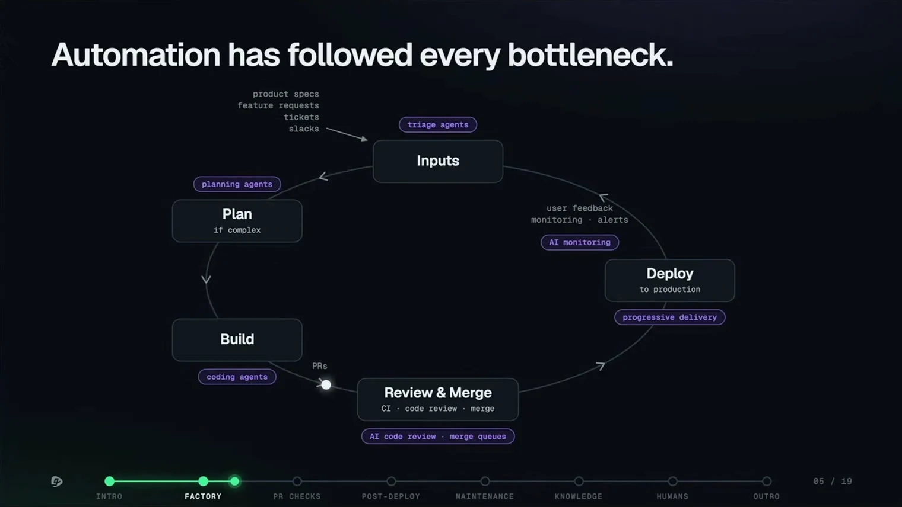

_截图 06  ·  录屏 02:48:03_

**02:48:23**　And so the question that we all have now is how do we make this factory safe, right? In other words, how can we introduce enough layers of verification into this so that we can trust that the software coming out of it is, it works as expected, it's free of bugs, free of security, vulnerabilities. Our CEO, Tarek, said recently, code is abundant, confidence is not.

所以现在我们面临的问题是：如何让这个工厂变得安全呢？换句话说，我们该如何在系统中加入足够的验证机制，从而确保从其中产生的软件能够按预期运行，没有漏洞，也没有安全漏洞。我们的首席执行官塔雷克最近说，代码很多，但信心却不多。

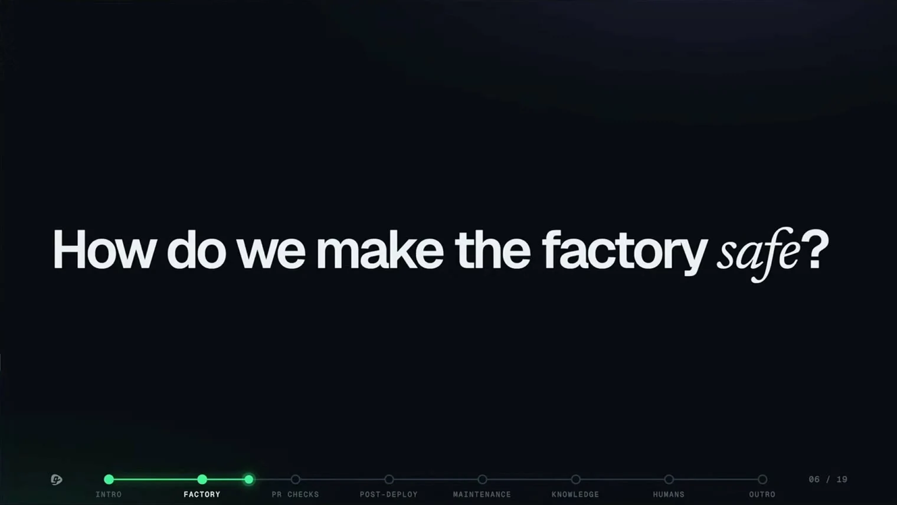

_截图 07  ·  录屏 02:48:32_

### PR 验证、扩展审查范围与合并门槛

**02:48:56**　So what I'm going to talk about today is just how we at Sonar have been thinking about how to introduce confidence at all sort of all different points within this software factory. And we're approaching this challenge with a defense in depth approach that comes from adding more loops, you might not be surprised to hear. And I'm going to talk about four of them today in particular.

今天我要讨论的是，Sonar团队是如何在这个软件平台的不同层面上去提升用户信心。我们采用“多层防御”的策略来应对这一挑战，也就是通过增加更多循环结构来实现。您可能会不意外地发现这一点。今天我将重点介绍其中的四个方法。

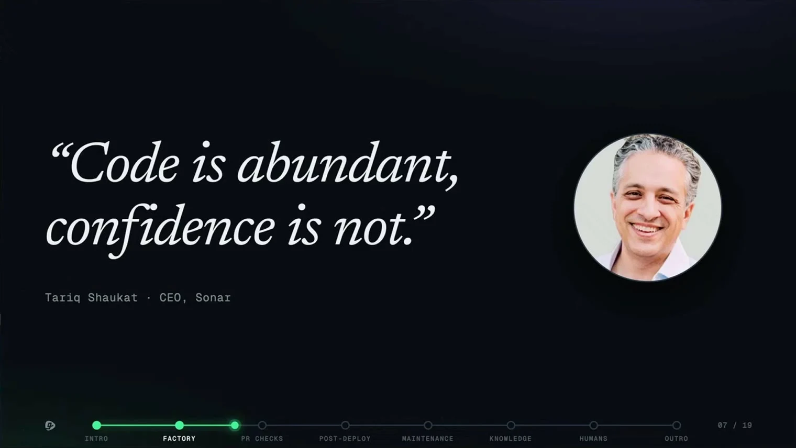

_截图 08  ·  录屏 02:48:57_

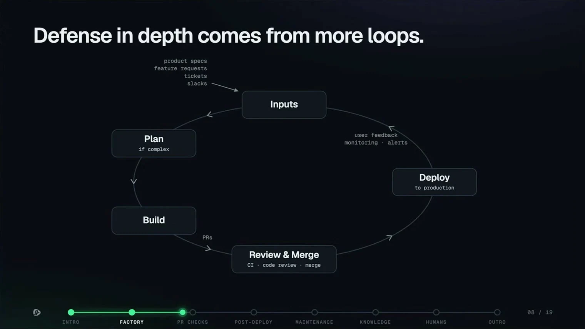

_截图 09  ·  录屏 02:49:18_

**02:49:27**　So there's the loop one, which is the PR checks loop. Loop two, which is the post-deploy verifications loop, loop three, which is the maintenance loop, and loop four, which is the knowledge loop. And this is kind of a special loop. So first I'm going to talk about loop one, the PR checks loop. So this is the loop that we probably all have in some form.

有第一个循环，即 PR 检查循环。第二个循环是部署后的验证循环。第三个循环是维护循环。第四个循环是知识更新循环。这是一个比较特殊的循环。首先，我将介绍第一个循环——PR 检查循环。这种循环可能我们所有人都有某种形式的存在。

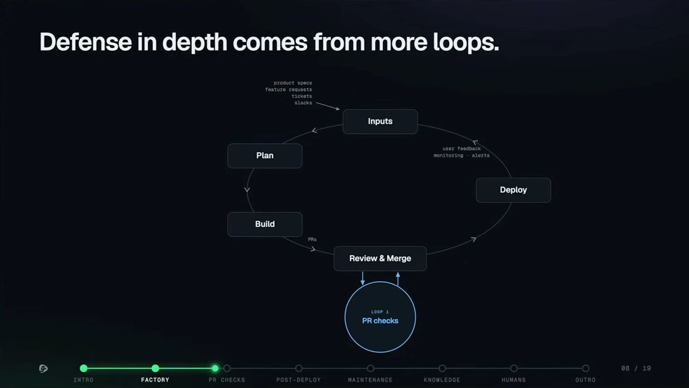

_截图 10  ·  录屏 02:49:30_

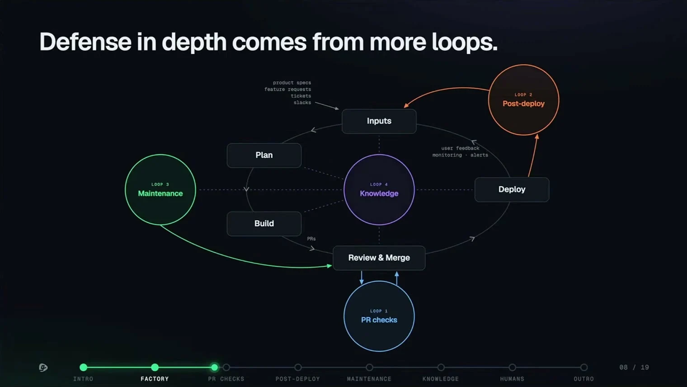

_截图 11  ·  录屏 02:49:47_

**02:49:59**　You put up a PR, it goes through some CI checks, it gets a code review. Nowadays it's probably getting an AI code review as well. But we're starting to see a lot more automation being introduced here as well. So we're starting to see agents pushing fixes to respond to the code review comments. And this loop kind of goes around and around until the PR turns green.

你提交了一个 PR，它通过了一些 CI 检查，也进行了代码审查。如今可能还会进行 AI 代码审查。不过我们也开始看到更多自动化流程被引入。因此，我们看到智能体开始提交修复内容以回应代码审查的评论。这个循环不断重复，直到 PR 获得批准。

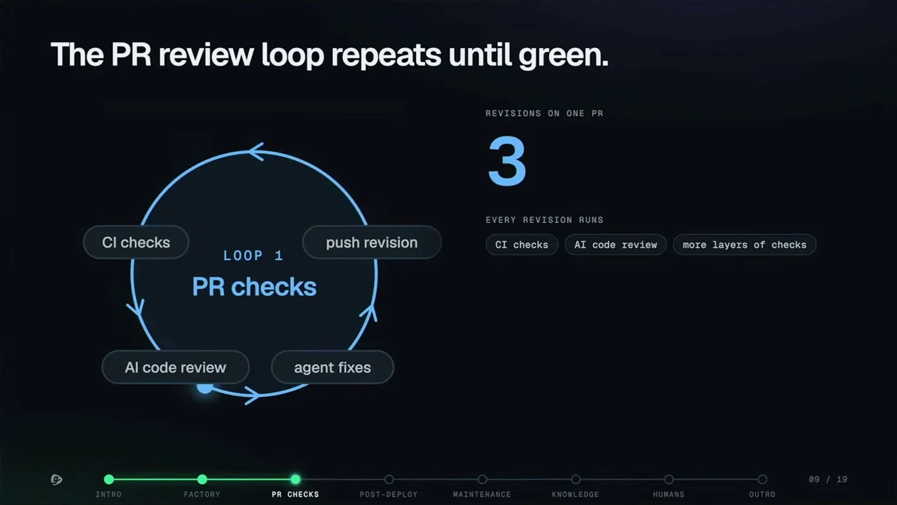

_截图 12  ·  录屏 02:50:04_

**02:50:29**　And there's actually a lot more that we can be doing here because catching a problem at this point is still cheaper than after it merges into the code base. So we have a real opportunity here to widen this review past the sort of normal tests and code review that most of us do. So, of course, we have AI code review. We can also do static analysis here.

实际上，我们还可以做很多事情。因为在问题出现时进行处理，成本比问题合并到代码库中之后要低。因此，我们有真正的机会超越大多数人所进行的常规测试和代码审查，进行更深入的审查。当然，我们还可以使用人工智能进行代码审查，也可以进行静态分析。

**02:50:56**　Many of us do that. We could do what's called functional validation. So this is where we can look at what the ticket asks for and see if the PR actually addresses those things. We can look at rules that the team may set for coding conventions, see if best practices, things like that, see if the PR is adhering to those. We can look at knowledge.

我们很多人都是这么做的。我们可以进行所谓的功能验证。因此，我们可以查看任务要求的内容，看看那个 PR 是否真正解决了这些问题。我们可以查看团队为编码规范制定的规则，看看是否遵循了最佳实践，以及该 PR 是否遵守这些标准。我们还可以查看相关知识。

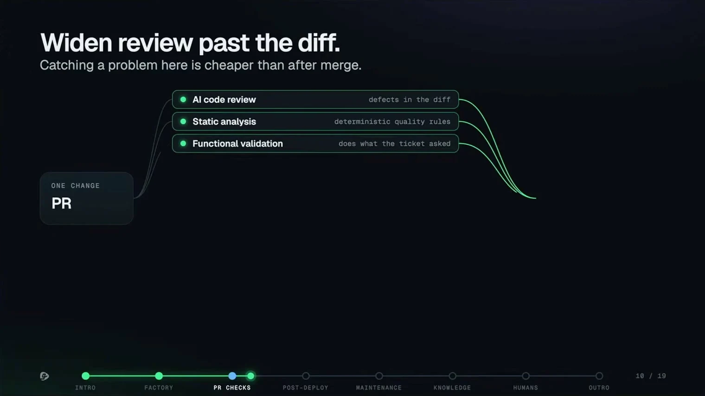

_截图 13  ·  录屏 02:50:58_

**02:51:27**　So this can be knowledge accumulated from company documentation, from things that have been learned on past code reviews or past outages. We could do cross-repo checks. So we could actually look at other repositories and see if anything in this PR will break or cause something to break in another repository. We could do cross PR analysis. So we can look at all the other open PRs as well and see if there's anything in this PR that conflicts with one of those.

因此，这些知识可以来自公司文档、过去代码审查或系统故障中的经验。我们可以进行跨仓库检查，即查看其他仓库，看看这个PR中的内容是否会导致其他仓库出现问题。我们还可以进行跨PR分析，因此也可以查看所有其他开放的PR，看看其中是否有与这些PR相冲突的内容。

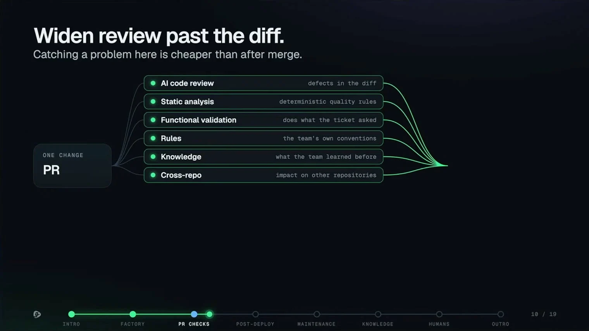

_截图 14  ·  录屏 02:51:48_

**02:52:04**　We could do security review, check for vulnerabilities, secrets, dependencies. We could do end-to-end testing. So, for example, if this is a web app, we could open it up in a browser and click around and see if it works as expected. And finally, we could do risk assessment. So we could sort of look at this and compute the blast radius and sort of categorize this into, like, low, medium, or high risk.

我们可以进行安全审查，检查漏洞、机密信息以及依赖项。也可以进行端到端测试。例如，如果这是一个网络应用，我们可以在浏览器中打开它，尝试操作看看是否如预期那样运行。最后，我们可以进行风险评估。因此，我们可以分析这些情况，计算影响范围，并将风险分为低、中或高三个等级。

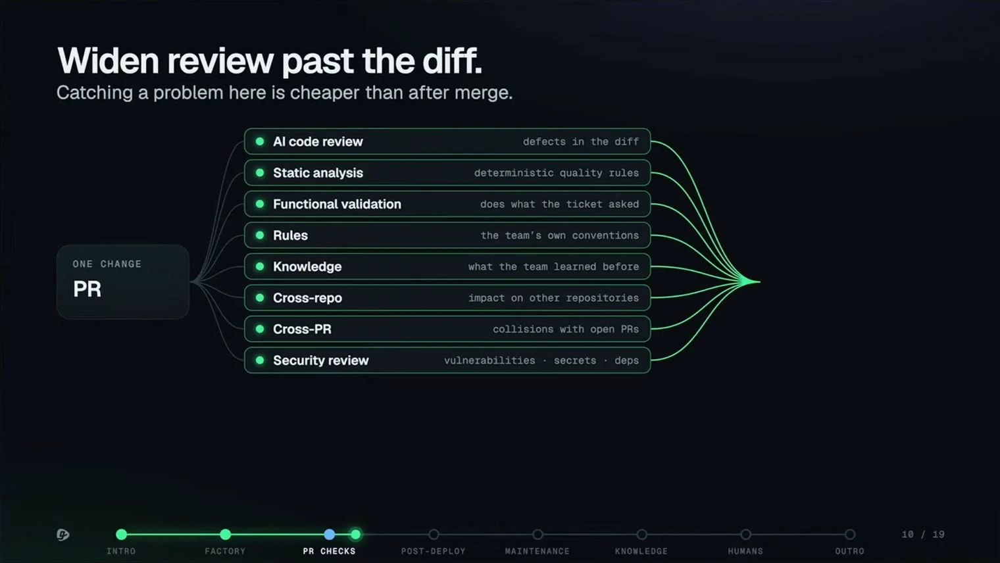

_截图 15  ·  录屏 02:52:09_

**02:52:36**　And that can actually help us determine if this is a PR that a human even needs to look at at all. And so all of these things can flow into this sort of decision, this merge gate, this decision of whether this PR is mergeable. And of course, every time a fix is pushed, all of these run again, at least in some degree.

这实际上有助于我们判断这是否真的需要人类去处理。所有这些因素都可以影响这个决策，即是否应该进行合并操作。当然，每次有修复代码被推送时，这些过程也会在某种程度上再次进行。

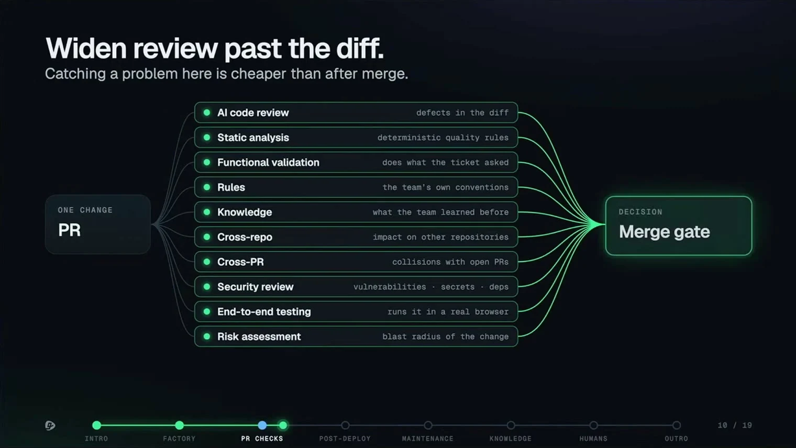

_截图 16  ·  录屏 02:52:42_

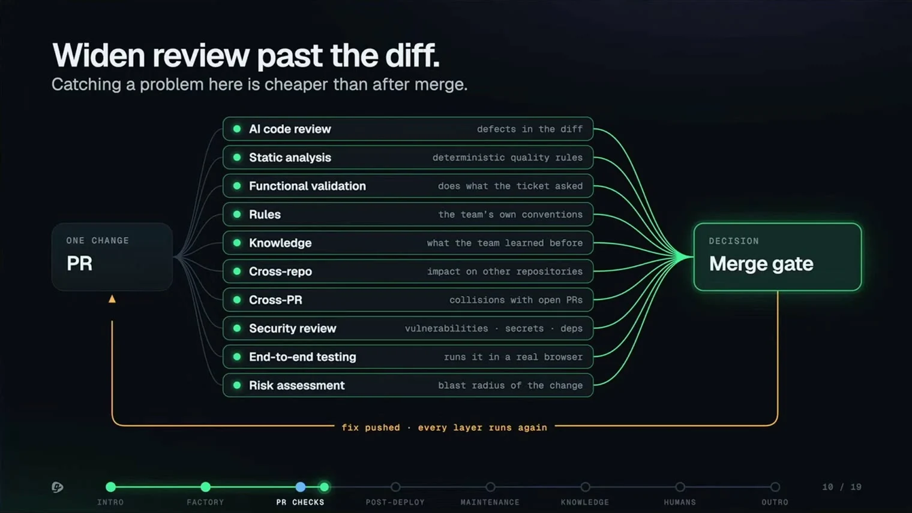

_截图 17  ·  录屏 02:52:50_

**02:52:59**　And with all of this, it's important to gate that merge decision, not just on the fact that a test ran or that it passed, but on the evidence. So that would be things like the actual code review findings, the results of the quality gates, any vulnerabilities, the risk level. So all of that can be basically fed into this merge gate and checked against criteria that the team can set for what is a mergeable PR.

此外，对合并决策进行验证非常重要，不仅仅基于测试是否运行或通过，还基于各种证据。比如实际的代码审查结果、质量验证的结果、任何漏洞以及风险等级等。所有这些都可以被输入到合并验证中，并根据团队设定的标准来判断该PR是否适合合并。

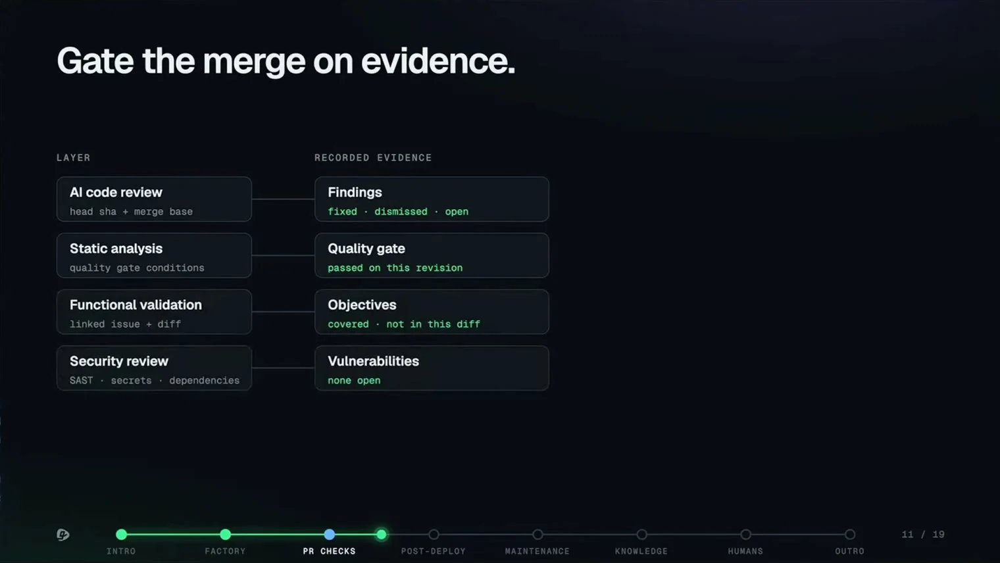

_截图 18  ·  录屏 02:53:11_

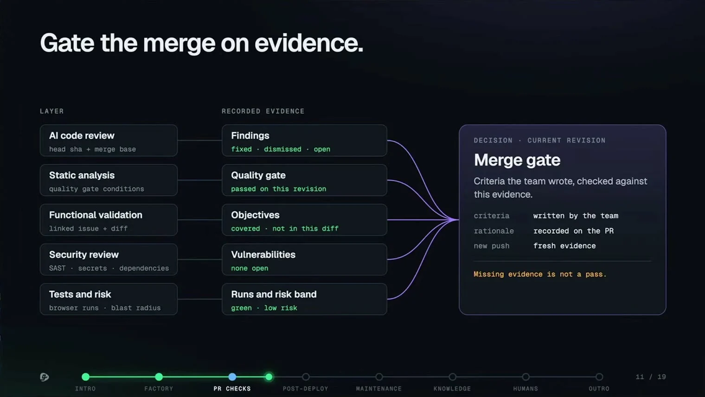

_截图 19  ·  录屏 02:53:24_

**02:53:30**　And when you record that evidence to the PR, it just makes the merge gate much stronger And so what we're seeing now with teams who do this well is that they can actually delegate more and more trusts to this type of automation on the PR review. So we're seeing teams begin to turn on not just automatic merge blocking, but even auto approve in some cases for low-risk changes, and even auto-merge for certain types of PRs that are low-risk and approved.

当您将这些证据记录到 PR 中时，就能让合并流程更加有效。现在我们看到，那些做得好的团队能够把更多任务委托给这种自动化工具来进行 PR 审核。因此，这些团队不仅开始使用自动合并拦截功能，在某些情况下甚至还会自动批准低风险变更，甚至对某些低风险且已获批准的 PR 进行自动合并。

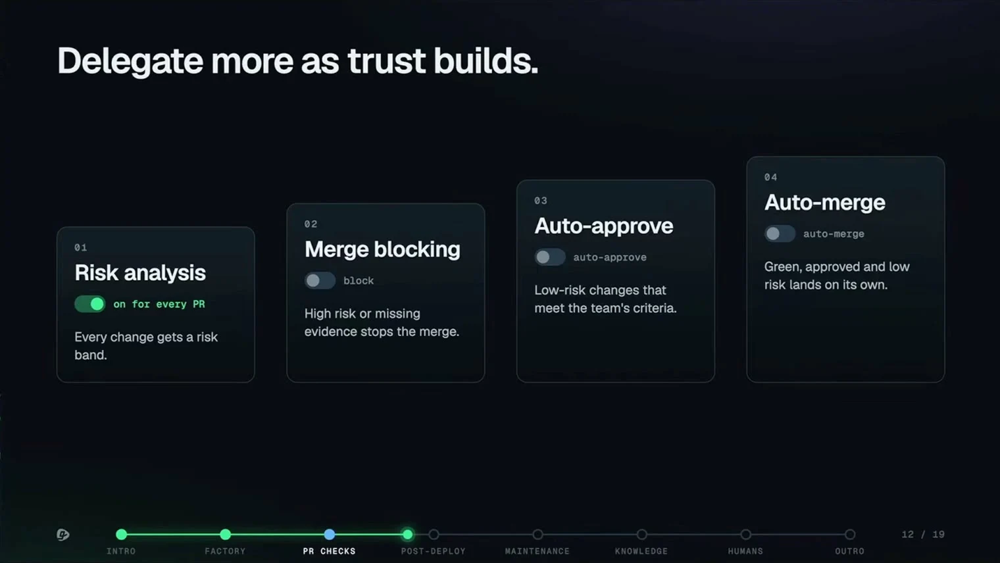

_截图 20  ·  录屏 02:53:53_

### 上线后复查、定期扫描和维护

**02:54:09**　And this can just free up a lot of review bandwidth for human reviewers to review the more high-risk changes. OK, so now I'm going to talk about loop two, which is our post-deploy verification loop. So this is, I would say, very much in its early stages right now. People are experimenting with all kinds of things here. But the idea is that once your code is deployed, you can build AI systems to check, to read like production logs, traces, metrics, and see if your code is actually behaving as you expect it to in production.

这就能为人工审核人员提供更多审核时间，以便他们能够审查那些风险更高的变更。好的，现在我将介绍第二个流程，即部署后的验证流程。目前这个流程还处于初期阶段，人们正在尝试各种方法。但核心思想是，一旦代码被部署完成，就可以利用人工智能系统来检查、分析类似生产环境中的日志、追踪数据、指标等，从而确认代码在真实运行中的表现是否符合预期。

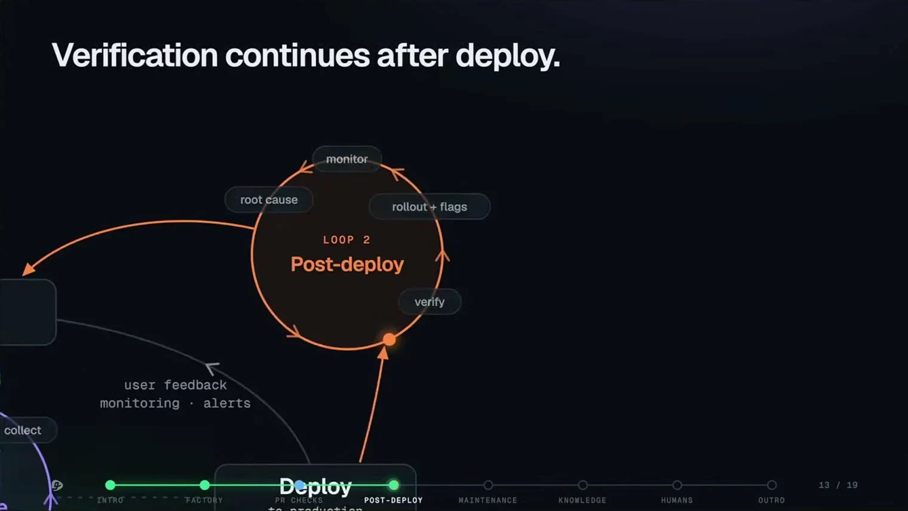

_截图 21  ·  录屏 02:54:18_

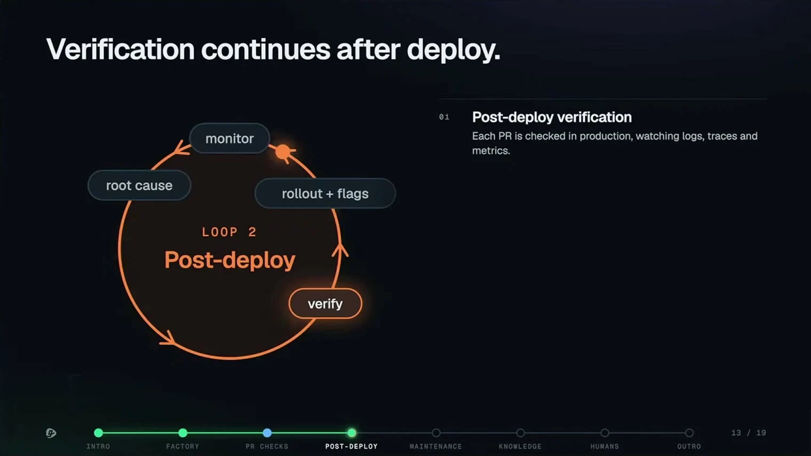

_截图 22  ·  录屏 02:54:39_

**02:54:50**　And then from there, you can actually, we're starting to see things like agentic rollout, where agents can decide whether to widen a rollout or roll back, turn the feature flag off. And you can also do AI outage monitoring, so you can monitor alerts and use AI systems to help you root cause and fix outages. Okay, so moving on to loop three.

然后，从那里开始，我们开始看到诸如智能体式部署这样的现象，其中智能体可以决定是扩大部署还是回退，关闭功能标志。你还可以进行 AI 故障监控，从而监测警报，利用 AI 系统帮助找出故障原因并解决问题。好的，现在进入第三环节。

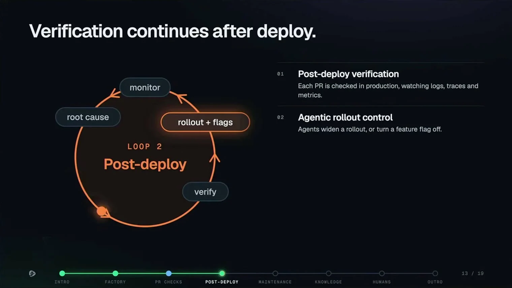

_截图 23  ·  录屏 02:54:55_

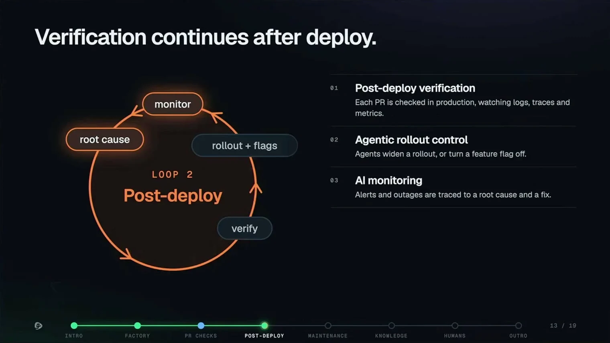

_截图 24  ·  录屏 02:55:08_

**02:55:24**　So this is what I call the maintenance loop. This is kind of a parallel loop that runs alongside your main software development lifecycle loop. And this is where we continuously scan the code base schedule. And we check for a lot of the same things that we check for on the PR. We could do code review, static analysis, security checks, et cetera.

这就是我所说的维护循环。它其实是一种与主要软件开发生命周期循环并行的并行循环。在这里，我们会持续扫描代码库状态。我们会检查许多与 PR 中相同的项目，比如代码评审、静态分析、安全检测等等。

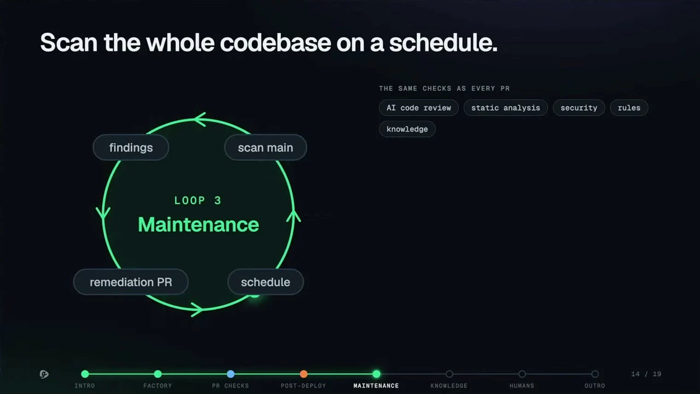

_截图 25  ·  录屏 02:55:29_

**02:55:46**　And then we can, if we find an issue, we can open up a remediation PR to address that. And this lets us catch things that we couldn't catch in the PR. So for example, you could imagine maybe a new rule was introduced after code merged, or a new vulnerability was published after code merged, or even something like slow drift, where you slowly get duplication or complexity building up that you can't really see on a single PR.

然后，如果我们发现问题，就可以打开一个修复分支来解决问题。这样就能让我们发现那些在普通分支中无法发现的问题。比如，可以想象一下：在代码合并之后引入了新规则，或者代码合并后出现了新的漏洞，甚至还有像“缓慢增长”这种情况——即逐渐出现重复或复杂化的问题，而这些在单个分支中是无法被发现的。

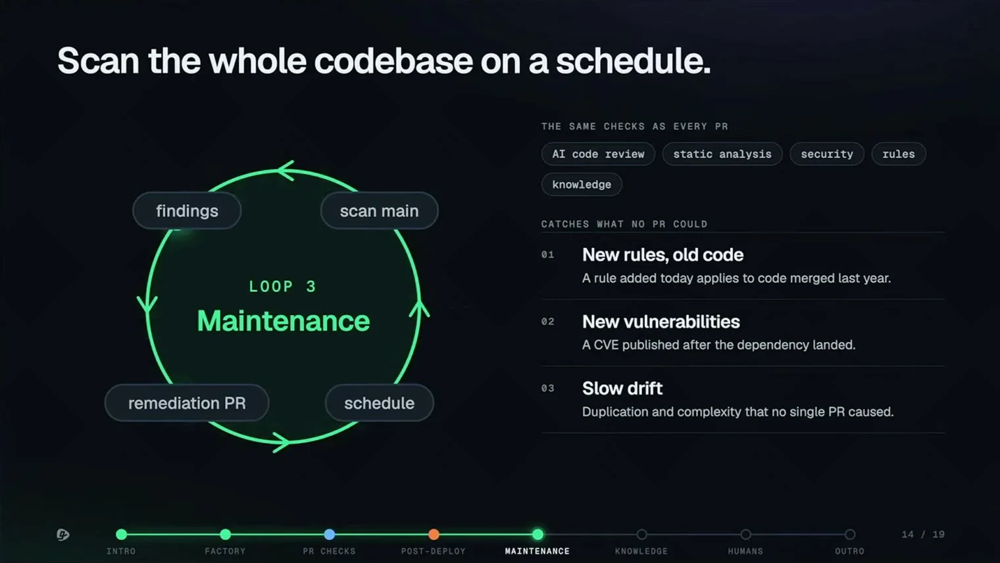

_截图 26  ·  录屏 02:56:15_

### 把审查发现反馈给编码 Agent

**02:56:18**　You can catch these kinds of things here with the continuous code-based scans. Okay, and so finally we move over to the knowledge loop. And this is becoming, we're seeing this become a very important loop for a lot of companies. Every company has a lot of knowledge, documentation, product specs, business decisions, and the agents do a better job if they have that knowledge, right?

你可以通过基于连续代码的扫描来发现这类内容。好了，最后我们转向知识循环。我们看到，这对许多公司来说是一个非常重要的循环。每家公司都拥有大量知识、文档、产品规格、业务决策，如果智能体能利用这些知识，就能更好地发挥作用，对吧？

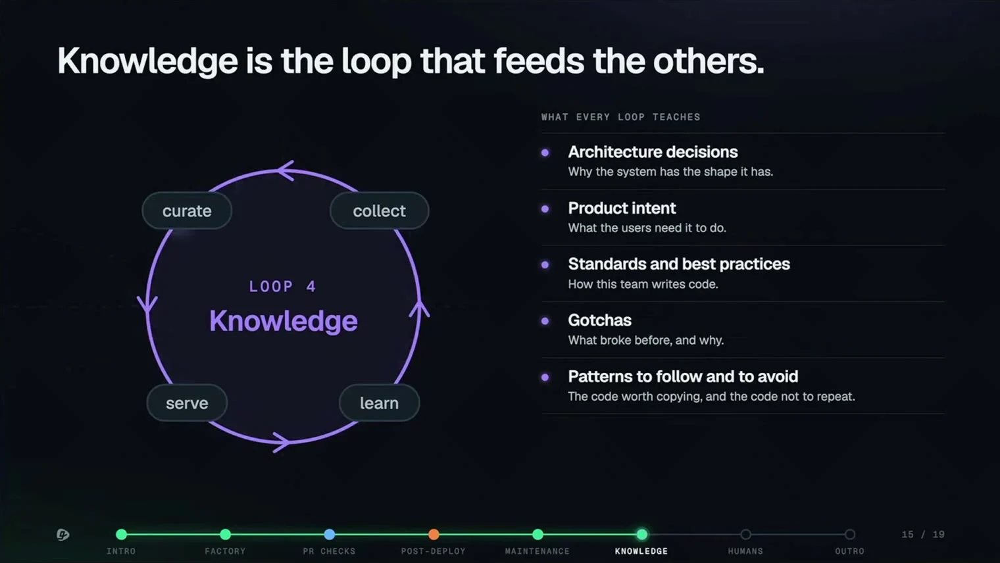

_截图 27  ·  录屏 02:56:40_

**02:56:55**　So this loop basically collects all that knowledge from different sources, as well as things that were learned on prior code reviews and from prior outages. It's curated, and then it can be fed into all of the other loops, all of these other agents, so they can do a better job. And for example, this is really powerful with your coding agents, because if they have some of this knowledge, they can probably do a better job the first time, fewer issues, and then you'll wind up with basically fewer review laps at the review stage.

因此，这个循环基本上会收集来自不同来源的所有知识，以及之前代码评审和故障修复中学到的内容。这些知识经过整理后，可以输入到其他所有循环中，让其他智能体能够更好地处理。例如，这对你的编程智能体来说非常有用，因为如果它们拥有这些知识，第一次就能更高效地完成工作，出现的问题也更少，最终在评审阶段所需的重复评审次数也会减少。

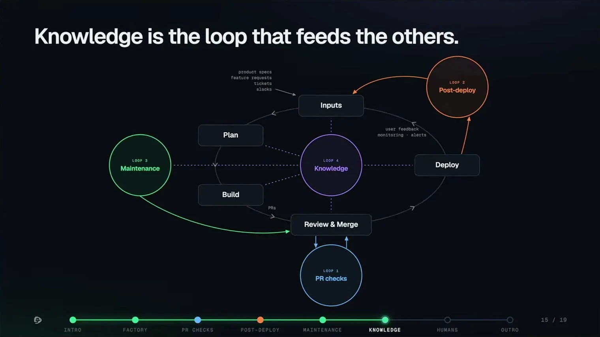

_截图 28  ·  录屏 02:57:13_

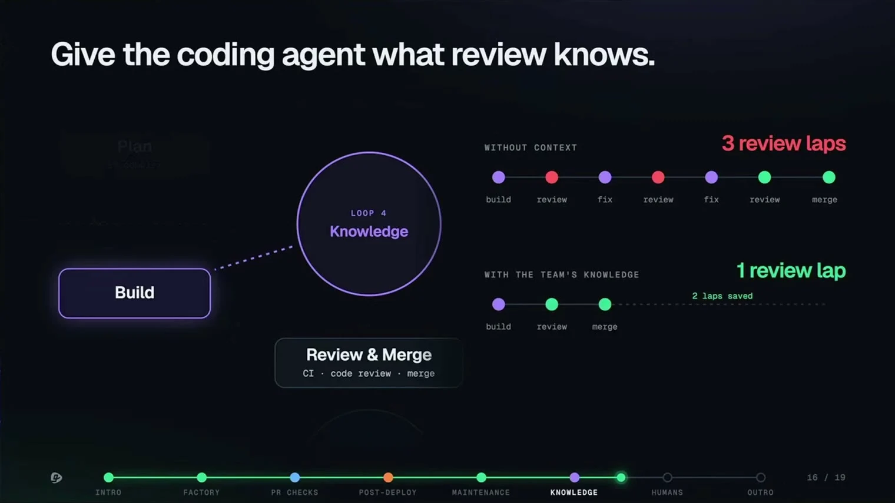

_截图 29  ·  录屏 02:57:34_

**02:57:42**　Okay, so what does this mean for our role as human software engineers in this factory? You might be asking, okay, so if we nail all of this, can we just turn the lights out and run a dark factory? And I would say probably not, not right now. I like to say the factory runs dim, not dark. Important for us to intervene in places where our expertise is really important.

那么，这对我们作为工厂中的人类软件工程师来说意味着什么呢？你可能会问，如果我们把这一切都做到位，就能把灯关掉，让工厂处于黑暗状态吗？我认为不太可能，至少现在不行。我更喜欢说，工厂的灯光会调暗，而不是完全黑暗。对我们来说，在那些需要发挥专业能力的领域进行干预非常重要。

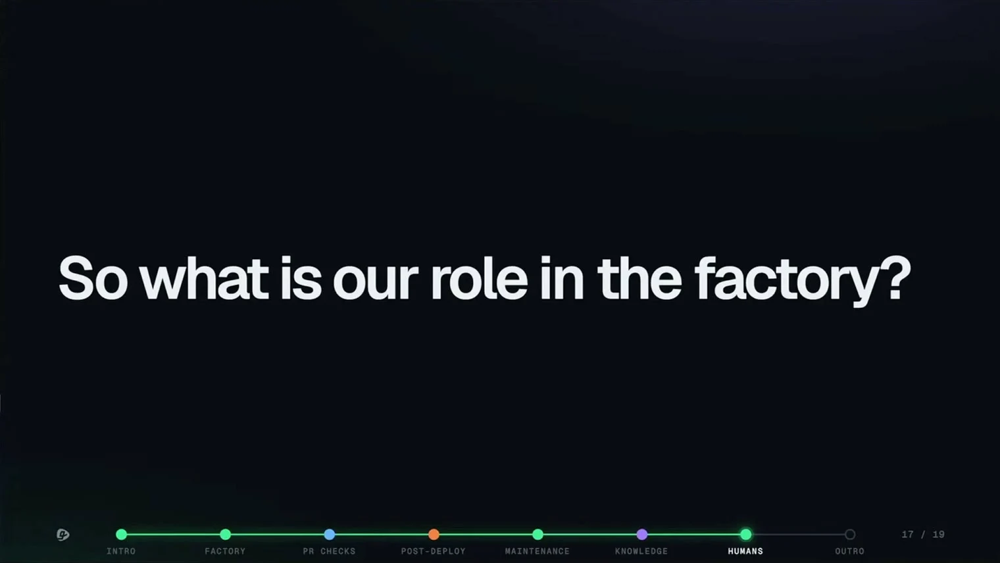

_截图 30  ·  录屏 02:57:46_

**02:58:16**　So that would be things like auditing risky code, verifying that evidence, verifying things are actually working as expected, handling exceptions like rollbacks and incidents, reviewing Doing architecture, agents are not very good at this yet, I would argue. And supplying the why, or helping to build that knowledge that powers all these agents and all these loops. Supplying the product intent, the trade-offs, the business decisions, things like that.

因此，比如审计有风险的代码、验证相关证据、确保系统按预期运行、处理回滚和事故等异常情况、审查架构设计——我认为智能体在这些方面还不太擅长。此外，还需要提供原因，或帮助构建支撑所有智能体和循环运作的知识体系。还需要提供产品目标、权衡选择、业务决策等相关信息。

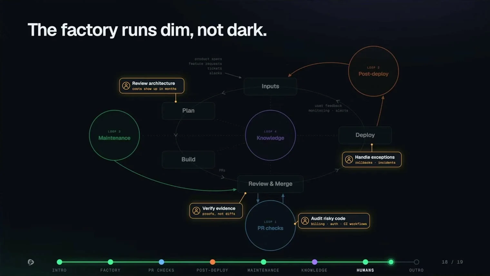

_截图 31  ·  录屏 02:58:36_

**02:58:57**　And of course, we engineer the factory ourselves, right? We've sort of moved into this era where we're building the software factory as a whole. So with that, I hope that gave you sort of a framework for how to think about not just how to build your software factory, but how to build a safe software factory. So thank you. That's all for me.

当然，我们自己就负责设计工厂的架构，对吧？我们已经进入了一个时代，需要整体打造软件工厂。希望这能为你提供一个框架，让你不仅能思考如何构建自己的软件工厂，还能思考如何打造一个安全的软件工厂。谢谢。我的演讲就到这里。

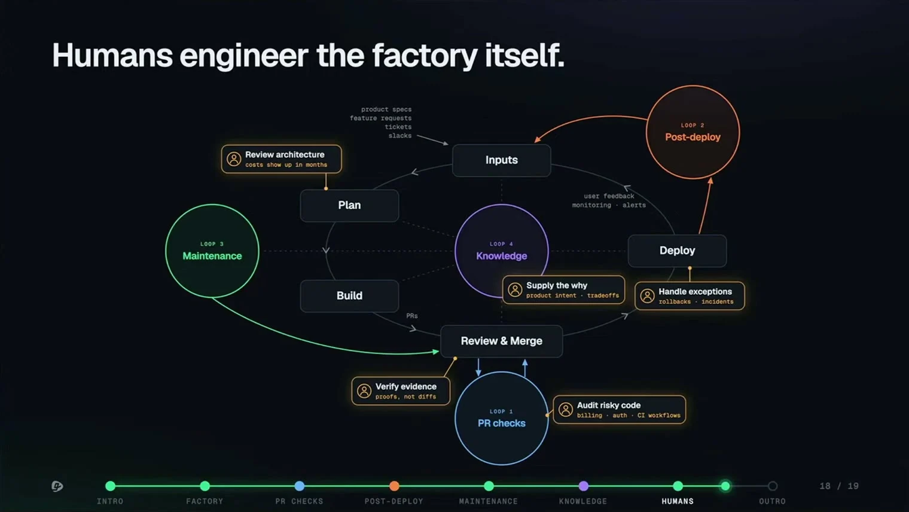

_截图 32  ·  录屏 02:59:01_

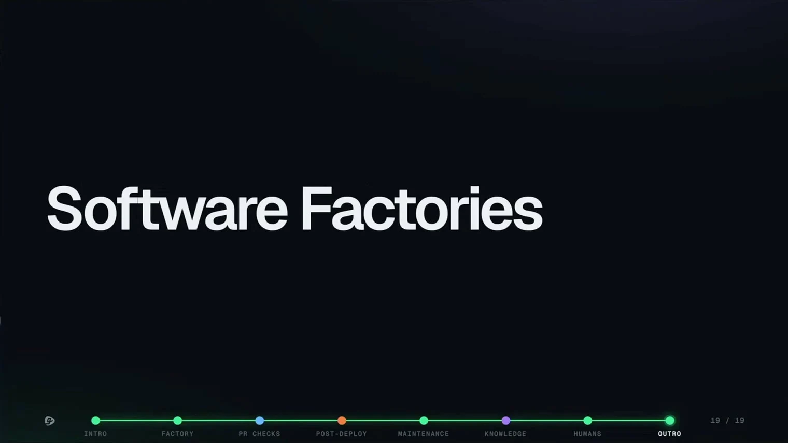

_截图 33  ·  录屏 02:59:14_

**02:59:24**　Thank you.

谢谢。

---

[全部演讲](../README.md) · [选看索引](index.md) · [上一场](10-ankit-mathur.md) · [下一场](12-luke-alvoeiro.md)
