[全部演讲](../README.md) · [选看索引](index.md) · [上一场](11-andrew-finch.md) · [下一场](13-ara-khan.md)

# Earning Autonomy: From Missions to Workstreams

**Luke Alvoeiro** · Factory · Member of Technical Staff

AIE Code Summit 2026  ·  11 月 11 日  ·  主舞台  ·  录屏 03:17:40–03:33:27

[官方议程](<https://ai.engineer/code/2026/schedule>)   ·   [Day 1 官方回放](<https://www.youtube.com/watch?v=ZZ19zhYnDKY>)

## 本场目录

- [03:18:32](#section-1) 软件工厂的组成及 Missions 的实际摩擦
- [03:21:31](#section-2) 调度、计算隔离和程序化工具调用
- [03:25:04](#section-3) Workstream 如何接任务、分工和累积上下文
- [03:29:22](#section-4) 合并门槛、返工信号与逐步放权

## 演讲实录

> 英文源自录屏音频，经轻度校订。每段英文下方为中文译文。时间指向原始录屏。

**03:17:40**　All set. Hi, everyone. I'm Luke. I lead our core agent team here at Factory. Today I want to talk about autonomy and why the teams that are getting the most out of coding agents are not actually the ones that are handing over the most work on day one. It's instead the folks who are ramping up autonomy gradually one checkpoint at a time until what they have starts to resemble a software factory.

一切准备就绪。大家好，我是卢克。我在Factory负责核心智能体团队的工作。今天我想谈谈自主性问题，以及为什么那些能够充分利用编码智能体能力的团队，实际上并不是第一天就交付最多工作的团队。相反，是那些逐步提升自主性、一个步骤一个步骤地发展，直到他们的成果开始类似于软件工厂的团队。

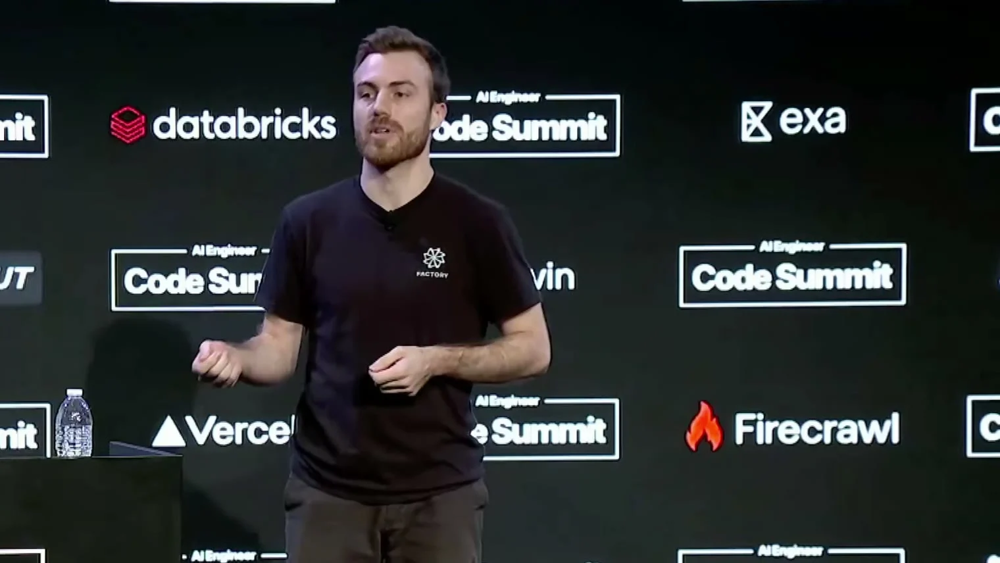

_截图 01  ·  录屏 03:17:55_

**03:18:04**　So for those who don't know us, factory is a platform that builds Droid and then a whole like surface for software engineering and building software on top of that coding agent. Hundreds of thousands of developers use us around the world at companies like Nvidia, T-Mobile, and Adobe. What these companies engineers are building with us is really like a software factory, a system that runs 24-7 and builds software under the company's control.

所以对于不认识我们的人来说，factory是一个平台，在这里可以构建Droid，然后打造出用于软件工程的完整环境，以及基于编码智能体来开发软件。全球范围内，像Nvidia、T-Mobile和Adobe这样的公司里有数十万开发者使用我们。这些公司工程师利用我们打造出的东西，实际上就像一个软件工厂，一个可以24小时不间断运行的系统，在公司的控制下开发软件。

### 软件工厂的组成及 Missions 的实际摩擦

**03:18:31**　And that's a loop that takes in signals from wherever information is already available, turns them into changes, validates them, and then learns from what production shows. A signal is really like anything that tells you how your software should evolve. So that That could be a central alert or someone's idea on Slack. Every single one goes through the same stages, so you standardize the process, not the output.

这是一个循环过程，它接收来自已有信息的信号，将这些信号转化为变化，进行验证，然后根据实际运行结果进行学习。一个信号其实就像任何能告诉你软件应如何发展的信息。可以是中央警报，也可以是有人在 Slack 上提出的想法。每一个信号都经过相同的阶段，因此你可以对流程进行标准化，而不是对输出结果进行标准化。

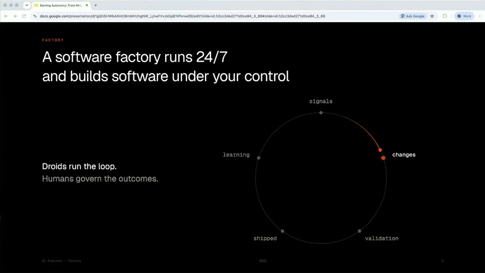

_截图 02  ·  录屏 03:18:32_

**03:18:55**　So we built that platform on five foundations. It has to be transparent, modular, governable, efficient, and frontier. Most people picture a software factory as this kind of lights out building where there's no people inside of it. Requirements come in one end and merged PRs come out the other. And really what we saw firsthand in the field is that that's not the case.

因此，我们基于五项原则构建了该平台。它必须具有透明度、可模块化、可管理、高效且适合前沿应用。大多数人认为软件工厂就是那种没有人的、安静的建造场所。需求从一端输入，合并的 PR 则从另一端输出。但实际上，我们在实践中发现并非如此。

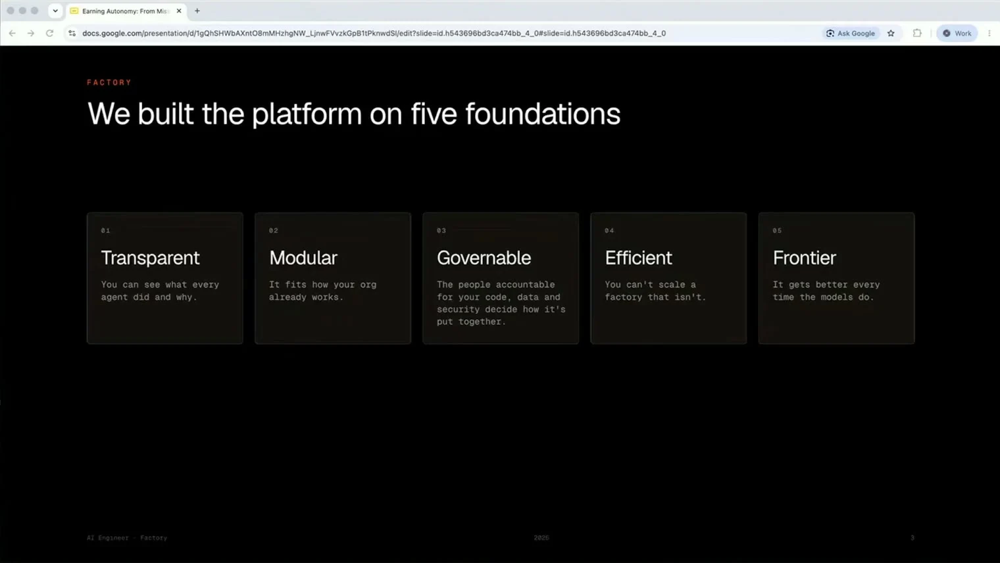

_截图 03  ·  录屏 03:18:57_

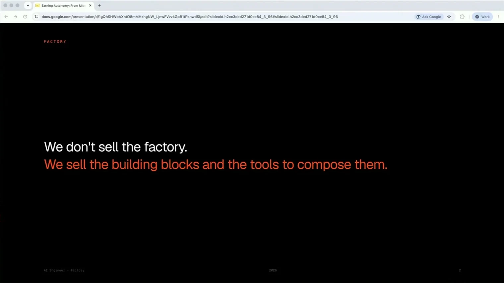

_截图 04  ·  录屏 03:19:18_

**03:19:19**　The best ones aren't set up like that. They're built around people instead. Humans decide what matters and how we should trust droids over time. And those droids earn their keep as they deliver more work that's higher quality. Every company's software factory looks very different to each other. So what we sell is not really this factory, it's the tools and the building blocks to compose them.

最好的企业并非以那种方式建立，而是以人为核心。随着时间的推移，人类决定了什么重要、应该如何信任机器人。而那些机器人则通过交付更高品质的工作来获得回报。每个公司的软件工厂都各不相同。因此，我们出售的并非那个工厂本身，而是用于构建它们的工具与基础要素。

**03:19:41**　Now, it's worth kind of looking at how we got here in the first place. Back in April, one of our flagship products was Missions, which was one of the first multi-agent products to really take a bite out of the human attentional bottleneck that existed in software engineering. You'd describe a goal, you'd argue with the orchestrator until you were aligned, you'd approve the plan, and then it would go handle implementation for days or even weeks.

现在，值得看看我们最初是如何达到这一点的。早在四月时，我们的旗舰产品之一就是Missions，这是最早能够有效解决软件工程中人类注意力瓶颈的多智能体产品之一。你设定一个目标，与调度器争论直到达成一致，然后批准计划，之后它就会负责实施工作，可能持续数天甚至数周。

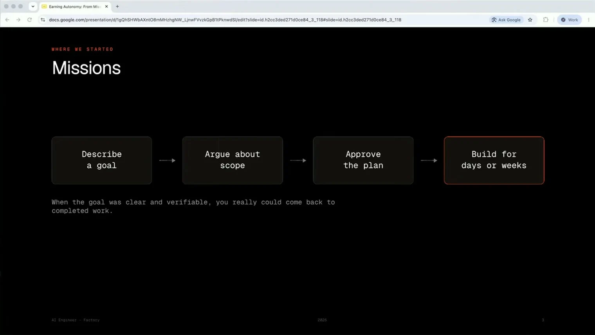

_截图 05  ·  录屏 03:19:51_

**03:20:06**　When the goal was clear and verifiable, you really could come back to completed work consistently. But as more teams adopted it, we heard some consistent, like, pieces of feedback. The first was how missions asked you to work. The product assumed that you could plan everything up front and then it would just work. And the UX sort of suggested that you shouldn't interrupt them.

当目标明确且可验证时，确实可以持续完成工作。但随着更多团队采用这种方法，我们收到了一些合理的反馈。首先，任务要求人们提前规划好一切，然后就能顺利实现。而用户体验方面则建议不要打断他们。

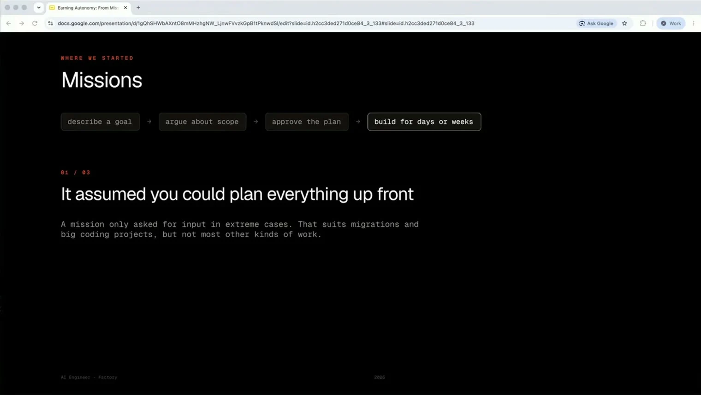

_截图 06  ·  录屏 03:20:25_

**03:20:26**　Missions didn't really, like, ask you any questions or provide, like, an interactive surface for that communication between you and the agent once it was starting implementation. So this suits, like, migrations and big coding, like, feature projects, but didn't really fit the bill for most kinds of other work. The second was cost and time. And that came from, honestly, the models getting really, really good.

任务实际上并没有像要求那样提出任何问题，也没有提供与智能体之间的互动界面，使得你们与智能体的沟通变得可能。因此，这种方式适合迁移和大型编码项目以及功能型项目，但不太适合其他类型的任务。第二个问题是成本和时间。而这一情况源于，说实话，模型变得非常出色。

**03:20:50**　I'm sure you've all seen now, adversarial review is really, really good at finding these issues in your code. And so at the time, we were adding adversarial review into every milestone's boundary. That just kind of like grew the scope of that mission from something like 60 features to over 200. And so you ended up having a token bill and a timeline that matched that.

我相信你们现在都已经看到，对抗性审查在发现代码中的这些问题方面确实非常有效。因此，当时我们把对抗性审查添加到了每个里程碑的边界中。这使得该任务的范围从大约60项功能扩展到了200多项。最终就形成了相应的令牌和时间线。

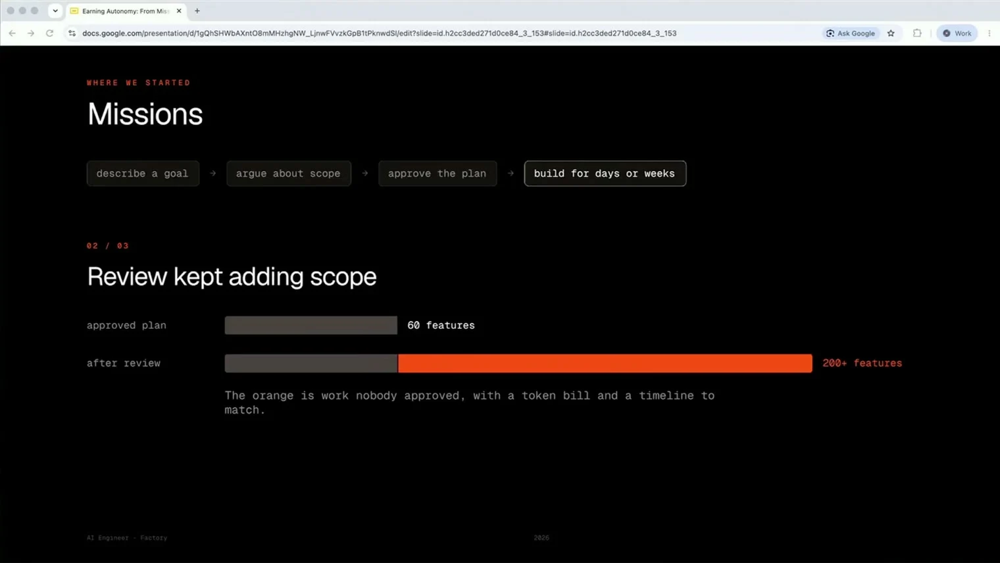

_截图 07  ·  录屏 03:20:54_

### 调度、计算隔离和程序化工具调用

**03:21:13**　And then the last one was that missions were keeping their contacts to one person. So that was fine for like a single project, but it meant that the rest of the team couldn't build on what that mission had learned. So we went back to the drawing board. And one mental model kept on coming up. When you have an org that is running dozens or hundreds of agents at a given point in time, you actually have a lot of the problems that operating systems back in the day solved.

然后最后一个问题是，这些智能体只与一个人保持联系。对于单个项目来说这没问题，但这意味着团队其他成员无法利用那个智能体学到的经验来继续工作。于是我们又回到原点重新规划。最终出现了一个概念模型。当某个组织在某一时刻拥有数十或数百个智能体时，其实就出现了许多当年操作系统能够解决的问题。

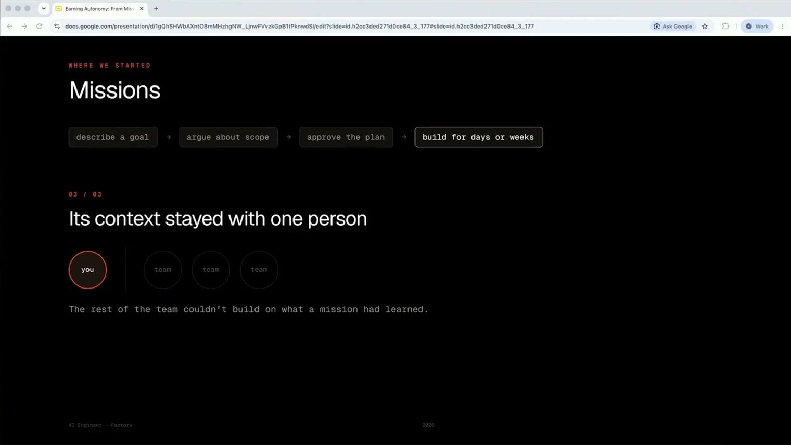

_截图 08  ·  录屏 03:21:19_

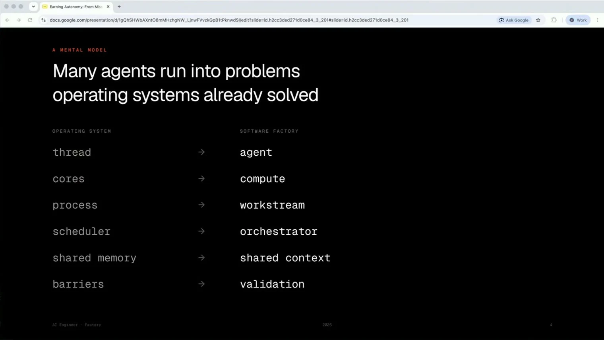

_截图 09  ·  录屏 03:21:31_

**03:21:41**　How to schedule work, how to run many things at once safely, and how to share state. So every operating system starts with the thing that actually does the work, and we wanted to revisit the agent itself. Long Horizon agents run for thousands of turns, and every inefficiency across of those gets multiplied. So you could have, you know, an extra inference request that's unnecessary, or a tool result that's pretty bloated, or a prompt cache miss.

如何安排工作，如何安全地同时运行多项任务，以及如何共享状态。因此，每个操作系统都从真正执行工作的环节开始，我们希望重新探讨智能体本身。Long Horizon智能体可以运行数千次，这些过程中的每一个效率低下都会被放大。所以你可能会遇到不必要的额外推理请求，或者结果过于庞大的工具输出，又或者是提示缓存的缺失。

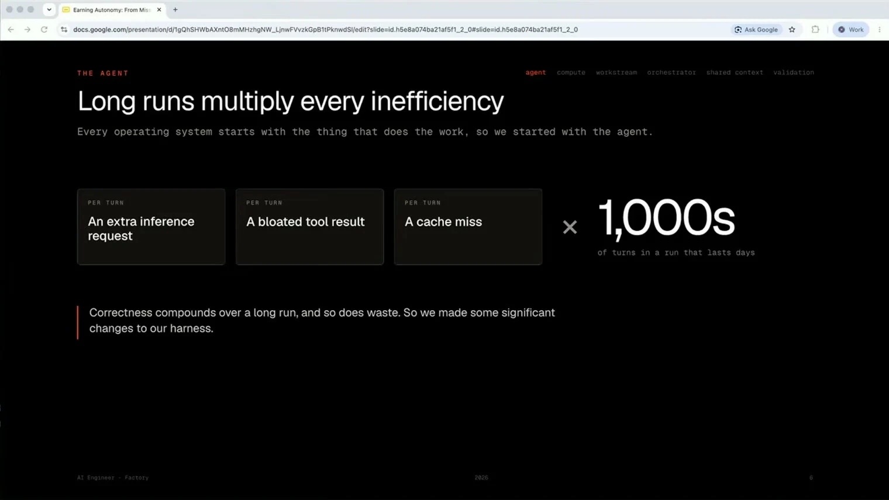

_截图 10  ·  录屏 03:21:56_

**03:22:09**　All those things compound over time and lead to waste. So we decided to make some pretty significant changes to the harness itself. The biggest one was programmatic tool calling, also known as code mode. Instead of calling one tool, waiting on the model, and then calling the next, we have the model write a small program that executes all those tools in one go, and then prints out only what's relevant.

所有这些因素随着时间推移逐渐累积，导致浪费。因此我们决定对 Harness 本身进行一些重大改进。其中最大的改变是程序化工具调用功能，也称为代码模式。不再需要调用一个工具、等待模型响应，再调用下一个工具，而是让模型编写一个小程序，一次性执行所有工具，然后仅输出相关内容。

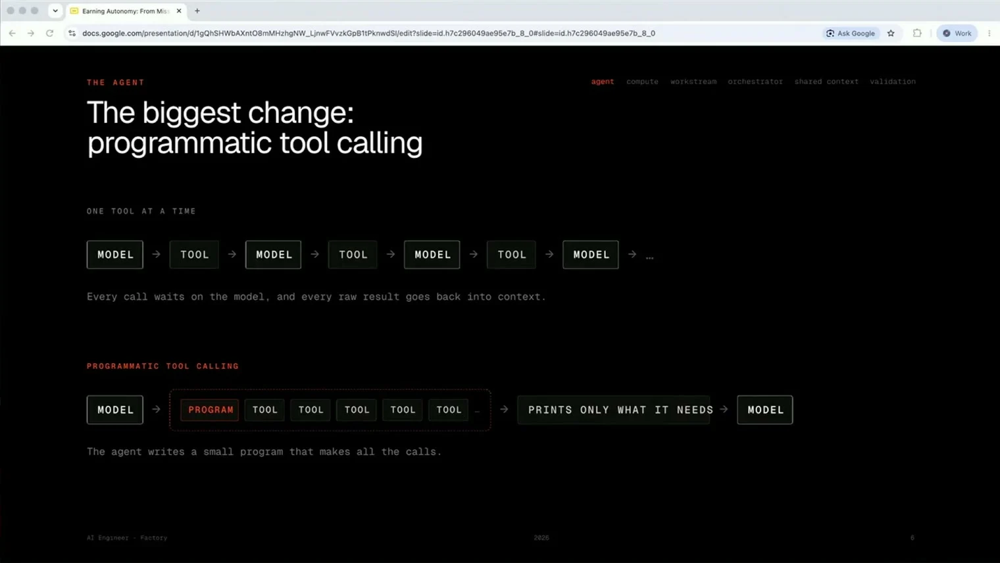

_截图 11  ·  录屏 03:22:17_

**03:22:31**　So there's this example here where you have 150 linear tickets that are getting moved from one project to another. Done the normal way, that's like 30 inference requests, a million tokens, but as one model-generated program, you actually only have like 60K tokens, it runs much faster, and the model only sees what is actually relevant to the task, the fact whether it was successful or not.

比如这里有个例子：有 150 张线性 tickets，需要从一个项目转移到另一个项目。按常规方式处理的话，相当于 30 个推理请求、百万个 tokens；但作为模型生成的程序，实际上只需要 60K 个 tokens，运行速度也更快。而且模型只关注与任务相关的内容，即是否成功。

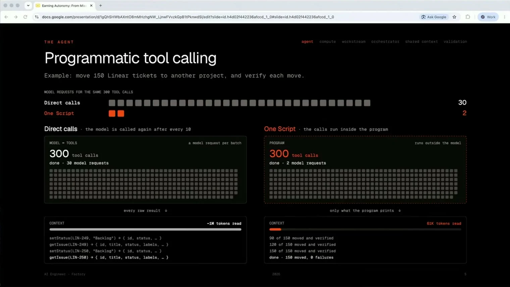

_截图 12  ·  录屏 03:22:46_

**03:22:54**　So this layer of the OS is where being frontier and efficient matters the most. A new model lands every few weeks, and no two fail the same way. So we tune our harness in such a way that evens out this jaggedness The result is that Droid is now, you know, higher quality at a lower cost than every other coding agent on the market.

因此，在操作系统这一层中，前沿性和效率至关重要。每隔几周就会推出一个新的模型，没有两个模型会以相同的方式失败。所以我们调整了Harness，使这种不整齐的情况得以平衡。结果就是，Droid现在在较低成本下，拥有更高的质量，比市场上的其他编码智能体都要好。

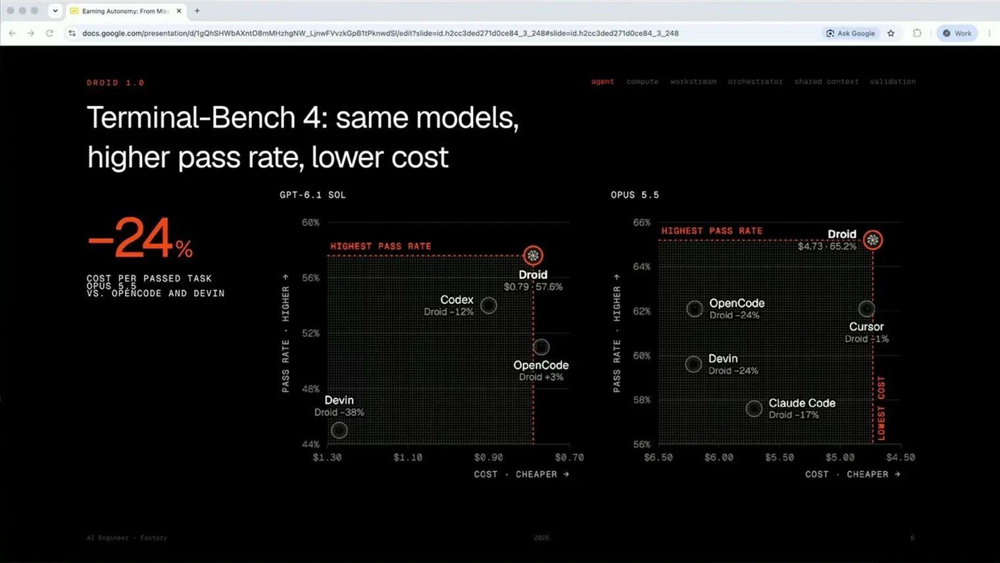

_截图 13  ·  录屏 03:22:59_

**03:23:15**　Now you have a faster agent, but that doesn't really give you like a step function increase in how much work gets done inside of your system. For that you need many agents running at once, and they need somewhere to run. Remote missions were kind of held back by this like fundamental limitation in the system, where there was one computer that handled all the work.

现在你有了更高效的智能体，但这实际上并不会让你的系统内完成的工作量出现明显的阶梯式增长。为此，你需要同时运行许多智能体，而且它们需要某个地方来运行。远程任务就因为这种根本性的限制而受到阻碍——当时只有一台电脑负责处理所有工作。

**03:23:34**　But to run a software factory, you need a compute that scales with the volume of work in the system. Otherwise, every agent is fighting for the same files or system resources. And so that's why we build environments, which are reusable definitions of the sandboxes that your droids need, complete with the repos, tools, and dependencies that they need to get started with.

但要运营一个软件工厂，就需要一种能够随着系统中工作量增加而扩展的计算能力。否则，每个智能体都会为相同的文件或系统资源而竞争。因此，我们构建了可重复使用的环境，这些环境就是你的机器人启动所需的沙盒定义，包含它们所需的仓库、工具和依赖项。

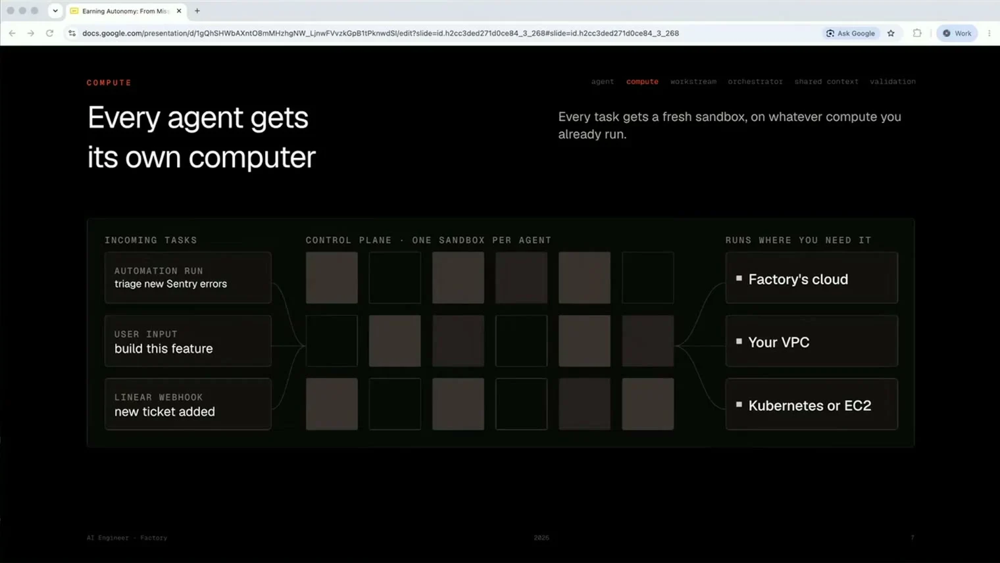

_截图 14  ·  录屏 03:23:36_

**03:23:55**　The system is governable, so there's one control plane that orchestrates all these sandboxes together wherever you need them. They can run inside of your own VPC on EC2, Kubernetes, whatever compute you already operate. So your code, your data, and your network are in your control. Compute becomes pluggable, just like we made the BYOK options and auto model options that we provide that provides sort of like this model pluggable layer.

系统运行稳定，因此有一个控制平面可以统一管理所有沙箱环境，无论你需要它们在哪里。这些沙箱环境可以在你的 VPC 内通过 EC2、Kubernetes 等现有计算平台运行。因此，你的代码、数据和网络都由你掌控。计算资源也可以被灵活使用，就像我们提供的 BYOK 选项和自动模型选项一样，它们提供了类似的可插拔层。

**03:24:23**　So now we had agents that were cheap enough to run all the time and the compute to run many at once. And so then the next question was, how do we orchestrate all this work? At first, we tried making this DAG, very complex system of agents composed together by these very strong rules, and it didn't really work. You end up having a lot of the same problems that plagued missions in the first place because it was too rigid, And as a result, it was too expensive to run, and it didn't generalize well.

现在我们有了足够便宜的智能体，可以持续运行，同时还能同时处理多个任务。那么下一个问题就是：如何协调所有这些工作呢？起初，我们试图打造一个非常复杂的智能体DAG系统，由这些严格的规则共同构成，但并没有成功。最终还是遇到了最初困扰任务的那些问题——因为系统过于僵化，而且运行成本也太高，也无法很好地推广使用。

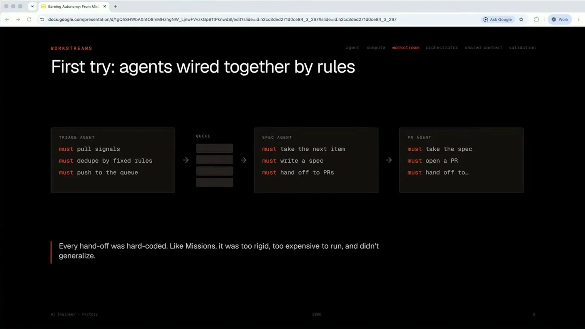

_截图 15  ·  录屏 03:24:35_

### Workstream 如何接任务、分工和累积上下文

**03:24:53**　So what we landed on instead is something that we call a work stream. It's a standing goal with a team of agents to support it. It has this goal, it has an identity, an environment that it runs on, and memory. A new work stream runs as you, and it has your access. When it outgrows one person, it can be moved to a service account with its own credentials.

因此，我们最终选择了一种叫做“工作流”的概念。这是一个由智能体组成的团队共同实现的长期目标。它拥有自己的目标、身份、运行环境以及记忆机制。一个新的工作流会基于你而启动，你可以访问它。当这个工作流超出一个人的能力范围时，就可以将其转移到具有独立凭证的服务账户上。

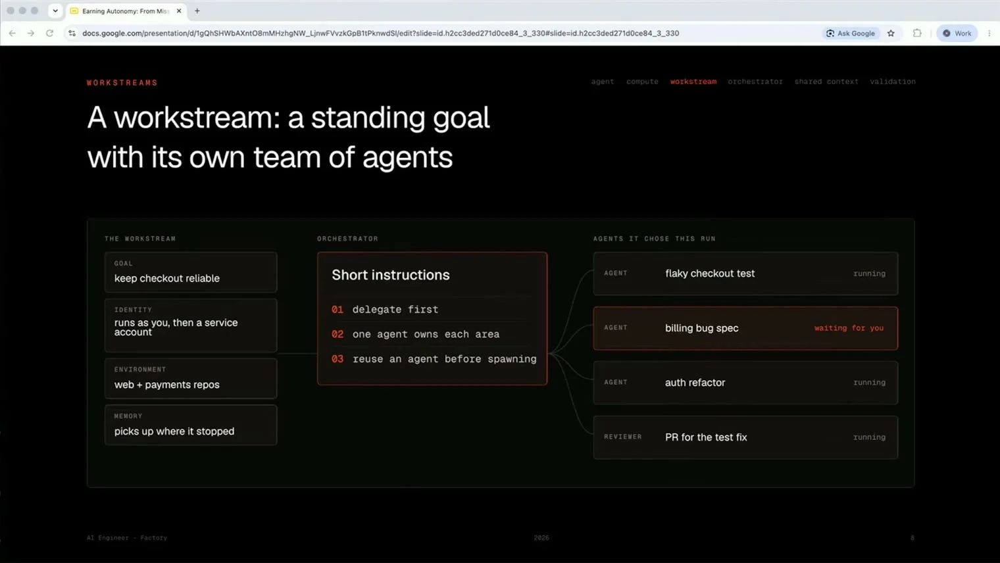

_截图 16  ·  录屏 03:25:04_

**03:25:14**　So you stay on as a member, but the work keeps happening the org actually controls. At the center of every work stream is an orchestrator, and its job looks a lot like a scheduler in an OS. Unlike the graph that we started with, it assembles its agents in whatever way is most natural for the model. So the instructions are pretty short, right?

所以你作为成员继续保留，但工作仍由该组织负责。每个工作流的中心都是一个调度器，其功能与操作系统中的调度器非常相似。与我们开始讨论的图不同，它按照模型最自然的方式来组织其智能体。因此，指令也相当简短，对吧？

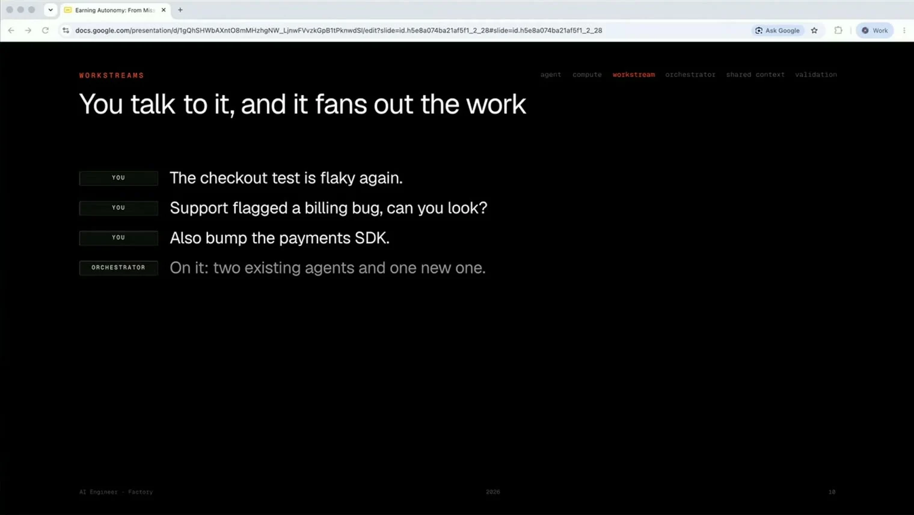

_截图 17  ·  录屏 03:25:33_

**03:25:35**　It's like delegate first, give each agent an area of ownership, and then for tasks that can fall into an existing area of ownership, delegate to those. You start by talking to it, you just kind of hand things over as you think of them, and then it fans out the work so then you can get the control back to you. Agents report back when they finish, when they get blocked, when there's something that changes the plan overall.

就像先委派任务，给每个智能体指定一个负责领域，然后对于可以归入现有负责领域的任务，就委派给它们。你首先与它们沟通，在想到相关事情时就把它们交给它们处理，之后它们会分配工作，这样你就能重新掌握控制权。智能体在完成任务、遇到障碍或计划发生变化时都会报告情况。

**03:26:02**　But the work stream doesn't just stop there, because it takes on more on its own, and it learns from your habits. At some point the orchestrator may ask you how you decide what to work on, and it learns that maybe bugs are coming from two Slack channels. So here, it can set up an intake at a triage listener. Every 30 minutes, it can go in and pull in those reports from those channels, dedupe them against existing linear issues or sentry alerts that already exist, and then weigh each of those against the work stream's goal.

但工作流并不止于此，它会自行发展，并根据你的习惯进行学习。在某个时刻，调度器可能会询问你如何决定要处理哪些任务，然后它就会意识到可能有两个 Slack 频道存在问题。因此，它可以设置一个三级分类的接收器。每30分钟，它就可以进入这些频道，收集那些报告，与现有的线性问题或 Sentry 警报进行去重处理，再根据工作流的目标对各项任务进行评估。

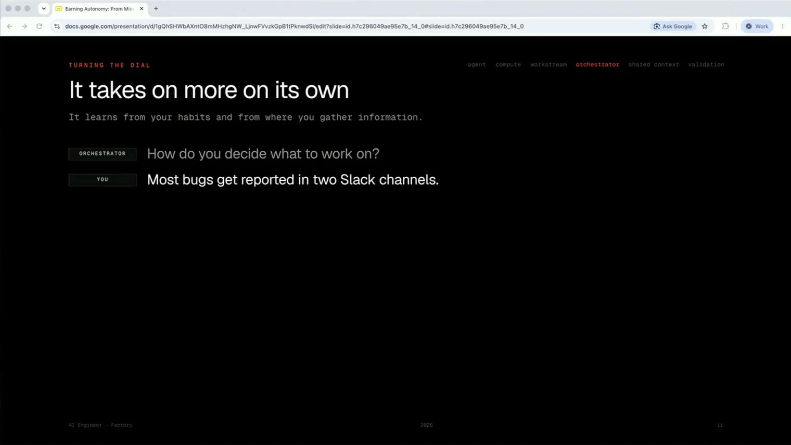

_截图 18  ·  录屏 03:26:06_

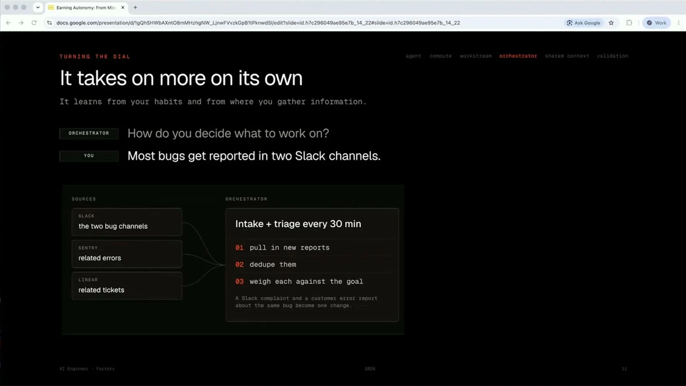

_截图 19  ·  录屏 03:26:31_

**03:26:33**　So a Slack complaint and a customer error report become one change. The output of triage is a spec that you review and you're capable of weighing in on before any code gets written. Once you approve a spec, the same worker opens a PR, stewards it until it's merge ready, and then makes sure that review, comments, and CI are passing. So each one of those stages actually maps to an autonomy level in this system.

所以，一个 Slack 投诉和一份客户错误报告就变成了一个变更。分类处理的结果是一个规范，你可以对其进行审核，并在编写任何代码之前提出你的意见。一旦你批准了该规范，同一人会打开一个 PR，负责维护直到达到合并准备状态，然后确保审查、评论和 CI 都通过。因此，这些阶段实际上都对应着该系统中的某种自主级别。

**03:27:03**　At L1, the work stream pauses for human review at the spec creation, at the PR, and before hitting merge. But as you level up those levels of autonomy, you can get to L4, where you're auto-merging everything by default. The owner gets to set the level, but the confidence to raise it comes from watching the work. So when proposed changes are accurate or PRs consistently merge at the quality that you'd expect, that's actually your cue to move to the next checkpoint.

在 L1 级别，工作流会在规范制定、代码提交以及合并之前暂停，等待人工审核。但当你提升自主性等级后，就可以达到 L4 级别，此时系统会自动进行所有内容的合并。所有者可以设定该等级，但能否进一步提升则取决于对工作的信任程度。因此，当提出的变更准确无误，或者代码提交能始终以你期望的质量完成合并时，就是你进入下一个检查点的信号。

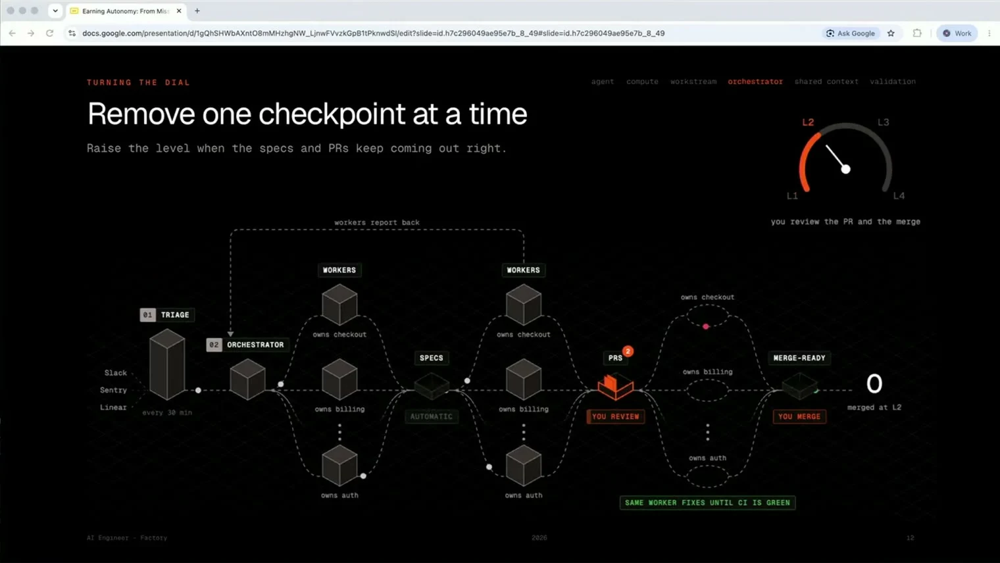

_截图 20  ·  录屏 03:27:05_

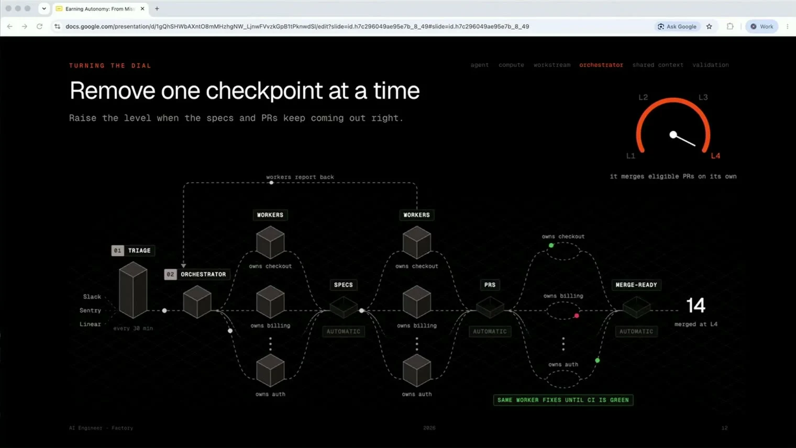

_截图 21  ·  录屏 03:27:25_

**03:27:33**　And so that becomes the dial for you. You don't need to decide on day one whether you trust a coding agent to own your CI health work stream off the bat. You just need to trust it to unlock the next checkpoint. So in a factory, an agent that starts from scratch repeats the same mistakes the last one already did. And so we built work streams to have a shared file system.

因此，这就是你的选择标准。你不需要从第一天开始就决定是否信任某个编码智能体来负责你的 CI 工作流。你只需要相信它能够解锁下一个检查点即可。所以在工厂里，一个从零开始的人工智能会重复上一个智能体犯过的错误。因此，我们设计了工作流，让它们使用共享文件系统。

**03:27:57**　Agents are encouraged to keep memory and version skills, and so their PRs get better over time. They're also proactive, and they go looking for context that they're missing. So for example, say that your work stream notices that other people are shipping related changes. It sets them PRs, analyzes what they've been working on and what comments they've been receiving in those PRs, and then incorporates them into their memory and skills.

智能体被鼓励保留记忆和技能，因此他们的 PR 会随着时间的推移逐渐提升。它们还具有主动性，会主动寻找缺失的上下文。例如，假设你的工作流发现其他人正在发布相关变更，它会生成 PR，分析他们所从事的工作以及这些 PR 中的评论内容，然后将这些内容纳入他们的记忆和技能中。

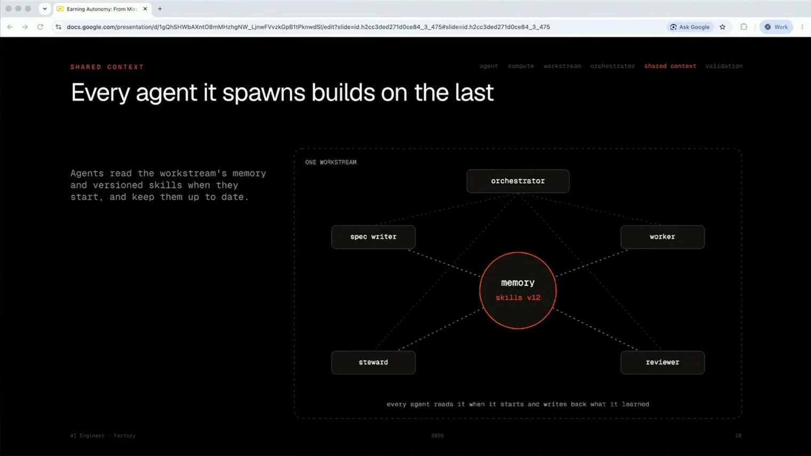

_截图 22  ·  录屏 03:28:03_

**03:28:25**　So what one agent learns, others can use, and nothing starts cold. That folder is also how agents work together on a project. When the orchestrator spawns an agent, it's capable of telling each agent where does its results sort of belong inside of this shared folder. So every agent can read and write to the same place. If you ask a work stream why checkout got slower, for example, you can send dozens of agents out to track out all those different leads that you have, and then ultimately each one can write its findings to the folder and the orchestrator can merge them.

所以一个智能体学到的内容，其他智能体就可以使用，无需额外准备。那个文件夹也是智能体在项目中协同工作的方式。当 orchestrator 生成一个智能体时，它能够告诉每个智能体其结果应该放在共享文件夹的哪个位置。因此每个智能体都可以读写同一个地方。例如，如果你询问工作流为什么检查速度变慢，你可以派出几十个智能体来追踪所有不同的线索，最终每个智能体都可以将发现的内容写入文件夹，orchestrator 则可以将它们合并。

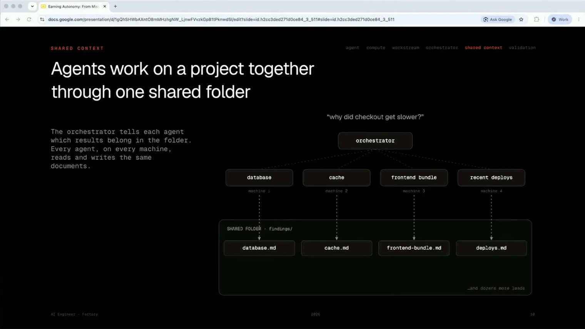

_截图 23  ·  录屏 03:28:40_

### 合并门槛、返工信号与逐步放权

**03:29:04**　Now you still need a barrier between implementation and merging. And for us that barrier is platform-level validation. Every PR gets code review, security review, and dedicated QA, and it's a live preview. And so once every review thread is resolved, a risk judge then goes in and decides whether it's safe to prove or not. The judge gets the exact if and a check out of the branch so it can build and test it, but ultimately it reads its policy from our mainline branch so that the change can't rewrite the rules that it's being judged by.

现在你仍然需要一道屏障来分隔实现阶段和合并阶段。对我们来说，这道屏障就是平台级别的验证。每个 PR 都会经过代码审查、安全审查以及专门的 QA 测试，同时还能进行实时预览。当所有审查问题都得到解决后，一个风险评估员就会介入，决定是否安全进行合并。该评估员可以查看具体的条件并访问分支代码，以便进行构建和测试；但最终它还是会遵循我们主线的规则，因此变更不会破坏其评判依据的规则。

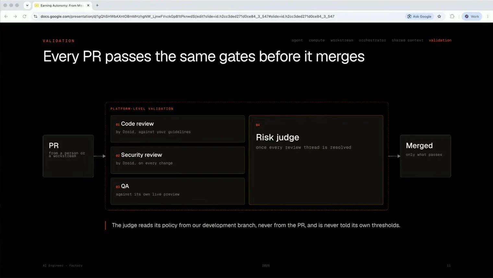

_截图 24  ·  录屏 03:29:22_

**03:29:35**　Every week, a droid minds the review comments and goes through, figures out which one authors have actually acted on, and then pulls those into review guidelines so that the loop sort of improves over time. We also have droids that every day run and analyze reverts, hot fixes, new sentry errors, for example, and traces them back to the PRs that cause them.

每周，一个机器人都会处理评论意见，筛选其中哪些内容作者确实采取了行动，然后将这些内容纳入审查指南中，这样随着时间的推移，流程会逐渐优化。此外，还有机器人每天运行并分析回退问题、紧急修复以及新的 Sentry 错误，并将它们与引发这些问题的 PR 关联起来。

**03:29:58**　And so that also is a signal into this same loop. What we're really hell climbing on here is the regret-free merge rate, the share of changes that merge and never need a revert or a follow-up fix. We measure it for droid-ridden and human-ridden PRs side by side. And it's the same way that we let self-driving cars onto the road.

因此，这也成为该循环中的一个信号。我们真正关注的，是无需修复的合并率——即那些能够自动合并且不需要后续修正或修复的变更比例。我们同时对包含机器人代码的PR和人类代码的PR进行对比测量。这与我们让自动驾驶汽车投入使用的方式相同。

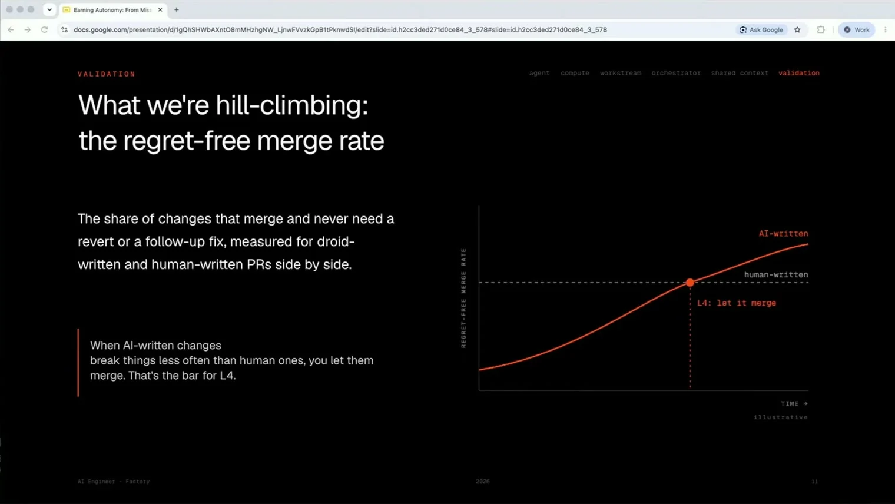

_截图 25  ·  录屏 03:30:12_

**03:30:18**　We didn't just give them the green light. Did so once they crashed less often than human driven ones did. And so once AI ridden changes, break things less often than human ones, and you can actually measure that, then you can let them merge. And that's the bar for turning a Workstream to L4. Workstream is now like the platform that we build new features on top of.

我们并非简单地允许他们这么做。只有当他们的故障发生频率低于人类操作时的频率时，才允许他们这样做。一旦由人工智能驱动的变化带来更少的故障，且这种差异可以实际测量出来，那么就可以让他们合并在一起。这就是将 Workstream 提升为 L4 级别的标准。现在，Workstream 就像是我们构建新功能的基础平台。

**03:30:40**　So Migrate is the first one. It sort of fulfills a niche in our product framework for what missions used to be, this like dedicated one-shot migration experience, and continuous remediation is the second, where it follows that circular shape that work streams are best suited for because there the work never ends. We run factory on top of work streams ourselves, and so this is what it actually looks like in production.

So Migrate是第一个。它在我们的产品框架中扮演了特定角色，属于那些曾经存在的任务类型，也就是一个专门的单次迁移体验。而持续修复则是第二个方面，工作流以循环模式最为合适，因为工作永远没有结束。我们自己在工作流之上运行工厂系统，所以实际生产中的情况就是如此。

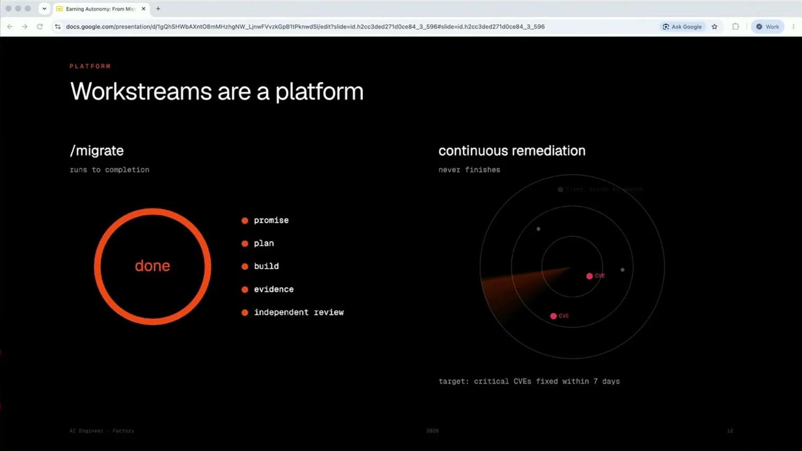

_截图 26  ·  录屏 03:30:45_

**03:31:07**　In a week in this past October, we shipped about 800 pull requests in our dev branch, and Droid wrote 99% of them and reviewed all of them. Now, work landed in one of two ways. It was either a human picking up a signal manually, or increasingly nowadays, it's a work stream picking it up automatically, triaging it against the goal of the work stream, and then ultimately writing a spec and merging it.

去年十月的这一周里，我们在开发分支上提交了大约800个Pull请求，其中99%是由Droid完成的，并且他们也审核了所有提交的内容。现在，这些工作要么由人手动处理，要么如今越来越多地由工作流自动处理——根据工作流的目标对任务进行分类，然后最终编写规格说明并合并到项目中。

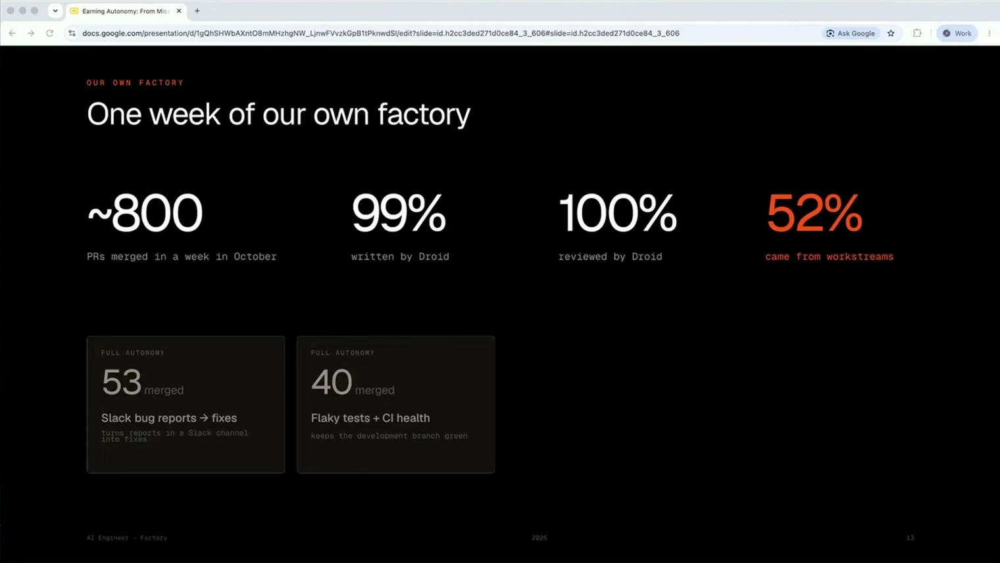

_截图 27  ·  录屏 03:31:19_

**03:31:32**　52% of PRs that we ship right now are coming from work streams themselves, and some of these are operating on full autonomy. So, for example, the one that fixes bug reports from a dedicated Slack channel PRs per week. Another one is our flaky test work stream, which merges at about 40. Fully autonomous PRs aren't really the only thing worth tracking, though.

目前我们处理的 52% 的 PR 来自工作流本身，其中一些是完全自主运行的。例如，有一个工作流每周从专门的 Slack 频道接收错误报告并处理这些报告；另一个则是我们的不稳定测试工作流，其合并率约为 40%。不过，完全自主的 PR 并非唯一值得跟踪的内容。

**03:31:56**　What matters a lot more is the progression. How much of your work flows through work streams and how many checkpoints does each one still need? As more work flows unrestricted, your engineers become the regulators of this system. They decide what signals to watch, what are the goals and the owners of of those, what are the skills and review guidelines that you need in order to keep this code high quality, and how much autonomy each work stream gets.

更重要的是进展情况。有多少工作通过工作流进行，每个工作流还需要多少个检查点？当更多工作能够不受限制地进行时，你的工程师就会成为这个系统的管理者。他们会决定要关注哪些信号，目标是什么以及它们的负责人是谁，还需要哪些技能和审查标准来保持代码的高质量，以及每个工作流能获得多少自主权。

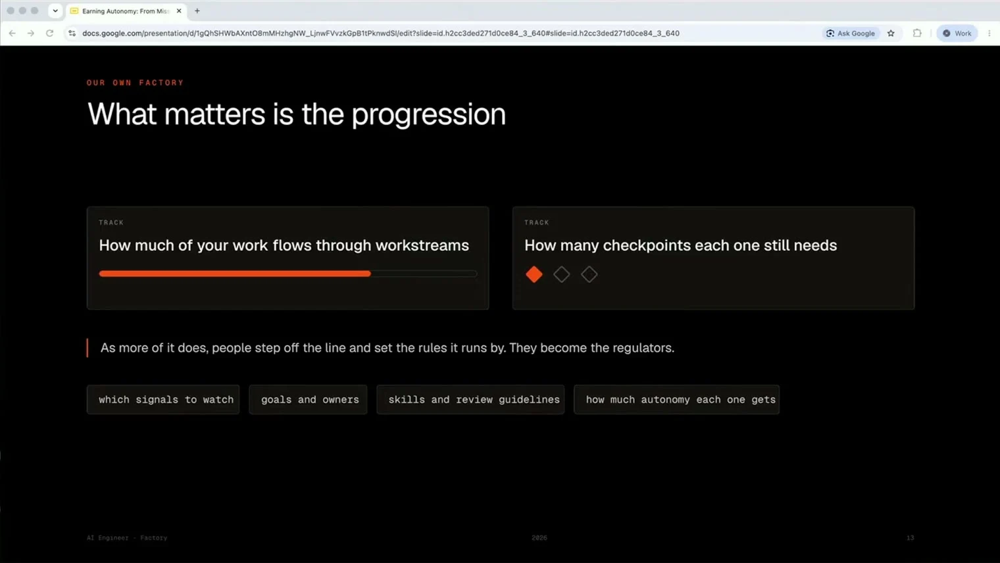

_截图 28  ·  录屏 03:32:00_

**03:32:20**　And so there's just one question that tells you whether you have a software factory or faster engineers, and that is, can you name and track your signals? Every team already has them. You have bug reports in Slack, failing CI jobs, error spikes, tickets that nobody ever picks up, but most of them wait on a person to notice. And so my ask to all of you is to write them down and then pick the one that you waste the most time on.

所以，只有一个问题可以判断你是否有软件工厂或更高效的工程师：你能命名并追踪你的信号吗？每个团队都已经有这些了。你在 Slack 上看到错误报告，CI 作业失败、错误激增，还有没人会处理的工单，但大多数都只是等待有人注意到。因此，我对大家的请求是：把它们记录下来，然后选择那些你花费最多时间处理的问题。

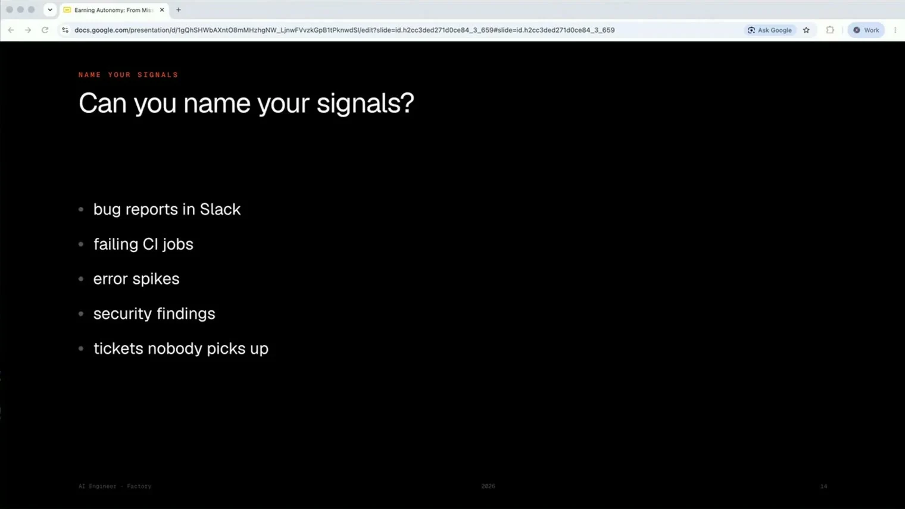

_截图 29  ·  录屏 03:32:25_

**03:32:45**　Give it to Workstream on L1 and then set up our validation experience. And then you're well on your way to building software that improves itself with all the signals that you choose to track. Thanks, everyone, and I'll be around to answer any questions today.

将它交给 L1 的 Workstream 处理，然后设置我们的验证流程。这样你就能顺利构建能够根据所选指标进行自我改进的软件了。谢谢大家，今天我会随时回答任何问题。

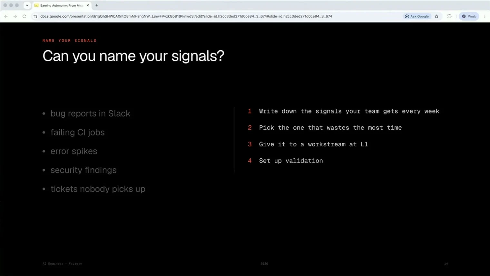

_截图 30  ·  录屏 03:32:46_

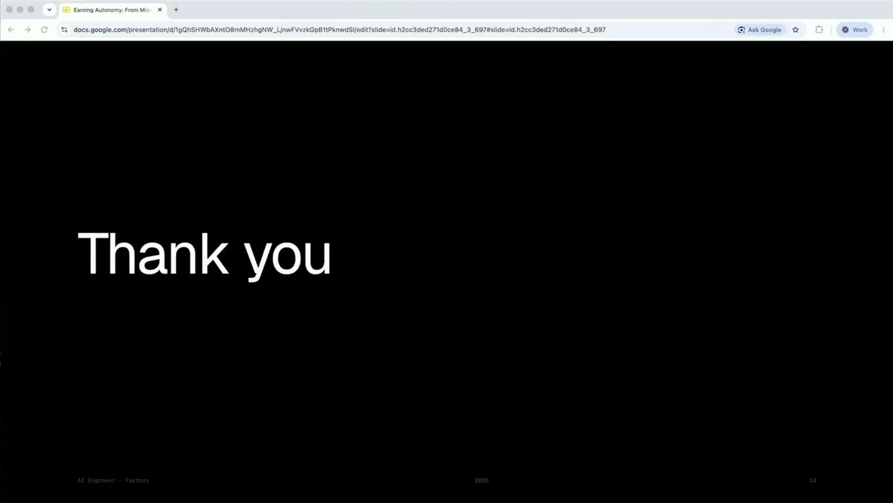

_截图 31  ·  录屏 03:32:59_

**03:33:25**　Thank you.

谢谢。

---

[全部演讲](../README.md) · [选看索引](index.md) · [上一场](11-andrew-finch.md) · [下一场](13-ara-khan.md)
