[全部演讲](../README.md) · [选看索引](index.md) · [上一场](12-luke-alvoeiro.md) · [下一场](14-tanmay-and-dolly-sah.md)

# Recursively Self-Improvement for Coding Agents

**Ara Khan** · Cline · Founding Engineer

AIE Code Summit 2026  ·  11 月 11 日  ·  Online Track 预录插播  ·  录屏 03:34:34–04:01:12

[官方讲者资料](<https://ai.engineer/code/2026#speakers>)   ·   [Day 1 官方回放](<https://www.youtube.com/watch?v=ZZ19zhYnDKY>)

## 本场目录

- [03:39:26](#section-1) 递归自我改进的含义及编码 Agent 的演进
- [03:42:50](#section-2) Agent 评测、Terminal-Bench 和迭代流程
- [03:46:23](#section-3) Cline 实验、具体修复及验证方式
- [03:49:18](#section-4) 推理、训练、现实世界任务和职业建议

## 演讲实录

> 英文源自录屏音频，经轻度校订。每段英文下方为中文译文。时间指向原始录屏。

**03:34:42**　Hey guys, this is Ara. I'm a founding engineer at Cline, and today I'm going to be talking about recursively self-improving coding agents. So this is a very interesting conversation in the sense that everyone wants to understand what RSI is, how we accomplish it, how we go through it, and how it affects our career. So I'm going to start with giving you just three goals of this entire conversation, just three simple goals.

大家好，我是Ara。我是Cline的创始工程师，今天我将谈论递归自改进编码智能体。这是一个非常有趣的讨论，因为每个人都想了解RSI是什么、我们如何实现它、我们如何完成它，以及它如何影响我们的职业生涯。所以我将从提出整个讨论的三个目标开始，只有三个简单的目标。

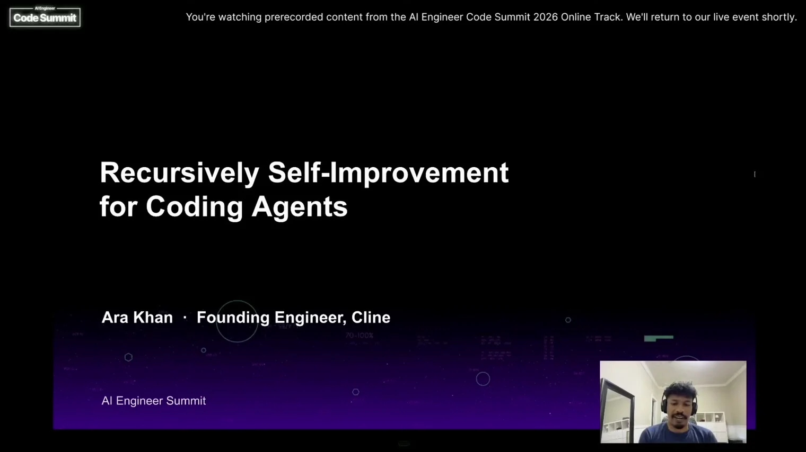

_截图 01  ·  录屏 03:34:43_

**03:35:06**　And that would help you understand what we get out of it and what the future for this looks like. So the goal number first is understanding the intent of the Frontier Labs.

这将有助于你理解我们从中获得什么，以及未来的发展方向是什么。因此，首先要明确的是对 Frontier Labs 意图的理解。

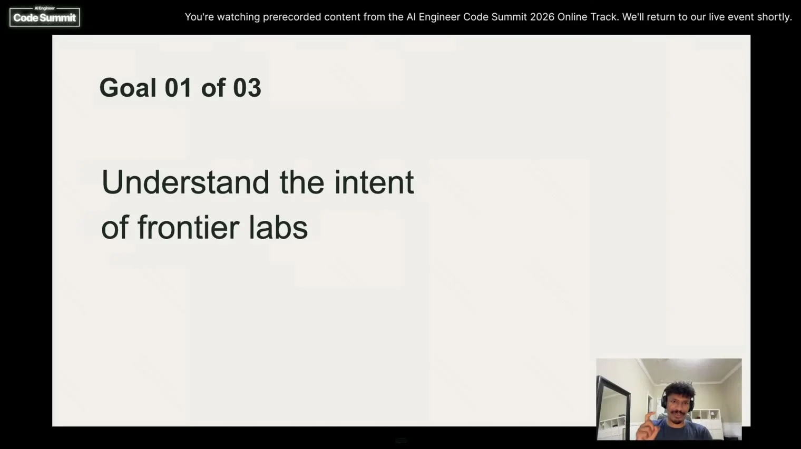

_截图 02  ·  录屏 03:35:12_

**03:35:15**　right everyone who's outside of the frontier labs always trying to speculate like hey what what is the topic in OpenAI or what is DeepMind going to come out with or what are they trying to make and what's the future going to look like who has cracked the rsi so like this kind of helps you get a rough outline of what their roadmap looks like and the second thing is that like if the models are improving so fast like how do you think about your career over the next few years right that is really what we want to understand we want to understand like okay things are changing so underneath us is shifting so quickly.

没错，所有身处边境实验室之外的人总是试图猜测：OpenAI的议题是什么？DeepMind将会推出什么？他们想要创造什么？未来会如何发展？既然已经破解了RSI，这种猜测能让你大致了解他们的规划方向。第二点就是，如果模型的发展速度如此之快，你觉得未来几年你的职业生涯会如何发展呢？这正是我们想要理解的。现实是，情况正在发生变化，而我们的处境也在迅速变化。

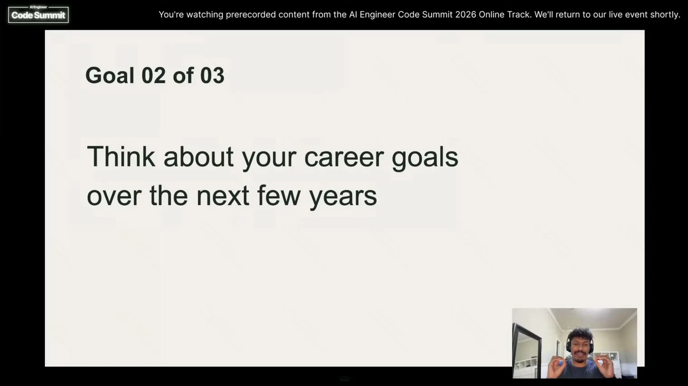

_截图 03  ·  录屏 03:35:45_

**03:35:48**　Right now, like it's like, there used to be a time when you could like, demonstrate your side projects on your personal website or GitHub, and now it's just like, you could literally one shot them using any frontier coding agent. And with that, it's like, it's like, oh, well, how do we demonstrate proof of work? How do we demonstrate, you know, that we know what we're doing?

现在，曾经有一段时间，你可以在个人网站或 GitHub 上展示你的个人项目，而现在则可以直接使用任何编码智能体来完成这些项目。那么，如何展示工作量证明呢？我们该如何证明我们知道自己在做什么呢？

**03:36:09**　And how do we think of our career for the next coming years, right? So it's very interesting times that we're living in. And then the third and the most important goal of the conversation is escaping the permanent underclass, right? So I know this seems like a joke, but this really is a very valid possibility that people are contemplating. Everyone's like, oh, well, if everything that we want to be doing can potentially easily be done by a frontier model, like what are we good for?

那么，我们如何看待未来几年的职业生涯呢？我们正处于非常有趣的时期。第三个也是最重要的目标就是摆脱永久性的下层社会地位，对吧？我知道这听起来可能像是个玩笑，但实际上这是人们真正在考虑的可能性。每个人都在想，如果所有我们想要做的事情都能通过边缘模式轻松实现，那我们还能做什么呢？

**03:36:34**　And like where does software go? Where is the future of technology going to go? And what are we going to do as things evolve so fast, right? So I think that there's like a lot of like fear mongering, but also there's some very valid merge where people are concerned that if all the revenue of the planet is going to go to a few hardware companies that make Frontier GPUs and then a few AI companies that make the best models, how are the rest of us going to survive and what are we going to do here?

那么，软件将会走向何方呢？技术的未来又将如何发展呢？当变化如此迅速时，我们该怎么做呢？我认为存在很多恐惧的言论，但也有一些合理的担忧：如果全球所有的收入都归少数几个生产 Frontier GPU的硬件公司，以及那些制造最优秀模型的AI公司所有，那我们其他人将如何生存呢？我们该怎么做呢？

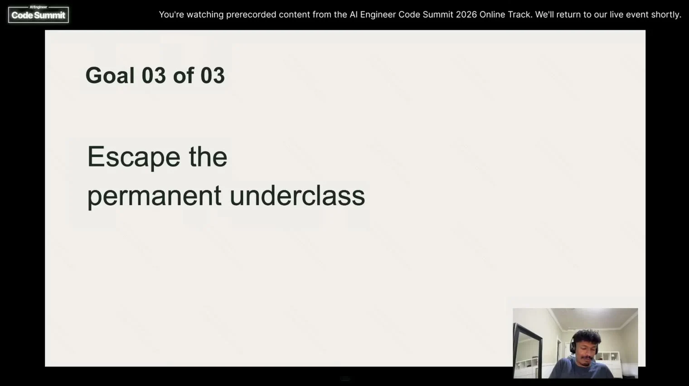

_截图 04  ·  录屏 03:36:44_

**03:37:05**　So I think I'll walk you through a few examples and a few ideas that will like really, really help you reconsider the career choices and life choices you're making and what your problems you're picking up. And then that would help you like realign what it is that we should be working on and what it is that you could work on that would stand the test of time and help you both just not just like on a psychological level but like financial and other levels as well.

所以，我想给你举几个例子和一些想法，这些会真正帮助你重新思考自己的职业选择和生活选择，以及你所面临的挑战。这样就能帮助你明确我们应该努力的方向，以及那些能够经得起时间考验、对你们双方都有帮助的方向——不仅是从心理层面来看，还有财务和其他层面。

**03:37:32**　So to give a very precise example, let's start with something very precise that I had done. So a couple of months ago, I came up with recursive improvements on IA coding harness. So this was the first public example of an automatic eval improvement. So to give you an example, we used to do this thing where we would measure the quality of a coding agent using evaluation scores.

那么，举一个非常具体的例子吧，从我做过的事情开始。几个月前，我在IA编码工具中提出了递归改进方案。这是第一个公开的自动评测改进案例。为了给你一个例子，我们过去总是用评测分数来衡量编码智能体的质量。

**03:37:58**　So on Terminal Bench 2.1, Kimi K3 with Cline would score usually 60-70%. And then depending on how good the model is, you get better scores on Terminal Bench 2.1. So we noticed that when Kimi K3 came out, our score was 77.5%, which is a good score. But we were like, oh, is this truly the best score that this model can get on this benchmark?

在 Terminal Bench 2.1 测试中，Kimi K3 配合 Cline 模型通常能获得 60-70% 的得分。而根据模型的性能好坏，在 Terminal Bench 2.1 上的得分也会有所不同。我们发现，当 Kimi K3 发布时，我们的得分达到了 77.5%，这是一个不错的成绩。不过我们也在思考：这真的是该模型在这个基准测试上能取得的最高分吗？

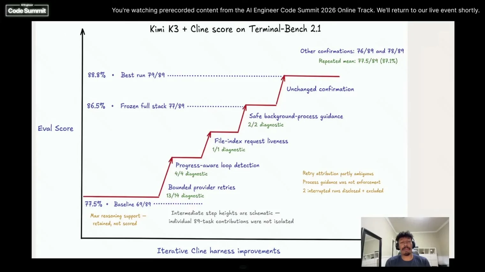

_截图 05  ·  录屏 03:38:07_

**03:38:23**　and also like what does the model release paper claim about what their best score is so the model's release paper said that they could score up to 85 or even more so we were just like okay okay so we are not getting the sort of score and often what we do with model releases incline is that we try to like optimize your score and try to get the best out of the model so when we started hill climbing on the on the model like we we realized this we realized that like you know there's a lot of steps that we do says that we do it gracefully so that you pursue the right kind of problems and do it the right way and we started thinking…

还有，关于模型发布文件所声称的最佳得分是多少，模型发布文件说他们可以达到85甚至更高分。所以我们就觉得好吧，我们并没有达到那个分数。通常我们在处理模型发布相关工作时，会努力优化你的得分，让模型发挥最大效用。当开始对模型进行优化时，我们意识到，其实有很多步骤需要完成，而且我们要以优雅的方式去做，这样你就能找到正确的问题并正确解决它们。于是我们就开始思考……

**03:38:58**　like okay if we there's a lot of groundwork here. How do we automate it? And this is a demonstration of, like, how we automated it. So I'll just leave that as a placeholder for now, and we'll get back to it later, where we talk about in detail of, like, how does this automatic improvement loop of a client harness work. So this basically means that, like, you have a coding agent harness that could just, like, basically improve itself and become better on the same set of problems.

如果这里需要大量的基础工作，那还行吗？我们该如何实现自动化呢？这其实就是一个自动化的示例演示。所以现在我就把这部分当作暂存项，稍后我们再详细讨论关于这种客户工具自动改进循环是如何运作的。也就是说，你有一个代码智能工具包，它能够自我改进，在相同的任务范围内变得更好。

### 递归自我改进的含义及编码 Agent 的演进

**03:39:22**　So let's start with the ground terms. What is recursive self-improvement? Recruits self-improvement is the idea that an AI system that helps build a more capable successor, which repeats the process until you hit artificial general intelligence. You have better systems, you have better improvements, you have a better system, and then you have singularity. So a classic example is like a self-reporting coding agent.

那么，我们先从基础概念开始。什么是递归自我改进？递归自我改进的概念是：一个帮助构建更强大的后继系统的AI系统会重复这一过程，直到达到人工通用智能。你有更好的系统，有更好的改进，有更完善的系统，然后就迎来了奇点。一个典型的例子就是自我报告的编码智能体。

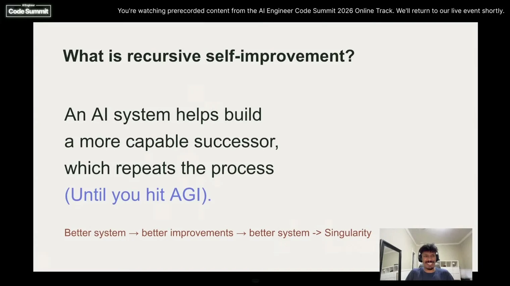

_截图 06  ·  录屏 03:39:26_

**03:39:43**　Self-reporting coding agent is just like a coding agent that can improve itself. So this is all like a pie-in-the-sky idea. This looks cool, but how did this even come out to be? Like, how did we even get to here? So if you notice in Topic Roadmap in 2021, in 2021's roadmap, they very specifically said that they want to develop a general AI system that can interact conversationally with a user to create, edit, and explain software.

自我报告的编码智能体就像一种能够自我改进的编码智能体。所以这其实只是一个不切实际的想法。看起来很酷，但究竟是如何实现的呢？我们究竟是如何走到这一步的？如果你留意一下2021年的主题路线图，在2021年的规划中，他们明确表示希望开发一种通用人工智能系统，该系统能够与用户进行对话式交互，从而创建、编辑和解释软件。

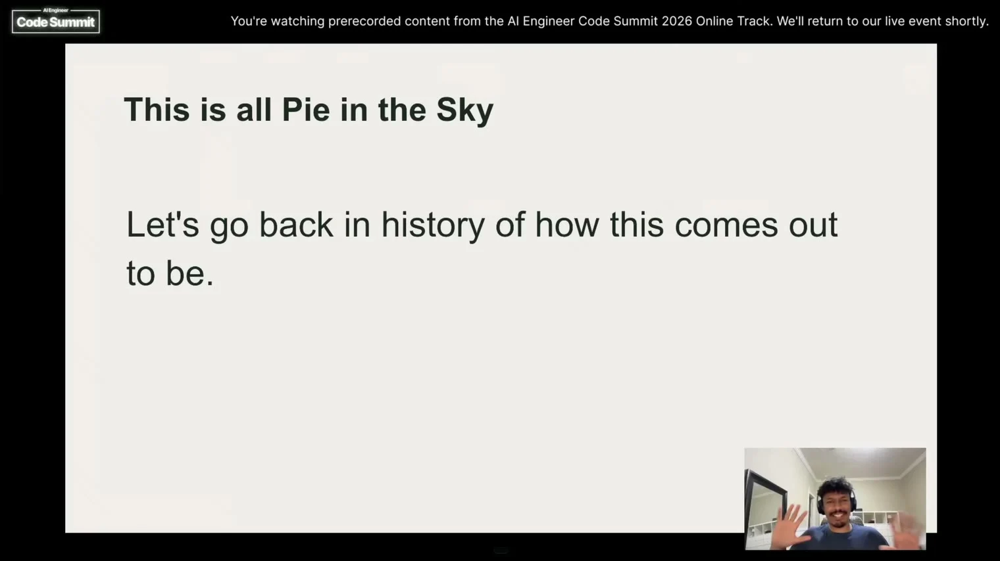

_截图 07  ·  录屏 03:39:51_

**03:40:11**　It would display all the capabilities of a software engineer colleague. It would write functions, it would identify bugs, it would design an API, discuss style, and best practices. So we don't expect to reach this cold right away, but it's in the direction which we're striving. It's interesting how this was more than five years ago. More than five years ago, people had predicted that there is a day where you will have like a full-blown general assistant that can basically act like a colleague, which we do have right now.

它能展现出一个软件工程师同事的所有能力。可以编写函数，识别错误，设计 API，讨论代码风格和最佳实践。所以虽然我们不会立刻达到这种水平，但这是我们正在努力的方向。五年前的情况与现在不同：当时就有人预测，总有一天会出现一种完全能替代同事角色的智能助手，而我们现在确实已经实现了这一点。

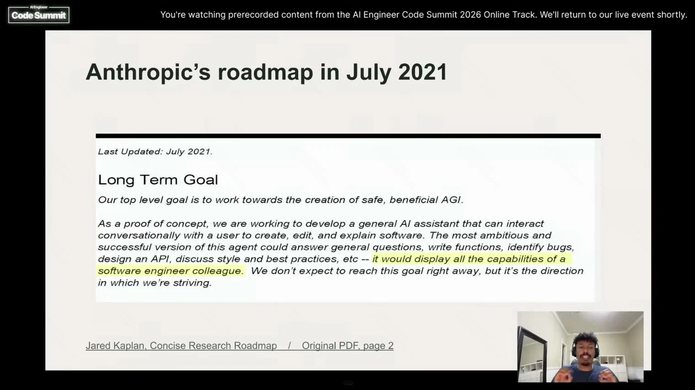

_截图 08  ·  录屏 03:40:12_

**03:40:36**　Then in 2022, chat-tipity got released. We all know how that happened. It was a fun moment. It was like the first time things got sparked for us. Then in 2023, 2024, that was the first time chat models could call functions. Simple functions like, hey, what's the weather? Or, you know, what's the, what's, you know, what's this competition or what are these competitions result in Python?

然后，在2022年，Chat-Tipity被发布了。我们都知道这是怎么发生的。那是一个有趣的时刻。就像第一次有东西在我们之间激发出灵感一样。接着在2023年和2024年，聊天模型第一次能够调用函数了。比如，简单的函数，比如“今天的天气怎么样？”或者“这个比赛是什么？或者这些比赛的结果在Python中是什么？”

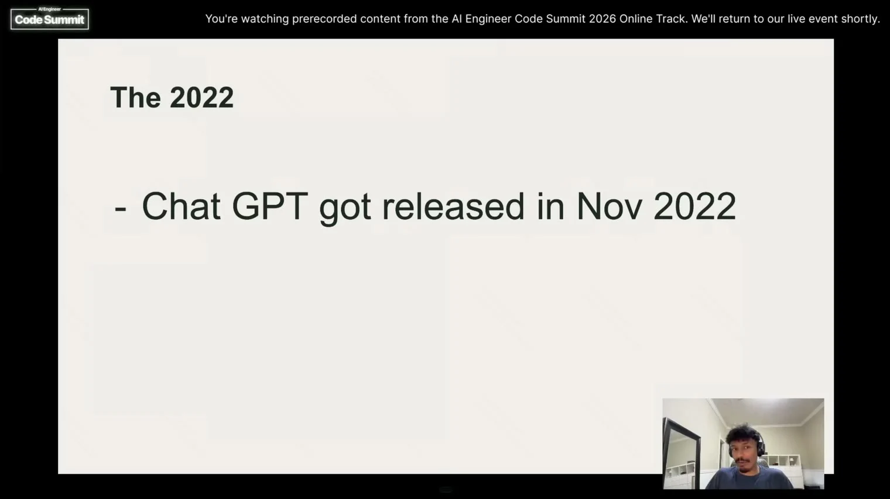

_截图 09  ·  录屏 03:40:37_

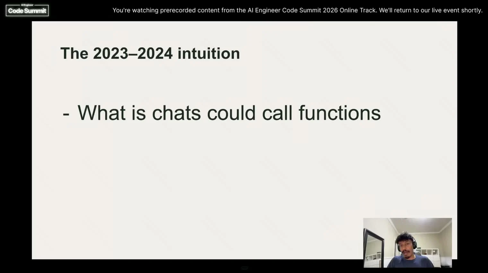

_截图 10  ·  录屏 03:40:50_

**03:41:00**　And then finally in 2024 when Sonic 3.4.5 was released, that was when the agents could like truly call like actual tools the way we call like ThinkoTools. So it's like reading a file, editing a file, you know, reading, searching something on web, listing, listing a folder, searching and grabbing through, you know, a file system, things like that. And in 2024, we had the intuition that like, what if chat box could actually talk to each other?

最终在2024年，当Sonic 3.4.5版本发布后，智能体就真正变成了我们称之为ThinkoTools的实用工具。比如读取文件、编辑文件，或者在网络上搜索内容、列出文件夹、通过文件系统进行查找和获取等操作。在2024年，我们意识到：如果聊天框能够互相交流该会怎样呢？

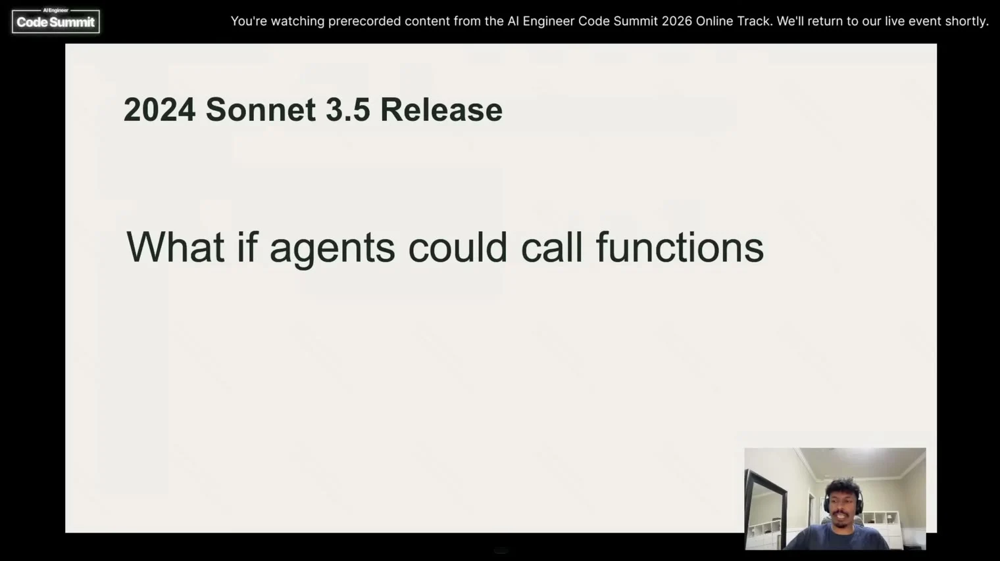

_截图 11  ·  录屏 03:41:06_

**03:41:27**　So then that was the first time when we had like, you know, multi-agent conversations. Now at the time, these things were very janky, right? Like they were just like taped together in this like weird, bizarre ways where you have just like these classes and these links and then like these hierarchies of classes. And it was all like kind of like a very janky attempt to like make us think that like these models they can all communicate with each other.

那么，那是我们第一次进行多智能体对话。当时这些系统非常不完美，对吧？它们只是以一种奇怪、不自然的方式被连接在一起，有各种类、链接以及类之间的层次结构。这完全是一种不完美的尝试，试图让我们认为这些模型能够相互交流。

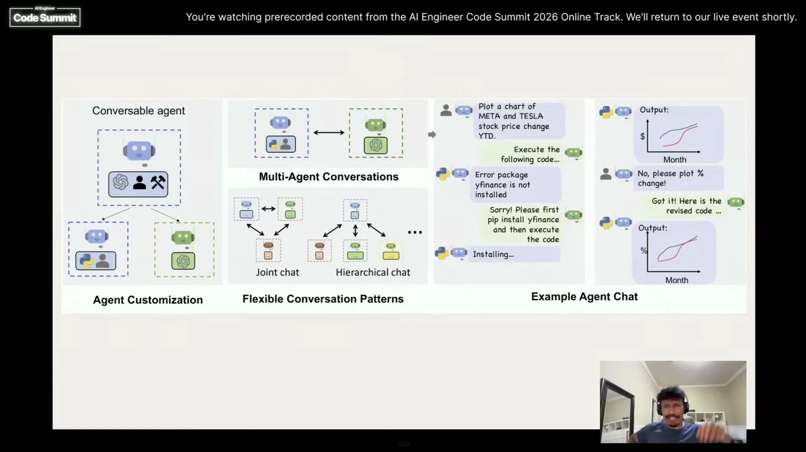

_截图 12  ·  录屏 03:41:35_

**03:41:54**　A lot of it was like mostly deterministic and it was like, you know, it was not as free-flowing as it is right now. We started getting the intuition. This was the Autogen project, but only in 2025 we started getting the intuition, what if the agents just kept getting better and pasturing cheaper? What if that just kept happening? Then in 2026, we had the intuition that what if the agent could improve itself, which is like the final, you know, the final part of the whole process.

其中很多部分都呈现出明显的确定性特征，不像现在那样自由流动。我们开始有了直觉。这是 Autogen 项目，但直到 2025 年我们才真正获得这种直觉——如果智能体不断进步、成本降低会怎样？如果这种情况持续下去又会如何？然后到了 2026 年，我们意识到，如果智能体能够自我改进，那将是整个流程的最终环节。

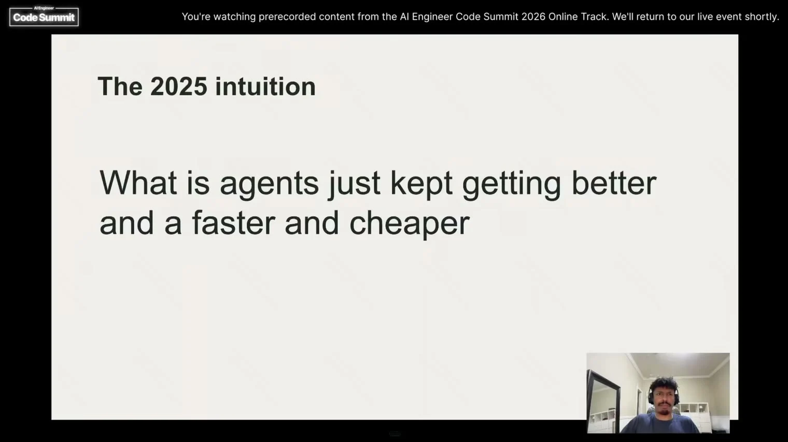

_截图 13  ·  录屏 03:42:05_

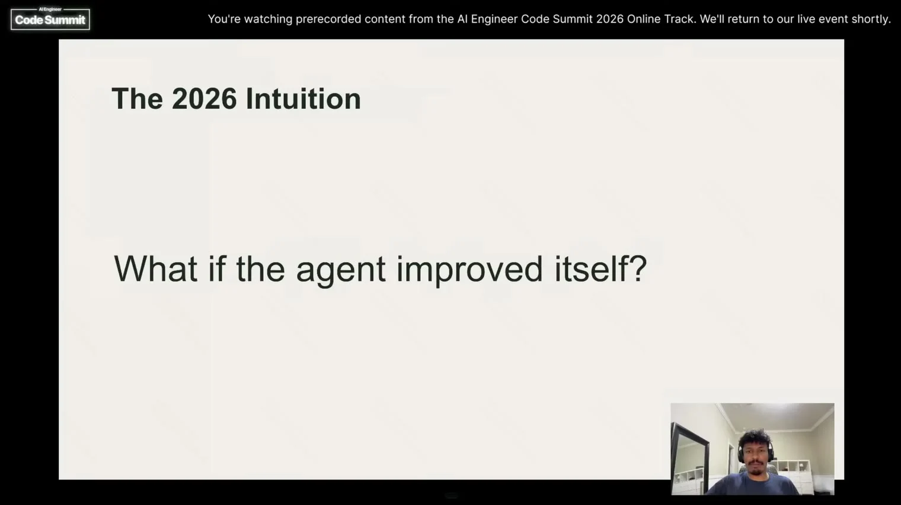

_截图 14  ·  录屏 03:42:17_

**03:42:23**　So let me give an example. Like what does it mean for an agent to improve itself, right? So like it's like a lot of times when we think of like evaluating an agent, we initially used to think of evaluating an agent in the form of like just a single turn conversation. So we would tell like agents that like ask a simple question, like how many toes does a dash animal has?

那么让我举一个例子。智能体自我改进意味着什么呢？通常当我们考虑评估智能体时，最初是以单次对话的形式来进行的。我们会让智能体提出简单的问题，比如“一只短腿动物有多少只脚？”

### Agent 评测、Terminal-Bench 和迭代流程

**03:42:44**　Like it could be, let's say, how many toes does a cat have? And then the element would go through and the element would like prepare a response and then we would get the response. So like a cat has maybe 10 toes, 18 toes, whatever many. I don't I actually don't know how many toes a cat has. But anyway, yeah. So then we create the responses like a yes or no.

也许可以这样，比如说，猫有多少只脚？然后元素会经过处理，元素会准备一个回应，接着我们就能得到这个回应。所以，比如猫可能有10只脚、18只脚，或者更多。其实我不知道猫到底有多少只脚。不过不管怎样，我们就会生成“是”或“否”这样的回应。

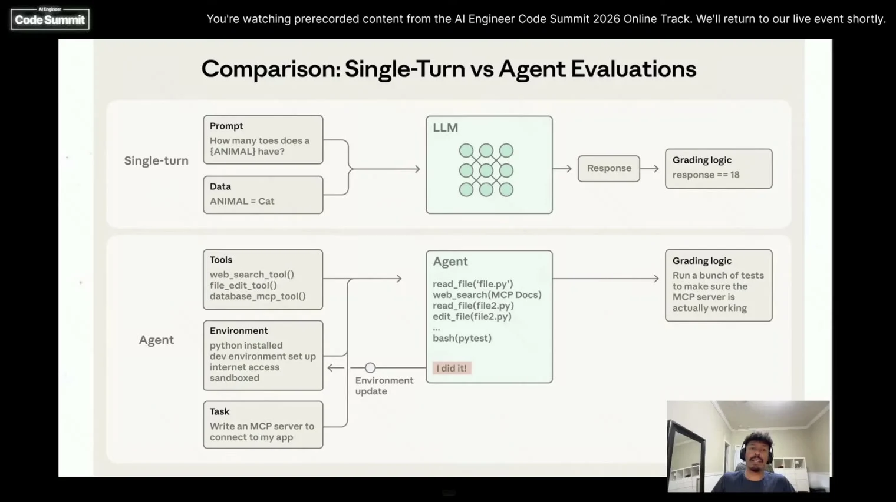

_截图 15  ·  录屏 03:42:50_

**03:43:02**　But like when you work with an agent, there's a ton of things that you're doing. So let me give an example. Let me give an example. So, for example, you're going to ask an agent like, hey, set up this MCP for me. So now it's not just like, you know, a trivial one-shotable thing. Like it will like search online and go, what's the MCP?

但就像与智能体合作时一样，你要做很多事情。让我举个例子吧。比如，你会让智能体帮你设置这个MCP。现在这不再只是简单的一次性任务了。它会去网上搜索，问什么是MCP。

**03:43:19**　What is the config? So I'll like edit and download some soft files. Like maybe I need to add database update the MCP tool. Maybe I need to read and edit some files. Maybe I need to run some bash commands, right? So you do all of that and then the agent responds like, hey, I did it. And then you create that with a bunch of tasks to gauge like, hey, did the agent actually accomplish the thing that it said it would do?

配置是什么？所以我会编辑并下载一些软件文件。比如可能需要添加数据库，更新MCP工具。也许还需要阅读并编辑一些文件。也许还需要运行一些bash命令，对吧？所以你完成所有这些之后，智能体就会回应说：“嘿，我做到了。”然后你用一系列任务来评估，比如“智能体是否真的完成了它所说的任务？”

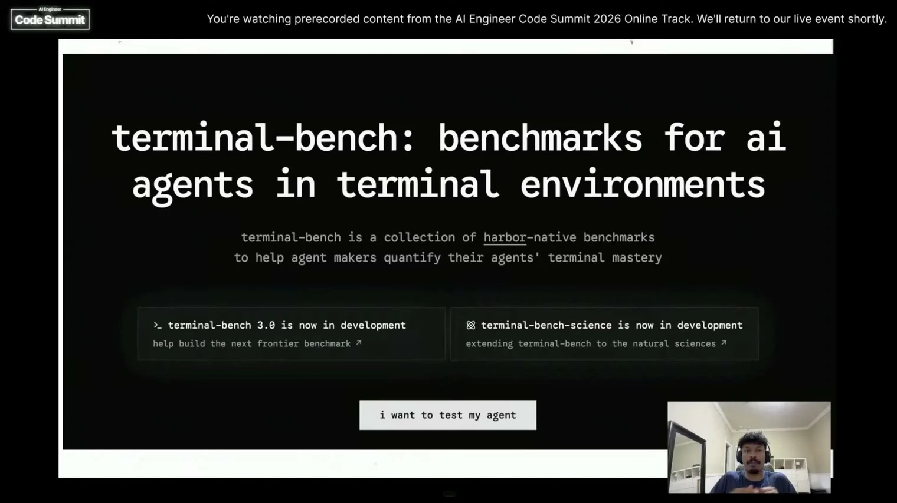

_截图 16  ·  录屏 03:43:40_

**03:43:41**　So to do that thing, the second part, which is like more intricate, where you're actually like truly, you know, testing agents like to their best extent. Like it's like, you know, we use the same call terminal bench. Terminal bench is a benchmark for, you know, agents in terminal environments. And that is something that we are we have a lot of experience with at Client.

那么，为了完成那件事，第二部分更加复杂，实际上是在尽力测试智能体。比如，我们使用相同的终端测试平台。终端测试平台是用于测试终端环境中智能体的基准测试。我们在Client方面有丰富的相关经验。

**03:44:02**　and it's like one of the best ways to really gauge is your coding agent accomplishing in general the tasks that you're doing that you want to be doing with HRD model. So there's many different parts of evaluation suits. So ideally you want that to run in individual sandboxes. Then you have independent graders that check everything, like how many channels it took, how many tokens it took, how much latency it took, how many tool calls did it make, what was the trajectory looking like, and then grading all the results for things like, hey, did you not reward hack?

这其实是衡量编码智能体能否有效完成你希望在 HRD 模型中实现的任务的最佳方式之一。因此，有多种不同的评估方法。理想情况下，应该让这些评估在独立的测试环境中进行，然后由独立的评分者检查所有指标，比如使用了多少通道、使用了多少令牌、延迟时间是多少、调用了多少工具、轨迹如何，最后对结果进行评分，比如是否奖励了作弊行为。

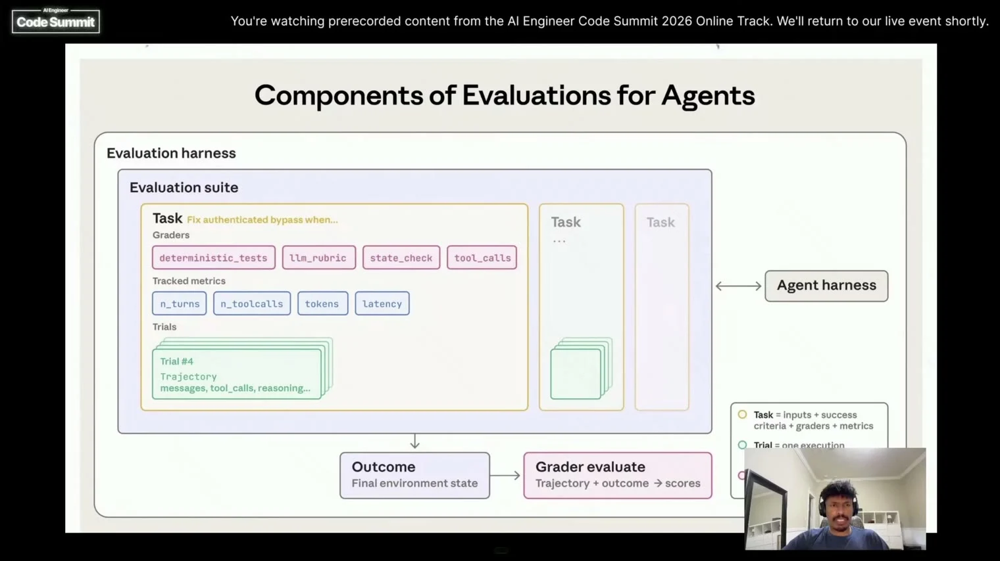

_截图 17  ·  录屏 03:44:22_

**03:44:38**　Did you not cheat through the solution? Did you not just look up the solution online? Things like that. So basically, a lot of these data sets of evaluation problems have a set of tasks. So in Azure Terminal Bench 2.1, they have 89 tasks. So what we do is like we spin up 89 parallel containers where they all run online and they run in parallel and they're sandboxed and then they each try to solve a problem.

你不是通过解决方案来作弊吗？不是只是在网上查找解决方案吗？诸如此类的情况。所以基本上，这些评估问题的数据集包含一系列任务。在 Azure Terminal Bench 2.1 中，有 89 个任务。我们做的就是启动 89 个并行容器，它们都在线上运行，并行进行，并且处于沙箱环境中，然后每个容器都尝试解决一个问题。

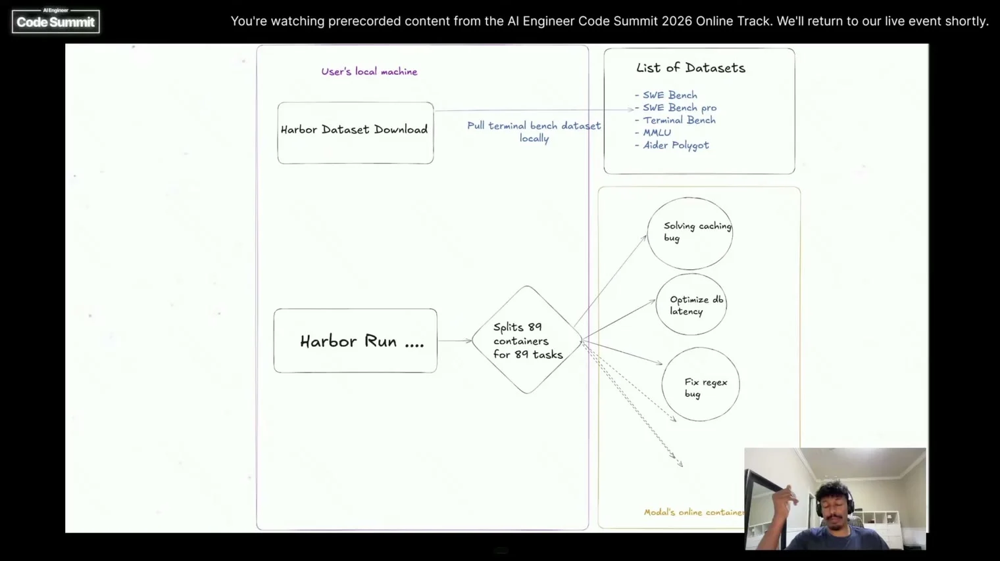

_截图 18  ·  录屏 03:44:51_

**03:45:04**　So then they're all in parallel and independent of each other. And then at the end, we get a score. So our score could give us measures like is the model performing well and what kind of failures it has, right? So you run the evaluation, you get a score. So you get an aggregate score. Aggregate score could reveal a set of failures.

所以它们都是并行且相互独立的。最后，我们就能得到一个分数。这个分数可以让我们了解模型的表现情况以及存在的缺陷，对吧？于是我们进行评估，得到一个分数。也就是一个综合分数。这个综合分数可以揭示出一系列的问题。

**03:45:24**　Failures could be of any kind. Failures could be, hey, the refile tool is not working. Sometimes the inference is so slow that, like, you know, the agent's working, it's doing, it's making progress. Maybe it's running a circle, but it's so slow that it literally, like, runs out of time. It runs out of, like, 45 minutes or whatever. Many that were given for the task and just, like, stopped working.

故障可能来自任何类型。比如，refile工具无法正常运行。有时推理过程非常缓慢，虽然智能体在运作，正在取得进展，但可能只是在循环运行，速度太慢以至于时间直接用完了。可能只用了45分钟或者别的什么时间。许多用于该任务的资源就这样停止了工作。

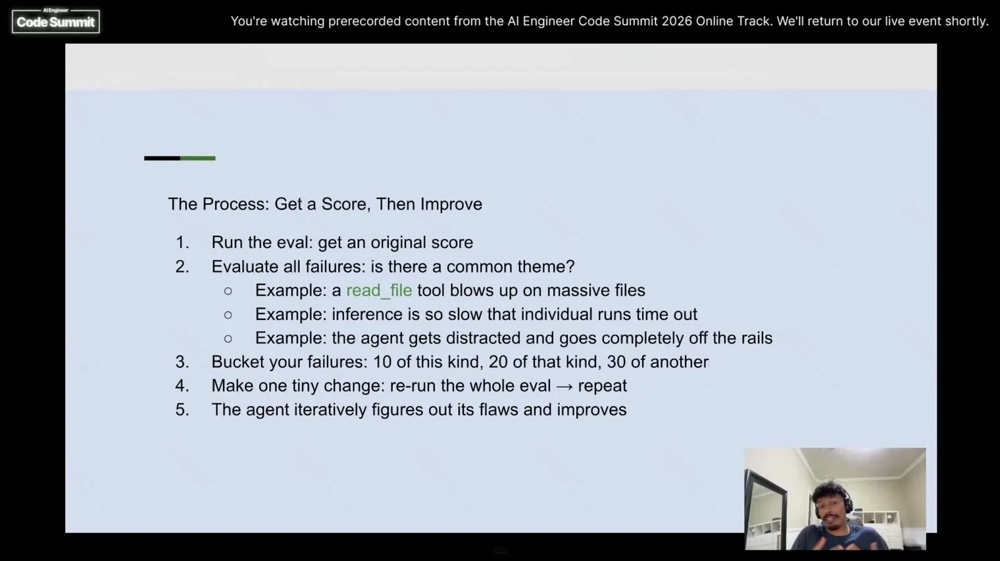

_截图 19  ·  录屏 03:45:29_

**03:45:42**　So once you do that, once you understand, hey, this is what we ran, this is what the failures we got, we buck the failures in different categories. So like 10 failures of, you know, this kind of tool called 10, 20 failures of like, say, inference not working or something else. Right. And then we once we bucket the failures into different categories where like we try to make an improvement to the harness, because like what if there's like something wrong with the harness that we could change just that the model score would improve.

所以一旦你做到这一点，一旦你理解了，这就是我们运行的结果，这就是我们遇到的失败情况。我们将这些失败分为不同的类别。比如有10种失败情况，就是那种被称为“10”的工具问题，还有20种失败情况，比如推理无法正常工作之类的。然后，我们将这些失败分类到不同的类别中，试图改进这个工具，因为要是工具本身有问题，我们就能改变它，这样模型得分就会提高。

### Cline 实验、具体修复及验证方式

**03:46:05**　Right. And on and on and on. You do this iteratively. It takes a while. It's just like, you know, hill climbing is like a very groundworky kind of process. And, you know, usually we used to take a lot of time trying to do this, but it was a great way for us to, like, learn how to improve models. So one way to help climb on public e-wails is that, like, you know, we could have a thing where, you know, we started doing this thing where we could just, like, what if we could have, like, a long-running agent that runs for a while and automatically improves the model score?

对。如此循环往复。你以迭代方式进行，需要一些时间。其实，就像爬山算法一样，这是一种非常基础的过程。过去，我们通常需要花费大量时间来完成这项工作，但这对我们学习如何改进模型来说是一个很好的方法。因此，帮助公共电子系统提升性能的一种方式就是，我们可以设立一个机制，让智能体持续运行一段时间，并自动优化模型得分。

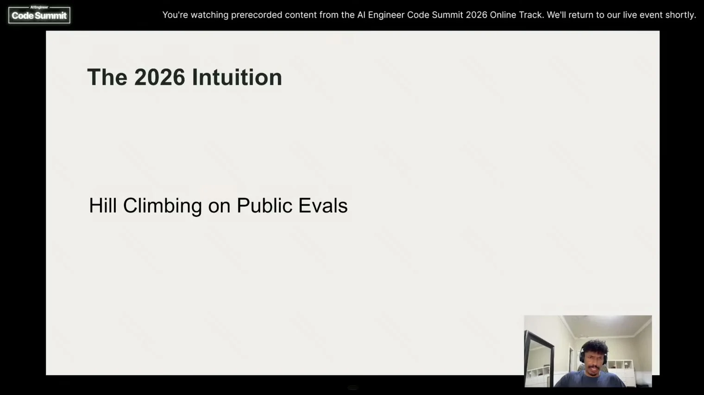

_截图 20  ·  录屏 03:46:15_

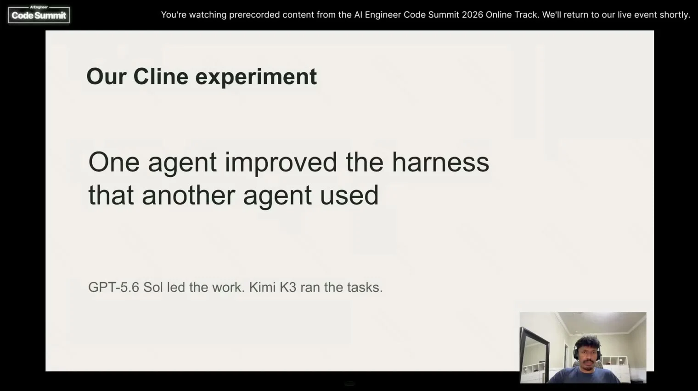

_截图 21  ·  录屏 03:46:23_

**03:46:38**　And that's what we did. So we ran GPT 5.6 Soul. That was like the main agent. And then Kimi K3 was just running evals. So what it was doing is that like GPT 5.6 was like, hey, run these evals, get these scores. Let me look at the failures. Let me look at where it went wrong. And then I'll make changes to client's harness.

这就是我们所做的。所以我们运行了 GPT 5.6 Soul。它就像那个主要的智能体。然后 Kimi K3 只是进行测试。它的作用就是，比如 GPT 5.6 会说：“运行这些测试，得到这些分数。让我看看失败的情况，看看哪里出了错。然后我会对客户端的 Harness 进行修改。”

**03:46:58**　And then I'll run these evals again. And then I'll keep trying. So again, you can see how like very quickly this can like go off the rails because this is supposed to be like the running evaluation itself takes like an hour. Then you have to read the feedback. Then you have to see if you're properly interpreting the feedback to make reasonable changes to the harness that are not reward hacking, that are just actual genuine improvements, and then run the URL again.

然后我会再次进行这些测试。接着我会继续尝试。所以你也能明白，事情会非常迅速地偏离正轨，因为实际的测试评估本身只需要一个小时。之后你必须阅读反馈结果。然后你需要判断是否正确地理解了这些反馈，从而做出合理的改进，而不是过度优化，而是真正的实质性提升，然后再进行一次测试。

**03:47:19**　So we ran that for 17 hours, and when we ran that for 17 hours, there was a legitimate hell climbing. And what we found that was very interesting, this happened with a very detailed prompt that accomplished this, is that we had baseline score of 207%, and then we found issues like loop detection. Loop detection is when a harness just runs in circles around the problem.

所以我们运行了17个小时，运行了17个小时后，攀爬过程简直像地狱一样。而我们发现一个非常有趣的现象：这是通过一个非常详细的提示词实现的，最终我们得到了207%的基础分数，之后又遇到了循环检测的问题。循环检测是指系统只是围绕问题不断循环运行。

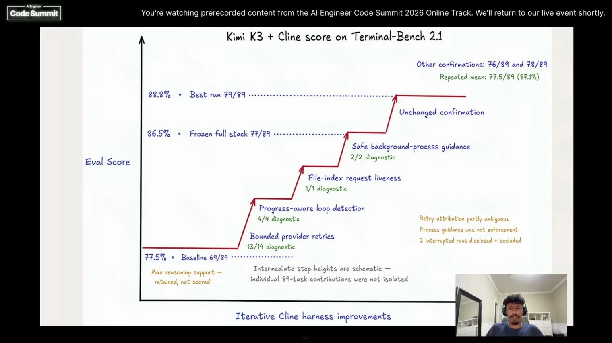

_截图 22  ·  录屏 03:47:38_

**03:47:43**　We found background process grinding, where background processes would run too long. We found some file index issues and other things as well. I mean, when I say we, what I've actually made is GPT-5.6 solve. So that found those issues, that found and bucketed those issues. It's like, hey, how about I make those changes in the harness and I run the Eval again?

我们发现了后台进程运行过长的现象，还发现了一些文件索引问题及其他问题。我的意思是，实际上我做的是让 GPT-5.6 解决问题。所以通过发现这些问题，我们将其处理掉了。那样的话，不如我在 Harness 中做出这些修改，然后再次运行评测吧？

**03:48:02**　And it iteratively built the hill climbing process completely autonomously on its own without my interference. And 13 hours later, when I come back to it, it has improved the harnesses performance in so many ways. So see what does that mean? What does that mean? It just basically means that we are at a point where the experience could make the harness better.

并且它独立地、不依赖我的干预，迭代式地构建了爬山算法过程。13小时后，当我再查看时，它的性能在许多方面都得到了提升。那么，这到底意味着什么？这到底意味着什么？基本上就是说明我们已经到了一个阶段，通过这种体验，可以让Harness变得更优秀。

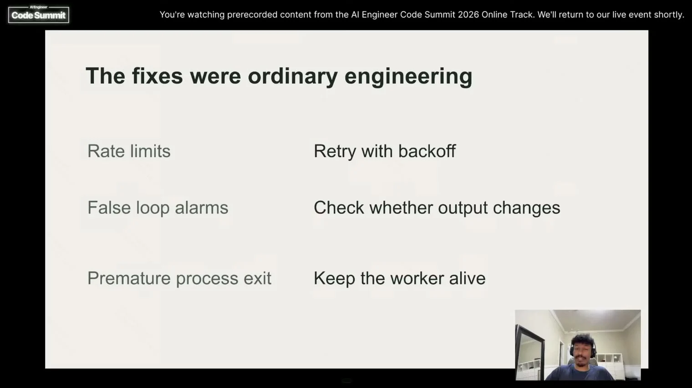

_截图 23  ·  录屏 03:48:11_

**03:48:22**　There's a two-level learning loop where the harness does some action, interacts with the environment, understands whether or not it did the right thing or the wrong thing, and gets some reward. There's a meta-agent that's observing the main harness and finding the changes to it and just incorporating those changes and improving. Now, I think, in my personal opinion, it's much harder to do in real time because if you do it in real time, solving certain problems or you're just like too curtailed to a specific thing.

有一个两层的学习循环：智能体会执行某些动作，与环境互动，判断自己是否做了正确的或错误的事情，并因此获得奖励。还有一个元智能体，它观察主要的智能体，发现其变化后便将这些变化纳入其中并加以改进。不过，就我个人而言，实时完成这一过程要困难得多，因为如果实时进行，就难以解决某些问题，或者受到过于严格的限制。

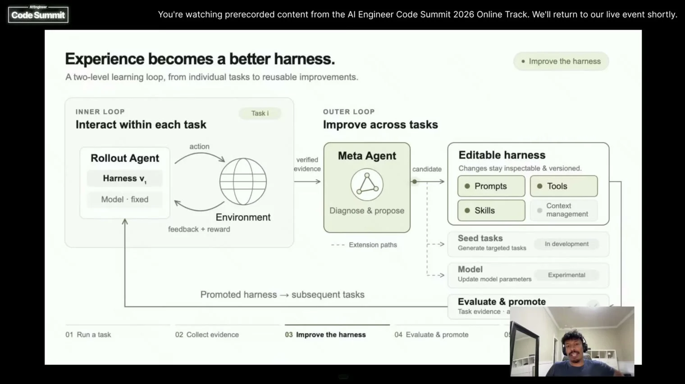

_截图 24  ·  录屏 03:48:32_

**03:48:53**　But I do think that this is something that works like on a broader scale of like working on a wider range of problems and you want to be able to like you want you want to be able to justify the changes you're making on a broader active applicability so that the changes you make here will apply to a broader range of problems as well.

但我认为，这确实可以在更广泛的层面上发挥作用，可以解决更多类型的问题。你希望能够证明你所做的改变具有更广泛的适用性，这样在这里所做的改变也能适用于更多问题。

### 推理、训练、现实世界任务和职业建议

**03:49:11**　So what does that mean? What am I trying to get at here. The point I'm trying to get at is that the models are so good right now that if they can improve the harness, they can improve a lot of other things. So then what else can they improve? So this is a post primarily from OpenAI where GPU 5.6 soil autonomously rewrote and optimize its own production kernels, and those production kernel improvements remove the end-to-end serving costs by 20%.

那么这意味着什么？我在这里想要表达什么？我想强调的是，现在的模型非常出色，如果它们能改进 Harness，就能改善许多其他方面。那么还能改进什么呢？所以这篇帖子主要来自 OpenAI，其中 GPU 5.6 能够自主重写和优化其生产内核，这些生产内核的改进使得端到端服务成本降低了 20%。

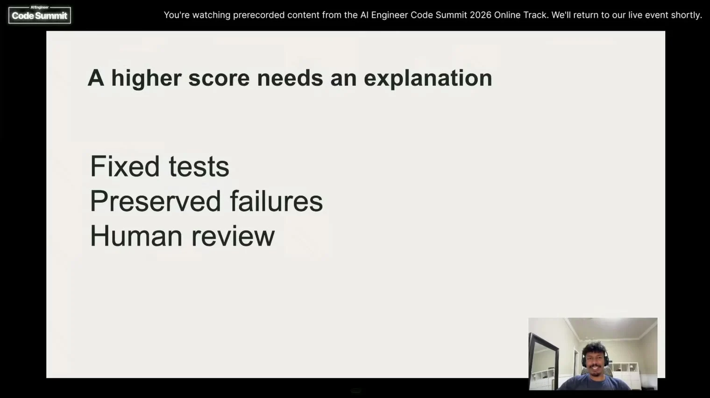

_截图 25  ·  录屏 03:49:14_

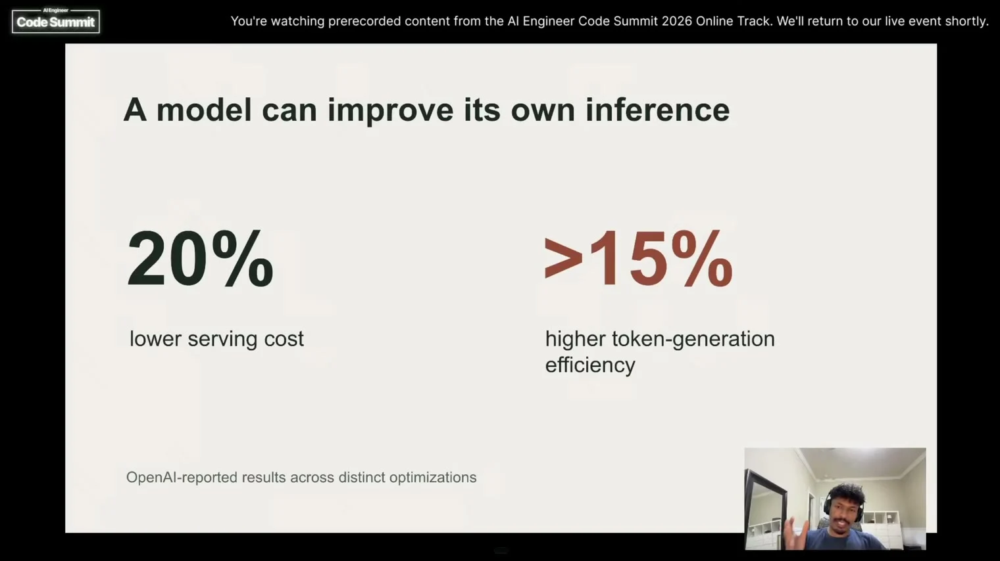

_截图 26  ·  录屏 03:49:18_

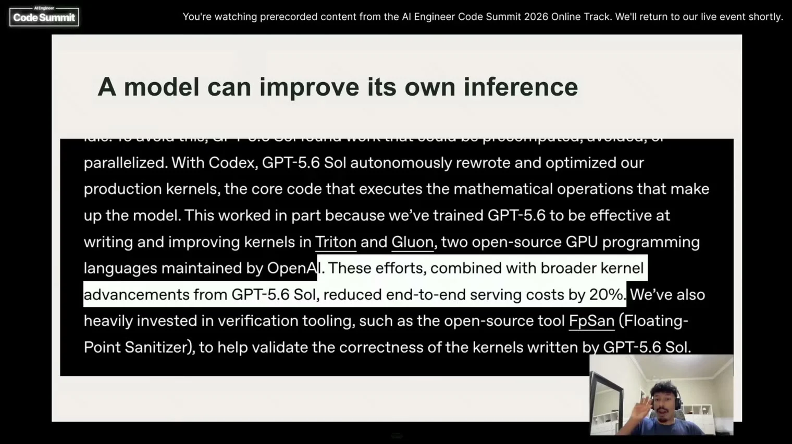

_截图 27  ·  录屏 03:49:30_

**03:49:39**　It also had 15% higher token generation efficiency. And this was completely on itself, right? So what that means is that like inference is becoming much cheaper and that means that like if for a company like OpenAI, if you're having 20% lower serving cost for a frontier model, that could be a billions of dollars of improvement in price and you could do that as well for your own models.

其token生成效率也提高了15%。而且这完全是自然而然的结果，对吧？这意味着推理成本变得更低，对于像OpenAI这样的公司来说，如果前沿模型的服务成本降低20%，那就能带来数十亿美元的成本降低收益，你也可以在自己的模型中实现同样的效果。

**03:50:07**　Another interesting thing is that like when people have kernel writing competitions, so Core Auto is a company which has a kernel writing competitions and you'll notice that they mentioned that the person who won the kernel writing competition, they explicitly said that I've never handwritten a GP operator, it's all ALM and agent driven. So notice that how the best inference improvements, kernel improvements are at this point completely exclusively done by a swarm of agents or generally just agents doing some magic to magically prove the kernel code and have faster inference, cheaper inference.

另一个有趣的是，就像人们举办内核编写比赛一样，Core Auto也是一家举办内核编写比赛的公司。你会注意到，在比赛中获胜的人明确表示自己从未手写过 GP 操作器代码，所有工作都依赖 ALM 和智能体驱动机制。因此可以看出，目前最优秀的推理优化和内核改进完全由一群智能体或普通智能体完成，他们通过某种神奇的方式证明内核代码能够提升推理速度并降低成本。

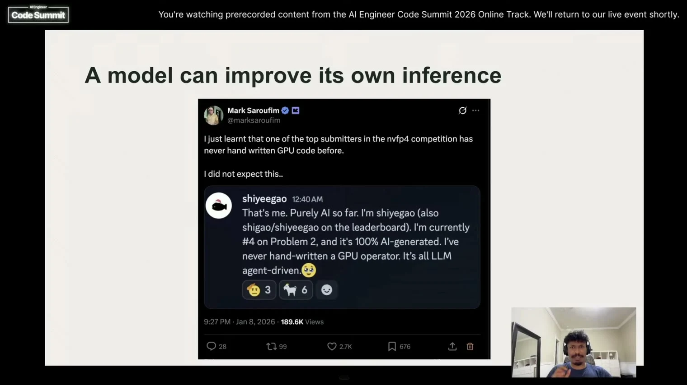

_截图 28  ·  录屏 03:50:20_

**03:50:43**　Yeah. So basically, like, the improvement surface that you think of is not just, like, the harness improvement. It's literally the whole surface stack, right? So the whole stack from, like, evaluation to harness improvements to training data to post-training to world interaction to inference. Like literally the entire part of the pipeline, like all the way from like electricity going through your machine to like making an error request, going through the model, models doing inference and making a response and getting back to you, like every single part of the pipeline, we can optimize it.

是的。基本上，你所说的改进层面不仅仅是 Harness 的改进，实际上是指整个流程的整个层面，对吧？所以从评估到 Harness 的改进、训练数据、训练后的处理、与世界的交互、推理，实际上就是整个流程的每一个部分，从电力通过机器到发出错误请求、通过模型、模型进行推理并给出响应再返回给你，我们都可以对其进行优化。

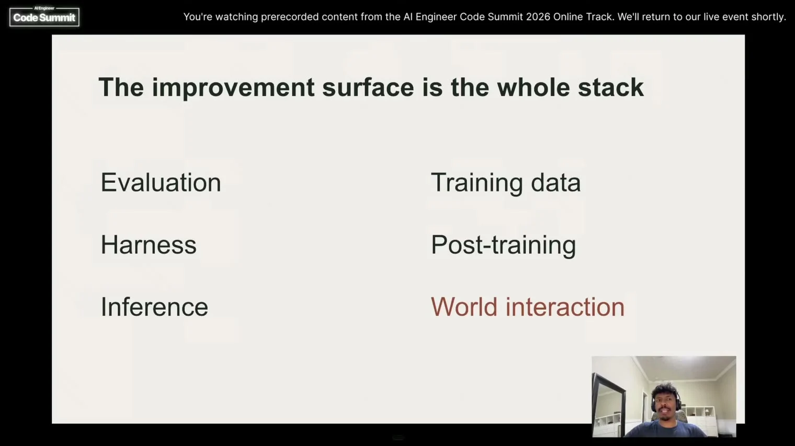

_截图 29  ·  录屏 03:50:54_

**03:51:16**　So the whole RSI loop has like there's a couple different parts so it's like pre-training you gave nematron examples of like you know ai curated pre-training data that was good there's like post-training examples which are you know where there's like constitutional yeah examples of like post-training uh improvements then inference i gave you the example of gp5.6 so for evals and eval generation i give you our own example of how we improved ourselves on our own evals um in general what you want to think of is that like do something and it's like not able to do it or not able to accomplish it.

所以整个 RSI 循环包含几个不同的部分。在预训练阶段，你看到了 Nematron 的示例，也就是 AI 精心设计的预训练数据，这很不错。还有预训练后的示例，比如那些关于预训练后改进的例子。然后是推理阶段，我给你展示了 gp5.6 的例子。对于评估和评估生成，我给你展示我们自己的例子，说明我们是如何在评估方面进行改进的。一般来说，你可以这样想：做某件事，但无法完成或无法实现目标。

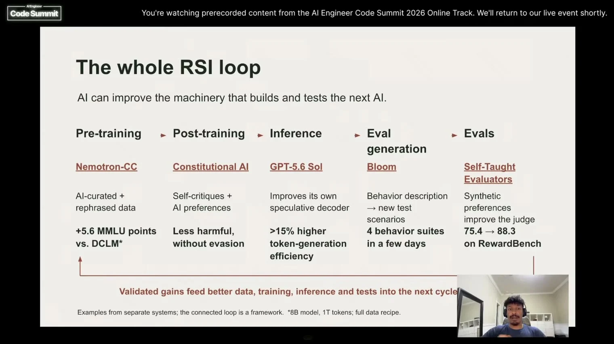

_截图 30  ·  录屏 03:51:27_

**03:51:52**　So for example, like imagine you're having a long conversation where you ask the model something obvious. So like it's like, or something that you think is not necessarily obvious, but it's like, it's hard, but you would assume that the model could potentially do it. So to give an example, let's say you want to make, add a new column to a database and then fill that column, right?

比如，想象一下你正在进行一段长时间的对话，向模型询问一些显而易见的问题。或者，可能是一些你认为并不明显的问题，但确实比较困难，不过你可以假设模型能够完成它。举个例子，假设你想要在数据库中添加新列，然后填充该列的内容，对吧？

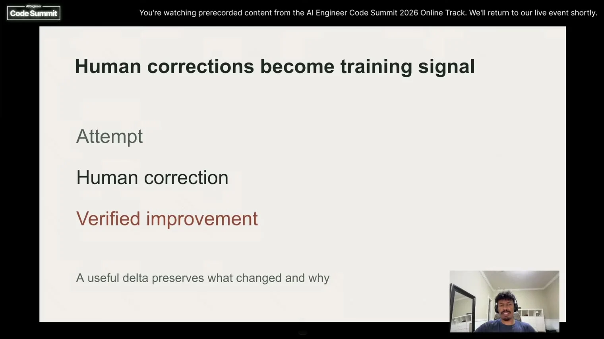

_截图 31  ·  录屏 03:52:00_

**03:52:12**　And then put a cache in front of it. So what happens is that it does the whole thing, But for some reason, the way it pushes the cache in front of the whole database, it kind of doesn't do it right. So at that point, you were like, oh, no, set this cache differently, set this as a TTL. And then you give a correction signal.

然后在它前面放一个缓存。结果就是它会完成所有操作，但出于某种原因，将缓存推送到整个数据库前的方式并不正确。于是你就会想，哦，不对，得以不同的方式设置这个缓存，把它设为 TTL 机制吧。然后你发出修正信号。

**03:52:27**　And then that kind of fixes your problem and you kind of go about your day. But the way I want to think of it is that I want to think of every single time a human correction to the digital landscape is a part of a delta that needs to be covered. And what that means is that every single time you're finding the edge of model capabilities of how far it can push for infants, how much it can push for this, how much it can push for solving your problems, you want to find the delta and we want to push that frontier a little bit further, a little bit further.

然后，这种方式就能解决你的问题，你就可以继续过你的日子。但我想这样理解：我认为每次人类对数字领域的修正，都是需要被填补的“差值”的一部分。这意味着，每次你发现模型在婴儿领域能发挥多大的作用、能解决多少问题时，你就应该找到那个“差值”，然后我们就要把这个边界再推进一步。

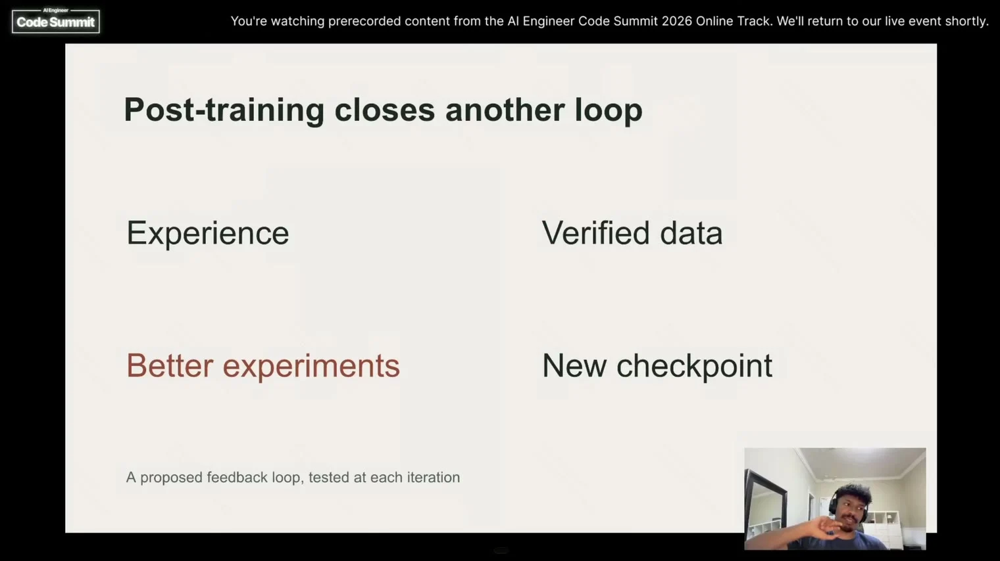

_截图 32  ·  录屏 03:52:50_

**03:53:00**　and that's what post-training does, right? So post-training is in that post-training. We find these really interesting and really hard long-horizon problems for coding agents or for other kinds of problems and then just slowly hill-climb the models on those kind of problems. So anything that has a verifiable loop can be optimized, but this is not just limited to software.

这就是训练后的工作，对吧？因此，训练后的阶段就处于这种状态中。我们发现这些关于编程智能体或其他类型的问题非常有趣且难度很大，然后就可以逐步优化这些模型。因此，任何具有可验证循环的问题都可以被优化，但这并不仅限于软件领域。

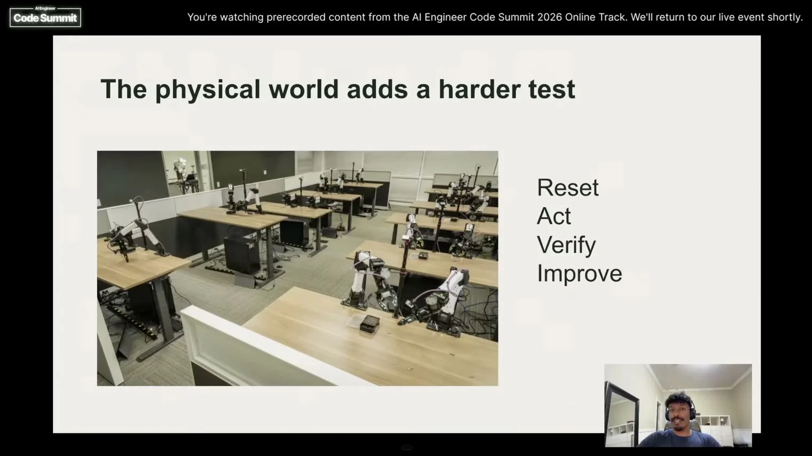

_截图 33  ·  录屏 03:53:24_

**03:53:24**　Literally, the physical world itself could have a verifiable loop. So to give an example, give you a very funny kind of bizarre example where like it's like you you look at this and you um um look at this uh like robot and it's it's typing something and it's like really really like interesting what the robot is typing…

实际上，物理世界本身也可能存在可验证的循环。举个例子吧，给你一个非常有趣的、奇怪的例子：你看着这个，然后看到机器人正在输入一些内容，真的很有意思，看看机器人到底在输入什么……

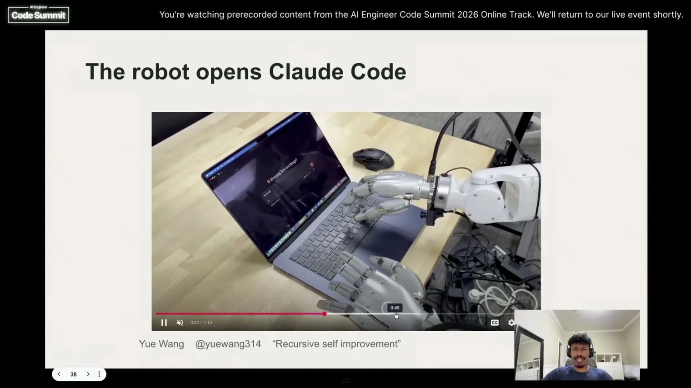

_截图 34  ·  录屏 03:53:36_

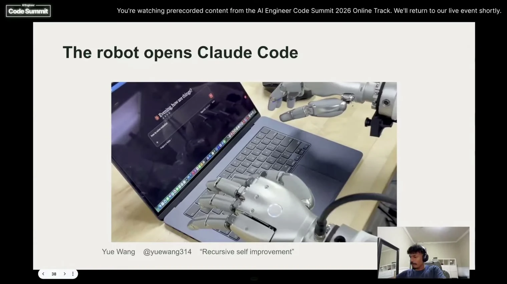

_截图 35  ·  录屏 03:53:49_

**03:53:56**　So notice how the robot is itself typing how it wants to solve robotics. And imagine if the robot itself could interpret the results of the answers and just keep improving. Then that means that this is basically like an ASI robot. Another example that I could give you from my personal life is that I have this chip that has the ability to see.

所以请注意，机器人正在按照自己的方式编写代码以实现机器人技术的解决方案。想象一下，如果机器人能够理解答案的结果并不断改进，那基本上就相当于一个具有人工智能能力的机器人了。另一个我能举出的个人例子是，我有一块具有视觉能力的芯片。

**03:54:21**　and has a speaker and has a microphone inside of it. So I was trying to set up this with my machine and it was a gift that I had for my girlfriend. And what I find very interesting about this is as I was trying to set it up, it's very slow, it was slow to respond, it had higher latency, it had an agent in and of itself, right?

它内部有扬声器，也有麦克风。我试图用我的设备来设置它，这是我送给女朋友的礼物。我觉得非常有趣的是，在尝试设置的过程中，它的响应速度很慢，延迟也高，而且它本身就包含了一个智能体，对吧？

**03:54:41**　So what I did was I connected the chip to my computer and I let coding agents run on this hardware and basically run on this hardware, automatically make tests to it. So like my computer would talk to my hardware, give it some tests like, hey, do this, do that, and just like, what do you see right now? So then it would notice the end-to-end latency of like the inference response of like how fast my hardware is responding.

所以我的做法是把芯片连接到电脑上，让智能体在硬件上运行，自动对其进行测试。就像我的电脑与硬件进行交互，给它一些测试任务，比如“做这个，做那个”，然后问“你现在看到了什么？”这样就能检测到端到端的延迟以及推理响应速度，即硬件的响应速度如何。

**03:55:11**　And then what I found is that like it was able to do the breakdown of like every single case and scenario where there was like higher latency, slower response or just the algorithm wasn't right. And I could then set up a recursive loop where both the firmware could be updated, the two calls, the inference model used, the speech-retext model used, all those could be improved automatically with like an open router key, which I'd given to a coding agent, and then overnight with self-running experiments with the hardware, this tiny little piece of beautiful hardware that I have was like deeply optimized.

然后我发现，它能够分析每一种高延迟、响应缓慢或算法不正确的情况，以及所有相关场景。我可以设置一个递归循环，让固件能够自动更新，两种调用方式、使用的推理模型、语音-文本模型等都能通过我交给编码智能体的开放密钥得到改进。随后，在夜间通过硬件的自运行实验，我拥有的这个小巧而优秀的硬件设备得到了深度优化。

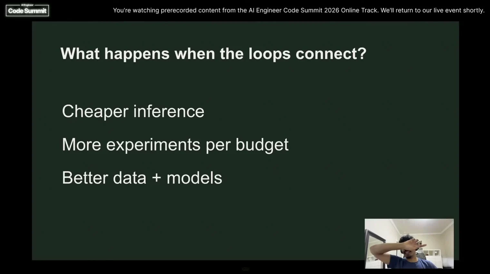

_截图 36  ·  录屏 03:55:16_

**03:55:51**　like even hardware could be a part of the RSI loop. So what happens when you connect these loops, that's the next question. You could have cheaper inference, you could have more experiments budget, you have better data and better models. So is this singularity? It's a very close question to ask, and I think that the parts of the loop are already weird.

甚至硬件也可以成为 RSI 循环的一部分。那么当这些循环相互连接时会发生什么，这就是下一个问题。你可以获得更便宜的推理过程，拥有更多的实验预算，也有更好的数据和模型。那么这是否属于“奇点”现象呢？这是一个非常值得思考的问题，我认为循环中的各个部分已经很奇怪了。

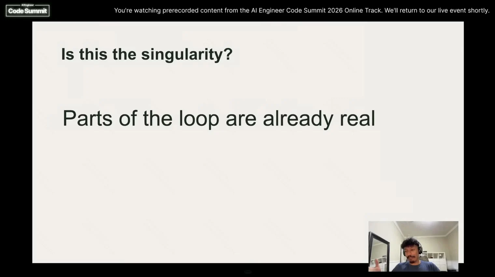

_截图 37  ·  录屏 03:56:06_

**03:56:10**　We really are very close to parts of the RSI loop. And what do we do? What do we do about this? And it's like, how do we think of that in terms of like our career and how do you think of that in terms of you know our lives and what do we want to do next so here's my advice to everyone who's watching this like please please please please move closer to the rs right so it's like right now like people are working on all these like different kinds of software which is like you know agents for you know construction agents for this agents for that and it's like i think that you're you know well the way i see those things is that like…

我们确实与 RSI 循环中的某些部分非常接近。那我们该怎么办呢？该如何应对这个问题呢？这就像，从我们的职业生涯来看，又从我们的生活角度来看，我们接下来想要做什么，所以这里我给所有观看的人一个建议：请务必更接近 RSI 的循环，因为现在人们正在开发各种不同类型的软件，比如建筑领域的智能体、这个领域的智能体、那个领域的智能体等等。我认为你很清楚我看待这些问题的方式，就是……

**03:56:45**　i think of those as like you're missing the forest for the trees. You really are. And it's like, you have this like, very interesting, godlike technology that can change the course of humanity and then, we're not ambitious enough to pursue the best problems. We really are not and we're just like I think that it's not just like The problem isn't just that we're not ambitious and we're also like what we're pursuing a lot of those things are just like one model release away from like being completely like wiped out, right?

我觉得这就像你只看到树而忽略了森林一样。确实如此。而且，你拥有这种非常有趣、类似神一般的科技，能够改变人类的命运，但我们就没有足够的雄心去追求那些最值得追求的目标。我们真的没有，我觉得问题不只是因为我们没有雄心，还有因为我们所追求的许多东西其实都只是离彻底被消灭只有一步之遥而已，对吧？

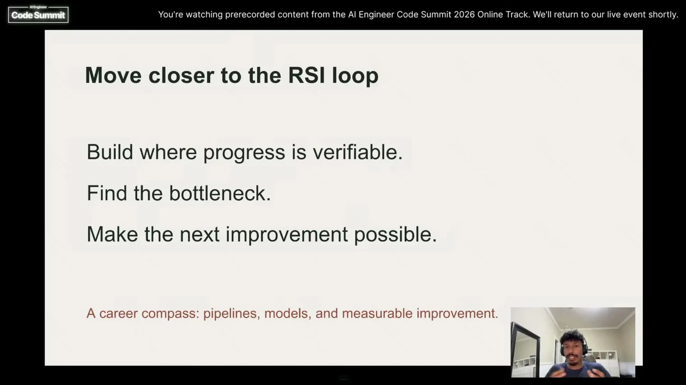

_截图 38  ·  录屏 03:57:00_

**03:57:14**　So like it's also like it's also like It may not be that intellectually simulating because like all you're essentially all we're essentially doing is like sitting all day cloud do this for me a cloud do this for me and i don't know if that's like i don't know if that's like the most intellectually stimulating or like or like um thoughtful use of a person's time like maybe maybe you know we're supposed to be solving harder and more uh more frontier problems and i think that like it's like the ceiling is like our ambition so instead of like working on these tiny things my suggestion to people is to like you know do things that of course like goes without saying but you should do things you…

所以，也许这并不是一种智力上的模拟吧。实际上，我们整天只是坐着，做着一些无意义的事情。我不知道这是否算是最具智力刺激性的，或者只是对时间的一种浪费而已。也许我们应该去解决更困难、更有挑战性的问题吧。我觉得，我们的目标就是突破极限。所以，对于大家来说，我的建议是：去做一些有意义的事情吧——当然，这不言而喻，但应该做那些真正有价值的事情。

**03:57:47**　believe in and you know i'm just a guy on the internet but do things that help you move closer to the RSI loop, right? So, like, anything that's just, like, the end-to-end pipeline of, like, hey, this is where, like, the models are lacking. Like, it's, like, whether that's inference, whether that's post-training, whether that's literally, like, physical interaction, whether that could be, you know, sending end-to-end pipelines of truly any kind, you know, whether that's hardware problems, whether that's networking problems, whether that's building a sense of community, things that just, you know, things that just like help you as an engineer get closer to the benefits of the improvements in the model.

相信我吧，虽然我只是个网络上的普通人，但我会做一些事情来帮助你更接近 RSI 循环。比如，任何能推动整个流程完成的事情——这就是模型所缺乏的地方。无论是推理过程、训练后的处理，还是实际的互动行为，甚至是可以发送各种类型的端到端管道数据，无论是硬件问题还是网络问题，或是建立社区意识——这些都能帮助你作为工程师更充分地利用模型的改进成果。

**03:58:28**　So this is a very interesting slide from Satyadentropic. So they mentioned that like you want to have like this, you're in this space where it's like, you know, you only have like one to five years left to contribute to the world. What do you do? Right. So it's like they gave great suggestions where like prefer ambitious, targeted and fast collaborations. And, you know, in general, like the timescale, like all the timelines that you give to yourself, like they should be just completely squeezed out.

这是 Satyadentropic 的一个非常有趣的幻灯片。他们指出，如果你想要实现某种目标，那么你就处于这样一个状态：你只剩下1到5年时间来为世界做出贡献。那你应该怎么做呢？没错。他们提出了很好的建议，即选择有抱负、有明确目标且进展迅速的合作方式。总的来说，所有你给自己设定的时间框架都应该被充分利用起来。

**03:58:58**　Because it's like a lot of times and you also have to think through that, like, if the model, if the problem that you're working on is too ambitious, like it's like, is it probably is it probably better to wait for just like the next next frontier model to come out or not? Like that's something you also have to wait through. Right.

因为很多时候你也需要仔细思考这个问题：如果你正在研究的模型或问题过于雄心勃勃，那么或许最好等待下一个更先进的模型出现，而不是继续推进当前的工作。这也是你需要等待的事情。对吧？

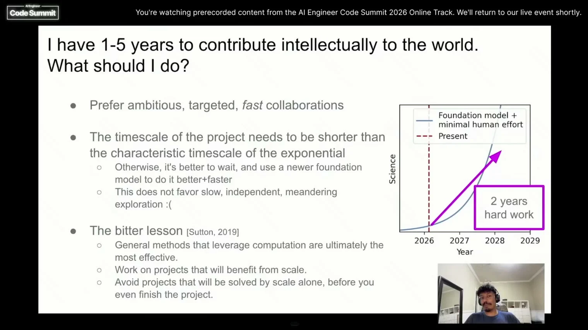

_截图 39  ·  录屏 03:59:10_

**03:59:15**　And you ideally want to work on problems that benefit from scale. And you also at the same time want to avoid projects that can be solved by sale alone. Because then even if you're working on a problem and then the next model release comes out and solves the problem. So that's probably not a good thing to do. So you have to think philosophically of what is the endeavor that benefits greatly from model improvements but isn't also completely wiped out from it.

理想情况下，你希望从事那些能从规模效应中受益的问题。同时，你也想避免那些仅通过销售就能解决的项目。因为那样的话，即使你在研究某个问题，之后又出现新的模型版本并解决了该问题，这可能并不是什么好事。所以你必须从哲学的角度思考：究竟是什么项目能从模型改进中获得巨大收益，同时又不会因此被完全摧毁？

**03:59:39**　And then ideally, like it's like if the if the endeavor could also be a part of the improvement pipeline, that could be amazing. So you see a lot of companies raising on, say, making data pipelines. And there's a lot of money there. There's a lot of companies working on physical hardware and stuff. So I think if you're a software engineer watching these, it's like I think that if you feel like you're like here, the delta of your intellect and ability in your day-to-day, it's like not contributing as in like you have the intellect, you can make a difference.

理想情况下，如果这项努力也能成为改进流程的一部分，那将会非常棒。因此，很多公司都在努力构建数据管道，而且相关的投资也很大。还有许多公司专注于物理硬件方面的研究。所以我认为，作为软件工程师，如果你关注这些事情，就会意识到，只要你有智慧和能力，就能在日常工作中带来改变。

**04:00:13**　But like if cloud is just like one-shotting all those problems like in your day-to-day and you're just like kind of like becoming a meat proxy, So it's worth the thing to take a step back and think through. It's like, okay, where are the problems where you're actually truly contributing and that they will stand the test of time? And that kind of reflection and realignment right now would, I think, have very interesting consequences for you in the long term.

但就像云能一次性解决那些日常问题一样，你也可以成为这样的“肉类代理”，所以退一步思考一下是值得的。也就是说，到底有哪些真正能带来价值的问题，这些问题能够经得起时间的考验呢？这种反思和调整，我认为从长远来看会给你带来非常有趣的结果。

**04:00:38**　So, yeah. So thank you so much. Thank you so much for your time. I think that if you're watching this and if you've gone this far, I think that you're definitely contemplating one of the most interesting improvements in the course of humanity. And there's many philosophical arguments here. Some people might say, hey, I think maybe I'm off on the timelines or maybe I'm just being too pessimistic or maybe I'm being too optimistic.

那么，是的。非常感谢您。感谢您花时间观看这个内容。我认为，如果您正在观看这个，并且已经看到这里了，那您一定正在思考人类发展史上最有趣的改进之一。这里有很多哲学性的讨论。有些人可能会说，也许我误判了时间线，或者我只是过于悲观，又或者过于乐观。

_截图 40  ·  录屏 04:00:50_

**04:01:03**　But I would love to hear all those thoughts. So this is my QR code, please feel free to scan it and let me know all your thoughts. Thank you so much, very kind of you to give me your time.

但我很想听到所有的想法。这是我的 QR 码，请随意扫描它，告诉我你的所有想法。非常感谢，你愿意花时间与我交流真是太好了。

---

[全部演讲](../README.md) · [选看索引](index.md) · [上一场](12-luke-alvoeiro.md) · [下一场](14-tanmay-and-dolly-sah.md)
