[全部演讲](../README.md) · [选看索引](index.md) · [上一场](13-ara-khan.md) · [下一场](15-kush-agrawal.md)

# The Missing Undo Button for Coding Agents

**Tanmay Sah** · Independent · AI Researcher

**Dolly Sah** · Independent · Analyst

AIE Code Summit 2026  ·  11 月 11 日  ·  Online Track 预录插播  ·  录屏 04:01:12–04:17:48

[官方讲者资料](<https://ai.engineer/code/2026#speakers>)   ·   [Day 1 官方回放](<https://www.youtube.com/watch?v=ZZ19zhYnDKY>)

## 本场目录

- [04:01:48](#section-1) 完成任务与恢复状态的差距
- [04:03:40](#section-2) 超时是否已经产生副作用，Git 能还原哪些状态
- [04:08:20](#section-3) UndoBench、失败归因和恢复方法对照
- [04:11:56](#section-4) EvoUndo 的状态取证、恢复演示和放行条件

## 演讲实录

> 英文源自录屏音频，经轻度校订。每段英文下方为中文译文。时间指向原始录屏。

### 完成任务与恢复状态的差距

**04:01:12**　Hi everyone, I am Tanmay. Today joining me is Dolly and we will be presenting the missing undo button for coding agents. So imagine a coding agent working on a repository issue. It applies patch, run the tests and everything passes it even creates a release tag but then our downstream integration fails now here is the question can the agent actually get everything back to the state it was in before so git can tell us what changed in the repository but what about changes outside Git such as external API calls or runtime configurations or notifications.

大家好，我是Tanmay。今天和我一起的还有Dolly，我们将介绍编码智能体中缺失的撤销按钮。想象一下，一个编码智能体正在处理一个仓库问题：它应用补丁、运行测试，一切都通过，甚至还会创建一个发布标签，但随后下游集成失败。那么问题来了：智能体真的能把所有东西恢复到之前的状态吗？这样Git就能知道仓库中发生了什么变化，但那些不在Git范围内的变化，比如外部API调用、运行时配置或通知，又该如何处理呢？

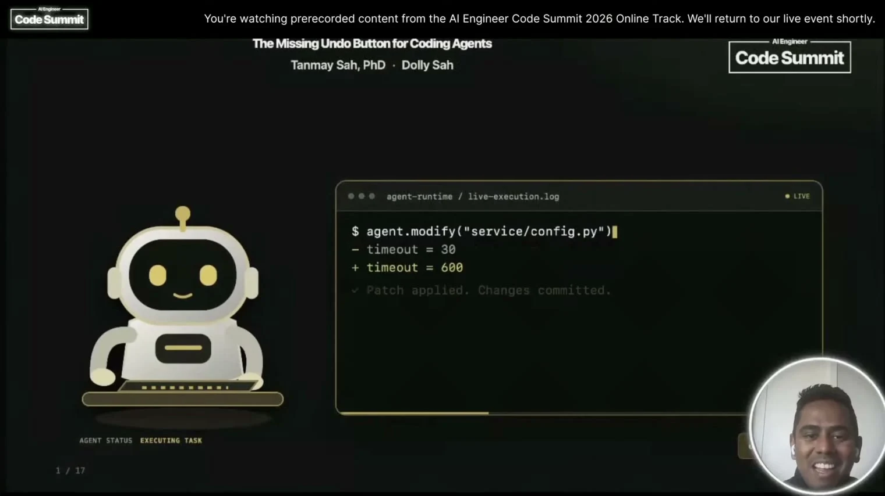

_截图 01  ·  录屏 04:01:15_

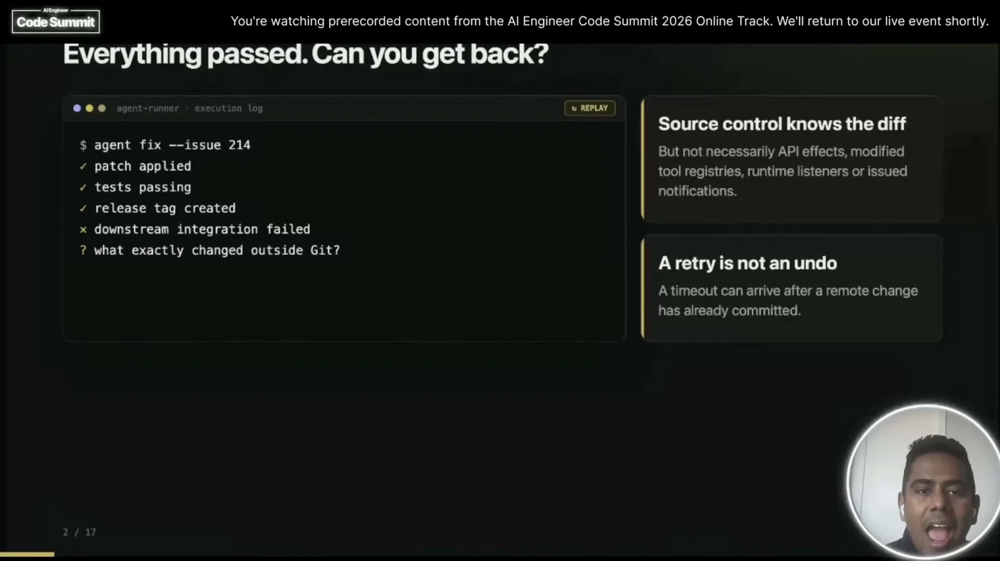

_截图 02  ·  录屏 04:01:48_

**04:02:08**　And simply retrying an operation does not necessarily undo what already happened. So we wanted to understand not just whether agents can complete tasks, but whether they can recover when something goes wrong. This brings us to our first research work, UndoBench. We wanted to investigate whether an agent's ability to complete a task also translates into its ability to recover from failure. We evaluated agents across 2,880 paired trials, comparing normal execution with execution under injected failure.

而且简单地重新执行操作并不一定能消除已经发生的事情。因此，我们想要了解的是，智能体是否能够完成任务，以及当出现问题时是否能够恢复状态。这引出了我们的第一个研究项目——UndoBench。我们想探究的是，智能体完成任务的能力是否也体现在其从失败中恢复的能力上。我们在2,880次配对试验中对智能体进行了评估，比较了正常执行和因故障导致的执行情况。

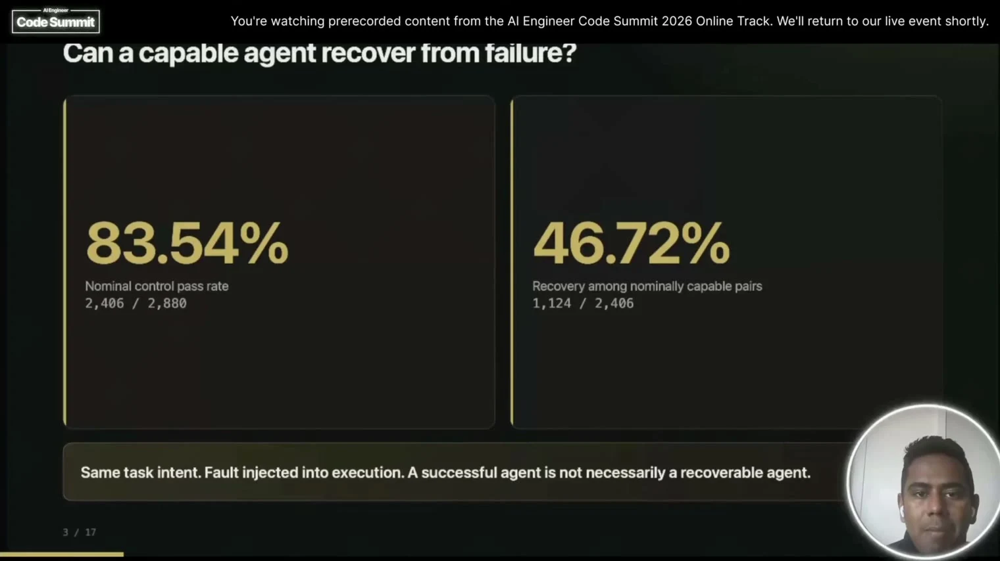

_截图 03  ·  录屏 04:02:55_

### 超时是否已经产生副作用，Git 能还原哪些状态

**04:03:00**　So under normal conditions, the agent achieved an 84% success rate. But when we introduced failures, only 47% of the normally successful trials recovered successfully. Notice that these two percentages do have different denominators. Even when an agent can complete a task successfully, recovery remains a significant challenge. Now let's look at a specific failure scenario. Imagine a coding agent sending a request to an external system to create a ticket.

因此，在正常条件下，智能体的成功率为84%。但当我们引入失败情况后，只有47%的常规成功实验能够顺利完成。请注意，这两个百分比的分母不同。即使智能体能够成功完成任务，恢复工作仍然是一个重大挑战。现在让我们看看一种具体的失败场景。想象一个编码智能体向外部系统发送请求以创建工单。

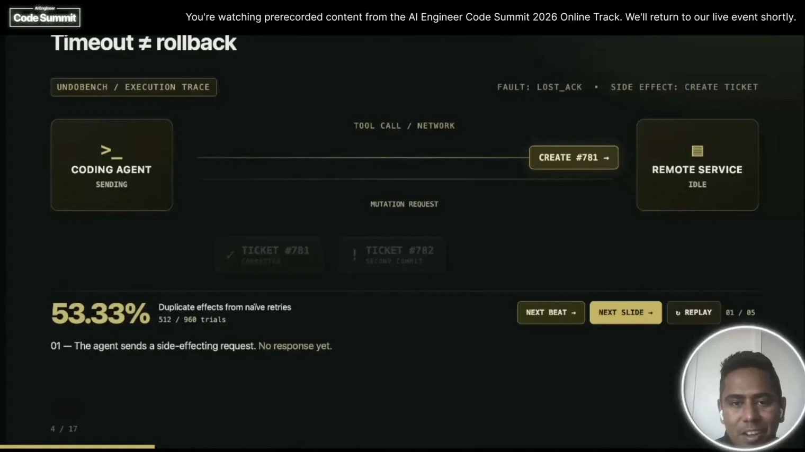

_截图 04  ·  录屏 04:03:40_

**04:03:44**　The request has been sent and the agent is waiting for a response. Next, the server receives the request and successfully creates ticket number 781, but the acknowledgement gets lost on its way to the agent. From the agent's perspective, the request has timed out, but the agent does not know that the ticket has already been created. A timeout tells us that the response didn't arrive, not that the operation failed.

请求已发送，智能体正在等待回复。接下来，服务器收到请求并成功创建了编号781的票证，但确认信息在传送到智能体时丢失了。从智能体的角度来看，请求已超时，但它不知道票证已经创建完成。超时只是表明回复没有到达，而不是操作失败。

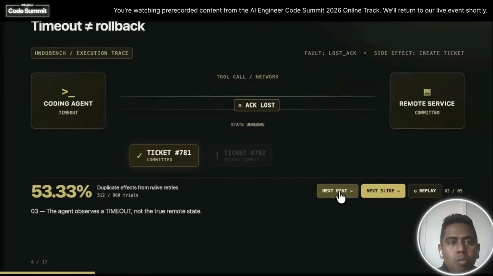

_截图 05  ·  录屏 04:04:05_

**04:04:23**　So the agent tries the request without checking whether the first operation committed. And now we have two tickets even though the agent intended to create only one. So in UndoBench, naive retries produced duplicate effects in 54% of these kind of trials. That's why we need to distinguish a failed response from a failed operations. Now, the failure phase also changes the answer.

因此，智能体会尝试执行请求，而不检查第一个操作是否成功。现在我们有两张票，尽管智能体原本只打算创建一张。在 UndoBench 中，简单的重试操作在 54% 的试验中产生了重复效果。因此，我们需要区分失败的响应和失败的操作。现在，失败阶段还会改变答案。

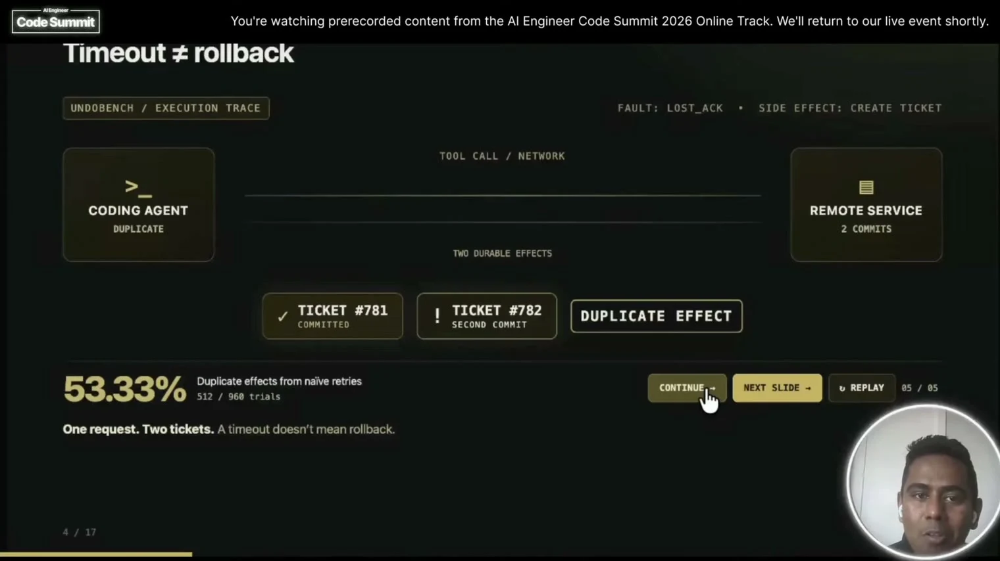

_截图 06  ·  录屏 04:04:43_

**04:05:06**　What do I mean is that recovery also depends on when the failure happens. Before the mutation, retrying is generally safe because nothing has changed. But during the mutation, the system may be partially modified, so we need to inspect its state. And after the mutation, the operation may have committed even if the acknowledgement was lost. So retrying could create duplicates. So we need different recovery strategies depending on the failure phase.

我的意思是，恢复过程也取决于故障发生的时间。在突变之前，重新尝试通常是无害的，因为没有任何变化。但在突变过程中，系统可能会被部分修改，因此我们需要检查其状态。而突变之后，即使确认信息丢失，操作仍可能已完成。因此，重新尝试可能会导致重复问题。所以，根据故障阶段的不同，我们需要采用不同的恢复策略。

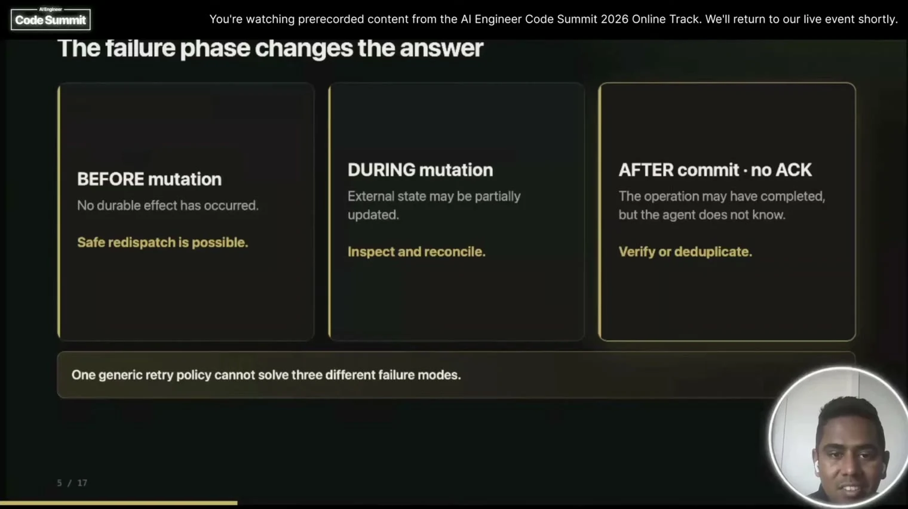

_截图 07  ·  录屏 04:05:16_

**04:05:53**　Now, why can't we just use git revert? So git can restore repository changes, but coding agents also modify their runtime state including tool registries, middleware, and configurations. They can also trigger external effects such as deployment or database rights. So, GitRevered does not reverse all these changes. The recovery mechanism has to match the type of effect the agent created. And this becomes particularly important when coding agents start modifying their own execution environment or what we call the agent hardness.

那么，为什么我们不能直接使用 git revert呢？git可以恢复仓库中的变更，但智能体在运行时会修改其运行时状态，包括工具注册表、中间件和配置。它们还可以触发诸如部署或数据库权限等外部效果。因此，GitRevered无法完全撤销这些变更。恢复机制必须与智能体产生的效果类型相匹配。当智能体开始修改自身的执行环境或我们所说的“智能体难度”时，这一点就变得尤为重要。

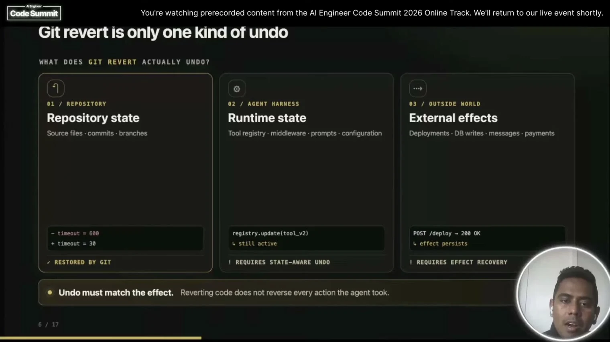

_截图 08  ·  录屏 04:06:06_

**04:06:48**　prompts, tools, middleware, event listeners, resources, and routing configuration. Such changes may improve the agent's performance, but they can also make recovery more difficult. In other words, an agent can become more capable while becoming less recoverable. That's why undo needs more than an inverse command. Now undoing a change is not always as simple as reversing a command. Suppose an agent changes a timeout from 30 to 60 to undo that change, it needs to know that the original value was 30.

提示、工具、中间件、事件监听器、资源和路由配置。这些更改可能提升智能体的性能，但也会使恢复变得更加困难。换句话说，智能体虽然能变得更高效，但恢复能力却会下降。因此，撤销操作需要的不仅仅是反向命令。现在，撤销更改并不总像反转命令那样简单。假设一个智能体将超时时间从30改为60以进行撤销，它必须知道原始值为30。

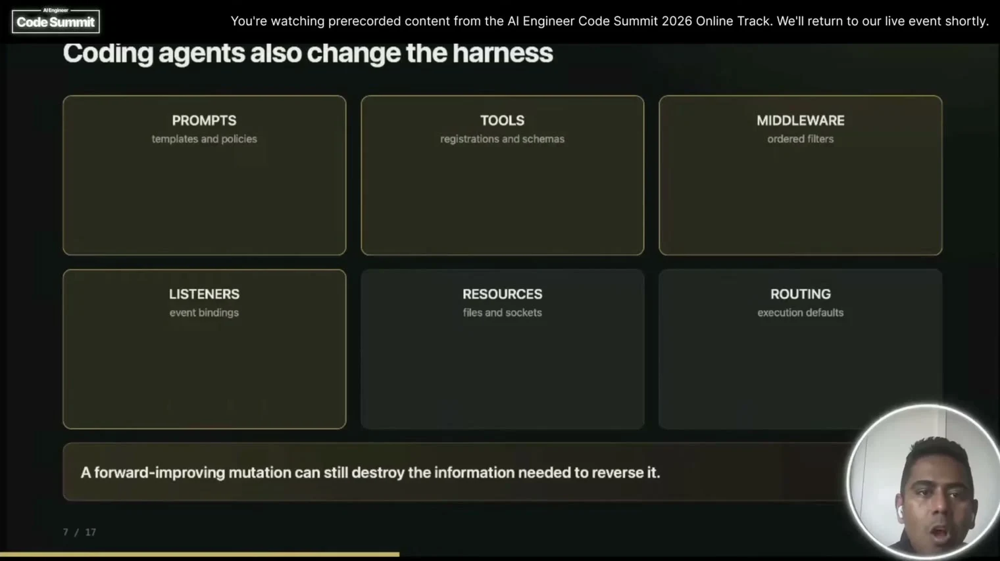

_截图 09  ·  录屏 04:06:48_

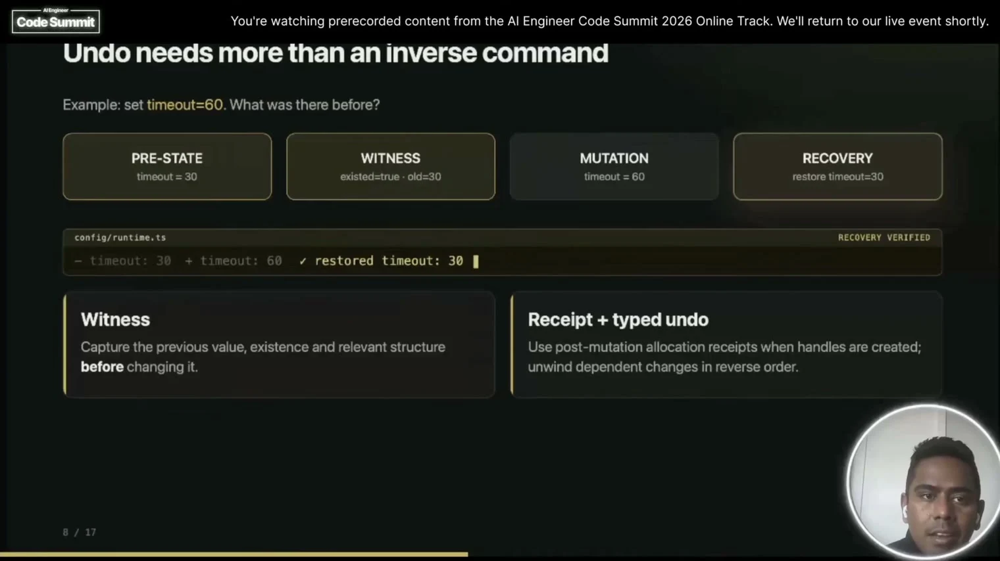

_截图 10  ·  录屏 04:07:34_

### UndoBench、失败归因和恢复方法对照

**04:07:41**　That's why EvoUndo captures a pre-state witness before applying the mutation. And that witness provides the information to restore the original state and later verify that recovery actually worked. Now the question is, how often do improved harnesses fail recovery? So in EvoUndo, we evaluated 600 self-evolution tasks. Out of those, 478 produced capability improvements. But 197 of those improvements had recovery defects.

所以 EvoUndo 在执行修改前，会先记录一份修改前的状态证据。这份证据提供了恢复原始状态所需的信息，也能在事后验证恢复是否真的成功。接下来的问题是，改进后的 Harness 多久会遇到一次恢复失败？我们用 EvoUndo 评估了 600 个自我改进任务。其中 478 项带来了能力提升，但这些改进里有 197 项存在恢复缺陷。

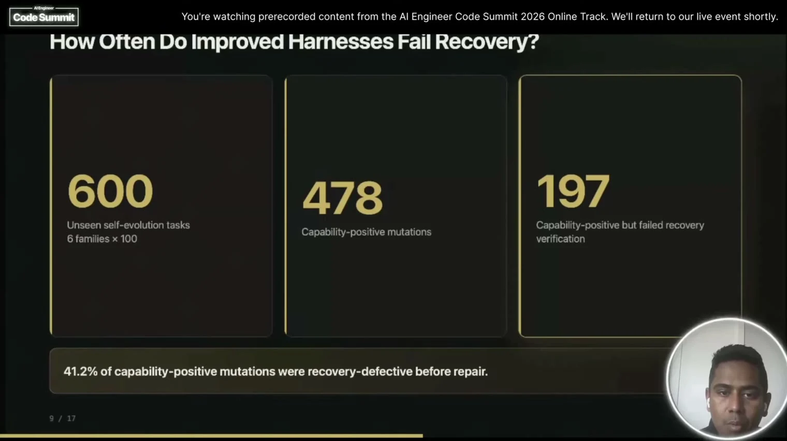

_截图 11  ·  录屏 04:08:20_

**04:08:26**　That is around 42% of the capability positive cases. So here key takeaway is that a mutation can improve an agent's capability and still leave the system unable to recover reliably. Now we can say that why please fix the undo did not work. So naturally, we wanted to use prompting and wanted to tell agent that, hey, could you simply repair all these recovery failures?

这约占能力正向案例的42%。因此，关键结论是：某种突变可以提升智能体的能力，但仍可能导致系统无法可靠恢复。现在我们可以说，为什么修复操作没有生效呢？因此，我们自然希望使用提示词，并想告诉智能体：嘿，能否简单修复所有恢复失败的情况呢？

**04:09:02**　So we tested four verifier guided repair strategies, but under the original recovery language, none recovered the 197 naturally occurring failures. The problem was not necessarily the agent's reasoning. In some the agent lacked precise information about the original state. In others, the recovery language could not express the operation needed to reverse the chain. So we investigated these two limitations separately. So two bottlenecks.

因此，我们测试了四种由验证器引导的修复策略，但在原始恢复语言下，没有任何一种能够修复那些自然发生的197种故障。问题不一定出在智能体的推理上。在某些情况下，智能体缺乏关于原始状态的准确信息。在其他情况下，恢复语言无法表达需要执行的操作以逆转链条。因此，我们分别研究了这两种限制因素。也就是两个瓶颈。

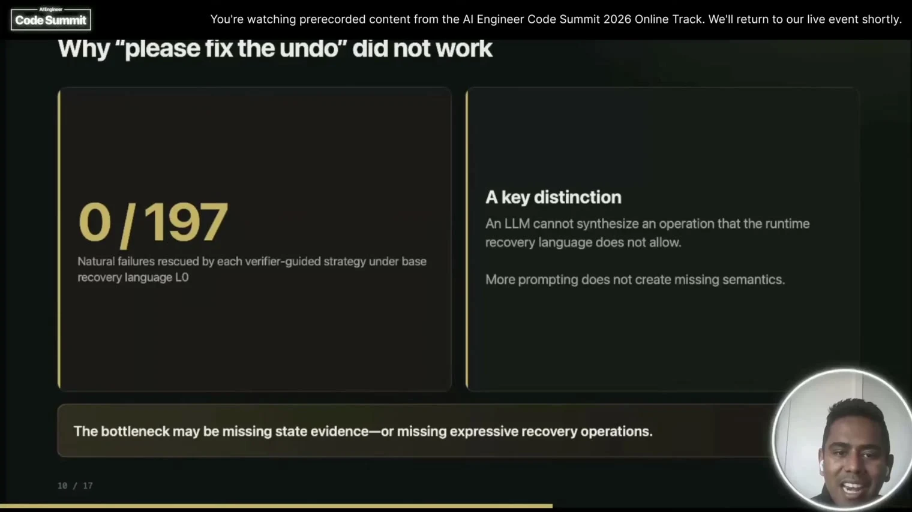

_截图 12  ·  录屏 04:09:05_

**04:09:47**　First is state grounding and another one is recovery expressivity. When we provided precise information about what had changed and where, then recovery improved from 0 to 38 out of 48 cases. And the second is recovery expressivity. So when we introduced richer undo operation, recovery improved significantly from 0 to 142 out of 143 cases. So these results come from two different experimental subgroups, but together they show why recovery needs both accurate state information and ability to perform the required undo operation.

首先是有序状态恢复，另一个是快速恢复能力。当我们提供关于发生了什么以及发生在何处的详细信息后，恢复效果从48个案例中的0提升到了38。第二个是快速恢复能力。因此，当我们引入更丰富的撤销操作功能后，恢复效果从143个案例中的0显著提升到了142。这些结果来自两个不同的实验子组，但综合来看，它们说明了为什么恢复需要准确的状态信息以及能够执行所需撤销操作的能力。

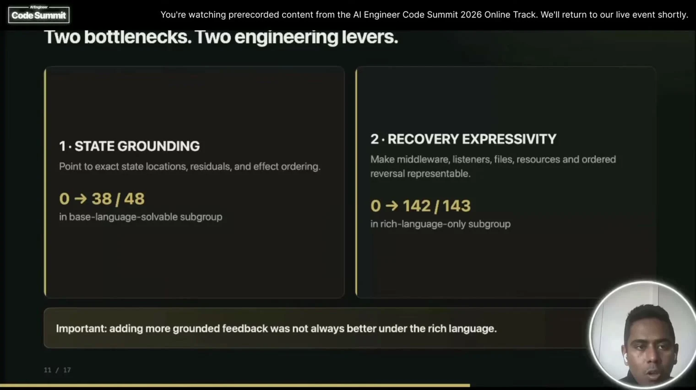

_截图 13  ·  录屏 04:10:04_

**04:10:41**　Now question comes to our mind that can better undo mechanism rescue failed mutations. So what happens when we give the agent better recovery capabilities? So with the original recovery language, none of the 197 recovery defective mutations could be restored. But after extending the recovery language, we successfully recovered 180 out of 197 cases. That is around 92%. As a result, the number of admissible improvement increased from 281 to 461 out of 600 tasks.

现在我们思考一个问题：如何更好地实现机制恢复，以弥补失败突变的修复效果。那么，当赋予智能体更好的恢复能力后会发生什么呢？使用原有的恢复语言时，197个有缺陷的突变无法被修复。但经过扩展恢复语言后，我们成功修复了197个案例中的180个，约占92%。因此，可接受的改进数量从600项任务中的281项增加到461项。

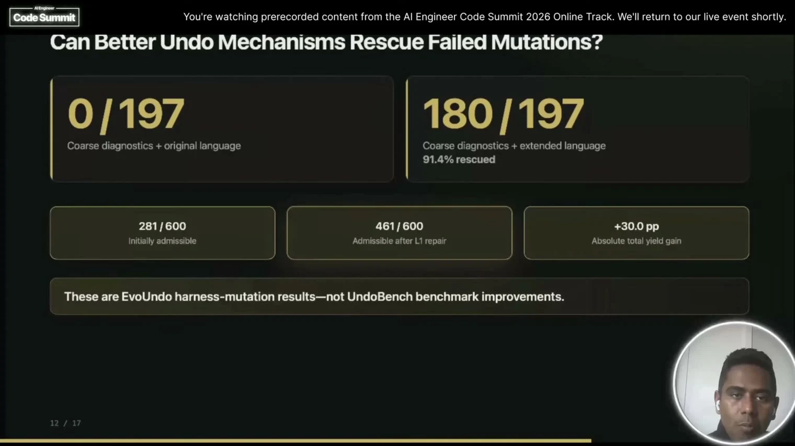

_截图 14  ·  录屏 04:11:02_

**04:11:23**　That is a 30 percentage point improvement. And that brings us to the next question. How do we build these recovery checks into the agent's evolution process. I will now hand it over to Dolly to walk through the Evo and do algorithm. All right. Thanks, Sanmay. So let's get into the working on how Evo and do actually works. So first, we will start with the agent.

这是30%的改进。这让我们进入下一个问题：如何将这些恢复检查机制融入智能体的进化过程中？现在我将把任务交给Dolly，让她详细讲解Evo和算法的工作原理。好的，谢谢Sanmay。那么让我们开始研究Evo和算法的实际运作方式吧。首先，我们从智能体开始讨论。

### EvoUndo 的状态取证、恢复演示和放行条件

**04:11:55**　pro first the agent will start the agent processes the mutation on which state it is currently in along with the effect contract and the recovery plan and before applying the mutation we capture the state witness representing the original state and even before that the then a testing in the testing environment agent will apply the mutation and execute the recovery plant an independent verifier will also verify the original if verify to check if the original state has been restored or not if the mutation improves the capability based on the user defined criteria and passes the recovery check the agents admit the otherwise well the agent attempt to repair or the verifier itself rejects the mutation altogether this way the recovery ability becomes a part of the admission…

首先，智能体会开始执行相关操作，处理其当前所处的状态以及合同效果和恢复计划。在应用该修改之前，会记录代表原始状态的证据。甚至在此之前，智能体会在测试环境中进行测试，然后应用修改并执行恢复计划。独立的验证者也会对原始状态进行验证，以确认是否已恢复至原状。如果修改能够根据用户定义的标准提升能力并通过恢复检查，那么智能体会接受该修改；否则，智能体会尝试修复，或者验证者会完全拒绝该修改。这样，恢复能力就成为了接受修改的条件之一……

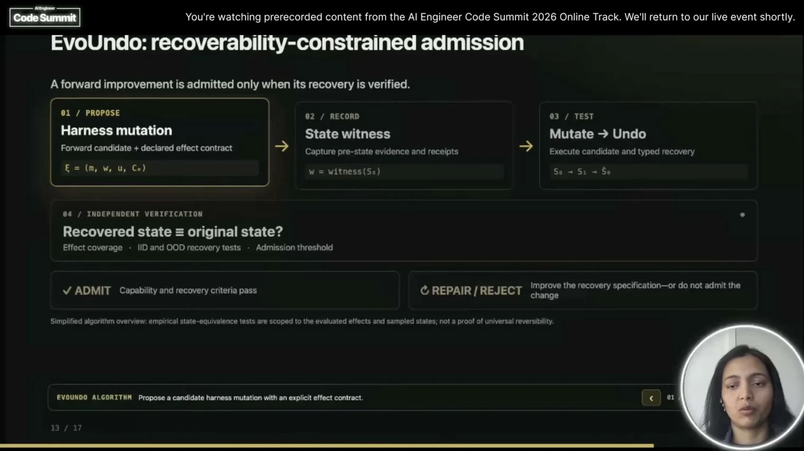

_截图 15  ·  录屏 04:11:56_

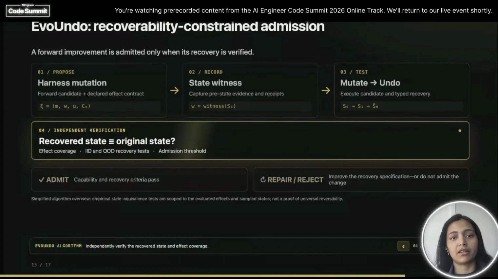

_截图 16  ·  录屏 04:12:38_

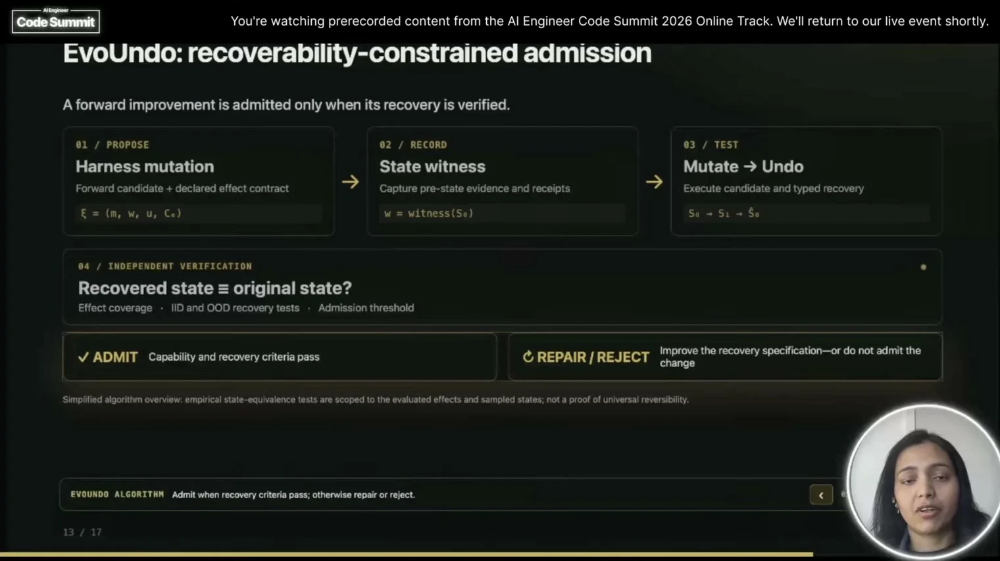

_截图 17  ·  录屏 04:12:50_

**04:12:56**　decision rather than something that we strategize or even plan once we are deployed the deployed the AI agent okay so with next next we will walk through as as done we have already explained in and given an example let let me walk through how the how that example of a time or changing from 30 to 60 would look like in action so let's take let's start with the original state a simple example that simple example of our agent having the time value of 30 before changing anything the Evo and do word first read the original value and then it will save the it will capture value as a state witness we know exactly we so we know exactly what need to be restored when then and…

与其说是策略或计划，不如说是在部署后由智能体做出决策。那么接下来，我们来看看在已经解释并给出示例的情况下，当时间从30变为60时，实际运作过程会如何。让我们从初始状态开始，举一个简单的例子：在没有任何改变之前，智能体的时间值为30。首先读取原始值，然后将其保存为状态。我们清楚地知道，何时需要恢复原来的数值。

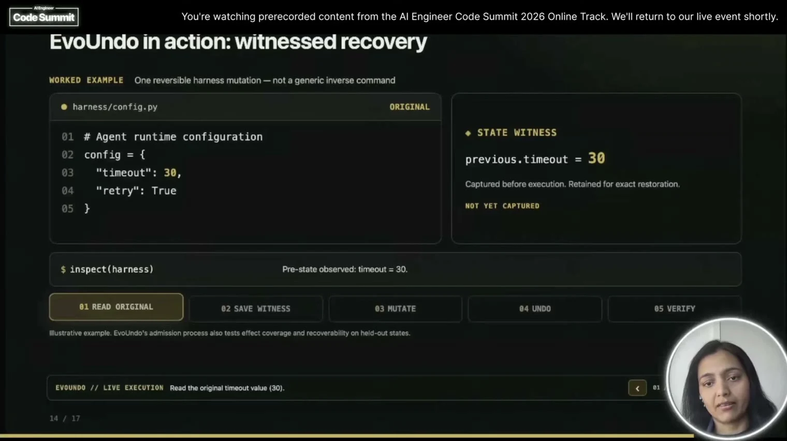

_截图 18  ·  录屏 04:13:20_

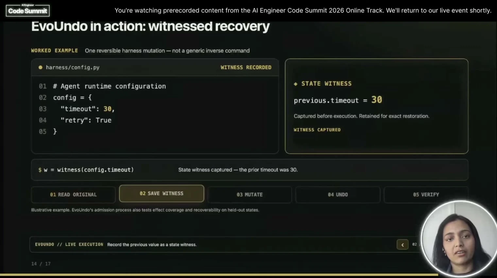

_截图 19  ·  录屏 04:13:45_

**04:13:51**　when if we have to restore it we would know what what need to be restored or which state would be the true state to return back to now the agent so next come the mutation now the agent changes the timeout from 30 to 60 as we want it to do and if recovery is required if recovery is required the Now independently the verifier finally independent verify would also confirm that the recovered value matches the original value so the recovery isn't considered successful simply because an undo command was run but also the verifier would verify the resulting state to make sure that we are in fact doing the recovery those in the state we want it to be.

如果我们需要恢复它，就会知道需要恢复什么，或者哪个状态才是应该回到的状态。现在智能体开始进行修改，将超时时间从30改为60，因为我们希望如此。如果需要进行恢复，那么最终验证器也会确认恢复后的值与原始值一致，因此仅仅因为执行了撤销命令，恢复就不算成功。同时，验证器还会验证最终状态，以确保我们确实处于想要的状态中。

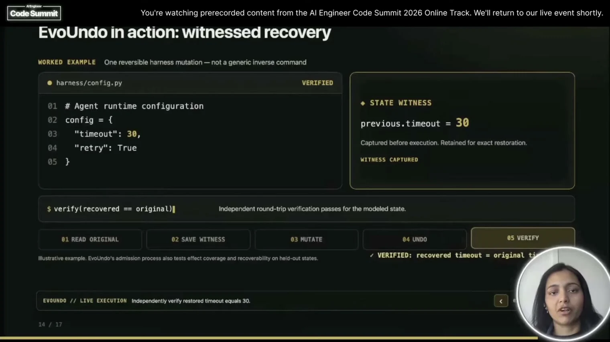

_截图 20  ·  录屏 04:14:22_

**04:14:44**　Well, now comes the bigger question. So, so we have this capability of recovery in our arsenal. Should we be using it uniformly and applying the recovery mechanism to all the failures? Well, of course not. Not every failure can be recovered the same way. If nothing has changed, then simply, if nothing has changed in the system, we would simply want it to safely retry.

那么，现在问题就更大了。因此，我们拥有这种恢复能力作为工具。我们应该统一使用它，对所有的故障都应用这种恢复机制吗？当然不是。并非每个故障都能以相同的方式被恢复。如果没有任何变化，那么只要系统没有发生任何变化，我们就希望它能够安全地重新尝试。

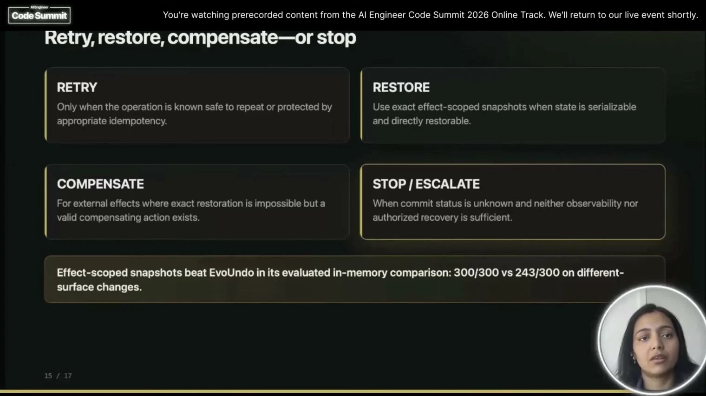

_截图 21  ·  录屏 04:15:12_

**04:15:16**　We would want the agent to simply retry and try to achieve the state that we want to be. However, if we have the original state, once we have the original state, we can restore it. If the external action has already been committed and we need, it's then when we would need a compensation mechanism, compensation action to, compensating action to reverse its effect.

我们希望智能体能够简单地重新尝试，努力达到我们想要的状态。不过，如果我们有原始状态，一旦获得原始状态，就可以将其恢复。如果外部动作已经执行完毕，我们就需要一种补偿机制，即补偿动作来抵消其影响。

**04:15:42**　and if we cannot recover the recovery and we cannot if and as we cannot the cannot verify that recovery is safe or the verify have rejected the recovery then the agent should stop and escalate the right response definitely depends on what actually happened and what we what can be safely reversed or not that brings me to the almost the last slide which is about bringing everything together on our two paper UndoBench and EvoUndo so the key takeaways here are first, the UndoBench shows the successful task execution.

如果无法恢复，且无法验证恢复是否安全，或者验证过程已经拒绝了该恢复，那么智能体应该停止行动并寻求正确的应对方式。这完全取决于实际发生了什么，以及哪些操作可以安全撤销。接下来是最后一个幻灯片，内容是关于将UndoBench和EvoUndo两个工具整合在一起。因此，关键要点是：首先，UndoBench能够展示任务的成功执行。

**04:16:27**　The UndoBench shows that a successful task execution doesn't guarantee, doesn't always guarantee the successful recovery of it. Secondly, the Evo-undo algorithm provides a structured process, capture the original state, apply the mutation, recover, independently verify, and restoration. So the Evo-undo algorithm does work in the way we intended it to. And third, we should admit self-evolution changes only when both the capability and the recoverability requirements are met.

UndoBench表明，任务执行成功并不一定能保证其恢复成功。其次，Evo-undo算法采用结构化流程：捕获原始状态、应用修改操作、恢复状态，并独立验证，从而实现恢复功能。因此，Evo-undo算法确实按照我们的预期方式发挥作用。第三，只有当能力要求与可恢复性要求都得到满足时，我们才能承认自我进化带来的变化。

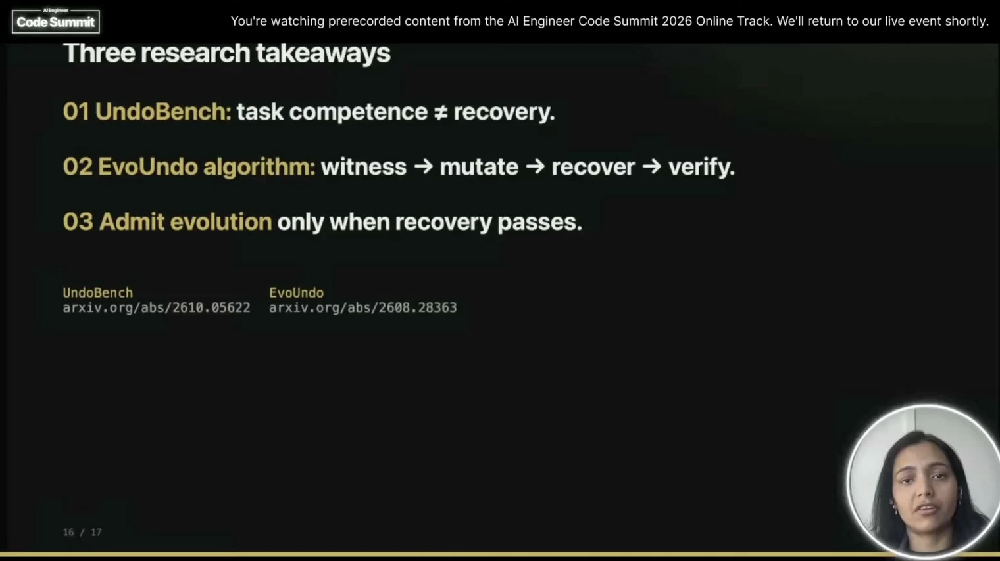

_截图 22  ·  录屏 04:16:31_

**04:16:59**　So ultimately, as we give agents more autonomy, we should also give them more reliable ways to recover from their actions. All right. So finally, I hope you remember the agent from the beginning. It was looking for an undo button. Well, now it has one. We have started building this capability through our research project, EvoUndo. And you can explore the world through the, hub repository then scan the qr code on the screen to get to the page our goal is to make the recovery a fundamental capability of ai agents so that we not only have the agent does not even execute does not only execute the action but also recover when something goes wrong as well thank you so much…

所以最终，当我们让智能体拥有更多自主权时，我们也应该为他们提供更可靠的恢复机制。好的，最后希望你们能记住最初的智能体。它一直在寻找“撤销”按钮，现在有了。我们通过研究项目 EvoUndo 开始构建这一能力。你们可以通过中心仓库探索世界，然后扫描屏幕上的二维码进入目标页面。我们的目标是通过让智能体具备恢复功能，使人工智能智能体不仅能够执行动作，还能在出现问题时进行恢复。非常感谢……

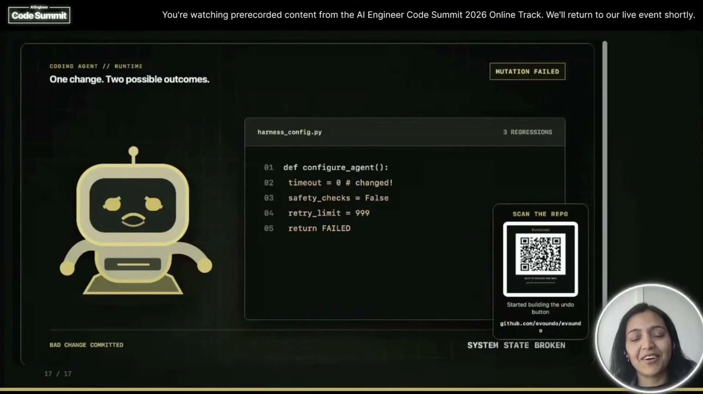

_截图 23  ·  录屏 04:17:13_

---

[全部演讲](../README.md) · [选看索引](index.md) · [上一场](13-ara-khan.md) · [下一场](15-kush-agrawal.md)
