[全部演讲](../README.md) · [选看索引](index.md) · [上一场](14-tanmay-and-dolly-sah.md) · [下一场](16-roey-ben-chaim.md)

# How AI Agents Shipped over 200k Lines of Tests on a 1.8M Line Codebase

**Kush Agrawal** · Duolingo · Staff Software Engineer

AIE Code Summit 2026  ·  11 月 11 日  ·  Online Track 预录插播  ·  录屏 04:17:48–04:30:26

[官方讲者资料](<https://ai.engineer/code/2026#speakers>)   ·   [Day 1 官方回放](<https://www.youtube.com/watch?v=ZZ19zhYnDKY>)

## 本场目录

- [04:18:20](#section-1) iOS 代码规模、初始覆盖率和为何优先补单测
- [04:21:40](#section-2) 本地批次、文件评分和定时补测
- [04:25:12](#section-3) PR 生命周期、自动修 CI 和质量门槛
- [04:28:49](#section-4) 合并与覆盖率结果，以及可以迁移的流程

## 演讲实录

> 英文源自录屏音频，经轻度校订。每段英文下方为中文译文。时间指向原始录屏。

**04:17:49**　Hey, everyone. Thanks for tuning in today. I'm going to walk you through how we use AI agents at Duolingo to write and ship more than 200,000 lines of unit tests on our iOS codebase. I'll share what we built and what we learned along the way. I'm Kush, a staff engineer on the platform team here at Duolingo. My job is to build developer tooling and AI-assisted workflows for the 100-plus engineers who contribute to our client apps.

大家好，感谢收看。今天我会带大家看看，我们在 Duolingo 怎么用 AI 智能体为 iOS 代码库编写并交付了超过 20 万行单元测试。我会介绍我们做了什么，以及一路上学到了什么。我是 Kush，Duolingo 平台团队的资深工程师。我负责为参与开发客户端应用的 100 多位工程师打造开发工具和 AI 辅助工作流。

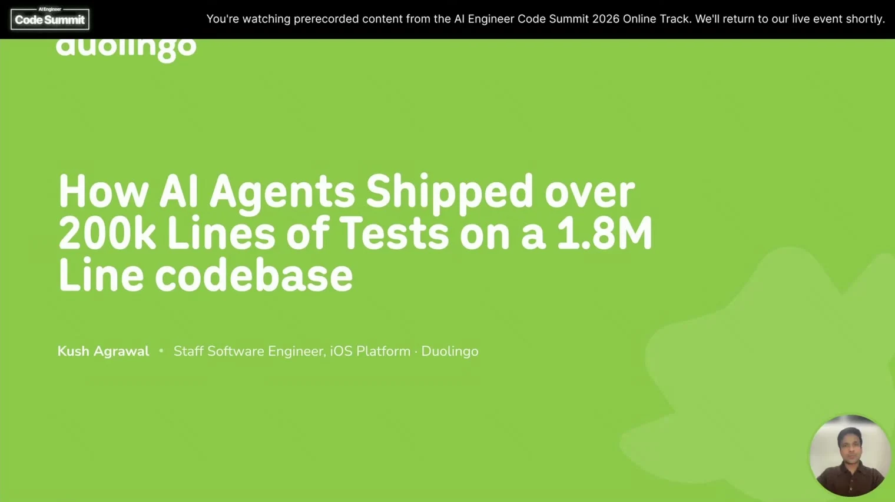

_截图 01  ·  录屏 04:17:55_

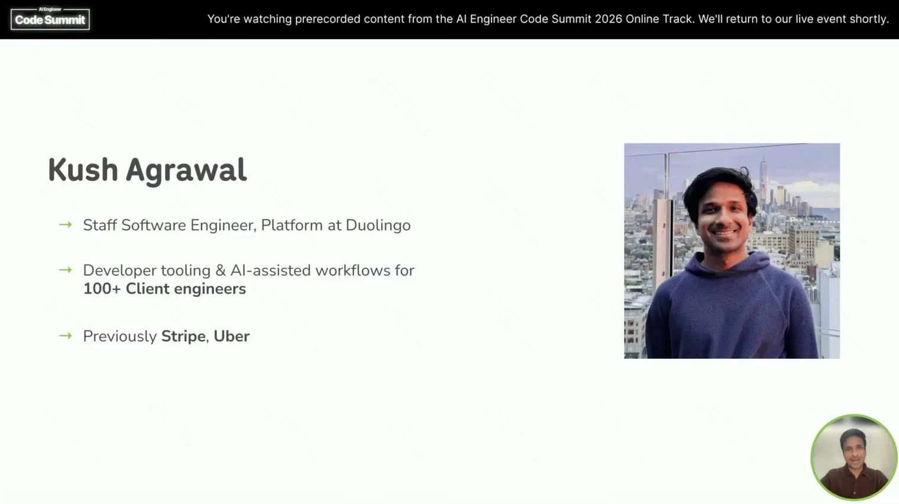

_截图 02  ·  录屏 04:18:07_

### iOS 代码规模、初始覆盖率和为何优先补单测

**04:18:07**　Before Duolingo, I spent close to a decade at Stripe and Uber working across a few teams there. Let's start with some background on the scale of mobile at Duolingo. We ship our apps to the App store every week. We're also a very experiment driven company. So at any given point of time, we have more than 600 AB tests running live. And our code bases are pretty mature.

在 Duolingo 之前，我在 Stripe 和 Uber 工作了近十年，参与了多个团队的工作。先来谈谈 Duolingo 在移动应用领域的规模。我们每周都会将应用发布到 App Store 上。我们也是一家以实验为导向的公司。因此，在任何时候都有超过 600 项 AB 测试正在进行中。我们的代码库也相当成熟。

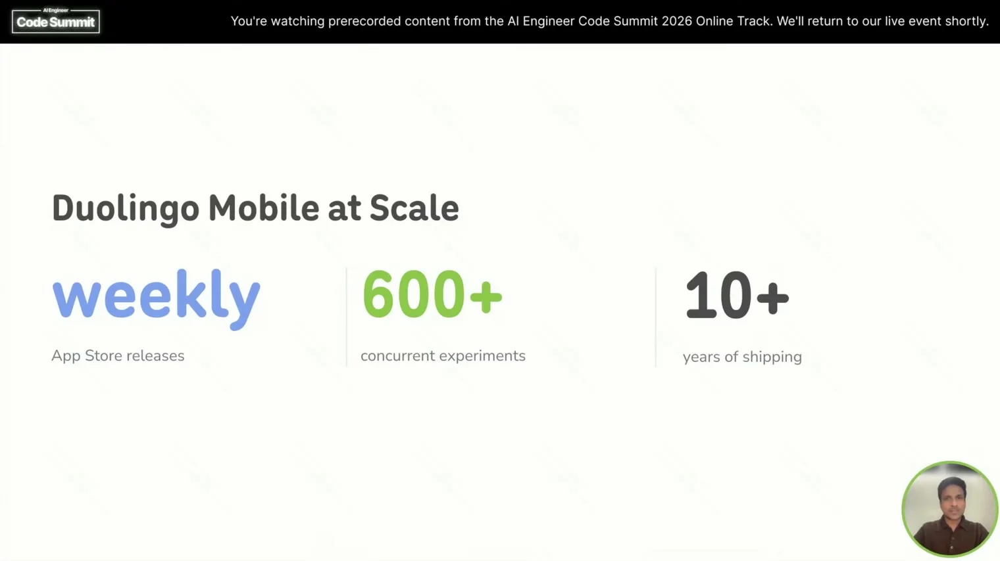

_截图 03  ·  录屏 04:18:20_

**04:18:26**　Both the iOS and Android apps have been around for more than 10 years at this point. Here's also the number of executable lines of app code in our iOS repository. So as you can see, back in 2019, we were at about 200,000 lines. And today we're hit close to 2 million. And as AI assisted coding picks up, you can see that curve starting to bend upward.

目前，iOS和Android应用都已经存在了10多年。以下是我们iOS代码库中可执行代码行数的数量。如您所见，2019年时约为200,000行。而今天，这一数字已经接近200万行。随着AI辅助编程的普及，可以观察到这一趋势开始向上弯曲。

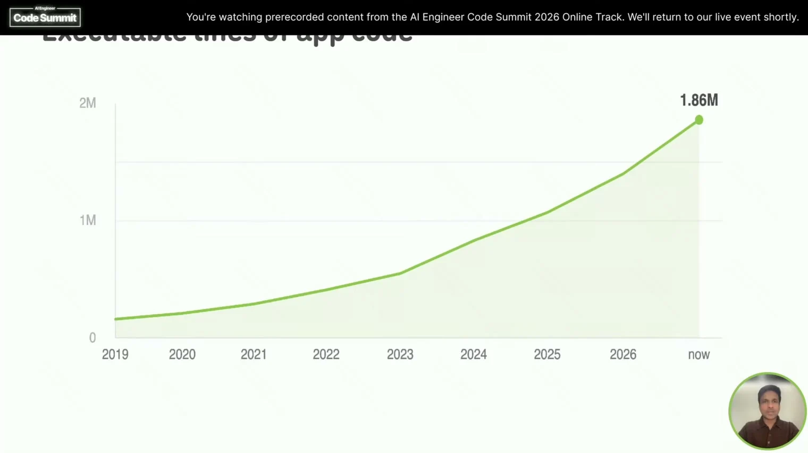

_截图 04  ·  录屏 04:18:36_

**04:18:43**　And it's not just the amount of code that's changing, it's also who's writing it. So last year, about 200 people contributed to the iOS repository, and this year we've already crossed 250. And a lot of these folks aren't even iOS engineers. We are backend engineers, Android engineers, even PMs and designers all shipping code to the iOS app. And that's mostly been unlocked by AI coding tools like Cursor and Claude Code.

而且不仅仅是代码量在变化，编写代码的人也变了。去年大约有200人为iOS仓库贡献代码，今年已经超过了250人。其中很多人甚至不是iOS工程师，我们有后端工程师、Android工程师，甚至产品经理和设计师也在为iOS应用编写代码。而这一切主要得益于像Cursor和Claude Code这样的AI编码工具。

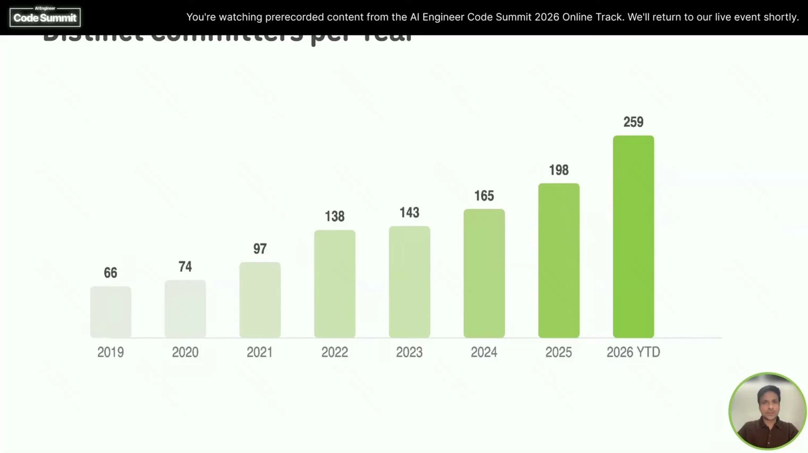

_截图 05  ·  录屏 04:18:49_

**04:19:02**　Another thing to note about our code base is that it's a code base in transition. So a few years ago, we standardized on the MVVM architecture pattern. Today, about half the code in our repository follows that pattern, and the other half is still legacy code that we're in the process MBVM half is the easiest to test. That's where we focused on this project.

关于我们的代码库，另一个值得注意的点是它正处于转型阶段。几年前，我们采用了 MVVM 架构模式。如今，仓库中约一半的代码都遵循这一模式，另一半则是传统代码，我们正在努力将其转换为 MVVM 模式。MVVM 模式更易于测试，这也是我们专注于这个项目的原因。

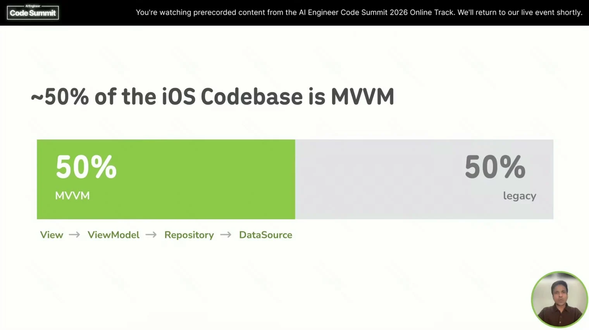

_截图 06  ·  录屏 04:19:10_

**04:19:19**　Here's where we started back in March of this year. We were at overall unit test coverage of 11%. The MBVM layers were a bit lower. Repositories were at 11%, view models at nine, data sources at five, and combined we are about 9% for the MBVM slice of the app. So why does this matter now more than it used to? As agents and humans write more code and write it faster, writing code isn't the hard part anymore.

今年三月我们开始这项工作。当时整体单元测试覆盖率仅为11%，MBVM层的覆盖率则稍低一些。仓库的覆盖率为11%，视图模型的覆盖率为9%，数据源的覆盖率为5%，因此应用程序中MBVM部分的整体覆盖率约为9%。那么，为什么现在这个问题比过去更重要了呢？因为智能体和人类编写代码的频率更高、速度更快，编写代码不再是一项困难的任务。

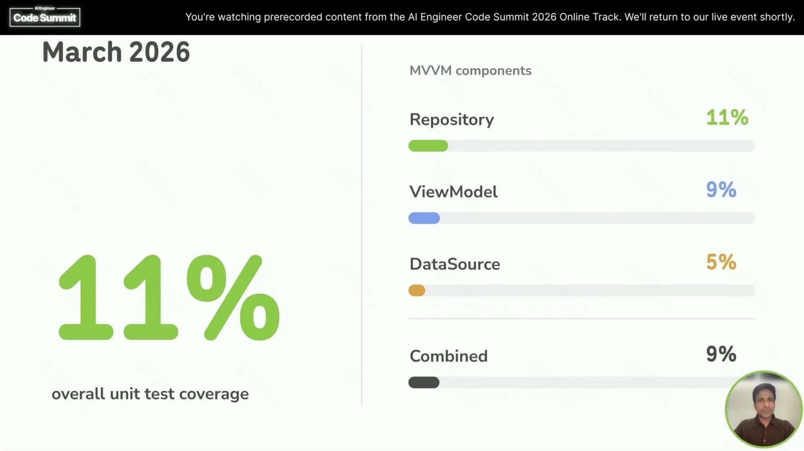

_截图 07  ·  录屏 04:19:26_

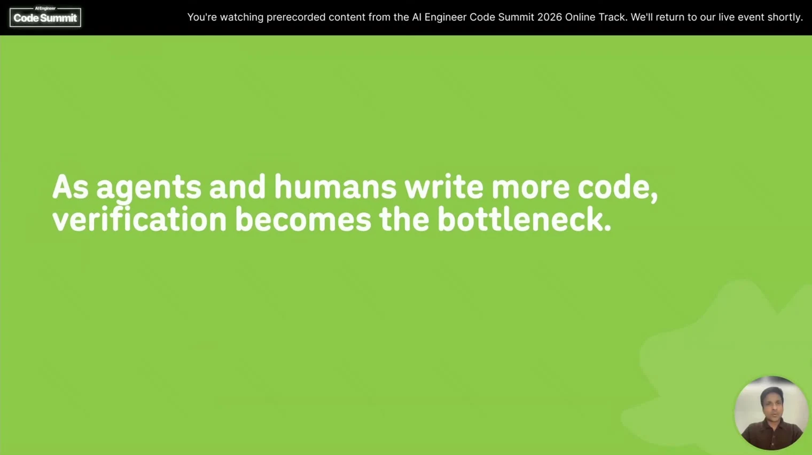

_截图 08  ·  录屏 04:19:39_

**04:19:41**　Verifying it is. So when someone puts up a PR, save to ship. The bottleneck is really shifting from writing to verifying. And that's where unit tests come in. They make up the base of the testing pyramid, they're pretty cheap to write and pass to run, and they also act as guardrails for agents. So when an agent's change breaks a test in CI, it gets immediate feedback on what to fix.

正在验证中。所以当有人提交 PR 时，就保存以便发布。瓶颈实际上已经从编写阶段转移到了验证阶段。这就是单元测试的作用所在。它们构成了测试金字塔的基础，编写和运行的成本很低，同时还能作为智能体的防护措施。因此，当智能体的变更在 CI 环境中破坏测试时，就能立即得到关于如何修复的反馈。

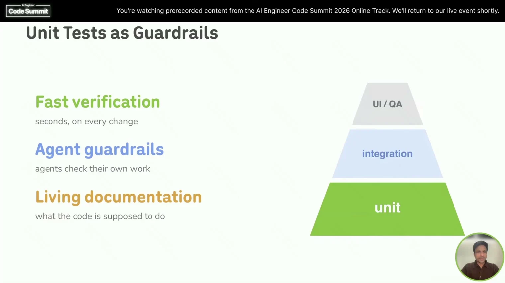

_截图 09  ·  录屏 04:19:55_

**04:19:59**　They also act as living documentation on what the code is supposed to do. And here's where we ended up eight months later. Overall unit test coverage went from 11% to 24%, repositories went from 11% to 72%, view models from 9% to 58%, data sources from 5% to 41%, And the combined MVVM slice of the app went from 9% to 59%.

它们还充当了关于代码应实现功能的活生生的证明。而这就是八个月后我们的成果。总体而言，单元测试覆盖率从11%上升到了24%，仓库覆盖率从11%上升到了72%，视图模型覆盖率从9%上升到了58%，数据源覆盖率从5%上升到了41%，而应用程序中MVVM部分的覆盖率则从9%上升到了59%。

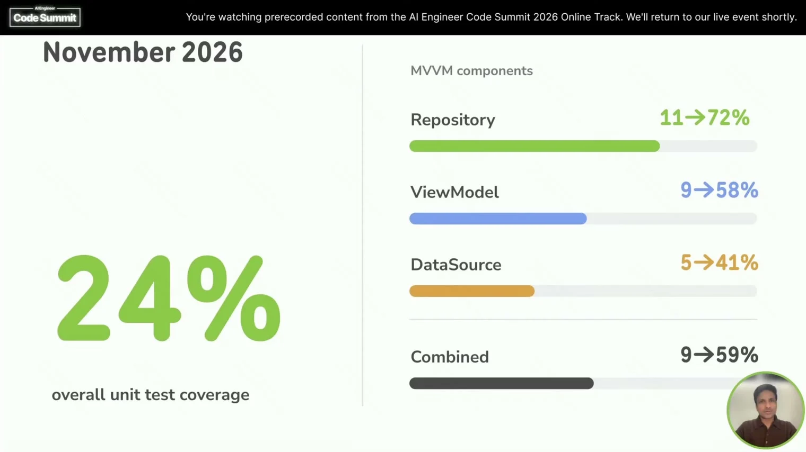

_截图 10  ·  录屏 04:20:08_

**04:20:16**　So what did we actually end up building? On paper, it's a pretty simple loop. First, you identify the files that need tests. Then you write those tests with an agent. You verify that the tests are good quality and they pass CI. Then you resolve the PR, which means getting interviewed by an engineer and merged. And finally, you iterate on the feedback so that the next batch of PRs is better than the last one.

那么我们实际上最终构建了什么？从理论上看，这是一个相当简单的流程。首先，确定需要测试的文件。然后，用智能体编写这些测试。验证这些测试的质量是否达标，并且能够通过 CI 检查。接着处理 PR 相关的工作，这意味着需要接受工程师的面试并合并代码。最后，根据反馈进行改进，使下一批 PR 比之前的更好。

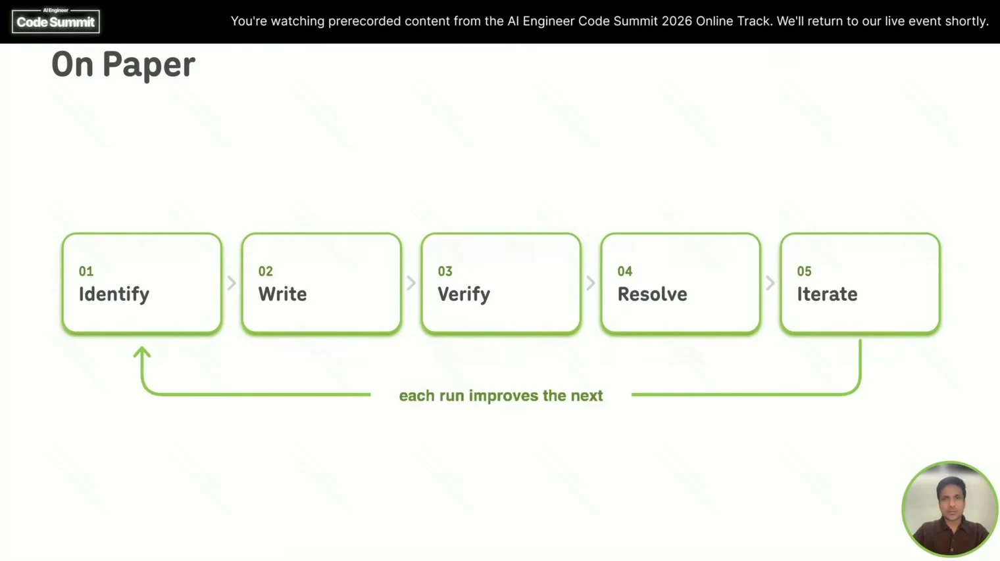

_截图 11  ·  录屏 04:20:25_

**04:20:33**　When production is a little messier, this is what our system ended up looking like. I won't go through every box right now, but at a high level, it's a few temporal workflows that coordinate through shared states stored in S3. And every box you see here maps back to one of the five steps I just talked about. Here are the building blocks that we ended up using.

当生产流程有些混乱时，我们的系统最终就呈现这样的样子。我现在不会逐一分析每个模块，但从整体来看，它主要由几个通过 S3 中存储的共享状态进行协调的时间流程组成。这里看到的每个模块都对应着我刚才提到的五个步骤中的某一个。这就是我们最终使用的构建模块。

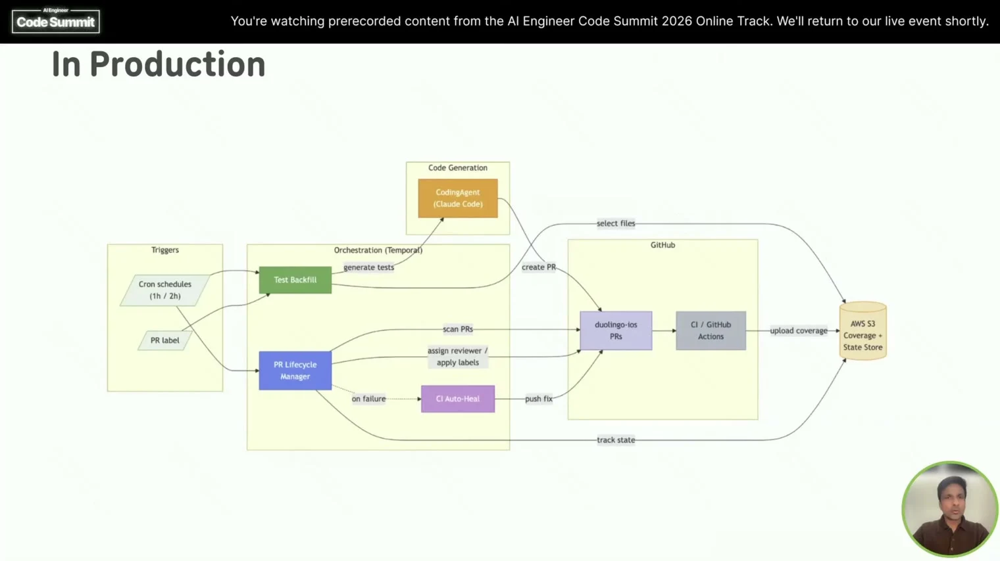

_截图 12  ·  录屏 04:20:37_

**04:20:49**　Temporal handles workflow orchestration and execution. Claude Code acts as the coding agent. S3 holds the shared state that keeps our workflows in sync. And we use GitHub for actions, labels, and PRs. Datadogs acts as an observability layer, where we keep an eye on the health of our pipelines. If you haven't used Temporal before, it's basically a durable workflow execution engine. You write your workflows as normal Python code.

Temporal用于工作流编排和执行。Claude Code作为编码智能体发挥作用。S3负责存储使工作流保持同步的共享状态。而GitHub则用于动作、标签和Pull Request。Datadogs作为可观测性层，帮助我们监控管道的健康状况。如果之前未使用Temporal，它本质上就是一个持久化工作流执行引擎。你可以像处理普通Python代码一样编写工作流。

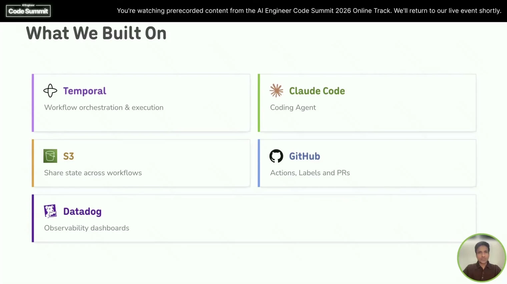

_截图 13  ·  录屏 04:20:54_

**04:21:09**　And if a worker crashes, the workflow just picks up right where it left off. This fits agents really well. An agent session can run for seconds to hours. And it can call out to tools like GitHub, CI, S3, and Cloud. We also lean on a few built-in features of temporal. There are schedules, which are basically cron-like schedules for our jobs.

如果某个工人出现故障，工作流会立即从之前的状态继续运行。这非常符合智能体的特性。智能体会话可以持续几秒到几小时，并且可以调用 GitHub、CI、S3 和 Cloud 等工具。我们还利用了 temporal 框架中的一些内置功能。其中包含了调度机制，基本上就是类似 cron 的调度方式，用于我们的任务。

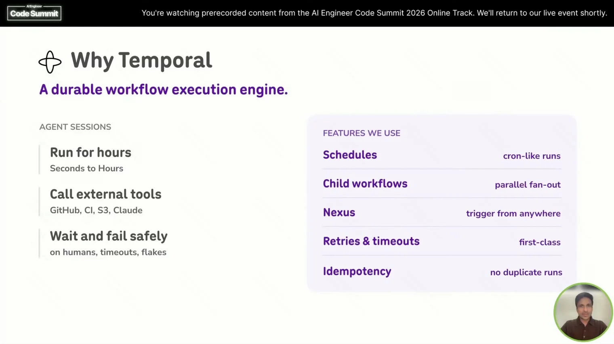

_截图 14  ·  录屏 04:21:15_

### 本地批次、文件评分和定时补测

**04:21:24**　There are composable workflows so that we can fan out work in parallel. Then there's first-class support for retries and timeouts, and item potency so that we never kick off duplicate runs of the same file. To split up this work, we split this project into four milestones. The first was local validation. Basically, is this project even viable? The second was a scheduled backfill workflow to write tests for existing code.

有可组合的工作流，让我们能够并行处理任务。此外，还提供一流的重试和超时支持功能，以及项目有效性检测机制，确保不会重复执行同一文件的操作。为了拆分这些任务，我们将这个项目分为四个里程碑。第一个是本地验证阶段——基本上就是判断这个项目是否可行。第二个是计划性的回补工作流，用于编写现有代码的测试。

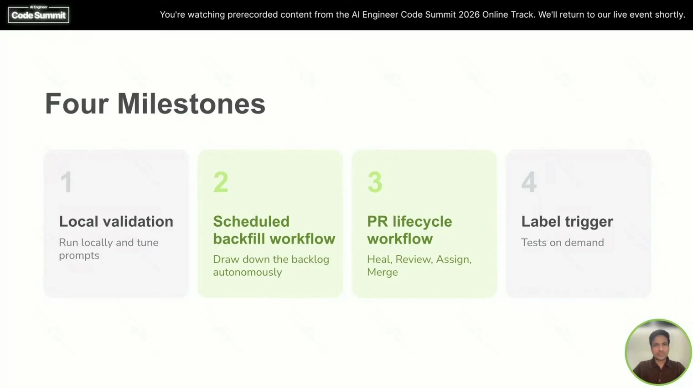

_截图 15  ·  录屏 04:21:40_

**04:21:43**　The third was a PR lifecycle workflow to actually get those PRs merged. So engineers can get tests for the new code that they're writing. Now we go through each of these in order. Before building anything real we wanted to do the least amount of work possible that would tell us whether an agent could actually do this job well and do it at scale.

第三个是PR生命周期工作流，用于实际合并这些PR。这样工程师就可以对他们编写的新代码进行测试。现在我们将按此顺序逐一处理。在构建任何实际内容之前，我们希望尽可能少地做工作，以便判断智能体是否真的能够很好地完成这项任务，并能以大规模的方式实现。

**04:21:59**　We started with a very simple local Claude Code setup where we had one Claude Code command that acted as an orchestrator. It ran an Xcode build script to generate a code coverage report locally. Then it fed that report through a file selection script that we wrote and then it handed each selected file off of two sub agents. One wrote the tests and the other one opened the PR.

我们从非常简单的本地 Claude Code 设置开始，只有一个 Claude Code 命令作为协调器。它运行 Xcode 构建脚本以在本地生成代码覆盖报告。然后，该报告通过我们编写的文件选择脚本传递，最后由两个子智能体处理每个选中的文件。一个负责编写测试，另一个则负责打开 PR 请求。

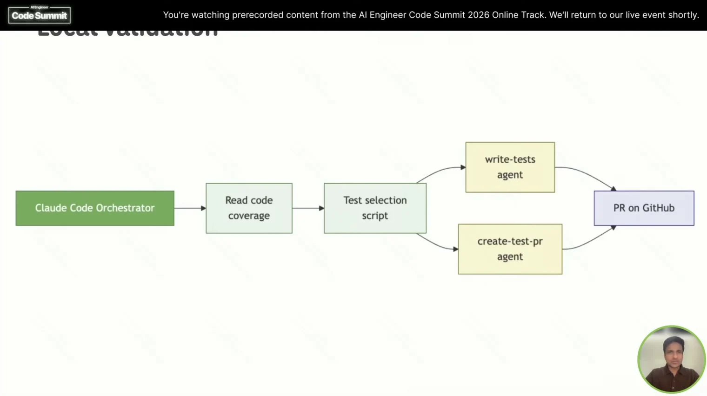

_截图 16  ·  录屏 04:22:05_

**04:22:17**　We ran this in a loop and generated of PRs. We basically ran this in two batches. The first batch had 17 PRs and we merged eight of them. The second had 40 PRs and we merged 19. So that's roughly a 50% merge rate. But the goal here wasn't to merge a lot of PRs, it was to learn how the agents fail and to fix those paper cuts before productionizing anything.

我们通过循环处理生成了多个 PR。实际上，我们分两批进行处理：第一批有 17 个 PR，我们合并了其中 8 个；第二批有 40 个 PR，我们合并了 19 个。因此，合并率大约为 50%。但我们的目标不是合并太多 PR，而是了解智能体为何会失败，并在实际部署之前修复这些问题。

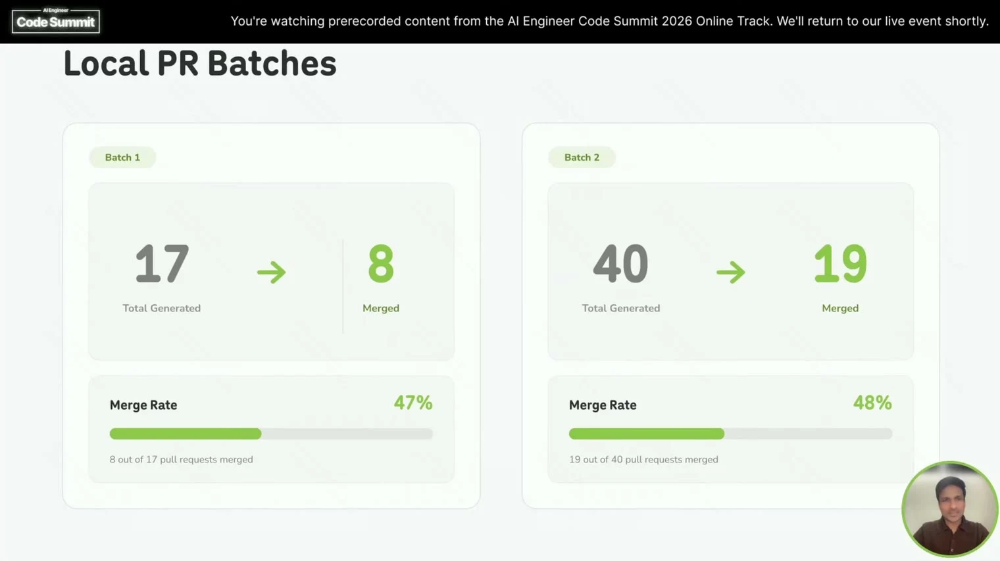

_截图 17  ·  录屏 04:22:25_

**04:22:33**　Here are some of the failure modes that we saw. Since we're a large legacy codebase with both XCTest and Swift testing, the agents would sometimes get confused and mix the two in one file. We fixed that by giving the agents clear rules on when to use each. We also had a giant user-client singleton class. Some code passed around the concrete version of this class as others passed around the protocolized version.

以下是我们观察到的一些故障模式。由于我们拥有庞大的遗留代码库，其中同时包含 XCTest 和 Swift 测试机制，因此智能体有时会感到困惑，将两者混在一个文件中。我们通过为智能体制定明确的规则来指导何时使用每种机制，从而解决了这个问题。此外，我们还有一个巨大的用户-客户端单例类。有些代码使用该类的具体版本，而另一些则使用协议化版本。

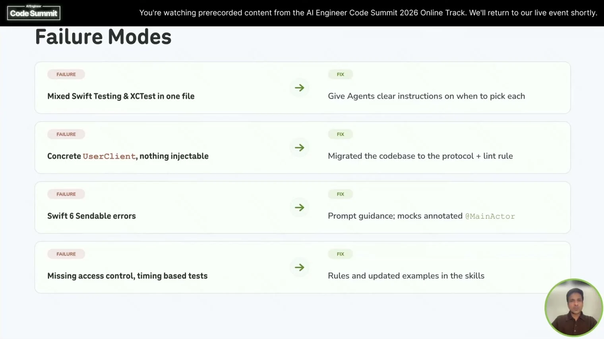

_截图 18  ·  录屏 04:22:46_

**04:22:50**　So we migrated the entire code base over to the protocolized version and added a lint rule to enforce it. This made the whole host of files easier to test for agents and for humans. We also ran into six concurrency related issues and agents writing timing based tests, which are a big source of flakiness in CI. So we improved the state for both of these with better rules and examples in our testing skills.

因此，我们将整个代码库迁移到标准化版本中，并添加了 lint规则来强制执行该标准。这使得所有文件对智能体和人类来说都更易于测试。我们还遇到了六个与并发相关的问题，以及智能体编写时间测试的情况，这些正是 CI 系统中出现不稳定问题的主要原因。于是我们通过更好的规则和测试指南来改进了这两种情况的状态。

**04:23:09**　Now this brings us to milestone two. Since we were so far behind on code coverage, the biggest leverage that we saw was backfilling tests for code that was already merged in. That's where the scheduled backfill workflow comes in. This is a system design diagram for that workflow as it runs in production and it essentially does two jobs. The left half is to identify which is picking the files that need tests and the right half is write which is having the agents actually write those tests.

现在我们来到了第二个里程碑。由于代码覆盖度严重落后，我们所能利用的最大优势就是对已经合并的代码进行测试补测。这就是计划中的补测工作流的作用所在。这是该工作流的系统设计图，它在生产环境中运行，实际上完成两项任务。左半部分用于确定需要测试的文件，右半部分则负责让智能体实际编写这些测试。

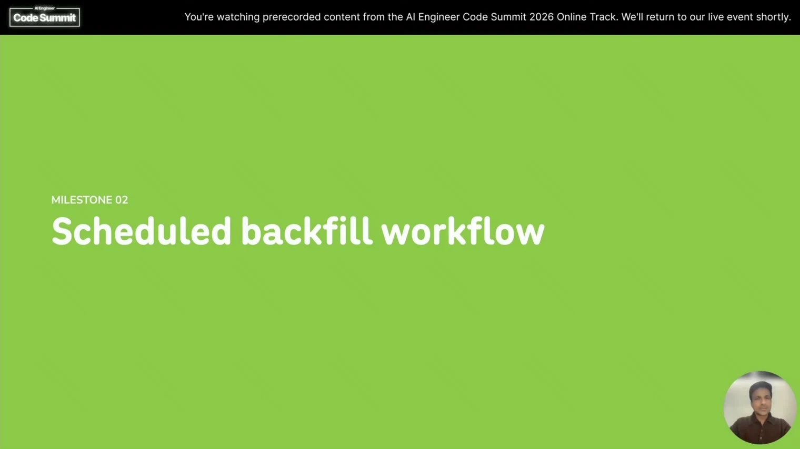

_截图 19  ·  录屏 04:23:11_

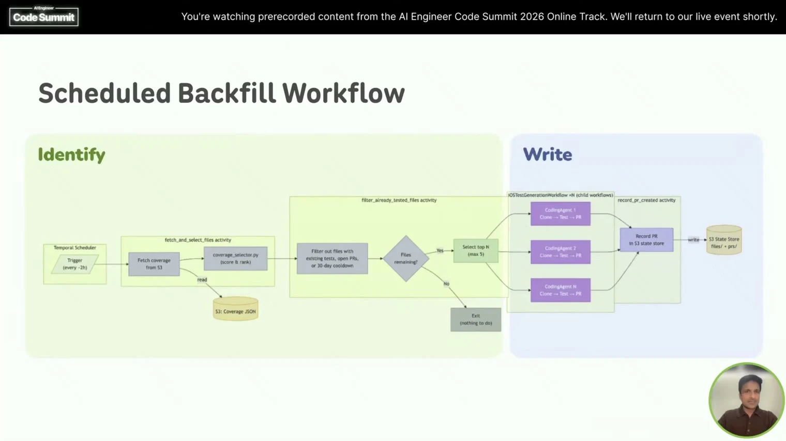

_截图 20  ·  录屏 04:23:24_

**04:23:31**　Let's start with identify. Every time a PR merges to the main branch in the iOS repo we kick off a GitHub access job that generates an Xcode coverage report and uploads it to S3. That becomes a source of truth for the latest code coverage. The backfill workflow then fetches that report and runs it through a selector script which picks the next set of files test.

让我们从识别开始。每当一个 PR 合并到 iOS 仓库的主分支时，我们会启动一个 GitHub 访问任务，该任务会生成 Xcode 覆盖报告并上传到 S3。这便成为最新代码覆盖情况的权威来源。随后，补回工作流会获取该报告，并通过一个选择器脚本来运行它，从而选择下一组测试文件。

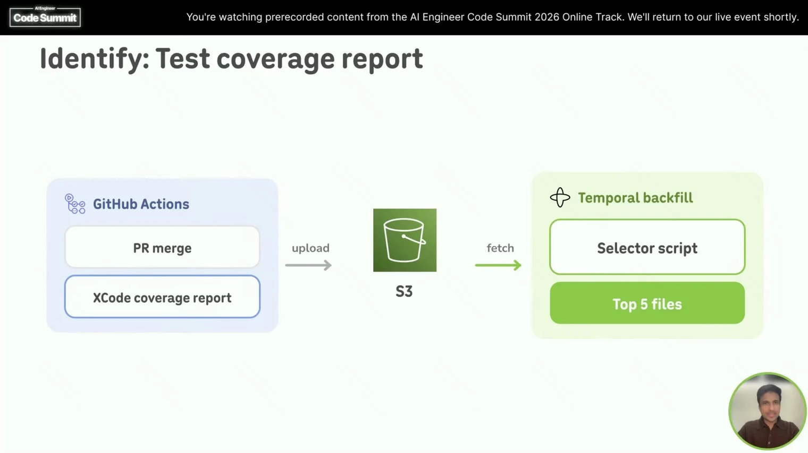

_截图 21  ·  录屏 04:23:36_

**04:23:47**　Let's get a little deeper into the selector script. Its job is essentially to score every switch file based on how confident we are that an agent can write a good test for it. The strongest signal is file type. So view models, repositories, and data sources get a 2.5x boost while legacy files get pushed down. We skipped UI code completely for now since snapshot tests are better fit there.

让我们更深入地了解选择器脚本。它的作用本质上是根据我们对智能体能够编写出良好测试的置信度来给每个开关文件打分。最有力的指标是文件类型。因此，视图模型、存储库和数据源会获得2.5倍的提升，而旧文件则会被降低权重。目前我们完全跳过了UI代码，因为快照测试更适合用于此场景。

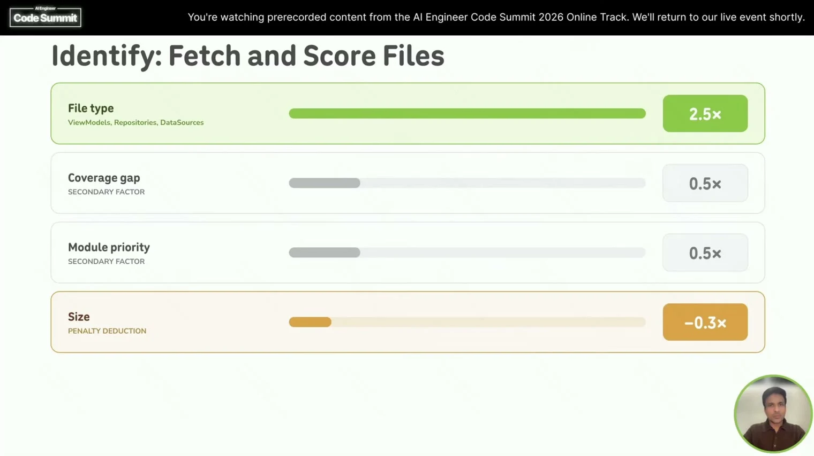

_截图 22  ·  录屏 04:23:57_

**04:24:05**　And larger files also get a penalty, so we prioritize code that we're confident that we can test well. The next step is to actually write the tests. We kick off one child workflow per file, all running in parallel.

较大的文件也会受到惩罚，因此我们会优先选择那些我们确信能够顺利测试的代码。下一步就是实际编写测试代码。我们会为每个文件编写一个子工作流，所有工作流都会并行运行。

**04:24:16**　In each one of these runs, the agent clones the iOS repository, reads the testing skill that we keep in the repo which spells out how to write a good test then it writes the test plus any mocks and fakes it needs and opens a pr with a generated test label so we can identify it easily later these agents run on duolingo's cloud coding agent which is a platform that also runs on the temporal the simplest way to think about it is as an abstraction on top of Claude Code and codex running in the cloud we can invoke it from slack temporal or github it talks to a bunch of our internal tools for mcp and it logs a bunch of events so we can see what…

在每次运行中，智能体会克隆 iOS 仓库，读取仓库中保存的测试技巧说明，其中详细介绍了如何编写优质测试。然后，它编写测试代码以及所需的所有模拟和假象内容，并发布带有生成测试标签的 PR，以便日后轻松识别。这些智能体在 Duolingo 的云端编码智能体上运行，该平台也基于云端环境。最简单的理解方式就是将其视为 Claude Code 和 Codex 在云端运行的抽象层。我们可以从 Slack、Temporal 或 GitHub 中调用它，它与我们的许多内部工具进行 MCP 交互，并记录大量事件，从而我们可以了解具体情况。

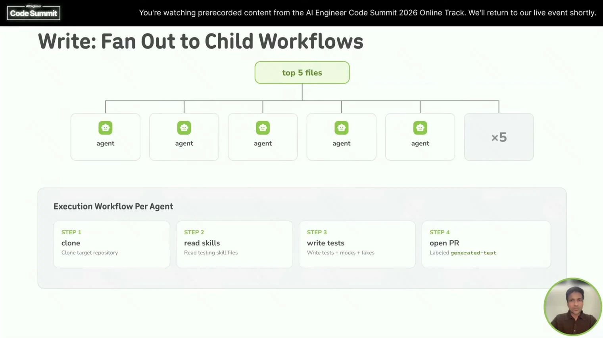

_截图 23  ·  录屏 04:24:18_

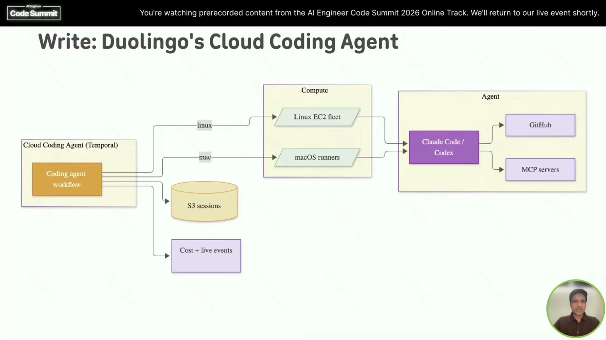

_截图 24  ·  录屏 04:24:39_

**04:24:44**　each agent run is doing and how much it costs. We started running these on Linux machines and then later moved them to Macrunners which will become important in a minute. Here's what a generated test PR looks like. Every PR description follows the same template and it says explicitly that the PR is AI generated. The reviewer has four options. They can approve it in the PR auto merges.

每个智能体的运行行为及其所需成本。我们最初在 Linux 机器上运行这些，后来又转移到 Macrunners 上，这将在不久后变得重要。以下是生成的测试 PR 的样貌。每个 PR 描述都遵循相同的模板，并且明确说明该 PR 是由 AI 生成的。审核者有四个选项：他们可以在 PR 自动合并中批准它。

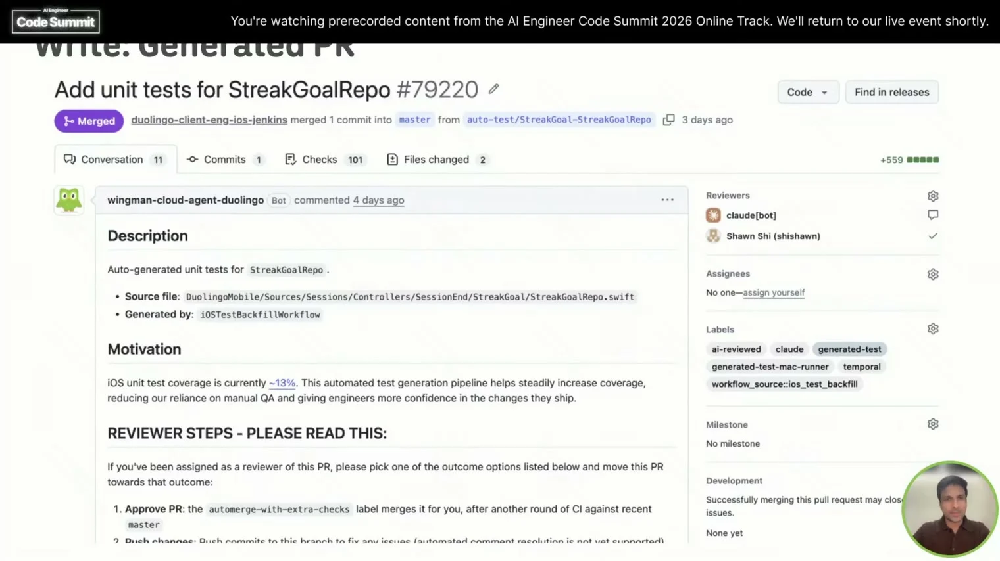

_截图 25  ·  录屏 04:25:00_

### PR 生命周期、自动修 CI 和质量门槛

**04:25:03**　They can push changes to it directly. They can reassign it to someone better suited or they can close it out with feedback on why it isn't mergeable. Now once we had the backfill running in production we had a slightly new problem. We suddenly had PRs that nobody could manage by hand. So how do we get all of these to a mergeable state and in front of the right reviewer?

他们可以直接将更改推送到其中。他们可以将它重新分配给更合适的人，或者提供反馈说明为何无法合并。当我们在生产环境中运行了填充操作后，就出现了新的问题：突然出现了一些无法手动处理的 PR。那么，我们该如何让所有内容达到可合并的状态，并让合适的审核者看到呢？

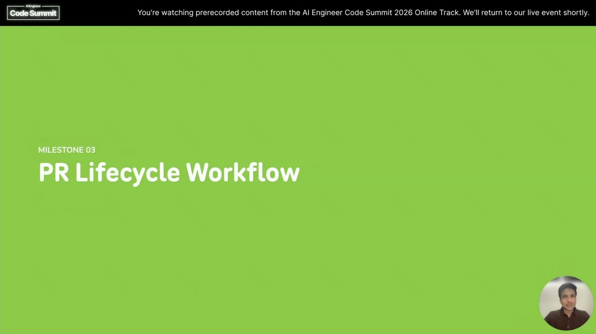

_截图 26  ·  录屏 04:25:12_

**04:25:21**　That's where the PR lifecycle workflow comes in. You can think of it as a state machine. It runs every couple of hours, looks through every open generated test PR and takes exactly one action on each. It covers the next two steps of our loop, verify, which is does this PR pass CI and is it high quality, and resolve, which is getting a human to review it and merge it.

这就是PR生命周期工作流的作用所在。你可以将其视为一个状态机。该工作流每隔几小时运行一次，会检查所有已生成的测试PR，并对每个PR执行 exactly一个操作。它涵盖了我们循环中的接下来两个步骤：验证，即判断该PR是否通过CI测试且质量良好；以及解决，即请人工进行审核并合并该PR。

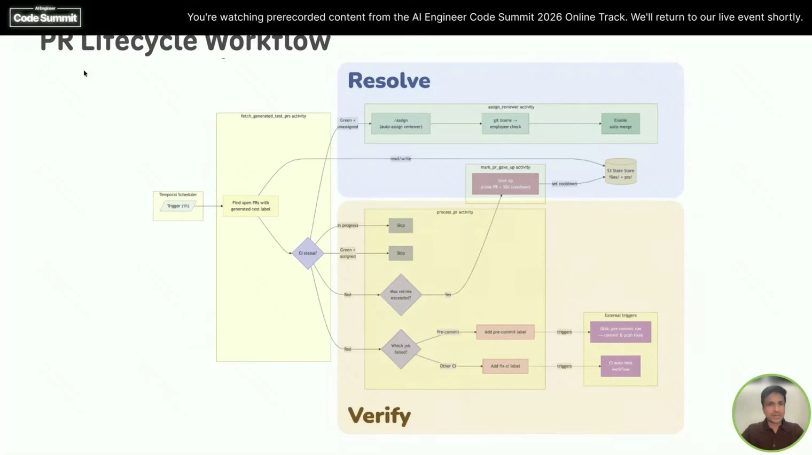

_截图 27  ·  录屏 04:25:33_

**04:25:38**　The logic for this workflow is a simple decision tree. If there are any merge conflicts or the PR we close it out and mark it as still. If CI is still running or a reviewer is already on it, we skip it. If CI is green and there's no reviewers, we find one and sign them. If CI is red, we try to fix it.

此工作流的逻辑是一个简单的决策树。如果存在合并冲突或当前 PR 尚未完成，则将其关闭并标记为待处理状态。如果 CI 仍在运行或已有审核人，则跳过该任务。如果 CI 为绿色且没有审核人，则找到审核人并让其签署。如果 CI 为红色，则尝试修复问题。

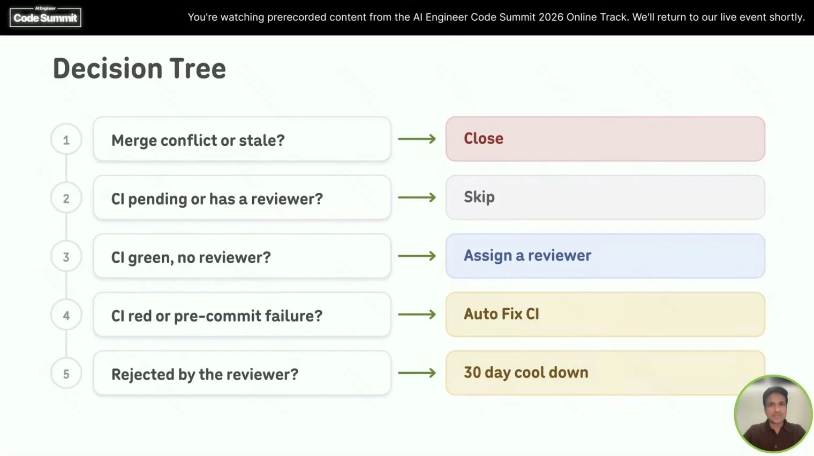

_截图 28  ·  录屏 04:25:45_

**04:25:52**　And if the reviewer rejects the PR, the file goes into a 30-day cool down, so we're not spamming engineers with the same PR again and again. When CI fails, the first thing we check is which job failed. If it's pre-commit, a GitHub action applies the fix. It's cheap, it's deterministic, and there's no agent needed. If it's a real test failure, we kick off another agent that reads the CI logs and pushes a fix to the PR.

如果评审者拒绝该 PR，文件将进入 30 天的冷却期，这样我们就不会反复向工程师发送相同的 PR。当 CI 出现问题时，我们首先检查是哪项任务失败。如果是 pre-commit 问题，GitHub Action 会应用修复方案。这种方法成本较低、结果可预测，且不需要智能体。如果是真正的测试失败，我们会启动另一个智能体，该智能体会读取 CI 日志并将修复方案推送到 PR 中。

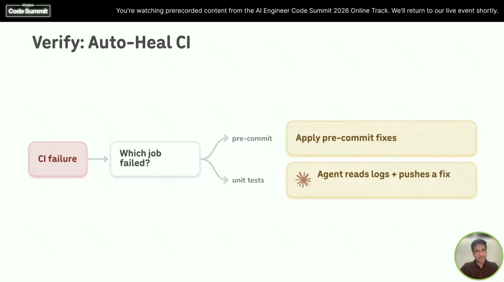

_截图 29  ·  录屏 04:26:06_

**04:26:10**　We cap that whole loop at five attempts, rather than trying to fix it forever. Once CI is green, we need to find the right reviewer. What we do is we run git blame on the source file being tested, find the top contributor, and assign it to them, and turn on auto-merge. If they approve it, the PR gets merged. If they reject it, the file goes into the 30-day cooldown, which I previously mentioned.

我们将整个流程限制在5次尝试内，而不是试图永远修复它。一旦CI显示绿色，我们就需要找到合适的审查者。我们的操作是：在要测试的源文件上运行git blame，找出主要的贡献者，将其分配给他们，然后开启自动合并功能。如果他们同意，PR就会被合并；如果他们拒绝，该文件将进入我之前提到的30天的冷却期。

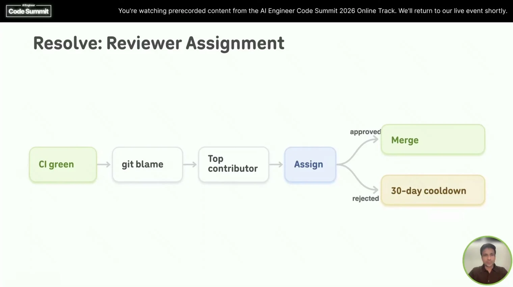

_截图 30  ·  录屏 04:26:23_

**04:26:29**　This brings us to milestone four. Once all of this was backfilling tests for existing code, we wanted to make it just as easy to get tests for the new code engineers were writing. Now any engineer can add a right test label to their own PR. It hooks into the same temporal infrastructure we just walked through. Instead of the selection script, we take the file straight from the engineer's PR.

这就到了第四个里程碑。在对现有代码进行所有测试之后，我们希望让工程师们为新代码编写测试也变得如此简单。现在，任何工程师都可以在自己的 PR 中添加正确的测试标签。该机制与我们刚才讨论过的时间性基础设施相衔接。我们不再使用选择脚本，而是直接从工程师的 PR 中获取文件。

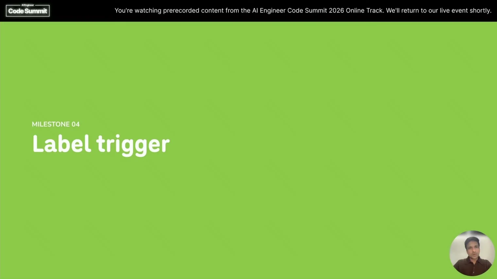

_截图 31  ·  录屏 04:26:31_

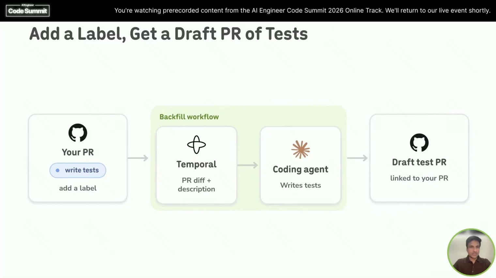

_截图 32  ·  录屏 04:26:44_

**04:26:47**　The agent writes the tests and you get a draft test PR link back to your original one. Now let's talk about some of the challenges that we ran into. Our agents originally ran on Linux machines which don't have Xcode or SwiftLint installed. So when an agent would open a PR, after about 20 or 30 minutes, CI would fail frequently on Lint.

智能体会编写测试代码，你就能得到指向原始问题的测试 PR 链接。现在让我们来谈谈我们遇到的部分挑战。我们的智能体最初运行在没有安装 Xcode 或 SwiftLint 的 Linux 机器上。因此，当智能体打开一个 PR 后，大约 20 到 30 分钟之后，CI 在 Lint 方面会频繁失败。

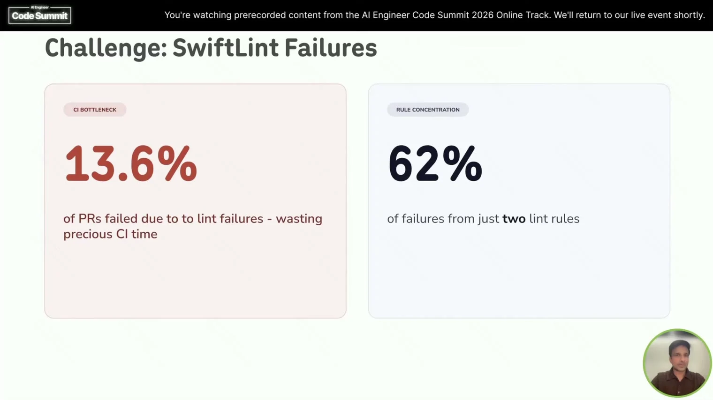

_截图 33  ·  录屏 04:27:00_

**04:27:01**　This wastes the agent's time and CI time as well, which is an increasingly scarce resource. For a while, 13.6% of our PRs were failing due to Lint, and then when we dug into it, 62% of those failures came from just two Lint rules. We fixed this in layers. The first was better examples in the prompt, along with pitfalls to avoid.

这也会浪费智能体的时间和CI时间，而这两种资源正变得越来越稀缺。有一段时间，13.6%的PR因为Lint而失败，后来我们深入调查后发现，其中62%的失败来自仅仅两条Lint规则。我们通过逐步改进解决了这个问题。首先是在提示中提供更好的示例，并指出需要避免的陷阱。

**04:27:16**　The second was a GitHub action that autofixes lint errors in CI. The third was an audit of the rules that couldn't be autofixed. We essentially removed the ones that weren't high signal, and this made life easier for both agents and human engineers. And finally, the real fix came when we moved the agents to turn on macrunners. So now the agents could build and lint the code locally before ever opening a PR.

第二个是 GitHub 动作，可以在 CI 环境中自动修复 lint 错误。第三个是对那些无法自动修复的规则进行审计。我们基本上移除了那些没有重要意义的规则，这让智能体和人类工程师的工作都变得简单了。最后，真正的解决方案是我们将智能体设置为可以启用 macrunners 功能。现在，智能体可以在打开 PR 之前在本地构建和 lint 代码。

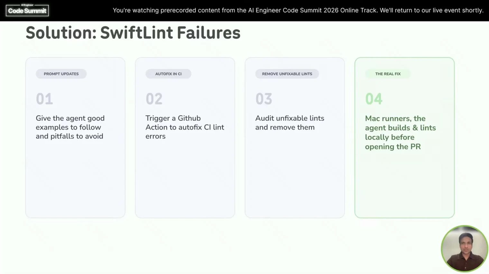

_截图 34  ·  录屏 04:27:21_

**04:27:34**　The second challenge was PR quality. When we assign a PR to a human, we want it to be something they'd actually feel comfortable proving. But agents sometimes take the shortest path to green CI. We saw agents editing production code to make a failing test pass. We also saw them modifying, deleting, or silencing existing tests. And then we saw them adding long wait to tests, which can make CI flaky.

第二个挑战是 PR 的质量。当我们将 PR 分配给人类时，我们希望这些 PR 是他们能够真正感到舒适的验证内容。但智能体有时会选择最短的路径来使 CI 通过。我们看到智能体编辑生产代码以让失败的测试通过。我们还看到他们修改、删除或隐藏现有的测试。然后我们又看到他们在测试中加入长时间的等待，这会导致 CI 不稳定。

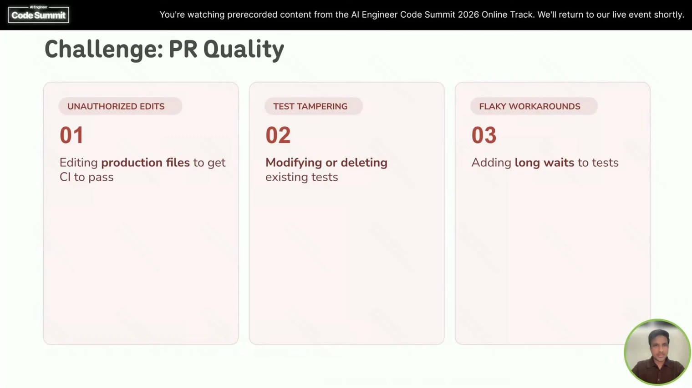

_截图 35  ·  录屏 04:27:42_

**04:27:52**　Again, there was no single fix here, so we built three layers. The first is the deterministic rule. If a PR touches any file that isn't a test, a mock, a fake, or a stub, we close it out. The second builds on our AI code review. At Duolingo, we use Claude and Codex to review every PR, and those bots often leave comments.

同样，这里没有单一的解决方案，因此我们设计了三个层次。第一层是确定性规则：如果一个 PR 涉及到的文件不是测试文件、模拟文件、假文件或模板文件，我们就将其关闭。第二层基于我们的 AI 代码审查机制——在 Duolingo 中，我们使用 Claude 和 Codex 来审查每个 PR，这些机器人通常会留下评论。

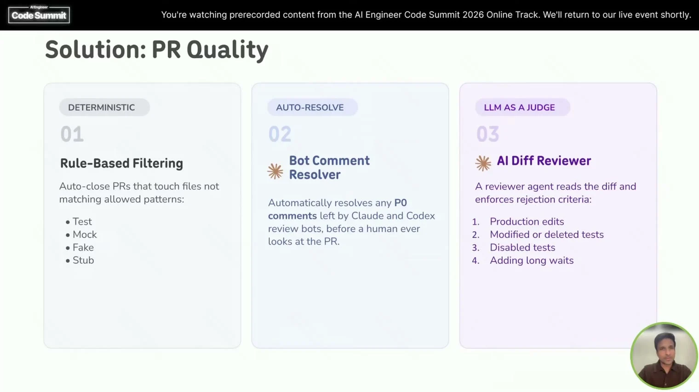

_截图 36  ·  录屏 04:28:03_

**04:28:07**　So we built an agent that resolves any P0 comments before a human ever looks at the PR. And the third is an LLM as a judge. Test PRs, it reads the PR diff and rejects production edits, changed or deleted tests, disabled tests, and long waits. And as we learn more, we keep adding additional checks to it. So far, the LLM as a judge has reviewed about 1200 PRs and rejected 73 of them.

因此，我们构建了一个智能体，能够在人类查看 PR 之前解决任何 P0 评论。第三项是作为评判者的 LLM。我们测试了这些 PR，它会读取 PR diff，并拒绝生产编辑、修改或删除的测试、禁用测试以及长时间等待的情况。随着我们不断学习，我们会继续添加更多检查项。到目前为止，作为评判者的 LLM已经审查了约 1200 个 PR，并拒绝了其中 73 个。

**04:28:29**　Every rejection comes with a comment like this one saying exactly why the PR was rejected. We then read that feedback and fold it back into our prompts and skills so the same mistakes get less likely each time. So let's talk about what all of this added up to. Since we started, the pipeline has merged more than 700 test PRs, adding about 225,000 lines of test code.

每次被拒绝时都会有一份评论说明为什么该 PR 被拒绝。我们会阅读这些反馈，并将其融入我们的提示和技能中，这样同样的错误就不会再出现。那么让我们来谈谈这一切带来的效果吧。从我们开始到现在，该流程已经合并了超过 700 个测试 PR，增加了约 225,000 行测试代码。

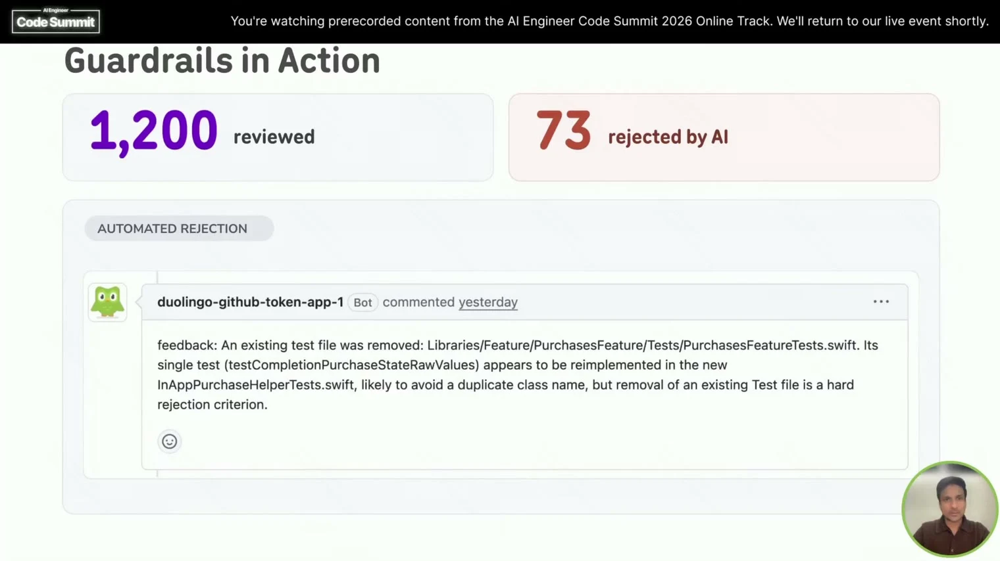

_截图 37  ·  录屏 04:28:32_

### 合并与覆盖率结果，以及可以迁移的流程

**04:28:46**　Every one of those PRs was reviewed and approved by a human. MVVM test coverage went from 9% to 59%, and overall coverage went from 11% to 24%. Most importantly, we now have a code base where engineers and agents can ship faster and with more confidence. Here's a few more interesting stats. Since March, the pipeline has written 34% of all new test files in the repo, 44% of all new test cases, and 10% of every Swift line added to the code base.

这些PR中的每一项都经过了人工审核并得到了批准。MVVM的测试覆盖率从9%提升到了59%，整体覆盖率也从11%上升到了24%。最重要的是，我们现在有了代码库，工程师和智能体可以更快速、更自信地发布代码。以下是几个有趣的统计数据：自3月以来，管道系统已经编写了仓库中所有新测试文件的34%，所有新测试案例的44%，以及代码中新增的每10个Swift行代码。

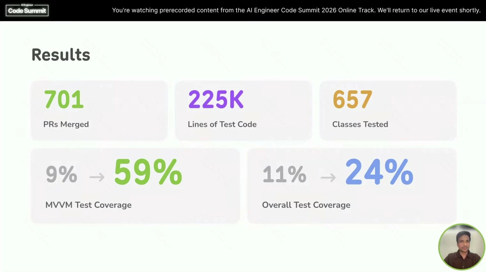

_截图 38  ·  录屏 04:28:49_

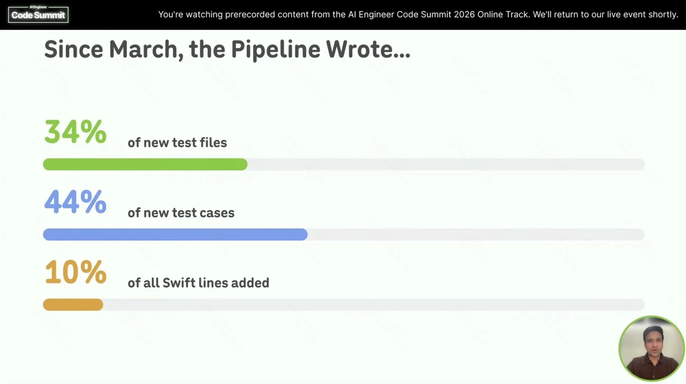

_截图 39  ·  录屏 04:29:05_

**04:29:08**　And interestingly, that share has actually dripped in the last few weeks a lot more tests themselves, which is honestly the end goal. And here's the coverage curve since April, when the backfill started running on a schedule. You can see it bent slightly upward around June and July, which is when we really wrapped up the pipeline. So what did we learn while doing this project?

有趣的是，过去几周这一比例实际上有所上升，说实话，这才是最终目标。以下是自4月开始按计划进行补充作业以来的覆盖曲线。可以看到，在6月和7月时曲线略微向上弯曲，那正是我们完成整个项目的时刻。那么，进行这个项目时我们学到了什么呢？

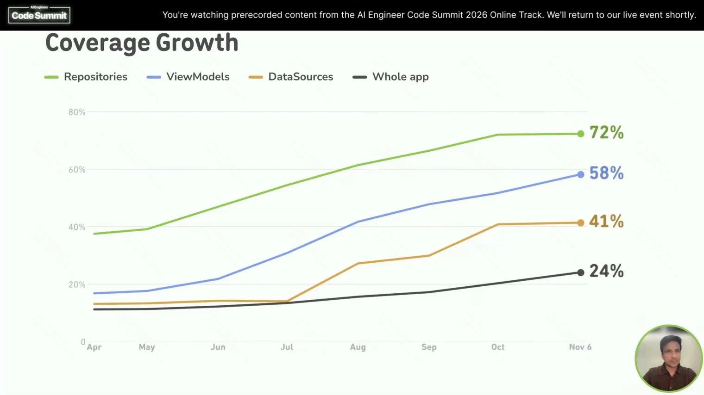

_截图 40  ·  录屏 04:29:18_

**04:29:27**　The first thing is that this pattern generalizes. The loop we talked about, identify, write, verify, resolve, and trade, it isn't specific to testing. Unit tests were just the lowest hanging fruit, and any job that fits the shape can run on the same infrastructure. And that's exactly what we're starting to do at the company. We're applying the same loop to modernization, to modernizing screens to MVVM and SwiftUI, migrating code on Android to coroutines, and generating snapshot tests.

首先，这种模式具有通用性。我们提到的循环——识别、编写、验证、解决和交易——并不局限于测试领域。单元测试只是最易实现的方案，任何符合该模式的任务都可以使用相同的基础设施来执行。而这正是我们公司在努力做的事情。我们将同样的循环应用于现代化改造中，比如将界面现代化为 MVVM 和 SwiftUI，将 Android 上的代码迁移到 coroutines 中，以及生成快照测试。

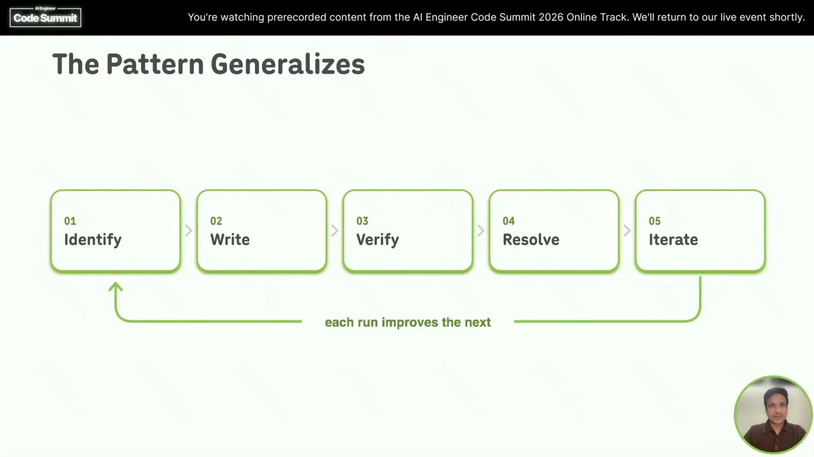

_截图 41  ·  录屏 04:29:30_

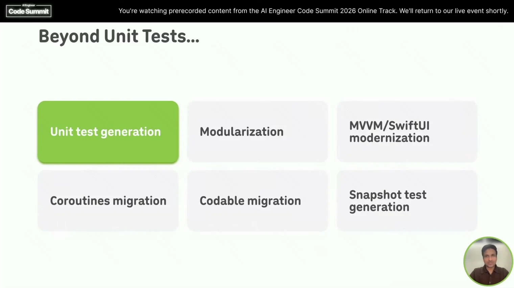

_截图 42  ·  录屏 04:29:43_

**04:29:49**　So before I wrap up, I want to leave you with a thought experiment. There's a new class of fast general purpose classifiers like Jev. They take in some state and output an action in milliseconds. So what if we replace a handwritten decision tree in the PR lifecycle workflow with one of these? PR state goes in, the classifier picks the next action, and we execute it all in milliseconds.

所以，在结束之前，我想给你一个思维实验。现在有一类新的快速通用分类器，比如 Jev。它们接收某种状态，然后在毫秒内输出一个动作。如果我们用这类分类器来替代 PR 生命周期工作流中的手写决策树会怎样呢？PR 状态输入后，分类器会选择下一个动作，我们能在毫秒内执行它。

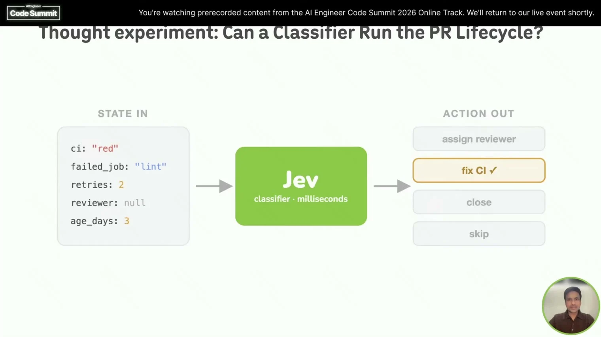

_截图 43  ·  录屏 04:29:55_

**04:30:07**　I also want to thank a few folks who worked on this with me, Jesse, Guadalupe, Hunter, and Jihao. They built a lot of the platform pieces this project stands on and helped review a lot of this code. That's it for me. Thank you so much for making it this far. If you want to go deeper, we've written about this pipeline on the Duolingo Engineering building something similar.

我也想感谢那些与我一起参与这项工作的朋友们：Jesse、Guadalupe、Hunter和Jihao。他们共同完成了这个项目所依赖的许多平台组件，还帮助审查了大量代码。这就是我的感谢了。非常感谢你们让项目能够发展到现在的状态。如果你们想更深入地了解，我们曾在Duolingo Engineering的博客上写过关于这个开发流程的文章，他们也做了类似的工作。

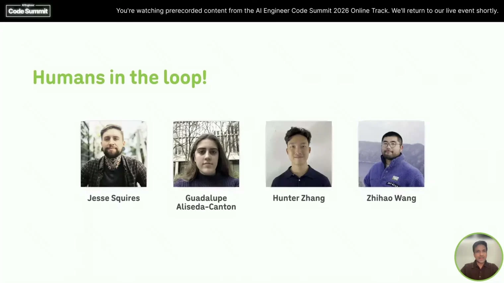

_截图 44  ·  录屏 04:30:08_

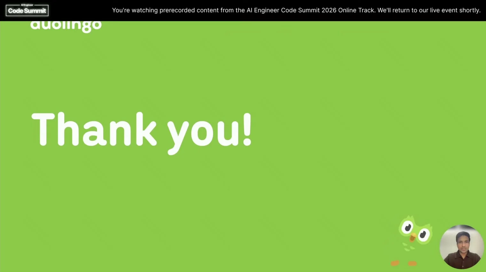

_截图 45  ·  录屏 04:30:20_

**04:30:22**　You can find me on LinkedIn or on X.

你可以在 LinkedIn 或 X 上找到我。

---

[全部演讲](../README.md) · [选看索引](index.md) · [上一场](14-tanmay-and-dolly-sah.md) · [下一场](16-roey-ben-chaim.md)
