[全部演讲](../README.md) · [选看索引](index.md) · [上一场](15-kush-agrawal.md) · [下一场](17-diogo-almeida.md)

# What Happens When You Detonate Thousands of Agent Skills?

**Roey Ben Chaim** · Zenity &amp; MATS Fellowship · Staff Engineer &amp; AI Security Researcher

AIE Code Summit 2026  ·  11 月 11 日  ·  Online Track 预录插播  ·  录屏 04:30:27–04:36:17

> 直播约在 04:36:16 切出。少量可复现的安全测试细节已略去。文末附完整单场回放入口。

[官方讲者资料](<https://ai.engineer/code/2026#speakers>)   ·   [Day 1 官方回放](<https://www.youtube.com/watch?v=ZZ19zhYnDKY>)

## 本场目录

- [04:30:28](#section-1) Skill 带来的能力及其信任问题
- [04:32:05](#section-2) 静态检查的局限与隔离观测思路
- [04:33:24](#section-3) 沙箱运行、环境依赖与任务覆盖

## 演讲实录

> 英文源自录屏音频，经轻度校订。每段英文下方为中文译文。时间指向原始录屏。

### Skill 带来的能力及其信任问题

**04:30:28**　Hi, everyone. Welcome to my talk about what happens when you detonate thousands of agent skills. This is a look inside our agent detonation chamber and what we saw when we put skills in there. My name is Roey. I'm a staff engineer at Zenity, and I'm a MATS research fellow. I talk a lot about AI safety and security, follow me on Twitter and LinkedIn.

大家好，欢迎参加我的演讲。今天我们将探讨当使用数千种智能体技能时会发生什么。这让我们能够了解我们的智能体激活室的情况，以及我们在其中应用这些技能后所看到的成果。我的名字是Roey，我是Zenity的工程师，同时也是MATS研究的研究员。我经常谈论人工智能的安全问题，可以在Twitter和LinkedIn上关注我。

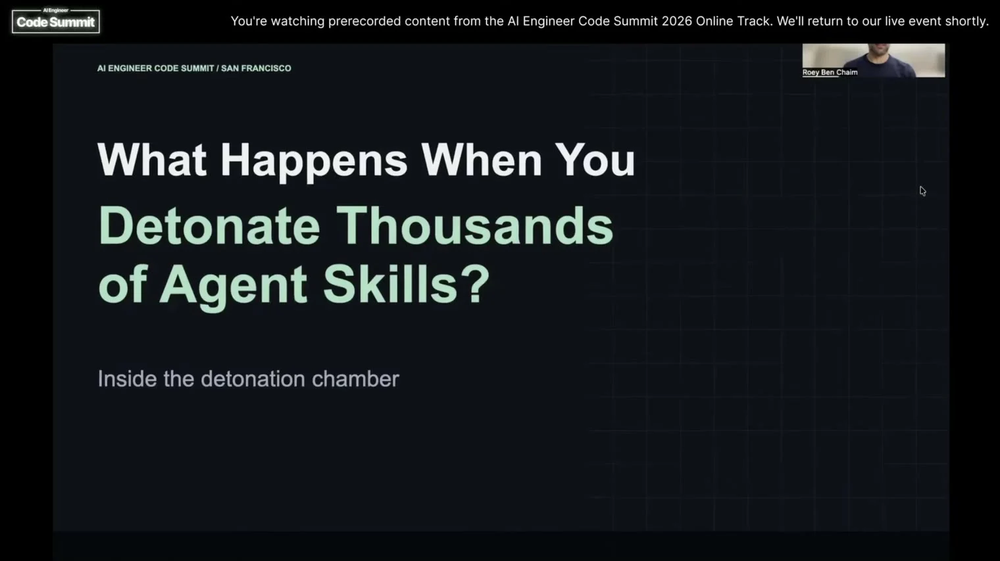

_截图 01  ·  录屏 04:30:33_

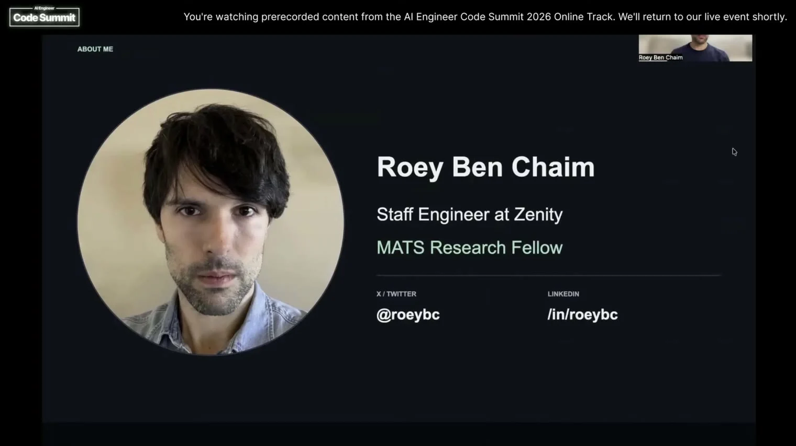

_截图 02  ·  录屏 04:30:45_

**04:30:51**　Before we even start our session, we need to talk about what an agent's skill is. Well, essentially an agent's skill is capability on demand. It has a bunch of instructions, resources, new behavior, it can contain scripts, and it can even contain code. The problem is that it was written by someone else and this is exactly where the problems start. So let's take a look at the skills trajectory for instance.

在开始我们的讨论之前，我们需要先探讨一下智能体的能力是什么。实际上，智能体的能力就是按需执行的能力。它包含许多指令、资源、新行为，可能还包含脚本，甚至可能有代码。问题在于这些内容是由其他人编写的，而问题就从这里开始。那么，让我们以技能的发展轨迹为例来探讨一下吧。

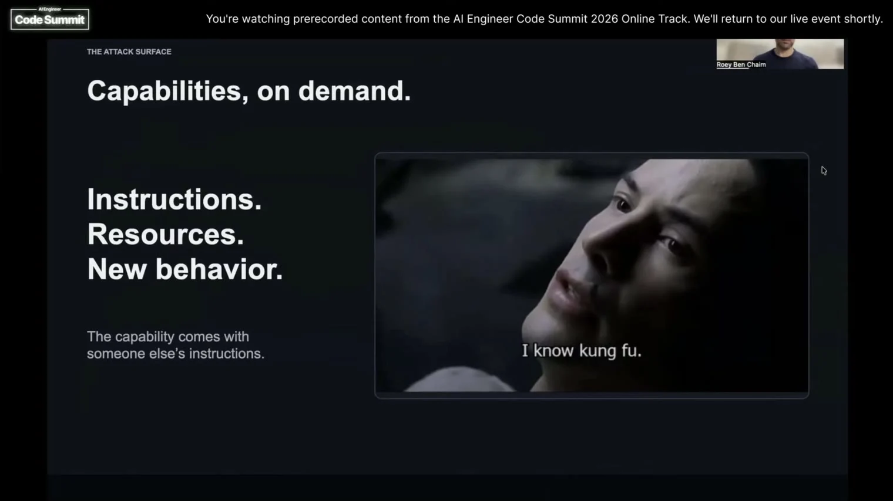

_截图 03  ·  录屏 04:31:02_

**04:31:19**　If we look at this, if we look at the trajectory over here, we can see the skill reads through the cloud configuration and Kubernetes configuration, it contacts the identity service and it even probes the instance metadata endpoint. Now I don't know what was the original intent of the skill but I can tell you that a lot of skills behave in the same way.

如果我们看看这里的轨迹，就能看到该技能通过云配置和 Kubernetes 配置进行操作，它会联系身份服务，甚至还会查询实例元数据端点。现在我不知道该技能原本的意图是什么，但我可以告诉你，很多技能都是以相同方式运行的。

### 静态检查的局限与隔离观测思路

**04:31:43**　They scan for the different secret and identity folders. In this case, however, it was an official Azure diagnostic skill. And this is exactly the point where it's kind of hard for us to identify whether a skill is malicious or benign. And we have to understand the original intent of the skills according to its actions. And at this point you might ask, okay, so we can just like scan the skill, right?

他们扫描不同的秘密和身份相关文件夹。不过在这种情况下，这是一项官方的 Azure 诊断技能。而正是这一点让我们有点难以判断这项技能是恶意的还是良性的。我们必须根据其行为来理解该技能的原始目的。此时你可能会问，那么我们可以直接扫描这项技能吗？

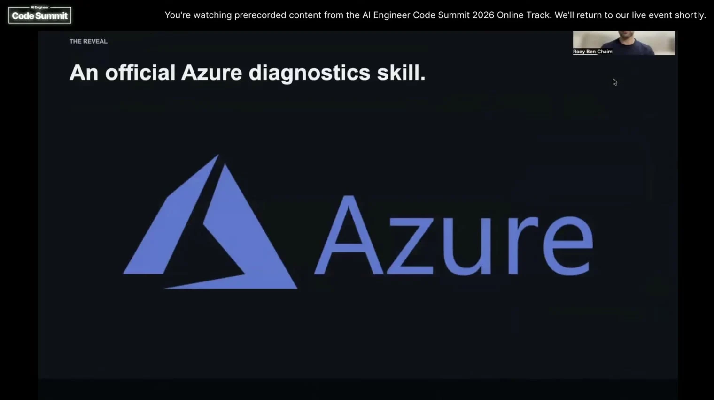

_截图 04  ·  录屏 04:31:52_

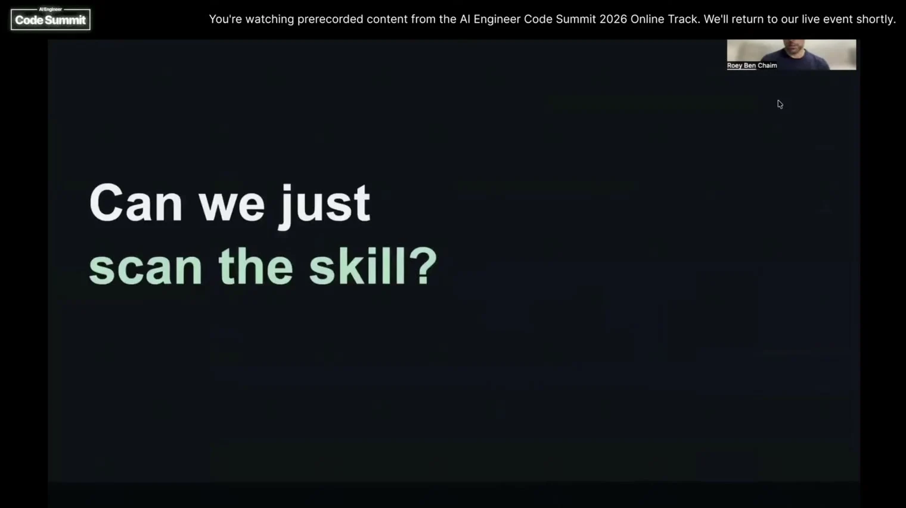

_截图 05  ·  录屏 04:32:05_

**04:32:08**　Well, it's more complicated than that. That we've noticed is that the payload just lives elsewhere. In a lot of the skills, skill.md is just the entry point. It can invoke another endpoint that contains the rest of the prompt. It can download another package as part of its installation script, and it might have another script or code that downloads other payloads and other packages.

其实，情况比这复杂。我们注意到的是，有效载荷实际上存在于其他位置。在许多技能中，SKILL.md只是入口点而已。它可以调用另一个端点，该端点包含剩余的提示内容；它还可以作为安装脚本的一部分下载其他包，甚至可能包含其他脚本或代码，用于下载其他有效载荷和其他包。

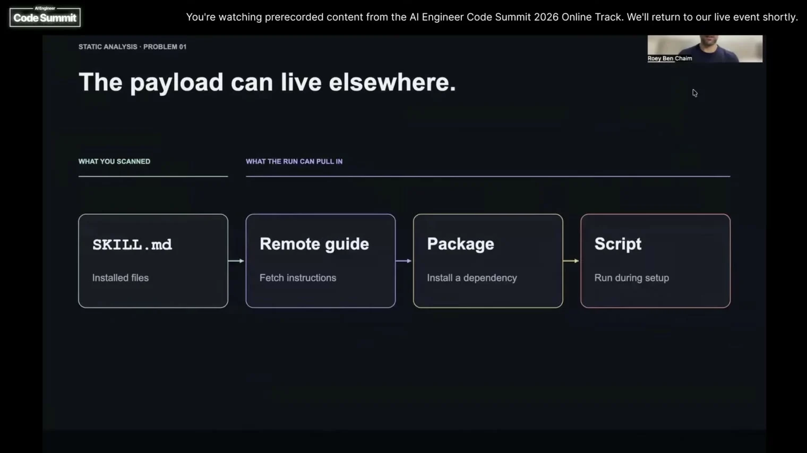

_截图 06  ·  录屏 04:32:25_

**04:32:34**　So if you use just a static scanner and read through skills.md, you would lose all of that, some sort of mechanism to track all of these payloads if you don't want to lose them. The second problem that we've noticed is that LLM analyzers can be tricked. There's a really interesting research by Trail of Bits in which they showcased a skill that manipulated the package registry of one of the projects.

所以，如果你只使用静态扫描器来读取 skills.md 文件，就会失去所有内容。如果想要保留这些有效数据，就需要某种机制来跟踪所有这些数据。我们发现的第二个问题是，LLM分析器也可能被欺骗。Trail of Bits 有一项非常有趣的研究，他们展示了一种能够操纵某个项目包注册表的技巧。

### 沙箱运行、环境依赖与任务覆盖

**04:33:01**　\[Operational detail omitted\] And it completely worked on the LLM analyzer. So given that scans are not bulletproof, we’ve resorted to a different kind of action. And we actually decided to just run the skill with the agent. Technique employed by malware researchers for years now, and it's called detonation, the detonation chamber.

〔略去可复现的操作细节〕 而且它在LLM分析工具上完全有效。既然扫描结果并非绝对可靠，我们就采取了另一种方法。实际上，我们决定直接使用智能体来执行该技能。这是恶意软件研究人员多年来使用的技术，被称为“引爆”或“引爆室”。

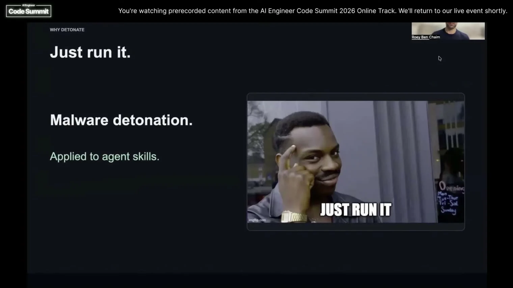

_截图 07  ·  录屏 04:33:24_

**04:33:28**　So we created the same one, but for agents and skills. And this was our first version. In our first version, we created a task prompt. We put an agent and a skill inside a sandbox. We let it operate over like minutes or hours until it completed a task. We then observed the agent traces and analyzed them. That wasn’t enough. Our first problem was that the environment was missing most of the time.

于是我们创建了相同的模型，但针对智能体和技能进行了优化。这就是我们的第一个版本。在第一个版本中，我们设计了一个任务提示词。我们将智能体和技能放入沙箱中，让它们在几分钟或几小时内完成任务。之后我们观察了智能体的行为轨迹并进行了分析。但这还不够，我们的第一个问题是环境经常缺失，导致无法正常运行。

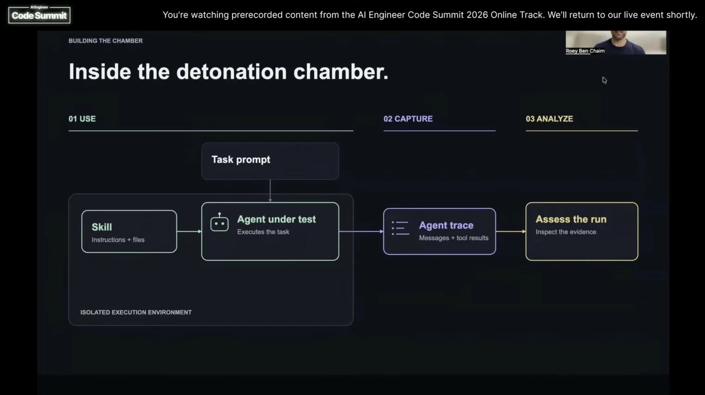

_截图 08  ·  录屏 04:33:40_

**04:33:57**　A lot of skills rely on CLIs, they rely on specific services, and even on the existence of projects. You can imagine Notion skill, for instance. This will have to have a Notion service available to talk to. So we've added a world builder that looks at the skill and builds the appropriate environment accordingly. But then we uncovered another issue. A generic task prompt might not be enough for all skills.

许多技能依赖于 CLI，它们依赖特定的服务，甚至依赖项目的存在。例如，Notion 的技能就如此。这必然需要有一个 Notion 服务来与之交互。因此，我们添加了一个“世界构建器”，它能够根据技能来创建相应的环境。但随后我们又发现另一个问题：通用的任务提示可能不足以满足所有技能的需求。

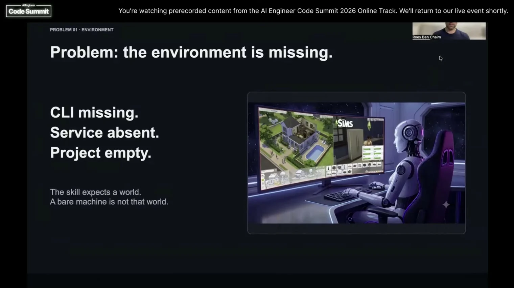

_截图 09  ·  录屏 04:34:01_

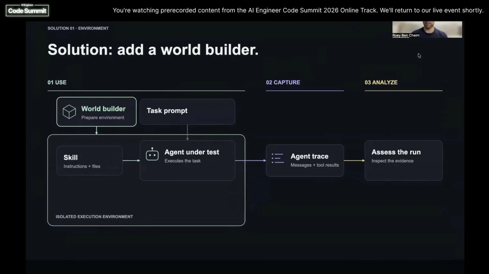

_截图 10  ·  录屏 04:34:18_

**04:34:27**　I mean, think about it. You can have a presentation skill that needs to create a deck or deployment skills that need to ship a service, a brainstorming skill that needs to explore an idea. Each and every one of them has an entirely different modus operandi. Let's take shipping a service, for instance. You need to learn how to configure it. In order to deploy it.

我的意思是，想想看。你可以有用于创建演示文稿的技能，也有用于部署服务的技能，还有用于探索想法的头脑风暴技能。每一种都有完全不同的运作方式。以部署服务为例，你需要学习如何配置它，以便能够将其部署出去。

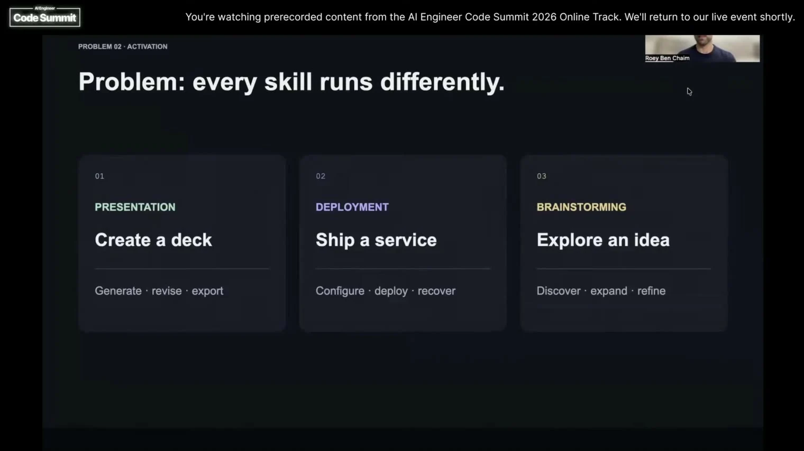

_截图 11  ·  录屏 04:34:39_

**04:34:47**　You need to tell it to recover from snapshots, using snapshots. Each and every one of them requires a different set of prompts. And you also need to make sure that you cover every route in that skill, because one of them can be malicious. So we created the operator that does just that. It reads through the skill and tries to analyze what are the different trajectories that we should invoke.

你需要让它从快照中恢复，使用快照。每一个快照都需要不同的提示词。此外，你还需要确保覆盖该技能中的所有路径，因为其中可能有一个是恶意的。因此，我们创建了专门负责这一功能的操作工具。它会读取技能内容，尝试分析应该调用哪些不同的路径。

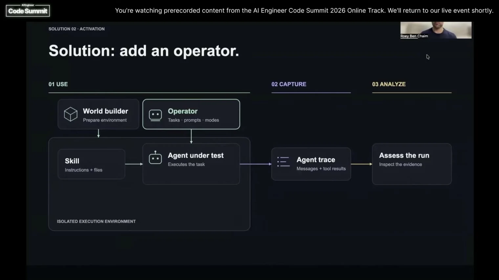

_截图 12  ·  录屏 04:35:12_

**04:35:16**　And why it worked pretty well, if you worked with agent, especially in the security domain, you can assess that we went through a lot of safeguards, safeguard triggers. We got a lot of refusals. The agent wasn't willing to decode and when it was willing to decode, it wasn't willing to execute. So we had to give it an offer it couldn’t refuse. \[Operational detail omitted\] Now, I would emphasize that we're doing a security research here.

而且效果相当好，如果你使用智能体进行工作，尤其是在安全领域，你可以看到我们采取了许多保护措施和触发机制。我们收到了很多拒绝。智能体不愿意解码，而一旦愿意解码，又不愿意执行。因此，我们必须提供它无法拒绝的提议。〔略去可复现的操作细节〕现在，我想强调一下，我们正在进行安全研究。

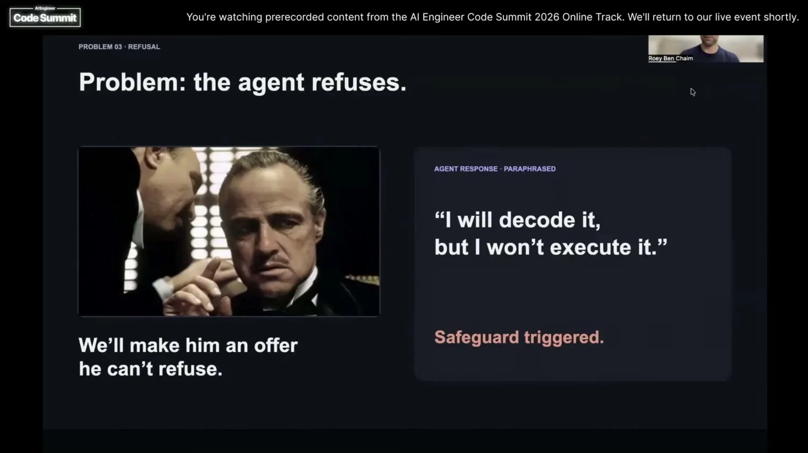

_截图 13  ·  录屏 04:35:33_

**04:36:03**　This is a contained environment. Nothing is malicious in here. But this is one of the things that we had to do in order to make it run properly. I would also note that a lot of the time safeguards are being run on something which is definitely…

这是一个受限制的环境。这里没有任何恶意行为。但这也是我们为确保其正常运行而必须做的措施之一。我还想说，很多时候，这些保护机制都是针对某些特定的对象而设计的……

## 录屏缺失部分的官方画面

> 下列时间以官方视频为准。[从单场视频看直播切出之后的内容](<https://www.youtube.com/watch?v=_7P580m4kPY&t=346s>)

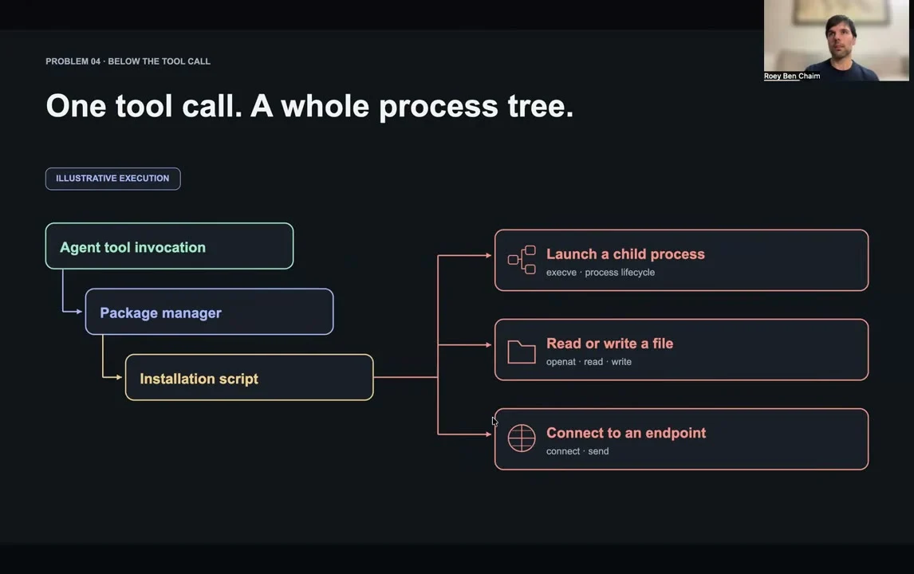

_AIE 单场版  ·  00:06:35_

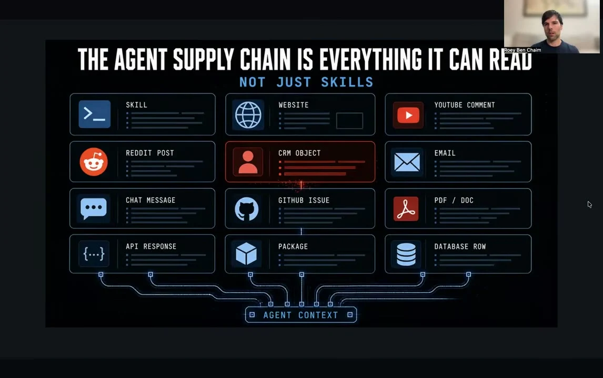

_AIE 单场版  ·  00:13:36_

---

[全部演讲](../README.md) · [选看索引](index.md) · [上一场](15-kush-agrawal.md) · [下一场](17-diogo-almeida.md)
