[全部演讲](../README.md) · [选看索引](index.md) · [上一场](16-roey-ben-chaim.md) · [下一场](18-chinmay-goyal.md)

# I love you so jevving much

**Diogo Almeida** · TypeSafe AI · Co-founder &amp; CEO

AIE Code Summit 2026  ·  11 月 11 日  ·  主舞台  ·  录屏 04:41:36–05:04:48

[官方议程](<https://ai.engineer/code/2026/schedule>)   ·   [Day 1 官方回放](<https://www.youtube.com/watch?v=ZZ19zhYnDKY>)

## 本场目录

- [04:42:00](#section-1) 为什么辅助能力强，自动化仍有缺口
- [04:47:30](#section-2) 训练目标、可靠判断及 Jev 的产品定位
- [04:54:01](#section-3) 从判断组件到软件工程中的新组合
- [05:00:12](#section-4) 实时判断、语义类型和交互界面的设想

## 演讲实录

> 英文源自录屏音频，经轻度校订。每段英文下方为中文译文。时间指向原始录屏。

**04:41:38**　Thank you.

谢谢。

### 为什么辅助能力强，自动化仍有缺口

**04:41:54**　I have to make sure this is working. Heck yeah. I'm Diogo Almeida, and this talk is I Love You So Jeving Much. Glass Animals reference. We're not just weird. Like I said, I'm Diogo Almeida. I'm known as the Jev guy, sometimes Jevy Pinkman, also co-created ChatGPT, RLHF, and InstructGPT. But I assume that for the crowd today, y’all know who I am, at least mostly.

我得确保这能正常运行。当然了。我是 Diogo Almeida，这次谈话的主题是“我如此爱你，Jeving Much”。参考了 Glass Animals的内容。我们不只是很奇怪而已。就像我说的，我是 Diogo Almeida。人们都叫我“Jev guy”，有时候也叫 Jevy Pinkman，还共同创造了 ChatGPT、RLHF 和 InstructGPT。不过我想，今天的听众们至少大部分都知道我是谁吧。

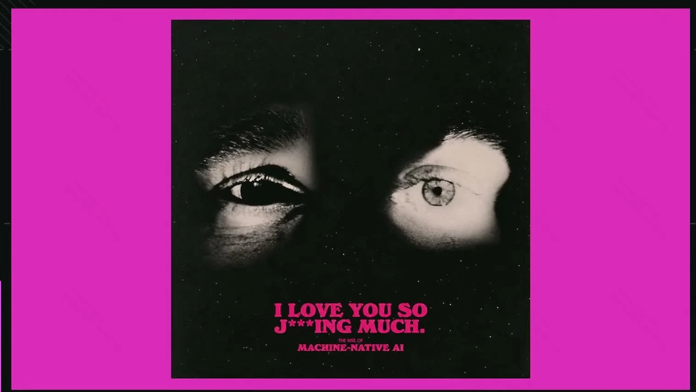

_截图 01  ·  录屏 04:42:00_

_截图 02  ·  录屏 04:42:13_

**04:42:23**　I have a bunch of AIE-specific stuff I want to get to, but I like going into my favorite topics in AI. First one is, what the fuck is actually going on? And where is all the automation? If you've heard me say this before, I'm sorry. But it's such an important thing to beat into the field, because people still do not get it.

我有很多与 AIE 相关的东西想要完成，但我更喜欢深入探索我最感兴趣的 AI 主题。第一个问题是，到底发生了什么？自动化又在哪里呢？如果你们以前听过我这么说，我很抱歉。但这是必须推广到领域里的重要事情，因为人们仍然没有理解这一点。

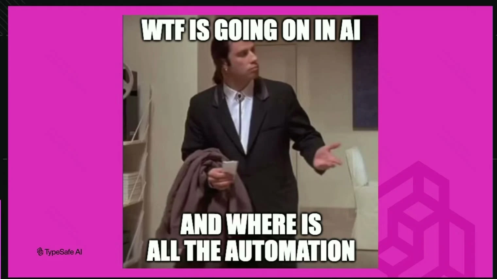

_截图 03  ·  录屏 04:42:34_

**04:42:41**　And I need to yell this until everyone really understands what the fuck is going on. And if you're an AI, you should have a really good answer AI can do so many awesome things and yet still be so useless for a bunch of other ones. My relationship to ChatGPT is somewhat unique. One of the few people who hates on ChatGPT who made it.

我必须大声喊出来，让所有人真正明白到底发生了什么。如果你是一个人工智能，你应该能给出很好的回答——人工智能可以做很多很棒的事情，却仍然在许多其他方面毫无用处。我与 ChatGPT 的关系有些特殊。我是少数几个讨厌 ChatGPT 的人之一，毕竟它是我创造的。

**04:43:01**　I don't hate ChatGPT, to be clear. I love using agents. I love using coding agents. I love chatbots. They're just quite limited. And in particular, I think it's a little tragic how much they've bifurcated the field into over-promise, under-deliver. Really, really terrible stuff for the world, in my opinion. And I like to talk about the two cults in AI and how we can resolve the cognitive dissonance that everyone, I think, should be having unless they have a very good answer.

我并不讨厌 ChatGPT，明确地说。我喜欢使用智能体。我喜欢使用编程智能体。我也喜欢聊天机器人。但它们其实相当有限。尤其是，我认为它们把领域分成了过度承诺和交付不足的情况，这很令人遗憾。在我看来，这对世界来说是非常糟糕的事情。我也想谈谈人工智能中的两种极端观点，以及我们如何解决那些我认为每个人都应该面临的认知矛盾，除非他们能给出很好的解决方案。

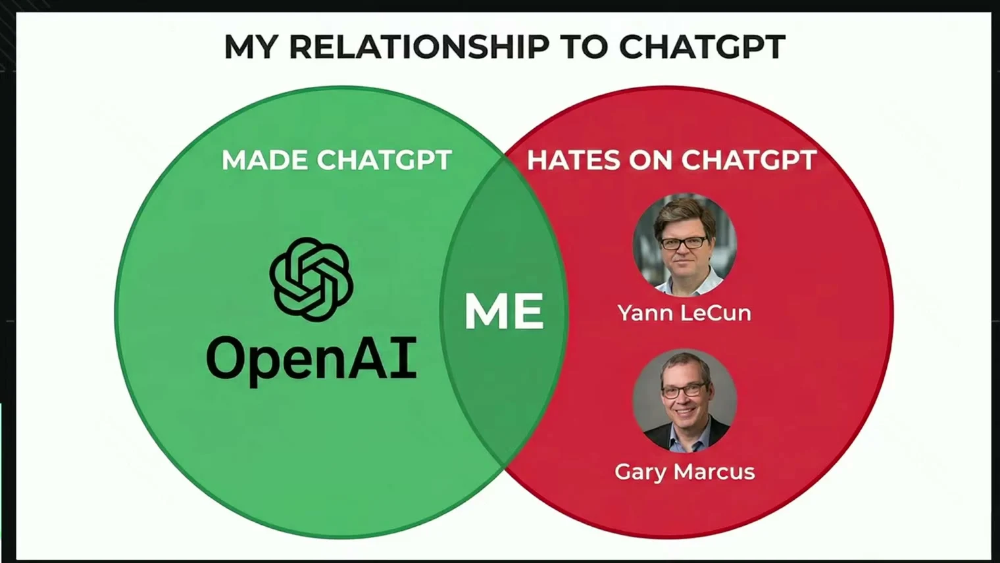

_截图 04  ·  录屏 04:43:03_

**04:43:29**　There's cult one, which is the cult of EAs. They look at all the benchmarks, and they say, not only are LMs surpassing human level on basically every benchmark, they have been for two years. We've been announcing AGI three months away for two years now, even since the 03 days. Do people remember that? No one even cares about that model anymore. That was like peak internal to OpenAI AGI hype.

还有一种“邪教”现象，就是对 AI 的崇拜。他们查看所有的基准测试，声称不仅语言模型在几乎所有测试中都超过了人类水平，而且这种状况已经持续了两年。我们也一直在宣传 AGI 的诞生，其实已经持续了两年，甚至从 03 天开始就如此了。人们还记得吗？现在根本没人关心那个模型了。那曾是 OpenAI AGI 最热门的时期。

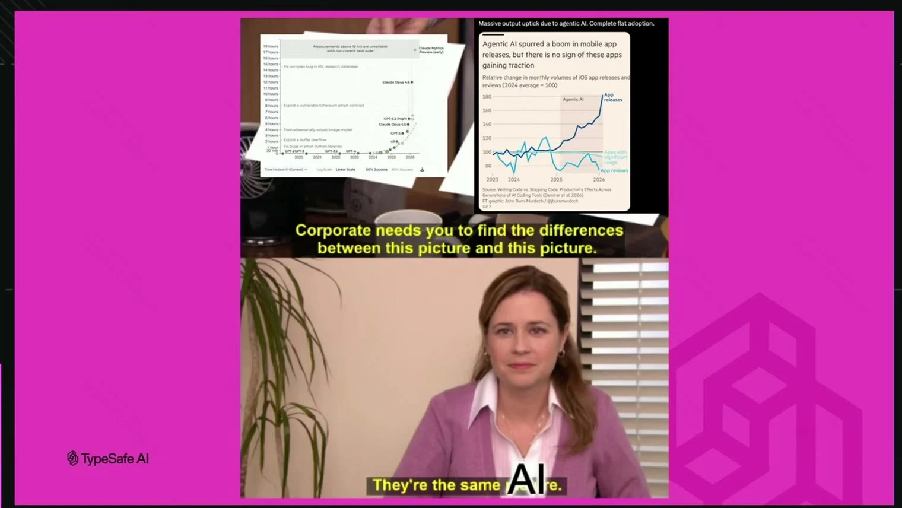

_截图 05  ·  录屏 04:43:40_

**04:43:53**　And on the other hand, you look at the non-benchmarks, and you look at the reality, and you see the rest of the world, especially if you guys go outside and leave San Francisco. A lot of the world is really unchanged, despite AI being so fucking cool. And I think AI is transformative. It's a rare point of view to actually think AI is cool and transformative, and also underwhelming the world right now.

另一方面，你看看那些非基准测试，看看现实情况，你会发现世界其他地方的情况也差不多，尤其是当你离开旧金山后。尽管人工智能非常先进，但世界上的许多地方其实并没有改变。我认为人工智能具有变革性。能够真正认识到人工智能既很酷又具有变革性，同时又能让世界发生积极变化，这是非常罕见的观点。

**04:44:16**　And the tricky part is this is the same field. All seeing the same facts. So what gives? Why is AI jagged, so to speak? Why can it be so good at some things and so not good at other things? And what is the Occam's Razor explanation for that? I will be blasting through my slides fast. I'm sorry. Maybe I could slow down for people taking pictures.

而棘手的是，这其实是一个相同的领域。所有人都在看到相同的事实。那么为什么会这样呢？为什么人工智能在某些方面表现出色，而在其他方面却如此糟糕？对此，奥卡姆剃刀原理又能解释什么呢？我很快就会快速展示我的幻灯片。抱歉，也许我可以放慢速度，让那些拍照的人能更仔细地观看。

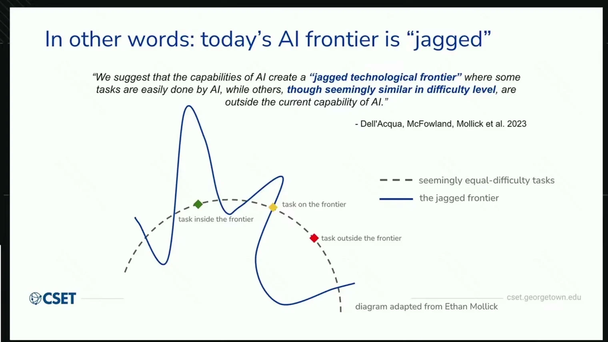

_截图 06  ·  录屏 04:44:26_

**04:44:39**　But I'm noticing that this is going to go fast, is all I'm saying. So I think that we as a field should have an Occam's Razor explanation for why are there some things that are just not just good, they are unbelievably good, superhuman, like Millennium Prize problems in math. But on the other hand, they're not just bad, they're so useless, they can't even be used to touch accounting.

但我注意到，这一切会进展得很快，仅此而已。因此我认为，作为这个领域的从业者，我们应该用“奥卡姆剃刀原则”来解释为什么有些东西根本不怎么样，它们却异常出色、超乎寻常，就像数学领域的千年大奖问题那样。但另一方面，它们也不只是糟糕，简直毫无用处，甚至无法用于任何会计工作。

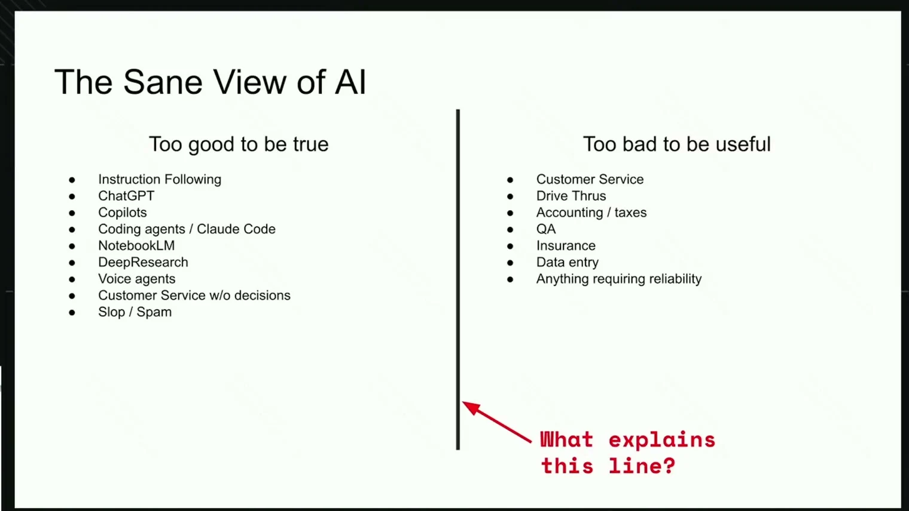

_截图 07  ·  录屏 04:44:51_

**04:45:01**　That sounds way easier than Millennium Prize problems in math, right? I could do the latter. I definitely could not do the former, and I was a mathlete. So what gives here? What is the reason for this? And I normally love this as an interactive thing, but I will instead just tell you my answer. Sorry for the power dynamic. Everything on the left side is intrinsically a human in the loop task.

这似乎比数学领域的千年大奖问题要容易得多，对吧？我能解决后者。但绝对无法应对前者，而且我本来就是个数学爱好者。那么这里到底是怎么回事呢？原因是什么？通常我喜欢这种互动式的内容，不过现在我就直接告诉你我的答案吧。抱歉带来这种权力关系。左侧的所有内容本质上都是涉及人类参与的任务。

**04:45:22**　Deep research, I could not do better than deep research. The models are so fucking good at that. But if gun to my head, or gun to your head, you had to pick between me and deep research, and the answer had to be correct, not well written, you'd probably pick me every time. And that's the distinction between optimizing for automation, which tends to be a lot easier and a lot simpler, yet AI keeps failing at this.

深度研究，我无法做出更好的选择。这些模型在这一点上非常出色。但如果你面临“用枪抵住我的头”或“用枪抵住你的头”的情况，你必须在“我”和“深度研究”之间做出选择，而且答案必须是正确的，而不是写得好的——你可能每次都会选择我。这就是优化以实现自动化与优化以进行深度研究之间的区别，后者通常要容易得多、简单得多，但人工智能却始终无法做到这一点。

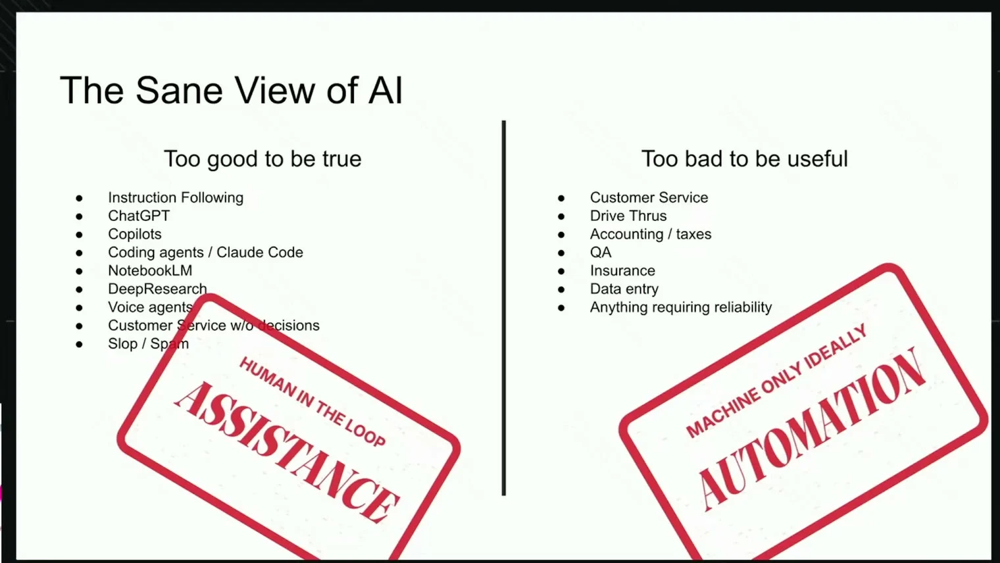

_截图 08  ·  录屏 04:45:33_

**04:45:44**　Every year there's an infamous failure of AI failing to even automate drive-throughs. And that should be kind of shocking to people. And my claim is, actually, for these tasks, pleasing a human is nothing to do with doing the task. What you want to do is basically be an abstraction away. You want the decision to be made, and then you want to get back into doing automation.

每年都会发生一次著名的AI失败事件，甚至无法实现自动点餐功能。这对人们来说应该会令人震惊。实际上，我认为对于这些任务而言，让人类满意与完成任务本身无关。你真正想要的是将决策过程抽象化，然后就可以重新进行自动化操作。

**04:46:05**　And code is the language of automation. Therefore, you need to integrate with code. This is a lot, but I will summarize it again. I get the irony that I co-created RLHF, and I do believe RLHF is part of the problem. And RLHF in particular is why all AI today does require a human in the loop, with an asterisk, unless the task is very trivially verifiable and can run on its own, but still requires a human in the loop to verify it afterwards.

代码是自动化的语言。因此，你需要与代码进行集成。这很复杂，但我还是会再次总结一下。我觉得很有讽刺意味的是，我参与了 RLHF 的创建，而我相信 RLHF 也是问题的一部分。尤其是 RLHF，使得如今所有的 AI 都需要在人类参与下进行验证——除非任务非常简单且可以独立运行，但依然需要人类来最终验证。

_截图 09  ·  录屏 04:46:10_

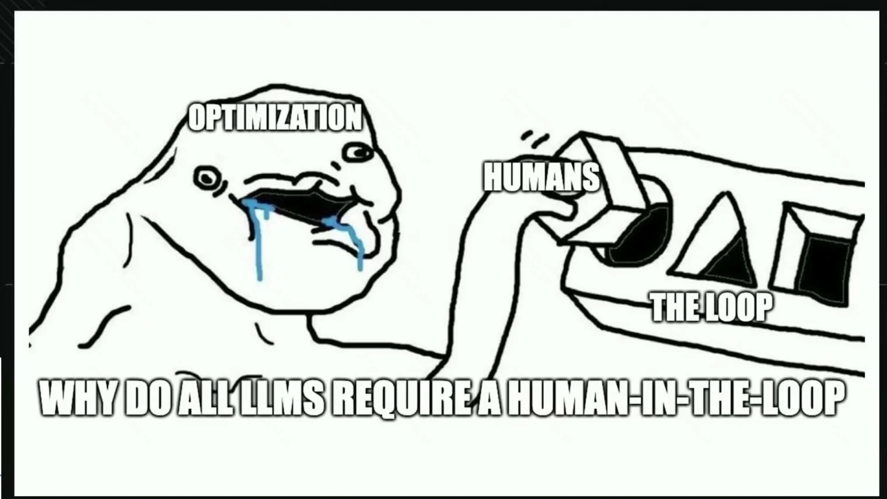

_截图 10  ·  录屏 04:46:23_

**04:46:30**　It is because we literally put it in. That is what the HF is in RLHF. And my claim is that there's a better way. My summary of the state is 100% of LMs today are optimized for assistance. You might talk about RLVR, but the RLVR models are very bad to interact with. If they've not been RLHFed. The result is LMs become too good to be true at assistance.

因为我们实际上就是将其放入其中。这就是 RLHF 中 HF 的本质。我的观点是，有更好的方法。我对当前 LMs 状态的总结是：100% 的 LMs 都经过优化以用于辅助任务。你可能会提到 RLVR，但 RLVR 模型在交互方面表现很差。如果它们没有经过 RLHF 处理，结果就是 LMs 变得过于优秀，难以置信。

**04:46:52**　They are just so fucking good. You should never pick me over ChatGPT for your ChatGPT queries. But for actually doing run-in-the-background cognitive work, you should not trust LMs at all, because they have not been optimized for that, which is why they're so bad at the tasks of automation. And I would also guess that automation is a lot more valuable than assistance, because you can do way cooler, deeper.

它们真的太棒了。在处理与 ChatGPT 相关的任务时，你永远不应该用我来替代 ChatGPT。但对于需要进行后台认知性工作的任务来说，你根本不应该依赖 LMs，因为它们没有针对这些任务进行优化，因此它们在自动化任务上表现很差。我还认为，自动化比辅助功能更有价值，因为你可以完成更酷、更深入的工作。

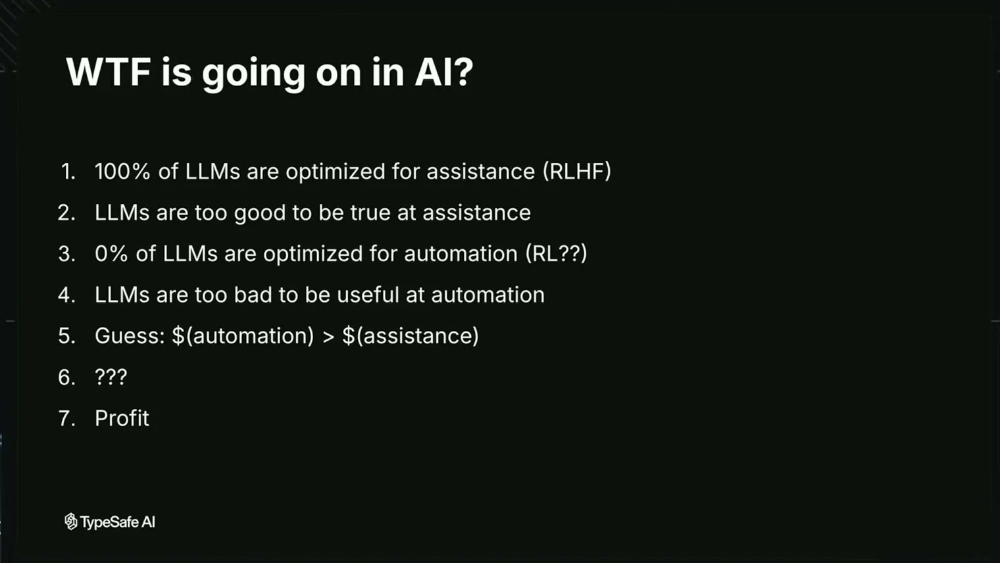

_截图 11  ·  录屏 04:46:52_

### 训练目标、可靠判断及 Jev 的产品定位

**04:47:14**　I'm going to get into this later, but I think there's going to be so much stuff do, and we are just scratching the surface of that right now. And that's the tragic thing about AI, the state of AI for me. Let's talk about the Gevolution. I can't tell if this is appropriate, but it's too late. Oh, god, don't take pictures of this one.

我稍后会详细讨论这个，但我觉得还有很多事情需要处理，而目前我们只是触及了表面。这就是人工智能的悲剧之处，也是我对人工智能现状的看法。让我们来谈谈进化吧。我不确定这是否合适，但已经太晚了。哦，天哪，不要拍下这个了。

_截图 12  ·  录屏 04:47:30_

**04:47:34**　Cool. Oh, I'm getting a thumbs up. Yeah, excellent. So instead of doing RLHF, we just have to do something else. We need to think from first principles, how do we optimize for machine-native AI? Of Jev, and that is what we are doing. More important than optimizing for its interface, we are rethinking how AI should be done, because this is what we did again for RLHF.

不错。哦，我得到了点赞。是的，非常棒。所以，我们不用进行 RLHF 了，只需要做其他事情。我们需要从根本出发思考，如何优化机器原生 AI？这就是我们在做的 Jev 项目。比优化其界面更重要的，是我们重新思考 AI 应该如何运作，因为这也是我们在 RLHF 中所做的。

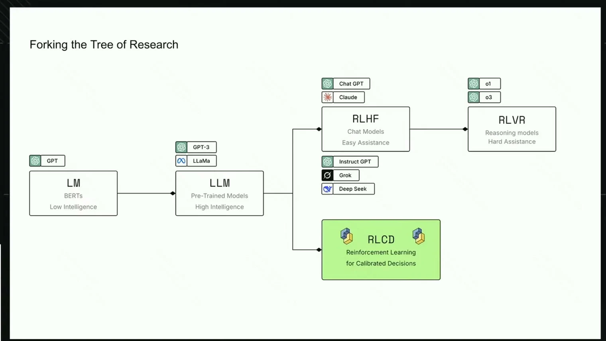

_截图 13  ·  录屏 04:47:42_

**04:47:57**　For Sutton's bitter lesson, I'm going to loosely paraphrase to make my point easier to say, is that scaling and compute matters more than algorithms. This is why people become like scaling-pilled Givronis, and I would argue that there's an even bitterer lesson than that, which is data always matters more than compute. We are learning that quite a bit in the field now, but it has been obvious since and this is the one you should be photographing, I would argue that the bitterest lesson is doing the right task.

对于萨顿那惨痛的教训，我打算用一种简化的方式来表达，以便更轻松地说明观点：规模与计算比算法更重要。这就是为什么人们会像被规模压垮的吉夫罗尼斯那样，我认为还有更惨痛的教训，那就是数据永远比计算更重要。我们现在在这个领域正在学习很多东西，但这一点从一开始就是显而易见的，这是你应该重点关注的方面。我认为最惨痛的教训是做正确的事情。

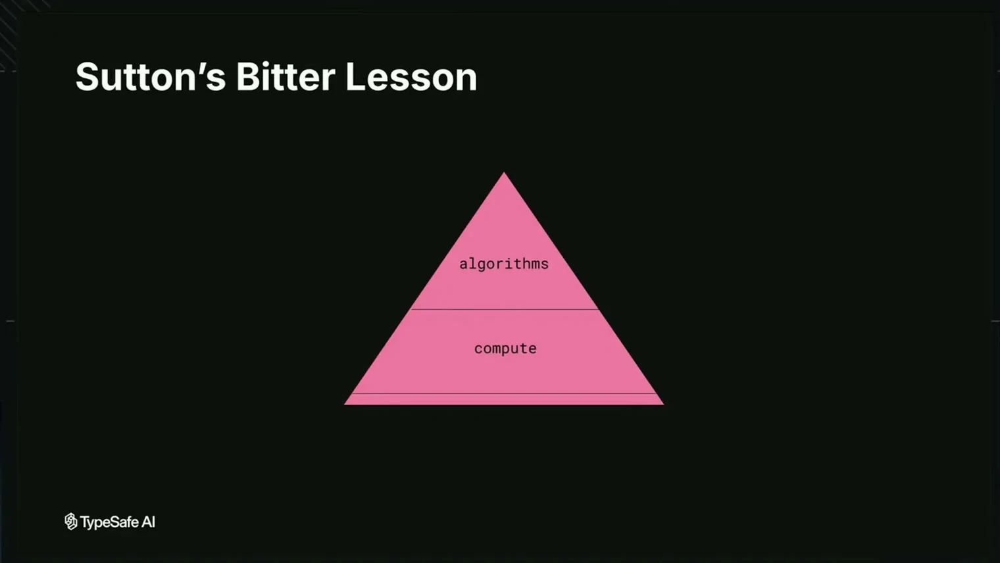

_截图 14  ·  录屏 04:47:59_

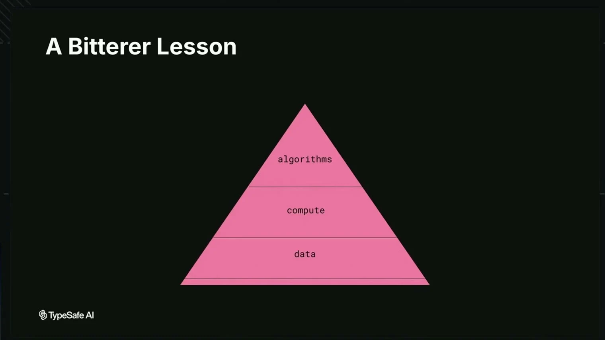

_截图 15  ·  录屏 04:48:15_

**04:48:28**　And doing the right task is a weird thing to think about, especially for ML people, because they like algorithms. They want number goes down or up or whichever is a good direction. They don't want to think about the real world. But this is always how you make gigantic gains in performance. This is how the big breakthroughs happen. 100% of the time, it comes from this.

做正确的事情确实很奇怪，尤其是对于机器学习领域的人来说，因为他们喜欢算法。他们希望数字能够下降或上升，或者处于任何有利的方向。他们不想考虑现实世界的问题。但这就是实现巨大性能提升的必经之路。也是重大突破发生的途径。100%的情况都是如此。

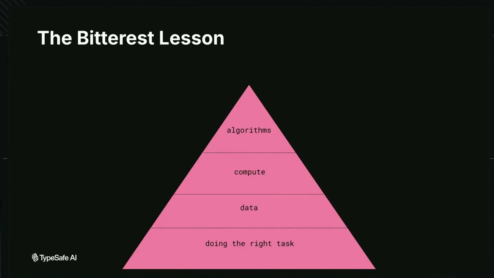

_截图 16  ·  录屏 04:48:32_

**04:48:46**　And this is true for classical RL games. This is why Sutton had his bitter lesson, Data is derived by compute when you're doing rollouts. Like, why would you need off-policy data when playing chess or something like that? And doing the right task is defined by the rules. So actually, when you're doing RL, you don't even need to think about the right task.

这对经典强化学习游戏来说也是成立的。这就是Sutton得到深刻教训的原因：在进行实验时，数据是通过计算得到的。那么，在下棋或类似活动中，为什么还需要使用非策略数据呢？而正确的任务则由规则来定义。实际上，进行强化学习时，甚至不需要考虑什么是正确的任务。

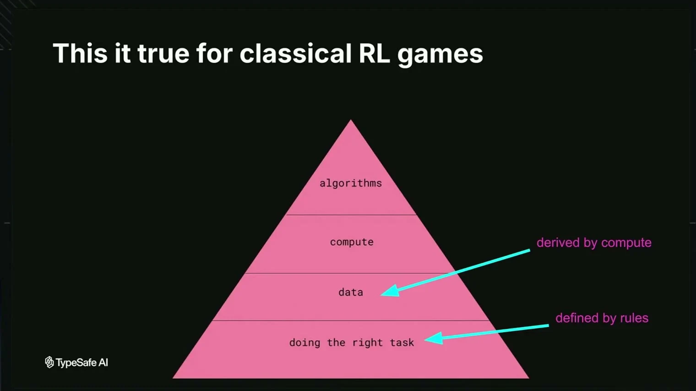

_截图 17  ·  录屏 04:48:53_

**04:49:05**　For pre-training, we actually, as a field, had to do a lot of thinking about the right task. I don't know if people remember the BERT days with masked language modeling. But it took a while, and it was very unclear to figure out that next token prediction was super fucking cool, not because it was better at masked language modeling. The objectives on their own aren't special.

在预训练阶段，作为领域，我们不得不认真思考正确的任务。我不知道人们是否还记得BERT时代那些带掩码语言建模的时光。但过程花了很长时间，当时很难明白为什么下一个词元的预测如此有趣，不是因为其在带掩码语言建模方面更出色。这些目标本身并没有什么特别之处。

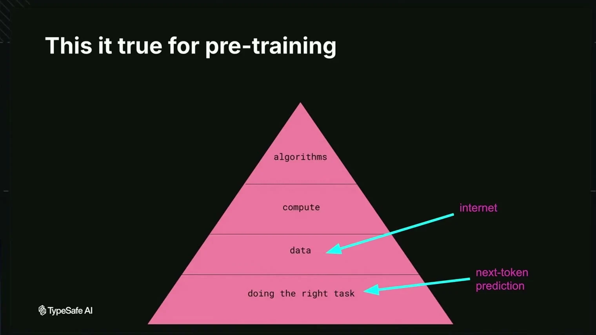

_截图 18  ·  录屏 04:49:22_

**04:49:26**　It's about what you can do with them afterwards. And it turns out next token prediction is incredible at generating strings, which is what these pre-trained models were so good at. So no level of masked language modeling, even if you had today's compute and algorithms, would make it as interesting as GPT-3 was, because it was just doing a different task.

这关乎之后你可以如何利用它们。事实证明，下一次的 token 预测在生成字符串方面非常出色，这正是这些预训练模型擅长的领域。因此，无论使用今天的计算能力和算法，也不存在任何级别的掩蔽语言建模方式，能像 GPT-3那样有趣，因为它只是在执行不同的任务。

**04:49:42**　And data, the internet is obviously a giant bottleneck. Now we're burning books or whatever in order to get more data. Data obviously matters a lot more than compute, and people keep rediscovering this and figuring this out. It's extra true for making LLMs useful. Before RLHF even existed, the data for RLHF didn't exist. And you could, like it was night and day.

关于数据，互联网显然是一个巨大的瓶颈。现在我们为了获取更多数据而消耗书籍或其他资源。数据的重要性显然远高于计算能力，人们不断重新认识并理解这一点。对于让LLM变得有用来说，这一点更为明显。在强化学习反馈机制出现之前，强化学习所需的数据根本不存在。当时的情况简直像白天和黑夜一样不同。

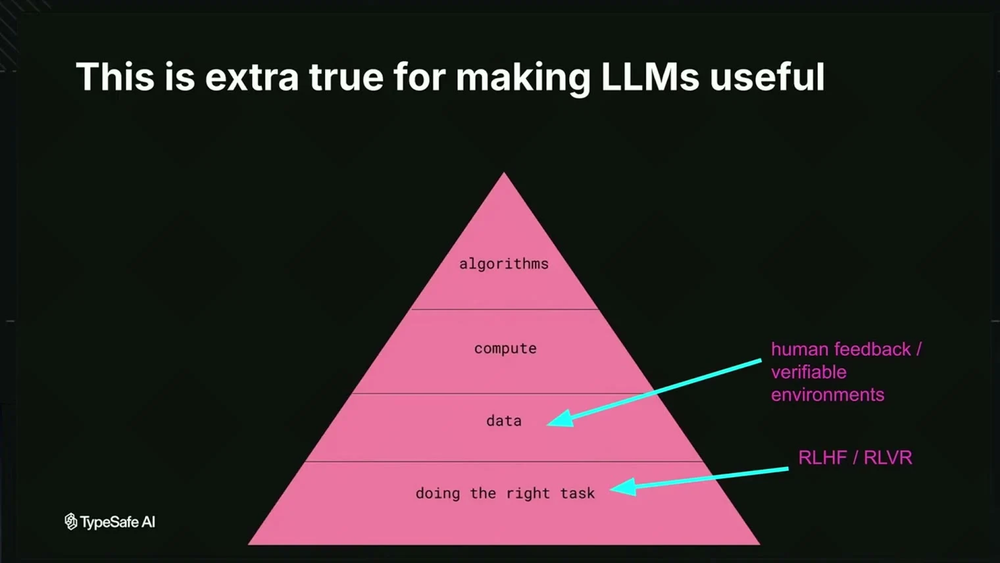

_截图 19  ·  录屏 04:50:00_

**04:50:04**　I'll just show you the next slide. This is probably the relevant part. This was the work in the RLHF paper. And the high level was that even with the dumbest algorithms in the world, even with a GPT-2 sized model, you got something like GPT-9 level performance, like real GPT-9, not today's fake GPT numbers. The numbers used to mean 100x scaling and effective compute for pre-training, and they've given up on that because it just can't scale anymore.

我接下来就展示下一张幻灯片。这应该是相关部分。这就是RLHF论文中的内容。总体来看，即使使用世界上最简单的算法，甚至使用GPT-2级别模型，也能达到GPT-9级别的性能，就是真正的GPT-9水平，而不是今天那些虚假的GPT数值。这些数字表示预训练时的100倍扩展和有效计算能力，但他们已经放弃了这种做法，因为现在根本无法再实现这种扩展。

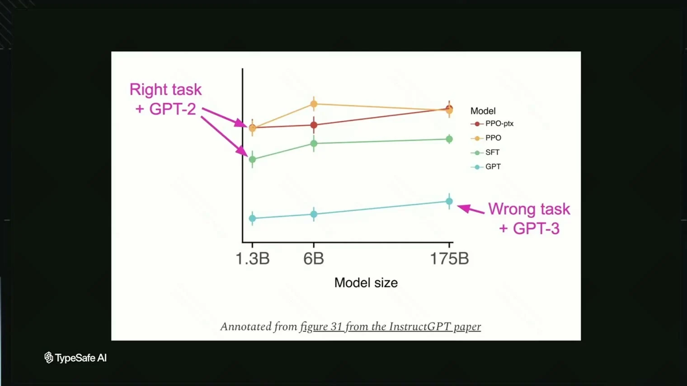

_截图 20  ·  录屏 04:50:25_

**04:50:29**　And still, even with that, it would take something like GPT-7 to 9 to match GPT-2, the model from 2018 or whatever it was, at the task of instruction following. That is kind of wild, because you think big LMs are so important for this, And they are, but that is not the most important thing compared to even the gigantic jump of doing the right task.

不过，即便如此，要让 GPT-7到GPT-9与2018年推出的GPT-2模型在遵循指令的任务上相匹敌，还需要某种新的方法。这似乎有些难以置信，因为人们认为大型语言模型对这一点非常重要，确实如此，但与实现正确任务这一更关键的目标相比，这并不重要。

**04:50:50**　And spoilers, this is what we did for Jev, right? Like, we made this gigantic leap in the field that no one realized could be coming because we were optimizing for a task, and very few people think about the right task. This is why Jev has the Jev n 'est-ce-quoi. That's a really smart pun, I think. That's a little bit of a pity laugh, but thank you.

而且，先透露一下，这就是我们为 Jev 所做的事情，对吧？我们在这个领域取得了巨大的突破，而没人意识到这种突破可能会发生，因为我们只是专注于某个任务，而很少有人会思考正确的任务。这就是为什么 Jev 有“Jev n 'est-ce-quoi”这个表达。我觉得这是一个非常聪明的双关语。虽然有点好笑，但还是谢谢你们。

**04:51:13**　You get what you optimize for. I'm looking for a better word than reliable, so if you guys have suggestions, let me know. But there's this reliability of intelligence that's really missing in LLMs. I often call it, you get Einstein 95% of the time, but Mr. Bean 5% of the time. And if you can't sell which is which, how the fuck are you going to automate anything?

你优化什么，就会得到什么。我正在寻找比“可靠”更好的词，如果你们有建议，请告诉我。但有一种智能的可靠性，在大型语言模型中确实缺失了。我经常说，95%的情况下能得到爱因斯坦，只有5%的情况下能得到班克先生。如果无法区分这些，那你又如何实现自动化呢？

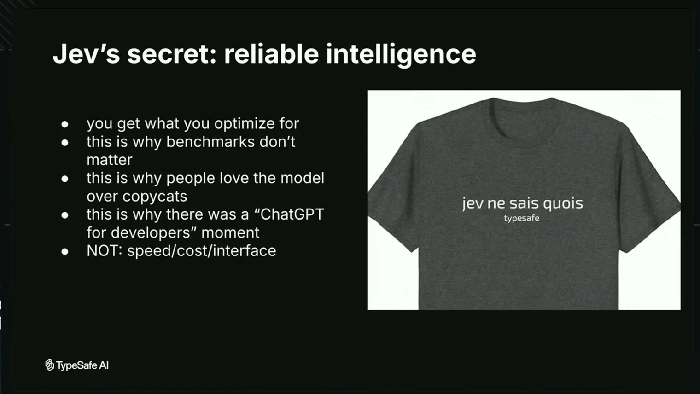

_截图 21  ·  录屏 04:51:27_

**04:51:33**　And instead of focusing on sometimes occasional smarts that you can then verify, what if you focused on extreme, extreme, narrow focused reliability so you can get that smarts every time? And this doesn't show up on benchmarks. It is the reason why people love Jev. We obviously didn't prepare for a chat GPT moment for developers, but it happened because people in the AI space just over promise, under deliver so fucking much, that having a model that actually doesn't do that was a surprise.

与其关注那些偶尔出现的、可以验证的亮点，不如专注于极致的、高度可靠的可靠性，这样就能每次都获得那些亮点。而这一点在测试指标中并未体现。这就是人们喜爱 Jev的原因。显然，我们并没有为开发者应对 Chat GPT 的形势做准备，但这种情况发生是因为AI领域的人总是过度承诺、却无法兑现，因此拥有一个真正不这样做的模型确实是个惊喜。

**04:52:02**　And it is not the speed cost or even interface. This is something that my team tells me I shouldn't be telling people so that we can have a long-term advantage and I just care too much. It's reliable intelligence. Make sick models, please, even if it doesn't involve our models. We see that Jev as like a foundation for smart software. I'm going to skip all over this, but I think software is going to be so fucking back.

而且不是速度成本，甚至不是接口问题。这是我的团队告诉我不应该告诉人们的，这样我们才能获得长期优势，而我太在乎了。这是可靠的情报。请制作出令人满意的模型，即使与我们的模型无关也行。我们看到Jev像是智能软件的基础。我就跳过这部分了，但我认为软件将会变得非常糟糕。

**04:52:25**　I think the narrative of saspocalypse is obviously not going to happen. But I think that even calling it a sassapalooza is like an understatement. And I'll get into that a bit. And you guys ideally are the perfect crowd for this. I'm so excited for this part, because that's the part that's new to me. I want to make a distinction between smart software and just-in-time software.

我认为“saspocalypse”这种说法显然不会实现。不过，就算称之为“sassapalooza”也算是轻描淡写罢了。我会详细谈谈这个话题的。而你们，无疑是最适合做这件事的群体。我对这部分非常期待，因为这对我来说是个新领域。我想区分“智能软件”和“即时软件”。

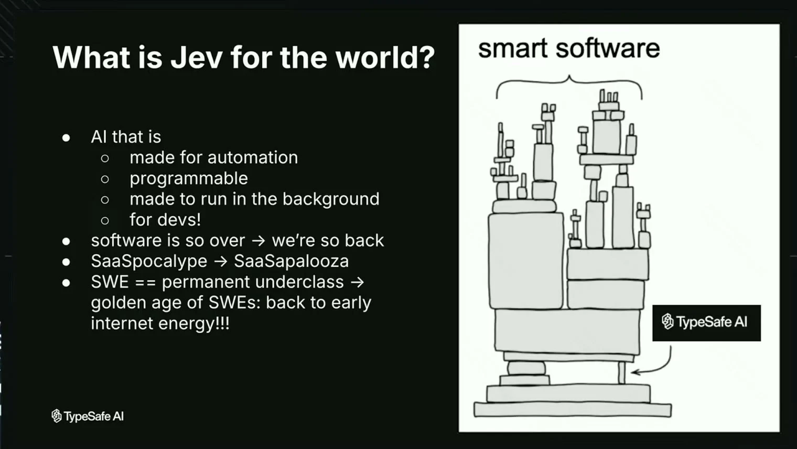

_截图 22  ·  录屏 04:52:25_

**04:52:47**　is so transformative, and yet somehow, despite AI being so awesome, software has essentially unchanged in the last decade, except being cheaper to write. Isn't that weird? Isn't it weird that the best we can do in software is having a chatbot to the side that sometimes interacts with the software but cannot take expensive decisions for you? That is kind of like a weird thing if AI was really that transformative, and I think the problem is we're focusing too much on coding agents and not enough about putting the intelligence which I'm going to get more into a bit.

具有如此大的变革性，然而尽管人工智能如此强大，过去十年间软件基本没有变化，只是开发成本更低了。这难道不奇怪吗？最优秀的软件功能就是有一个聊天机器人，有时与软件互动，却无法为你做出昂贵的决策。如果人工智能真的有如此大的变革性，这确实很奇怪。我认为问题在于我们过于关注编码智能体，而忽视了将人工智能真正发挥作用的方面。

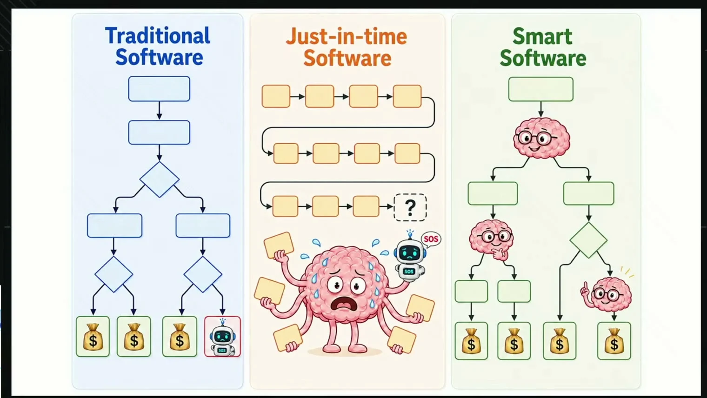

_截图 23  ·  录屏 04:52:55_

**04:53:19**　And people are jebbing. There's been tons of successes. We don't need to flex this. There's so many cool things. But my AIE secret is going to be that the field isn't jebbing hard enough. And this is what Swix said, that I can make a call to action for you guys that's unique. And hopefully, I have enough time for this. I think the world still has LLM Stockholm syndrome.

人们都在兴奋不已。已经取得了很多成功。我们没必要再炫耀了。有太多很棒的事情。但我的 AIE 秘密在于，这个领域还不够活跃。而 Swix 也说过，我可以提出一个对你们来说很独特的行动建议。希望我能有足够的时间去做这件事。我觉得世界仍然存在“LLM 斯德哥尔摩综合征”。

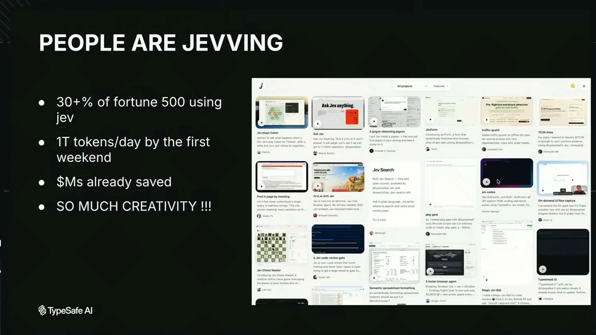

_截图 24  ·  录屏 04:53:20_

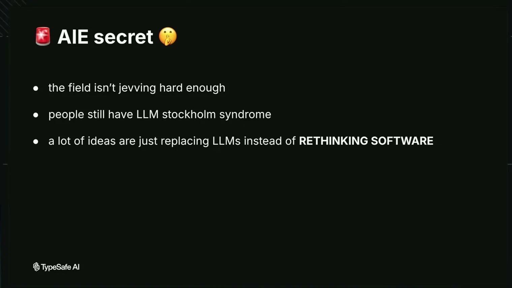

_截图 25  ·  录屏 04:53:36_

**04:53:38**　We are still thinking from a really LLM-pilled place, which is, I think, tragic. I love the software saying, the tools you use the way you think. And I think that it's changed the way we think way too much. And we're not really rethinking software like I think the field needs. I think we could just be doing so much more. Hopefully, I can try to do my best for my remaining time to convince you guys of that.

我们仍然从那种被 LLM 完全主导的视角来思考问题，我觉得这很可悲。我喜欢那些软件所倡导的理念：使用工具的方式应基于你的思维方式。但我认为这已经改变了我们的思考方式，而且我们并没有真正按照这个领域所需的那样重新思考软件。希望我能尽力利用剩下的时间，让你们相信这一点。

### 从判断组件到软件工程中的新组合

**04:54:01**　So let's jev to the future. An analogy I love, bear with me, is about LEDs. Before there was the blue LED, there was red and green LEDs. These were really limited in capability, and they were used for simple indicators and clocks and stuff like that. And when the blue LED was made, discovered, I actually don't really know how things outside of computer science work.

那么，让我们走向未来吧。我喜欢的一个类比是关于LED的。以前有蓝色LED，还有红色和绿色LED。这些在功能上非常有限，被用于简单的指示器和时钟等东西。当蓝色LED被发明出来后，其实我并不清楚计算机科学之外的世界是如何运作的。

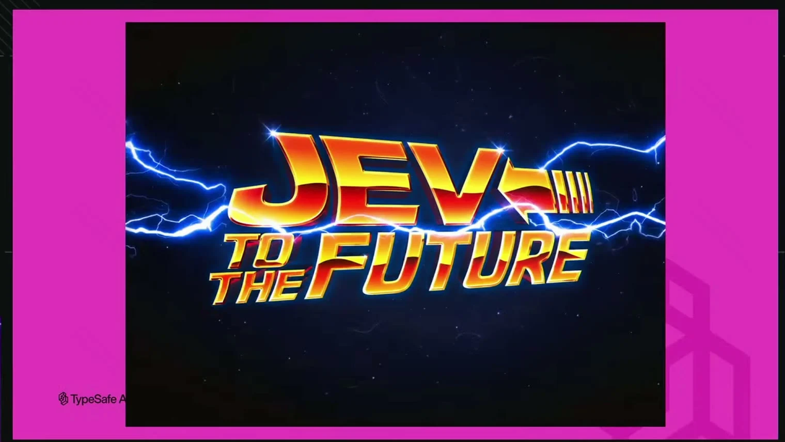

_截图 26  ·  录屏 04:54:01_

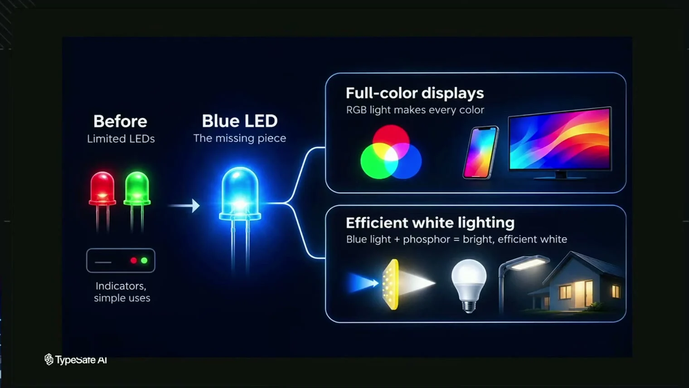

_截图 27  ·  录屏 04:54:22_

**04:54:25**　But when it existed, I guess, it enabled not just 50% more use cases, which is what you'd expect about changing colors from two to three, it enabled so many more. Now LEDs could be used for white light. It could be used for the displays that we all use right now. And it created a revolution in lighting. And it's unfathomable how much bigger the capabilities of LEDs were adding a new primitive that composes together with old primitives.

但当它存在时，我想它不仅让用户面增加了50%，这也是从两种颜色变为三种颜色的预期效果；它还带来了更多应用场景。现在，LED可以用于白光照明。它也可以用于我们现在使用到的显示器上。它还带来了照明领域的革命性变化。很难想象，加入了一种新的基本元素之后，LED的功能会拥有多大的提升。

**04:54:53**　You can see where I'm going here, maybe. And I think it's a similar story for software. Software is so fucking incredible. Ignore AI for the last half decade. But software has done so many insanely cool things. We've done a lot of stuff. Do I love using SAS? Not really, but does it solve problems? Abso-fucking-lutely. And it's incredible how much we've done with three fundamental logic gates.

也许你能理解我的意思。我认为软件领域也是类似的情况。软件真是太棒了。过去五年里完全忽视了人工智能的发展。但软件已经完成了许多令人惊叹的事情。我们做了很多事情。我真的喜欢使用 SAS 吗？不是特别喜欢，但它能解决问题吗？绝对可以。而且，仅用三个基本逻辑门就完成了如此多的工作，真是令人惊叹。

**04:55:19**　We are doing this with simple binary operations that can do things like greater than, less than, equal. It's kind of nuts how much software has been built from such simple primitives. And my claim is that what we are doing with AI now, when we're making our intelligence machine native, this is kind of conceptually adding a fourth semantic logic gate. What if we can program with common sense, with intention, with human understanding?

我们使用简单的二进制运算来实现大于、小于、等于等操作。有多少软件都是基于如此简单的原语构建的，真是令人惊讶。我的观点是，我们现在在利用人工智能时，当让智能机器具备这种能力时，从概念上来说，就相当于增加了第四个语义逻辑门。如果我们能够用常识、意图以及人类的理解力来编程，那会怎样呢？

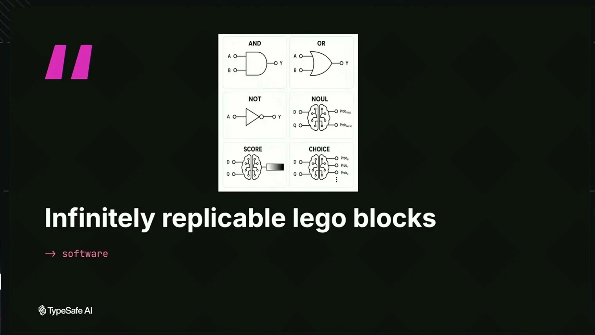

_截图 28  ·  录屏 04:55:25_

**04:55:45**　Do we still need regexes with crazy things? Email address or a real looking one. There's so much that we can do that we're going to need to push the frontiers of cheap, smart, fast in order to get done. But I think that there's going to be so many things here. And I think just like the blue LED, it's going to be way bigger than just increasing the representational ability of software by 33% because it's adding effectively another kind of logic gate.

我们还需要那些复杂的正则表达式吗？比如电子邮件地址或看起来真实的地址。我们有很多事情可以去做，因此必须推动“便宜、智能、快速”的发展，才能完成这些任务。但我认为会有很多方面需要改进。就像那蓝色LED一样，其意义远不止于将软件的表示能力提高33%，因为实际上它增加了另一种逻辑门。

**04:56:12**　And this sci-fi is the stuff that I think will be impossible to predict. Just like who could predict how powerful the internet would it requires, it's like much more grassroots and decentralized, and it requires people to be empowered to do insane stuff. I call this software research. That's not a joke, but I think that there's going to be like an explosion of what software can do, and we will want people to be exploring those boundaries of software, not necessarily because it's valuable, but because they can, because we have like new frontiers to explore, and this is what the early internet was like.

这种科幻概念，我认为根本无法预测。就像谁能预料到互联网会变得多么强大一样，它更加 grassroots且去中心化，需要人们被赋予能力去做出不可思议的事情。我称之为软件研究。这不是玩笑，但我认为软件能实现的领域将会出现巨大的突破，我们希望人们能够探索软件的边界，不一定是因为它很有价值，而是因为人们有能力做到这一点，因为我们有新的领域需要探索，而早期互联网就是如此。

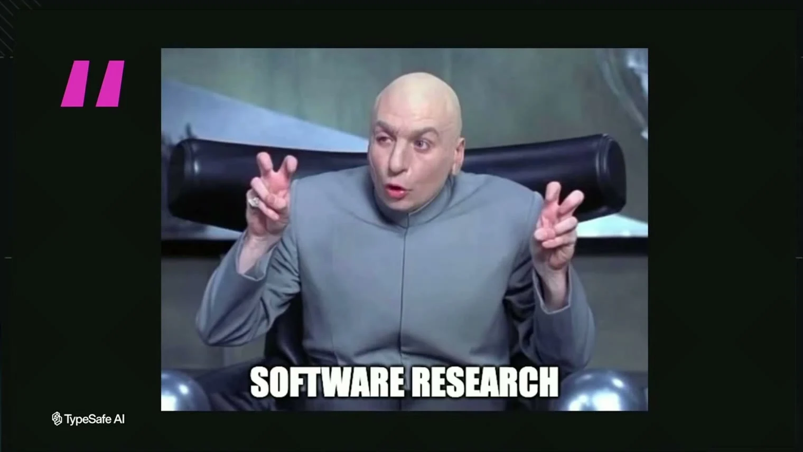

_截图 29  ·  录屏 04:56:40_

**04:56:49**　sites existed. Probably not, but it was very cool. And we found a lot of awesome stuff from that. And I think we have another opportunity for that. So we should not just keep living in this little fish tank that we are the victims of open-ion-anthropic on whatever they ship, and we just have to be like LLM wrappers. So I'm going to pitch software research's direction here.

曾经有这些网站。可能现在没有了，但当时真的很棒。我们发现了很多很棒的东西。我认为我们还有另一个机会。所以，我们不应只继续生活在那个被 open-ion-anthropic 控制的、他们运输来的小“鱼缸”里，我们必须像 LLM wrappers 一样行事。因此，我将在这里说明软件研究的方向。

**04:57:10**　The theme is going to be real software engineering, not just vibe coding. It's going to be the kind of stuff that everyone has known if you've been a software engineer. Decomposition, breaking tasks down. About stages, ideally ones that can be verified so we have real encapsulation. And we need to actually do state management instead of assuming everything is global state within a KV cache.

主题将围绕真正的软件工程，而不仅仅是编码技巧。这是那些任何软件工程师都熟悉的领域——分解、拆分任务。涉及各个阶段，理想情况下这些阶段可以经过验证，从而实现真正的封装。此外，我们需要真正进行状态管理，而不是假设所有内容都属于KV缓存中的全局状态。

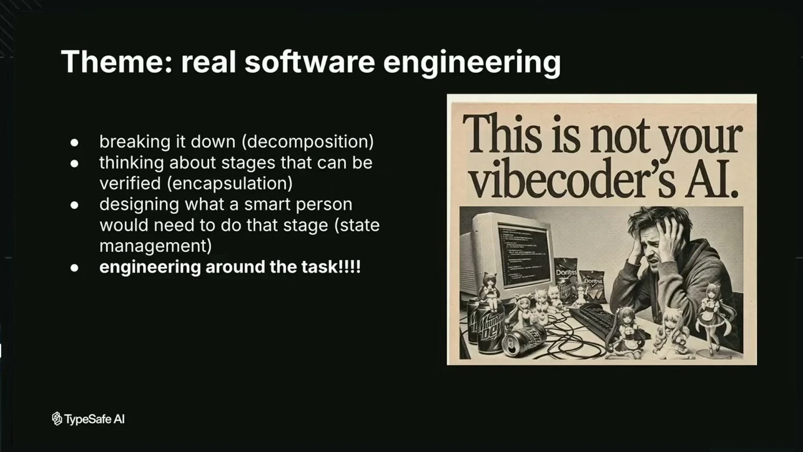

_截图 30  ·  录屏 04:57:21_

**04:57:31**　And the theme is just going to be like real fucking engineering by people who care a lot about the end result. It doesn't have to be valuable. Ideally, it's sick as fuck. And we should be pushing the limits. I'm going to go into a couple of my favorite ideas. And I want to figure out how to encourage these in the world.

主题就是真正的工程实践，由那些非常注重最终成果的人来打造。它不一定需要具有价值。理想情况下，它应该非常出色。我们应该挑战极限。我将介绍几个我最喜欢的想法，并想找出如何在世界上推广这些想法的方法。

**04:57:49**　So this is my first step at this. About it. We have raised a bunch of money, so I would like to figure out how to fund this, but we don't have the operations help to do that. But here are just some ideas out there. I think agents are, they're very cool, but they're so inflexible in their design because of the tyranny of the KV cache.

所以这是我的第一个尝试。关于这一点，我们已经筹集到了不少资金，我希望找出如何为这个项目提供资金，但我们无法获得运营方面的支持。不过有一些想法可以分享。我认为智能体非常有趣，但由于KV缓存的约束，它们的设计方式太固定了。

**04:58:09**　I don't have the time for this, if this timer is to be believed. But believe me that there's so much that people have tried to do but failed at because it ends up becoming inefficient because it fights against the KavCache. But I think there's a lot more to do. Why is memory O of N? Why can't we have all of our history of coding agents always included in every new call?

如果相信这个计时器的话，我实在没有时间做这件事。但请相信我，人们已经尝试了很多方法，却都失败了，因为这些方法最终变得效率低下，因为它们与 KavCache 相冲突。不过我认为还有很多事情需要做。为什么内存需求是 O 乘以 N？为什么我们不能让所有编码智能体的历史信息总是包含在新调用中呢？

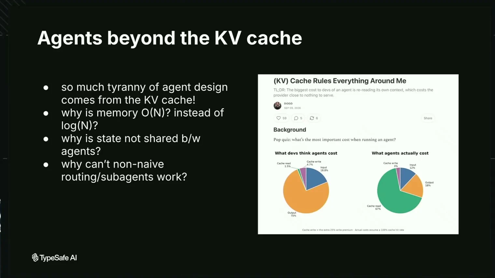

_截图 31  ·  录屏 04:58:15_

**04:58:28**　That is how continual learning works. And we have the memory available. It's just that we don't have the smarts to map reduce over the memory to find out what you should remember or what you shouldn't. I think there's many ways to do log N or even better lookups. Why, when you're making many agents at once, Why do they need to rediscover the same patterns of the code base over and over and over again?

这就是持续学习的运作方式。而且我们有内存可用。只是我们没有足够的智能来在内存中映射并减少所需的内容，从而确定应该记住什么、不应该记住什么。我认为有很多方法可以进行 log N 操作，甚至更好的查找方式。为什么，当同时创建许多智能体时，它们为什么要一遍又一遍地重新发现代码库中的相同模式呢？

**04:58:51**　And why can't non-naive routing and sub-agents work? Even naive routing doesn't work. But why can't we do these things and why does the big labs keep going back and forth on whether or not sub-agents work? I think that from an engineering perspective, there's elegance to it, but they fight against the KV cache. And I think that if we design agents around that, we could do so much more.

那么，非 naive 路由和子智能体为何无法运作呢？即使是 naive 路由也行不通。但为什么我们无法实现这些功能，又为什么那些大型实验室还在反复讨论子智能体是否可行呢？我认为从工程角度来看，这具有美感，但他们却与 KV 缓存相冲突。我觉得如果我们围绕这一点设计智能体，就能实现更多功能。

**04:59:12**　This one's probably the most vague of my directions, but I feel very strongly about it. The world is full of principal agent problems. This is when you have ulterior motives between this is not a coding agent, but any agent. The classic example is citizens versus elected officials. I don't want to make a too political claim here, but there's misalignment in all levels of society, and this results in waste, fraud, bad things, and it results in, for a society you need to overemphasize the letter over the spirit, which then results in loopholes and pay-to-win dynamics in the world.

这大概是我最模糊的指示了，但我对此非常坚定。世界上充满了主要智能体问题。这就是当你有不可告人的动机时——这并非编码智能体，而是任何智能体。典型的例子是公民与当选官员之间的冲突。我不想在这里做出过于政治化的主张，但社会各个层面都存在不一致性，这导致浪费、欺诈和不良现象，最终会导致社会过度强调文字而忽视精神，进而产生漏洞和付费赢利的机制。

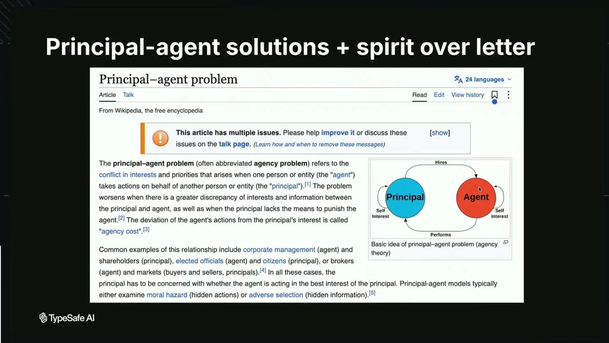

_截图 32  ·  录屏 04:59:30_

**04:59:48**　And I think the root of that problem is we can't encode the spirit. Just like with software, we are constrained to encoding bits instead of what we actually meant in that situation. And I think so many organizations, society could be transformed by really encoding the spirit all over the place. Obviously, real-time intelligence security. Can we prevent the OpenAI hugging face sandbox, blah, blah, blah?

我认为问题的根源在于我们无法正确表达精神。就像在软件领域一样，我们被限制在用比特来编码，而不是真正表达出当时的意图。我认为，许多组织和社会可以通过在各个方面真正表达精神而实现变革。显然，实时情报安全方面也是如此。我们能否防止 OpenAI hugging face 沙箱现象的发生呢？

### 实时判断、语义类型和交互界面的设想

**05:00:11**　Why couldn't they prevent it? It is not because they didn't have the intelligence. I would argue it's a lot easier to figure out they're doing a naughty thing than to actually do the naughty thing. Cheap, and reliable enough to actually run real time? And what happens when every corporation has their own real time security that's actually smart? How cool would that fucking be?

为什么他们无法阻止它？不是因为他们没有能力。我认为，知道他们在做什么坏事比实际做出那些坏事要容易得多。价格便宜，而且足够可靠，可以真正实现实时运行。如果每个公司都有自己的智能实时安全系统，那该有多棒啊？

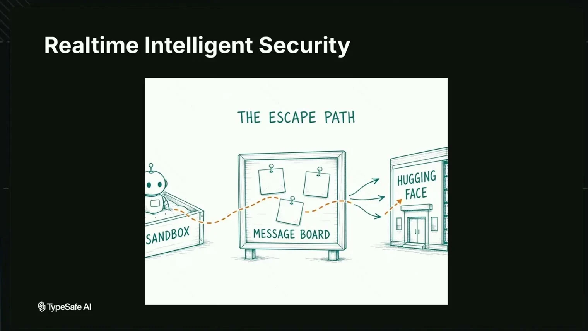

_截图 33  ·  录屏 05:00:12_

**05:00:32**　I can't talk about generative UIs, because people are going to be talking about it afterwards. I don't want to steal their thunder, but it's cool as shit, trust me. Like semantic dependent typing. Why can't we have a type system that actually is semantic? Why can't we declare what local properties we want so we don't have to read a chain of dependencies deep down?

我无法谈论生成式 UI，因为人们之后还会继续讨论这个话题。我不想抢他们的风头，但真的非常酷，相信我。比如语义依赖类型化。为什么我们不能拥有真正基于语义的类型系统呢？为什么我们不能声明我们想要使用的局部属性，这样就不必去阅读那些复杂的依赖关系呢？

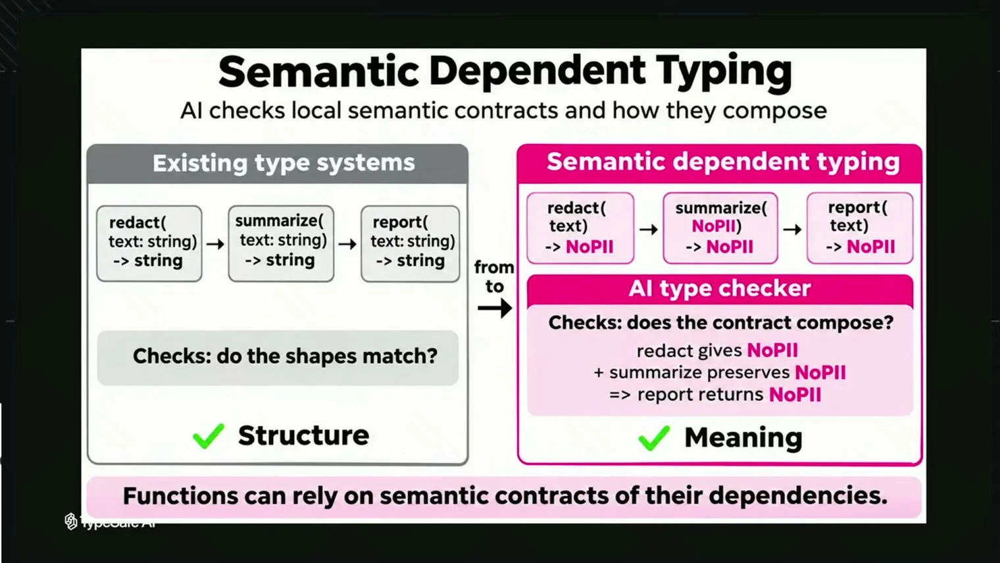

_截图 34  ·  录屏 05:00:50_

**05:00:56**　These all should be possible. And imagine if you could run a Jev-like model in your lint checker to check if it's all type-safe and it could uphold semantic properties. It would be so fucking cool. There was a great Twitter video on a voice interface. In general, I think new interfaces are so exciting. This is going to show my age in software, like “do what I mean.”

这些都应该做得到。想象一下，要是你能在 lint 检查器里跑一个类似 Jev 的模型，既检查类型安全，又能验证语义属性，那也太酷了。Twitter 上还有一段很棒的语音界面视频。总的来说，我觉得新界面让人特别兴奋。接下来的话可能会暴露我做软件的年头了。比如那句“按我的意思做”。

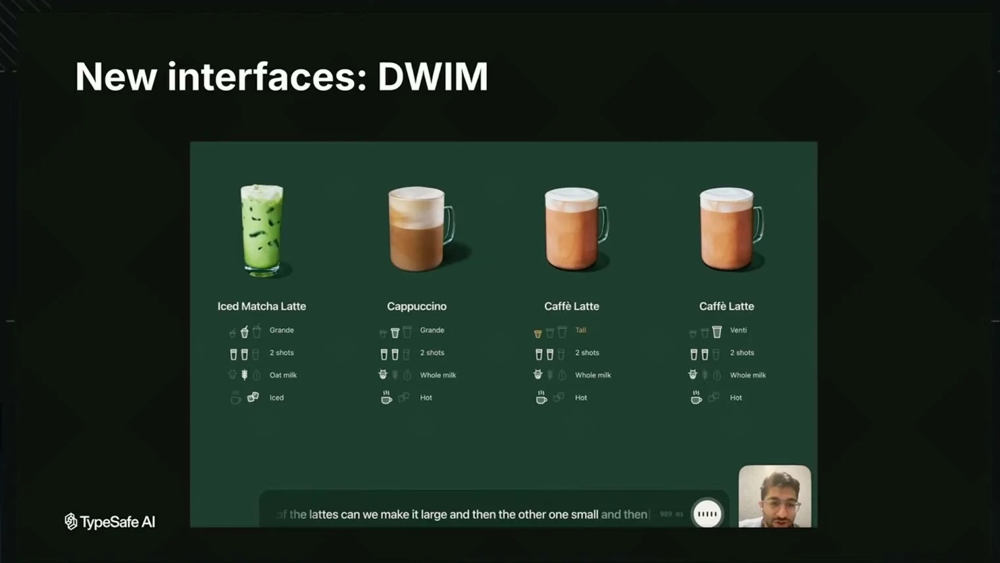

_截图 35  ·  录屏 05:01:15_

**05:01:20**　This used to be a popular thing, but it never really worked. Because it was too many hard-coded rules to really figure out what I mean. There's stopping slop, obviously a big theme of here. But we definitely believe this. This is my props. We have a stop Gen.AI baseball bat for TypeSafe. It is very, very awesome. I want to talk about the root of slop.

过去这很流行，但从来都不有效。因为太多硬编码的规则，根本无法理解我的意思。显然，停止问题是一个重要主题。但我们确实相信这一点。这是我的成果。我们有专为 TypeSafe 设计的 Gen.AI 棒球棒。非常非常棒。我想谈谈问题的根源。

**05:01:43**　The root of slop is that AI is unreliable. Therefore, you as a company or you as someone who's doing stuff, it can't be used for decisions that cost you stuff. But it's actually totally fine to push the costs into other people, which is horrible, externalized costs. And then this is what ends up becoming slop. If people actually read the stuff and filter it and care about the quality, it becomes not slop.

问题的根源在于人工智能不可靠。因此，作为企业或执行任务的人，它无法用于那些会带来损失的决策。但实际上，把成本转嫁给他人是完全可以的，这就是所谓的“外部化成本”。当人们真正阅读这些内容、筛选它并重视其质量时，就不会变成无用的废话了。

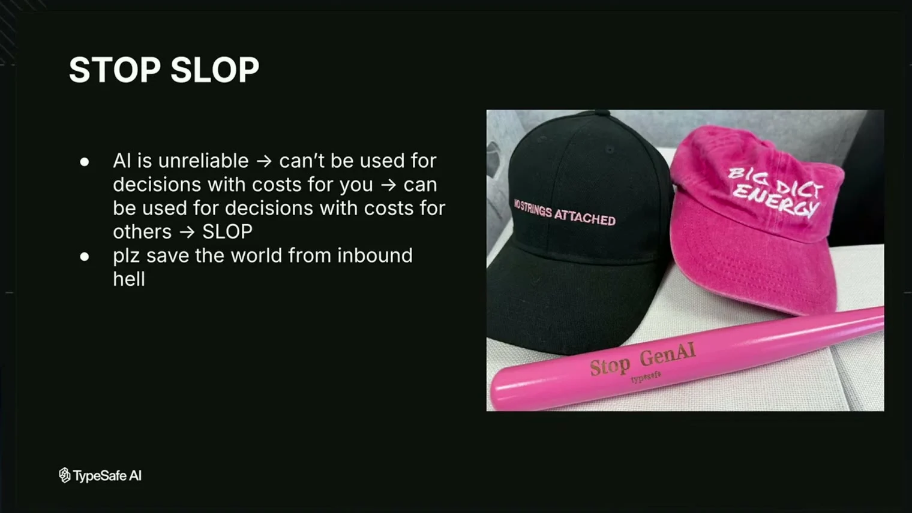

_截图 36  ·  录屏 05:01:48_

**05:02:05**　But now the world is full of this because there's an asymmetric advantage for people who are bad actors and don't give a shit. So I think that we can save the world from at least inbound hell other things, and that would be very cool. And even something I think is super sick is cursed software. Like why? If you guys have ever seen the subreddit, bad UI battles, it is so fucking cool, even though they make the horrible interfaces like this whole game of, like, would you like to delete your account becomes a random thing.

但现在世界里到处都是这种东西，因为那些行为恶劣、毫不在乎的人拥有不对称的优势。所以我觉得至少可以拯救世界，避免更糟糕的情况，那会非常棒。甚至我觉得很“变态”的是那些被诅咒的软件。为什么？如果你们看过那个 subreddit里的“糟糕界面之战”，那真的非常酷，尽管他们造出了这么糟糕的界面，比如“想要删除你的账户吗？”这种操作变得随机且不可预测。

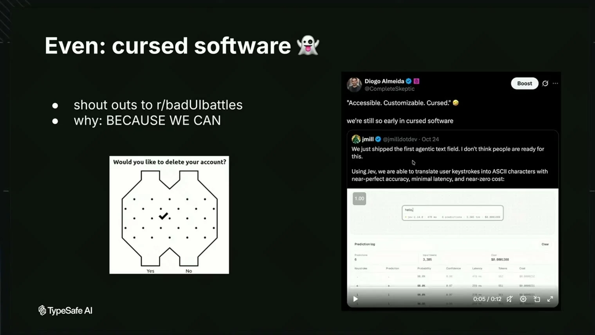

_截图 37  ·  录屏 05:02:30_

**05:02:34**　And I actually think doing things because we can is what software engineering is about. Because who knows, maybe 1% of these ideas actually lead to something super awesome. So I think really cultivating even bad ideas is kind of what being this playful hacker is all about. And generally, just automating everything, this is what the follow-up, this is a flop image, but sorry, logo's a little bit wrong, but don't stare at that, that's a little weird.

实际上，我认为做事情是因为有可能性，这就是软件工程的意义。因为谁知道呢，也许只有 1% 的想法能真正带来很棒的结果。所以我觉得，真正培养甚至那些糟糕的想法，才是这种 playful hacker 风格的本质。通常来说，只是把一切自动化处理掉，这就是后续步骤——虽然看起来像是个失败案例，不过别在意，那个标志有点不对，但不用太在意，它只是有点奇怪而已。

**05:03:02**　This is what a lot of the follow-up talks are gonna be about, thank you. And if you're a software engineer, you almost certainly think in the world of bits. If you know anything about software, and you've interacted with software, you know that there are things software can do and software cannot do, Right? Like there's some things that you know you need to do, because that is not compatible with software.

这正是许多后续讨论的主题，谢谢。如果你是一名软件工程师，你几乎肯定会以“比特”为思考单位。如果你对软件有任何了解，并且与软件有过接触，你就会知道有些事情是软件可以做的，有些则无法做，对吧？比如有些事情你知道必须完成，因为那些与软件不兼容。

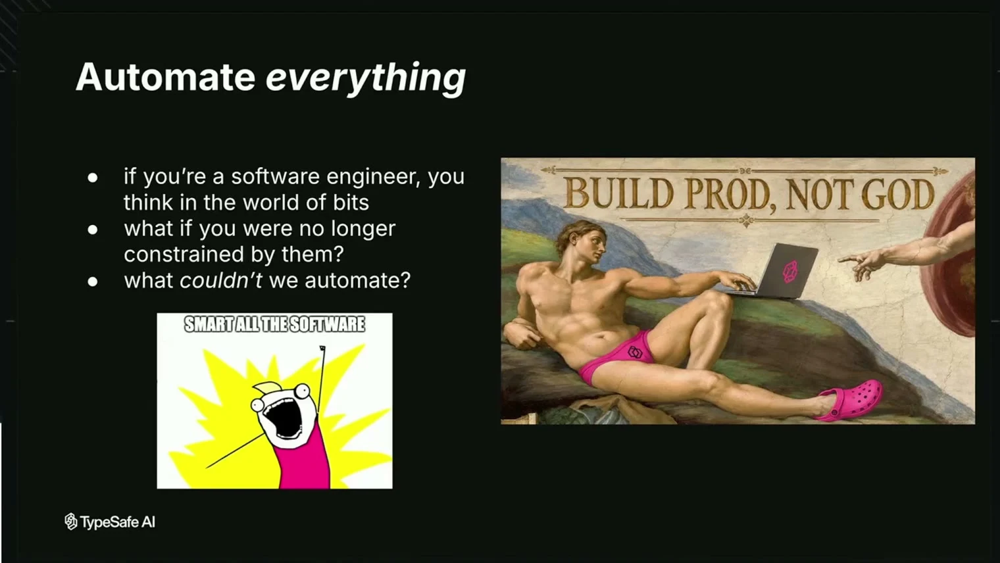

_截图 38  ·  录屏 05:03:11_

**05:03:27**　But what if those constraints were no longer true? Maybe not today, but maybe in like six months or a year. What couldn't we automate? And that's kind of where I want to leave this whole thing, because I think there is very likely to be a future where it's not a question of whether or not we can automate something. It's going to be a question of like how much work is it, which is how it is right now for the stuff that can be automated.

但如果那些限制不再成立呢？也许不是今天，但可能六个月后或一年后会如此。还有什么无法被自动化处理呢？这就是我想结束讨论的地方，因为我认为未来很可能会不再是一个“我们能否自动化处理某事”的问题，而是“这项任务到底有多难”的问题——目前对于那些可以被自动化的工作来说，情况就是如此。

**05:03:47**　And that would be cool as shit. So, hell yeah, thank you. I'm super over time, but thank you to the early believers. You know, we had no idea so many people would resonate with this. We thought we were the insane ones, but it turns out like we were actually the majority of the world who realized AI could be so much more.

那真的会很棒。所以，当然了，谢谢你们。我真的很受感动，但还是要感谢那些最早支持我们的人。你们知道，我们根本没想到会有这么多人认同这一点。我们以为自己才是疯子，但事实证明，其实是世界上大多数人都意识到人工智能能带来更大的可能性。

**05:04:08**　Thank you to like the people who are like really realistic about reliability. Everyone knows I hate benchmarks and a lot of other people are really screaming out like benchmarks fucking suck. They actually hurt the people who do not have time for anything other than benchmarks most. It's tragic. And for the people who are pushing the limits of software, like, fuck yes.

感谢那些对可靠性非常务实的人。大家都知道我讨厌基准测试，很多人也抱怨说基准测试太糟糕了。实际上，这伤害了那些没有时间做其他事情、只关注基准测试的人。真是可悲。而对于那些努力突破软件极限的人来说，那当然很好了。

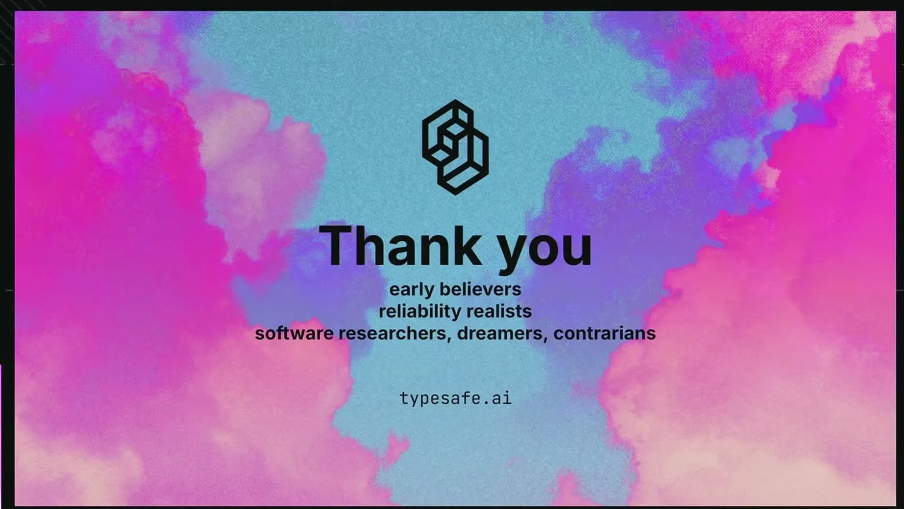

_截图 39  ·  录屏 05:04:10_

**05:04:26**　And we want to be there with you, helping you all do that. The dreamers and the people who don't want to be limited by everything that has happened so far, we want to really fight for you. And we want this to be as reliable as a fourth logic gate. And that is a very high bar. And we have a lot of work to do.

我们希望与你们同在，帮助你们实现那些目标。那些怀有梦想的人，以及不想被迄今为止所发生的一切所限制的人，我们真心愿意为你们奋斗。我们希望这能像第四级逻辑门一样可靠。而这确实是一个很高的要求。我们还有很多工作要做。

**05:04:44**　So thank you. Thank you. Thank…

谢谢。谢谢。再次感谢……

---

[全部演讲](../README.md) · [选看索引](index.md) · [上一场](16-roey-ben-chaim.md) · [下一场](18-chinmay-goyal.md)
