[全部演讲](../README.md) · [选看索引](index.md) · [上一场](17-diogo-almeida.md) · [下一场](19-chibi-vikram-kevin-bernstein.md)

# Beyond Generation: Fast, Structured AI Decisions with Jev at Glean

**Chinmay Goyal** · Glean · Software Engineer

AIE Code Summit 2026  ·  11 月 11 日  ·  主舞台  ·  录屏 05:09:27–05:25:04

[官方议程](<https://ai.engineer/code/2026/schedule>)   ·   [Day 1 官方回放](<https://www.youtube.com/watch?v=ZZ19zhYnDKY>)

## 本场目录

- [05:10:08](#section-1) 识别输出可枚举的任务，介绍评测流程
- [05:12:59](#section-2) 查询分类、专家路由和建议排序
- [05:18:28](#section-3) 置信度、引用校验和防护判断
- [05:23:45](#section-4) 怎样选择决策模型、规则或生成模型

## 演讲实录

> 英文源自录屏音频，经轻度校订。每段英文下方为中文译文。时间指向原始录屏。

**05:09:28**　Hi, everyone. My name is Chinmay, and I'm a software engineer at Glean. I work on the product engineering side of Glean Assistant. Today, I'm going to give a talk on how Glean uses GEV. The title of the talk is Beyond Generation, Fast and Structured AI Decisions with GEV at Glean. If you look at it, most AI product steps are bounded decisions and not generation problems.

大家好，我是 Chinmay，是 Glean 公司的软件工程师。我负责 Glean Assistant 的产品工程方面工作。今天我将分享关于 Glean 如何使用 GEV 的演讲内容。演讲标题是“在 Glean 中利用 GEV实现快速且结构化的 AI决策”。从标题来看，大多数 AI 产品的决策过程都是有限制的，而非生成式问题。

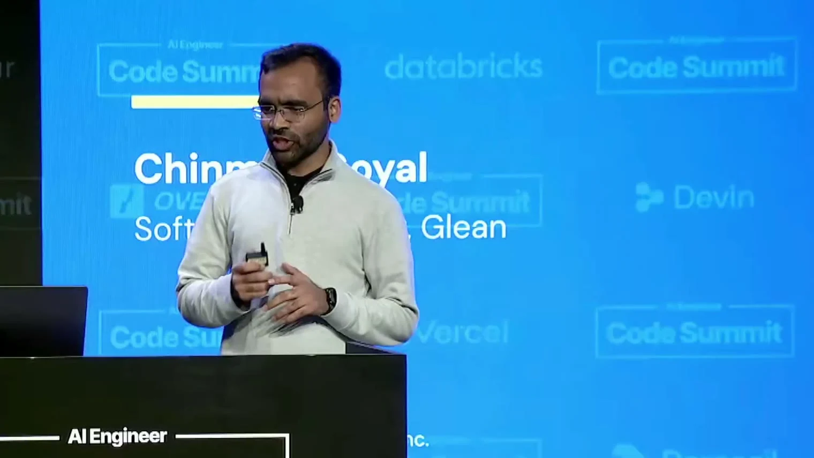

_截图 01  ·  录屏 05:09:43_

### 识别输出可枚举的任务，介绍评测流程

**05:09:58**　So to give a couple of examples, user query intent classification, a ranker picking a suggestion out of N options, checking whether a citation is valid or not, routing to the correct model or expert, so on and so forth. Till now, we have been paying the full LLM cost and latency to get an answer to all these bounded problems. Jeff at Glean fills the gap between general LLMs and fine-tuned classifiers.

以几个例子来说明：用户查询意图分类、从多个选项中选择推荐项、判断引用是否有效、将请求分配到正确的模型或专家手中等等。到目前为止，我们一直要支付完整的 LLM 成本和延迟费用，才能解决这些有约束条件的问题。Glean 的 Jeff则填补了通用 LLM 与微调分类器之间的空白。

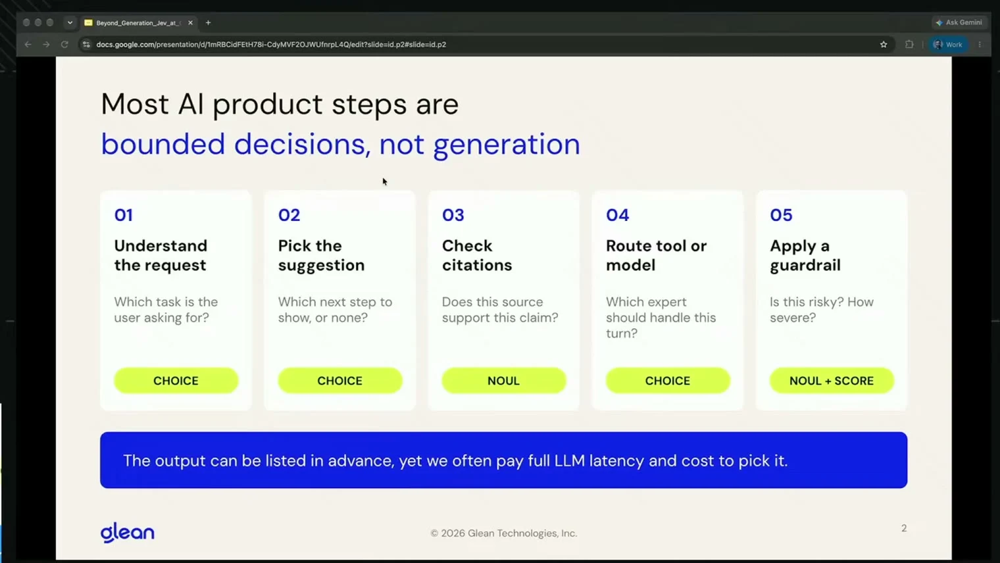

_截图 02  ·  录屏 05:10:08_

**05:10:30**　Classification itself isn't a new problem. People have been trying to solve it since forever. We can have multiple ways to solve it. Some of the things that we have tried out include using a general purpose LLM, using an open model, something like Laya, fine-tuning that open model, or using Jev. Now, all these approaches and all these different ways have their pros and cons.

分类本身并不是一个新的问题。人们一直试图解决它。我们有多种方法可以解决它。我们尝试过的一些方法包括使用通用型 LLM、使用开放模型，比如 Laya，对那个开放模型进行微调，或者使用 Jev。现在，所有这些方法和不同方式都有各自的优缺点。

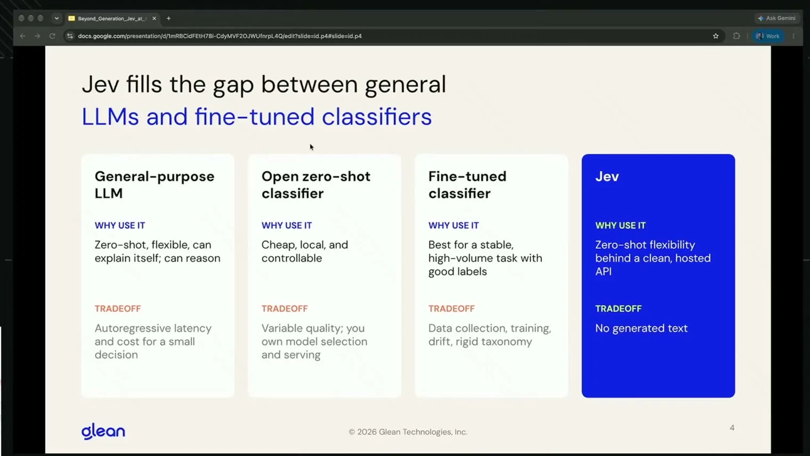

_截图 03  ·  录屏 05:10:41_

**05:10:55**　With a general purpose LLM, we incur a lot of cost and latency, while with something like Jev, we get no generated text output. Another advantage that we have been seeing with Jav is that as the taxonomy of the decision space changes, we don't have to fine tune these models again and again. We can just change our prompt a bit and boom, it works out of the box.

使用通用型 LLM时，我们会面临较高的成本和延迟问题；而使用像 Jev 这样的模型则不会产生任何生成的文本输出。我们在 Jav 上发现的一个优势是，当决策空间的分类方式发生变化时，我们无需反复对模型进行优化。我们只需稍改一下提示词，一切就自动生效了。

**05:11:21**　Now I'll walk you through how we have integrated gen or these classification, how we have used Jev at Glean to solve these classification problem statements. I'll go into some of these problems in great detail. Before we go into these individual problems, I wanted to touch upon how we evaluate these changes. We have a huge customer base having millions of users, so we don't want any of the change that we make to regress our product.

现在我将向您说明我们是如何整合 gen 或这些分类方法的，以及如何在 Glean 中使用 Jev 来解决这些分类问题。我会详细讲解其中的一些问题。在讨论这些具体问题之前，我想先谈谈我们如何评估这些变更。我们有庞大的用户基础，拥有数百万用户，因此我们不希望所做的任何变更导致产品退化。

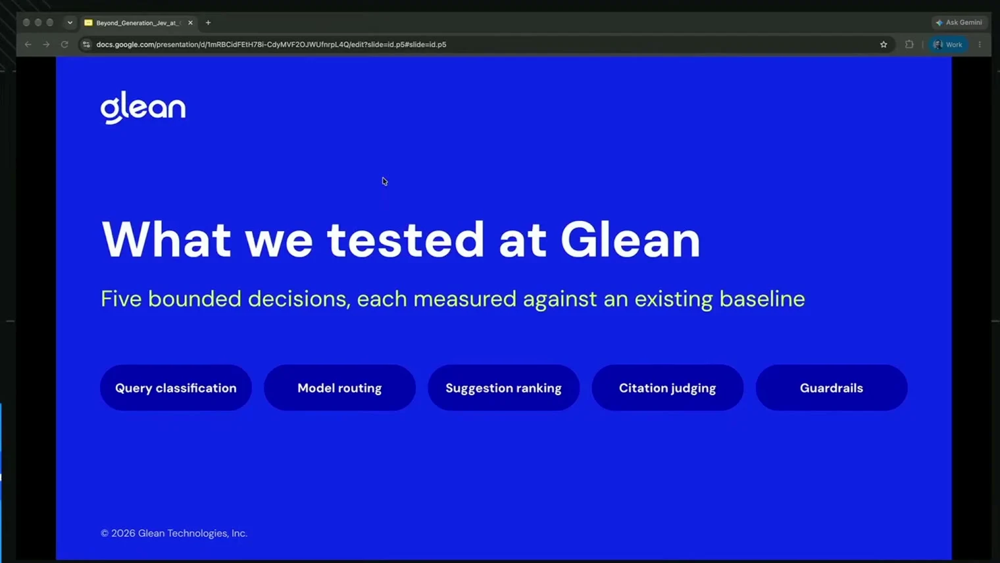

_截图 04  ·  录屏 05:11:27_

**05:11:51**　We have a multiphase approach, a rollout approach to any change that we are making. This includes having a golden eval set for almost every possible thing like any place where we have generative ai any place where we have any form of intelligence involved we have a golden eval set for that space we soak all of these changes for a significant amount of time for our internal use case like we have around 1500 people at clean right now we soak all of these changes within our glean for a couple of weeks, we get active feedback.

我们采用多阶段方法，对所做的任何变更都采用推广式策略。这包括为几乎所有可能的情况设立“黄金评测组”，比如在我们使用生成式人工智能的任何领域，以及任何涉及智能技术的领域，我们都会为这些领域设立“黄金评测组”。我们会用相当长的时间来研究所有这些变更，以便用于内部测试，比如目前Clean公司有大约1500人。我们在Glean内部对所有这些变更进行几周的测试，并获取积极的反馈。

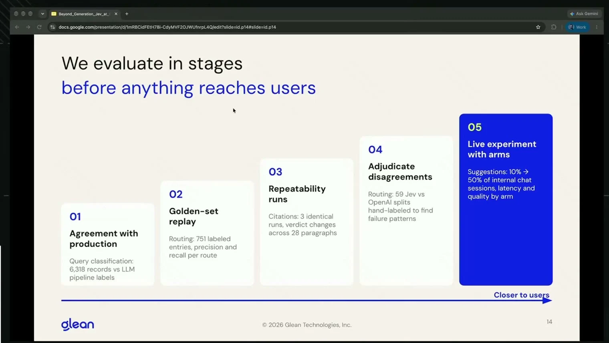

_截图 05  ·  录屏 05:11:56_

**05:12:24**　We have a very active feedback loop from our internal users. We work upon that, and then we go for an A-B testing with our customers. The first problem that we tried out with our decision model was query classification. Query classification is when we want to know the nature of user queries. This helps us realize what kind of jobs for. Say, for example, if people are using more for sales like queries, we focus more on that.

我们的内部用户提供了非常活跃的反馈。我们会根据这些反馈进行改进，然后与客户进行 A-B 测试。我们用决策模型尝试解决的第一个问题是查询分类问题。查询分类指的是我们想要了解用户查询的性质。这有助于我们明确需要处理何种类型的问题。例如，如果人们更多使用与销售相关的查询，我们就会更关注这方面。

### 查询分类、专家路由和建议排序

**05:12:56**　If people are using more for engineering type use cases, we focus more on that. We tried out three different approaches over here, and this is data from our test bed. We used an open source model, then we tried out Jev, and then we fine-tuned the model on our own compute resources. Jev is the best no training option in our opinion.

如果人们更多地使用用于工程类场景的模型，我们就会更专注于这方面。我们在这里尝试了三种不同的方法，这些就是我们的测试数据。我们首先使用了开源模型，然后尝试了 Jev 模型，最后利用自己的计算资源对模型进行了优化。在我们看来，Jev 是无需训练的最佳选择。

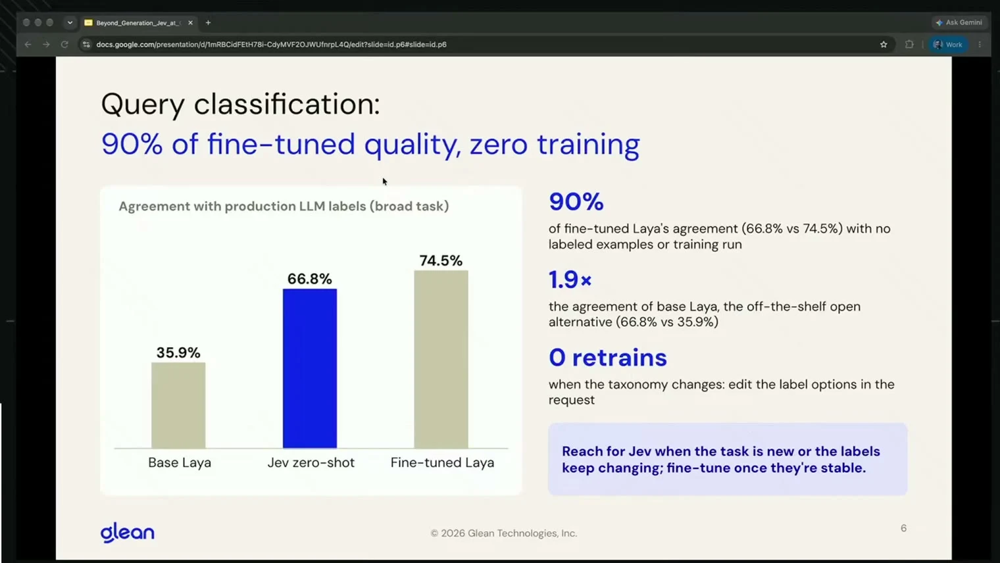

_截图 06  ·  录屏 05:12:59_

**05:13:20**　It nearly the output quality of a base Laia model, and is able to perform at 90% quality in comparison to a fine-tuned Laia. With Jev, we don't have to go through the very tedious process of data collection, data cleaning, incurring the cost for compute, like training the model, fine-tuning the model again and again as the taxonomy changes, and at the same time, we don't have to worry about hosting the model or incurring the inference cost.

其输出质量几乎与基础 Laia 模型相当，与经过微调的 Laia 模型相比，其质量可达 90%。使用 Jev 后，我们无需经历繁琐的数据收集、数据清洗、计算成本以及模型训练、反复微调等过程，因为分类标准会不断变化；同时，我们也不必担心模型托管或推理成本的问题。

**05:13:54**　The next problem we went to is expert routing. This is a pretty common problem statement in the industry right now. Like, hey, when the user query comes in, what expert do we route it to? How do we ensure that the user is of the best possible quality? Glean receives the way we have been solving this is Glean receives the user query and then decides what's the best expert to answer the query.

我们接下来要解决的问题是专家路由。这是当前行业中非常常见的难题。比如，当用户查询到来时，我们应该将用户分配给哪位专家？如何确保用户得到最优质的回答？Glean解决这一问题的方式就是：接收用户查询后，决定哪个专家最适合回答该查询。

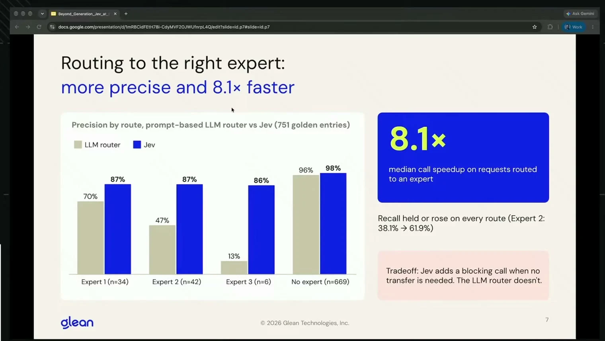

_截图 07  ·  录屏 05:14:14_

**05:14:17**　Till now, we have been using a general purpose LLM to route to the correct expert. Up a test bed for Jev, we set up a test bed with N experts and our experiments found a significantly high precision when using Jev and that too at an almost 8x reduction in latency. We had to change our implementation or our infrastructure significantly to integrate Jev into this specific stage of our product, but the reduction in latency justifies that inherent complexity in the system.

到目前为止，我们一直使用通用型 LLM来将请求路由到正确的专家。为了测试 Jev 的性能，我们搭建了一个包含 N 位专家的测试平台，实验结果显示使用 Jev 时精度非常高，且延迟降低了近 8 倍。为了将 Jev 整合到产品的这一特定阶段中，我们不得不大幅改变实现方式或基础设施，但延迟的降低证明了系统固有的复杂性是值得的。

**05:14:48**　We at Glean have been trying to build systems in the most in the simplest possible manners. This is one of the rare pieces where we believe complexity is worth it. Next, I'll walk you through the ranker problem statement that I talked about. When we receive a user query, we also want to generate the best follow-up suggestions for the user. This helps us in getting discoverability for our product.

我们在 Glean 公司一直努力以最简单、最直观的方式构建系统。这是少数几个我们认为复杂性值得投入的地方。接下来，我将向您介绍我之前提到的 ranker 问题描述。当收到用户查询时，我们还想生成最合理的后续建议，这有助于提升产品的可发现性。

**05:15:14**　This helps us in ensuring that the user has the best possible experience. We also want to recommend or say preempt what the next user Again, a pretty common problem statement that the entire industry has been trying to solve for. Internally, we call this system Q, like Q as in the literal Q. The way this works, we have like 10 or 15 different sources or 10 or 15 different ways, 10 or 15 different sources that are generating suggestions independently of each other.

这有助于我们确保用户获得最佳使用体验。我们还希望能够推荐或指出下一个用户应该选择的内容。这其实是一个整个行业一直在努力解决的常见问题。在内部，我们称这个系统为Q，就像字母Q一样。其运作方式是通过10或15种不同的来源或10或15种不同的方法，这些来源/方法相互独立地提供建议。

**05:15:45**　These suggestions are generated by natural language LLMs, and it's like a proper natural language query. Once these suggestions are in, we have a ranking step. So the ranker takes on all these suggestions, takes on the first user query, takes on the output that Glean gave, and then all these suggestions in that context. The ranker is then asked to decide, like, hey, you have these suggestions, what do you think is the best one?

这些建议是由自然语言 LLM 生成的，就像一个标准自然语言查询一样。一旦这些建议被纳入，就进入排名阶段。因此，排名器会考虑所有这些建议、第一个用户查询以及 Glean 提供的输出，再结合该语境下的所有建议。最后，排名器需要做出判断：嘿，你有这些建议，你认为哪一个是最好的呢？

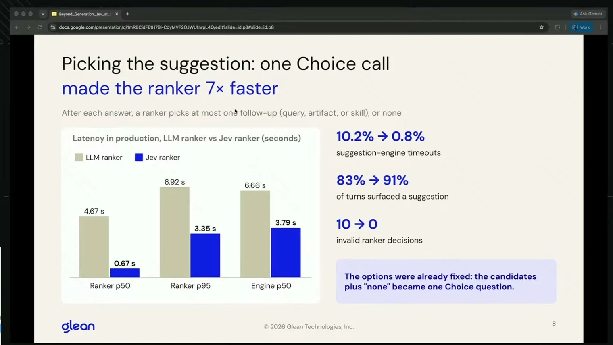

_截图 08  ·  录屏 05:16:02_

**05:16:10**　A pretty interesting bottleneck that we had over here is we want the response to be snappy. We cannot have a state where we give the textual response to the user and then wait five seconds for generating the follow-up suggestion. We have to be snappy. That's why we have time limits on these sessions. So right now this step had a time limit of 1.5 to 2 seconds.

我们这里遇到的一个很有趣的瓶颈是：我们希望响应速度要快。我们不能出现这样的状态：先给用户给出文本回复，然后等待五秒才生成后续建议。我们必须快速响应。因此，这些会话都有时间限制。目前，这一步骤的时间限制为1.5到2秒。

**05:16:33**　Jeff no doubt gave us a better quality and far better latency than what we had with the general purpose LLM. But two things stood out over were able to give a suggestion within our time bounds in 99.2% cases. With the general purpose LLM, this was almost 90%. So this ensures that we have user engagement and far more user queries now.

Jeff无疑提供了比通用型LLM更优质且延迟更低的效果。但有两个方面表现突出：在99.2%的案例中，他能够在规定时间内给出建议；对于通用型LLM来说，这一比例接近90%。因此，现在我们有了更多的用户互动和查询。

**05:17:02**　The second thing is, at Glean, whenever we use these LLMs, we have guardrails. Guardrails in the sense that, hey, LLM might not be good at generating a response, LLM might be making some specific kind of mistakes. So we have checks and balances for all those possible mistakes that we see. We keep a log of all these checks that are incurred at any point of time.

第二点是，在 Glean 平台上，每当我们使用这些 LLM 时，就有防护措施。这种防护意味着，LLM 可能不擅长生成响应，也可能出现某些特定的错误。因此，我们对所有可能出现的错误进行了检查与约束。我们会记录下在任意时刻发生的所有检查情况。

**05:17:25**　With a general purpose LLM, we were able to generate a valid suggestion in almost 90% of the cases. We still had some places where LLM was either generating a response in a different language, the output did not meet certain other criteria that we had written programmatically. With Jev, we found zero cases to be there when the output was invalid. Now, a natural question is like, hey, but you would have used a different prompt.

使用通用型 LLM 时，几乎 90% 的情况都能生成有效的建议。不过仍有一些情况中，LLM 会用其他语言回应，或者输出不符合我们编程设定的某些标准。而使用 Jev 时，则完全没有出现输出无效的情况。现在自然会有人问：不过你可能会使用不同的提示词吧？

**05:17:56**　Yes, the prompt was somewhat different, but we tried to mimic the prompt in the two cases to the largest extent possible so that we don't have a divergence. Like again, we at Glean want to keep the system as simple as possible. Another benefit we see with using a decision model is how we can control the thresholds. Because in this rancor problem statement, we are getting specific probabilities of each output.

是的，提示词有些不同，但我们在两种情况下都尽力模仿了提示词，以尽可能避免差异。同样，我们希望Glean能保持系统尽可能简单。使用决策模型的另一个好处是，我们可以控制阈值。因为在这个Rancor问题描述中，我们得到了每个输出的具体概率。

### 置信度、引用校验和防护判断

**05:18:22**　restricted to a binary yes or no response. We get like, hey, these were the five options, and these are the probabilities of these five options. With this, we are able to fine-tune the thresholds based on the deployment. We have put in self-learning systems, which based on the user, based on the customer deployment and the nature of usage that the specific customer has, fine-tune the thresholds by itself.

只能选择“是”或“否”的二元回应。我们了解到，有这五个选项，以及这些选项的概率。通过这一方法，我们可以根据部署情况调整阈值。我们引入了自学习系统，该系统依据用户、客户部署情况以及客户的使用方式，自动调整阈值。

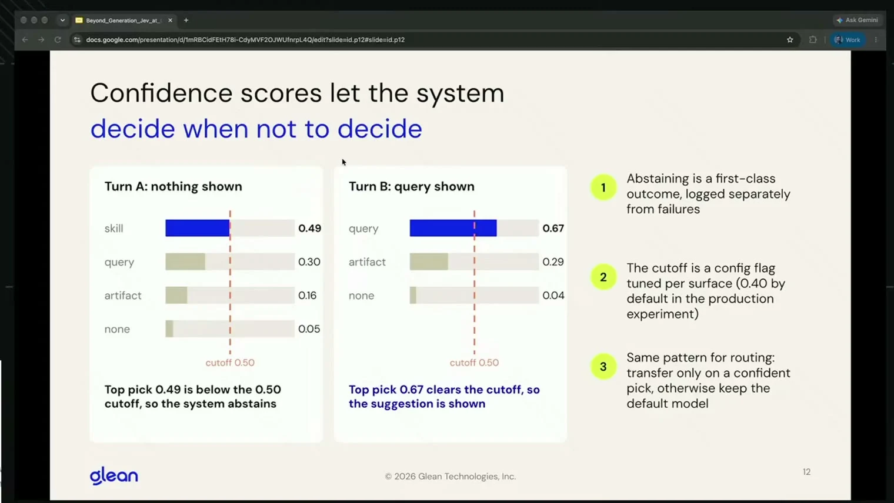

_截图 09  ·  录屏 05:18:28_

**05:18:46**　This ensures that the experience in each and every customer is the best possible based on how they use Glean, not a general purpose solution that fits all. Okay, this is an interesting one. Now, moving on from how we have been making the lives or the experience of our end users better, we also tried using Jav and some other parts of our development pipeline.

这确保了每个客户的使用体验都达到最佳状态，而不是采用适用于所有情况的通用解决方案。好吧，这确实是个有趣的话题。现在，从我们如何改善最终用户的生活或使用体验来看，我们还尝试使用了 Jav 以及开发流程中的其他部分。

**05:19:18**　pipeline. One of them was how we use LLM as judges. Like, all of us have been using LLM as judges for quite some time now. There's an input, there's an output, and we use an LLM to judge how the quality of the output is. Now, naturally, whenever we use LLM as a judge, we repeat the experiment multiple times to account for the variability in the response.

管道。其中一种方式就是我们将 LLM 用作评判者。实际上，我们一直都在用 LLM 作为评判者。有输入，也有输出，我们利用 LLM 来评估输出的质量。当然，每当使用 LLM 作为评判者时，我们会多次重复实验，以考虑到响应中的不确定性。

**05:19:40**　At Glean, we used Jev for a very specific part of our evaluation pipeline. Glean responses or like any other AI product out there has like citations. This is how people trust that Glean's answer was correct and it is grounded in the correct document. Now we hold these citations to a very high bar and we have a specific part in our evaluation pipeline where we check whether the cited document really supports the claim made in the answer or not.

在 Glean 中，我们在评估流程的某个特定环节使用 Jev。Glean 的回应或任何其他人工智能产品一样，都包含引用。这就是人们相信 Glean 的回答是正确的，并且其依据正确的文档的原因。现在，我们对这些引用有很高的要求，我们在评估流程中有一个特定的环节，用来检查被引用的文档是否真的支持回答中的观点。

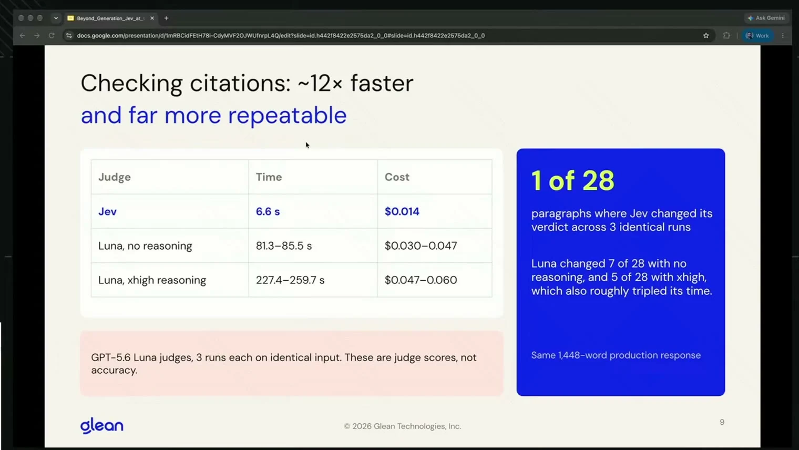

_截图 10  ·  录屏 05:20:00_

**05:20:11**　This again seems to be a pretty simple yes or no question like, hey, whether the claim is supported or not. With Jev, no doubt we had a far better latency and cause, like visible in the slide over here. The interesting thing we noticed over here is how consistent and reproducible Jev results were in comparison to something like say Luna. In the 28 or 30 use cases that we had, like only one run had like a difference in response.

这又似乎是一个非常简单的“是”或“否”的问题，即该声明是否得到支持。在Jev方面，毫无疑问我们的延迟时间和原因要好得多，就像这里的幻灯片所展示的那样。我们注意到有趣的是，与Luna等工具相比，Jev的结果具有一致性和可重复性。在我们测试的28或30种用例中，只有一次运行出现了响应差异。

**05:20:41**　Apart from that, everything was consistent. But this ensures two things for us as engineers or us as developers at Glean. We are not only improving the quality of our product, we are not only improving Glean in a linear fashion anymore. Any improvement of this extent in the development pipeline leads to an exponential increase in how we can improve the product. So if I, as a developer, am able to ship things like 5x faster, like this is a significant reduction in latency.

除此之外，一切都很一致。但这对我们这些工程师或 Glean 的开发者来说意味着两件事：我们不仅在提升产品的质量，而且不再以线性方式改进 Glean。在开发流程中如此大的改进，会带来产品改进的指数级提升。因此，作为开发者，如果我能实现5倍以上的速度提升，或者能显著降低延迟，那就非常好了。

**05:21:12**　Like if I run this experiment across thousands and thousands of entries, this is a lot of time. And again, I don't have to run the same input output pair multiple times because the results from Java are quite consistent. So if I'm able to increase my own productivity by like 5X or 6X, I can ship 6X times the features to our customers.

比如如果我在成千上万条记录上运行这个实验，那需要花费大量时间。而且，我不需要多次重复相同的输入输出对，因为 Java 的结果非常稳定。所以，如果我能将自身的工作效率提高 5 到 6 倍，就能向客户提供 6 倍的功能。

**05:21:32**　And this happens across like 500 engineers or 300 engineers at clean. So the impact of a good decision model is no longer linear. It is exponential on how we can improve the product. Okay. Now, moving on from product and LLMS judges, there's a pretty important, this is a pretty important part of how we use our customer data. Like, security is something that all our customers expect from us.

在清洁领域，大约有 500 或 300 名工程师参与其中。因此，良好的决策模型所带来的影响已不再呈线性增长，而是随着产品质量的提升而呈指数级增长。好的，现在从产品和 LLMS 评判机制来说，还有一个非常重要的方面，那就是我们如何使用客户数据。比如，安全性是所有客户对我们所期望的。

**05:22:05**　So, for example, we have checks and balances on all the inputs and outputs coming from a tool, all the inputs and outputs from an LLM. Till now we at Glean have like a multi-phase approach. There is like, there are two phases to this. The first one is like recall heavy phase and the second one is the final heavy loaded LLM.

例如，我们对工具的所有输入和输出，以及大语言模型的所有输入和输出都进行了制衡机制。到目前为止，我们在 Glean 采用了多阶段的方法。总共有两个阶段：第一个阶段是以回忆为主的阶段，第二个阶段则是最终加载完成的大语言模型阶段。

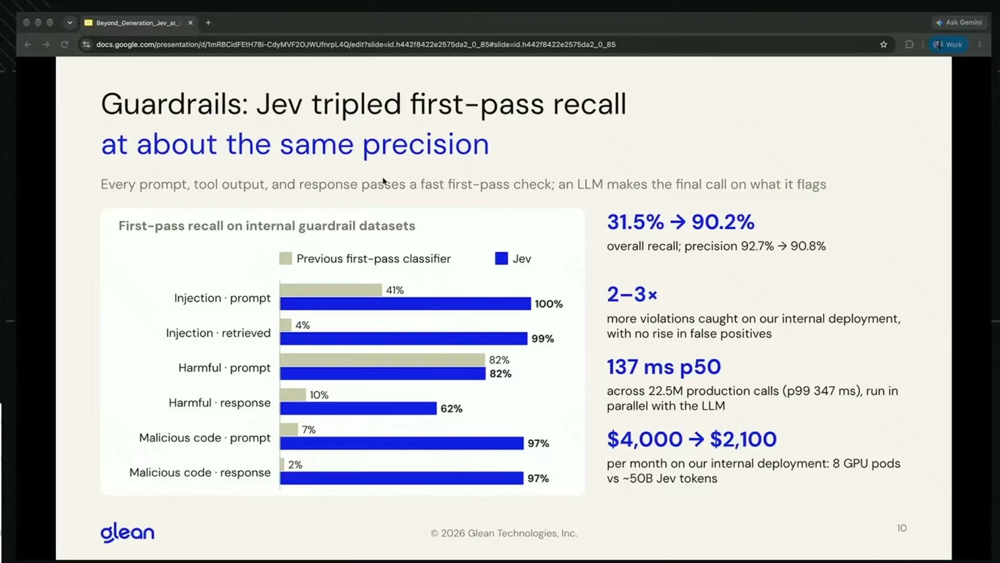

_截图 11  ·  录屏 05:22:25_

**05:22:25**　All these calls are made in parallel to like the actual tool input output calls. Till now we used to host a virtual classifier using T4 GPUs across all our customers. So Glean is a single tenant solution. We don't use or share resources across customers. Every customer gets its own deployment, gets its own instance, and gets all the resources. So assuming we have 1,000 customers out there, we had to maintain virtue classifiers across all these 1,000 customers, which becomes a pretty difficult problem statement in itself which takes up a lot of time from Glean engineers.

所有这些调用都是与实际工具的输入输出调用同时进行的。到目前为止，我们一直使用 T4 GPU 为所有客户提供虚拟分类器服务。因此，Glean 是一种单一租户解决方案。我们不会在客户之间共享或使用资源。每个客户都有自己的部署、自己的实例，以及所有资源。假设我们有 1,000 个客户，那我们就需要在这 1,000 个客户中维护这些虚拟分类器，这本身就是一个相当困难的问题，会占用 Glean 工程师大量的时间。

**05:23:02**　So looking at the results over here, the overall recall of the first phase we used to have a virtual classifier, we replaced that with GIV, went from 31.5% to 90.2%. At the same time, we are seeing a significant reduction in cost. Now this cost is only the resource cost mentioned over here, but we are also saving cost on the engineering resources over here.

从结果来看，使用虚拟分类器时的第一阶段整体召回率从31.5%上升到了90.2%。同时，成本也显著降低了。这里提到的成本仅指资源成本，而在工程资源方面也节省了成本。

### 怎样选择决策模型、规则或生成模型

**05:23:25**　We don't have to invest like two or three engineers who are full-time maintaining those virtual classifiers or those T4 GPUs across customers. The improvement or the savings that we have more than 50%. This slide concludes all the results I have talked about till now. Jev at Glean has been able to influence the product experience of the users, has been able to impact how we as developers have been working at Glean, and most importantly, it also has a very good positive impact on the security that we provide to our customers.

我们无需投入两名或三名全职工程师，负责在多个客户处维护那些虚拟分类器或T4 GPU。我们所实现的改进和节省效果超过50%。此幻灯片总结了我迄今为止所讨论的所有结果。Glean的Jev能够影响用户的产品体验，也改变了我们开发者在Glean的工作方式，最重要的是，它对我们向客户提供的安全性也有非常积极的影响。

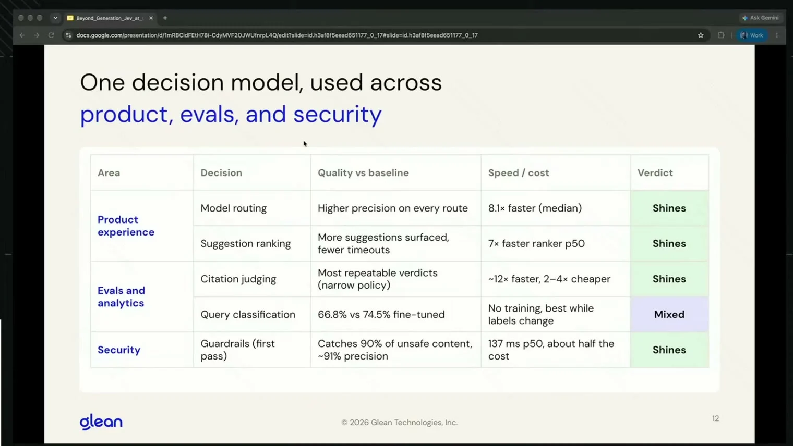

_截图 12  ·  录屏 05:23:45_

**05:24:01**　A simple rule that we have been using is can the out in conclusion a simple rule that we have been using at Glean is can the output be listed in advance if no then it's a free form generative text problem statement go back to something that can generate free form text if yes then use jev are labels stable and volume high the case where the labels are stable, which is rarely the case anymore, you can also fine tune a model.

我们一直使用的简单规则是：如果输出可以提前列出，那么这就是一个自由形式生成文本的问题。如果是这样，就使用 Jev。当标签稳定且数量较多时，这种情况很少出现，你还可以对模型进行优化。

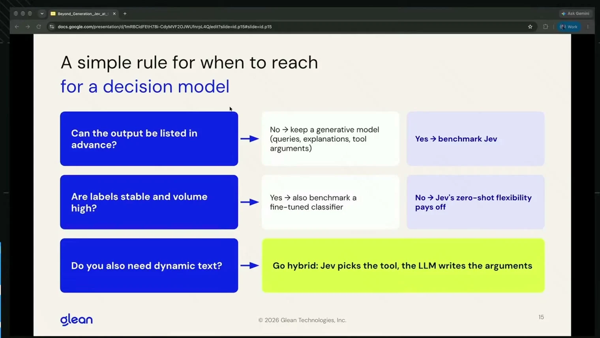

_截图 13  ·  录屏 05:24:14_

**05:24:28**　But if the labels change, which in my opinion is quite frequent these days, then again use something like Jev. Obviously, if you need dynamic text, we can feel free to try out more hybrid approaches like Jev along with freeform text, LLMs. This ends my presentation So thank you everyone for listening I have added a blog A link to the blog post Where we have posted the exact same results In great detail Feel free to catch me on the outside If you have more questions Thank you…

但如果标签发生变化，在我看来如今这种情况很常见，那么还是使用类似 Jev 的标签。显然，如果需要动态文本，我们可以自由尝试更多混合式方法，比如 Jev 与自由形式文本、大语言模型相结合。我的演讲就到此结束。感谢大家的聆听，我添加了一个博客链接，那里详细展示了我们完全相同的结果。如果还有疑问，欢迎在外部与我联系。谢谢……

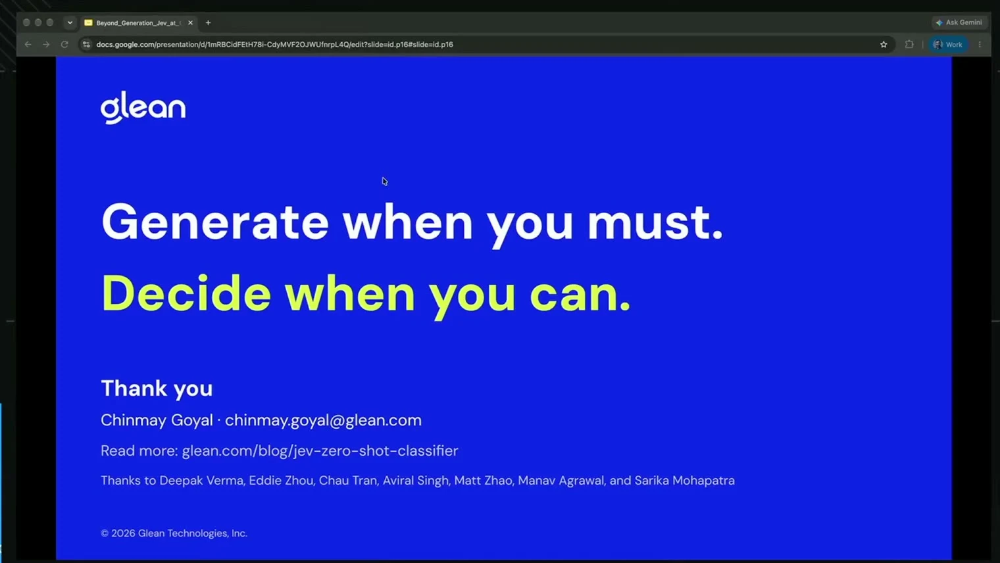

_截图 14  ·  录屏 05:24:51_

---

[全部演讲](../README.md) · [选看索引](index.md) · [上一场](17-diogo-almeida.md) · [下一场](19-chibi-vikram-kevin-bernstein.md)
