[全部演讲](../README.md) · [选看索引](index.md) · [上一场](18-chinmay-goyal.md) · [下一场](20-brian-kennedy.md)

# Your Automation Is Overthinking It

**Chibi Vikram** · UiPath · Engineer

**Kevin Bernstein** · UiPath · Principal AI Solution Architect

AIE Code Summit 2026  ·  11 月 11 日  ·  主舞台  ·  录屏 05:27:09–05:41:50

[官方议程](<https://ai.engineer/code/2026/schedule>)   ·   [Day 1 官方回放](<https://www.youtube.com/watch?v=ZZ19zhYnDKY>)

## 本场目录

- [05:29:35](#section-1) Jev 在 Maestro 流程中的位置
- [05:31:10](#section-2) 可疑交易初筛与后续调查演示
- [05:34:35](#section-3) 分类、路由等用法及检索重排
- [05:38:36](#section-4) 从邮件挖掘结构化数据，比较示例延迟和成本

## 演讲实录

> 英文源自录屏音频，经轻度校订。每段英文下方为中文译文。时间指向原始录屏。

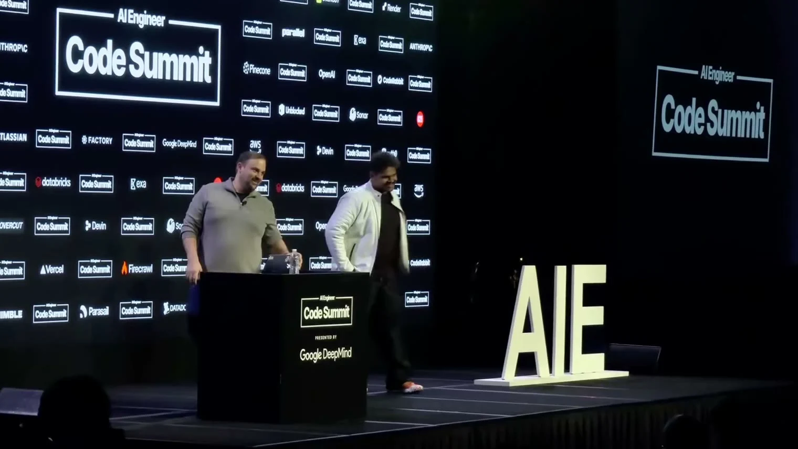

_截图 01  ·  录屏 05:27:09_

**05:27:10**　Hello everyone. My name is Chibi and I'm joined in stage by Kevin. We are here to talk about how we believe that your automations are overthinking it. So tell us a little bit about ourselves. We are from a company called UiPath. We have been doing automation for the last 20 years. We have been doing RPA before and we service more than 10,000 organizations around the world and we build an agentic process orchestration layer which basically brings agents, robots and people together to interact with each other and build extremely scalable automations that run for days and weeks.

大家好，我是Chibi，今天和Kevin一起参与这个环节。我们想讨论一下，我们认为你们的自动化系统存在过度思考的问题。那么请简单介绍一下我们吧。我们来自UiPath公司，过去20年一直从事自动化工作。我们之前也做过RPA工作，目前为全球超过10,000个组织提供服务，我们构建了智能体流程编排层，让智能体、机器人和人能够相互协作，从而打造出可长期运行的、高度可扩展的自动化系统。

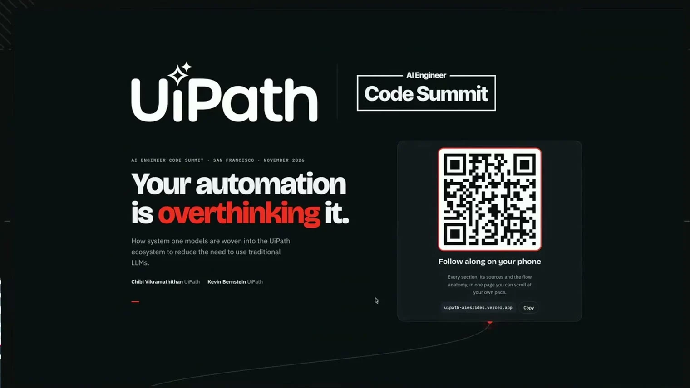

_截图 02  ·  录屏 05:27:17_

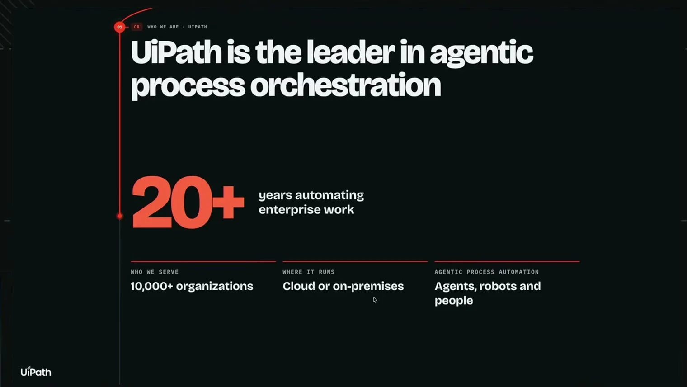

_截图 03  ·  录屏 05:27:34_

**05:27:55**　So we were inspired by this particular slide that you're seeing right now, and you saw today before us as well. When Diego presented it three months ago, the same slide, it resonated really well with us because this is how we see automation as well. So the traditional software is basically RPA. It's just robotic process automation, if else, just execute some task and then keeps going.

因此，我们受到您现在看到的这张幻灯片启发——您之前也看到过类似的幻灯片。三个月前当Diego展示这张幻灯片时，它让我们非常认同，因为这就是我们对自动化的理解方式。所以传统软件本质上就是RPA，也就是机器人流程自动化；否则就只是执行一些任务，然后继续工作而已。

**05:28:23**　The control flow is deterministic, just keeps going. And then when the LLMs came out, we all raced to go and build the just-in-time software where we have this one agent, we give it a bunch of tools, we give it a task and ask it to finish. And then we were seeing good results, bad results, and then we added evaluations build the results up.

控制流程是确定性的，一直持续进行下去。当大语言模型出现后，我们纷纷赶紧构建即时软件，使用这个智能体，给它提供许多工具、任务，然后让它完成工作。之后我们看到了好的结果和不好的结果，接着又增加了评估机制，整理出各种结果。

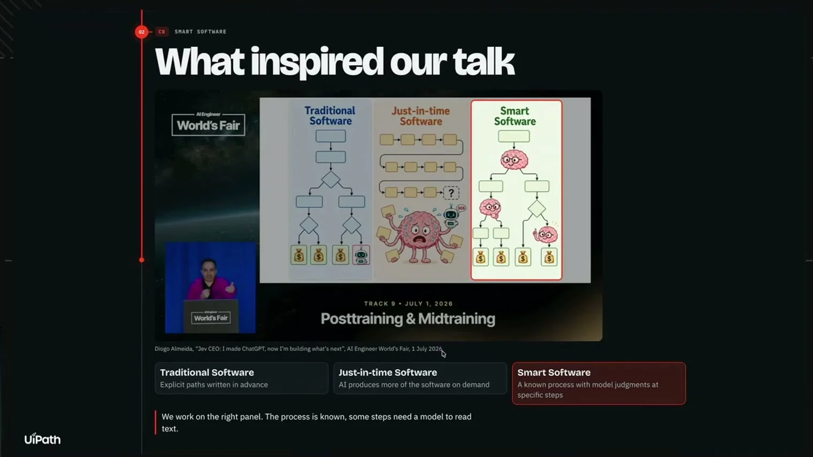

_截图 04  ·  录屏 05:28:24_

**05:28:44**　And then finally, we landed on agentic process orchestration, which kind of weaves in this cognitive decision through a logical decision layer. So you have deterministic calls and clear cognitive decision points where you would use an LLM to control the control flow rather than leaving it all in the hands of an agent. So at this time, we saw where Jay would fit in.

最后，我们提到了智能体过程编排，这种方式通过逻辑决策层将认知决策融入其中。因此，会有确定性的调用流程，以及明确的认知决策点，在这些地方可以使用LLM来控制控制流，而不是完全将一切交给智能体来处理。所以，目前我们已经明确了Jay在其中的位置。

### Jev 在 Maestro 流程中的位置

**05:29:13**　about JEW, we were really excited because we saw JEW fit in a very particular niche area. So, here we see that JEW is a very powerful tool, as Diego was saying it is a foundational tool that we would be able to integrate into all automation and it fit right in between a deterministic case and an agent case. So, JEW is extremely fast and most of you guys would have tried it and we were surprised by how fast and how parallel we could make it work and how intelligent it was.

关于 JEW，我们非常兴奋，因为看到 JEW在特定的领域非常有效。因此，我们看到 JEW是一种非常强大的工具，正如 Diego所说，它是基础工具，我们可以将其整合到所有自动化系统中，它正好处于确定性案例和智能体案例之间。所以，JEW非常快速，大多数人都已经尝试过，我们惊讶于它的速度以及如何并行运行，还有它的智能性。

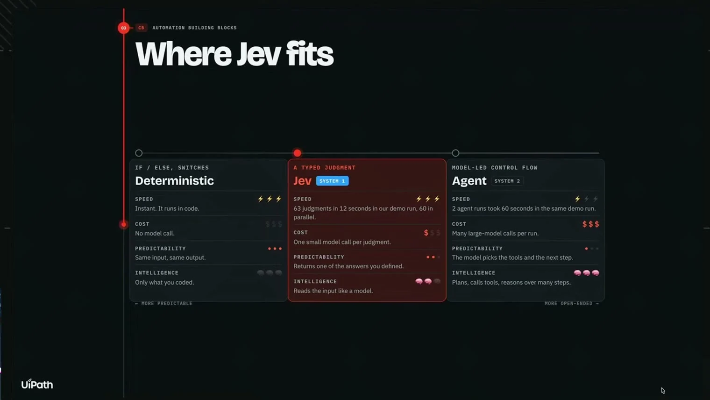

_截图 05  ·  录屏 05:29:35_

**05:29:49**　So, we were able to benchmark it around how good it was compared to an LLM and was pretty good not as a full LLM, but it was pretty good at in terms of intelligence as well. So, it falls in between and there are so many ways we could use jell and i want to hand it off to kevin to take you take you guys through a scenario where we use jell in uipath maestro flow yeah thanks jibi um so hi everybody uh today i want to actually walk us through a little bit about what UiPath is building with UiPath Maestro Flow and talk through a little bit of how we would go through and coordinate humans, robots, and agents all together inside of one canvas.

因此，我们能够对比出它与 LLM 的优劣，虽然作为完整的 LLM 来说不是最优秀的，但在智能性方面却表现非常出色。所以，它处于一个中间水平，我们有很多方式可以应用 Jell，我想把这个任务交给 Kevin，让他带大家了解如何在 UiPath Maestro Flow 中使用 Jell 的实际场景。好的，Jibi，那么大家好，今天我想简要介绍一下 UiPath 正在用 UiPath Maestro Flow 做什么，以及我们如何协调人类、机器人和智能体，让它们在一个统一的平台中协同工作。

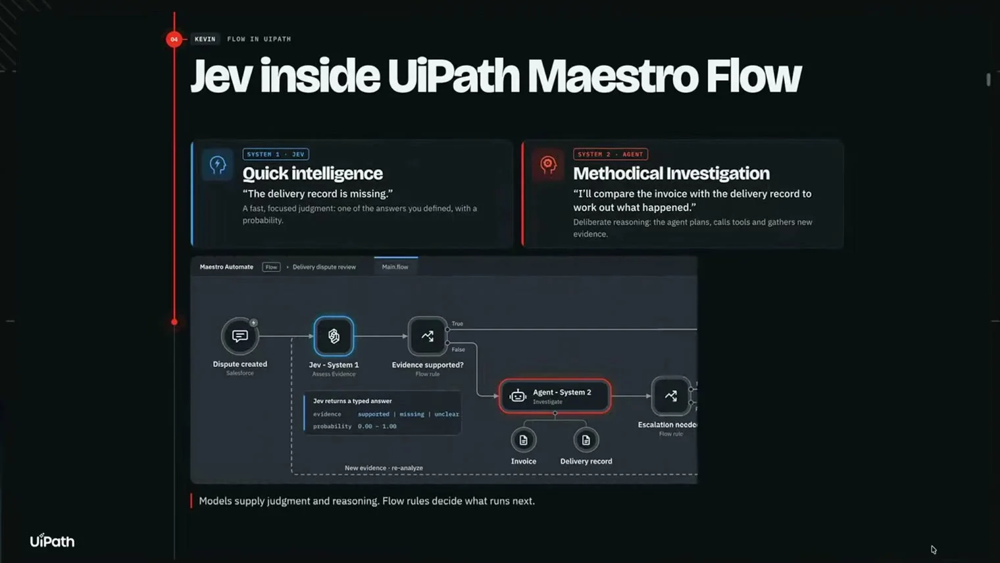

_截图 06  ·  录屏 05:30:08_

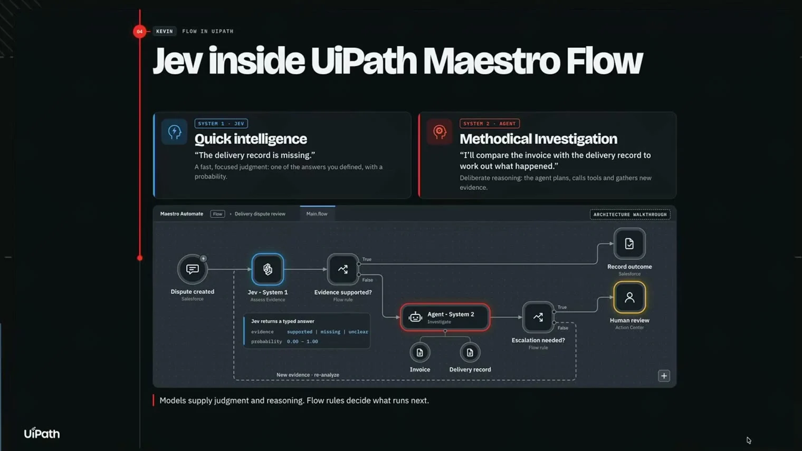

_截图 07  ·  录屏 05:30:25_

**05:30:29**　What we're going to walk through today is essentially a flow that will demonstrate how we can weave all these things together. And the way that we're approaching this is that we're going to end up having System One agents which are going to be able to make quick intelligence happen within our process. Hey, is this transaction fraud or not? Additionally, we'll have system two agents running where we're going to have more of a methodical, deeper investigation that's going on where agents are going off and calling tools.

今天我们将要探讨的内容本质上是一个流程，它将展示如何将所有这些元素整合在一起。我们的处理方式是，最终会拥有System One智能体，它们能够在我们过程中快速实现智能决策。那么，这是否属于交易欺诈行为呢？此外，我们还将运行System Two智能体，进行更系统、更深入的调查，这些智能体会调用各种工具。

### 可疑交易初筛与后续调查演示

**05:30:59**　And we'll see kind of this pattern, these patterns start to emerge where we're able to hand off from one to the next. And so with that, I'll jump into an actual demo where we're going to demonstrate a account fraud scenario. And so our demo starts here with effectively a transaction coming in for $48,000. And this wasn't something that we were expecting.

我们会看到这种模式，这些模式开始显现出来，我们就能顺利地将一个流程转化为另一个流程。因此，我将开始进行一个实际演示，我们会展示一个账户欺诈场景。我们的演示从以下情况开始：有一笔价值48,000美元的交易进入系统。这并非我们预期的情况。

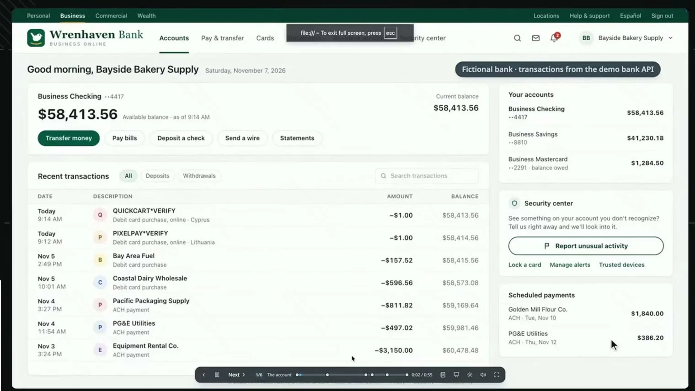

_截图 08  ·  录屏 05:31:10_

**05:31:23**　And so as I'm reviewing my bank portal here, I'm going to go ahead and report this as a fraudulent transaction. And so now this would end up submitting it off into our UiPathMeisterial flow, where this would act as essentially the trigger for this end-to-end workflow to go off and start processing. What we're looking at is a collection of various different nodes that are each going to kind of be orchestrated from the left side of the canvas over to the right.

因此，当我在这里查看我的银行门户时，我会将此记录为欺诈交易。现在，该记录将被提交到我们的 UiPath 管理系统中，从而作为整个工作流的触发点，启动处理流程。我们所看到的是一系列不同的节点，这些节点将从画布的左侧被协调到右侧。

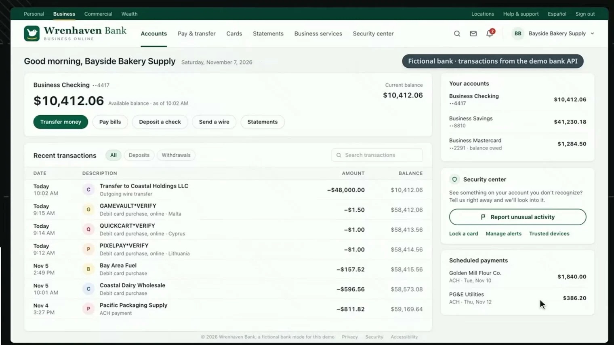

_截图 09  ·  录屏 05:31:23_

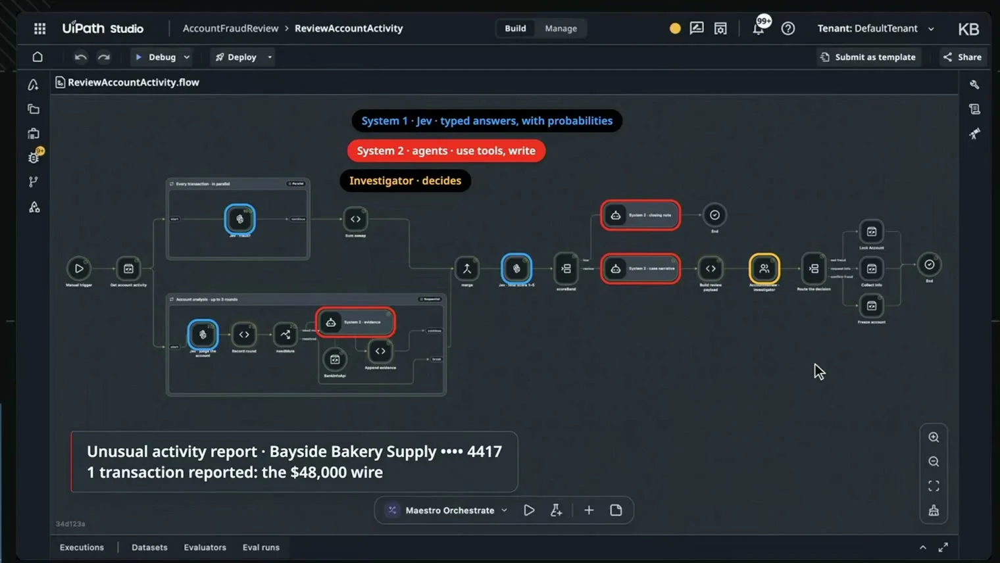

_截图 10  ·  录屏 05:31:44_

**05:31:47**　And we're going to use essentially a combination of System One and system two models to actually process this and do analysis of if this is fraud or not. And so the first thing that actually takes place is we're going to go through and get account activity. We're going to send this off to Jev to basically pull 60 transactions from the most recent credit card purchases that were made and analyze each one of those individually whether or not these are fraud.

我们将主要使用 System One 和 System Two 模型的组合来处理这一情况，并分析其是否为欺诈行为。首先，我们会查看账户活动情况。随后会将数据发送给 Jev，让其在最新的信用卡交易记录中找出 60 笔交易，并逐一分析这些交易是否属于欺诈行为。

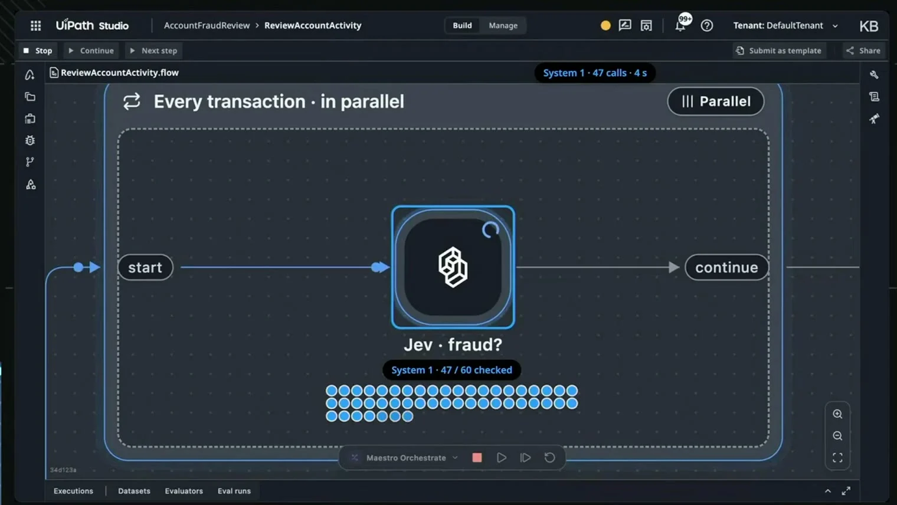

_截图 11  ·  录屏 05:32:09_

**05:32:13**　And this is happening in real time where Jeff's able to process these transactions and ask that question of, hey, is this fraud or not within fractions of a second. Now, we found that there's about four transactions that recently appeared that it thinks are fraud. Now, in parallel to that, we're able to kick off another part of our flow, which is doing more of a semantic analysis on the entire account.

而且这一切都是实时进行的，Jeff能够在几分之一秒之内处理这些交易并判断这是否属于欺诈行为。我们发现最近有大约四笔交易被判定为欺诈行为。与此同时，我们还能启动另一部分工作，对整个账户进行更深入的语言分析。

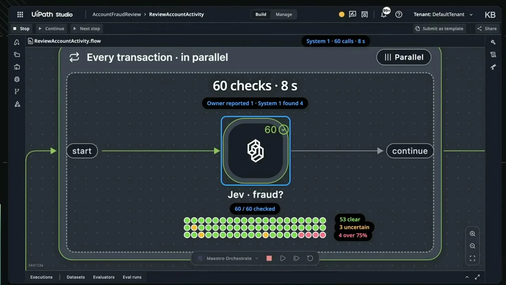

_截图 12  ·  录屏 05:32:21_

**05:32:34**　We're looking at that one transaction that came in for $48,000, which was flagged. And we're asking a question to Jev is, hey, is there enough information here for us to determine whether or not this is actually fraud? And just as we heard Diago talk about this earlier, where you have these new kind of paradigms and logic come up, we ended up finding from this that there's a scoring that took place and we needed more information.

我们正在查看那笔金额为48,000美元的交易，该交易被标记为可疑。我们在问Jev的问题是：是否有足够的信息让我们判断这是否真的属于欺诈行为？正如我们之前听到Diago谈论的那样，当出现这种新的模式与逻辑时，我们发现确实进行了评分，而我们需要更多信息。

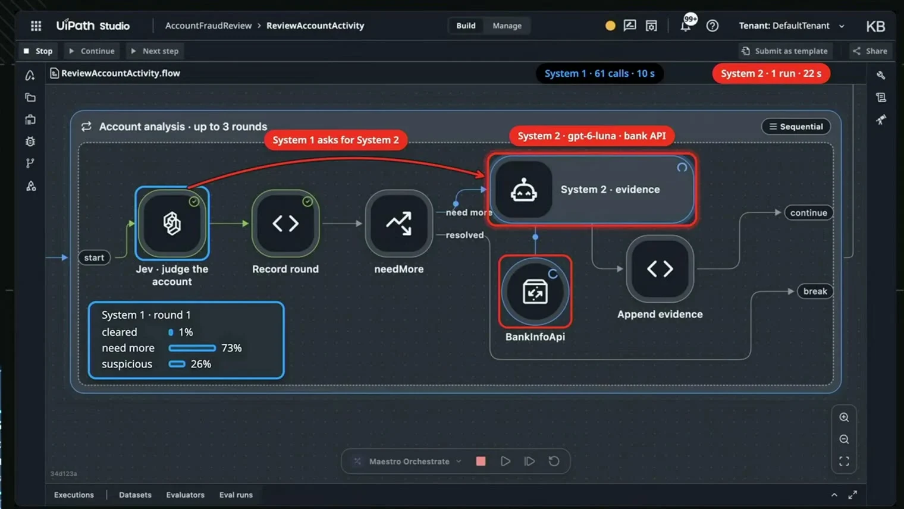

_截图 13  ·  录屏 05:32:46_

**05:32:57**　We were asking the question, do we have enough information for fraud? And for that, what we're going to end up doing is kicking off a System 2 agent that's going to go spin up and run for much longer, calling a bank API and finding that there was a $48,000 transaction from a payee, basically creating a new account on his phone.

我们问的是，我们有足够的信息来识别欺诈行为吗？为此，我们将启动一个系统2智能体，该智能体会运行更长时间，调用银行API，发现有一笔48,000美元的交易来自收款人，实际上是在他的手机上创建了一个新的账户。

**05:33:16**　And it was earlier that day that that account got created. So high indicator of fraud. We circle back and ask that same question now to Jev and ask, hey, do we have enough evidence now? Jev agrees, and it finds 100% of its activity. And we would hand that off effectively to another grading model that combines all those transactions that we found with the system payload, and then finds that there is fraud in this particular use case.

那天早些时候就创建了那个账户。这是明显的欺诈迹象。我们现在又回到这个问题上，问Jev：现在我们有足够的证据吗？Jev同意了，并且发现了100%的活跃行为。我们可以有效地将这一情况交给另一种评分模型，该模型会将我们发现的所有交易与系统数据结合起来，然后判断出这个特定用例中存在欺诈行为。

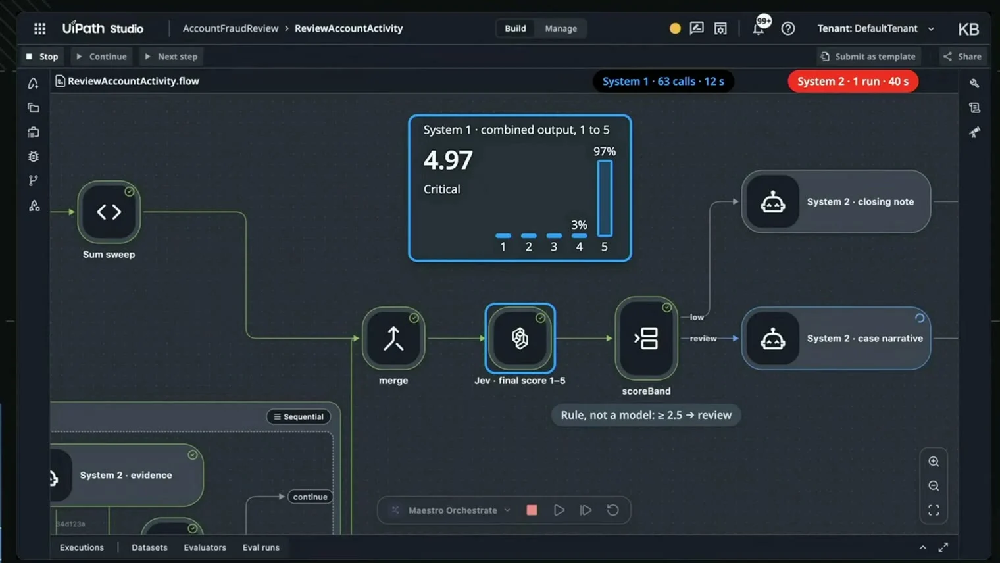

_截图 14  ·  录屏 05:33:36_

**05:33:40**　A square out of 1 to 5, we got 4.97. Now, stepping out of this, typically what would happen from this point onwards is that we'd go off to a human to review. To review both the System One and system two logs and then find that there was, you know, potential fraud and freeze the account. But, you know, effectively what we're seeing from customers that are going through and implementing Jev inside of their workflows is that they're able to replace the typical LLM calls that are going on behind the scenes.

1到5中的评分，我们得4.97分。从这一点来看，通常接下来我们会请人类来审核。要审核System One和System Two的日志，然后发现可能存在欺诈行为，就冻结账户。不过，从那些使用Jev的客户的反馈来看，他们能够取代那些在背后进行的传统LLM操作。

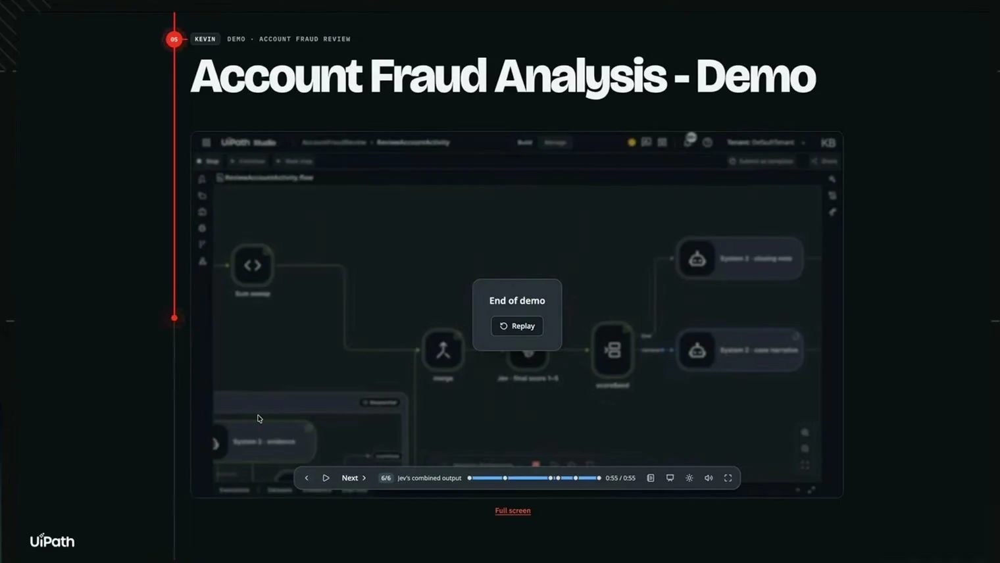

_截图 15  ·  录屏 05:33:53_

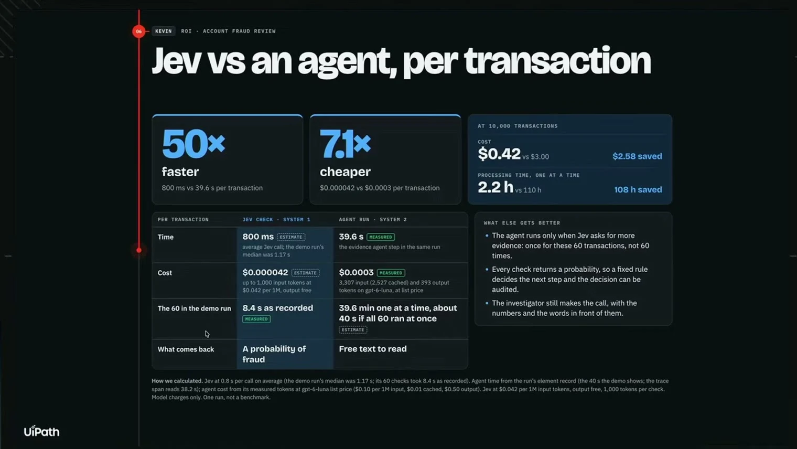

_截图 16  ·  录屏 05:34:05_

### 分类、路由等用法及检索重排

**05:34:08**　And in process, we're saving about 50 times, we're increasing the speed about 50 times while also being 7.1 times cheaper than calling a traditional LLM. Now, we've gone through and kind of shown how customers would use this within our technology, but we're also pointing the finger back inwards where we're trying to ask the question of how can UiPath use this within the products and services that we offer to be able to help customers out.

同时，我们的成本降低了约50倍，处理速度也提高了约50倍，且价格仅为传统LLM的7.1分之一。现在，我们已经展示了客户如何在我们的技术中使用这一功能，但我们也思考着：UiPath如何能将这一功能融入我们提供的产品与服务中，从而帮助客户。

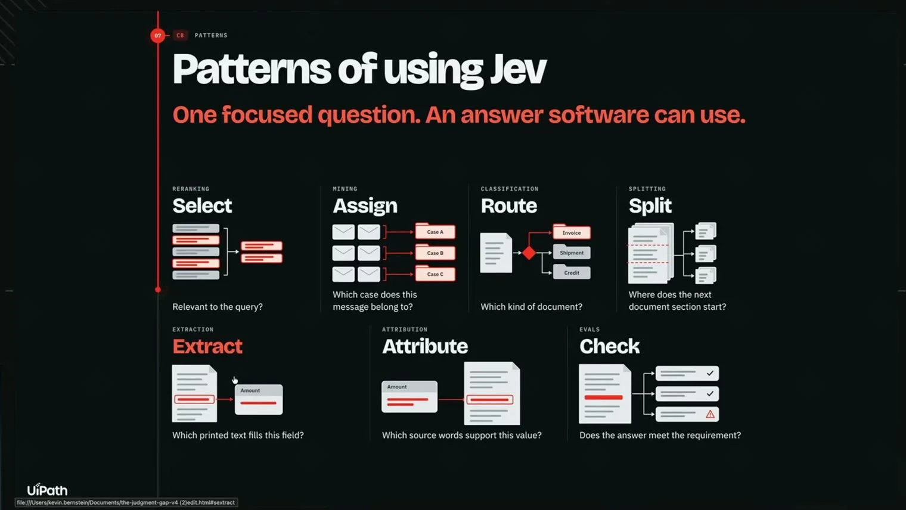

_截图 17  ·  录屏 05:34:35_

**05:34:37**　And there's a number of different patterns that we're kind of exploring with Jev. And today we're going to talk about a re-ranking problem as well as what we're using inside of email mining.

我们正在用 Jev 探索多种不同的模式。今天我们将讨论重新排序问题，以及我们在邮件挖掘中使用的技术。

**05:34:47**　And so to set the stage for kind of re-ranking, to do is run and add within our retrieval augmented generation within our agents the ability for us to find more appropriate chunks to be able to provide to our agent and we do that by basically finding relevant documents first and then using typically an llm to do this but we're experimenting with also using jev to go through and find the various different chunks that make are most relevant to answering the question and then providing those as context to the llm and we've run a couple on this now, and I'd like to hand it back off to Chibi, who's going to end up telling us a little bit more about what we were able to find.

因此，为了进行重新排序，我们需要在智能体中加入一种能力，让检索增强生成机制能够找到更合适的片段，从而提供给智能体。我们首先找出相关文档，然后通常使用 LLM 来完成这一操作。不过，我们也在尝试使用 Jev 来筛选各种与回答问题最相关的片段，并将这些片段作为上下文提供给 LLM。我们已经进行了几次实验，现在希望把任务交给 Chibi，她会告诉我们更多关于我们所发现的内容。

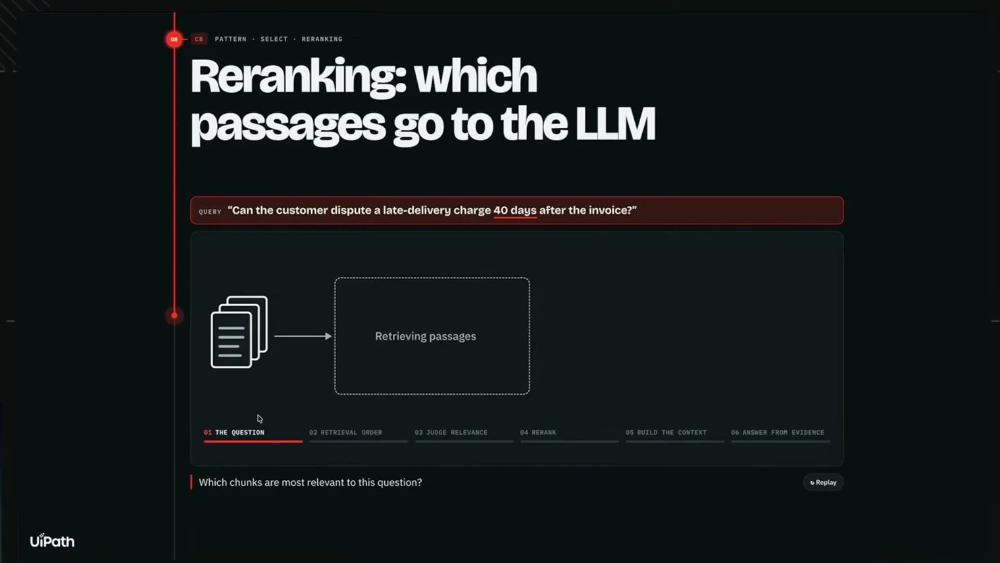

_截图 18  ·  录屏 05:34:55_

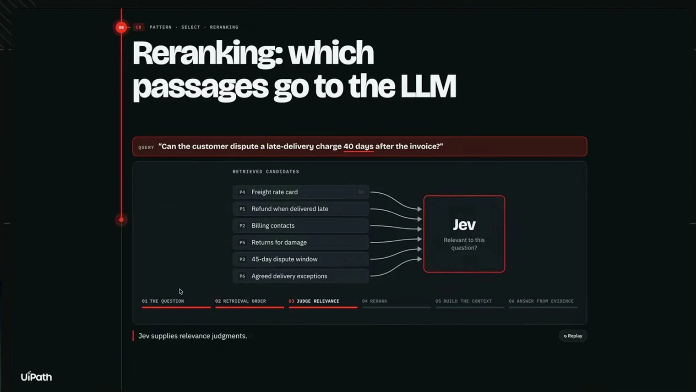

_截图 19  ·  录屏 05:35:08_

**05:35:28**　Yeah. So this is where things got really interesting for us. This is like the first week of Jev. We got our hands on Jev. And we have these extremely strong benchmarks and eval sets that we had for re-ranking that we have been running for some time. And we need those for like when we change from one model to another.

是的。这就是对我们来说非常有趣的地方。这是 Jev 的第一个星期。我们得到了 Jev 的数据。我们有一些非常强大的基准测试和评测集，这些是我们已经运行了一段时间用来进行重新排序的工具。当我们在不同模型之间切换时，我们就需要这些工具。

**05:35:48**　and we realized, okay, why not take these eval sets and build a hill climbing harness and ask Astra to say, okay, this is my score. I can get with an LLM. Here is Jeff. Here are the three APIs. Find a strategy which can achieve that score and let it run. And it ran for the entire night for 14 hours in a session.

我们意识到，好吧，为什么不利用这些评测数据集来构建一种 Hill Climbing 算法，然后让 Astra 给出结果，这样就能得到我的分数了。我可以借助 LLM 来实现。这是 Jeff。这些是三个 API。找到一种能够实现该分数的策略，然后让它运行起来。它整晚连续运行了 14 小时。

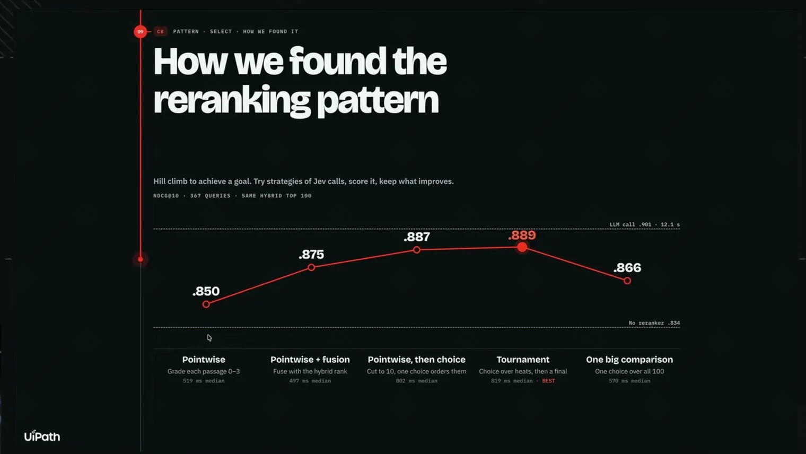

_截图 20  ·  录屏 05:35:50_

**05:36:14**　And it came up with so many different strategies where it worked, where it didn't work and then we were slowly seeing the number go up. Every two hours there will be one strategy would perform slightly better. This was so surprising for us because what we thought was JEL as an API, if you just call it, like when you just send all of the go up, yeah.

它提出了许多不同的策略，有些有效，有些则无效，然后我们逐渐看到数字在上升。每两小时就会有一种策略表现得稍微好一些。这对我们来说非常令人惊讶，因为我们认为JEL作为一个API，只要调用它，就像发送所有数据一样，没错。

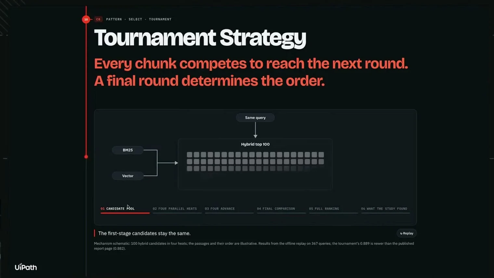

_截图 21  ·  录屏 05:36:35_

**05:36:37**　So when we call it, we were getting only 0.866, which was very, very low at that point when we were trying it out. When we were thinking how do we increase it and then it slowly got got to the number of.889 while it was trying out new strategies, and that strategy is called tournament. And I want to showcase that strategy which these hill climbing models actually come up with, and how we were able to see the intelligence squeaked out of Jav just by applying Jav in a different architecture and different call method.

所以当我们尝试时，得到的数值只有0.866，非常低。在思考如何提高数值的过程中，经过一段时间的尝试后，最终达到了0.889。这一策略被称为“锦标赛”策略。我想展示的是这些hill climbing模型所提出的策略，以及我们如何通过将Jav应用于不同的架构和调用方式，从而展现出Jav的智能特性。

**05:37:11**　And I want to take you through tournament now. So what tournament did is that it actually reimagined re-ranking differently. Instead of looking at every chunk and saying that it is, how good relevant is it for my question, it created cohorts of different groups of these chunks and made them fight between each other to be the best most relevant chunk by sending thousands and thousands of JavCars for each and every one of them.

现在我想带你们了解一下比赛机制。这种比赛方式实际上采用了不同的排名方法。不再只是逐一分析每个片段对问题的相关性，而是将这些片段分成不同的组，让它们相互竞争，成为最相关、最有价值的片段，为此会为每一个片段投入成千上万个 JavCars。

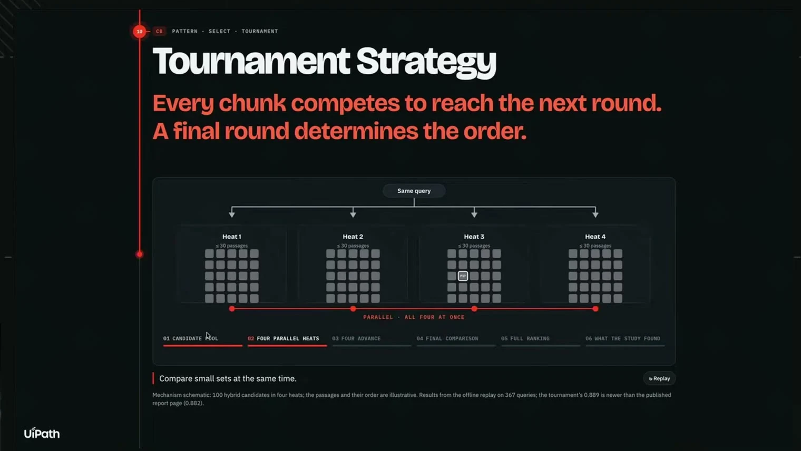

_截图 22  ·  录屏 05:37:30_

**05:37:39**　And it found leaders in those particular cohorts, and then the winners would be promoted to the next round. And then from those winners, we would again find top winners from those chunks, and then we will slowly increase and find the topmost, the cream will rise to the top, and you would find the most relevant chunks on the whole list. So this worked extremely well, and we were testing it, and we were surprised to see that even with thousands of Jav calls and many millions of contexts being used, we were still unsure how it performed and people were extremely surprised by this one.

它能在那些特定群体中找出领导者，然后这些获胜者会被推举到下一轮。再从中选出最优秀的参与者，我们又会从这些群体中找出最顶尖的人，最终就能得到最优秀的那些人。所以这种方法非常有效，我们一直在测试它，但令人惊讶的是，即使使用了数千次 Jav 调用和数百万种上下文情况，我们仍然不确定其效果如何，人们对此也感到非常惊讶。

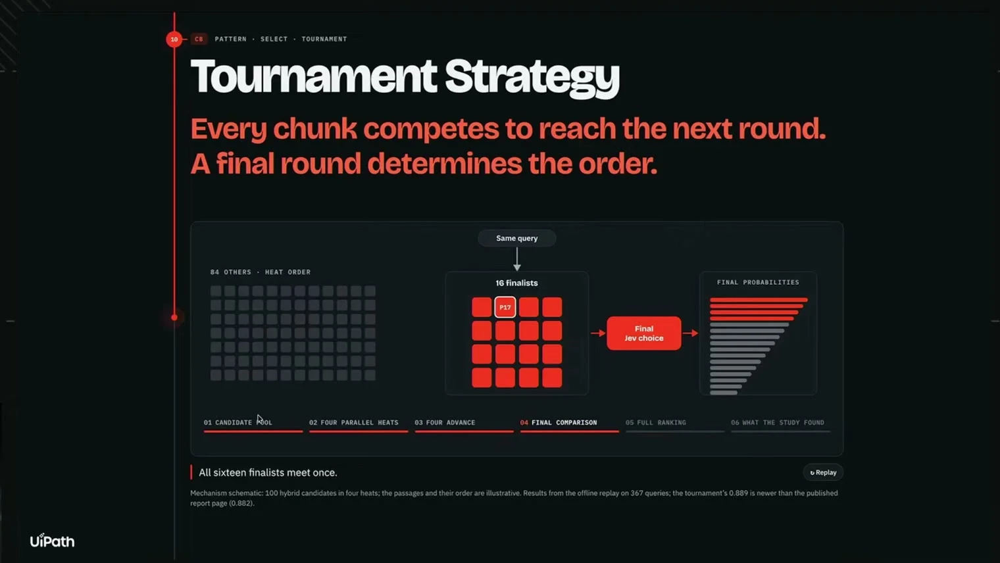

_截图 23  ·  录屏 05:37:50_

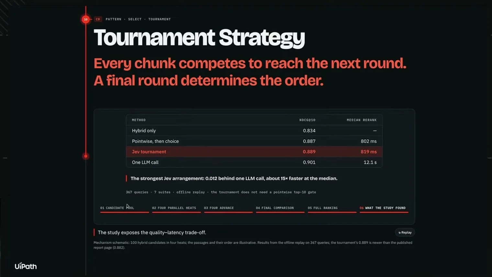

_截图 24  ·  录屏 05:38:11_

### 从邮件挖掘结构化数据，比较示例延迟和成本

**05:38:18**　And next, we saw how Jav could be used for mining. So mining has a lot of stages. I'm going to talk only about the classification stage. And what happens is we have customers who have millions of support email box. And what happens is they wanna analyze and they wanna dig into what happened in these emails so that they can take some actions.

接下来，我们了解了如何利用 Jav 进行挖掘工作。挖掘过程包含许多步骤。我将只讨论分类阶段。实际情况是，有些客户拥有数百万个支持邮件地址。他们希望分析这些邮件内容，了解其中发生了什么，以便能够采取相应行动。

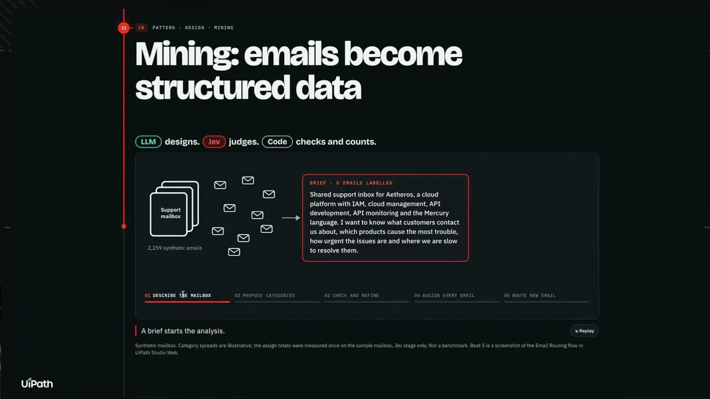

_截图 25  ·  录屏 05:38:36_

**05:38:43**　I'm sure every one of you guys have one of those email boxes. What happens is that it's so hard to find the right categories and bucketizations without reading all of these emails. So what we used to do is that we would go and create a fine tuning to figure out a model that classifies them. It would take hours and maybe day to fine tune the particular model for the classification story.

我相信你们每个人都有一个这样的邮件收信箱。问题在于，不阅读所有邮件的话，很难找到合适的分类和归类方式。过去我们会进行微调，以找出能够对这些邮件进行分类的模型。针对分类任务来说，微调可能需要几小时甚至几天的时间。

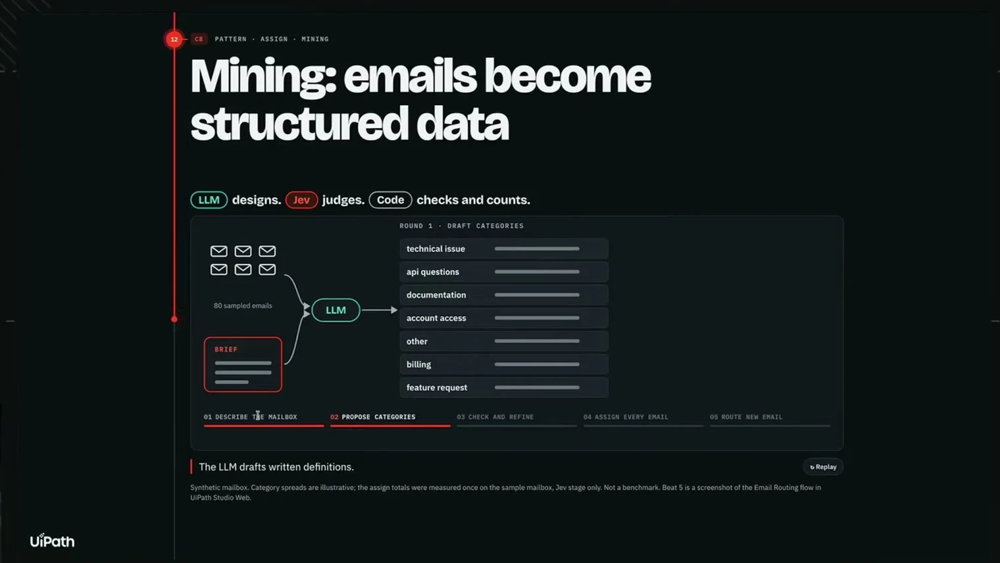

_截图 26  ·  录屏 05:39:01_

**05:39:06**　But what we found was, this is again through hill climbing, we found this pattern where we use an LLM to find an initial candidate list of categories. And then it would say that, okay, these are all the 15 categories the emails will fit. Then what we would do is that we'll use Jav and then all the million emails through it and see where the buckets fill up.

但我们发现，这同样是通过“山式攀登”的方式：我们利用 LLM 来生成最初的类别候选列表。然后系统会提示说，这些就是邮件会属于的 15 个类别。接下来，我们就使用 Jav 工具，再处理所有百万封邮件，看看各个分类的邮件数量如何分布。

**05:39:31**　And with that, we can actually see which buckets are not filled properly, which gets overfitted, which buckets are never filled out. And then we ask the LLM to go back and optimize those buckets again. And then once the buckets are rearranged, we'll do another classification of all the millions of emails one more time. Because Java is so cheap, we are able to do this multiple times.

这样，我们就能看出哪些桶没有被正确填充，哪些被过度填充，还有哪些桶根本从未被填满。然后我们会让大语言模型重新优化这些桶。当这些桶被重新安排后，我们还会再次对数百万封邮件进行分类处理。因为 Java 非常便宜，所以我们能够多次进行这种操作。

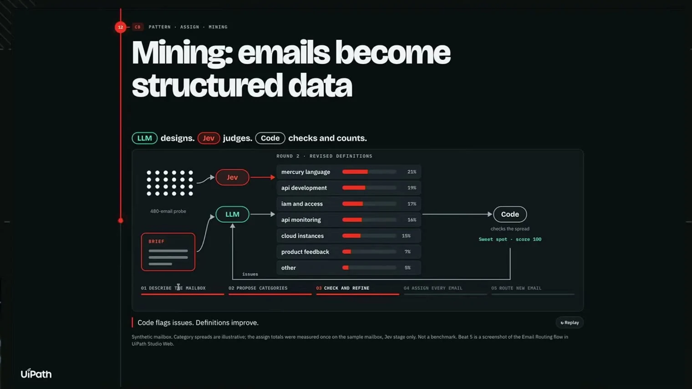

_截图 27  ·  录屏 05:39:43_

**05:39:54**　And eventually you'll end up with the category list, which is extremely fit towards the mailbox that you are dealing with. Because it's not the same across different mailboxes, the categories are completely different. But the powerful thing is, once you did all of this work with an LLM going through and finding these categories, you don't need the LLM anymore. Because you have the categories which you, where you have distilled down all the intelligence into these categories.

最终你会得到一个分类列表，这个列表非常符合你所处理的邮箱需求。因为不同的邮箱有不同的要求，所以分类也完全不同。但更棒的是，一旦你利用大语言模型完成所有这些工作并找到这些分类，你就不再需要那个模型了。因为你拥有这些分类，而所有信息都已经被浓缩到这些分类中了。

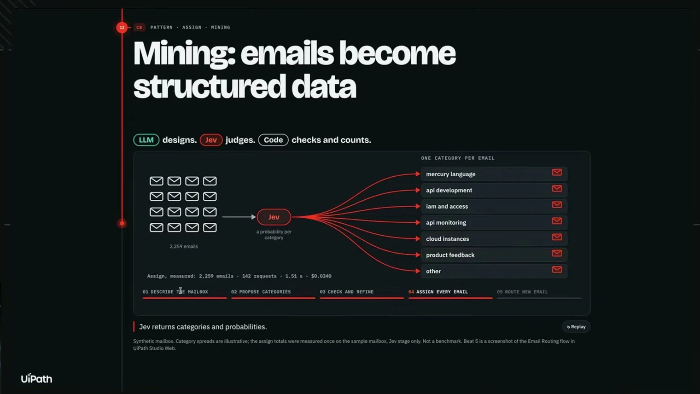

_截图 28  ·  录屏 05:40:12_

**05:40:20**　Now you can just build a Maestro flow which basically takes just the categories alone and uses GIF. So whenever a new email comes, it only needs GIF. It just looks at the email and fits the categories and we basically have a list of follow through. So this matches this category, you are going to get an email. This team is going to get an email or that team is going to get an email so easily.

现在你可以简单地构建一个 Maestro 流程，该流程只依赖类别，并使用 GIF。每当有新邮件到达时，它只需要 GIF 即可。它只需查看邮件，然后匹配相应的类别，我们就能得到一份执行记录。如果符合这个类别，你就会收到一封邮件。这个团队会收到邮件，或者那个团队也会轻易收到邮件。

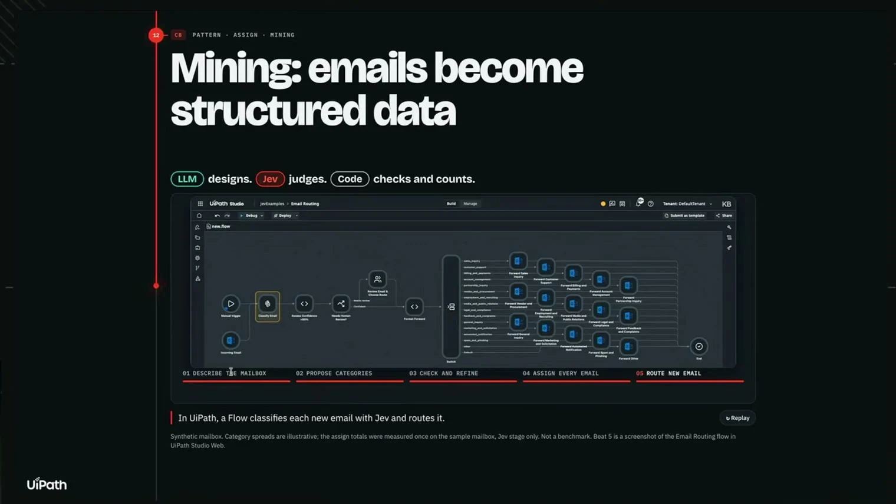

_截图 29  ·  录屏 05:40:33_

**05:40:45**　And we basically removed the LLM completely from the picture on this one. And we saw a humongous speed increase on just email processing. It was almost like at real time, an email comes and suddenly somebody will get notified. So that was an amazing thing to see as well. So over the few months, we were so excited to play around with Jev.

在这一项目中，我们基本上完全去掉了 LLM 的参与。仅通过电子邮件处理，速度就大幅提升了，几乎就像实时操作一样，邮件一到达，立刻有人会收到通知。这也是非常令人惊叹的。在几个月的时间里，我们非常兴奋地尝试使用 Jev。

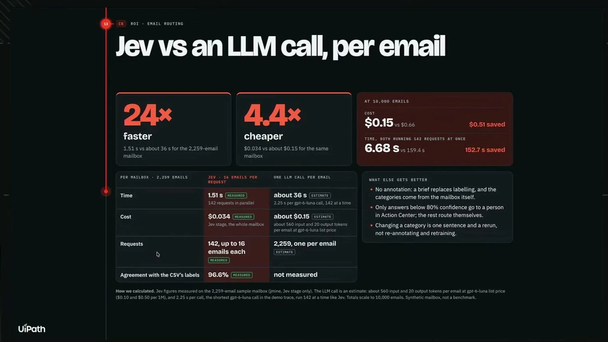

_截图 30  ·  录屏 05:40:54_

**05:41:07**　And every day, the slack threads would light up everywhere in the company that I found this pattern, I found and it was such an exciting time during these last three months. And I wanted to share that there are so much more patterns and strategies to be found. We are only scratching the surface of this, and I want us to try out and share the strategies that we all find and collaborate here.

每天，那些松散的线索都会在公司里随处可见。我发现这种模式后，过去三个月真是令人兴奋的时光。我想分享的是，还有更多模式和策略等待我们去发现。我们才刚刚开始探索而已，我希望大家能尝试并分享那些我们都能找到的策略，在这里相互合作。

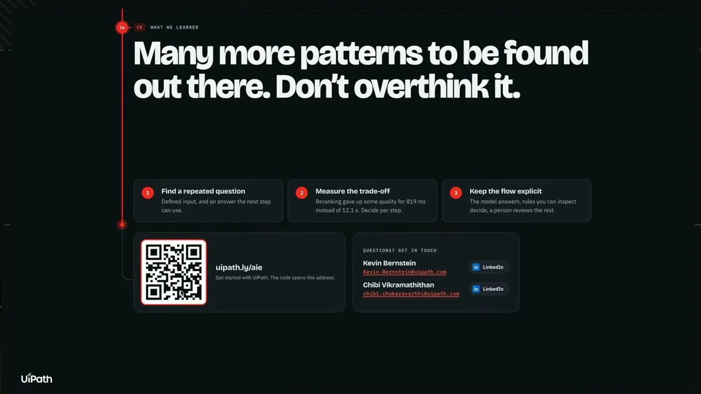

_截图 31  ·  录屏 05:41:19_

**05:41:33**　And if you're interested in trying out UiPath Flow, we have it available for free right now. Scan the QR code on the screen here, and it'll take you into a portal where you can basically point your coding agent at it and get complete access to build your first automations there. Thank you for your time, everyone. Thank you.

如果您有兴趣尝试使用 UiPath Flow，我们现在可以免费提供。请扫描此处屏幕上的二维码，即可进入一个平台，您可以将您的编码智能体指向该平台，从而完全访问并创建您的第一个自动化程序。感谢各位的耐心，谢谢。

---

[全部演讲](../README.md) · [选看索引](index.md) · [上一场](18-chinmay-goyal.md) · [下一场](20-brian-kennedy.md)
