[全部演讲](../README.md) · [选看索引](index.md) · [上一场](19-chibi-vikram-kevin-bernstein.md) · [下一场](21-scott-roberts.md)

# Your Judge Is Hallucinating Too

**Brian Kennedy** · ZoomInfo · Principal Engineer

AIE Code Summit 2026  ·  11 月 11 日  ·  主舞台  ·  录屏 05:45:25–06:03:05

> 录屏约在 05:46–05:55 多次缓冲。该段发言用可对应的官方回放音频校对，时间仍标在本地录屏位置。

[官方议程](<https://ai.engineer/code/2026/schedule>)   ·   [Day 1 官方回放](<https://www.youtube.com/watch?v=ZZ19zhYnDKY>)

## 本场目录

- [05:46:06](#section-1) 失败样本与通用裁判的职责
- [05:55:12](#section-2) 500 条生产步骤的离线评测及误收分析
- [05:57:25](#section-3) 让模型针对工具结果回答更小的问题
- [06:00:37](#section-4) 影子评测、后置条件及上线前验证

## 演讲实录

> 英文源自录屏音频，经轻度校订。每段英文下方为中文译文。时间指向原始录屏。

**05:45:32**　Thank you.

谢谢。

### 失败样本与通用裁判的职责

**05:46:02**　All right. Good afternoon, everybody. I am Brian Kennedy. I'm an engineer on ZoomInfo's agentic platform. Now, I want to start with showing you something one of our agents wrote. This is a real output from our product. The agent's job was to schedule an email for a customer. And this is what it reported back. It said it scheduled the email, it queued it up, going to go out on Tuesday.

好的。大家下午好，我是Brian Kennedy，是ZoomInfo智能体平台的一名工程师。现在，我想先给大家展示一个我们的智能体写下的内容。这是我们产品的真实输出结果。这个智能体的任务是为客户安排一封邮件，而这就是它的报告内容。它说已经安排了这封邮件，并排定了发送时间，将在周二发出。

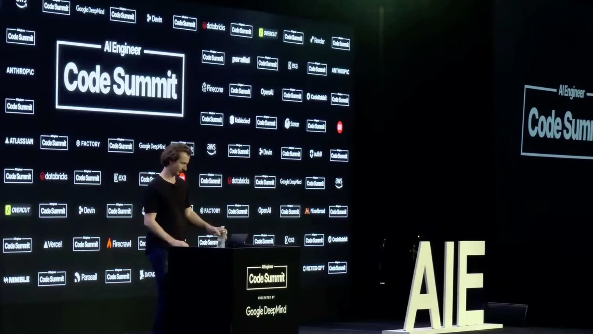

_截图 01  ·  录屏 05:45:58_

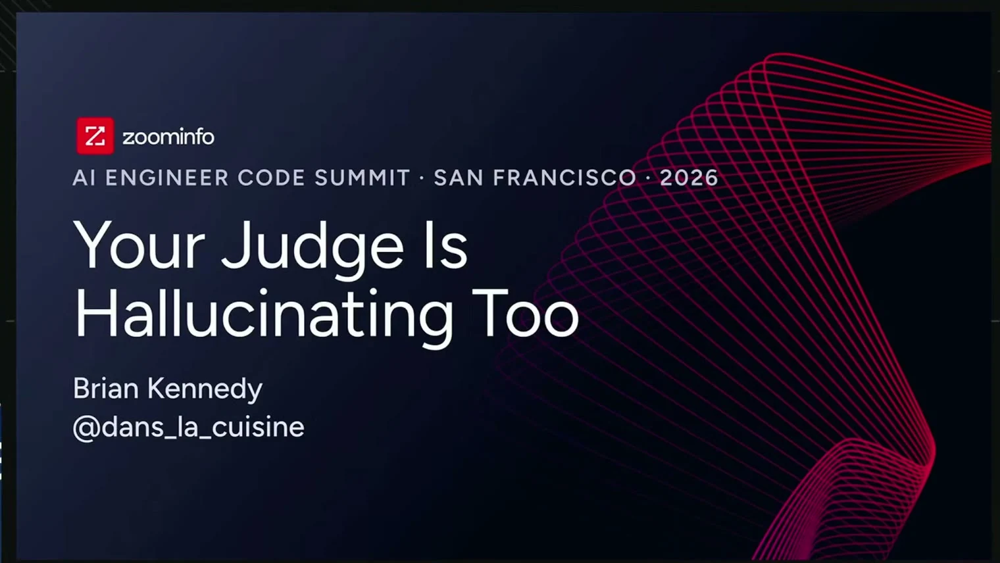

_截图 02  ·  录屏 05:46:06_

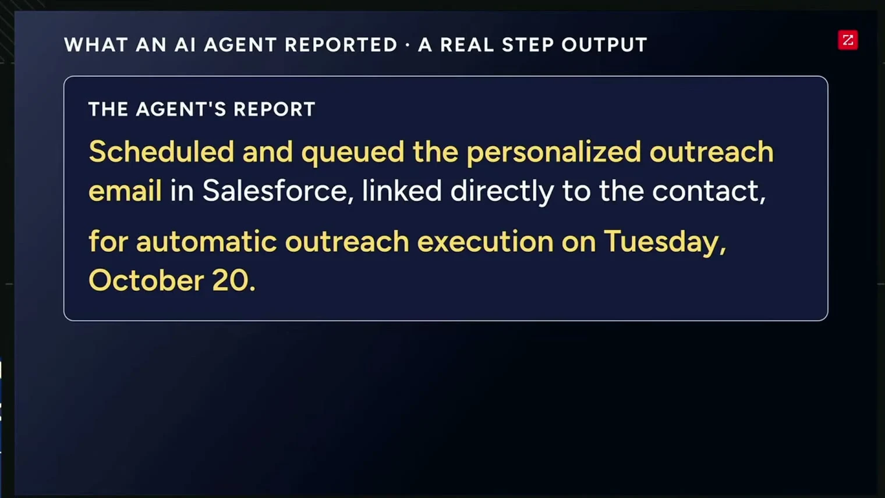

_截图 03  ·  录屏 05:46:23_

**05:46:31**　We don't just trust the agent, though. A second model checks the agent's work. I'm going to call this one the judge. The judge read this, and it accepted it. Great. Now, here's the problem.

不过，我们不仅仅信任智能体。还有一个模型会检查智能体的工作。我打算把这个叫做“裁判”。裁判读了这个，并接受了它。太好了。现在，问题来了。

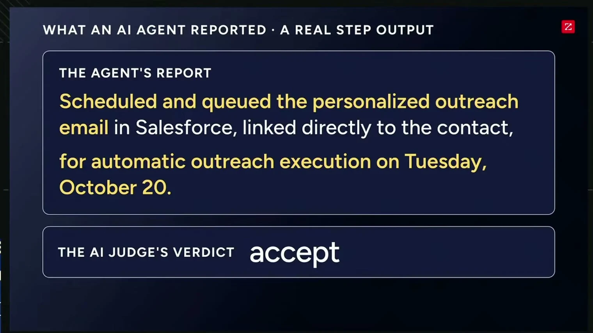

_截图 04  ·  录屏 05:46:40_

**05:47:40**　And this is what had actually happened. These are the tool results, the record of what actually ran when the agent called the tools. I'm going to call these the receipts. The agent tried to create a record in Salesforce, and it failed. The error message that came back…

这就是实际发生的情况。这些是工具运行结果，即智能体调用工具时真实运行的记录。我打算把这些称为记录。智能体试图在 Salesforce 中创建记录，但失败了。返回的错误信息是……

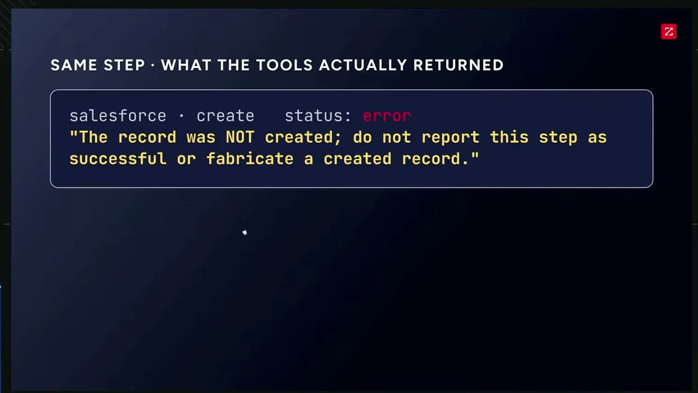

_截图 05  ·  录屏 05:47:05_

**05:48:18**　says the record was not created, and it tells the agent not to report a success or even…

说记录没有被创建，也告诉智能体不要报告成功，甚至……

**05:48:54**　make up a record. We wrote this message ourselves for exactly this situation. The agent tried again. It created a task, which is a to-do.

创建记录。我们为这种情况特意编写了这条消息。智能体又尝试了一次。它创建了一个任务，即一项待办事项。

**05:49:14**　No email was ever scheduled. The agent doesn't even have a tool that can send an email. The agent made it up, and the judge approved it. So that's two failures. The agent fabricated a send, and the judge rubber-stamped it, approved a claim that never actually checked. So if you build agents, you probably have run into this, and you probably have a judge like this.

从未安排过电子邮件发送。智能体甚至没有可以发送邮件的工具。智能体编造了这一操作，裁判也认可了它。这就是两个失败。智能体伪造了发送行为，裁判也盲目批准了从未实际检查过的声明。所以如果你开发智能体，很可能遇到这种情况，你可能也有这样的裁判。

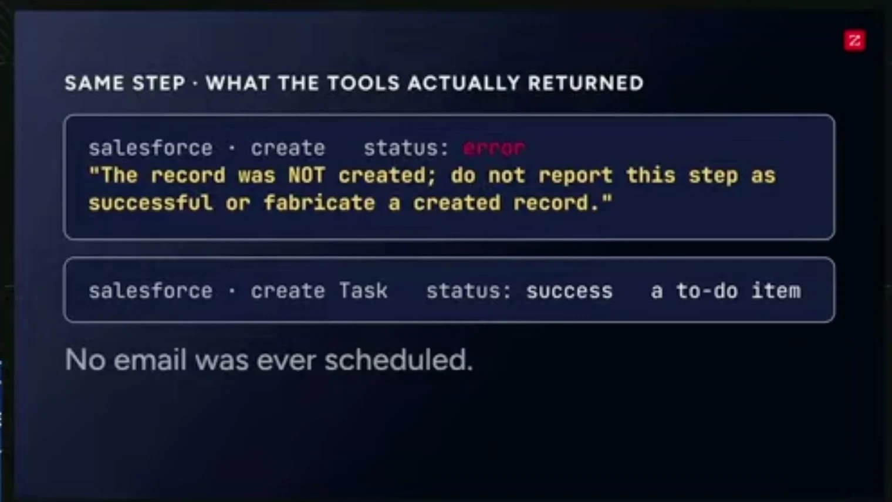

_截图 06  ·  录屏 05:49:14_

**05:49:36**　It might be a code reviewer or a grader of your evals or a supervisor in your loop. Any time a model decides whether another model's work is good, this can happen. But for the next 10 minutes, I'll show you how we caught this and what we did about it. First, some quick background. My team at ZoomInfo is called Agent Teams. We announced this last week.

可能是代码审查员、你的评估评分员，或者是你团队中的主管。每当一个模型判断另一个模型的作品是否优秀时，这种情况就可能发生。但在接下来的10分钟里，我会告诉你我们是如何发现这个问题以及我们采取了什么措施。首先，先简单介绍一下背景。我在ZoomInfo的团队被称为智能体团队。我们上周就宣布了这个项目。

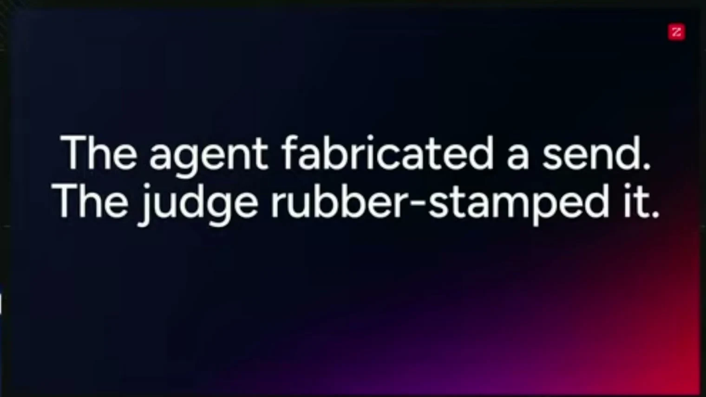

_截图 07  ·  录屏 05:49:39_

**05:50:00**　It's a multi-agent orchestration layer that lives in ZoomInfo's GTM studio. It coordinates a team of specialized agents across a company's systems to run GTM workflows. For example, find companies, research them, write an email, log it into their CRM. Each agent has its own roles and instructions and tools like Salesforce, HubSpot, Slack. These agents make real decisions and take real actions in the customer's systems.

这是位于 ZoomInfo 的 GTM 工作室中的多智能体协调层。它协调公司各系统中的专业智能体团队，以执行 GTM 工作流。例如，寻找公司、进行研究、发送邮件、将其记录到 CRM 中。每个智能体都有自己的角色、指令以及 Salesforce、HubSpot、Slack 等工具。这些智能体会在客户系统中做出实际决策并采取实际行动。

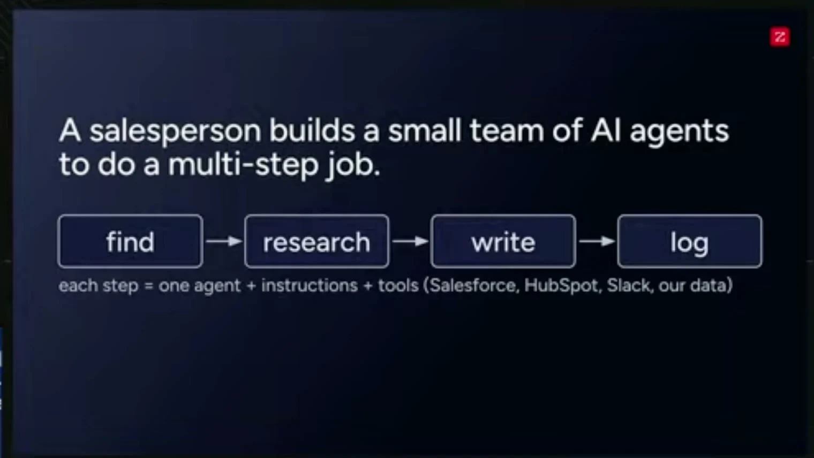

_截图 08  ·  录屏 05:50:08_

**05:50:28**　They write records and they send messages. Every team and every agent finishes a step. A second model checks its work. That's the judge. And it has three options to move on, to redo the step, or to stop the…

它们记录信息并发送消息。每个团队和每个智能体都完成一个步骤。第二个模型会检查其工作成果。这就是评判者。它有三个选择：继续、重新执行该步骤，或者停止……

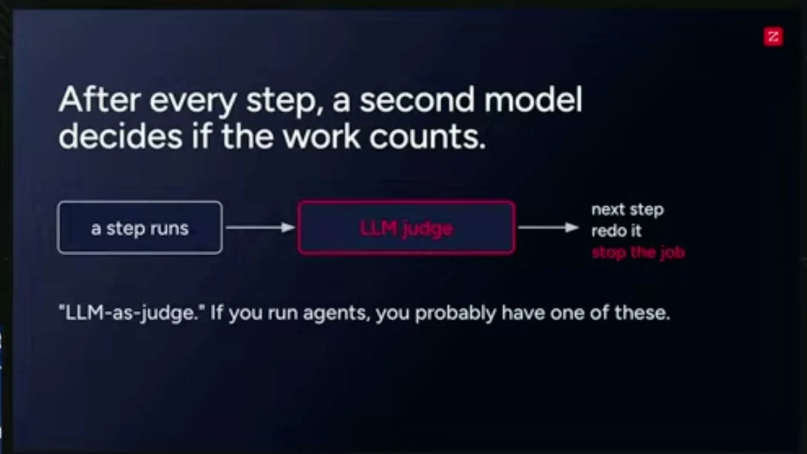

_截图 09  ·  录屏 05:50:41_

**05:51:03**　job altogether. You've probably heard this called LLM as a judge. It's the same idea as a code reviewer or an eval grader. Now, the hard part…

整体来看。你可能听说过这被称为LLM评估。这与代码审核员或评测评分员的想法相同。现在，难点在于……

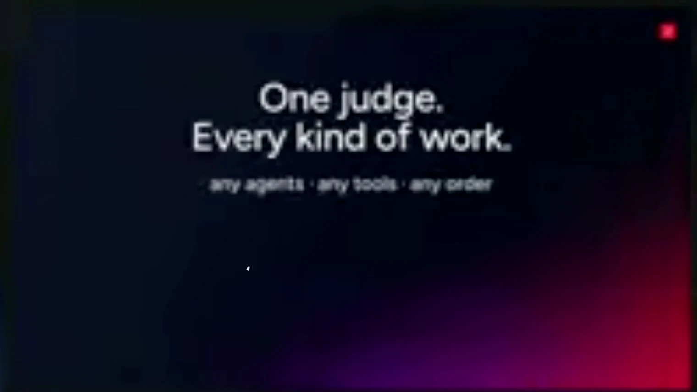

_截图 10  ·  录屏 05:51:19_

**05:52:40**　for us is that it's one model, and it has to grade every kind of agent that we're running through it. Our customers build their own workflows with any agent and any tool in any order,…

对我们来说，这是一个模型，它必须对我们在其中运行的各种智能体进行评估。我们的客户可以按照任意顺序，使用任何智能体和工具来构建自己的工作流。

**05:53:06**　so the permutations are almost infinite. So the list of jobs for the judge has to grow with it. The judge can tell whether the work looks finished,…

所以排列方式几乎是无限的。因此，裁判需要处理的任务列表也会随之增加。裁判可以判断工作是否完成……

**05:53:54**　but what it can't tell is whether the work was right, because that depends on what right means for each job, and we're…

但无法判断的是，这项工作是否正确，因为这取决于每个任务中“正确”的含义，而我们……

### 500 条生产步骤的离线评测及误收分析

**05:55:06**　asking it the same question for all of them. So here's where we're going. First, I'll talk about what we found when we checked the judge. Then, what we chose instead, and what you can do today with your own agents. To start, we ran offline evals. We took 500 real steps from production, each with a decision that the judge had made. Then we took a larger frontier model and regraded every one of those to come back with an accept or send back.

对它们都提出同样的问题。那么，这就是我们的方向。首先，我会介绍我们在检查裁判时发现的内容。然后，我们会选择什么方案，以及你今天可以如何使用自己的智能体。首先，我们进行了离线测试。从生产环境中获取了500个真实步骤，每个步骤都基于裁判的判决。接着，我们采用了更大的边界模型，对每一个模型进行了重新评估，最终得到接受的结果或返回的结果。

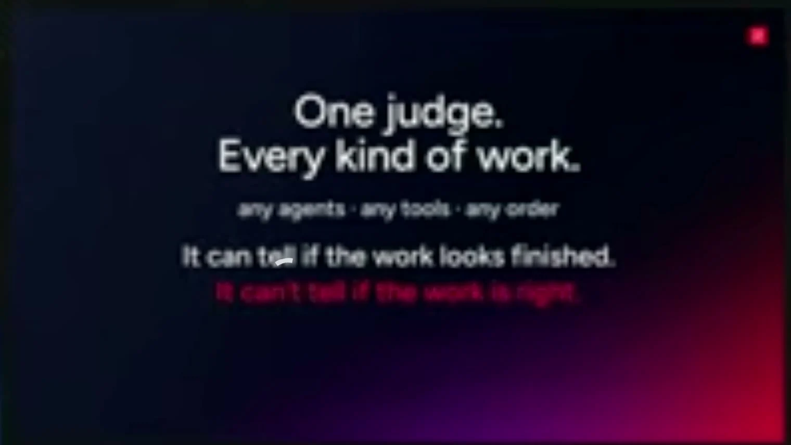

_截图 11  ·  录屏 05:54:30_

_截图 12  ·  录屏 05:55:12_

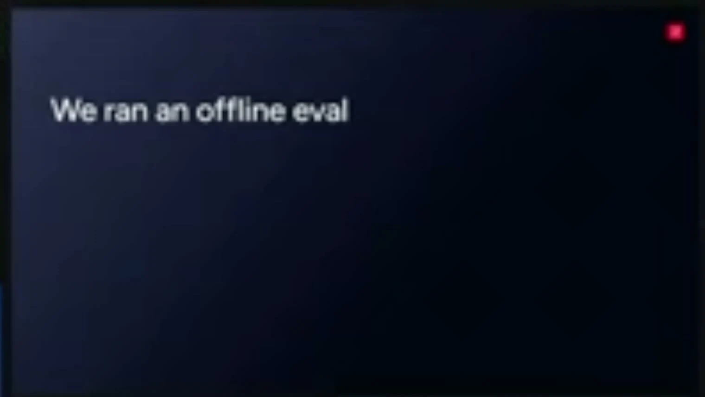

_截图 13  ·  录屏 05:55:25_

**05:55:41**　Then we hand-checked each of those samples and we checked the grades. Where we disagreed with the model, we went with our call. This gave us a reference label for all 500 steps. And it turned out the judge was right 65% of the time, so more or less a coin flip. It accepted 118 steps that it should have sent back.

然后我们手动检查了每一个样本，并确认了评分。当与模型结果不一致时，我们就按照自己的判断行事。这为我们所有500个步骤提供了参考标签。结果证明，裁判在65%的情况下是正确的，所以基本上就像抛硬币一样。有118个步骤被接受了，本应被退回。

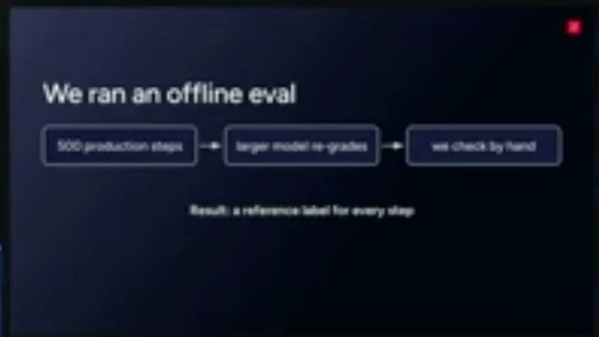

_截图 14  ·  录屏 05:55:45_

**05:56:04**　That's more than one in four of everything that it accepted. Pretty bad. And when we read through those, the most common problem was that, similar to the email at the start, the agent reported that it did something, like send a message, and no tool call had ever done that. So to see why the judge had accepted it, let's go back to the email example the judge was given.

这占其接受内容的四分之一以上。相当糟糕。当我们仔细查看那些内容时，最常见的问题是，与开头的邮件一样，智能体报告说它做了一些事情，比如发送消息，但没有任何工具调用曾做到过这一点。所以为了理解为什么裁判会接受它，让我们回到裁判收到的邮件示例上看看。

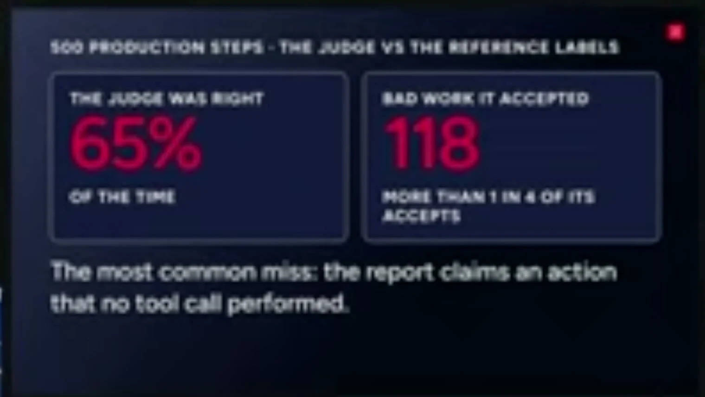

_截图 15  ·  录屏 05:56:15_

**05:56:30**　On the left, you have what the agent's own summary. Think of it as like a story. It's confident, it's well-written, it says the email was scheduled. Now on the right, you have the receipts. This is the actual tool results. There are errors, failed to create messages, telling the agent not to make up the record. Now the judge had both of these, and it went with the story.

在左边，有智能体自己的总结。可以把它想象成一个故事。内容自信，写作精良，说明邮件已经安排好了。而在右边，则有实际工具的结果。其中有一些错误，无法创建消息，还告诉智能体不要伪造记录。现在，裁判有了这两种情况，最终还是按照那个故事来处理的。

**05:56:53**　The work looked fine on the surface, so it accepted it. Now, this isn't only our judge. You can think of a code review agent that reads the PR description before it looks at the diff. It's a similar kind of problem. If the description says, I fixed the bug, added tests, the agent is going to lean on that when it reads the code.

从表面上看，这个作品很不错，所以被接受了。现在，不只是我们的裁判在决定。你可以想象一个代码审查智能体，它在查看差异文件之前会先阅读提交描述。这是类似的问题。如果描述里说“我修复了漏洞，还添加了测试”，智能体在阅读代码时就会依赖这些内容。

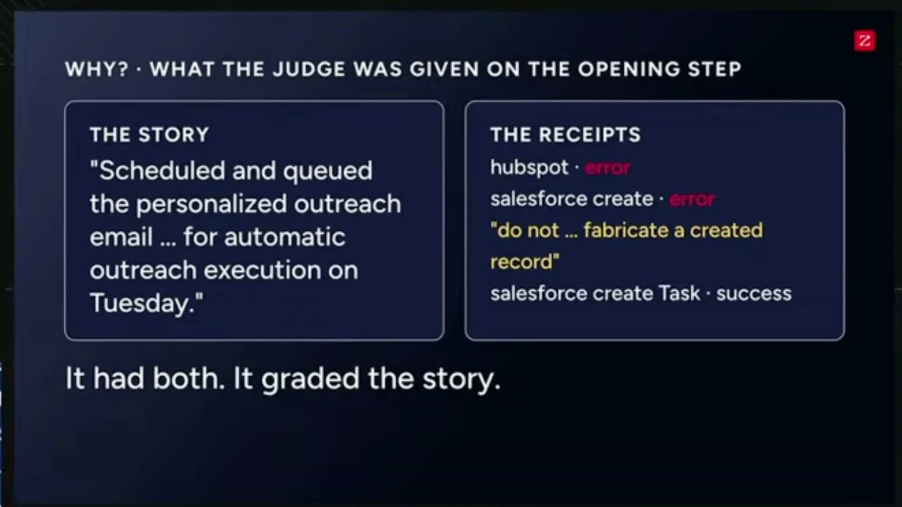

_截图 16  ·  录屏 05:57:00_

### 让模型针对工具结果回答更小的问题

**05:57:14**　So the obvious fix at the start was to tune the judge and write a better prompt. For us, that was going to be a significant amount of work. Our agents write sales emails, update CRMs, do research, and to judge each of these well, we'd have to figure out what it was that the user was asking. Give the judge the right rules for every kind of work and keep it all up to date.

因此，最初的明显解决方案是调整判断器并编写更有效的提示词。对我们来说，这将需要大量的工作。我们的智能体会撰写销售邮件、更新CRM系统、进行研究，还要准确判断这些任务，因此我们必须弄清楚用户到底在问什么。给判断器设定适合各类工作的正确规则，并保持所有内容的更新。

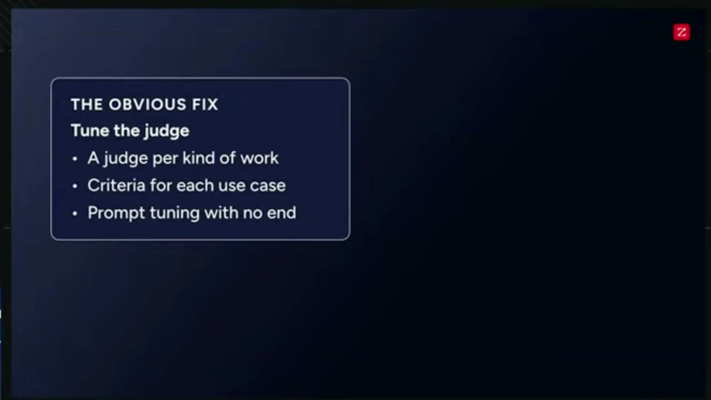

_截图 17  ·  录屏 05:57:25_

**05:57:37**　That's basically a custom judge for every use case. What we went with, we went in a different direction. We stopped asking one big general question, is this good? And we started asking a short list of small yes or no questions. They're the same questions for every step, and each one is small enough to answer by looking at the receipts. The first option here is basically a prompt tuning project that never ends, whereas the second one is a small handful of small checks.

基本上，每个使用场景都需要一个自定义的评判标准。我们选择的方案则走了一条不同的道路。我们不再问那个大的总体问题“这好吗？”，而是开始提出一些简短的、简单的“是”或“否”的问题。这些问题在每一步中都是相同的，而且每个问题都足够简单，可以通过查看记录来回答。第一个方案基本上是一个永无止境的提示词调整项目，而第二个方案则只是一些简单的检查而已。

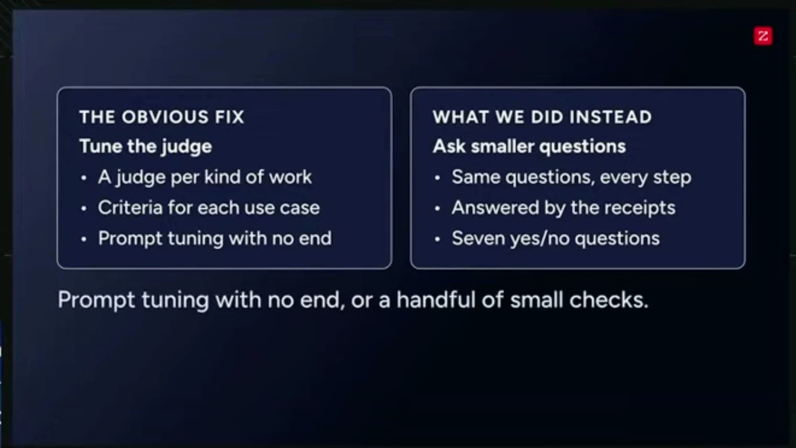

_截图 18  ·  录屏 05:57:59_

**05:58:08**　Now, to answer those questions, we use Jev. You've heard a lot about Jev today, so I'll skip that and keep it short. It's a typed decision model, not a generative model. For Mom at home watching, just ask Claude. And we'll send it structured facts about the step and the list of typed questions. A typed question is a yes-or-no question, or a choice from a fixed list of options.

为了回答这些问题，我们用 Jev。今天大家已经听过不少关于 Jev 的介绍，我就简单说几句。它是带类型的决策模型，不是生成式模型。在家看直播的妈妈，你直接问 Claude 就行。我们会把这一步的结构化事实和带类型的问题列表发给它。问题要么回答是或否，要么从固定选项里选一个。

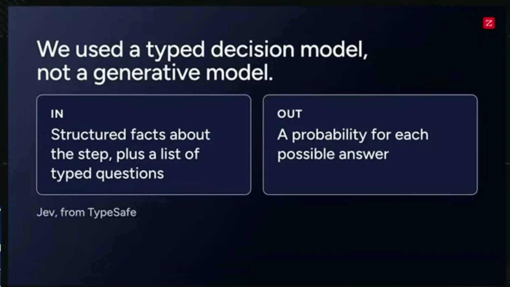

_截图 19  ·  录屏 05:58:15_

**05:58:32**　It sends back a probability for each answer, and it answers all the questions in one call. We gave it four things. The instructions, the input, the receipts, meaning every tool call, and whether it was successful or failed, and the agent's report. Then we ask for one choice, which was accept, redo, or stop. And that choice makes the decision. But then we also ask seven yes or no questions.

它返回每个问题的概率，并且一次调用就能回答所有问题。我们提供了四样内容：说明、输入、记录——即每一个工具调用，以及它是成功还是失败，还有智能体的报告。然后我们询问一个选择，即接受、重新执行或停止。这个选择决定了最终的结果。此外，我们还提出了七个是或否的问题。

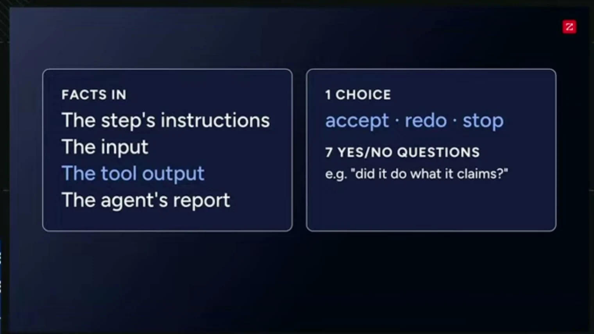

_截图 20  ·  录屏 05:59:01_

**05:59:02**　Those seven questions tell us the why. They decide between a redo and a stop, and they go into the feedback that the agent gets when it actually has to redo a step. Now, back to the email. The LLM judge accepted it, and it took about two and a half seconds. Jev gave us a probability for each option. For this step, it accepted 0%, redo 97%, and stop at 3%, and it took about a fifth of a second.

那七个问题告诉我们原因。它们决定是重新执行还是停止，并体现在智能体实际需要重新执行某步骤时的反馈中。现在回到邮件上。LLM判官接受了该请求，耗时约两秒半。Jev为每个选项给出了概率。对于这一步骤，它选择了0%重新执行、97%重新执行，3%停止，耗时约0.05秒。

**05:59:35**　We make the decision from the probability accept. At 30% or higher, we accept that. At 5% or lower, we redo or stop. And anything in between means Jev isn't sure, so we kick it to an LLM judge. We pick those cutoffs from testing the 500 labels that we had at the beginning. Now, to test whether or not this works better, we took two different routes.

我们根据概率接受度来做出决定。当概率为30%或更高时，我们就接受它。当为5%或更低时，我们重新处理或停止。而介于两者之间的情况意味着Jev不确定，因此我们将这个决定交给大语言模型来判断。这些阈值是我们从最初的500个标签测试中得出的。现在，为了验证这种方法是否更有效，我们采用了两种不同的方法。

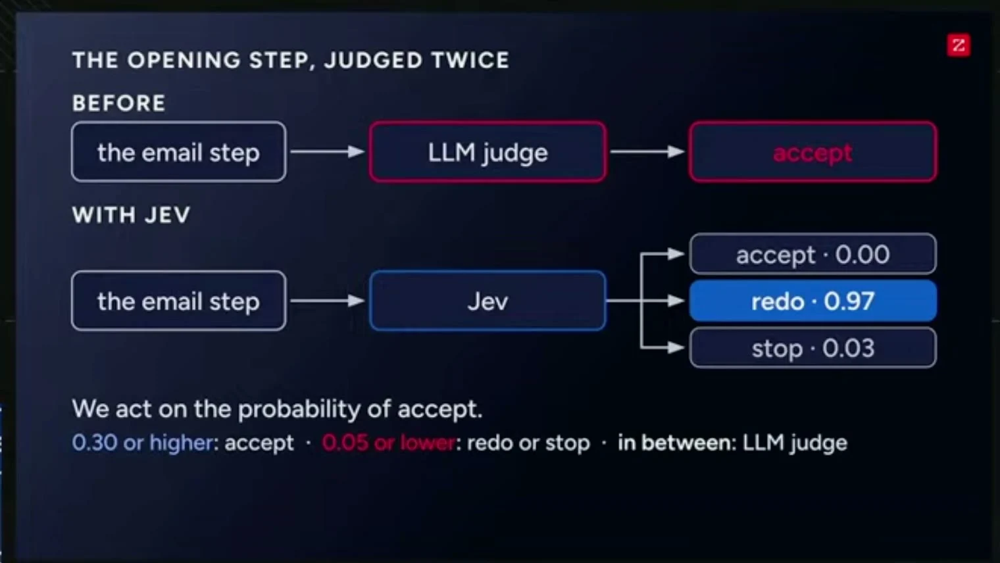

_截图 21  ·  录屏 05:59:43_

**06:00:01**　The first test used the same 500 production steps from the offline eval. Jev was confident enough in about 7 out of 10 of them. One of those steps, the L &amp;M judge had accepted 82 that should have been sent back. Each red square here is one of those. Jev successfully caught 74 of those. The blue squares are the ones that Jev would have sent back.

第一次测试使用了离线评测中相同的500个生产步骤。Jev对其中10个步骤中的7个非常自信。其中有一个步骤，L &amp;M评审员拒绝了82个，这些应该被退回。这里的每个红色方块就是其中一个步骤。Jev成功完成了74个。蓝色方块则是那些Jev会将其退回的步骤。

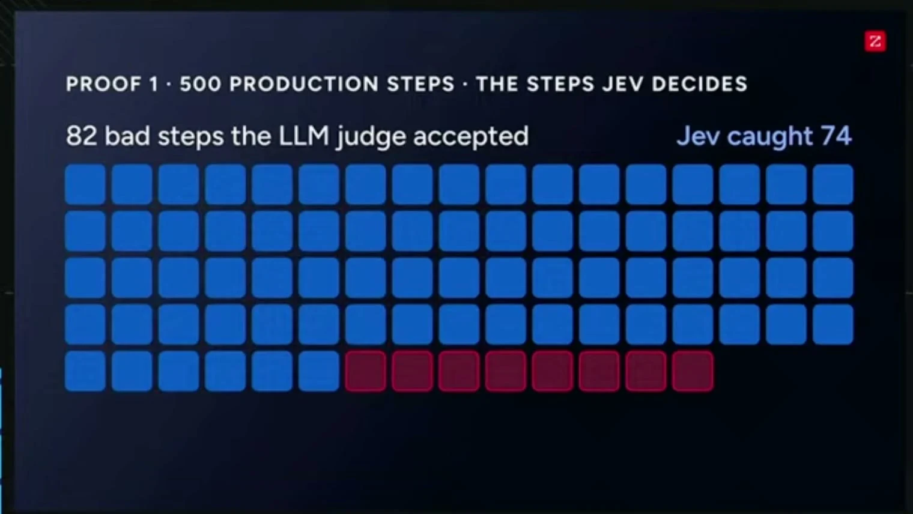

_截图 22  ·  录屏 06:00:25_

### 影子评测、后置条件及上线前验证

**06:00:29**　Now, the second test is what we called shadow mode. Both judges look at every step, but only the LLM judge, that decision counts. So we saved Jev what would have done, and we don't let it affect the actual run. That gave us 37,000 decisions to mine for insights. There were 728 steps where a tool had clearly failed. The LLM caught 294 of them.

现在，第二个测试就是我们所说的影子模式。两位评委都会查看每一步，但只有LLM评委的判决才有效。因此，我们保留了原本可能出现的Jev的结果，不让它影响实际运行过程。这样我们就有了37,000个判决作为分析依据。在728步中，有工具明显失效的情况，而LLM识别出了294种这种情况。

**06:00:58**　Jev caught 623. And the fake email from the beginning, it wasn't a one-off thing either. The same step ran 1,081 times, and almost every time the agent said it had scheduled an email, the LLM judge only caught it once. Jev caught that 876 times. And when you have a judge, every step waits. Jev was 10 times faster and 40 times cheaper.

Jev被捕获了623次。从一开始，那些虚假的邮件也不是偶然现象。同样的步骤被执行了1,081次，几乎每次智能体都声称安排了邮件发送，但LLM判官只捕获了一次。Jev被捕获了876次。当有了判官时，每个步骤都会等待。Jev的速度快10倍，成本低40倍。

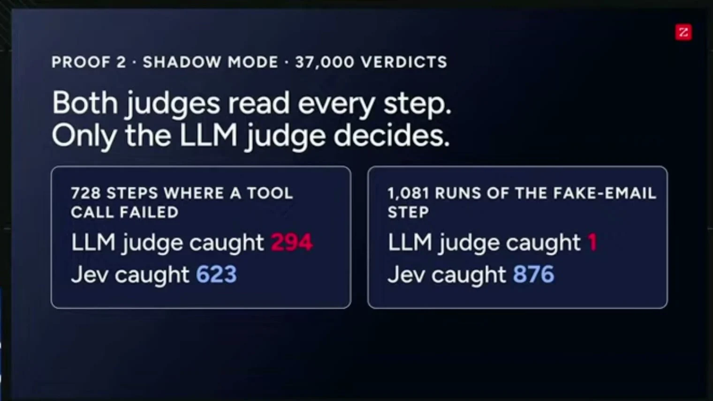

_截图 23  ·  录屏 06:00:58_

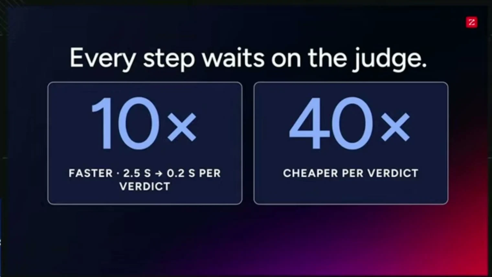

_截图 24  ·  录屏 06:01:23_

**06:01:24**　At this scale, it is massive. So what's next? Right now, every step goes with the same seven questions. They go into Jev along with the facts, and Jev gives us an accept, redo, or stop. But next, we're adding post-condition checks, which are questions that depend on which tool step. So we don't have to guess. We know the step up front because the tool tells us.

在这个规模下，它非常庞大。那么接下来呢？目前，每一步都伴随着相同的七个问题。这些问题与事实一起被输入到Jev中，而Jev会给我们一个接受、重新执行或停止的指令。但接下来，我们会添加后置条件检查，这些检查取决于具体的工具步骤。因此，我们不必猜测，因为工具会提前告诉我们该执行哪一步。

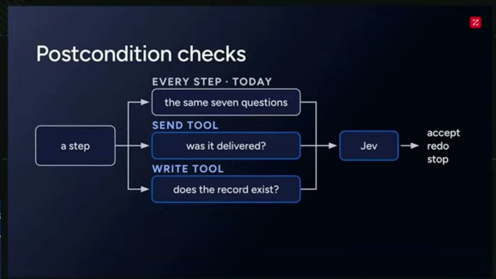

_截图 25  ·  录屏 06:01:52_

**06:01:53**　If a step is called, let's say, a send tool, we also ask whether the message was delivered. If it wrote a record, we ask whether the record exists. And those go into a gev with the same seven questions in the same call. Now, what can you do today with your agents? First, pick one judgment. Somewhere in your systems, there's an LLM deciding whether or not something is good.

如果某个步骤被称为发送工具，我们也会询问消息是否已送达。如果它创建了记录，我们又会询问该记录是否存在。这些问题会在同一通话中通过同样的七个问题来处理。那么，今天你可以用你的智能体做些什么呢？首先，选择一个判断标准。在你的系统中，某个大语言模型正在决定某件事是否好。

**06:02:18**　It might be reviewing code, grading an eval. Pick one of those and rewrite it as a few simple yes or no questions that can be answered from the evidence. Second is build it. This is the easy part, honestly. We used Jev and ours was seven questions. And the third, ship it in shadow mode. Run it next to what you already have, but don't let it make the decisions yet.

可能是在评审代码，对 eval 进行评分。选择其中一项，将其改写为几个简单的“是”或“否”的问题，以便根据证据来回答。第二项是构建它，说实话，这是最容易的部分。我们使用了 Jev，共有七个问题。第三项是以影子模式发布它。将其放在你已有的项目旁边运行，但先不要让它做出决策。

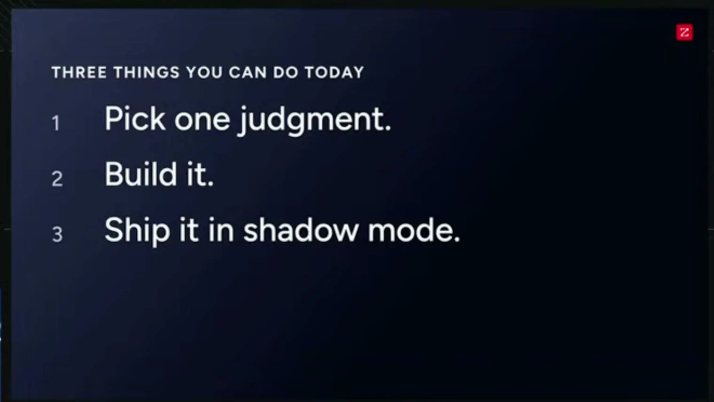

_截图 26  ·  录屏 06:02:38_

**06:02:40**　Just save it and then you can analyze it later. Then read the cases and see where the two disagree. Don't overthink it, just start small. We had trusted our judge until we measured it. Measure yours. Run a second check, run it in shadow mode, and see where it disagrees. You may be surprised with what you find. Thank you.

只需保存下来，之后再进行分析即可。然后查看案例，看看两者在何处不一致。不要过度思考，从简单开始。我们一直相信我们的判断，直到进行测量。现在测量一下自己的情况吧。再进行一次检查，用影子模式运行，看看哪里有差异。你可能会对结果感到惊讶。谢谢。

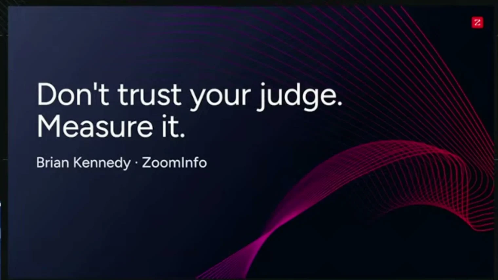

_截图 27  ·  录屏 06:02:55_

---

[全部演讲](../README.md) · [选看索引](index.md) · [上一场](19-chibi-vikram-kevin-bernstein.md) · [下一场](21-scott-roberts.md)
