[全部演讲](../README.md) · [选看索引](index.md) · [上一场](20-brian-kennedy.md) · [下一场](22-girish-konda.md)

# Autocomplete for Actions: System One from the UI to the DB

**Scott Roberts** · Workday · Principal Engineer

AIE Code Summit 2026  ·  11 月 11 日  ·  主舞台  ·  录屏 06:04:51–06:16:53

[官方议程](<https://ai.engineer/code/2026/schedule>)   ·   [Day 1 官方回放](<https://www.youtube.com/watch?v=ZZ19zhYnDKY>)

## 本场目录

- [06:05:04](#section-1) 哪些交互能用快速分类完成
- [06:09:14](#section-2) 从补全词语到补全动作，展示产品界面
- [06:12:00](#section-3) 延迟、路由和不同团队维护规则的办法
- [06:13:15](#section-4) 招聘检索、SQL 里的自然语言判断和演示

## 演讲实录

> 英文源自录屏音频，经轻度校订。每段英文下方为中文译文。时间指向原始录屏。

### 哪些交互能用快速分类完成

**06:04:52**　Hey, everyone. I promise I'm the last person on the hype train for Jev. I'm Scott. I'm from Workday, and I'm going to go through how we're experimenting with Jev to drive new innovations in HR and finance tasks. Exciting stuff. So at Workday, we have over 11,000 different organizations that use our tools. And a lot of the problems that we deal with break down into kind of two different categories.

大家好，我保证我不是那些对 Jev 感兴趣的人。我是 Scott，来自 Workday。我将介绍我们如何通过 Jev 进行实验，以推动人力资源和财务任务方面的创新。非常令人兴奋。在 Workday，我们有超过 11,000 个不同的组织使用我们的工具。我们遇到的许多问题可以分为两类。

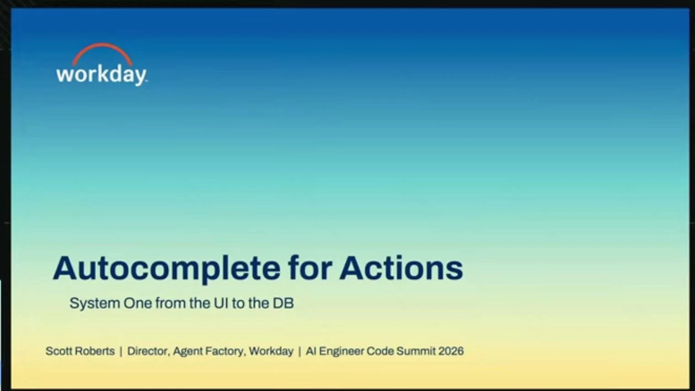

_截图 01  ·  录屏 06:05:04_

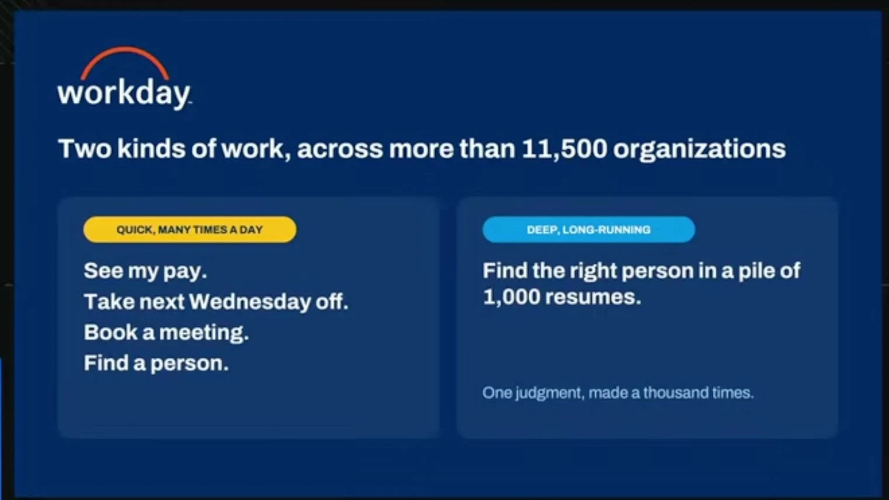

_截图 02  ·  录屏 06:05:20_

**06:05:24**　So one is very quick actions they have to take. I want to see my pay. I want to ask for a day off. The other ones are I have to dive into a ton of data, weed through it, try to figure out what's going on. And like many of your companies as well, we're trying to put agentic workflows around And so if you look at just a very simple agentic loop, you know, we have a user request, we try to decide what to do, we're running tools, we're judging, did we do a good job, and then over and over again until we finally get a result.

所以有些事情需要迅速处理。我想得到我的报酬，想请一天假。另外一些事情则是需要处理大量的数据，仔细分析，弄清楚到底发生了什么。就像你们公司的很多情况一样，我们也在努力实现代理式工作流程。所以，如果只看一个非常简单的代理循环，你知道的，我们有用户请求，我们试图决定该做什么，使用工具，进行判断，是否做得好，然后反复进行，直到最终得到结果。

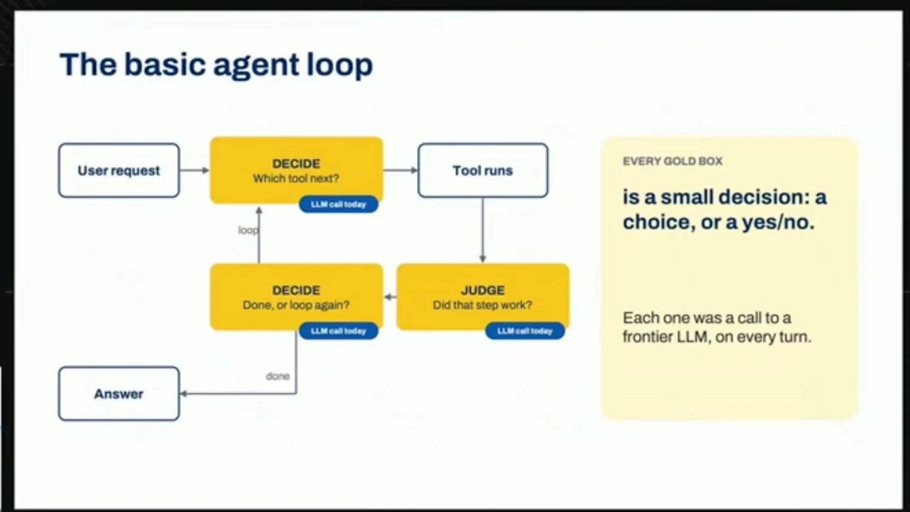

_截图 03  ·  录屏 06:05:50_

**06:05:58**　Now, one of the problems here is that on each one of those, we're doing LLM calls. And there's two major problems with that. So one is there's too much intelligence. So if we look at the System One versus system two thinking, we're doing a lot of slow, deliberate, very expensive thought processes at each one of those steps. Another problem is it's just the wrong tool for the job.

现在，这里的一个问题是，在每一个步骤中，我们都在使用 LLM 进行计算。而这又存在两个主要问题。第一个问题是智能程度过高。如果我们对比 System One 和 System Two 的思维方式，会发现我们在每个步骤中都要进行大量缓慢、精心策划且成本极高的思考过程。另一个问题是它根本不是完成这项任务的正确工具。

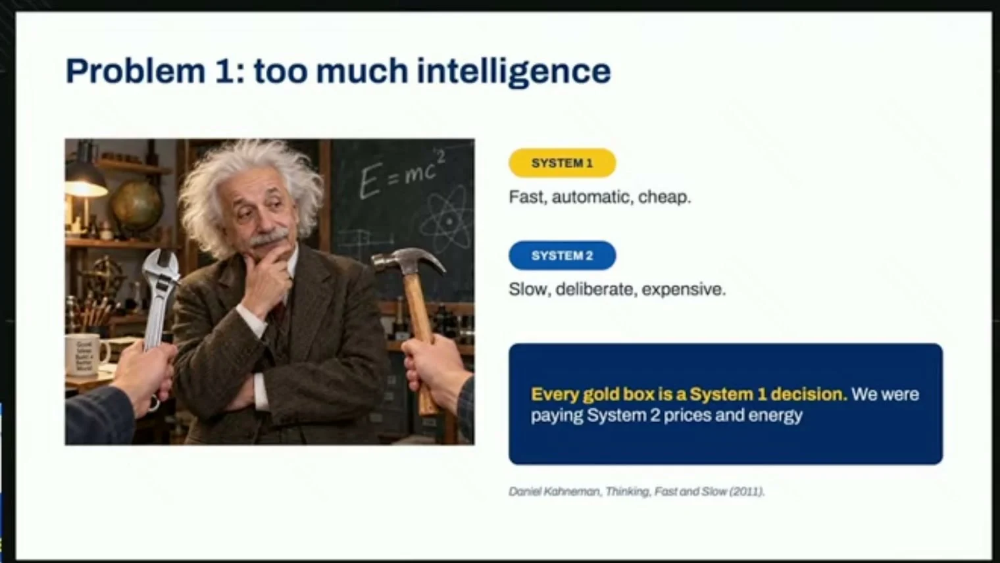

_截图 04  ·  录屏 06:06:10_

**06:06:24**　So, you know, LLMs a lot of times are just a hammer looking for a nail. And, you know, we want to figure out, like, what do we actually need? Because clearly LLMs are not doing it. So we want something that is fast, smart, easy to use, it's generalized, and it's very, very cheap. So when we look at like from a code perspective, what are we really looking at from a Jev-like model?

所以，你们知道，LLM很多时候就像一把锤子，在寻找一颗钉子。而我们要弄清楚，实际上我们需要什么？因为显然LLM做不到这些。所以我们想要的是：速度快、智能、易用、可通用，而且价格非常便宜。那么从代码的角度来说，从类似Jev的模型来看，我们真正想要的是什么呢？

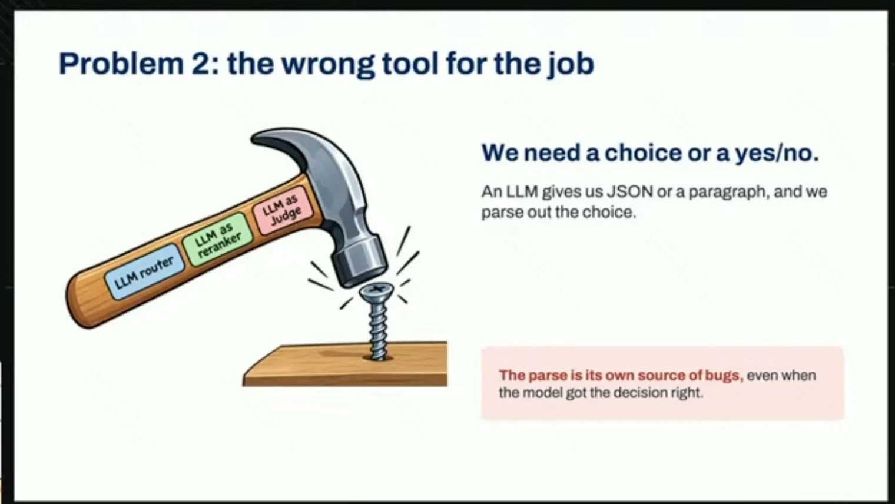

_截图 05  ·  录屏 06:06:27_

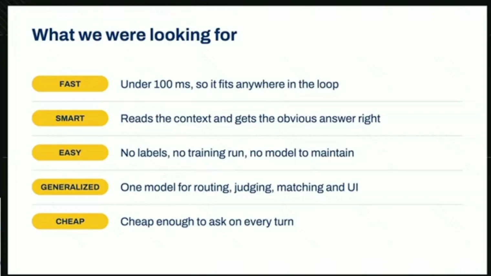

_截图 06  ·  录屏 06:06:40_

**06:06:55**　It's really just a conditional. If this happens, this should happen. Which one of these cases are the ones that I want to explore? And you've seen it among many of these presentations already, but Jev has the primitives to allow us to do this. There's the probability. Is it this or that? And what's the probability? What are the different categories that this particular thing could fall into?

其实只是一个条件问题。如果这种情况发生，那么另一种情况也必然会发生。这些情况中，我想要探讨的是哪一种呢？在许多这样的展示中你已经看到了这一点，但Jev拥有实现这一点的基础条件。存在概率问题。是这种情况还是那种情况？概率是多少呢？这种特定情况可能属于哪几种类别呢？

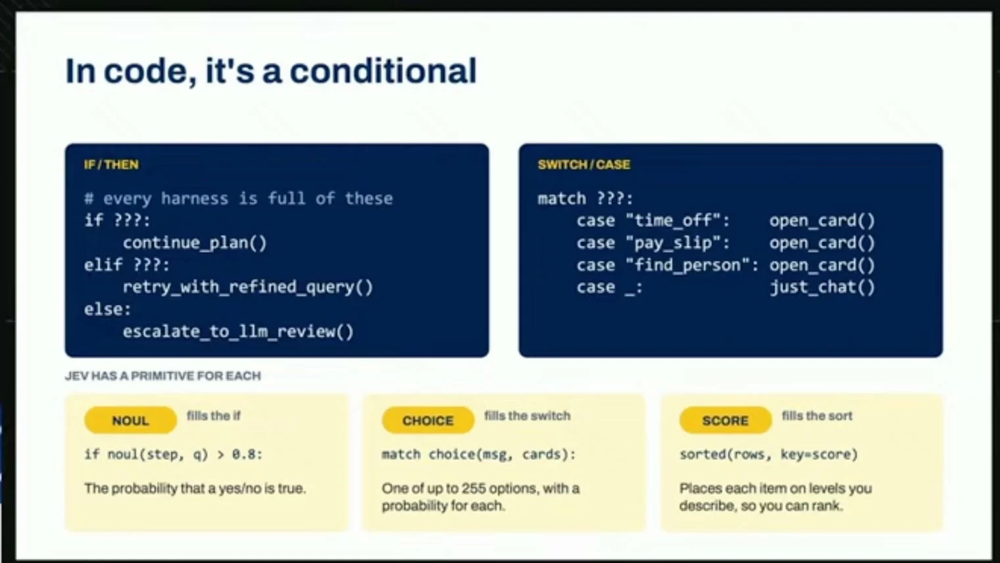

_截图 07  ·  录屏 06:07:13_

**06:07:21**　And then you have the scoring mechanism, which is basically probability and sorted. So this has been brought up as well. My first thought when I saw the Jev models was, well, we already have classifiers. I've been doing this for a long time. How is it actually different? And as many of the speakers have talked about already, with classifiers, I need to figure out what's my golden data set, I have to train it, new data comes out, I have to iterate over and over.

然后还有评分机制，基本上就是概率和排序。这一点也已经被提到过。当我看到 Jev 模型时，我的第一个想法是：我们已经有分类器了，我从事这个工作已经很久了。实际上有什么不同呢？正如许多演讲者已经提到的那样，使用分类器时，我需要确定什么是我的黄金数据集，必须对其进行训练，新的数据会不断产生，我必须反复迭代。

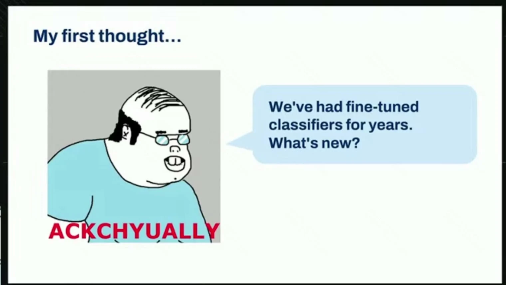

_截图 08  ·  录屏 06:07:34_

**06:07:54**　With Jev, just out of the box, it just worked. We plugged in our question, we classified it, we didn't really have to do anything, it generalized to our question. And so we started using it for a lot of the use cases that you've seen from some of the presenters already. So we use it for routing, that's kind of the canonical example.

使用 Jev 时，一切都非常顺手。我们输入问题后，对其进行分类，其实不需要做太多事情，它就能自动转化为我们的问题。于是我们开始将其用于许多你从一些演讲者那里看到的应用场景中。比如，我们用它进行路由处理，这是最典型的例子。

**06:08:14**　Figuring out, did this step work as a judge? We looked at resumes, is this person qualified for ML work? And I want to do kind of an overly simplified example as well. So no one taught Jev what a fish is. And so this is actually a question we asked, is a fish a pet? Well, 50-50, might be a pet sometimes, might not be.

看来这一步作为评判标准是有效的吧？我们查看了简历，这个人是否适合从事机器学习工作？我还想用一个非常简化的例子来说明。所以没有人教过Jev什么是鱼。那么，这其实是一个我们提出的问题：鱼算宠物吗？嗯，50-50，有时候可能是宠物，有时候则不是。

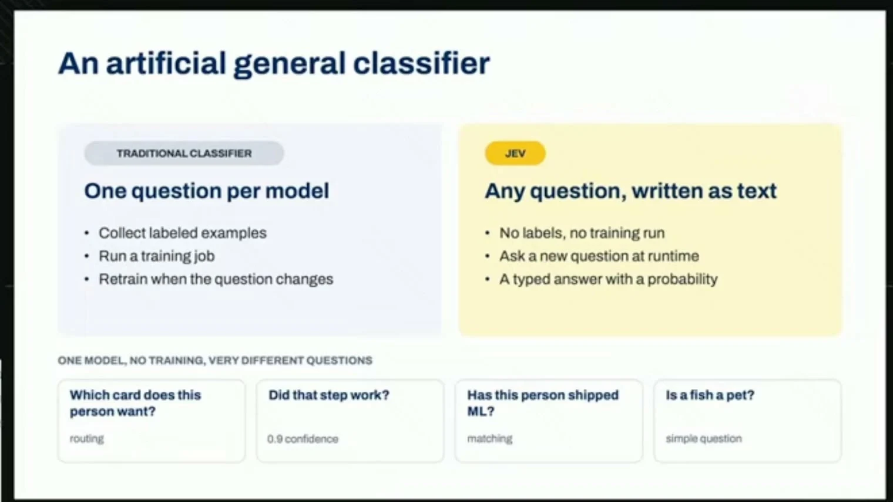

_截图 09  ·  录屏 06:08:15_

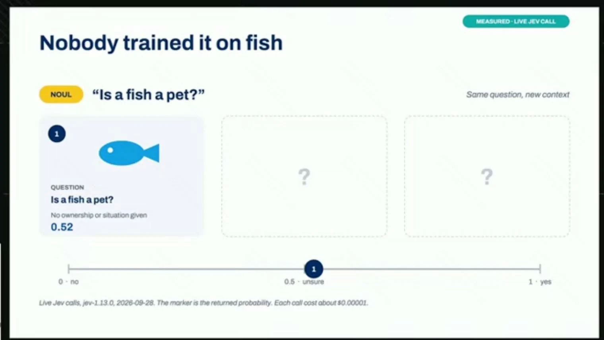

_截图 10  ·  录屏 06:08:36_

**06:08:42**　And so, you know, if I ran into this, then I have to figure out, what do I do next? Maybe I can give it some more context. Oh, is a fish in a bowl a pet? You know, and after 20 milliseconds, I can ask this again. All right, that's great. Oh, is a fish on my plate a pet? Clearly not. So this is something that wasn't trained out of the box in seconds.

所以，你知道的，如果我遇到这个问题，那我就得想想接下来该怎么做？也许我可以再提供一些上下文。哦，一个鱼在碗里算宠物吗？你懂的，20毫秒后，我还可以再问一次。好吧，那很好。哦，我的盘子里有一条鱼算宠物吗？显然不是。所以这是不是那种在几秒钟内就未被训练出来的东西呢？

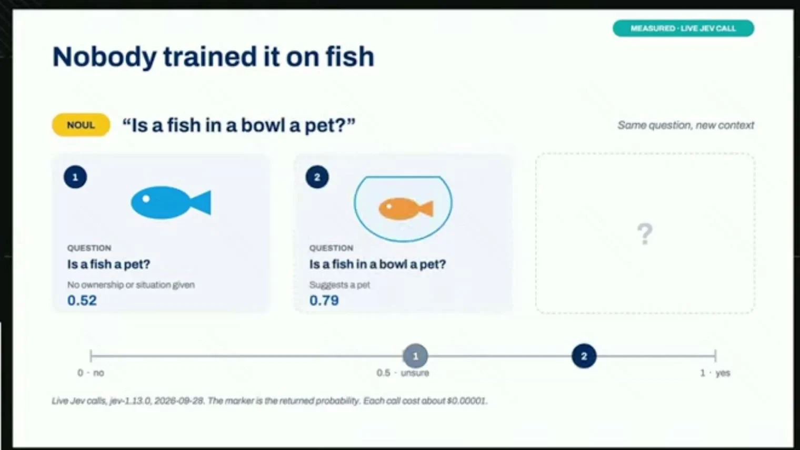

_截图 11  ·  录屏 06:08:49_

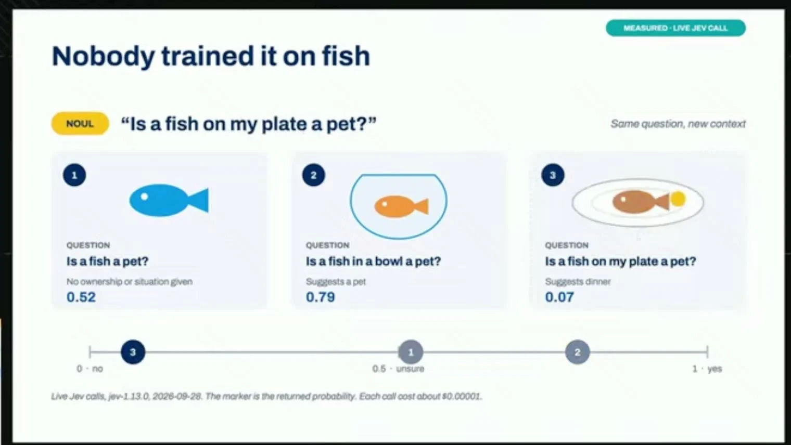

_截图 12  ·  录屏 06:08:57_

### 从补全词语到补全动作，展示产品界面

**06:09:03**　It just worked. All right. So now on to some of the demos that we've done at Workday. So just a caveat on some of these. It's not real data, so we're not using any of your resumes or payroll data. These are also not in production now and may or may not be in the future. So that's something our legal asked me to say.

它真的成功了。好的，现在让我们来谈谈在 Workday 上进行的几个演示案例。不过需要说明一下：这些都不是真实数据，所以我们没有使用任何您的简历或工资表数据。这些目前也不在正式运行中，未来也可能不会。这是我们的法律部门要求我说的。

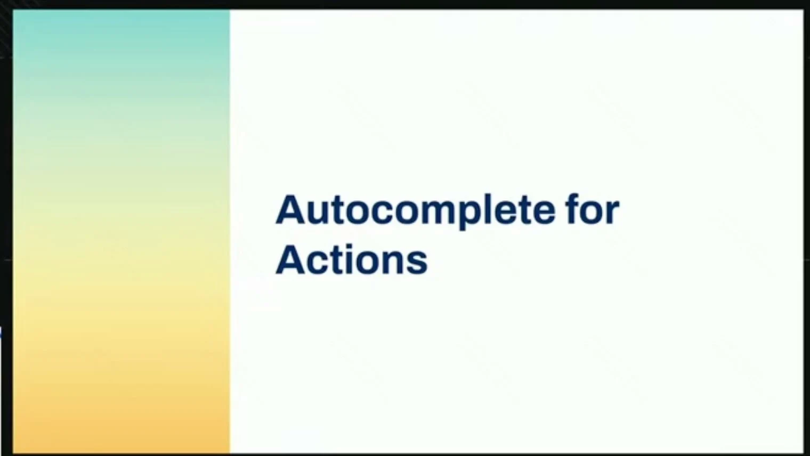

_截图 13  ·  录屏 06:09:14_

**06:09:27**　So let's get into some of the demos. All right, so starting with autocomplete. So autocomplete starts to predict what you're trying to ask. It's just predicting the question. It's not helping you get to the answer. So as you start to type more, it's going to guess like, oh, I want to figure out if this person wants to take a day off work.

那我们来看看一些演示吧。好的，首先从自动补全功能开始讲。自动补全会尝试预测你想要问的问题，只是进行预测而已，并不能真正帮你找到答案。所以当你开始输入更多内容时，它就会猜测，比如“我想知道这个人是否想请一天假”。

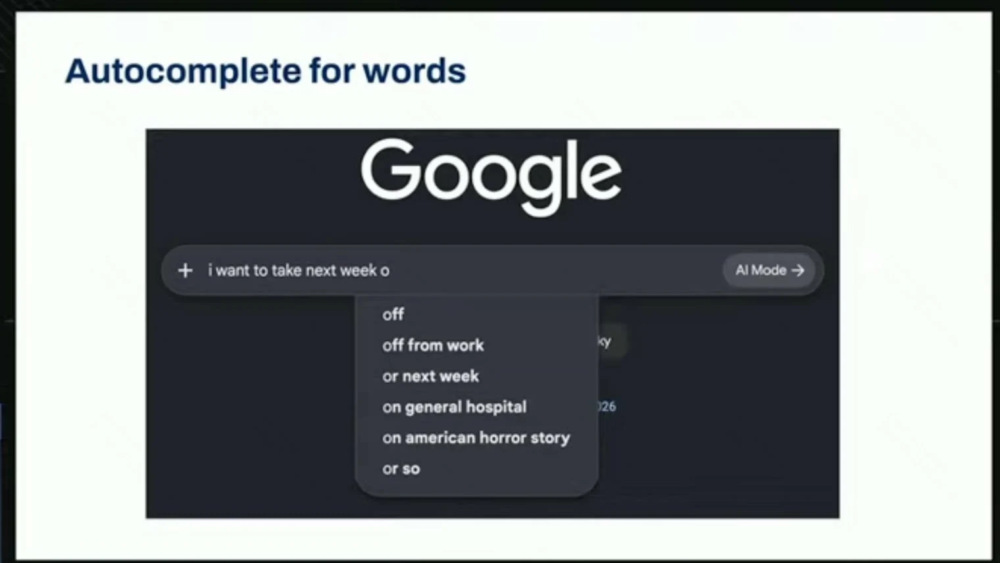

_截图 14  ·  录屏 06:09:47_

**06:09:49**　the question but you really haven't helped me get to the answer. So what we want to do is move from just predicting the word or the next block of code and actually help you finish the task. And so this is best shown with a demo that we have where we go from predicting what you want to say to predicting what you want to do.

不过你实际上并没有帮助我找到答案。我们想要做的是从仅仅预测单词或下一段代码，转变为真正帮你完成任务。这可以通过一个演示来展示，从预测你想要说的内容，到预测你想要做的事情。

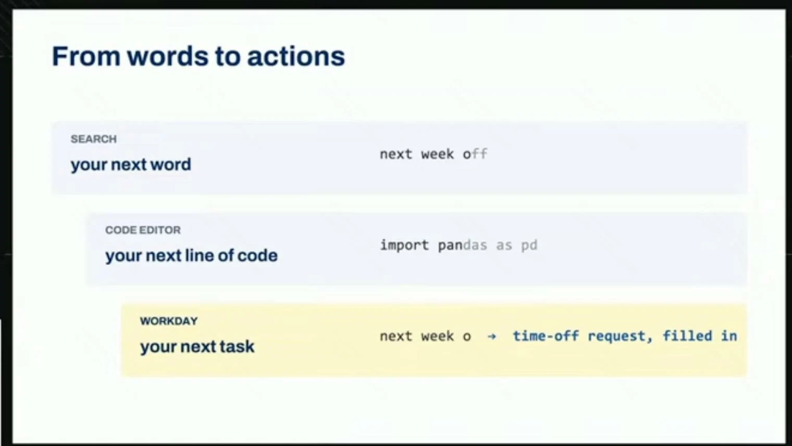

_截图 15  ·  录屏 06:09:55_

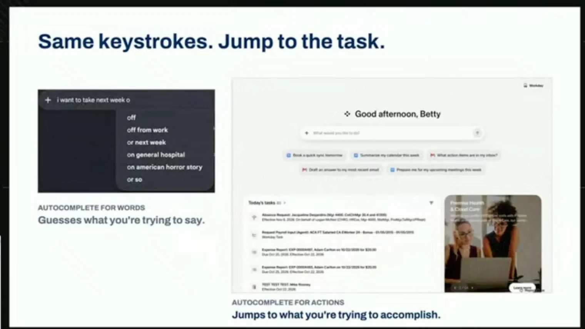

_截图 16  ·  录屏 06:10:08_

**06:10:11**　So hopefully the video plays. There we go. All right. So I need to take time off of next week. And as I start to ask this, Jev is actually figuring out under the hood, okay, what more context do I have? How can I adjust this UI based on the information that I'm getting? This is not something that we could have done with an LLM.

希望视频能播放成功。好了，就这样吧。那么下周我需要请假。当我开始思考这个问题时，Jev其实正在暗中努力，对吧？我还有哪些背景信息呢？我该如何根据所获取的信息调整这个界面呢？这可不是我们用LLM就能完成的。

_截图 17  ·  录屏 06:10:25_

**06:10:36**　We're doing this in a loop while someone's asking. The payslip. You know, you shouldn't have to go in and ask an agent, hey, can you go find out how much I was paid? What you can do is just in the search, say, what was my pay last period? Pops up an interface, allows you to unhide it, you know, see what your pay was in the last period.

我们在有人询问时就会反复进行这个操作。工资单的问题吧，你不应该需要去问智能体，嘿，你能帮我查一下我上个月的工资是多少吗？你可以直接在搜索里问，比如“我上个月的工资是多少？”就会出现一个界面，让你能看到上个月的工资情况。

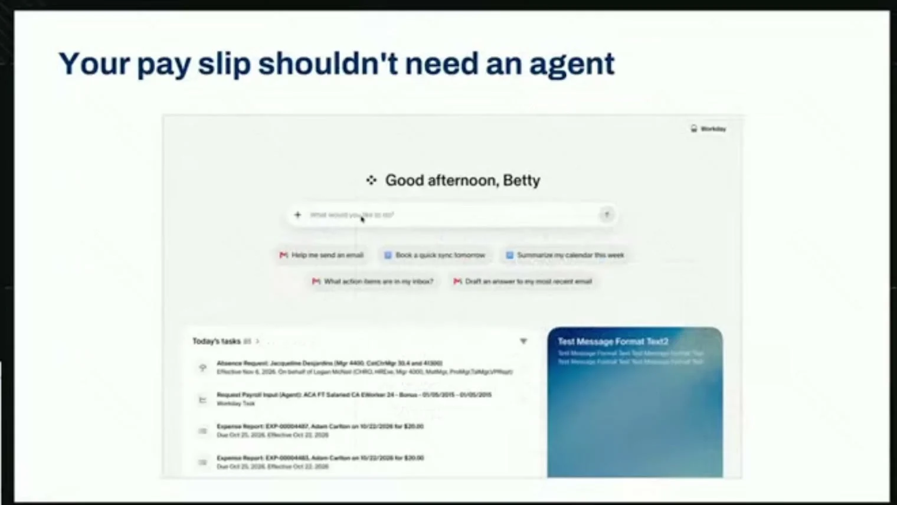

_截图 18  ·  录屏 06:10:41_

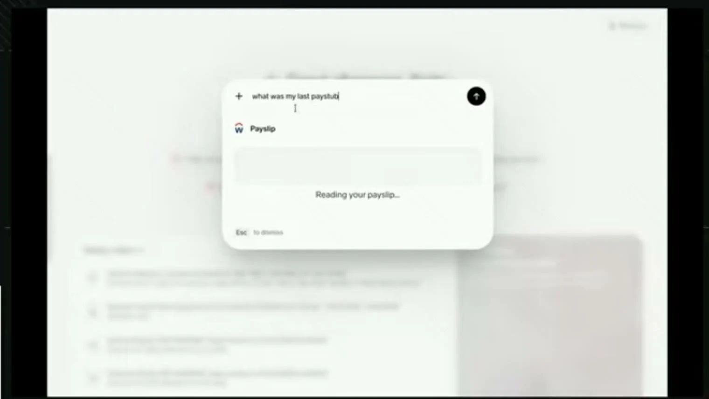

_截图 19  ·  录屏 06:10:54_

**06:11:01**　Very simple. Gets you to the action. Book a meeting. So I know that I want to book a meeting, and I'm going to want to do it for next Friday. Let me do it at 2 p.m. Oh, I want to do it with my boss. Make sure that I get my boss on this, Logan McNeil. There we go. Meeting's booked.

非常简单。就能让你开始行动了。预订一个会议吧。所以我知道我想要预订一个会议，而且打算在下周五进行。我定在下午2点进行。哦，我想和我的老板一起做这件事。确保我能让老板参与进来，Logan McNeil。就这样，会议已经安排好了。

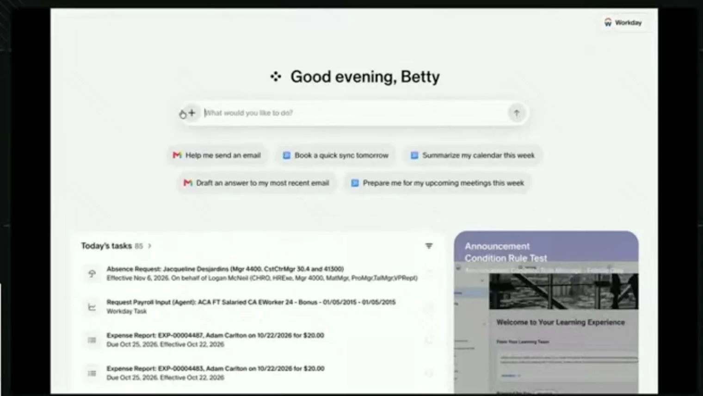

_截图 20  ·  录屏 06:11:06_

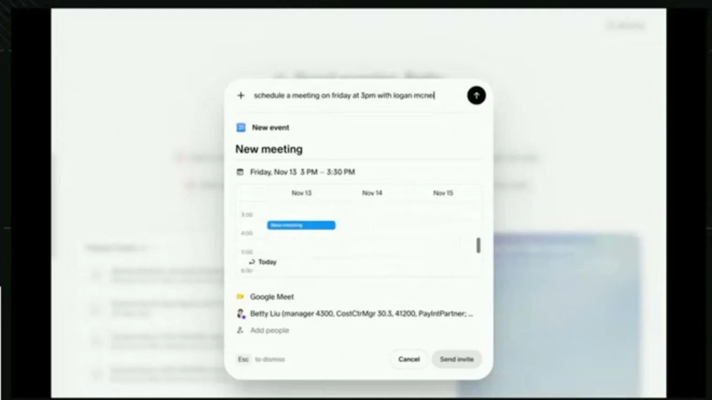

_截图 21  ·  录屏 06:11:19_

**06:11:26**　And then a final one that we have just for this example, but there's many more, is finding a person. So in this one, I may have some semantic knowledge, like find the person who owns this part of the organization, or just like who's Ashanti, I want to contact her, pop it up, click on email, good to go. All right, so what's happening under the hood?

还有最后一个例子，这只是为了这个示例而设计的，但实际上还有很多类似的情况，比如找到某个人。在这个例子中，我可能有一些语义知识，比如找出拥有该组织部分权力的那个人，或者像Ashanti那样的人，我想联系她，点击后会出现邮件选项，就可以发送了。那么，背后到底发生了什么呢？

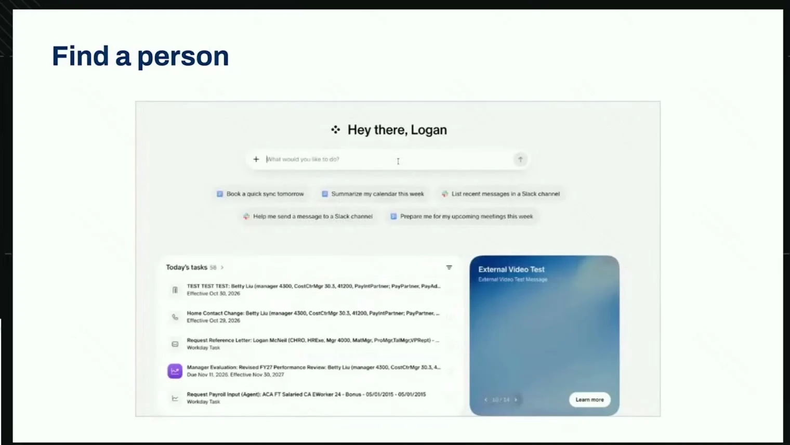

_截图 22  ·  录屏 06:11:27_

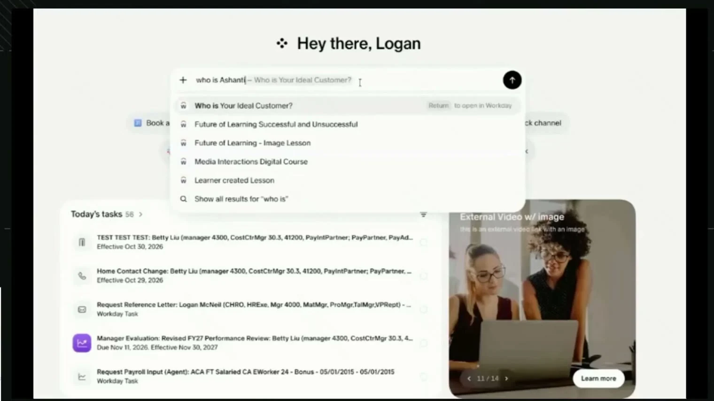

_截图 23  ·  录屏 06:11:40_

### 延迟、路由和不同团队维护规则的办法

**06:11:52**　So because Jev is fast and cheap, just like a type ahead, we could start to render a UI on that same cadence. We can look at, as the words are coming, do a prediction of intent, and start to render an interface. And we can do this at about 20 bucks for a million judgments. And the way that we're doing it is kind of twofold, or two parts, I should say.

因此，由于 Jev 速度快且成本低，就像提前规划一样，我们可以按照相同的节奏开始渲染 UI。当文字出现时，我们可以进行意图预测，然后开始渲染界面。而且我们只需花费约 20 美元就能处理一百万次判断。我们的实现方式可以说分为两部分或两个部分。

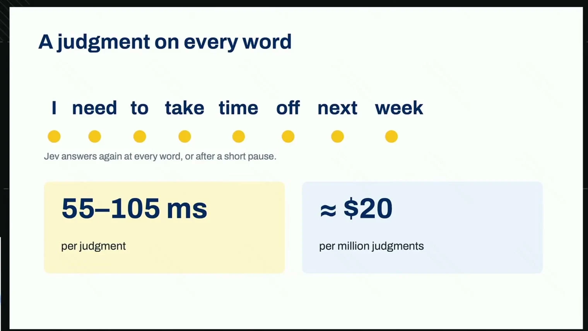

_截图 24  ·  录屏 06:12:00_

**06:12:20**　So first, Jev is picking the card of saying, what's the intent? All right, there's a card that's going to help you out. And then the team that's responsible in that domain then can decide, what are the questions to progressively fill out that card? And so there's sort of this two-step process. The first step is getting people in the front door, getting the right card up.

首先，Jev会挑选一张卡片来说明意图是什么。好的，有一张卡片能帮助你解决这个问题。然后，负责该领域的团队可以决定需要填写哪些问题来完善那张卡片。所以这是一个两步过程。第一步是让人们进入前端，拿到正确的卡片。

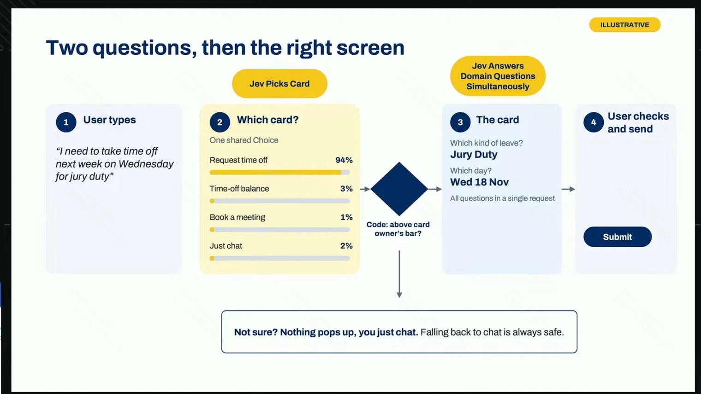

_截图 25  ·  录屏 06:12:21_

**06:12:40**　And then the second one is making sure that you fill in that card to help them accomplish the task that they're after. Here. Now, we have an eval on here before we merge any card. We want to make sure that it doesn't collide with any other one. And at least in our initial experiments, we've done seven cards or a just chat because it should, if there's no card to actually solve it, it should allow you to just continue chatting.

然后第二个步骤是确保你填写那张卡片，以帮助他们完成目标任务。现在，在合并任何卡片之前，我们在这里进行了评测。我们希望确保它不会与其他卡片冲突。至少在初步实验中，我们使用了七张卡片，或者只是聊天，因为如果没有实际可解决的卡片，就应该允许你继续聊天。

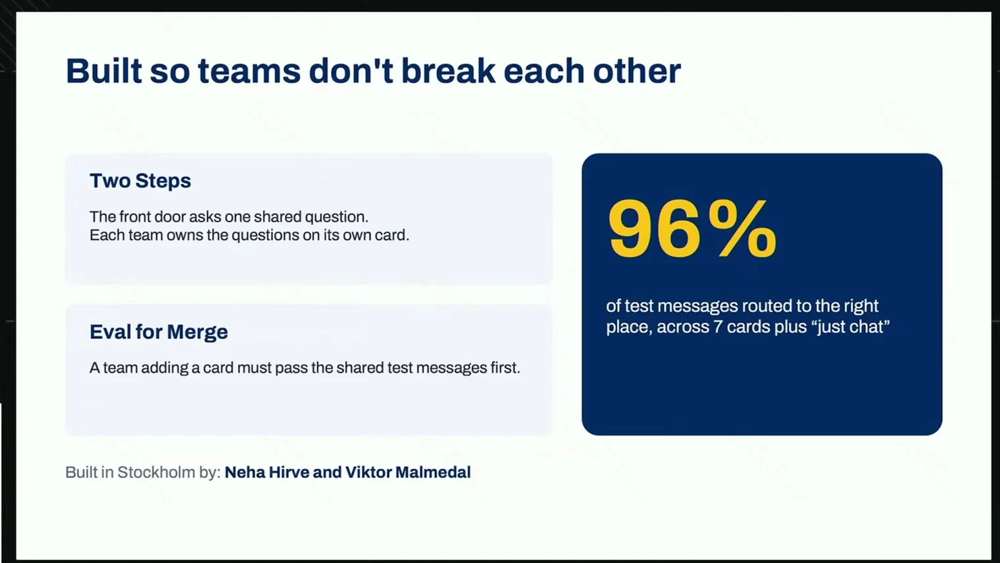

_截图 26  ·  录屏 06:12:46_

### 招聘检索、SQL 里的自然语言判断和演示

**06:13:04**　We were able to get 96% accuracy on that. All right. So now on to the recruiter. So let's talk about the recruiter problem. All All right, so this is not like a fast task. It's something where Recruiter has a pile of hundreds of resumes and has to figure out who has the best resume to accomplish or fill the rec that they're trying to fill.

我们实现了 96% 的准确率。好的，现在来谈谈招聘人员的问题。这并不像一项快速的任务，因为招聘人员手头有数百份简历，他们需要找出哪份简历最合适，以便完成招聘任务或填补职位空缺。

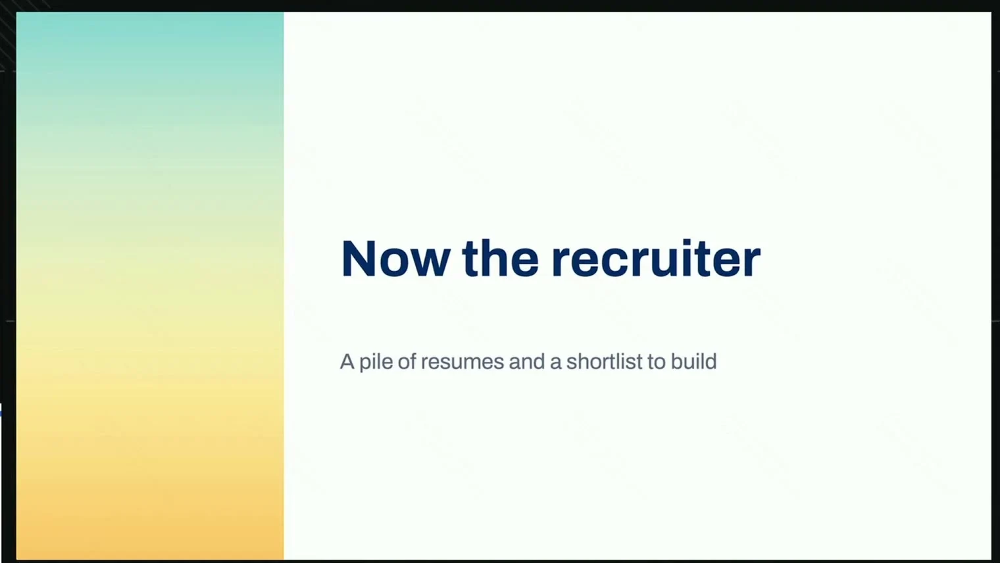

_截图 27  ·  录屏 06:13:15_

**06:13:27**　Now, I first want to look at how we would have done this before. We would have done an embedding, put the vectors in a vector DB, then had a retrieval layer, then have a re-ranker, and then figure out, based on the re-ranker, in front of the recruiter. One interesting call out is the Quinn Reranker looks surprisingly similar to the Jev process as well.

现在，我首先想看看在之前我们是如何完成这一操作的。我们会进行嵌入处理，将向量存储在向量数据库中，然后设置检索层，再有一个重新排序器，最后根据重新排序器的结果来呈现给招聘人员。一个值得注意的点是，Quinn Reranker与Jev流程非常相似。

**06:13:56**　And so that's kind of an interesting corollary if you've used that one before. But with Jev, we basically take out all the embedding steps. I don't have to train anything up. I don't have to do embedding. I don't have to put things in a vector database. Database. What I can do is just do a function on my database. So put all the resumes into a database, use natural language to query it, iterate over every single one of them, and then just figure out which ones match my criteria.

所以，如果你之前使用过那个方法的话，这其实是一个很有趣的推论。但使用 Jev 时，我们基本上可以省略所有的嵌入步骤。我不需要进行任何训练，也不需要做嵌入操作，更不需要把内容放入向量数据库中。我能做的只是在我的数据库上执行一些操作。所以，把所有简历放入数据库中，用自然语言进行查询，遍历每一个简历，然后找出符合我标准的那些简历即可。

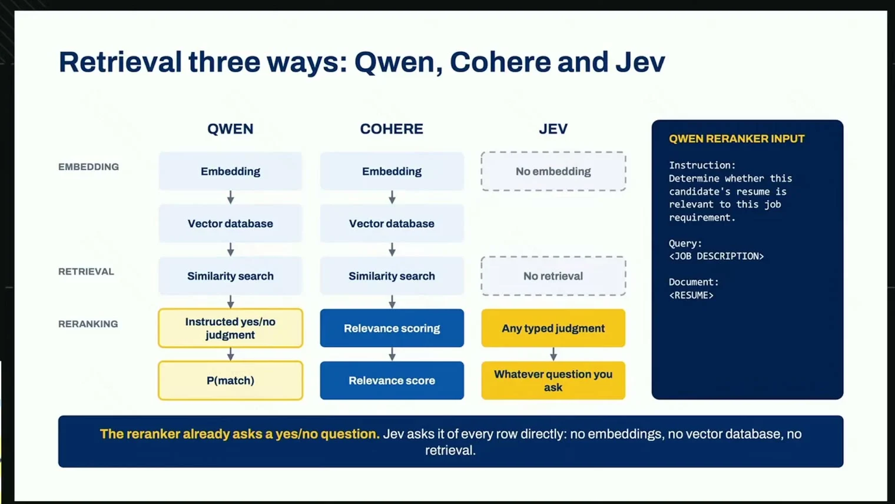

_截图 28  ·  录屏 06:14:05_

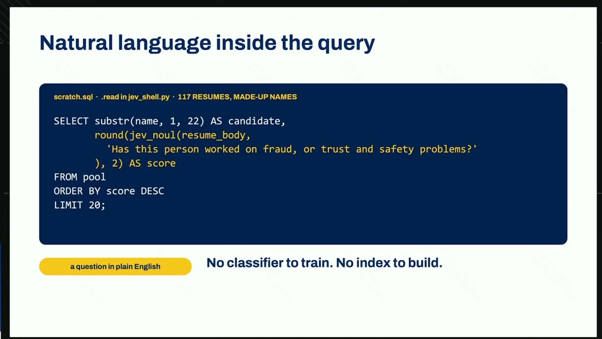

_截图 29  ·  录屏 06:14:18_

**06:14:30**　So I'll go into an actual demo of this exact same one. So here we have a select statement. And so this is against DuckDB, a function that is going to call Jev to figure out what's the probability that someone matches this criteria. We're going to get it a score and then we're going to order by that score. Now I'm going to do about 20.

那么我将进行一个实际的演示，使用完全相同的方案。这里有一个选择语句。这违反了 DuckDB 的规则，因为该函数会调用 Jev 来计算满足特定条件的人的概率。我们会得到一个分数，然后按照这个分数进行排序。现在我会得到大约 20 分。

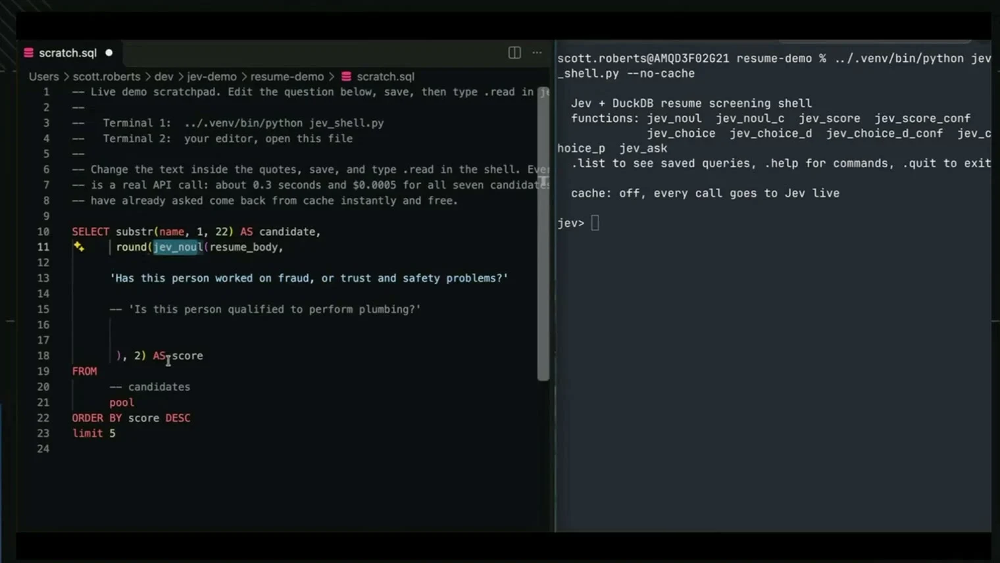

_截图 30  ·  录屏 06:14:43_

**06:14:52**　And as I said, these are all fakes and none of your resumes are in here, I promise. And then here we see these are very ML-focused synthetic data as well. So it's not a surprise that we would have very high hit rates against someone who's worked in fraud, trust, and safety problems. But let's look at it. Let's change this question.

正如我所说，这些都是假的，我的简历根本不在这里，我保证。而且这里看到的也是以机器学习为重点的合成数据。因此，对于那些从事过欺诈、信任和安全相关工作的人，我们的命中率很高也就不足为奇了。不过，让我们再看看这个问题。让我们换个问题吧。

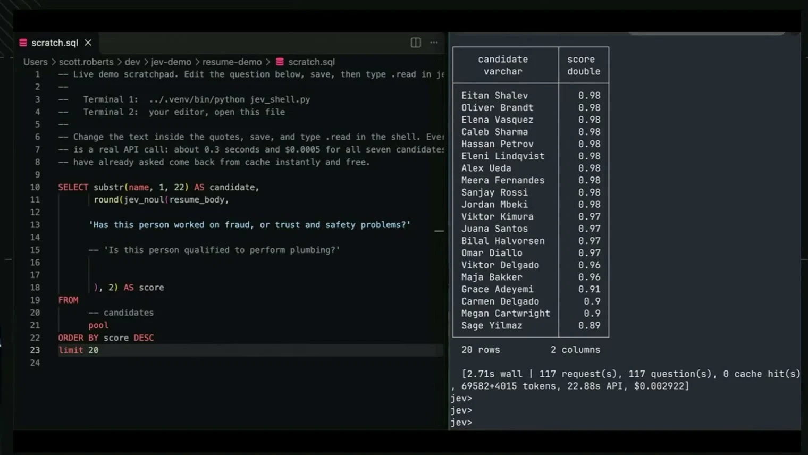

_截图 31  ·  录屏 06:15:04_

**06:15:12**　Let's be a little bit more adversarial on this one. So a lot of these resumes have the word pipeline in them. So whether it's a data or an AI pipeline, pipe's gonna come out. So let's just ask, is this person qualified to do plumbing? If you were gonna just do a lexical search, it might pick up some of these. So we put it into Jev and asked, of all these ML resumes, let's trim the limit down to five here, go ahead and run it.

让我们在这一点上更加对立一些。所以很多简历中都会出现“pipeline”这个词。无论是数据还是AI pipeline，都会用“pipe”来表示。那么我们就问一下，这个人是否具备做管道工作的资格？如果只是进行词汇搜索的话，可能会找到一些相关词。所以我们将它放入Jev中，然后询问：在所有这些机器学习简历中，让我们把范围缩小到五份，开始运行吧。

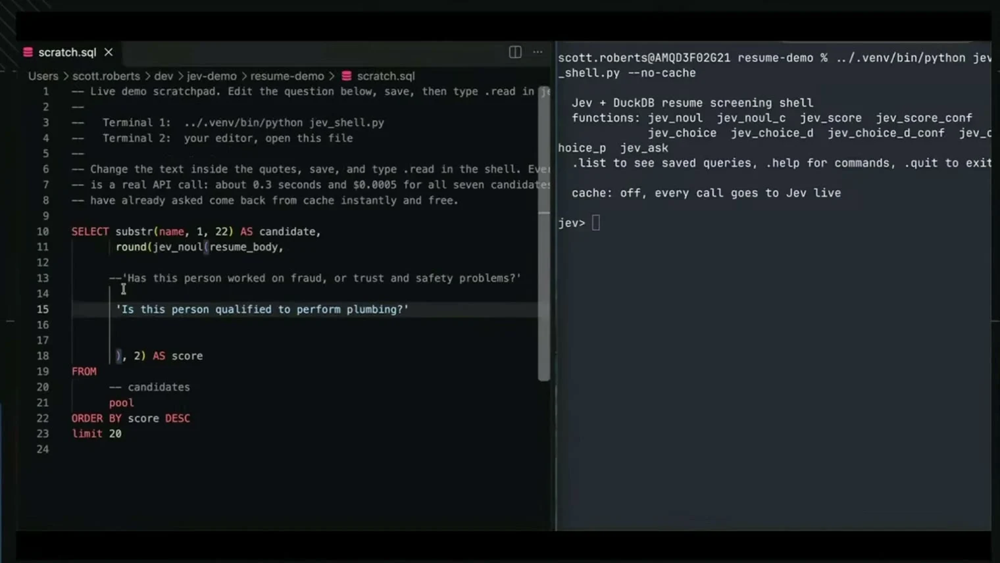

_截图 32  ·  录屏 06:15:33_

**06:15:43**　And we could see that very, very low probability on these. So these are ones that we would almost definitely out. And you can see the speed. So we went over 117 records. We had 2.3 seconds of wall time and spent almost nothing on this query to just iterate over everything. So Jev really kind of changed the game for us because every place where we're thinking either this is too expensive or it's too slow, we thought of new places to inject Jev into our pipeline.

我们可以看到，这些情况的概率非常低。因此，我们几乎肯定会排除这些选项。你可以看到速度问题。我们处理了117条记录，墙时间仅为2.3秒，而针对这个查询几乎没有花费任何资源，只是简单地遍历了所有内容。因此，Jev确实改变了我们的策略，因为在那些我们认为“成本过高”或“速度太慢”的地方，我们想到了新的方法将Jev引入到我们的流程中。

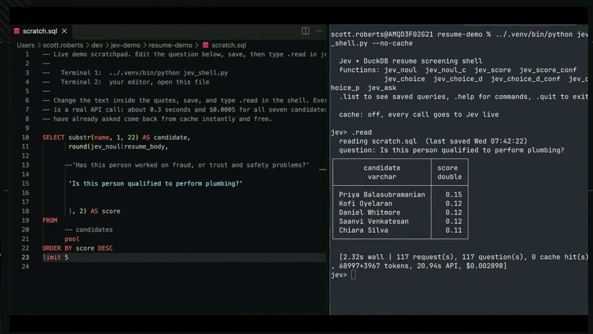

_截图 33  ·  录屏 06:15:54_

**06:16:15**　And so just to summarize, the two areas that I went through are, one, where can we decide very quickly and get to the intent and get the person on their way? And then the second one is to cut down on some of the really deep work. How do we filter those out for our customers? And so I hope that this gave you a little bit of insight into the things that you can take back to your own companies and imagine the things that you can do with Jev and decision models as well.

所以总结一下，我涉及的两个领域是：第一，如何快速确定目标，理解意图，帮助用户顺利推进；第二，如何减少那些非常复杂的任务。我们该如何为客户筛选这些任务呢？希望这能让你对这些问题有更清晰的了解，从而将所学应用到自己的公司中，想象出利用Jev和决策模型可以实现的方案。

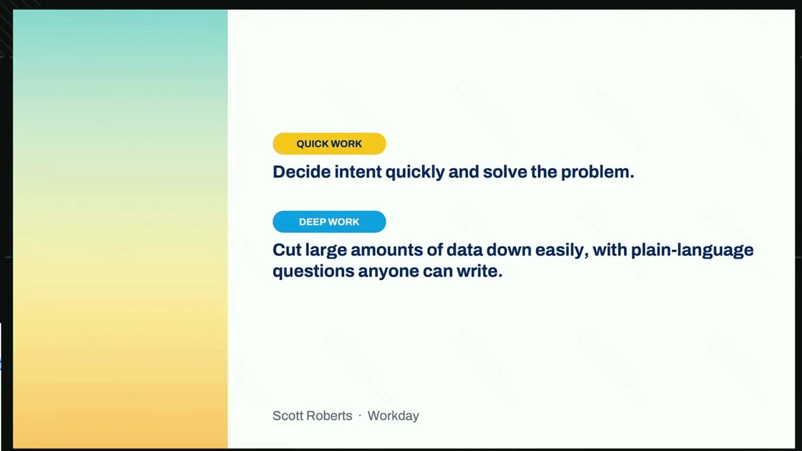

_截图 34  ·  录屏 06:16:27_

**06:16:47**　And that's my time. Thank you very much.

这就是我的时间。非常感谢。

---

[全部演讲](../README.md) · [选看索引](index.md) · [上一场](20-brian-kennedy.md) · [下一场](22-girish-konda.md)
