[全部演讲](../README.md) · [选看索引](index.md) · [上一场](21-scott-roberts.md) · [下一场](23-nikolay-petrov.md)

# Sub-Agents Are a Distributed System (And Nobody Gave You a Consistency Model)

**Girish Konda** · Microsoft · Principal Software Engineer

AIE Code Summit 2026  ·  11 月 11 日  ·  Online Track 预录插播  ·  录屏 06:18:00–06:40:56

[官方讲者资料](<https://ai.engineer/code/2026#speakers>)   ·   [Day 1 官方回放](<https://www.youtube.com/watch?v=ZZ19zhYnDKY>)

## 本场目录

- [06:18:49](#section-1) 把编排器、子 Agent 与共享状态画成分布式系统
- [06:19:51](#section-2) 部分失败、脏读、扇出与重试
- [06:27:09](#section-3) 选择一致性约束，介绍 SAFE 交接
- [06:29:43](#section-4) 来源、幂等、隔离、并发边界及代码验证

## 演讲实录

> 英文源自录屏音频，经轻度校订。每段英文下方为中文译文。时间指向原始录屏。

**06:17:59**　this is Grish, a Principal Software Engineer at Microsoft. Outside my job, I build open source tools for AI agents. One of them is MCP Pacemaker, a supervised bridge that keeps MCP servers running. Before we start, a small disclosure. The views in this talk are my own and doesn't represent my employer. So sub-agents are a distributed system. Over the past year, I have been using agents and sub-agents on real engineering work.

这是 Grish，微软的首席软件工程师。除了工作之外，我还开发用于 AI 智能体的开源工具。其中之一就是 MCP Pacemaker，这是一个能够确保 MCP 服务器持续运行的监督型桥接系统。在开始之前，先说明一点：本次演讲中的观点仅属于我个人的，并不代表我的雇主。因此，子智能体是一种分布式系统。过去一年里，我在实际工程工作中使用了智能体和子智能体。

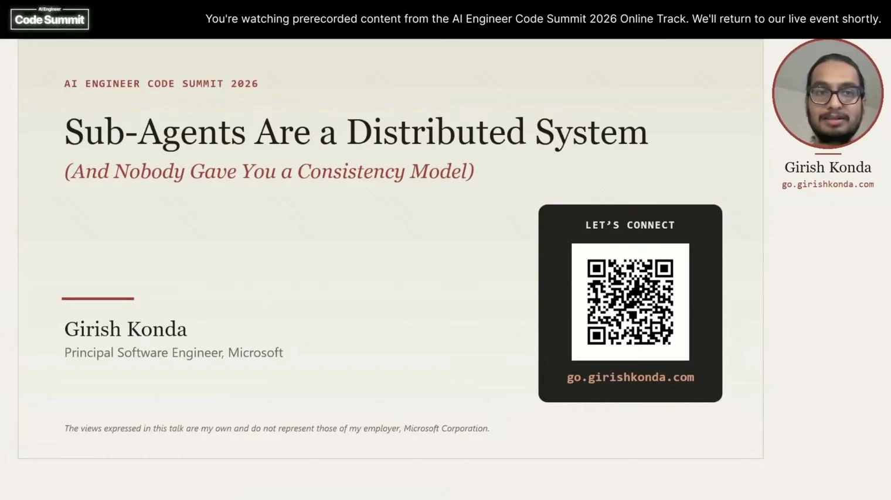

_截图 01  ·  录屏 06:18:20_

### 把编排器、子 Agent 与共享状态画成分布式系统

**06:18:30**　Devositions, code reviews, instant triaging, whatnot. This talk is about what happens when one agent hands work to another. So here's an architecture. The orchestrator splits the task and hands the pieces to three different sub-agents. They all read from the same shared state, colonization, memory files, repo, working trees, issues, vector stores. And they don't just think, they make tool calls to real systems which touch databases, APIs, CI tools, deployment pipelines.

部署、代码审查、即时分类等。本次讨论的是一个智能体将任务交给另一个智能体时会发生什么。因此，这里有一个架构。 orchestrator会分配任务，并将任务分解为三个不同的子智能体。它们都从同一个共享状态中读取数据，包括殖民地、内存文件、代码仓库、工作树、问题记录以及向量存储。它们不仅进行思考，还会调用真实系统的工具，这些系统涉及数据库、API、CI工具以及部署管道。

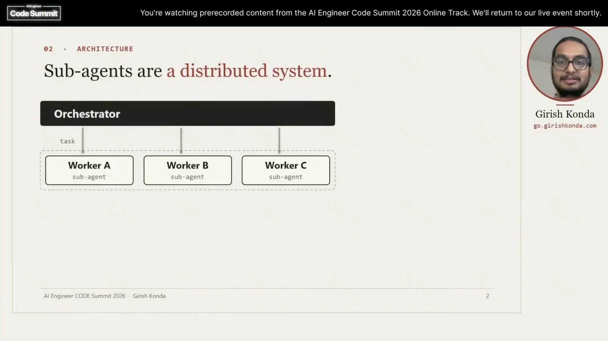

_截图 02  ·  录屏 06:18:49_

**06:19:19**　And the results come back. An orchestrator merges them into a single answer. An orchestrator works in a shared mutable state and results merge from concurrent executions. This represents a classic distributed system. I have known how to reason with distributed systems for decades, but none of this setup came with it. What you get is a function that takes a string returns a string.

结果就出来了。一个 orchestrator 将它们合并成单一的答案。orchestrator 在共享的可变状态中工作，结果来自同时执行的过程。这代表了典型的分布式系统。几十年来我一直知道如何处理分布式系统，但这样的设置却从未被包含其中。最终得到的是一个接受字符串参数并返回字符串的函数。

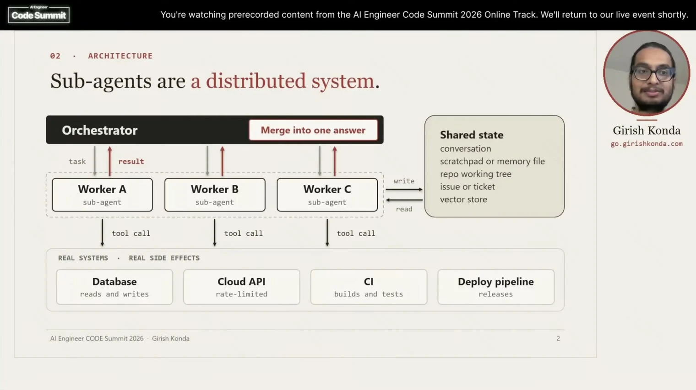

_截图 03  ·  录屏 06:19:30_

### 部分失败、脏读、扇出与重试

**06:19:48**　Failures we hit are not new, are not specific to the AI agents. They are classic distributed system failures. Partial failure, a normal call that fails halfway through and returns an exception error code. In a subagent case, it returns text that looks like a success. Dirty reads. Normally we have isolations, versions. Here every worker reads on shared context including things other worker only guessed.

我们遇到的故障并不新鲜，也不是AI智能体特有的问题。这是典型的分布式系统故障。部分失败，即正常调用在半途失败，并返回异常错误代码。在子智能体情况下，它会返回类似成功的文本。脏数据读取。通常我们会进行隔离和版本管理。但在这里，每个工作进程都在共享上下文中读取数据，包括其他工作进程仅能猜测的内容。

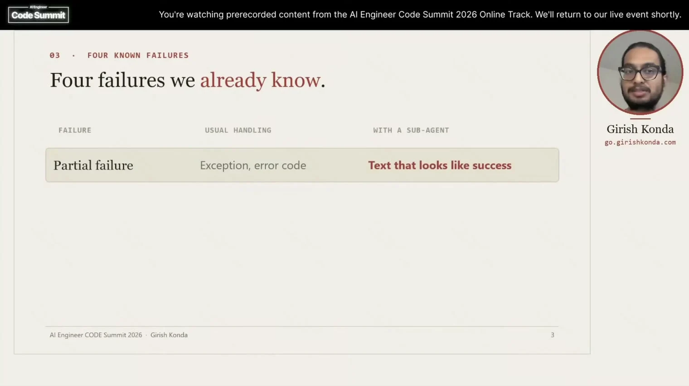

_截图 04  ·  录屏 06:20:04_

**06:20:22**　Unbounded fanout. A busy service pushes back with the queues for 2 nines, 5 0 3s. In agents, orchestrator does not see any of this. It just starts in the worker. Retrace. In normal dispute systems, we build idempotency to make read-tries reliable. In agents, a read-tried sub-agent runs the whole task again, with side effects included. For each of these cases, I'll name the concept it already is, then I'll put them together as a consistency model I'm proposing and walk through why each part is there.

无限制泛化。繁忙的服务会处理2个9和5 0 3s的队列。在智能体中，调度器不会看到这些情况，它只是由工作进程执行。回顾一下。在常规争议系统中，我们建立幂等性以确保读取尝试的可靠性。在智能体中，一个读取尝试的子智能体会再次执行整个任务，并包含副作用。对于这些情况，我会给这个概念命名，然后将其作为我提出的一致性模型来整合，并解释每个部分的存在原因。

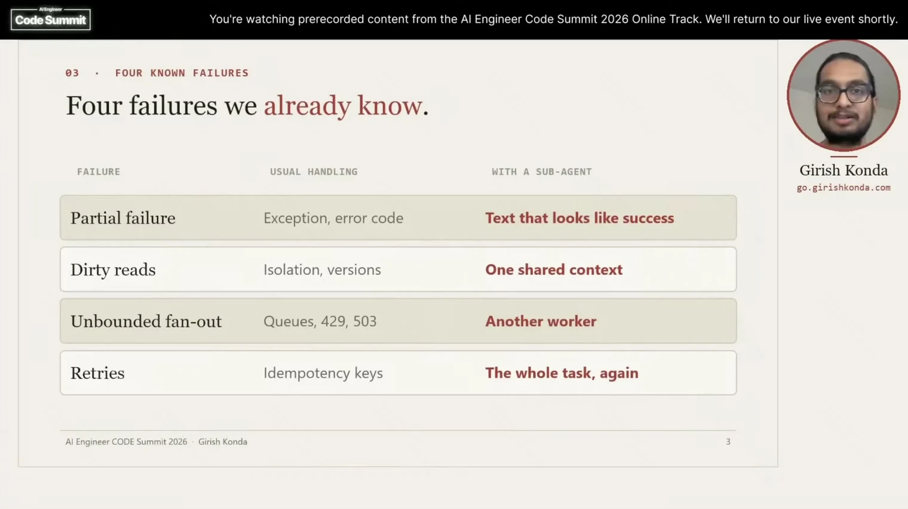

_截图 05  ·  录屏 06:20:50_

**06:21:06**　Start with the failure model because everything else depends on it. A friendly case is a crash stop. The process that was running correctly stops and stays stopped. A sub-agent that throws an error in this box. It's easy to handle. Next, no reply. The call is lost or it's very late. We'll come back to this soon. The hot case is the one from Byzantine General Stipper.

从失败模型开始，因为其他所有内容都依赖于它。一个友好的案例是崩溃停止。正常运行的进程会停止并保持停止状态。在这个框中抛出错误的子智能体。处理起来很简单。接下来是无响应情况。调用被丢失或时间太晚。我们很快会再讨论这个。热门案例是拜占庭将军Stipper的案例。

**06:21:34**　A component that gives conflicting information. The process answers and the answer is wrong. A half-finished sub-agent sits closest to the box. It is not malicious but from the outside it looks the same. It does not crash. It answers fluently. Let's jump into this. A sub-agent that half-finished does not race. It returns normal looking text with the same type signature as sexes.

一个会提供矛盾信息的组件。该过程会给出答案，但答案是错误的。一个未完成的子智能体位于盒子附近。它并不具有恶意，但从外部看却如此。它不会崩溃，也能流畅地回应。让我们开始吧。未完成的子智能体不会竞争，它会返回与 sexes 相同的类型签名、外观正常的文本。

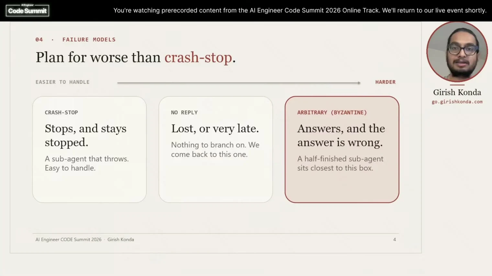

_截图 06  ·  录屏 06:21:40_

**06:22:02**　I talked about one version of this in one of my talks. We pointed an agent at an LLQ. Here's an illustration I used there with three different paths which give the same answer. The first one, it pulled the telemetry and compared with a known-benign set. It actually did the work. The second one, it matched against the title it has seen before and gave the response.

我在一次演讲中提到了这种情况的一种实现方式。我们将智能体应用于 LLQ 系统中。我在演讲中展示了一种示例，该示例包含三条不同的路径，但最终都能得到相同的结果。第一条路径会获取遥测数据，并与已知的良性数据集进行比较，确实完成了任务。第二条路径则根据之前遇到的标题进行匹配，并给出相应的回应。

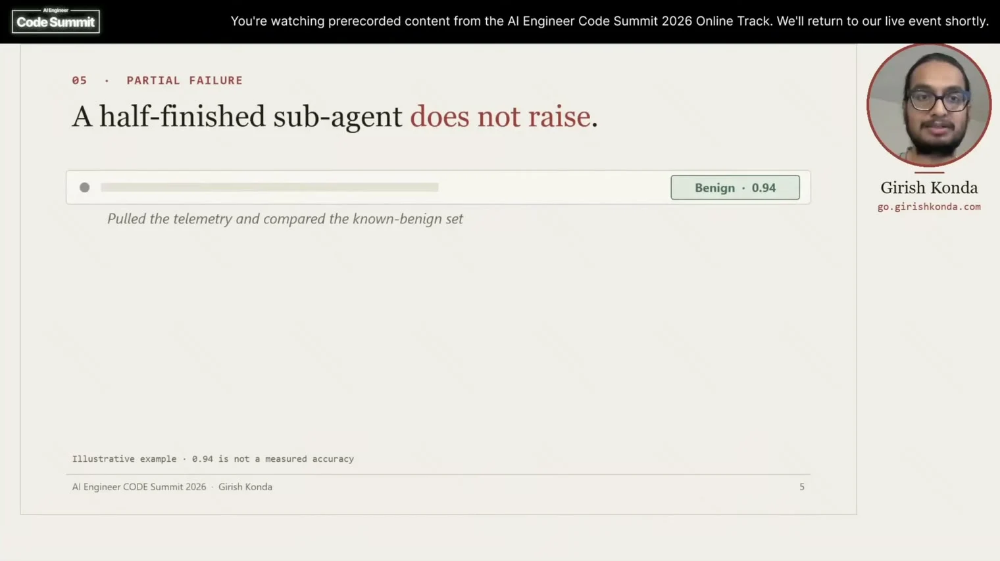

_截图 07  ·  录屏 06:22:21_

**06:22:31**　The third alert, it didn't do anything. It just resonated. All three are categorized as benign and nothing downstream can tell this apart. The orchestrator can read the conclusion it cannot read how much work was behind it. Now the call gets no reply. The orchestrator sent work and the timeout fired. From here three worlds look the same. The subagent is still working.

第三个警报没有产生任何效果，只是产生了共鸣而已。这三个都被归类为良性，后续无法判断其性质。调度器可以读取结果，但无法知道背后有多少工作正在进行中。现在电话没有回应。调度器发送了任务，然后超时了。从这一点来看，三个世界看起来都一样。子代理仍在工作。

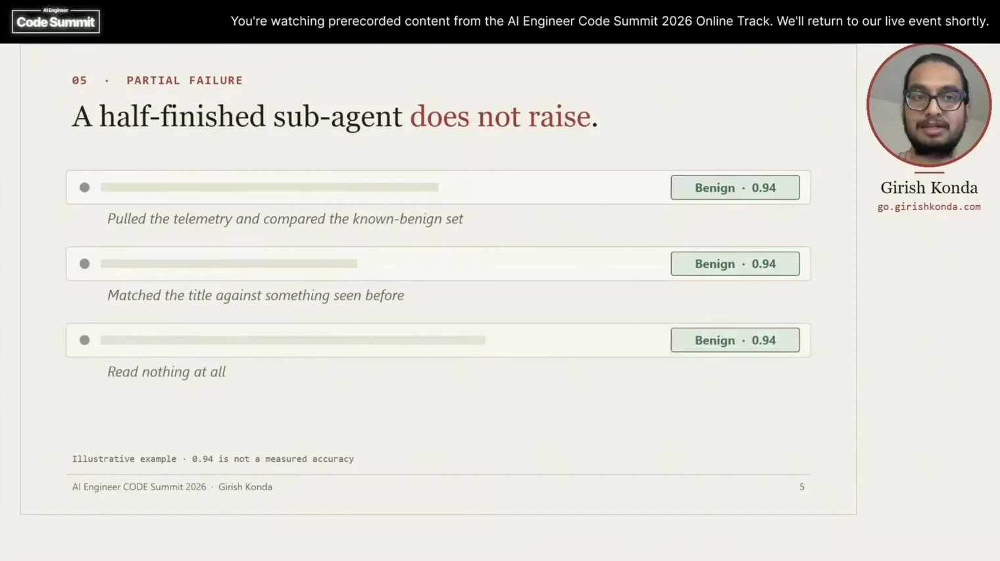

_截图 08  ·  录屏 06:22:34_

**06:23:05**　It crashed and the reply was lost. It's a hard limit, not a tooling gap. 1985 showed that in an asynchronous system with even one faulty process agreement can fail to finish. Chandra and 2x answer in 1996 was failure detectors that can make mistakes. They suspect did not know. I hit both directions in my own open source project MCP pacemaker supervised bridge.

系统崩溃了，回复信息也丢失了。这是一个硬性限制，而非工具上的不足。1985年证明，在异步系统中，即使只有一个有缺陷的进程协议，也可能导致任务无法完成。Chandra和2x在1996年提出的解决方案是能够出错的故障检测器。他们可能并不清楚这一点。我在自己的开源项目MCP pacemaker supervised bridge中也遇到了同样的问题。

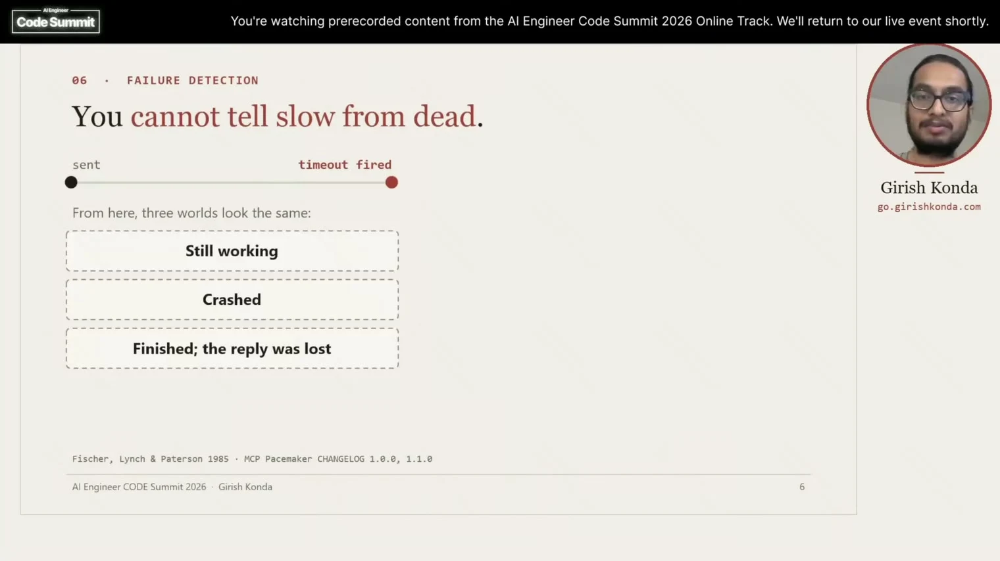

_截图 09  ·  录屏 06:23:07_

**06:23:37**　A server whose first run downloads itself hit the 30 second call timeout and looked broken. It was slow, not dead. We fixed it by giving initialize its own timeout. Now the other way. A server crashed during a call. The call then timed out. And the timeout overwrote the exit code that explained the crash. We fixed it by recording the timeout only when it was alive.

某台服务器在首次运行时自下载，最终达到了30秒的调用超时限制，看起来出现了问题。其实它只是运行缓慢，并非完全崩溃。我们通过设置自己的超时时间来修复这个问题。现在又出现了另一种情况：某台服务器在调用过程中崩溃了，随后调用也超时了。而超时时间也覆盖了导致崩溃的退出代码信息。我们通过仅在服务器正常运行时记录超时情况来修复这个问题。

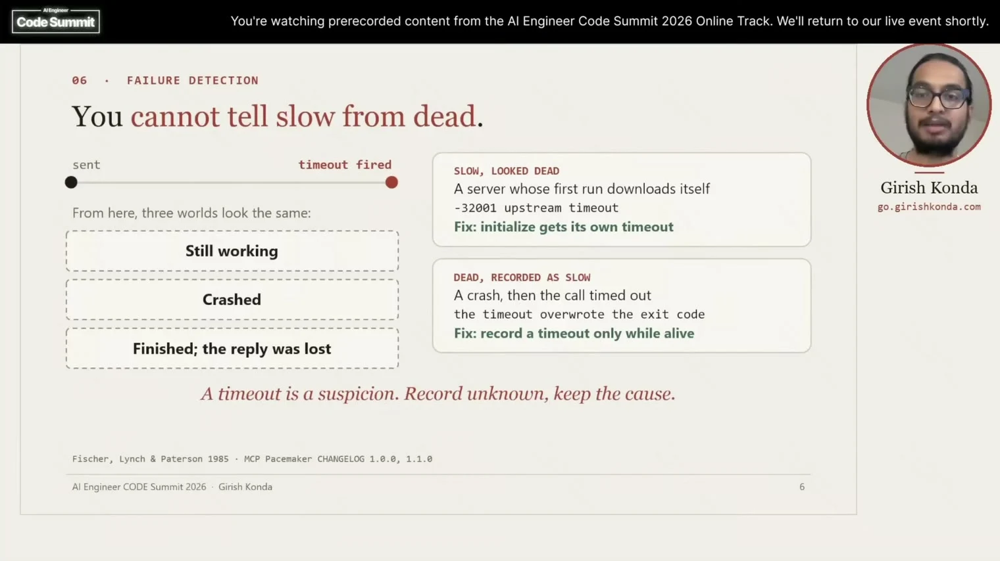

_截图 10  ·  录屏 06:23:57_

**06:24:06**　So timeout is a suspicion. Record it as unknown and keep the real cause. Now make failure a value. Let's take this illustration. A sub-agent returns a status, what it did, what it did not do, the evidence, and any side effects. Partial is a normal answer here. The protocols already have a slot for this. In A2A, a task can end as completed, failed, cancelled, or rejected, or stop and ask for input.

因此，超时是一个疑点。将其记录为未知，并保留真实原因。现在将失败作为一个值来处理。以这个示例为例，子智能体会返回状态、其行为、未执行的内容、证据以及任何副作用。部分完成是这里常见的答案。相关协议已经为这种情况预留了位置。在A2A中，任务可以结束于完成、失败、取消或被拒绝，或者停止并请求输入。

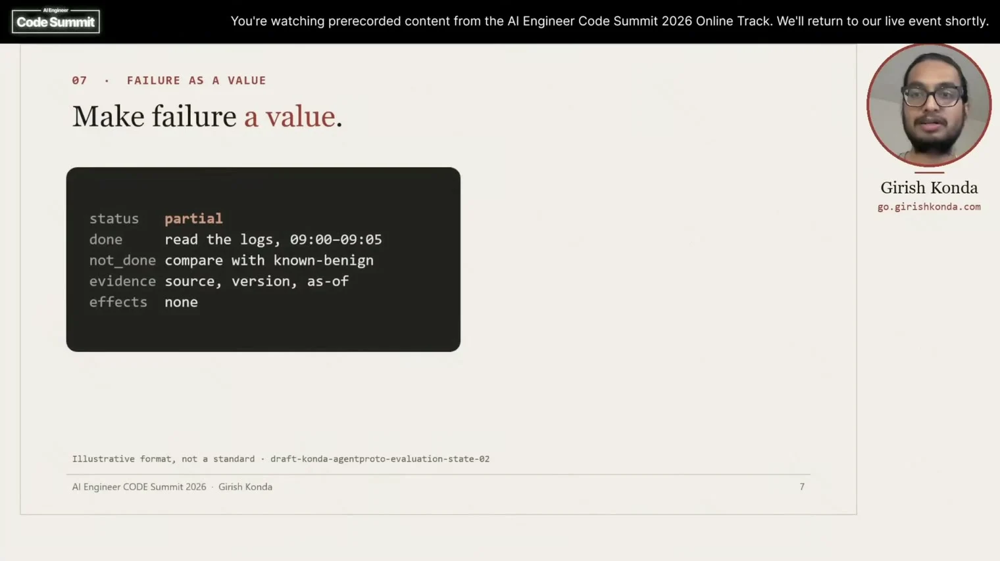

_截图 11  ·  录屏 06:24:26_

**06:24:45**　In MCP, a tool result can say is error true but a sub-agent can still say completed while its text says something else and a loop that only reads the text now sees the difference. Another split, checking a condition and getting no is a different fact from not being able to check at all. My own individual internet draft on evaluation states talks about this.

在MCP中，工具结果可能标注为“错误为真”，但子智能体却可能标注为“完成”，而其文本却显示其他内容；现在仅读取文本的循环则能发现这种差异。另一种情况，检查条件后结果为“无”，与根本无法检查的情况是不同的。我个人的关于评估的互联网草案也提到了这一点。

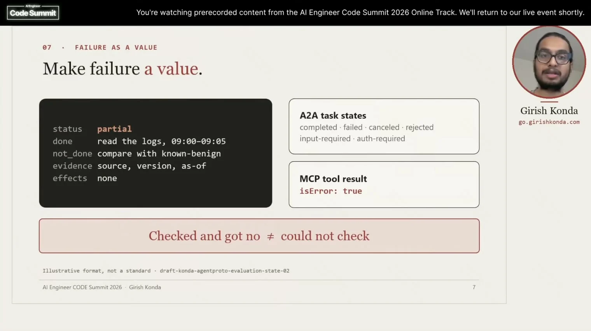

_截图 12  ·  录屏 06:25:08_

**06:25:17**　Collapse the two and you change what gets retried and who gets paged and what the target says later. Next, dirty reads. Let's take this made up example from one of my talks. The sub-agent does trash. It writes into a shared context saying that error rate fell by 80%. It did not measure that. It inferred. Now, two other sub-agents read from the same shared context.

将两者合并起来，就能改变需要重新尝试的内容、谁会被通知以及目标最终会说什么。接下来是脏读问题。让我们从我的一次演讲中选取这个虚构的例子。子智能体执行了垃圾操作，它将“错误率下降80%”这一信息写入共享上下文。它并没有进行测量，只是推断出来的。现在，另外两个子智能体从同一个共享上下文中读取数据。

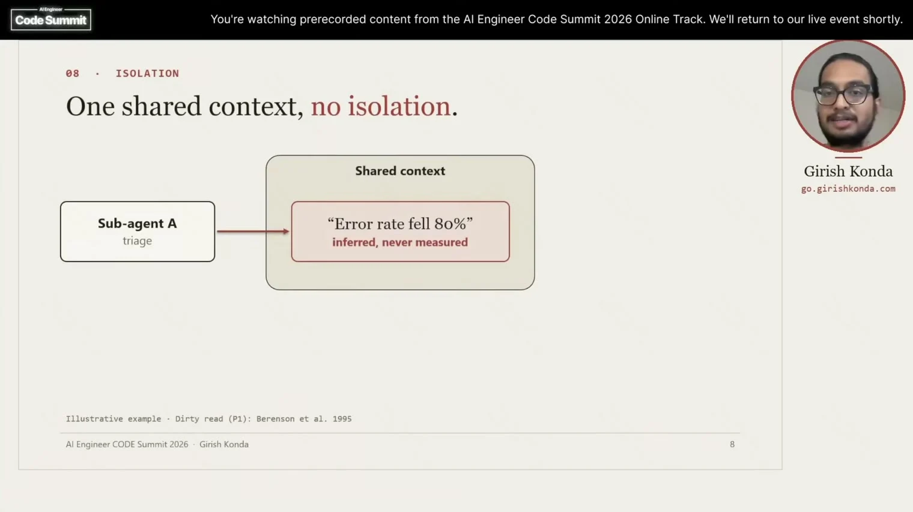

_截图 13  ·  录屏 06:25:37_

**06:25:52**　The second sub-agent writes a review note and picks the same sentence up. The third agent writes a runbook and uses it as a reason to proceed. The orchestrator merges all these three. Three artifacts agree. It is once an unsupported sentence, read three different times. The 1995 critique of SQL isolation levels define a dirty read as, you read a value before the writer commits or rolls back.

第二个子智能体撰写了评价笔记，并选用了同一句话。第三个智能体编写了操作手册，将其作为继续操作的依据。协调器将这三个内容合并起来。三个结果一致。这是一个没有依据的句子，被重复阅读了三次。1995年对SQL隔离级别的批评中定义“脏读”为：在写入者提交或回滚之前，你读取到了一个值。

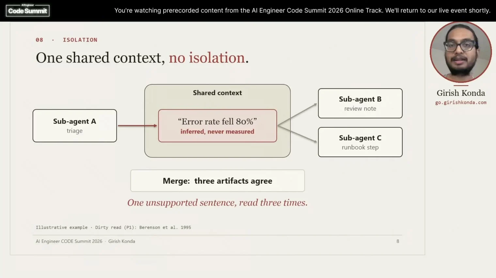

_截图 14  ·  录屏 06:26:15_

**06:26:22**　In a shared context, a guess is readable the moment it is written and nothing marks it as unchecked. A regular fix is to ask three sub-agents and get a quorum. Quorums do work for a specific reason. In weighted voting from 1979, the read quorum plus write quorum is greater than total. So every read overlaps the latest write. In subagents case, the three subagents that read the same shade context does not give you that.

在共享环境中，一旦写入内容，即可被识别，不会标记为未检查状态。常见的解决方案是询问三个子智能体，达到法定人数。法定人数有其特定的作用。从1979年开始的加权投票制度中，读取所需的法定人数与写入所需的法定人数之和大于总人数。因此，每次读取都会与最新的写入内容重叠。而在子智能体情况下，三个读取相同上下文的子智能体则无法实现这一点。

### 选择一致性约束，介绍 SAFE 交接

**06:26:59**　They are not independent copies. They read the same guess. Their agreement is one source counted three different times. Let's pick a consistency model. In databases, we have a cavalry for this. Linearizable. Every operation appears to happen at one point in real-time order. Sequential, one total order that respects each process's own order. Causal, operations that are causally related appear in the same order everywhere.

它们不是独立的副本。它们读取相同的数据。它们的协同工作被重复计算了三次。让我们选择一个一致性模型吧。在数据库中，我们有适合这种需求的线性化机制。每个操作都按实时顺序在某一点发生。是顺序的，是一种统一的顺序，符合每个进程自己的顺序。是因果的，所有有因果关系的操作都按相同顺序出现。

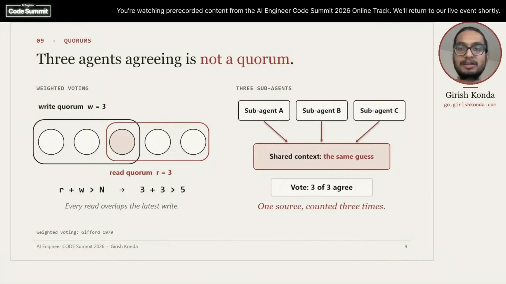

_截图 15  ·  录屏 06:27:00_

**06:27:32**　Session guarantees, there are promises to one client like read your writes and monotonic reads. If no new updates are made, reads eventually return the last value. A shared context gives you none of these. There is no student guarantee at all. And you don't need the top consistency models. The strongest models cannot stay available when the network splits. Causal end session guarantees can, as long as each client sticks to one place.

会话保证包括针对某个客户端的承诺，比如读取写入数据以及单调读取。如果没有新的更新，读取操作最终会返回最后一个值。共享上下文则没有这些保证。根本不存在学生保证。而且你也不需要顶级一致性模型。最强大的模型在网络分裂时也无法保持可用。因果结束会话保证可以，只要每个客户端都固定在一个位置即可。

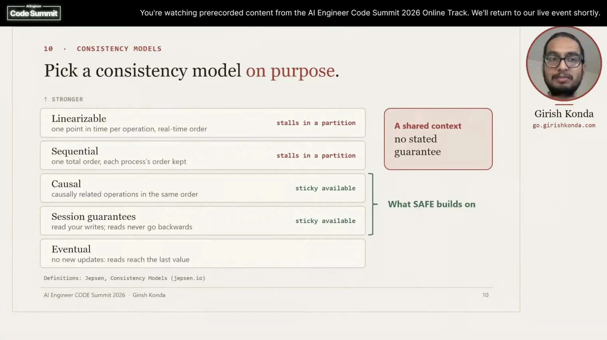

_截图 16  ·  录屏 06:27:55_

**06:28:06**　For sub-agents, that place is the orchestrator. So here's a consistency model I use for sub-agents. I call it SAVE HANDOFFS. S stands for SOURCE READS. Every fact a worker hands on carries its source version as of time and revision. Decisions read only fresh source facts. A. At most once effects. Every right has an identity and a single use approval for that exact action.

对于子智能体来说，那个角色就是协调者。因此，我使用了一种适用于子智能体的一致性模型。我称之为SAVE HANDOFFS。S代表SOURCE READS。每个工人传递的事实都包含其来源版本和时间及修订信息。决策则仅基于新的来源事实。最多只能产生一次效果。每个权利都有唯一的身份，并且针对该具体操作只有一次使用批准。

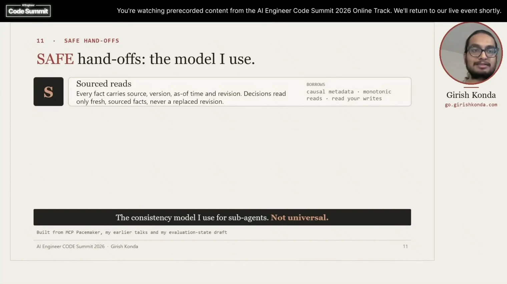

_截图 17  ·  录屏 06:28:28_

**06:28:44**　An outcome is read back, never replayed. F. Fan out budgets. Each downstream gets a gate and a bounded weight. And refusal counts as a E stands for explicit outcomes. Every handoff ends in a named state and the timeout is unknown with its cost kept. This consistency model is the one I use for my own sub-agents. It's not a universal model.

结果会被读取并回传，不会再次执行。F. 预算的扩散：每个下游节点都拥有一个门限和有限权重。而拒绝行为则被计入E，E代表明确结果。每次状态转移都会以特定状态结束，超时时间未知，但成本会被保留。这种一致性模型就是我用于自己的子智能体的模型。它并非通用模型。

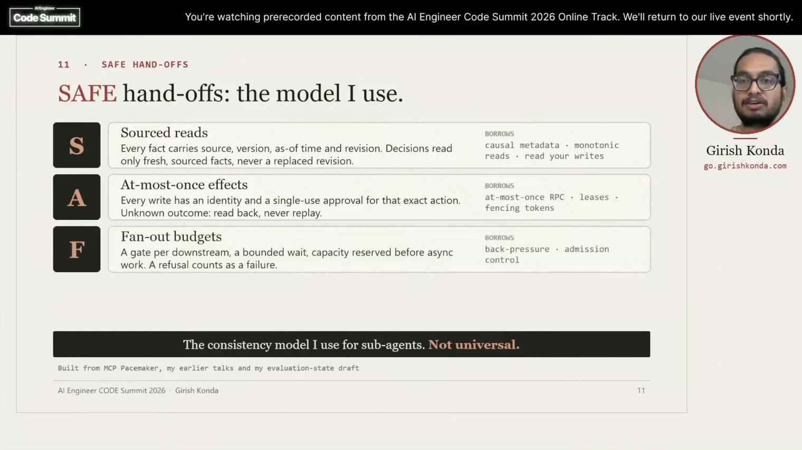

_截图 18  ·  录屏 06:28:53_

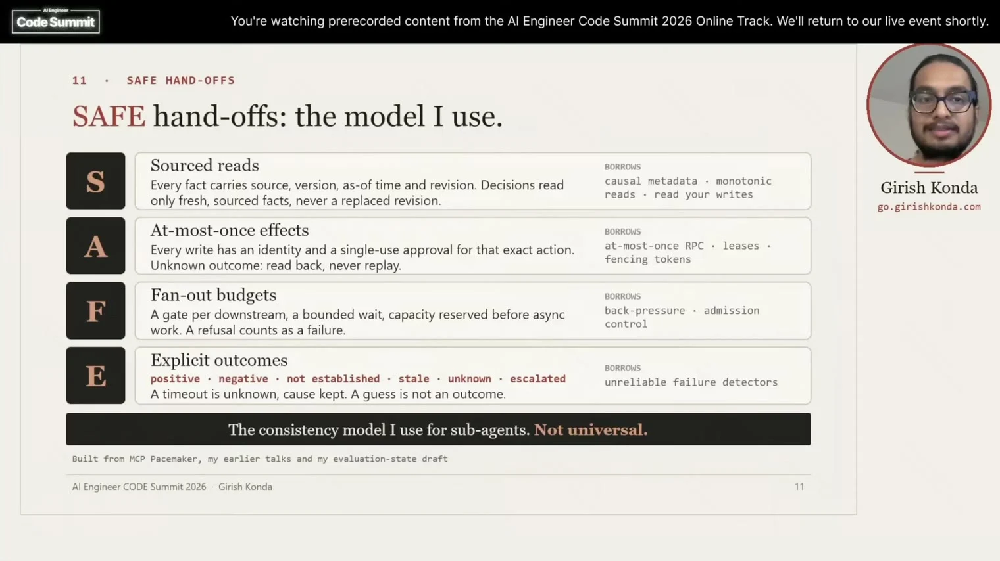

_截图 19  ·  录屏 06:29:10_

### 来源、幂等、隔离、并发边界及代码验证

**06:29:15**　It's based off my own public work. Some of it is in my FCP pacemaker bridge and some are based on my other talks and my own internet draft. Now let's see what's behind each letter. Yes source reads. It's the answer to 30 reads where one worker's guess becomes another worker's fact. What helps is to treat every fact as a record not a sentence.

这是基于我自己的公开作品。其中一些内容来自我的 FCP 心脏起搏器相关研究，另一些则来自我的其他演讲和自己的网络草稿。现在让我们看看每个字母背后有什么含义吧。没错，source 就是答案。这是“30次阅读”问题的解答，其中一个工人的猜测变成了另一个工人的事实。有帮助的是，把每个事实都当作记录来对待，而不是句子。

**06:29:47**　Lampard's 1978 paper defined when one event happened before another. The fact's provenance is that record. What it was read from and when. Let's take this made up example. The record names, the claim and its revision, the source and its version, the scope and three different times. When the data was current, when we read it and when we used it. Freshness is checked where the fact is used.

Lampard在1978年的论文中定义了某事件发生在另一事件之前的情况。该记录的内容、来源以及阅读时间和使用时间都已被证实。我们以这个虚构的例子为例：记录的名称、声明及其修改内容、来源及其版本、范围以及三个不同的时间点。数据是什么时候最新的？我们何时阅读它？又何时使用它？在验证时，会检查该记录是否仍然有效。

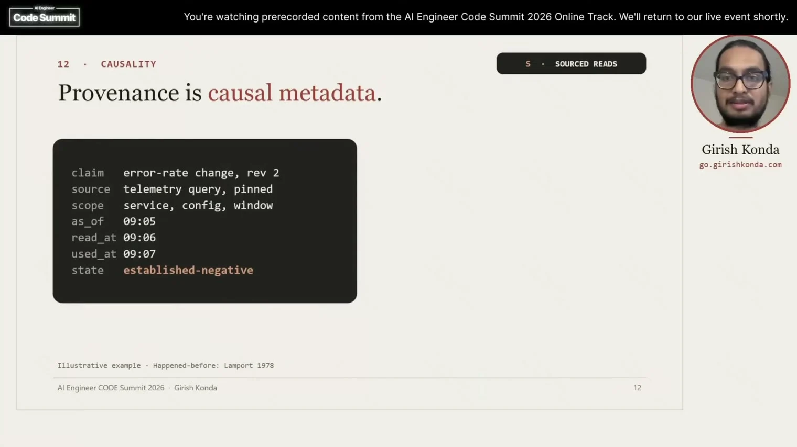

_截图 20  ·  录屏 06:30:04_

**06:30:22**　In this illustration, the data ends at 905. We read it at 906 and we decided at 907. In this case, we picked a 5 minute limit. So the data decision at 907 is fine. Now at 9.15 a second decision came in. Because our freshness limit is 5, this is still recorded. We reject it. And we say that the next decision needs another read.

在这张图中，数据在 905 处结束。我们在 906 处读取到数据，并在 907 时做出决定。在这种情况下，我们设定了 5 分钟的限制。因此，在 907 时的数据决策是合理的。现在，在 9.15 时又有一个新的决定被提出。由于我们的新鲜度限制为 5，这个决定仍然会被记录下来。我们拒绝它。并且我们认为下一个决定需要再次读取数据。

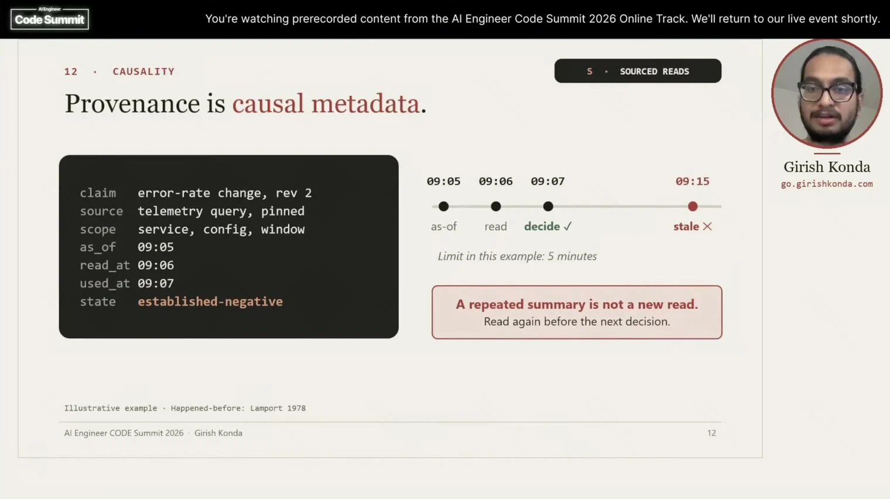

_截图 21  ·  录屏 06:30:50_

**06:30:57**　This is how you separate an observation from an inference. An observation has a source and a read time. An inference has none. Yay, at most of it is about retries. This is an illustration from my article about MCP pacemaker bridge. The orchestrator delegates a task. The subagent calls a tool which does a real right like creating a PR. The reply is lost.

这就是如何区分观察与推断。观察有来源和读取时间，而推断则没有。好啦，最多也就是关于重试的内容。这是我关于MCP pacemaker bridge的文章中的例子。 orchestrator负责分配任务，子代理则调用工具来完成实际操作，比如创建PR。回复则会被丢失。

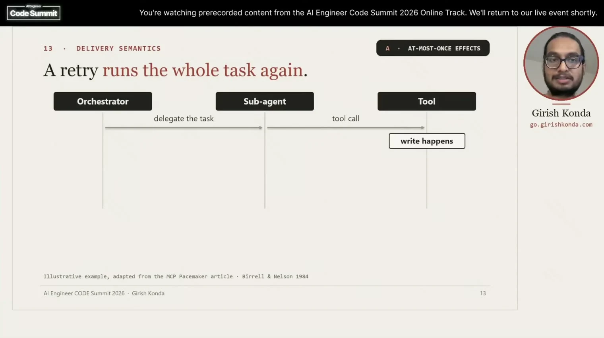

_截图 22  ·  录屏 06:31:23_

**06:31:33**　The orchestrator knows one thing the outcome is unknown. So it retries the whole task. The write happens again. This is a classic problem. In 1984 RPC paper it says that if the call returns the procedure ran precisely once. If you get an exception, it ran once or not at all and you are not told which. So you pick a delivery semantic.

调度器只知道结果未知这一事实。因此它会重新执行整个任务。写入操作再次发生。这是典型的问题。1984年关于RPC的论文中提到，如果调用返回了结果，说明该过程只运行了一次。如果出现异常，则不知道是否运行过，也无法得知具体情况。因此必须选择一种交付语义。

**06:32:04**　At most once, don't retry and accept the fact that it may be lost. At least once, retry and accept the duplicates are possible. Exactly once, it happened at least once and there's a way we can deduplicate maybe by using an IDO potency key. In MCP, IDO potency hint is only a hint and it defaults to false. If you need it, you build it.

最多只尝试一次，接受可能丢失的事实。至少要尝试一次，接受重复的情况可能发生。确实曾经发生过一次，而且我们可以通过使用 IDO potency 密钥来消除重复。在 MCP 中，IDO potency 提示仅是一个提示，默认值为 false。如果你需要，可以自己构建它。

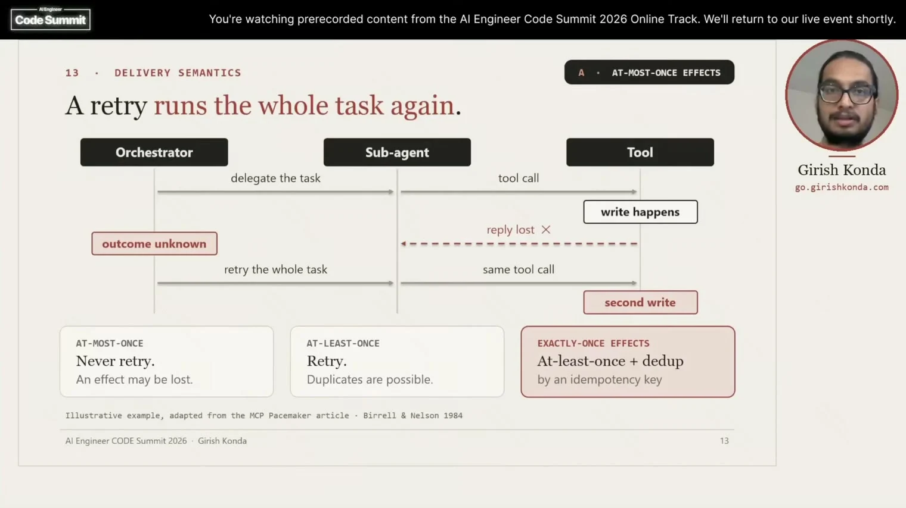

_截图 23  ·  录屏 06:32:13_

**06:32:36**　Here's the model design from my bridge on how I handle it. When a client comes back after restart, the bridge replace the client's record initialize against a fresh server. That's safe, it's just a handshake and it does not restore tool state. What it never replace is an uncertain tool call. When a shared server is recycled, the bridge drains it, and calls still unanswered at the deadline fail as potentially excluded.

这是关于我处理方式的模型设计。当客户端在重启后回来时，桥接器会替换客户的记录，并基于新的服务器进行初始化。这是安全的，只是一次握手过程，不会恢复工具状态。但它永远不会替换那些不确定的工具调用。当共享服务器被重新使用时，桥接器会将其释放，而截止时间未得到响应的调用则可能被排除在外。

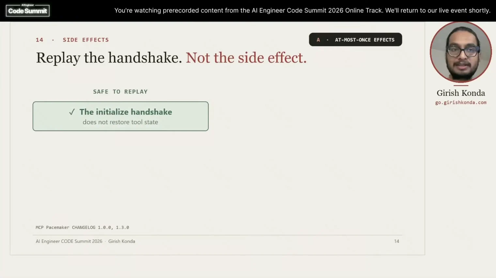

_截图 24  ·  录屏 06:32:46_

**06:33:06**　That status is honest. It tells the caller to go and check. What helped is giving every side effect an identity. Approval binds that exact action. After the call, read back by the identity. Submitted is not confirmed. Confirm means you observe their effect. The last part of A. It shows up when work passes and resumes. A lease is a lock with a timeout.

那种状态是诚实的。它告诉通话方去检查一下。有帮助的是给每个副作用指定一个身份。批准就绑定于那个具体行动。通话结束后，通过身份来重新确认。提交尚未被确认。确认意味着你观察到了他们的效果。A的最后一部分表明当工作完成并继续时会出现。租赁协议是一种带有时限的锁。

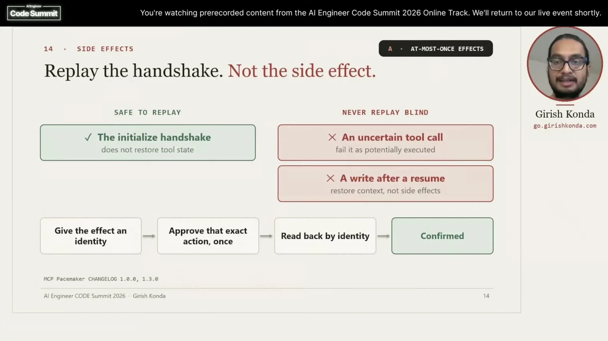

_截图 25  ·  录屏 06:33:20_

**06:33:40**　Martin Kleppman's post about distributed locking shows this problem. A client passes while holding it. The lease expects. Someone else takes over and the first client wakes up and writes anyway. The fix he proposes a fencing token, a number that goes up every time the lock is granted. The storage remembers the highest token it has seen and rejects any write with a old open.

Martin Kleppman关于分布式锁定的文章就提到了这个问题。客户端在持有锁的情况下会继续操作。租约机制期望如此。其他人接手后，第一个客户端仍然会唤醒并写入数据。他提出的解决方案是使用“ fencing token”，即每次锁被授予时都会增加的编号。存储系统会记住所看到的最高编号，从而拒绝任何带有旧打开状态的写入操作。

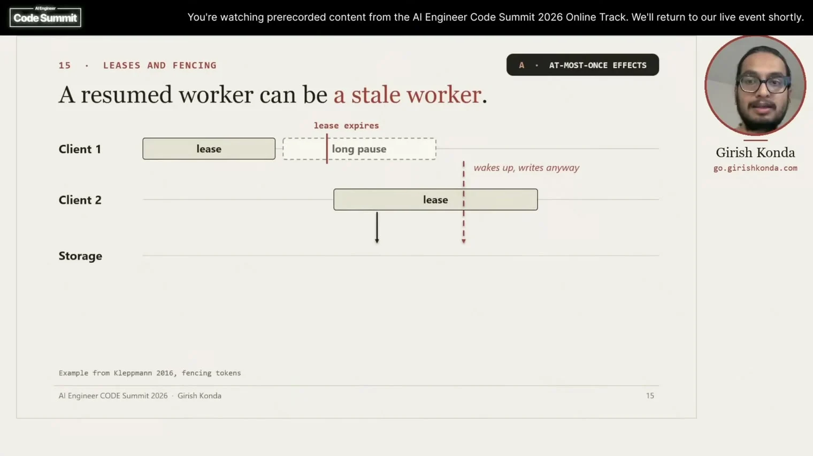

_截图 26  ·  录屏 06:33:45_

**06:34:10**　Sub-agents pause and resume all the time. In my other talk, as I put it, restore context, not side effects. So treat an approval like a fencing token. One action, one use. Checked at the gate, not remembered in the prompt or conversation. My bridge fixed the same class of bug. A stale exit or a deleted resume can no longer remove or bring back a replacement session.

子智能体会暂停和继续，一直如此。在我的其他讨论中，我强调要恢复上下文，而不是产生副作用。因此，将审批行为视为一种“ fencing token”——一个动作，一个用途。在入口处进行检查，不会被记住在提示或对话中。我的解决方案也解决了同一类问题。过时的退出或删除的继续功能，无法移除或恢复新的会话。

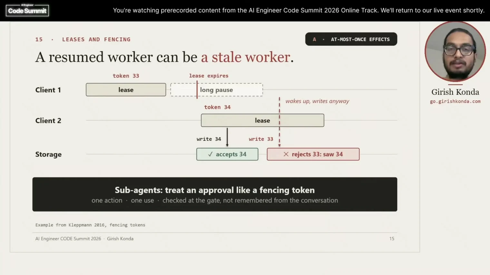

_截图 27  ·  录屏 06:34:22_

**06:34:41**　If Fanout Budgets is about unbounded fanout, this is flow control or the lack of it. I hid this issue in my own MCP bridge before it had a limit on cold starts. Many sessions start their service at the same time through NPX. They share one package cache. Every one of them failed with NPM's log compromise error. Nothing in any single request was wrong.

如果 Fanout Budgets 涉及无限制的 fanout，那就是流量控制问题，或者是没有流量控制。我在自己的 MCP 桥接器中隐藏了这个问题，直到它不再对冷启动有限制为止。许多会话通过 NPX 同时开始运行其服务。它们共享一个包缓存。每一个都因 NPM 的日志冲突错误而失败。任何单个请求中都没有问题。

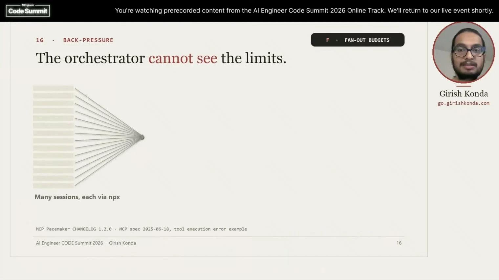

_截图 28  ·  录屏 06:34:55_

**06:35:10**　The failures was the concurrency itself. And when a downstream does push back, it can arrive as a plain text. This is MCP specs one example of a tool execution error. A rate limit has one sentence. The model reads the sentence. The orchestrator code may never look. The next worker starts anyway. So, I introduced a quota budget in my bridge. Cold starts that use a package manager go through a gate, two at a time by default.

失败的原因在于并发问题本身。当下游端进行拒绝时，结果可能以纯文本形式呈现。这是MCP规范中工具执行错误的一个例子。速率限制只涉及一句话，模型会读取这句话。 orchestrator代码可能根本不会显示出来。不过下一个工作线程还是会开始运行。因此，我在bridge中引入了配额预算机制。冷启动过程通过包管理器进行，默认情况下一次只能通过两个通道。

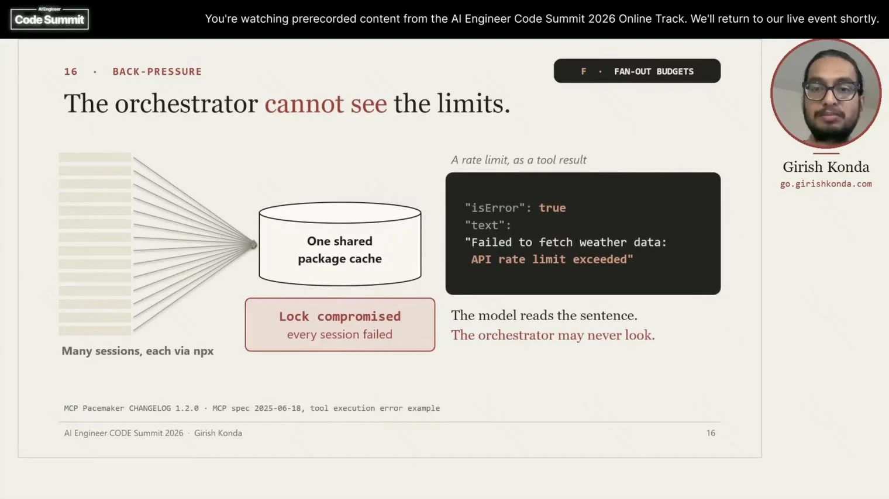

_截图 29  ·  录屏 06:35:20_

**06:35:43**　Everyone else waits, and the wait is bounded in 15 seconds. Past that, the start goes ahead without a gate. And I documented why. A corrupted cache is a risk, while a hunk client request is a certainty. That is a choice for availability, made on purpose and written down. And I also built a cap on sessions. At the cap, a new session waits up to 10 seconds.

其他人都在等待，这种等待时间不超过15秒。超过这个时间后，启动过程就会直接进行，无需任何门控机制。我也记录了原因：损坏的缓存会带来风险，而普通客户端请求则必然发生。这是出于可用性考虑而特意做出的选择，并已记录下来。我还设定了会话的上限：达到这个上限后，新的会话将等待最多10秒。

_截图 30  ·  录屏 06:35:45_

**06:36:13**　And then it's refused. That refusal now counts as a failure in health. Another book, capacity has to be reserved before the asynchronous start, not after. Otherwise, cued starts overbook the cab. That is a check then act race. For sub-agents, give the orchestrator a number per downstream, a bounded weight and a refusel it can see. Now, E, explicit outcomes. Every handoff ends in a named state, like stale or unknown, not just text.

然后被拒绝了。这种拒绝就被视为健康方面的失败。另一本书中，在异步开始之前必须预留容量，而不是之后。否则，cued启动会过度占用资源。这就是一个检查然后行动的流程。对于子智能体来说，给 orchestrator 分配一个下游编号、一个有限的权重以及可以识别的拒绝原因。现在，E，明确的结果。每次交接都以特定状态结束，比如 stale 或 unknown，而不仅仅是文本。

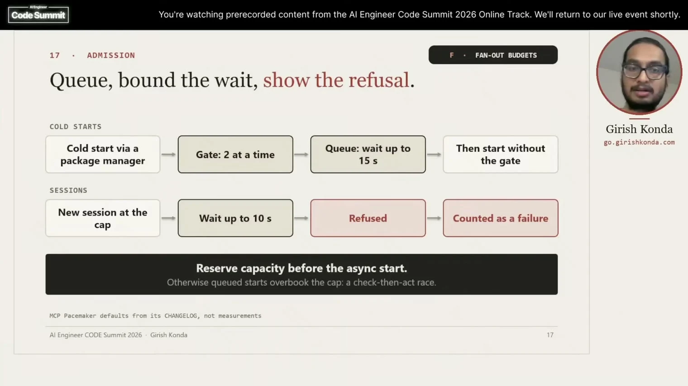

_截图 31  ·  录屏 06:36:23_

**06:36:49**　The last piece is who decided that state. Treats of the agent output as untrusted input, the same way you treat a request body from the internet. The orchestrator owns the checks, in code. Does the result match the schema? Is the evidence there? Is it fresh enough? Do the numbers hold when you recompute them? If a check fails, the step returns a refusal with a reason.

最后一块是谁决定了状态。智能体的输出被视为不可信的输入，就像对待来自互联网的请求内容一样。 orchestrator 负责进行验证，在代码中完成。结果是否符合规范？有相应的证据吗？是否足够新？重新计算后数字是否正确？如果验证失败，步骤会返回拒绝结果并说明原因。

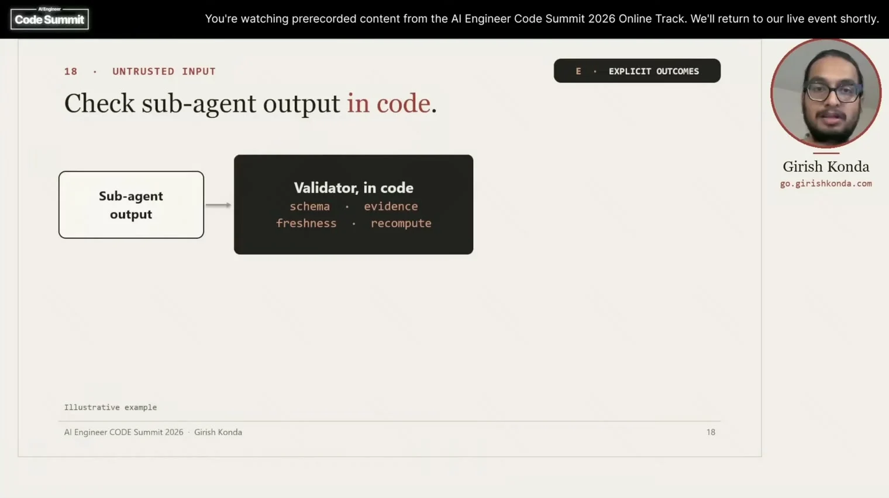

_截图 32  ·  录屏 06:37:05_

**06:37:15**　It does not pass the text along with a warning paragraph underneath. If the same model can skip a check and declare it passed, you have a request, not a boundary. Here is a made-up example from another talk. A sub-agent says the error rate fell. Before, it was 10 errors in 1,000 requests. After, it was 6 errors in 600 requests.

它不会在下方附上警告段落来传递文本。如果同一模型可以跳过检查并声明通过，那这就是一个请求，而不是限制条件。以下是一个来自其他讨论的虚构示例。一个子智能体表示错误率降低了。之前是1000次请求中有10个错误，之后是600次请求中有6个错误。

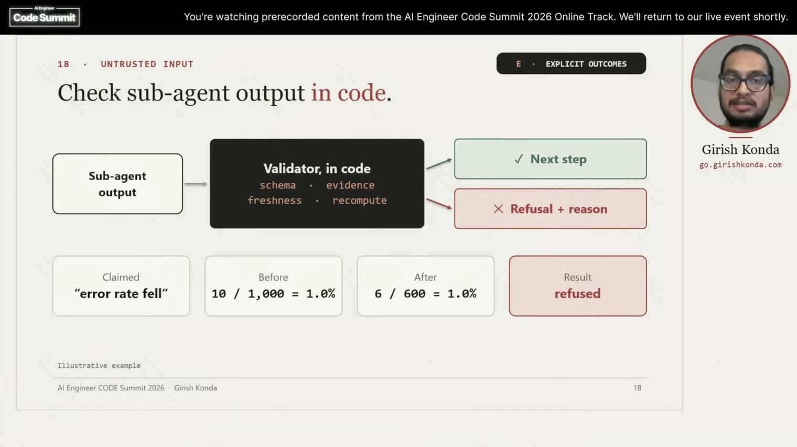

_截图 33  ·  录屏 06:37:38_

**06:37:39**　it went from 10 to 6 and it claimed that the rate fell but when we computed the rate it's both 1%. We recomputed it and then the claims refused. A supported answer is fine. A deliberate handoff to a person is fine. A confident guess it's not. So limitations because the consistency model is only useful when you know where we should start.

从10降到了6，他们声称比例下降了，但当我们重新计算时，比例仍然是1%。再次计算后，他们的说法就不成立。一个合理的回答是可以接受的。故意将任务交给某人也是可以接受的。但自信的猜测则不行。所以存在限制，因为一致性模型只有在知道应该从哪里开始时才有效。

**06:38:06**　So here's what safe model does not do. It does not make facts. A source fact is checkable, not correct. It does not give you exactly once delivery. A lost reply stays unknown until you read back. It does not roll anything back. Undoing a partial task is a compensation step you design like the saga's paper from 1987 and finally there's no global order across workers only causal order perfect and it has a price cap theorem says that when the network splits you trade off availability against consistency My bridge shows availability for cold starts on purpose.

那么，安全模型就做不到这些。它不会生成事实。来源事实可以验证，但并非绝对正确。它不会提供一次性的交付。丢失的回复会保持未知状态，直到你再次查看。它不会撤销任何内容。取消部分任务是一种补偿措施，这种机制是您根据1987年的研究设计出来的。最终，工人之间没有全局秩序，只有因果秩序。完美且符合价格限制定理：当网络分裂时，您需要在可用性与一致性之间进行权衡。我的桥接方案故意实现了冷启动时的可用性。

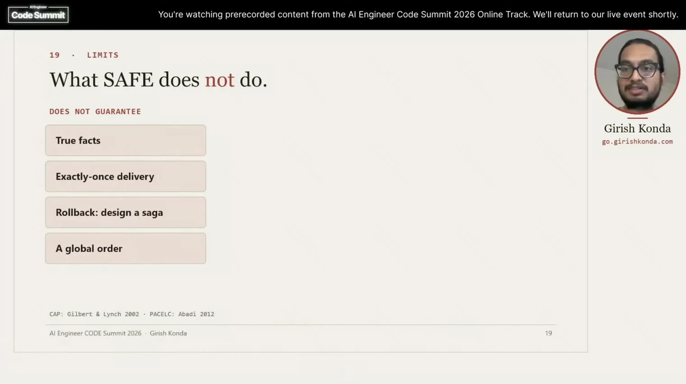

_截图 34  ·  录屏 06:38:20_

**06:38:58**　For rights, safe picks consistency over availability. It refuses rather than guesses. Paclac adds that even without failures, you trade latency for consistency. Every freshness check is another read. And every refusal needs an owner. So, where it does not fit. If a sub-agent only drafts text that a person reads before anything happens, most of this is a workhead. It also assumes that there is one single orchestrate.

对于权利而言，安全选择比可用性更重要。它拒绝而非猜测。Paclac还指出，即使没有失败，也要用延迟时间来换取一致性。每次新鲜度检查都是一次读取操作。而每次拒绝都需要一个所有者。因此，在那些不适合的情况下……如果子智能体只撰写文本，而人在发生任何事情之前会阅读这些文本，那么大部分都是工作头。它还假设只有一个单一的协调者。

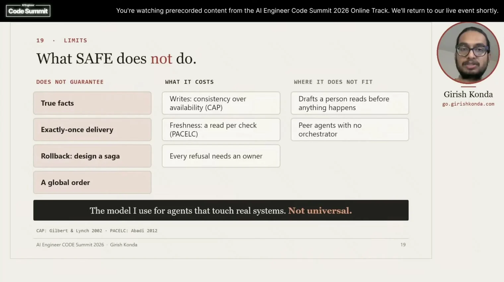

_截图 35  ·  录屏 06:39:30_

**06:39:36**　If you have more, this does not fit. Peer agents with no single place to stick to need something else. This is the consistency model I use for my own agents that touch actual real production systems. It's not universal. So wrapping up, here's three key takeaways. Treat every handoff to a sub-agent as a network call. It can fail a halfway, it can be slow and it can come back twice.

如果还有更多内容，就不符合要求了。没有固定位置的对等智能体需要其他解决方案。这是我在处理实际生产系统的智能体时使用的一致性模型。它并非适用于所有情况。所以总结起来，有以下三个关键要点：将每次对子智能体的传递视为一次网络调用。它可能会失败、可能速度较慢，也可能需要重复两次。

**06:40:06**　Return a status, not just text. If the result cannot say partial, stale or unknown, the orchestrator will read it as done. And start with our safe consistency model and enforce it in code. Keep what fits and change what does not. We already know how to build distributed systems. We just have to notice that we are building one. So these are some of the sources behind this talk.

返回状态，而不仅仅是文本。如果结果无法说明是部分、过时还是未知，编排器会将其视为已完成。从我们的安全一致性模型开始，并在代码中强制执行它。保留合适的部分，修改不合适的部分。我们已经知道如何构建分布式系统。我们只需要意识到我们正在构建一个分布式系统。这些就是本次讨论的背景原因。

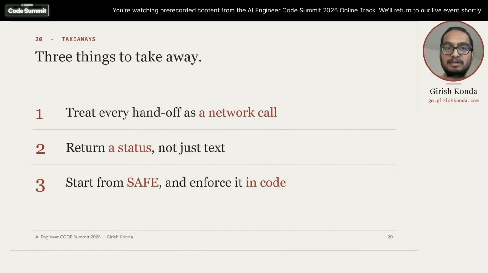

_截图 36  ·  录屏 06:40:08_

**06:40:36**　On the left side, it's my own work, my open source projects, my articles, internet drafts, and my docs. On the right side, specs and standards, and a bunch of papers behind each concept. Thank you.

左侧是我的个人作品：开源项目、文章、网络草稿以及文档。右侧则是相关规范与标准，以及每个概念背后的大量论文。谢谢。

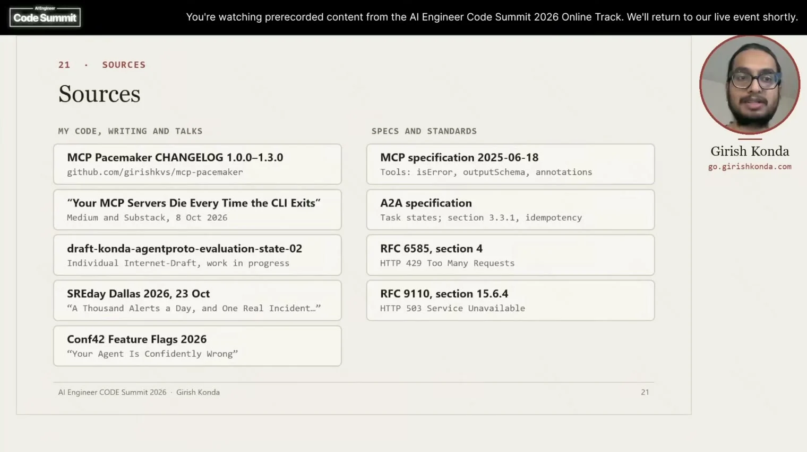

_截图 37  ·  录屏 06:40:37_

_截图 38  ·  录屏 06:40:50_

---

[全部演讲](../README.md) · [选看索引](index.md) · [上一场](21-scott-roberts.md) · [下一场](23-nikolay-petrov.md)
