[全部演讲](../README.md) · [选看索引](index.md) · [上一场](22-girish-konda.md) · [下一场](24-fabian-hedin.md)

# Your SKILL.md is 70% of Things the Model Already Knows

**Nikolay Petrov** · Intel · AI Engineering Manager

AIE Code Summit 2026  ·  11 月 11 日  ·  Online Track 预录插播  ·  录屏 06:40:56–06:54:57

[官方讲者资料](<https://ai.engineer/code/2026#speakers>)   ·   [Day 1 官方回放](<https://www.youtube.com/watch?v=ZZ19zhYnDKY>)

## 本场目录

- [06:41:15](#section-1) 区分 Skill 传授知识和约束行为的作用
- [06:44:14](#section-2) 把条目拆成问题并做有无 Skill 的对照
- [06:48:40](#section-3) 冲突条款、已有知识和不同 Skill 的差异
- [06:53:11](#section-4) 用新信息量找实验方向，并用任务评测复核

## 演讲实录

> 英文源自录屏音频，经轻度校订。每段英文下方为中文译文。时间指向原始录屏。

### 区分 Skill 传授知识和约束行为的作用

**06:40:57**　Hello, my name is Nikolay Petrov and we will be talking about skills and agents knowledge of those We'll start it with the simple prompts where we've been playing with the new stuff, new work being done by the agents, repeating those prompts over and over again. And then we start packing those into the skills, creating repeatable, reproducible, portable type of their functionality or capabilities that we can teach agents to work with.

你好，我叫尼古拉·彼得罗夫。我们将讨论技能以及智能体对知识的理解。我们先从简单的提示开始，我们一直在尝试使用新工具，智能体也在进行新的工作，反复使用这些提示。然后我们将这些功能整合到技能中，创造出可重复、可复制、可移植的功能或能力，以便教会智能体使用。

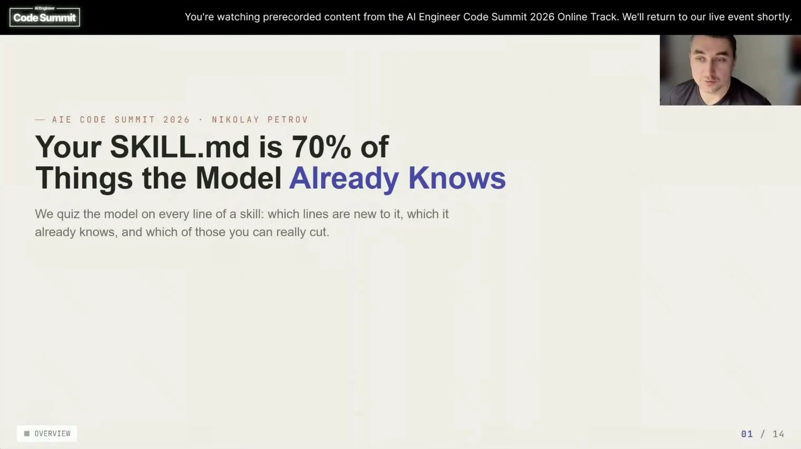

_截图 01  ·  录屏 06:41:02_

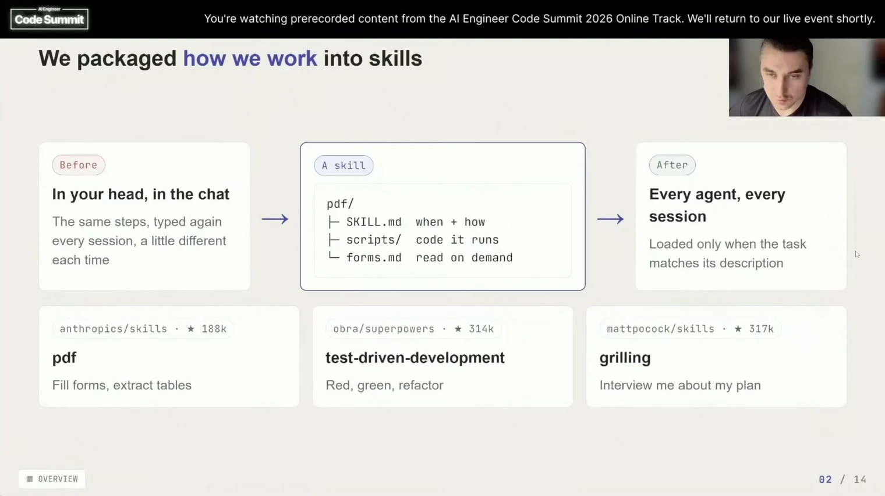

_截图 02  ·  录屏 06:41:15_

**06:41:30**　And some of those skills are very important, hundreds of the stars on GitHub. There are different types of their skills. Some teach models something new, bringing new knowledge or capabilities to the model. But there are also types of their just steering or process skills where we do not bring any additional information, but just getting repeatable flow of the actions that we want agents to perform both are useful in this session we'll be talking about new knowledge type of the skills and we'll see what we can get from the models understanding of those skills So we get our first skills packed, start using them, basically starting with the feel of does it work or not.

其中一些技能非常重要，GitHub上有数百种这样的技能。这些技能有不同类型：有些能教会模型新内容，为模型带来新的知识或能力；而有些则只是用于引导或处理，我们不会提供任何额外信息，只是让模型能够重复执行我们想要的行为。这两种类型在本次会议中都有价值，我们将讨论新知识类型的技能，并看看从模型对这些技能的理解中能得到什么。那么，我们开始使用第一个技能包吧，首先通过测试它是否有效来开始使用。

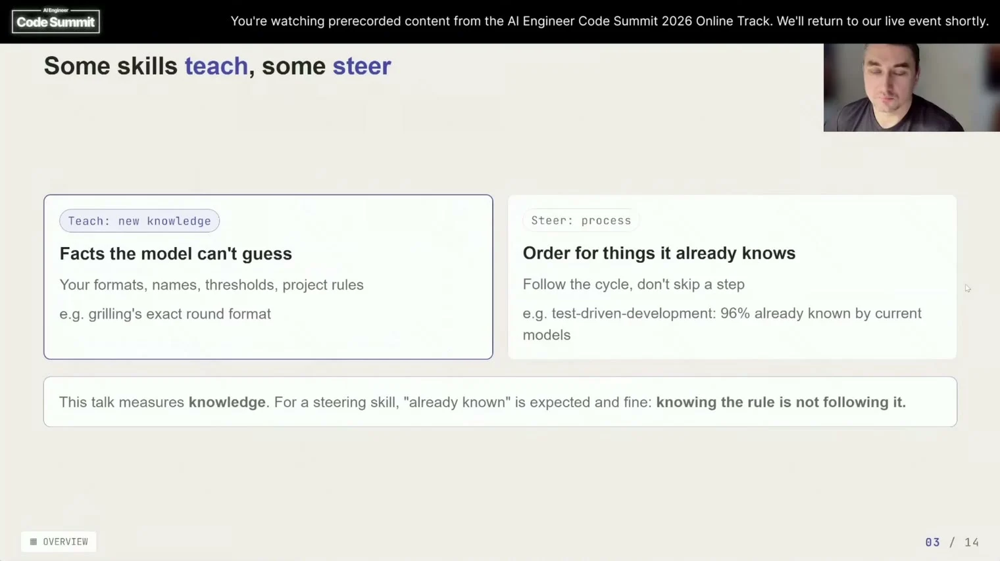

_截图 03  ·  录屏 06:41:52_

**06:42:29**　But there is also the more technical way and more deterministic way for the checking if skills are working or not and what's the impacts of those skills are evals. There are different formats where evals can be defined, but at the sense this is task definition that you want your agent to be able to solve. You put it in the place ideally more deterministic so we can validate it and we can check two arms.

但还有更技术性的、更确定性的方法，用于判断技能是否有效以及这些技能所带来的影响如何。评估方式有多种，但从任务定义的角度来看，你希望智能体能够完成这些任务。理想情况下，应采用更确定性的方法，这样我们就可以进行验证，并可以检查两个方面。

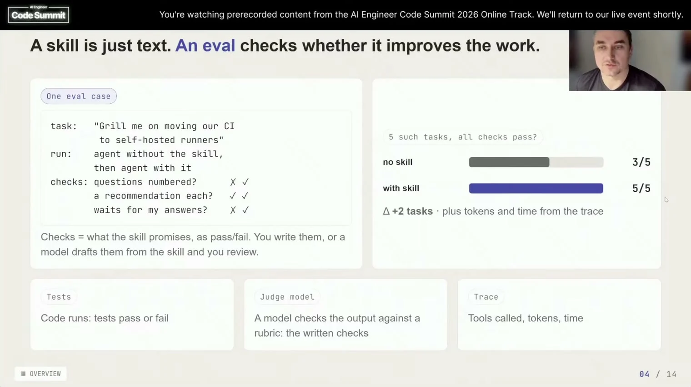

_截图 04  ·  录屏 06:42:46_

**06:42:59**　One they're no skill loaded and their second one where we're loading the skill and providing this additional information to the context and we compare how they're ours there are multiple things one is how many evals been solved in this case with no skill we're solving three out of five with skill we're solving all five meaning that we get two more tasks there also would be implications on the tokens usage or time that it took those tasks to be completed and other factors but at the end we are comparing whatnot and this is one of the main tools for evaluating the skills and saying that they not just nice ideas but actually working pieces of instructions and context for the agents but what next we get to…

第一个是没有任何技能加载的情况，第二个则是我们加载技能并向上下文提供额外信息后进行比较的。有很多方面需要考虑：首先，在这种情况下有多少评估任务被解决了？没有技能的情况下，我们只完成了五项中的三项；有技能的话，则完成全部五项。这意味着我们还能得到两项任务。此外，这还会影响令牌的使用情况以及完成这些任务所花费的时间等其他因素。但最终我们是在比较各种指标。这是评估技能的主要工具之一，说明这些方法不仅想法不错，实际上也是有效的指令和上下文描述方式。那么接下来我们该怎么办呢？

### 把条目拆成问题并做有无 Skill 的对照

**06:43:53**　the stage there we have their working skill it's all some uls but we know that there should be a better way we have models evolving we have some might be cases there we want to get skill more efficient meaning consuming less tokens so what's their options there one is just change line by line and try brute force all the different combinations another would be to think through what makes sense so maybe use something as the user feedback on the skills to see where the skills perform well there it's not and with new models just running skill and seeing how it works what's the options there and how large those modifications should be just text, lines, sentences, ideas.

在那个阶段，我们有他们的技术能力，但我们知道应该有更好的方法。我们有各种模型在发展，有些情况下，我们希望让技术更高效，也就是减少token的消耗。那么他们的选择有哪些呢？一种方法就是逐行修改，尝试各种组合；另一种则是仔细思考什么才是合理的，或许可以利用用户对技术的反馈来找出技术表现好的地方。但新的模型只是运行技术，看看它的运作方式如何。还有哪些选择呢？这些修改应该有多大呢？只是文本、行、句子、想法而已。

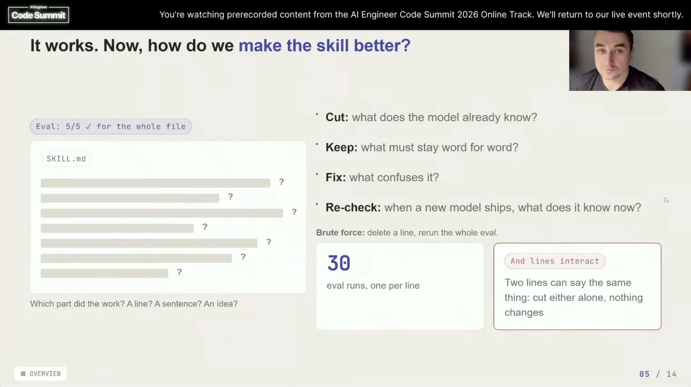

_截图 05  ·  录屏 06:44:14_

**06:44:57**　So what we found to be useful is instead of relying on their luck we can put more deterministic process here using idea of their items from the effect score. We can split their skill and instructions into those items and for each of those have the pair of question and answer that we expect this could be either general ideas like proposition in this case or contracts there we put more definitive of expectation on their action.

因此，我们发现有效的做法是不要依赖运气，而是利用这些项目在效果评分中的特点，采用更确定的流程。我们可以将他们的技能和指令分为这些项目，并为每个项目设置相应的问题和答案对，这可以是一般性的概念，也可以是在合同中规定的内容，这样就能更明确地预测他们的行为。

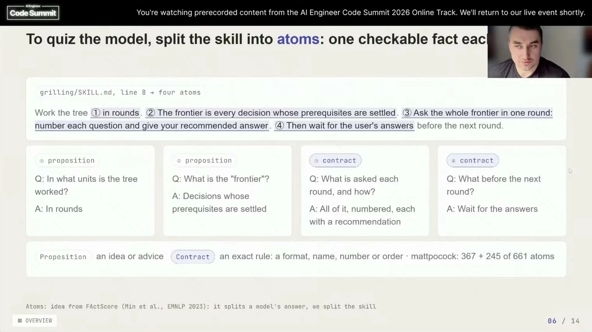

_截图 06  ·  录屏 06:45:16_

**06:45:41**　And in general, we will be getting there some predefined amount of the atoms per skill, and we will have, let's say, 25 or 30 atoms per skill. Then for each of the atoms, we will, again, run two arms, one without skill and one with skill. And we will have judge or panel of judges that will be evaluating model answers. So we're asking those questions to the model that we're interested in.

一般来说，每个技能中都会包含一定数量预先确定的原子，比如每个技能有25或30个原子。然后，对于每一个原子，我们又会使用两个“手臂”进行处理——一个没有技能，另一个有技能。此外，还会有一组评委来评估模型的答案。因此，我们会向模型提出那些我们感兴趣的问题。

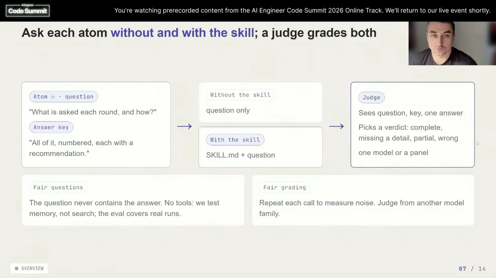

_截图 07  ·  录屏 06:46:15_

**06:46:18**　We're evaluating those questions with their judge, ideally different family of the models or panel of judges. We also ensure that the question do not leak answers. We, depending on the case, can compare with no tools or additional information to check their internal model understanding or provide it with their some tools like that access. So it would be more practical and we can get their simple for outcomes metrics.

我们会与评委一起评估这些问题，理想情况下是不同模型家族或评审团。我们还确保问题不会泄露答案。根据具体情况，我们可以没有工具或额外信息来检验他们内部模型的理解程度，或者给他们提供某些工具来辅助理解。这样会更实用，也能让我们得到简单的结果指标。

**06:46:59**　basically where we are checking that the model knows or don't know something and how this maps to their skill impact on this so the simplest option is where model was able to answer this particular questions even without skill or with skill this means that skill have no impact on this and this was already part of the model's The second one is where without skill actual model was able to answer this correctly.

基本上，我们是在检查模型是否知道某些内容，以及这种情况如何与技能对结果的影响相关。最简单的情形是：模型即使没有某种技能也能回答这个问题；或者有某种技能时也能回答，这意味着该技能对结果没有影响，而这也是模型固有的特性。第二种情况是：没有某种技能时，模型仍然能正确回答这个问题。

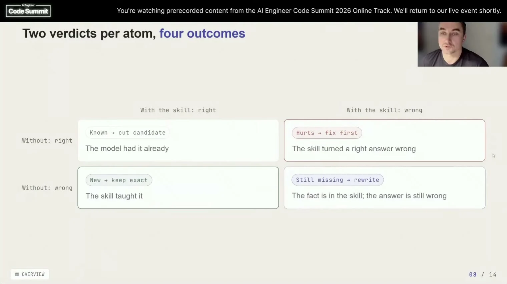

_截图 08  ·  录屏 06:47:25_

**06:47:32**　And by adding skill, we saw degradation in performance and model capability to talk or explain particular aspects. The ideal case is where without skill model wasn't able to answer something. And with skill, we start seeing that it can answer those new type of the questions and scenarios. Were aiming for teach model something new but there also can be the fourth option where skills were written not ideally or in some maybe not clean way, where model wasn't able to answer it either without skill or with skill.

通过添加技能，我们观察到性能以及模型解释特定方面的能力有所下降。理想的情况是，没有技能时模型无法回答某些问题；而有了技能后，模型就能应对那些新型问题和场景。我们的目标是通过训练模型来学习新内容，但也可能存在第四种情况：技能的描述方式不够理想或不够清晰，导致模型在没有技能或拥有技能的情况下也无法回答这些问题。

**06:48:15**　And while this topic might be relevant and important for the model, it still sort of misses some of those concepts. The simplest thing to fix are instructions or items that actually hurts performance. And for popular skills, those are pretty rare.

虽然这个话题对模型来说可能相关且重要，但仍然有些概念被忽略了。最易解决的问题是那些会降低性能的指令或元素。而对于常见的技能来说，这种情况相当罕见。

### 冲突条款、已有知识和不同 Skill 的差异

**06:48:39**　So in the box below, you see that it's just one case out of the mostly 400 atoms in Anthropic skills and others don't have those but for their smaller skills that are less popular you probably haven't come off those this is what we're seeing with some of our experiments and this is just straightforward the simplest thing to fix to ensure that your still do not reduce model capabilities and performance and bring only prevalent context there and we also can actually color this in this scenario this is done by lines but actually going with atoms you might have their different coloring for a single line or a single sentence and this just gives your example of their visualization where this would be helpful instructions in terms what…

所以在下面的框中，你会看到只有一种情况——在 Anthropic skills 中大约有 400 个原子，其他技能则没有这些原子。对于那些不太受欢迎的较小技能来说，你可能还无法摆脱这种情况。这是我们通过一些实验所看到的现象，这其实很简单，只需进行最简单的调整，就能确保模型的能力和性能不会下降，同时只保留那些常见的上下文。我们还可以用线条来标记这种情况，但实际上使用原子来表示的话，你可能会为一条线或一句话设置不同的颜色。这只是一个示例，展示了他们的可视化方式，对于指导操作来说非常有帮助。

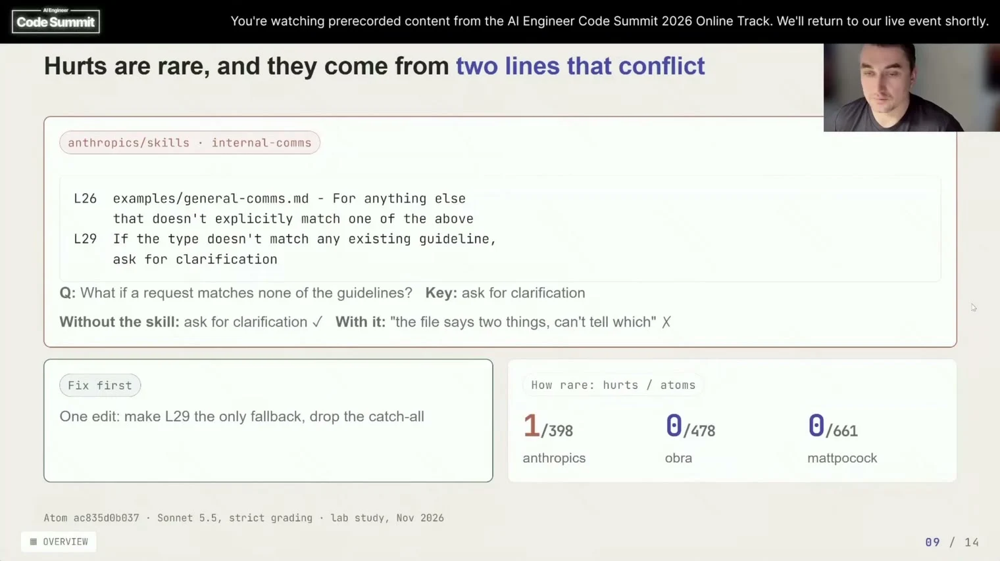

_截图 09  ·  录屏 06:48:40_

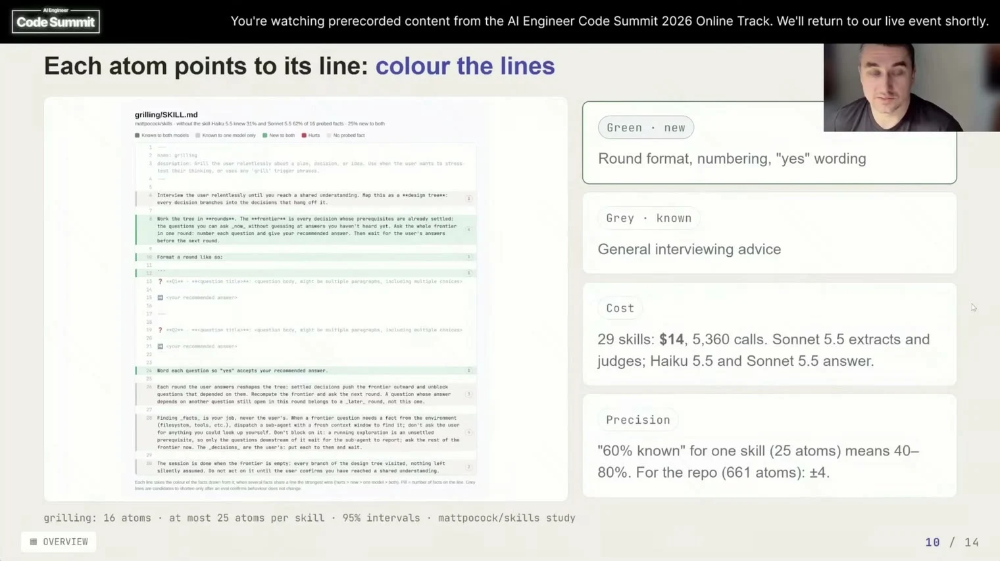

_截图 10  ·  录屏 06:49:35_

**06:49:43**　new stuff you bring to the model and what is something that model already knows cost wise we are running all those questions and asking model but still relatively this is uh cheap for 29 skills 14 bucks of their sonnet and haiku calls with their sonnet used as a judge and there are a couple ways how we also can check their strictness of their some knowledge we have lanyard and strict ways of the checking this where first checks the general idea while the second one is checking for exact details and you can think about the difference between general knowledge and understanding of the topic to the understanding of the exact keys parameters and exact values or steps and what we see across the models is the difference…

你为模型带来的新内容，以及模型已经知道的内容，从成本角度来看，我们正在处理所有这些问题，同时向模型提问，但总体而言，对于29种技能、14美元的费用来说，这还是相当便宜的。他们的十四行诗和俳句作为评判标准，我们还有几种方法可以检验他们的知识深度。我们有绳索式检查方式以及严格的检查方法，第一种是检查整体概念，第二种则是检查具体细节。你可以思考一下一般知识与对主题的理解之间的区别，以及对于具体关键参数、确切数值或步骤的理解。从模型中我们可以看到这种差异……

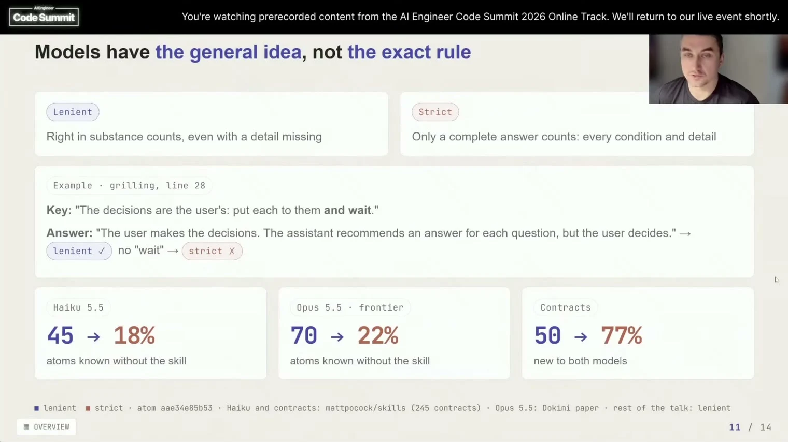

_截图 11  ·  录屏 06:50:37_

**06:50:51**　is large especially with their larger frontier models where we see OPPOS dropping from 70% understanding of their skill in case of the general understanding to just 22 percent of the specific details and this is much our expectations we see that new models are pretty well generalized to understand concepts but it's still helpful to provide their with exact details and data that useful for their solving those problems.

尤其是他们的更大规格边缘模型中，OPPOS对自身技能的理解从70%下降到了仅22%，而这一比例远低于我们的预期。我们看到新模型能够很好地泛化以理解概念，但提供对其解决问题有用的具体细节和数据仍然很有帮助。

**06:51:27**　Here is a look of their comparing those three popular repos with the skills across different models. So one of their interesting observations here is that smaller model have a general lower understanding of their skill with their larger sonnet having better understanding which is why you have bigger models but also we see that overall the models already understand a lot of their details and context of those skills and you would expect that with the newer models and more advances in their better training capabilities we will have more and more in terms of the models in this thing but also we see that this pretty significantly differs skill to skill and it's not bad some skills are intended to be directional but it's also useful piece of information…

这里展示了他们如何将这三个热门模型与不同技能进行比较。他们的一个有趣发现是，较小的模型对这些技能的理解较为有限，而较大的模型则能更好地理解这些技能，因此出现了不同大小的模型。同时，我们也能看到，总体而言，各个模型已经掌握了许多关于这些技能的细节和背景信息。随着新模型的出现以及训练能力的提升，我们将会看到更多这样的模型。不过，也注意到不同技能之间存在显著差异；有些技能是具有方向性的，但这也是很有用的信息……

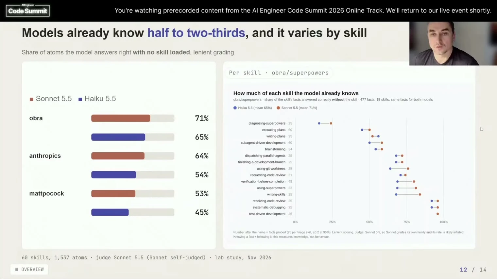

_截图 12  ·  录屏 06:51:56_

### 用新信息量找实验方向，并用任务评测复核

**06:52:35**　to see how those skills bring new knowledge to the different model and different families and this should be run ideally in the broader set of the models. But just having this novelty piece of information is just one of the signals. It's basically initial vector for optimization. At the end we still have to run evals and validate that all the changes that we try make with their skill actually works.

看看这些技能如何为不同的模型和不同家庭带来新的知识，这最好在更广泛的模型集合中进行。但仅仅拥有这一新颖信息只是其中的一个信号而已。它本质上就是优化的初始向量。最终我们仍需进行评估与验证，确保我们所尝试的所有变更确实有效。

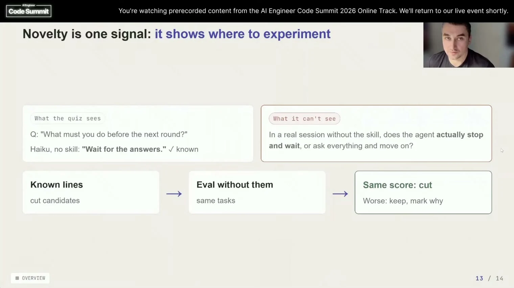

_截图 13  ·  录屏 06:53:11_

**06:53:14**　So one of their simpler scenarios would be we can look on their skill and try to remove some or all of the already known pieces of information from the skill and run evaluation it might come up with their same scoring basically we will be getting their same results model still capable of solving those problems then great we can reduce skill size safe tokens safe context and instead of their brute forcing and guessing what we can or should remove or add or how to fix their degradations we can have a guidance so all of those measurements experiments been done with the docemy which is a framework for the comparing everything related to the agents and context where it's is skill agents md mcp tools whatever and novelty…

那么，其中一个更简单的场景是：我们可以分析他们的技能，尝试从技能中去除部分或所有已知信息，然后进行评估。最终可能会得到与之前相同的评分结果。基本上，我们仍然可以得到相同的模型，该模型仍然能够解决那些问题。那么很好，我们可以缩小技能规模，使用安全令牌和安全上下文，而不是他们盲目尝试或猜测的方式，我们可以去除、添加或改进他们的缺陷，从而提供指导。所有这些测量和实验都是使用 docemy 框架进行的，该框架用于比较与智能体、上下文以及技能相关的各种因素，包括智能体、md mcp 工具等，以及新颖性……

**06:54:17**　is one of their pieces of the functionality where get this initial vector for their skill optimization and evaluation, but there also evolves. There is assessment of the context impact, routing, comparing their descriptions, naming, a bunch of things that related to their skills where it would be helpful to actually get their more deterministic evaluations to make conscious decisions in terms of what should be done with the skills.

这是他们功能的一部分，用于获取初始向量以优化和评估技能，但还有更多功能在发展之中。包括对上下文影响的评估、路由处理、描述比较、命名等与技能相关的内容，实际上如果能得到更确定的评估结果，就能更好地做出关于如何运用这些技能的决策。

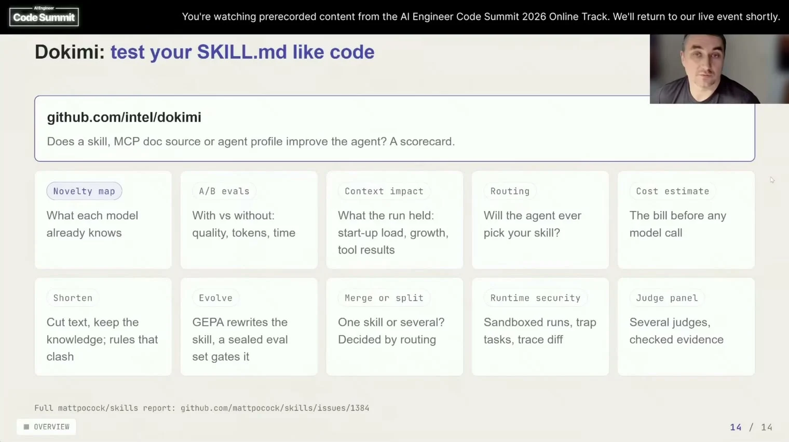

_截图 14  ·  录屏 06:54:18_

**06:54:48**　skills. So thank you for your time and please go ahead and write better skills.

技能。所以感谢您的时间，请继续撰写更优秀的技能内容。

---

[全部演讲](../README.md) · [选看索引](index.md) · [上一场](22-girish-konda.md) · [下一场](24-fabian-hedin.md)
