[全部演讲](../README.md) · [选看索引](index.md) · [上一场](23-nikolay-petrov.md) · [下一场](25-zach-bruggeman.md)

# What it takes to set intelligence free

**Fabian Hedin** · Lovable · CTO

AIE Code Summit 2026  ·  11 月 11 日  ·  主舞台  ·  录屏 07:06:10–07:28:08

[官方议程](<https://ai.engineer/code/2026/schedule>)   ·   [Day 1 官方回放](<https://www.youtube.com/watch?v=ZZ19zhYnDKY>)

## 本场目录

- [07:07:38](#section-1) 从 GPT Engineer、早期 Agent 框架到聊天加预览
- [07:14:05](#section-2) 十小时级任务所需的运行时、计算环境和验证
- [07:15:16](#section-3) 事件历史、任务分支、回放和跨部署接续
- [07:20:41](#section-4) 计算快照、共享内存、预览优化和双重验证回路

## 演讲实录

> 英文源自录屏音频，经轻度校订。每段英文下方为中文译文。时间指向原始录屏。

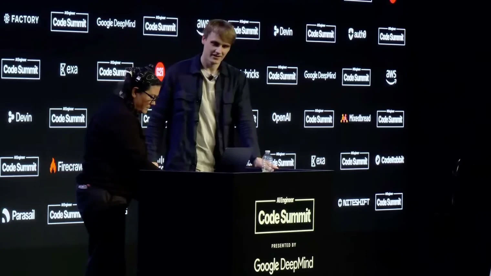

_截图 01  ·  录屏 07:06:10_

**07:06:11**　Thank you so much. See, we're good to go here. All right. Welcome, everyone. I'm Fabian, co-founder and CTO of Lovable. And we spent the last three years or so building a platform to let anyone create software and then operate that and deploy that software. And the topic of today is what it takes to set intelligence free. And really, for us this takes us back to when we started three years ago.

非常感谢。看，我们现在可以开始了。好的，欢迎各位。我是Fabian，Lovable的联合创始人兼首席技术官。过去三年里，我们致力于打造一个平台，让任何人都能创建软件，然后运行和部署这些软件。今天的主题是：如何释放智能的力量。实际上，对我们来说，这让我们回到了三年前开始的时候。

_截图 02  ·  录屏 07:06:31_

**07:06:46**　I have to say, I have a bit of a complicated relationship with agents, and I'll tell you why. We almost failed as a company, because we thought back in 2023 that, hey, these agents are the future, so let's build for them now. I think we kind of turned out to be true that they were the future, but we were definitely wrong on the now piece in 2023.

我得说，我与智能体之间的关系有点复杂，我会告诉你原因。我们作为公司几乎失败了，因为2023年时我们认为，嘿，这些智能体就是未来，所以现在就为它们打造产品吧。我觉得我们确实证明了它们是未来，但在2023年关于“现在”的规划上，我们显然错了。

_截图 03  ·  录屏 07:07:00_

### 从 GPT Engineer、早期 Agent 框架到聊天加预览

**07:07:12**　So this was back in kind of GPT-4 days. And at that time, the intelligence was simply not there to have more of these complex agentic systems. But nowadays, right, now the intelligence is actually at a place where you can really build out more complicated systems around them. And so I'll give you kind of a quick background story here of our journey in working with intelligence or these LLMs.

那是在 GPT-4时期。当时，缺乏足够的智能技术来构建更复杂的代理系统。但现在，智能技术已经发展到可以构建更复杂的系统的水平了。所以，我在这里简单介绍一下我们与智能技术或这些大语言模型合作的过程。

_截图 04  ·  录屏 07:07:17_

_截图 05  ·  录屏 07:07:25_

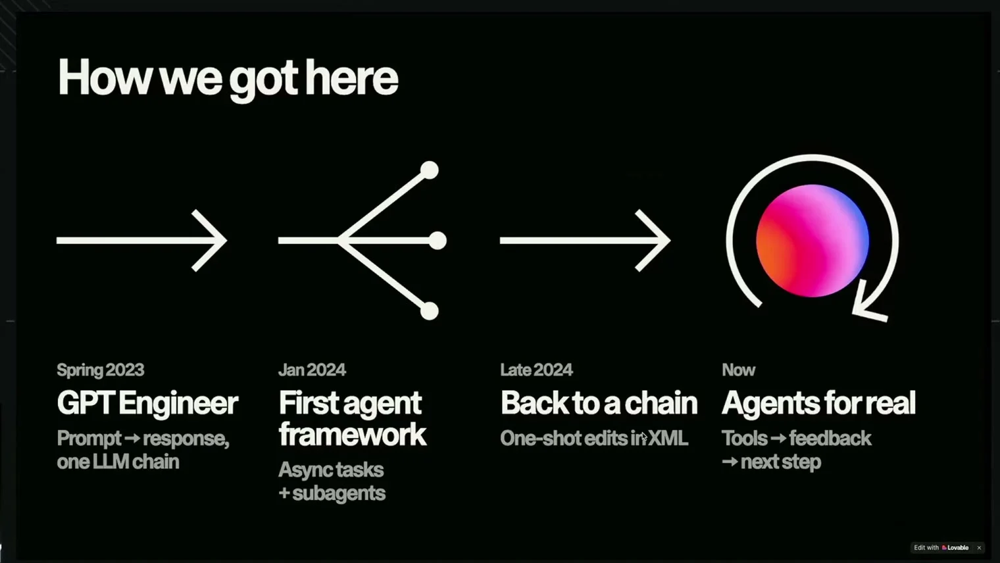

_截图 06  ·  录屏 07:07:38_

**07:07:45**　And so back in 2023 we built the first version of our product, we called it GPT engineer back then, and really the UI was very similar to what it is today where you can have a chat and this preview, but the AI at that point was quite simple. We just had a prompt and a response, one LLM call per user message.

因此，在2023年我们推出了产品的第一个版本，当时我们称之为GPT Engineer。实际上，其界面与现在的版本非常相似，可以进行聊天和预览功能，但当时的AI系统相当简单。我们只有提示词和回应，每个用户消息对应一个LLM的响应。

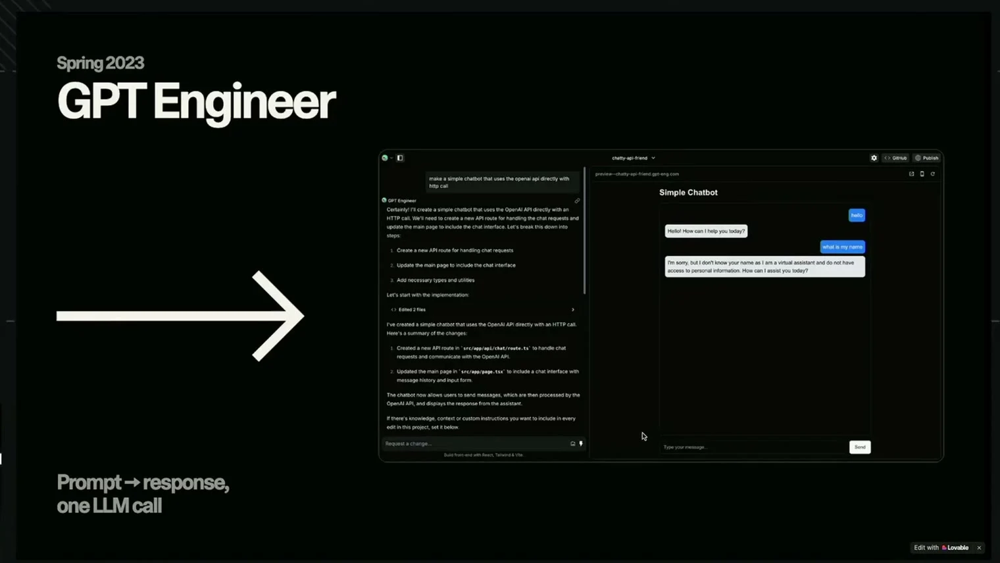

_截图 07  ·  录屏 07:07:59_

**07:08:06**　Very simple. It worked fine. But you could kind of build one-page apps and simpler applications with this. And then we thought, okay, this intelligence is going to keep on evolving, so we have to be ready for it as it evolves. And so we thought, let's go out and build this agentic framework. And so we went and we built this very sophisticated, there is a beautiful framework for agents to work.

非常简单。效果很好。可以用它来开发单页应用和更简单的应用程序。然后我们想到，这种智能技术会不断发展，所以必须准备好迎接它的进步。于是我们决定打造这个智能体框架。最终我们成功开发了这个非常先进的框架，其中包含了让智能体能够正常运作的精美结构。

**07:08:34**　And we had this one main agent that would talk to the user and that agent would spawn other agents, like an implementation agent here in the example. And each agent could have a speciality. This agent would kind of specialize in the first generation of an app and then you would have like a front end agent and a back end agent. And they would all talk to each other, send messages back and forth.

我们有一个主要的智能体，它会与用户对话，同时这个智能体还会生成其他智能体，比如示例中的实现智能体。每个智能体都可以有特定的职责。这个智能体会专注于应用程序的第一代功能，然后会出现前端智能体和后端智能体。它们会互相交流，传递消息。

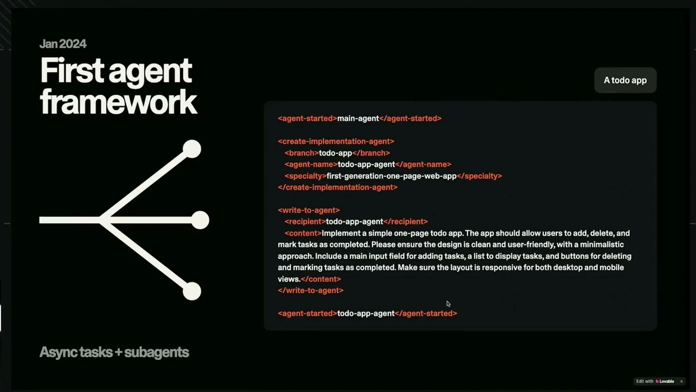

_截图 08  ·  录屏 07:08:36_

**07:08:56**　is beautiful and there were papers around this and how well this could work, and in the end, it didn't work at all. We just made the product worse. We definitely failed on this one, but luckily, before we ran out of money, we figured out, like, hey, let's go back to a simpler system again. So in late 24, we went back to a much simpler system where it was a bit of a shame where we had like some smaller LMs doing some knowledge retrieval and then really just one main LM kind of writing to the user and writing the code in the same message.

它很漂亮，周围还有各种文件说明它的应用效果如何，但最终却完全没达到预期。我们只是让产品变得更糟糕了。这次确实失败了，不过幸运的是，在资金耗尽之前，我们想通了——还是回到更简单的系统吧。所以到了24年末，我们又回到了一个更简单的系统上，虽然有些小型语言模型负责知识检索，但实际上只有一个主要的语言模型在向用户发送内容，并在同一消息中编写代码。

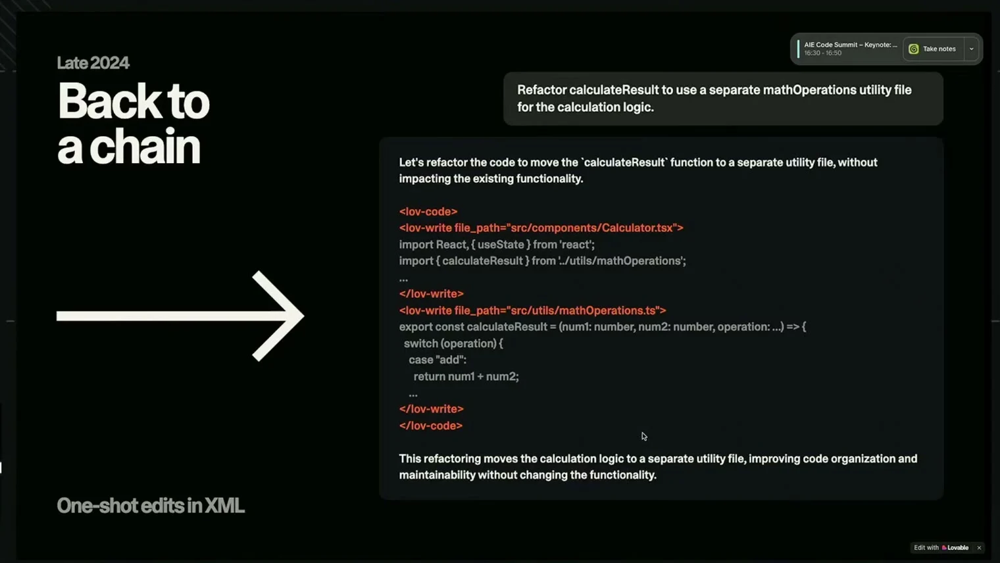

_截图 09  ·  录屏 07:09:22_

**07:09:31**　And this worked great. It was very responsive for users in the UI and it was reliable and users were kind of in it and iterating with the model. And so, let's close that down. But now, it's time again. We're back. We're so back. Agents this time, they work. And we're running them in production over a billion tokens per minute on these systems that I'm going to talk about.

而且这效果非常好。对于用户界面中的用户来说，响应速度非常快，而且非常可靠，用户们也乐于继续使用模型进行迭代。那么，我们就结束这个话题吧。但现在，是时候再次开始了。我们回来了。这次的智能体真的很有效。我们在这些系统上以每分钟十亿个令牌的速度将其投入生产使用，关于这些系统，我将会详细说明。

_截图 10  ·  录屏 07:09:51_

**07:10:00**　But first, just looking at, okay, what is actually lovable? So if you simplify the UI, and this was same back in 2023 as it is today, to the left we have a chat where humans come in and they kind of describe their intent to build or whatever they want to do, and to the right you have a preview, which is the output or the outcomes of what you're building.

不过首先，先来看看，究竟什么是值得喜爱的呢？如果简化一下界面，早在2023年时的界面和现在一样，左边是聊天区域，人们在这里描述他们的构建意图或想要做的事情；右边则是预览区域，显示你正在构建的内容及其结果。

**07:10:25**　And this back in 23, you could do simpler things with, right, but now we've really seen, working at this layer able to build very complex things, right? And I think we've even seen a lot of tooling meant for developers, for example, moving to this type of interface where you're not really looking at the code every day and so on and you're getting kind of attracted and working on the architecture or looking at some kind of output of what you're doing.

在23年时，你可以用更简单的工具来实现这些功能，对吧？但现在我们真正看到了，通过在这个层面进行工作，可以构建非常复杂的系统，对吧？我认为甚至出现了许多为开发者设计的工具，比如这种界面类型，你不再需要每天查看代码，而是专注于架构设计或查看你所完成的工作结果。

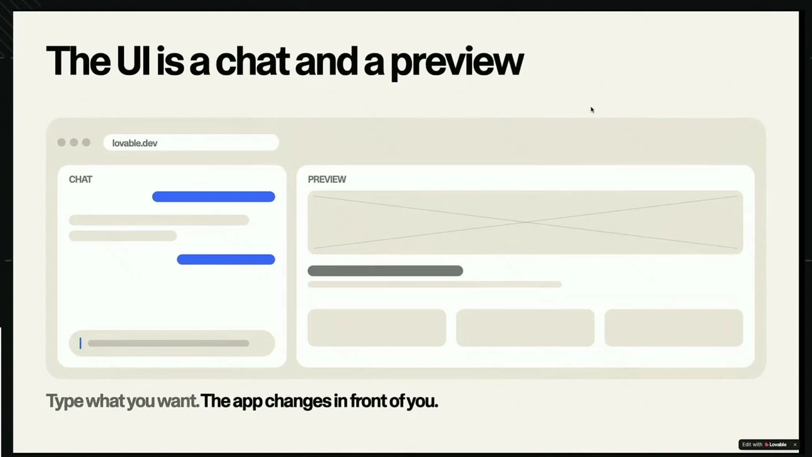

_截图 11  ·  录屏 07:10:29_

**07:10:54**　And this is something that we've always believed in and it's been kind of a core thesis behind Lovable that you won't have to care about the code in the same way that you had to do before. And I think today we're kind of in this almost a bit in between, I think, in the industry where some people might say, oh, you don't have to care about code at all, and some people might have different opinions.

这是我们一直坚信的观点，也是 Lovable 的核心理念之一：你不必像以前那样关注代码了。我认为如今我们正处于这种状态之间，在行业里，有些人可能会说“根本不需要关心代码”，而另一些人则可能有不同的看法。

**07:11:17**　I, of course, like growing up coding and these things, you get a bit attached. But in the end, what matters is actually not the code. Sorry, we removed that last part. But what matters is the outcomes, right? And so the outcomes, what is that? Well, for our users, the outcomes is creating a business and monetizing and creating value for others in some type of way.

当然，我喜欢通过编程来成长，这些事情会让你产生一些情感上的依赖。但归根结底，真正重要的不是代码。抱歉，我们删除了最后那部分。重要的是结果，对吧？那么，结果究竟是什么呢？对我们用户来说，结果就是创建业务、实现盈利，并以某种方式为他人创造价值。

_截图 12  ·  录屏 07:11:27_

_截图 13  ·  录屏 07:11:40_

**07:11:46**　And I'll kind of quickly go over what we build as a platform to enable this before I go in kind of on the technical side of this talk. So if you look at Lovable, the first thing that you can say about the platform is that we have this agent, and like any other agent, it can do quite arbitrary things, and it's quite specialized at building software, and it has access to a browser so it can verify what it's building, and it connects to GitHub, and it writes code, and you can do whatever you want for that code, so on.

在从技术角度展开讨论之前，我会快速简要介绍我们作为平台所构建的内容。如果你看看 Lovable，关于这个平台的第一点就是我们有这个智能体，就像其他智能体一样，它可以做很多任意的事情；它在构建软件方面非常专业，还能访问浏览器，因此可以验证自己所构建的内容；它还能连接到 GitHub，并编写代码，你可以对这段代码进行任何你想做的事情。

**07:12:21**　So that's kind of your basic coding agent. And the other pieces of the platform is this kind of cloud and business piece of the platform. And so the cloud part of the platform is about just giving kind of these hosting primitives just seamlessly to this agent. And so we built out databases, authentication, storage, all the types of back-end compute and security scanners and like backups and logs for all of these things.

这就是你的基础编码智能体。平台的其他部分包括云服务和企业功能。因此，云服务部分只是将这些托管基础服务无缝地提供给这个智能体。于是我们开发了数据库、认证系统、存储功能，以及各类后端计算、安全扫描工具、备份和日志等组件。

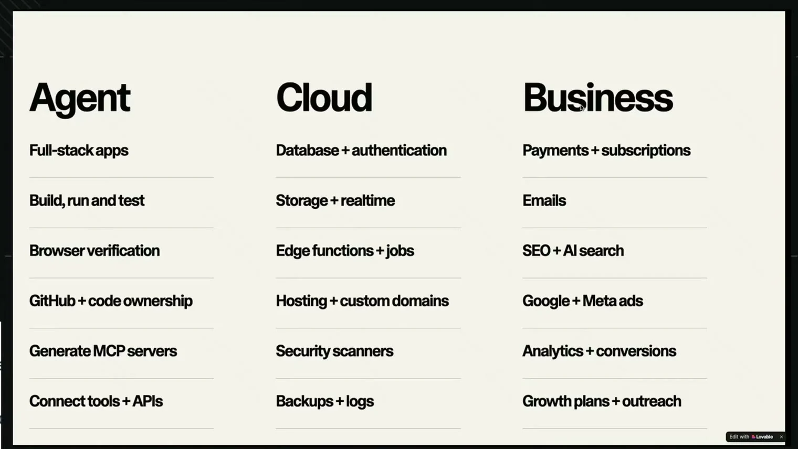

_截图 14  ·  录屏 07:12:34_

**07:12:48**　and all of it can be introspected by the agent. And this just makes it seamless to build things. You don't have to go to different services to set this together, we just provide you these primitives. So that's still around building software and hosting this, right? But then the last piece is around these business capabilities where, again, the output of what our users are doing on Lovable, we don't see that output as code.

而且所有内容都可以由智能体进行反思。这使得构建系统变得非常顺畅。你不必去使用不同的服务来整合这些功能，我们只是提供这些基础元素。所以，开发软件和托管服务仍然是一个问题，对吧？但最后剩下的就是这些业务能力，再次强调，用户在使用 Lovable 时所做的成果，我们并不将其视为代码。

**07:13:14**　The output is a product or a business. And if you want to succeed as a business, you need to do more things than just write code, right? And so we help our users with receiving payments, sending emails, optimizing SEO, doing ads on Google and Meta, and kind of analyzing what is happening with the product through analytics. And you can look at kind of conversions and optimize these sort of things.

最终会形成一种产品或业务。如果希望作为企业取得成功，就不仅需要编写代码，还需要做更多事情，对吧？因此，我们帮助用户处理支付事务、发送邮件、优化SEO、在Google和Meta上投放广告，以及通过数据分析了解产品的情况。你可以查看转化情况并优化这些方面。

### 十小时级任务所需的运行时、计算环境和验证

**07:13:42**　And the agent is in the loop in all of this, right? So that's kind of our capability offering, you could say. And again, the core part of this is an agent that all of these capabilities are built for. And at some point in Lobos history, we used to limit our agents to work for only 30 minutes because we thought they weren't reliable to work for a longer amount of time.

而且智能体在这一切中都起着关键作用，对吧？所以可以说这就是我们的能力优势所在。再次强调，核心就是为这个智能体而设计的各种功能。在 Lobos 的历史中，我们有时会将智能体的使用时间限制在30分钟内，因为我们认为它们无法长时间稳定运行。

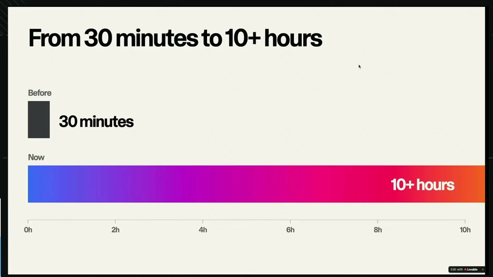

_截图 15  ·  录屏 07:14:05_

**07:14:06**　But now we've changed this to really be without any sort of bound in terms of the length an agent can work. Agents working for, for 10 hours plus. And so I'll go into some of the things that we've done in our architecture to enable this. And so the first piece is really around the agent runtime itself, and how we enable that to run for a long amount of time.

但现在我们已经调整了这一设置，使得智能体的运行时间没有任何限制。智能体可以连续工作10个多小时。因此，我将介绍我们在架构中为实现这一点所做的一些改进。首先，重点在于智能体运行时间本身，以及我们如何使其能够长时间运行。

**07:14:31**　And the second piece is the computer, where each of these agents are actually doing their work, running a dev server, and actually verifying what it's doing. And so the last piece then is the verification itself, where if you want an agent to work for a long amount of time, you need to make sure that you have these feedback loops in place so that it's not kind of going off in the wrong direction.

第二部分是计算机，这些智能体都在执行任务，运行开发服务器，并验证其工作成果。最后一部分就是验证过程，如果希望智能体能够长时间运行，就必须确保有这些反馈循环，避免其偏离正确的方向。

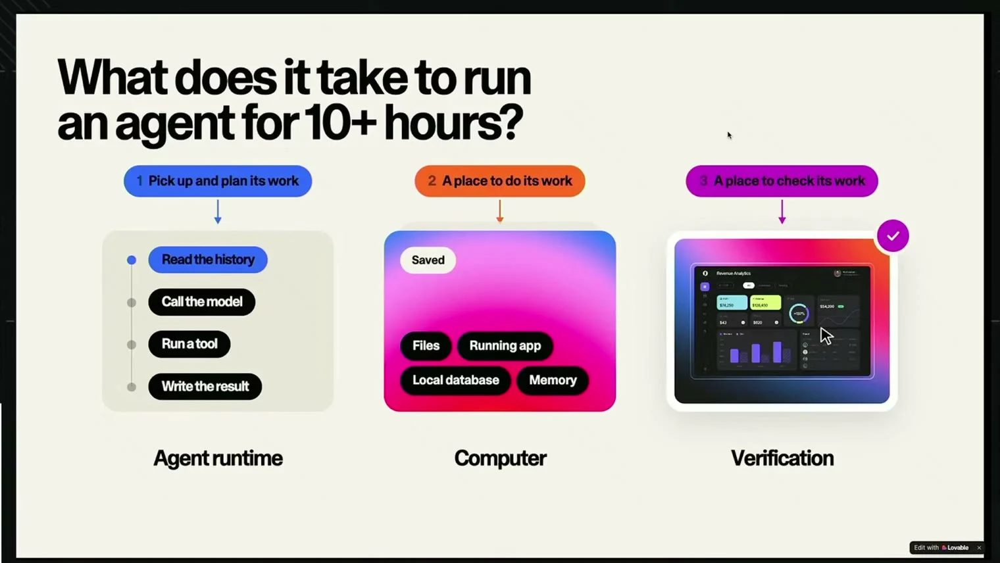

_截图 16  ·  录屏 07:14:35_

### 事件历史、任务分支、回放和跨部署接续

**07:14:56**　And so if we start by looking at the agent runtime itself, you can imagine that you have really three different sources that can interact with an agent. So it can be yourself kind of prompting this or a human, it could be other agents, and it could also be just a system on a schedule waking up.

因此，如果我们从智能体的运行时间开始分析，你可以想象实际上有三种不同的来源可以与智能体互动。可以是你自己进行提示，也可以是人类，还可以是其他智能体，甚至可能是定时启动的系统。

**07:15:18**　And the way we chose to architect this agent we have a separate inbox where any of these sources would kind of send in messages and so you might have a message here like what's the status and you can imagine you have this agent and this agent is kind of an always-on agent that might be working right and so you can imagine it has done like three actions here a request a tool call and it got some some result and then at this point the agent is ready to actually receive messages so since anyone can drop a the agent then can copy that itself into its own, what we call a trajectory, basically it's task history.

我们设计这个智能体的方式是，有一个独立的收件箱，任何来源都可以向其中发送消息。你可以想象，这里会有一封询问状态的消息。你可以想象，这个智能体是一个始终在运行的智能体，可能正在正常运作。你可以想象它已经完成了三个操作：请求工具调用，并得到了一些结果。此时，智能体就可以接收消息了。因为任何人都可以向这个智能体发送消息，所以它可以将这些消息复制到自己的“轨迹”中，也就是任务历史记录。

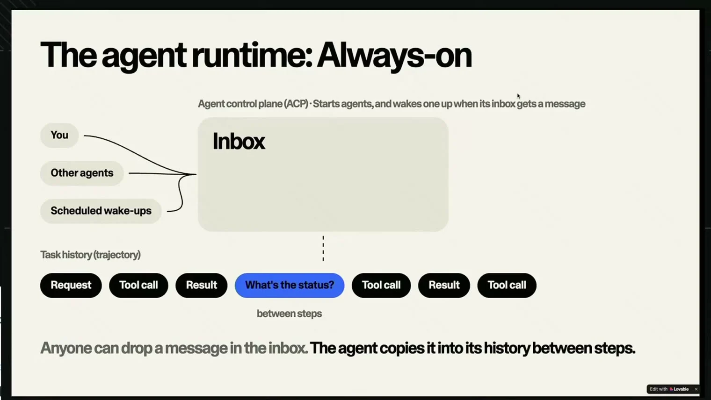

_截图 17  ·  录屏 07:15:58_

**07:15:58**　And this type of interaction that I think you're familiar with if you're using agents overall. So that's kind of the first design principle behind this agent runtime. I'll go through a few more here. And so the trajectory in which the agent is working in, which is kind of the history of what has happened so far, and really the basis for any sort of memory for the agent, right?

这种交互方式，如果你使用智能体，应该很熟悉。这就是该智能体运行环境的第一个设计原则。接下来我还会介绍更多内容。智能体的运作轨迹，实际上就是迄今为止发生的事情的历史记录，也是智能体所有记忆的基础，对吧？

**07:16:26**　And we designed this trajectory with really Git as inspiration. And so the trajectory, what is it? It's a pend-only log where each event points towards a parent, the previous event. And because of this, you get a nice capability just like in Git where you can fork things, right? Two events pointing to the same parent, which essentially creates a fork. And because of that, you can kind of spin up parallel agents at any point of time in the history without having to duplicate all of the shared history.

我们以 Git 为灵感设计了这个轨迹。那么，这个轨迹是什么呢？它其实是一个仅包含 pend 的日志，每个事件都指向一个父事件，也就是之前的事件。因此，你可以获得类似 Git 那样的功能，可以进行分叉操作，对吧？两个事件指向同一个父事件，本质上就形成了分叉。所以，你可以在历史中的任何时刻创建并行智能体，而无需复制所有共享的历史数据。

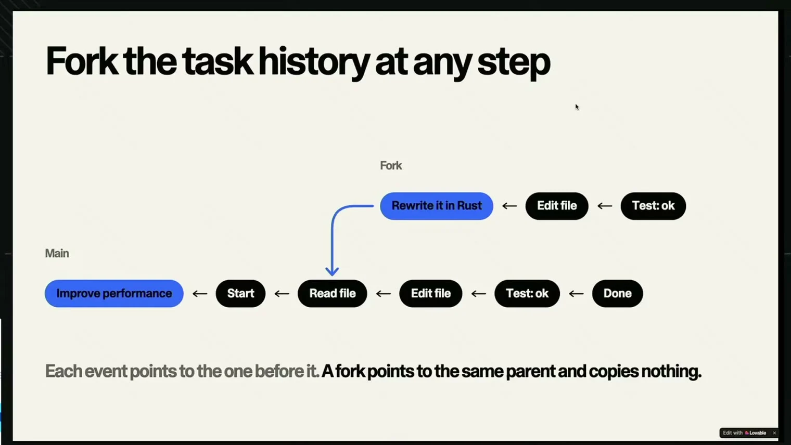

_截图 18  ·  录屏 07:16:35_

**07:17:05**　And semantically, it's a bit unclear what would happen if you merge this. So unlike it, we cannot merge agent trajectories, but we can spawn them outright, and these agents can talk to each other. The other thing that we made sure to design for is that this agent trajectory, it includes kind of the full history and everything that happens with the agent.

从语义上讲，如果合并这些智能体会如何发展还不太清楚。因此，与这种情况不同，我们无法合并智能体轨迹，但可以直接生成它们，而且这些智能体之间可以互相交流。我们还特别设计了这一点，即这个智能体轨迹包含了完整的历史记录以及智能体所经历的一切。

**07:17:27**　And so every tool call, a bunch of other things happening on the platform, if a tool call failed or succeeded, and a bunch of them. What we've done is make sure that we have this append-only log, and from that we can actually build a prompt that we would feed into the actual LLM. And you might ask, why would you want to do this?

因此，每次工具调用时，平台上还会发生许多其他事情。无论工具调用成功还是失败，都会产生各种情况。我们所做的就是确保有这种仅可追加的日志，从而可以构建出一个提示词，将其输入到实际的 LLM 中。你可能会问，为什么要这样做呢？

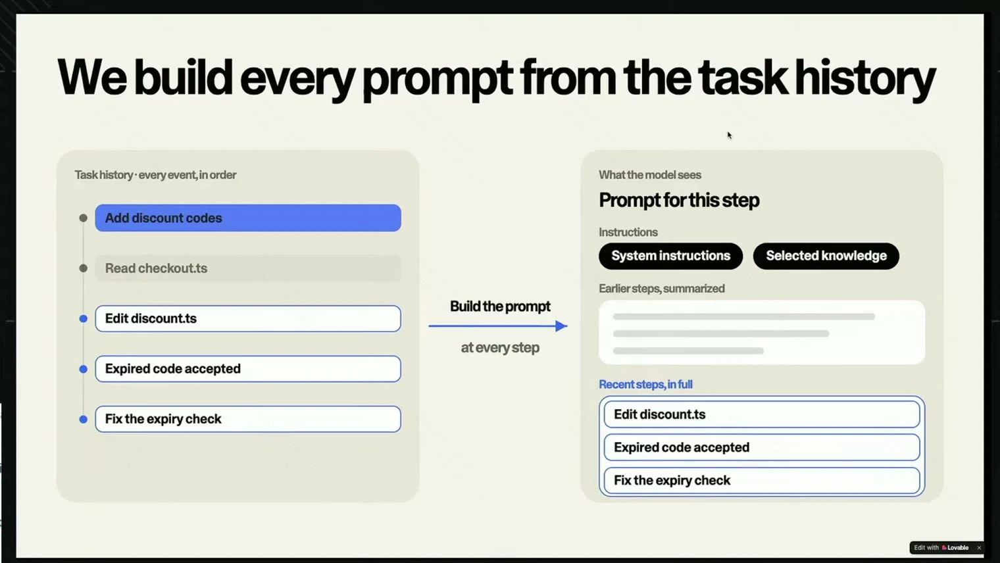

_截图 19  ·  录屏 07:17:38_

**07:17:46**　Well, one reason is that when you build a prompt, if you have a long history, you probably want to do some sort of compaction, you want to summarize part of that history in the earlier steps, for example. But this summarization would differ, for example if you use different models with different context lengths you would probably think differently about when you should summarize or not, and so by separating the prompt from the actual task history we're able to render prompts for any type of model or any type of task that we can kind of find the best and optimal prompt for.

嗯，原因之一是当构建提示时，如果历史记录很长，你可能希望对这部分历史进行压缩或总结。例如，在之前的步骤中可以对历史进行总结。但这种总结方式会有所不同，因为如果你使用不同参数且上下文长度也不同的模型，那么关于何时进行总结就可能需要不同的考虑。因此，通过将提示与实际任务历史分开，我们可以为任何类型的模型或任务生成合适的提示，从而找到最理想的提示方式。

**07:18:24**　So to show this event history in progress, we have this debug tool here. So here it's just a recording of me dragging this slider in our UI, and you can see on the right that the UI is kind of updating as I'm dragging this along, and you have 156 events here, and each of those is an event in this event history.

因此，为了显示正在进行的事件历史记录，我们有这个调试工具。这里只是我拖动UI中的滑块时的记录，从右侧可以看到，随着我的拖动，UI也在实时更新。这里有156个事件，每个事件都是事件历史记录中的一项。

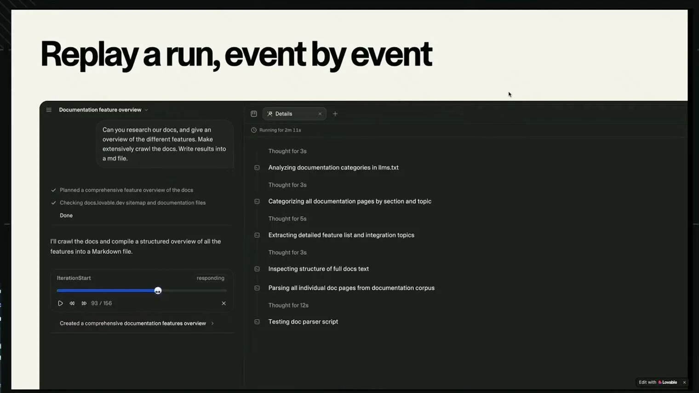

_截图 20  ·  录屏 07:18:40_

**07:18:43**　and you can see how the UI can render any point in history. And this is just showcasing that at any point in time we have full control of, say, the UI or anything else happening on this platform thanks to this history detailing everything that has happened. The last piece I'll go over here on the runtime itself is that the process that is running these agents, they're separate from the actual task history.

你可以看到，UI能够呈现历史中的任何一点。这只是说明，在任意时刻，我们都能完全控制UI或该平台上发生的其他一切内容，因为有了记录所有事件的完整历史。最后，关于运行时本身的另一点就是，运行这些智能体的过程与实际任务历史是分开的。

**07:19:13**　And so the process is almost entirely stateless in that between each call, each tool call, each turn, it will actually just persist into the task history. And so you can have a process come and go. And then the question is, why do we care about this? Well, at Lovable, this system, we deploy to it 700 times per day. So that's about once every two minutes.

因此，这个过程几乎是完全无状态的：在每次调用、每次工具调用、每次迭代之间，它实际上会保留在任务历史中。这样，一个进程就可以出现又消失。那么问题来了：我们为什么要关心这个呢？在 Lovable 公司，我们每天会部署 700 次该系统，也就是说大约每两分钟一次。

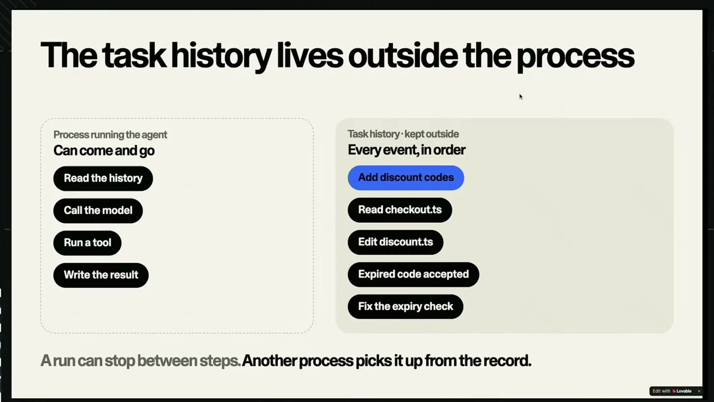

_截图 21  ·  录屏 07:19:14_

**07:19:40**　And you can imagine if you have an agent working for 10 hours, you want to not disrupt that agent when it's working, right? This agent is doing something for a customer. But at the same time, we want to make sure that this agent is running on the latest deploy. And it might be a new feature or something like that, but it might also be like a security vulnerability in the Linux kernel.

你可以想象一下，如果有一个智能体工作了10个小时，你肯定不想在它工作的时候干扰它，对吧？这个智能体正在为客户做事情。但与此同时，我们也要确保这个智能体使用的是最新版本的功能。可能是新功能，也可能是类似Linux内核中的安全漏洞。

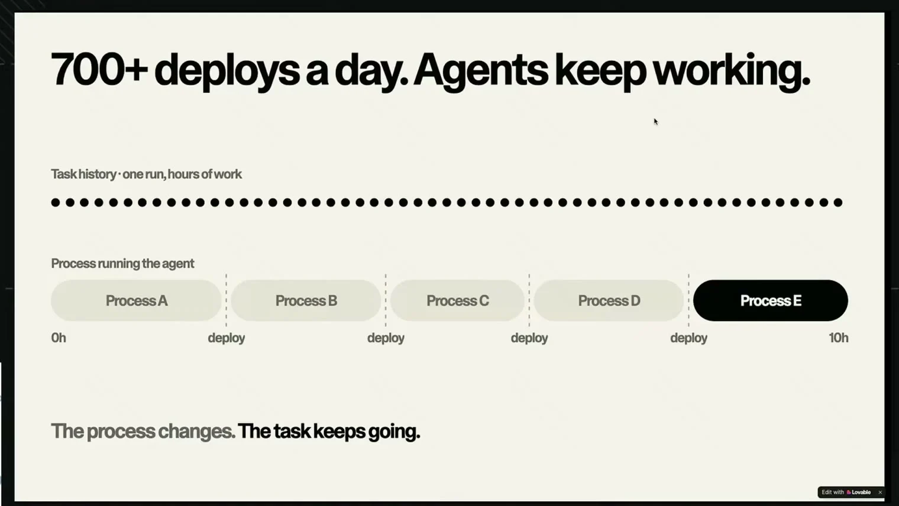

_截图 22  ·  录屏 07:19:55_

**07:20:03**　And it's like, okay, we need to update this ASAP. And so to do that, thanks to this separation between the actual history and the processes, we can actually make sure that we have one agent that is working on one task, but we can have different processes taking up and actually doing the compute behind that work. So this task can keep on working while we have different deploys working on it, be it for 10 hours or even longer, right?

而且，好吧，我们需要尽快更新这个。为了做到这一点，得益于实际历史与各个进程之间的分离，我们可以确保有一个智能体负责一个任务，同时可以有不同的进程负责执行相关计算。因此，这个任务可以持续进行，而不同的部署版本也可以同时运行，可能持续10小时甚至更长时间，对吧？

### 计算快照、共享内存、预览优化和双重验证回路

**07:20:33**　So that's the agent runtime. The second piece of this platform is the computer. So this is where the work is actually happening. And we've been through a lot of iterations and a lot of vendors kind of working with providing these sandboxes for the computer, for the agent to work in. And we've landed in the system that we've worked really hard now to develop, which is checkpointing a computer.

这就是智能体运行时间。这个平台的第二个组成部分是计算机。所以，实际的工作就在这里进行。我们经历了许多迭代过程，也得到了许多供应商的帮助，他们为计算机和智能体提供了这些沙盒环境，让智能体能够在此环境下工作。现在我们终于开发出了这个系统，我们花了大量精力来实现计算机的 checkpointing 功能。

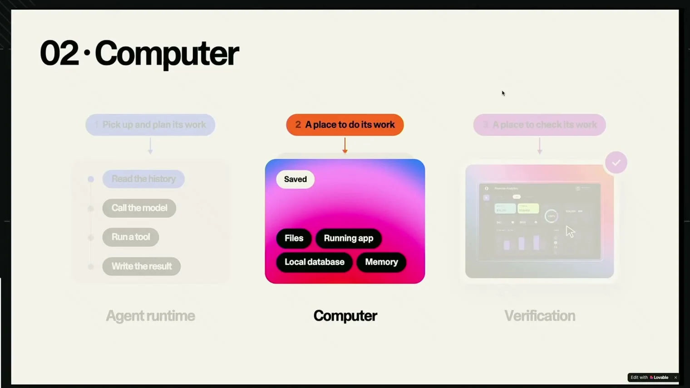

_截图 23  ·  录屏 07:20:41_

**07:21:02**　And so you can imagine you come to Lovable, you start a new project. We have this common, what we call a golden checkpoint, which contains the OS and the system services. It has common tools installed and a dev server that is ready to start. And this checkpoint, it includes everything on disk, memory, and also running processes. And so when you start a new project, you get all of that for free, and all of that is copied over in about 230 milliseconds.

你可以想象一下，当你开始一个新项目时，你会进入 Lovable 平台。我们有一个共同的“黄金检查点”，其中包含了操作系统和系统服务。上面还安装了常用工具，还有一个可以立即启动的开发服务器。这个检查点包含了磁盘上的所有内容、内存中的数据以及正在运行的进程。因此，当你开始一个新项目时，所有这些内容都可以免费获得，而且所有内容会在约 230 毫秒内被复制完成。

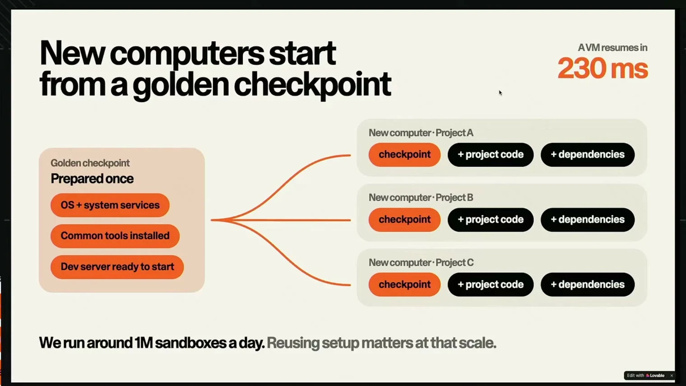

_截图 24  ·  录屏 07:21:15_

**07:21:29**　And so once you start a project, you might have some specific code and some dependencies within that project. And that is also checkpointed as you go. And so each time the agent is running and it finishes a turn, of that computer. And from that we're able to, again, like very quickly, sub-second, spin that computer up whenever you need it. That means we can save on resources by kind of spinning this down if you leave for say 10 minutes or so and come back, we can just spin it up extremely quickly so you don't even notice this.

因此，一旦开始一个项目，项目中会包含一些特定代码和依赖项。这些也会被记录下来。每当智能体运行并完成一个任务时，我们就能非常快速、几乎在秒级时间内重新启动这台计算机。这意味着，如果你离开大约10分钟再回来，我们可以通过快速重新启动来节省资源，你甚至不会注意到这一点。

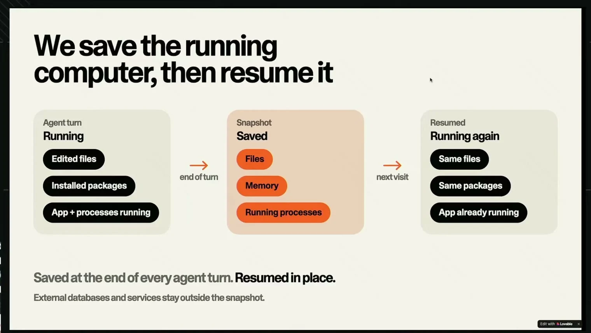

_截图 25  ·  录屏 07:21:56_

**07:22:07**　And even kind of requests in transit will not even be dropped in this setup. The other thing we can do thanks to this checkpointing that just like the trajectory itself in the agent runtime, we can also fork the computer. And when we do this, for example, we have a feature in Lovable that is called drafts where you kind of work in different environments of what you're doing, and to support that, we need to fork the computer that you're working in.

而且，即使是在传输过程中的请求也不会被丢弃。借助这种检查点机制，我们还可以像处理智能体运行中的轨迹一样，分离出计算机。当这样做时，例如，Lovable有一个名为“草稿”的功能，允许你在不同的环境中进行工作。为了支持这一点，我们需要分离出你正在使用的计算机。

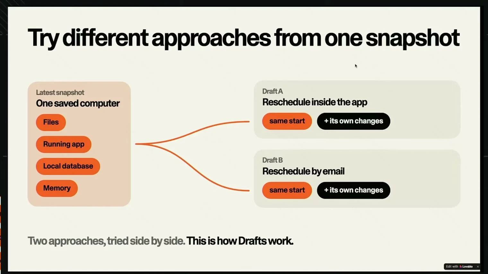

_截图 26  ·  录屏 07:22:30_

**07:22:39**　And here we have kind of the example of doing two at the same time, and you can imagine doing hundreds of these, right? And so we've had to do some optimizations to make this feasible to actually run. So one of these optimizations is copy and write on the RAM itself. And so creating one of these forks of a computer is basically free in terms of the RAM that it's using.

这就是同时执行两个操作的例子，你可以想象一下，要执行数百次这样的操作，对吧？因此，我们不得不进行一些优化，才能让这一切真正实现。其中一种优化方式就是直接在 RAM 中复制和写入数据。所以，创建这种计算机变体其实在使用的 RAM 方面是免费的。

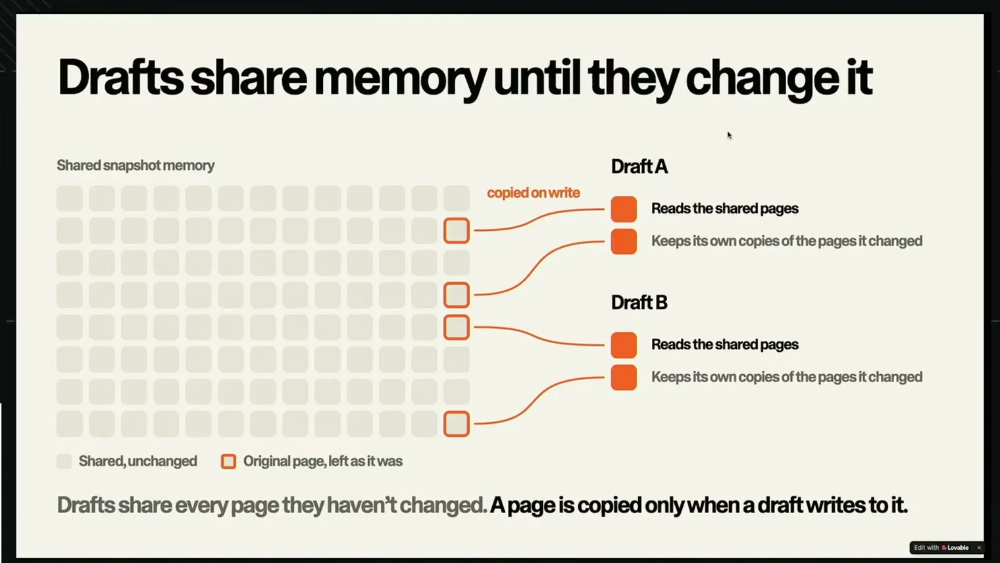

_截图 27  ·  录屏 07:23:03_

**07:23:06**　But as soon as you start writing in a process to RAM, we will kind of copy that page over, and only then will you start having to allocate new memory. And there's another optimization here also, which is that each of these sandboxes require a few hundreds of megabytes of memory, and that would take a few seconds to stream in if you have it in cold object storage, and then it has to go to disk, and then into memory of this VM, but thanks to being able to stream the memory, we can actually boot up the machine before all of the memory is actually ready on it.

但一旦开始在 RAM 中写入数据，我们就会把这一页数据复制过去，然后你才需要分配新的内存。此外还有另一种优化方式：这些沙箱环境每个都需要几百兆字节的内存，如果数据存储在冷对象存储中，加载这些数据只需几秒钟；之后数据需要被写入磁盘，再进入该虚拟机的内存中。不过由于可以流式加载内存，我们实际上可以在所有内存准备就绪之前就启动机器。

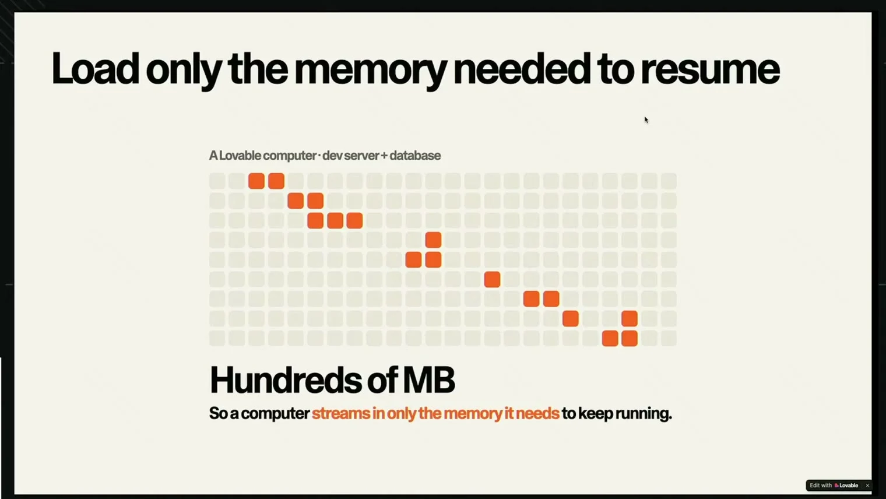

_截图 28  ·  录屏 07:23:36_

**07:23:50**　So the memory that always uses comes first, and then some processes and so on will start to work as soon as the memory gets there. And this also shaves off some extra startup time. And then we started asking ourselves, how can we make this even more efficient and even more faster for our users? And so you might be familiar with Vite, it's this great dev server that most of the meta frameworks out there in the JavaScript ecosystem is using.

因此，始终优先使用内存，一旦内存到位，其他进程就会开始运行。这还能减少额外的启动时间。于是我们开始思考：如何让这一过程更加高效、更快捷，更好地满足用户需求？你可能已经熟悉 Vite 了，这是 JavaScript 生态系统中大多数框架所使用的优秀开发服务器。

**07:24:13**　And so we took that and we forked it and we rewrote it in Rust. And that made our code starts two times faster this preview from 14 seconds to three seconds. And the main kind of thing that we made faster is that Vite uses Node.js and we're able to like drop that dependency of Vite itself and just have this Rust binary so that made the memory footprint be 6.5 times less in these machines.

于是我们采用了这种方法，重新编写了代码，使用 Rust 语言实现。结果在预览中，代码运行速度提高了两倍，从 14 秒缩短到 3 秒。我们让代码更快的关键点在于：Vite 使用了 Node.js，而我们可以移除 Vite 的依赖项，只保留 Rust 二进制文件。这样这些机器上的内存占用就减少了 6.5 倍。

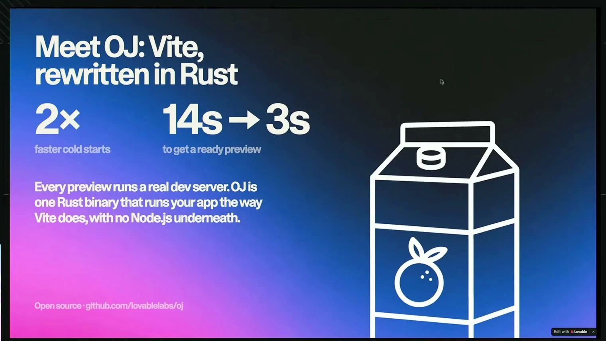

_截图 29  ·  录屏 07:24:14_

**07:24:40**　And by taking control of the applications that we're running in these computers, we're also able to control kind of how we write to memory. And so when we control how we write to memory, we're even more optimizing, if you remember back to the copy-on-write solution when we're drafting different computers. So we're able to run this extremely efficiently so that we can run lots and lots of agents in parallel and have agents explore different solutions to solving a bug or improving the performance of your applications and so on.

通过控制这些计算机上运行的应用程序，我们还能掌控向内存写入数据的方式。因此，当我们能够控制向内存的写入方式时，就能进行更有效的优化。回想一下我们在设计不同计算机时的“写时复制”方案，现在我们可以非常高效地运行这些程序，从而同时运行大量智能体，让它们探索不同的解决方案，以修复错误或提升应用程序性能等。

_截图 30  ·  录屏 07:24:51_

**07:25:14**　And so this has been fun. But the last piece now is about verification. And of course this kind of computer and this dev server is a big piece of being able to verify what an agent is doing. And if you look at verification, you can think of these feedback loops, right? That the agent needs to get information, it took an action, was this a good action or was it a bad action?

所以这很有趣。但最后一部分是关于验证。当然，这种计算机和开发服务器对于确认智能体在做什么非常重要。从验证的角度来看，你可以想到这些反馈循环，对吧？智能体需要获取信息，它采取了某种行动，那这是好的行动还是不好的行动呢？

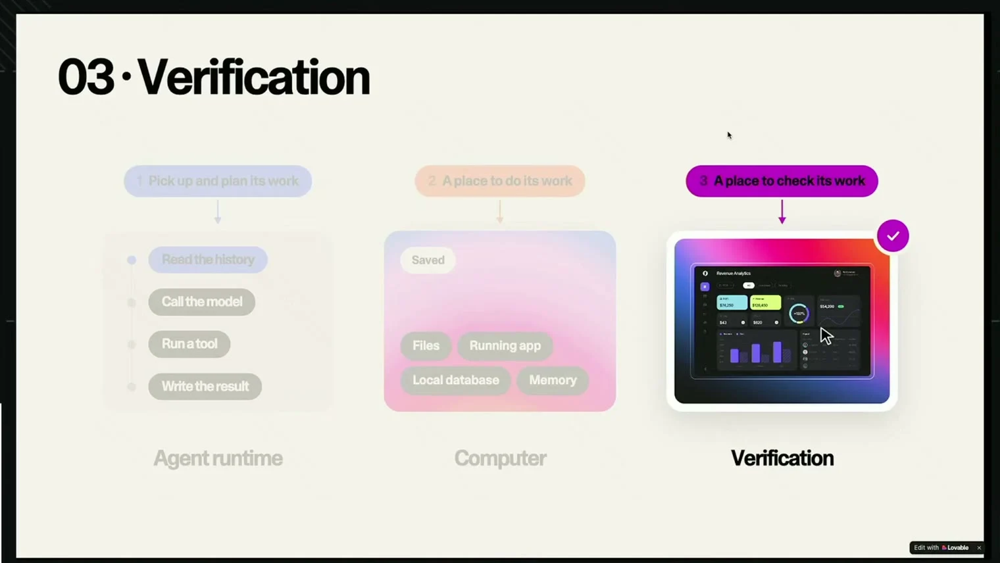

_截图 31  ·  录屏 07:25:20_

**07:25:36**　And you can think of it as this inner loop and this outer loop. So this inner loop is during the turn of the agent. And you have kind of obvious things such as like is the build working? Do we have lint errors or type errors in the code that we're running? And then you can check for runtime errors in the preview that you're running.

你可以将其视为一个内循环和一个外循环。这个内循环发生在智能体运行的过程中。你会遇到一些显而易见的问题，比如代码是否正常运行？我们运行的代码中是否存在 lint错误或类型错误？此外，你还可以通过预览功能来检查运行时错误。

**07:25:54**　You can also have within this computer a headless browser where the agent can go in and kind of explore the web app it's building or whatever it's building, right? And a bunch of other things that we're using to help verify within the turn of an agent. Loop, which is between each turn and a turn, you can think of when the agent is yielding to you as a user.

你也可以在电脑上运行一个无头浏览器，智能体可以进入其中，探索它所构建的网页应用或其他相关内容，对吧？还有许多其他工具，我们用它们来帮助验证智能体的行为。在每一轮交互之间，你可以把智能体像用户一样回应你的行为理解为“循环”。

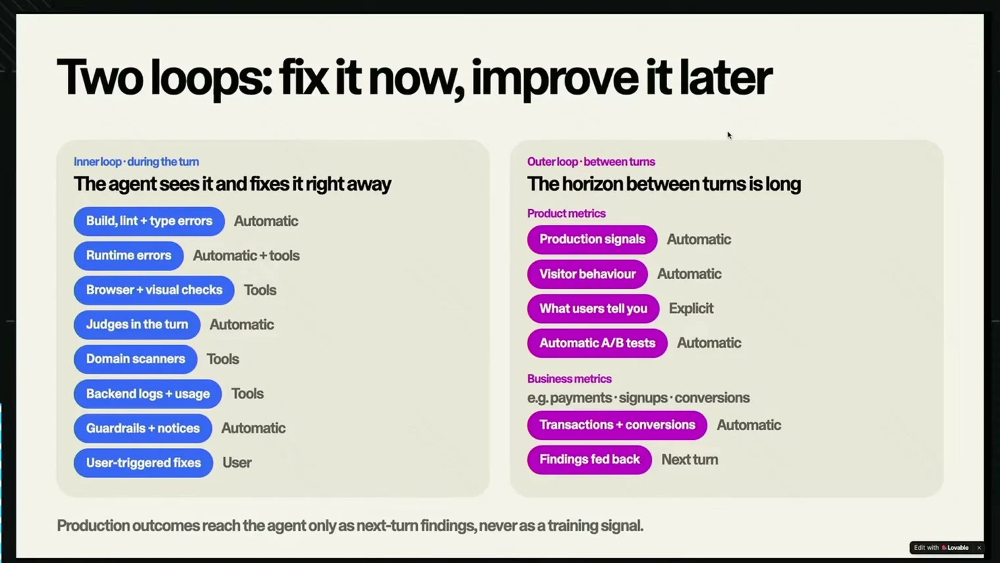

_截图 32  ·  录屏 07:26:02_

**07:26:17**　And between each turn, you might get some info on the product itself from production from your users, right? And so you can look at how your visitors are behaving, what users are telling you online. You can do automatic A-B tests and actually change some copy and see if it's improving conversion and so on. And then you can also take these goes back to kind of the capabilities I showed you.

在每次迭代之间，你可能会从用户那里得到关于产品本身的一些信息，对吧？这样你就可以了解访客的行为方式，以及用户在线上告诉你什么。你可以进行自动的A-B测试，修改一些文案，看看是否能提升转化率等等。然后，这些结果也可以被反馈给我所展示的能力。

**07:26:42**　By having control over these things, we can make sure that we can optimize how the agent is getting this outer feedback loop. So we can make sure that if you're running payments, we can actually track those transactions and conversions and make sure that the agent can actually help you optimize not only the code, right, but the business strategy around your product.

通过控制这些要素，我们可以确保优化智能体获取外部反馈循环的方式。这样，当您进行支付操作时，我们就能追踪相关交易和转化情况，让智能体能够帮助您优化代码以及产品相关的业务策略。

**07:27:06**　And so those are really the three things that we've been working for. And we'll continue to kind of build out these capabilities and this architecture around really orchestrating into agents. And so this agentic system that we're building is running billions of tokens per minute. And these computers, right, we can spawn up with each agent and we can have multiple agents use one computer.

因此，这些确实是我们一直在努力实现的三个目标。我们将继续发展这些能力与架构，以实现智能体之间的协同工作。我们正在构建的智能体系统每分钟能处理数十亿个令牌。这些计算机可以分配给每个智能体使用，也可以让多个智能体共享同一台计算机。

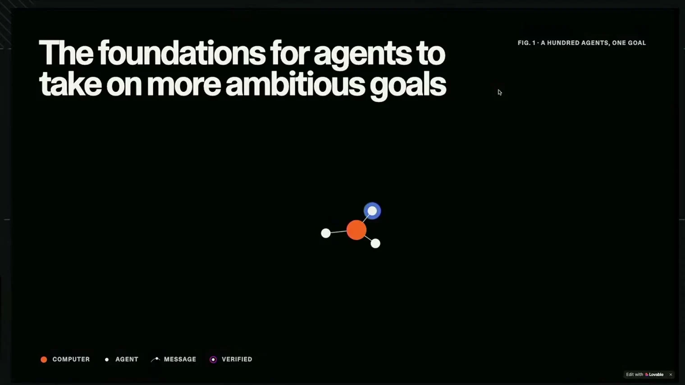

_截图 33  ·  录屏 07:27:09_

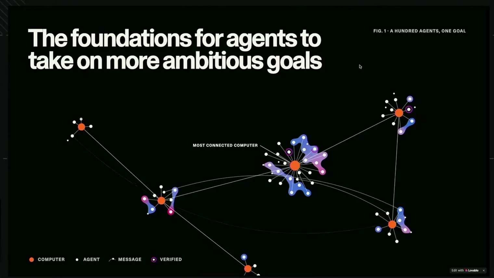

_截图 34  ·  录屏 07:27:21_

**07:27:35**　And now we're kind of back to this quite beautiful setup where you have agents talking to agents and they're orchestrating. And this time it's actually working. And it's working at scale thanks to some of these optimizations. And so if you're curious to try this out, double.dev and you'll see our previews spinning up and so on, but you'll get a very simple and nice interface and you won't have to care about all of this stuff.

现在我们又回到了这个非常漂亮的场景中，智能体之间互相交流，共同进行协调。这次确实有效了，而且由于一些优化措施，还能在大规模环境中运行。所以如果你有兴趣尝试一下，访问 double.dev 就能看到我们的预览功能正在运行，此外还有非常简洁美观的界面，你不必担心这些细节。

**07:28:01**　Thank you so much, it's been a pleasure. And yeah, hope you learned something. Thanks so much. Thank…

非常感谢，很开心能帮到您。希望您有所收获。再次感谢。

---

[全部演讲](../README.md) · [选看索引](index.md) · [上一场](23-nikolay-petrov.md) · [下一场](25-zach-bruggeman.md)
