[全部演讲](../README.md) · [选看索引](index.md) · [上一场](24-fabian-hedin.md) · [下一场](26-steve-yegge.md)

# How to build an agent that builds the culture

**Zach Bruggeman** · Ramp · Principal Software Engineer

AIE Code Summit 2026  ·  11 月 11 日  ·  主舞台  ·  录屏 07:30:04–07:44:08

[官方议程](<https://ai.engineer/code/2026/schedule>)   ·   [Day 1 官方回放](<https://www.youtube.com/watch?v=ZZ19zhYnDKY>)

## 本场目录

- [07:30:12](#section-1) Inspect 的使用规模及团队推广时遇到的问题
- [07:32:13](#section-2) 设置成本、信息孤岛和公司共享 Agent
- [07:35:29](#section-3) 如何让每次修改留下可核验的过程
- [07:39:18](#section-4) 公开协作的排障案例与 Review Buddy

## 演讲实录

> 英文源自录屏音频，经轻度校订。每段英文下方为中文译文。时间指向原始录屏。

### Inspect 的使用规模及团队推广时遇到的问题

**07:30:03**　Yeah, perfect. All right. Good. Well, thanks so much for waiting, everyone. My name is Zach, and I'm an engineer at Ramp. I'm just really excited to tell you all a bit about how Ramp has evolved its engineering culture this year through the help of our robotic friend, Inspect. As a quick introduction, Inspect is Ramp's collaborative coding agent. About a year ago, we decided to take a bet on building our own coding agent with every session running remotely and being fully multiplayer.

是的，太好了。好的，非常感谢大家的等待。我叫Zach，是Ramp的工程师。很兴奋能向大家介绍一下，今年Ramp如何通过我们的机器人助手Inspect，改进了其工程文化。简单介绍一下，Inspect就是Ramp的协作编码智能体。大约一年前，我们决定尝试打造自己的编码智能体，每次会话都以远程方式运行，并且支持完全多人在线模式。

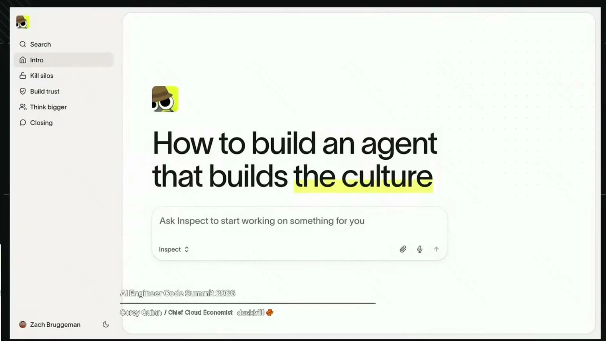

_截图 01  ·  录屏 07:30:12_

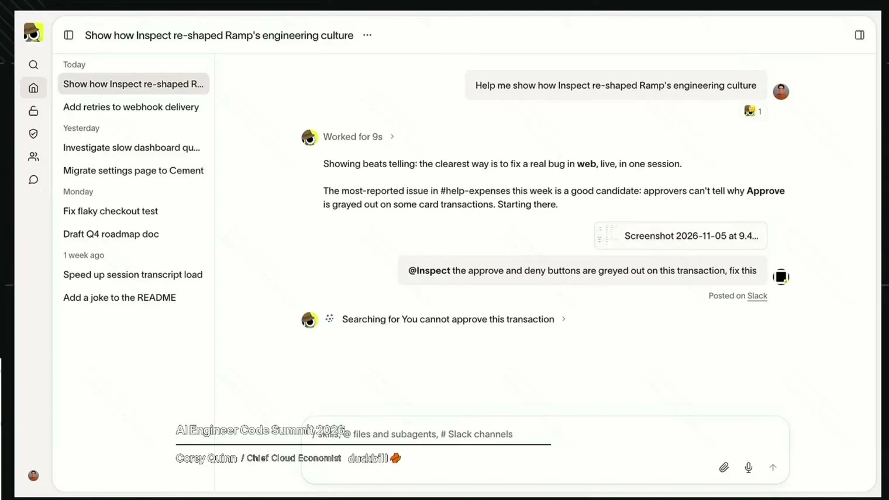

_截图 02  ·  录屏 07:30:25_

**07:30:30**　Inspect can work alongside you and your team, whether that be an Inspect itself, Slack, Linear, or any other of our integrations. And now it goes far beyond just writing the code with the design primitives, review agents, and verification flows that let any builder go from prompt to shipping all inside Inspect. Inspect is also connected with all of our integrations company-wide, so everyone's automatically connected to the data and tools that matter most, whether that be telemetry, databases, or any of the other tooling available.

Inspect可以与您和您的团队一起工作，无论是Inspect本身、Slack、Linear，还是我们的其他集成功能。现在，它不仅仅涉及使用设计原语编写代码、审查智能体以及验证流程，让任何构建者都能在Inspect中从概念到发布全程完成工作。Inspect还与全公司的所有集成功能相连，因此每个人都会自动获得最重要的数据和工具——无论是遥测数据、数据库还是其他可用工具。

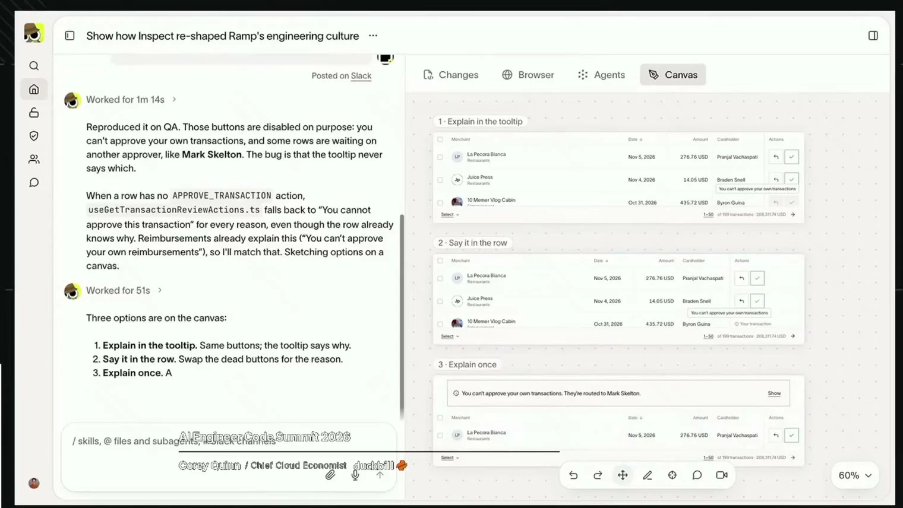

_截图 03  ·  录屏 07:30:37_

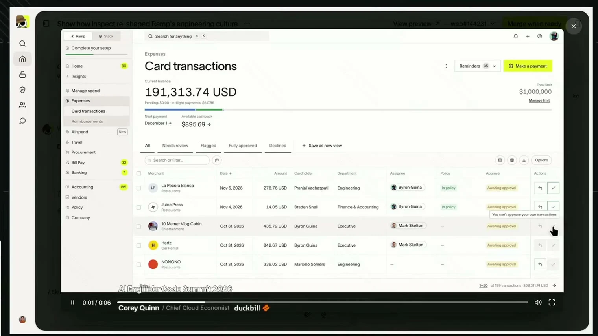

_截图 04  ·  录屏 07:30:50_

**07:31:01**　Through this, we now see around 75% of all of Ramp's code being written and shipped by Inspect. When we started sharing Inspect publicly at the start of the year, the technology itself was the more novel part, spinning up sandboxes in under five seconds, wiring up all that internal context, having agents work together in a multiplayer setting. People had a lot of questions about the plumbing.

通过这一点，我们现在发现大约 75% 的 Ramp 代码都是通过 Inspect 被编写和发布的。当我们在年初开始公开分享 Inspect 时，这项技术本身就非常新颖：在不到五秒的时间内就能启动沙箱环境，整合所有内部上下文，让智能体在多人游戏中协同工作。人们对相关的技术细节有很多疑问。

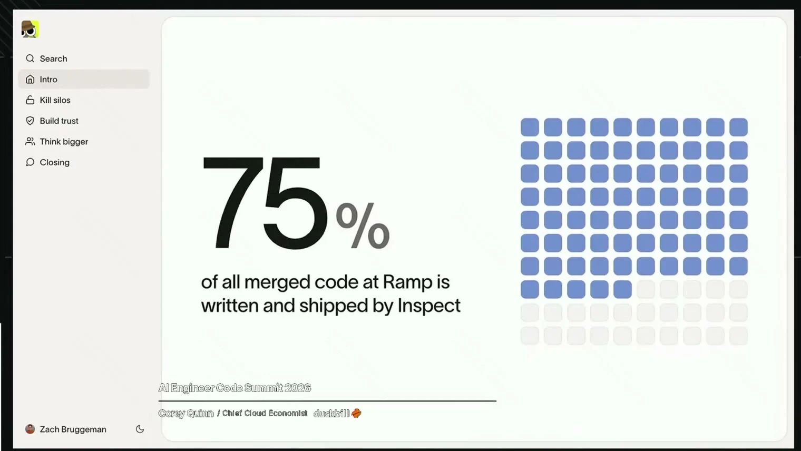

_截图 05  ·  录屏 07:31:02_

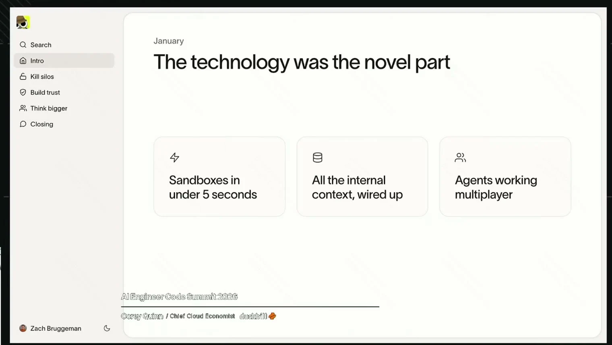

_截图 06  ·  录屏 07:31:15_

**07:31:24**　But now with much broader adoption of these concepts and Inspect itself now being a product on the market, the technology isn't nearly the barrier that it once was. Instead, I want to talk about the other angle, the lessons we've learned around building a culture around Inspect and what you can take away to inspire the people and teams that you work with.

但现在，这些概念得到了更广泛的应用，Inspect本身也成为了市场上的产品，这项技术不再像过去那样成为障碍。相反，我想谈谈另一个角度——我们在构建Inspect相关文化过程中学到的经验，以及你可以从中获得什么，以激励你工作的人员与团队。

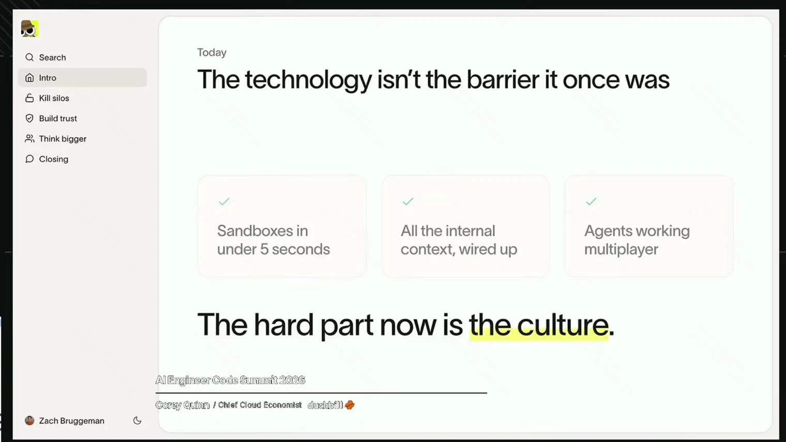

_截图 07  ·  录屏 07:31:31_

**07:31:43**　I'm not going to talk as much about those technical aspects of Inspect today, but if you are curious about that, you can read our blog posts or take a look at Pragmatic Engineer's deep dive that they did with us a few months ago. You can also follow my boy Dylan Garcia on Twitter. He's on his social media grind, but he's also been posting a ton of really great Inspect insights since we've launched it.

今天我不会过多讨论 Inspect 的那些技术细节，但如果你感兴趣的话，可以阅读我们的博客文章，或者看看 Pragmatic Engineer 几个月前与我们一起撰写的深度分析文章。你也可以在 Twitter 上关注我的朋友 Dylan Garcia。他在社交媒体上很活跃，自从 Inspect 推出以来，他也发布了很多非常精彩的见解。

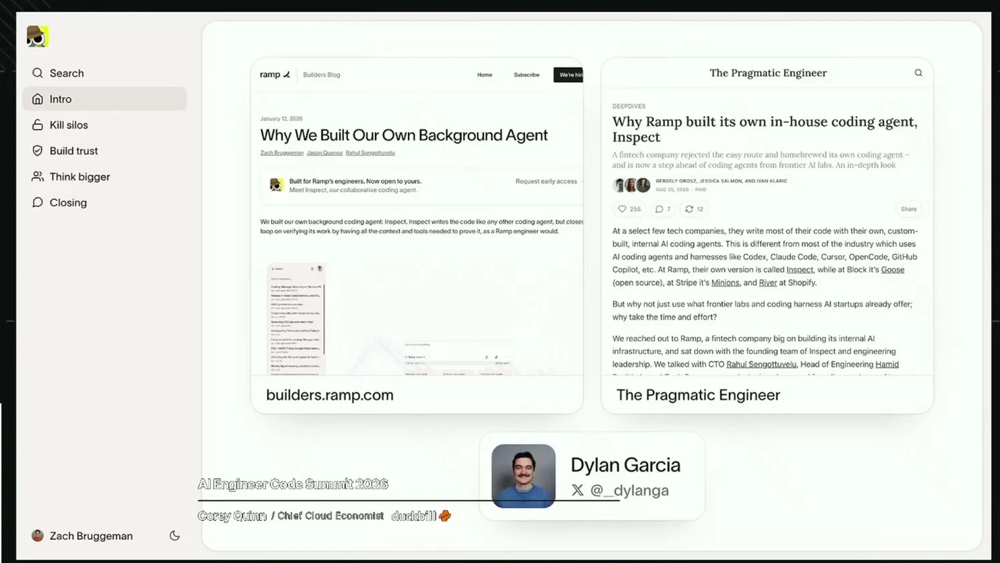

_截图 08  ·  录屏 07:31:56_

### 设置成本、信息孤岛和公司共享 Agent

**07:32:03**　So shout out, Dylan. Please give him a follow. One thing about working at Ramp is that it really makes you start thinking about everything through the lens of saving time and money. And although I think it is important to understand the systems that you work with and understand how your tooling works, if you're a multi-hundred or multi-thousand person organization and everyone has to go through, say, 15 minutes of setup, once you start multiplying that across an organization, this is days lost for what is very rote work.

所以， Dylan，请关注他吧。在Ramp工作的一个特点就是，会让你开始从节省时间和成本的角度来思考所有事情。虽然理解你所使用的系统以及工具的工作原理很重要，但如果你是一个拥有数百或数千人的组织，每个人都必须经历大约15分钟的设置时间，那么当这个时间被应用到整个组织中时，就相当于浪费了无数时间用于那些非常机械的工作。

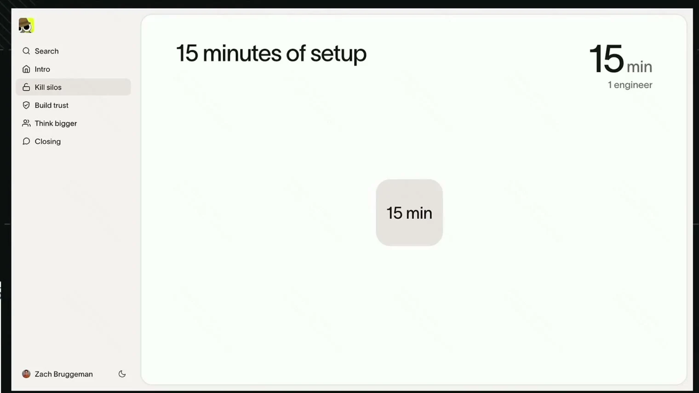

_截图 09  ·  录屏 07:32:13_

**07:32:34**　Then, how fast the frontier moves here on best practices and new ways to set up an agent, you realize this setup cost isn't just one time. Not to mention, these advancements won't always spread equally, so now you have an indeterminate amount of time and effort spent on this maintenance without an equal spread of knowledge, leading to disparate outcomes across an organization.

那么，在最佳实践和新方法的应用下，智能体的发展速度有多快？你会意识到这种设置成本并非一次性的。更不用说，这些进步不会总是均匀分布，因此现在你需要在没有平等知识分享的情况下投入不确定的时间和精力进行维护工作，导致整个组织出现不同的结果。

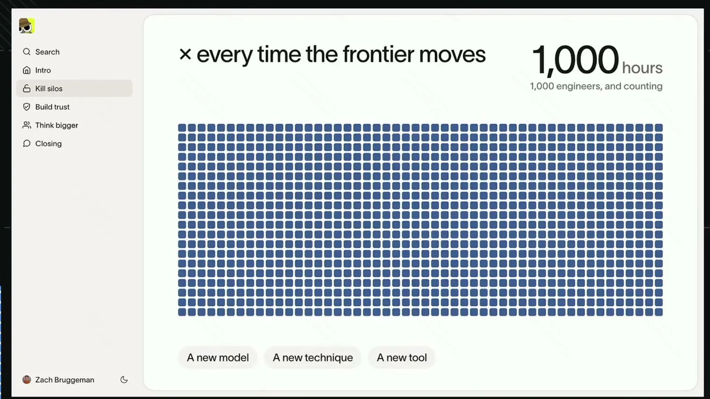

_截图 10  ·  录屏 07:32:38_

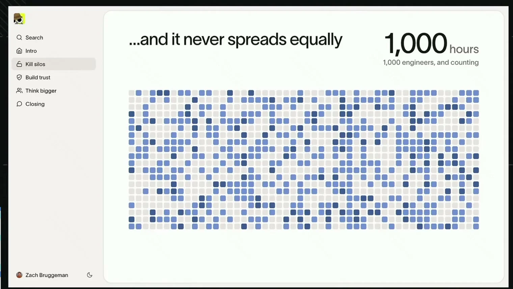

_截图 11  ·  录屏 07:32:50_

**07:32:55**　While you can perceive this as an advantage on an individual level, when you're trying to win you need everyone on your A-game. So this was our first lesson, build tools that kill information silos. When we found patterns that worked well, or tools that benefited everyone, we could push it to our entire organization immediately. If you want to spend time tweaking your own setup, that's fine, but Inspect is always available as a very solid baseline.

虽然从个人层面来看这可能是一种优势，但在努力取得胜利时，你需要让每个人都发挥出最佳水平。这就是我们的第一课：打造能够消除信息孤岛的工具。当我们发现有效的模式或能惠及所有人的工具时，就可以立即将其推广到整个组织中。如果你愿意花时间调整自己的设置，那也没问题，但Inspect始终是一个非常可靠的基准。

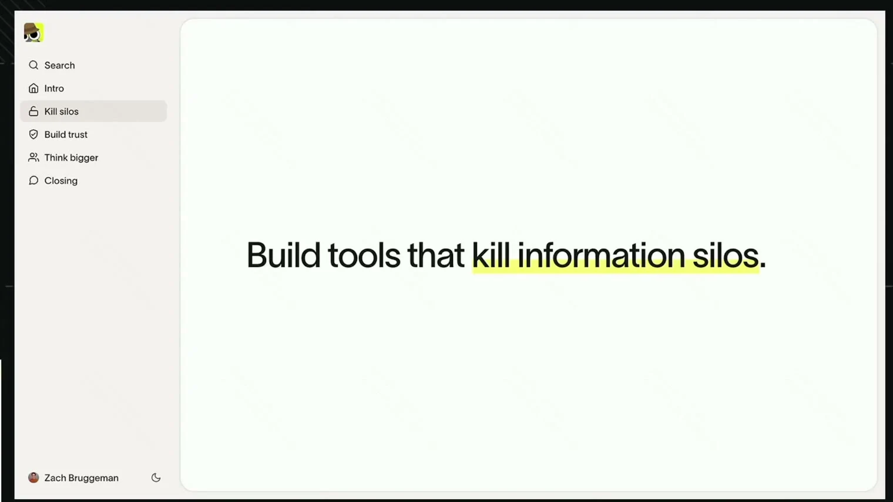

_截图 12  ·  录屏 07:33:11_

**07:33:21**　And what we've found is that we've never needed to mandate usage of Inspect because it existing as this baseline reduced the need for people to reach for their own setups all the time. Part of what I think makes this powerful as well is that the reality of this industry is that it's unlikely that you as an individual always know the absolute best way to work with agents across everything.

我们发现，其实从未需要强制要求使用 Inspect，因为这种基础设置的存在，减少了人们频繁调整自身配置的需求。我认为其如此强大的另一个原因在于，该行业的实际情况是，作为个人，你不太可能始终知道如何最有效地与各种智能体进行协作。

**07:33:44**　Even if keeping up with this is your full-time job, We all miss things, hold biases, and have blind spots. So part of the design of Inspect is that there's just one single Inspect for the whole company. When people figure out better ways to use it, or have ideas for what would make it better for the work they do, we're able to bring it to the entire company.

即使坚持使用这个就是你的全职工作，我们所有人都会遗漏某些东西、持有偏见，也有盲点。因此，Inspect的设计之一就是整个公司只使用一个Inspect工具。当人们找到更好的使用方式，或提出如何让它更适合他们的工作，我们就能将其推广到整个公司。

**07:34:05**　The best part of this is that for most changes, this is invisible to everyone else. You just keep using Inspect as you normally would, and benefit from the improvements that everyone's making over time. And what we found is that we really don't have to run these formal sit down, here's how you use AI effectively training sessions for Inspect. With every Inspect session being public within the company by default, it's actually easier to work in public than in private.

最棒的是，对于大多数更改来说，其他人根本无法察觉到。你只需像平常一样使用 Inspect，就能享受到大家随着时间所做的改进。我们发现，其实不需要进行这些正式的会议，以下是如何有效利用 AI 进行 Inspect 培训的方法。由于每个 Inspect 培训会话默认都是公开的，因此公开进行比私下进行更容易操作。

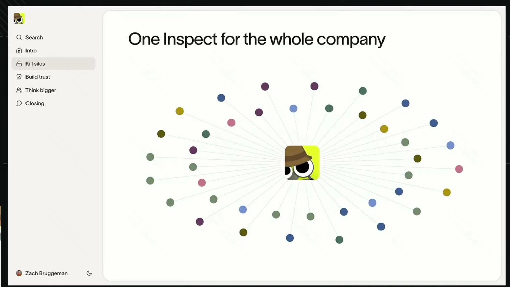

_截图 13  ·  录屏 07:34:10_

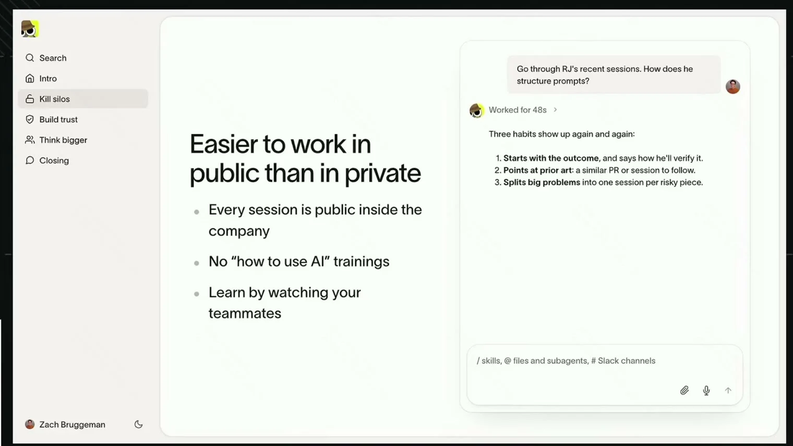

_截图 14  ·  录屏 07:34:26_

**07:34:31**　As such, you default to working in public and you can learn how to use it by watching how your teammates use it in the channels that you're already in. And your teammates can learn from you. You can literally ask inspects to go through their recent sessions and tell you about how they work, how they structure prompts, or how they break down gnarly problems.

因此，你默认需要在公共环境中工作。你可以通过观看队友在你所参与的频道中如何使用它来学习如何运用它。而你的队友也可以从你身上学习。你可以要求查看他们最近的会话记录，了解他们是如何工作的、如何构建提示词，以及他们如何解决复杂问题。

**07:34:51**　I think this has not just been helpful for the builders at Ramp, but also for the inspect team itself. We frequently see the way that people use inspect in ways that we didn't originally imagine. This then informs what we should build towards, whether that should be more native primitives for common patterns, tools and data are missing. All in all, it creates this self-sustaining loop where we're able to build towards what makes Inspect the most successful by seeing what people are already achieving with Inspect.

我认为这不仅对 Ramp 的开发者有帮助，也对检查团队本身也有益。我们经常看到人们使用检查工具的方式与我们原本想象的有所不同。这让我们能明确应该朝着什么方向发展，比如是否应该提供更多适用于常见模式的原生原语，因为目前工具和数据还不足。总的来说，这形成了一个自我维持的循环，让我们能够根据人们已经用检查工具取得的效果来推动发展，从而让检查工具更加成功。

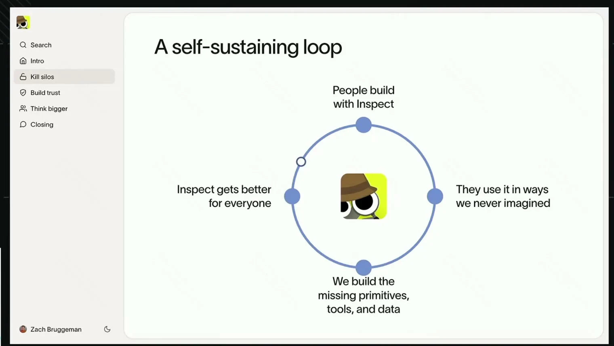

_截图 15  ·  录屏 07:35:16_

### 如何让每次修改留下可核验的过程

**07:35:22**　This feeds into the second lesson that we've learned. It's all about building trust. I think it's fair to say that adopting agentic-driven coding has been a massive trust-building exercise for every engineer this year. It's helped that the models have become more competent at writing high-quality code, but there's a large part of this that's just learning to trust what an agent builds.

这印证了我们学到的第二个道理。一切都是为了建立信任。可以说，今年采用智能体驱动的编码方式对每位工程师来说都是一次重要的信任建立过程。模型在编写高质量代码方面变得更加熟练，也起到了帮助作用，但其中很大一部分工作还是在于学会信任智能体所构建的内容。

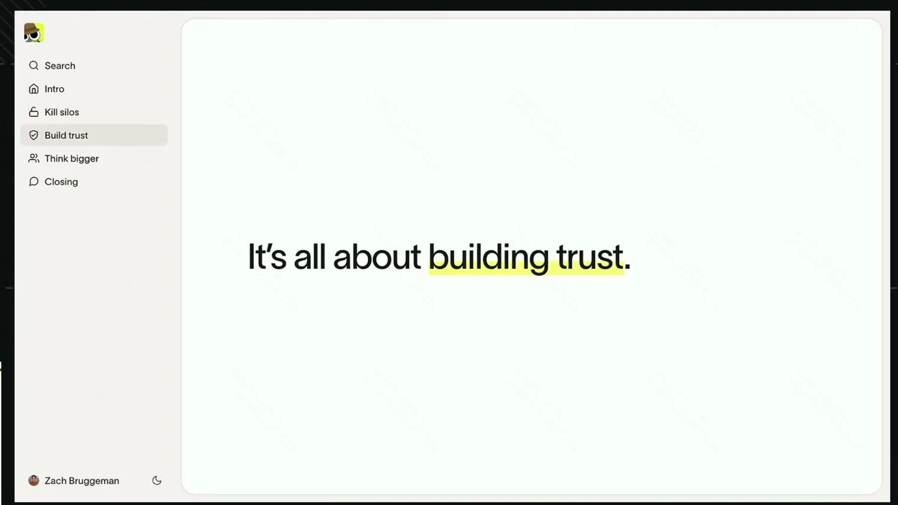

_截图 16  ·  录屏 07:35:29_

**07:35:43**　So much of building trust in tools comes from learning from other people. After all, that's why most of us are here, right? You wanted to listen to people you respect, or at least I hope you respect, teach you about the things that they learned. But if we limit our corpus of knowledge to just those who find the perverse enjoyment in public speaking, we're still not getting the full picture.

在工具方面建立信任，很大程度上依赖于从他人那里学习。毕竟，我们大多数人都在这里，不是吗？你想听那些你尊重的人——或者至少我希望你尊重的人——告诉你他们所学到的东西。但如果我们只把知识来源限制在那些从公开演讲中获得乐趣的人身上，那仍然无法了解全部情况。

**07:36:05**　This democratization of knowledge sharing is just fascinating to me as a concept. Instead of grouping around a select few leaders, can we build systems that inherently share the knowledge of everyone? This is what Inspect has built towards. Every time someone shifts something with Inspect, people can see it right there on the work you've done. The session itself is an easy-to-share, it's a living artifact of how that change came to be.

这种知识分享的民主化对我来说是一个很吸引人的概念。与其围绕少数领导者进行分组，我们能否建立能够让所有人共享知识的系统呢？这就是Inspect所努力实现的。每当有人使用Inspect进行某些更改时，人们就能直接看到你所做的工作成果。这个会话过程本身也很容易分享，它成为了那个改变如何产生的真实记录。

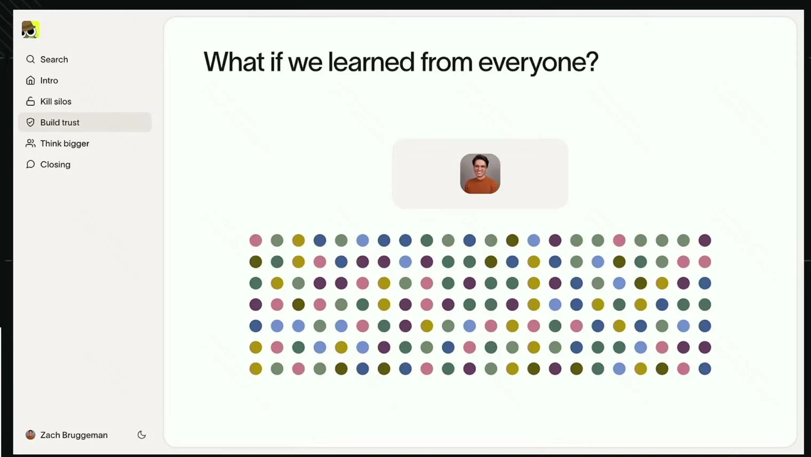

_截图 17  ·  录屏 07:36:10_

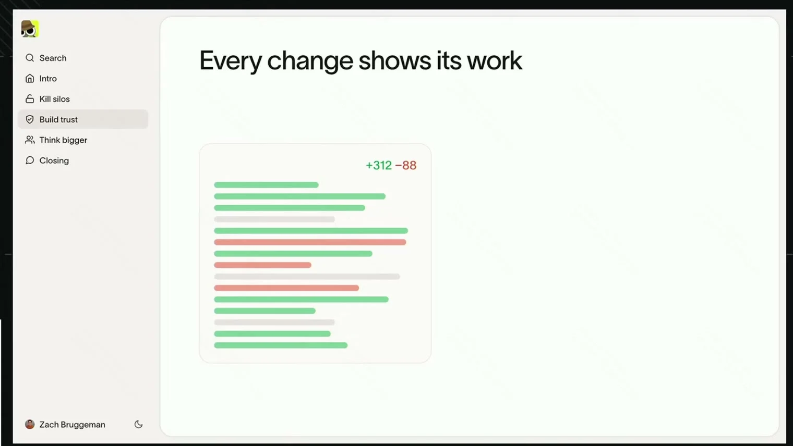

_截图 18  ·  录屏 07:36:27_

**07:36:31**　When a pull request goes up, anyone reviewing it doesn't just see the 400-line diff dropped over the wall and hope for the best. They can see the exact conversation that you had, all the tools that Inspect used, before and after screenshots, or even a video recording of the clicking through the app in the browser to prove its work holds up.

当提交请求被提出后，任何审查该请求的人不会只是看到那400行差异内容被丢弃在墙上，然后抱希望而已。他们可以看到你之前的对话内容、Inspect使用的所有工具、前后截图，甚至可以是通过浏览器在应用中点击操作的视频记录，以证明其功能正常。

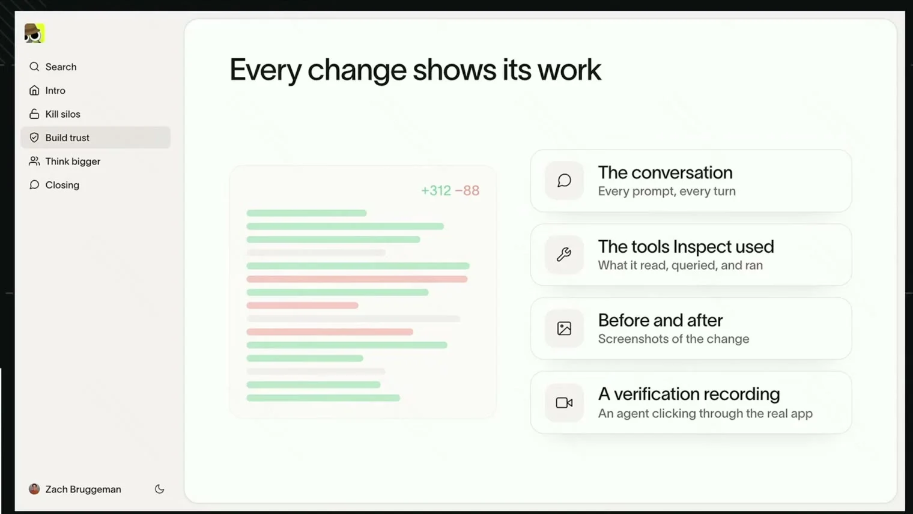

_截图 19  ·  录屏 07:36:52_

**07:36:52**　It makes it effortless to show not just what changed, but why you can trust it. It also just makes it easier to bring people you don't work with all the time into the fold. A fun moment on this one, it was back in February. One of our engineers, Andrew, reported a bug in Inspect. So naturally, I reached for Inspect and asked it to investigate.

这样就能轻松展示出发生了什么，以及为什么可以信任它。也更容易让那些不常一起工作的人加入进来。这次有个有趣的点，是在二月的时候。我们的工程师安德鲁报告了Inspect中的一个错误。所以自然而然地，我就使用Inspect来调查这个问题。

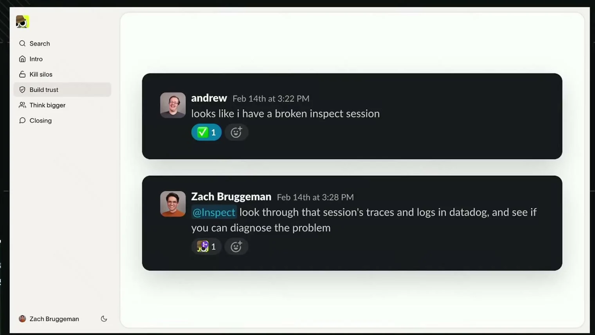

_截图 20  ·  录屏 07:37:09_

**07:37:13**　What's funny here is that although Inspect had access to Datadog for a while, we'd only just instrumenting InSpec itself. I mean, InSpec was primarily built by front-end product engineers, so tracing is a little bit of a foreign concept for us. But in any case, it was a great time for us to put it to the test for InSpec. And InSpec says, the instrumentation was causing the error.

有趣的是，虽然 Inspect 能够使用 Datadog 一段时间，但我们当时只是对 InSpec 本身进行了工具化处理。也就是说，InSpec 主要是由前端产品工程师开发的，因此追踪机制对我们来说还是个陌生的概念。不过无论如何，那段时间对我们来说是个很好的机会来测试 InSpec。而 InSpec 显示，这种工具化处理确实导致了错误。

**07:37:36**　Yes, the very instrumentation that was letting us debug this error was actually causing this error. So Dylan and I were not exactly convinced by the robot here. And Andrew is just like, whatever, I'll use Claude Code. And while we don't have a mandate to use inspect I mean personally these were not the words I wanted to hear so nobody here is really trusting anybody Dylan and I don't trust the robot's explanation Andrew doesn't trust us to build something that works and Inspect, well, I don't know if Inspect trusts anyone, but that's okay, that's okay.

是的，正是用来调试这个错误的工具实际上导致了错误。所以Dylan和我并不完全相信这里的机器人。而Andrew则说：“随便吧，我会用Claude Code。”虽然我们没有使用Inspect的授权，但个人来说，这些话并不是我想听到的，所以这里没有人真正信任任何人。Dylan和我也不相信机器人的解释。Andrew也不相信我们能开发出能正常工作的东西。至于Inspect，我也不知道它是否值得信任，但没关系，没关系。

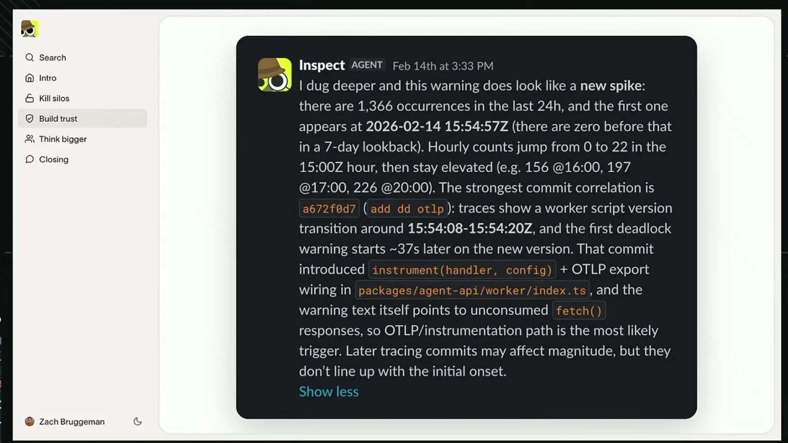

_截图 21  ·  录屏 07:37:38_

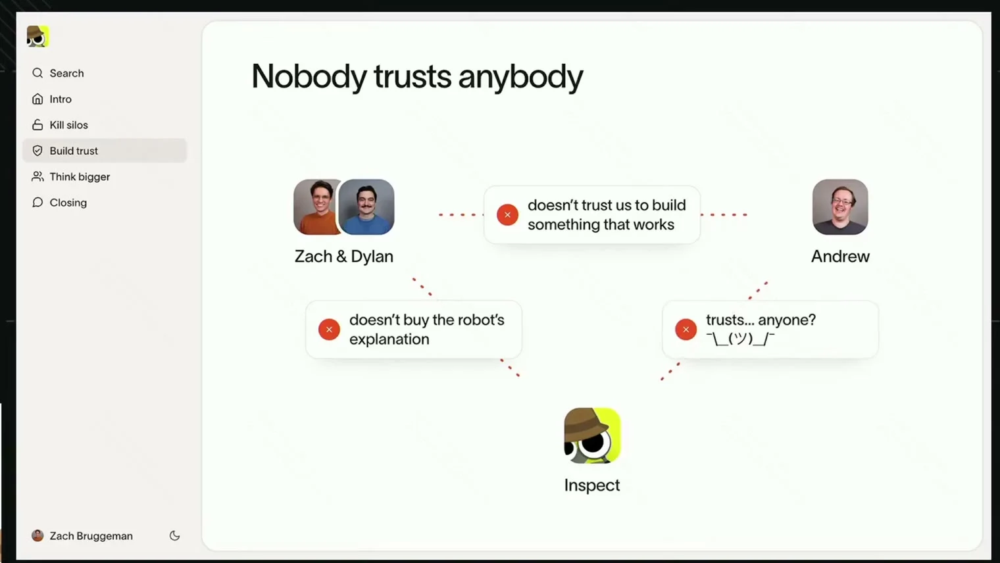

_截图 22  ·  录屏 07:38:07_

**07:38:12**　But because this is happening together in public, we keep prodding at it. Dylan asks Inspect to look through the code of the telemetry library we're using and see if this was just something that was happening before without visibility. Because surely by now coding has been solved and there can't be bugs that we introduced. And this time it comes back with something a bit more specific.

但由于这一切都在公开场合发生，我们仍不断努力探究。Dylan要求Inspect查看我们使用的遥测库代码，看看是否只是以前没有被注意到的现象。因为现在编码问题应该已经解决了，不可能还有我们造成的错误。而这次，又出现了一些更具体的问题。

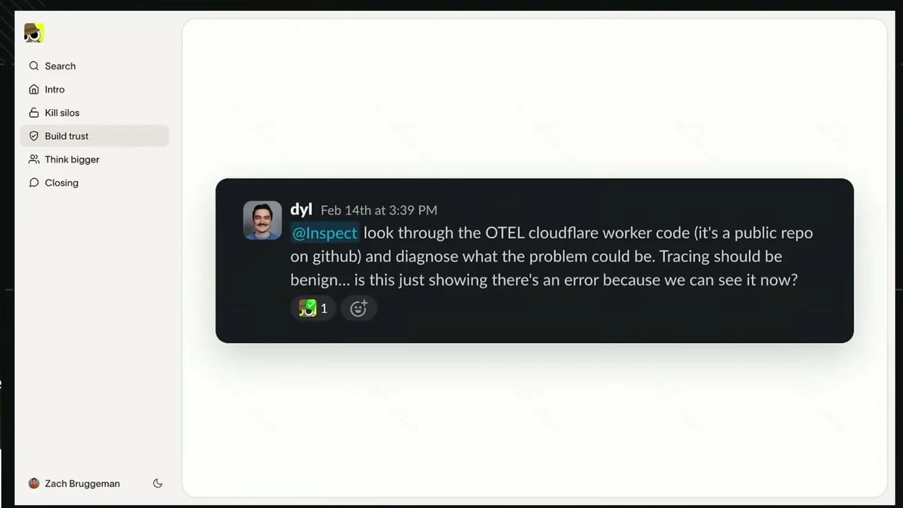

_截图 23  ·  录屏 07:38:20_

**07:38:32**　The OTEL library calls fetch, but it never reads or cancels the response body. This was just a Cloudflare platform limitation at the time, albeit happening in a library specifically made for Cloudflare workers. But that happens, this library was written pre-AGI after all. At this point we ask Inspect to make a patch. It updates the exporter to explicitly cancel the response body.

OTEL 库使用了 fetch 方法，但始终不会读取或取消响应体。当时这只是 Cloudflare 平台的限制，尽管该限制发生在专为 Cloudflare workers 设计的库中。不过这种情况确实发生了，毕竟这个库是在 AGI 之前编写的。目前我们请求 Inspect 来编写一个补丁，该补丁会更新导出函数，使其能够明确取消响应体。

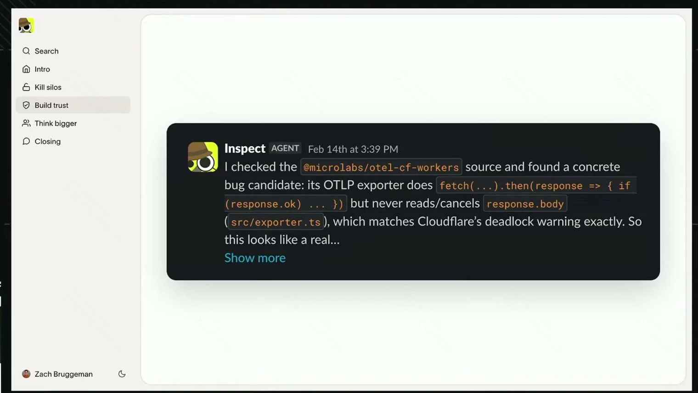

_截图 24  ·  录屏 07:38:36_

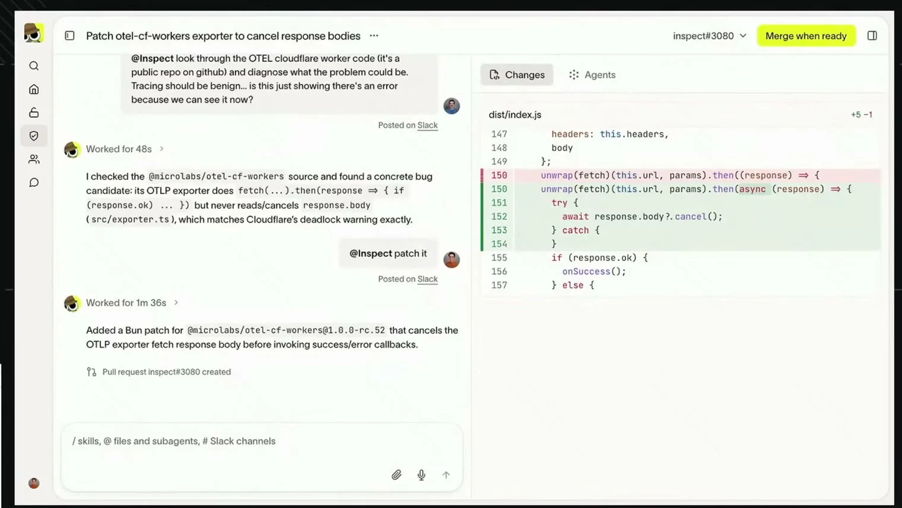

_截图 25  ·  录屏 07:38:49_

**07:38:55**　We grumbled in the thread a bit while it's deploying but we see after it deployed there haven't been any errors since. So great, Inspect fixed a bug, which at this point, it's nothing special in itself. But there was a much more important story playing out in this thread. Before Inspect, a report like this might have been acknowledged, a ticket filed, and then one of us would have gone away to debug it.

在部署过程中，我们在讨论帖子里抱怨了一下，但部署完成后就再也没有出现任何错误了。这很不错，Inspect修复了一个bug，不过本身也没什么特别之处。不过在这个讨论帖子里还有更重要的事情发生。在Inspect出现之前，类似这样的报告可能会被处理，被记录为工单，然后就会有人去调试它。

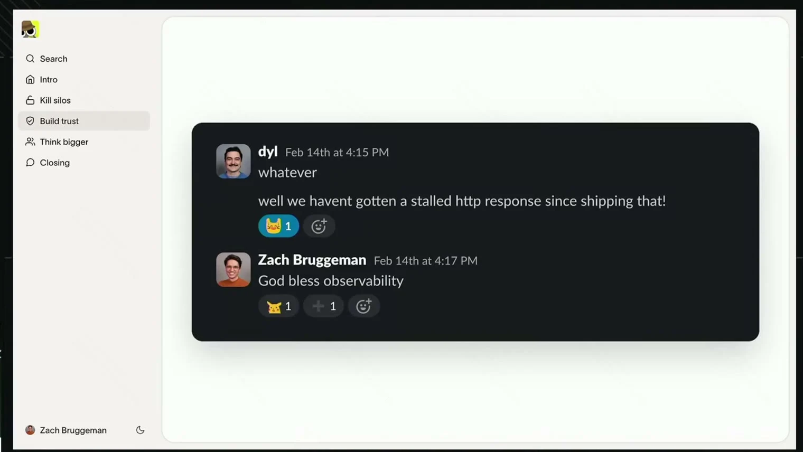

_截图 26  ·  录屏 07:39:01_

### 公开协作的排障案例与 Review Buddy

**07:39:17**　Andrew might have received a message later saying it was done in private. Now though, it's easier to do all of this in public. And as such, Andrew naturally starts becoming engaged, wanting to chime in with his thoughts and experiences. And then in that same thread, this leads to ideas coming up about how Inspect could power other work. And none of this required any prodding or pressure to work together.

安德鲁可能后来收到了一条消息，说这是私下完成的。不过现在，在公开场合完成这些事情就更容易了。因此，安德鲁自然开始积极参与，想要分享自己的想法和经历。而在同一个讨论帖中，这又引发了关于Inspect如何支持其他工作的想法。而这一切都是自然而然地发生的，不需要任何推动或压力来促使大家合作。

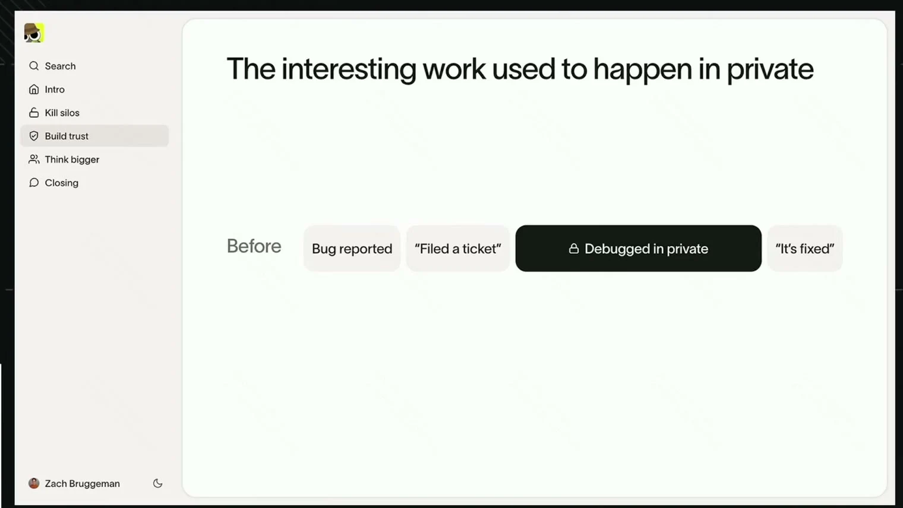

_截图 27  ·  录屏 07:39:18_

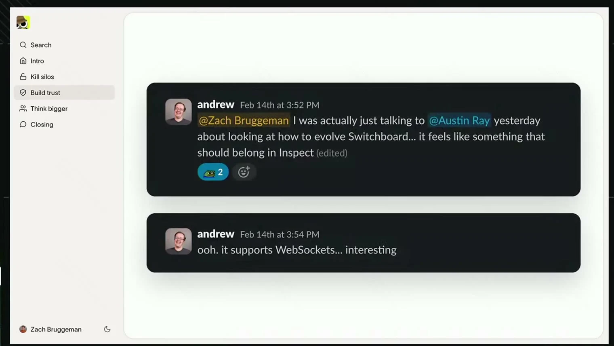

_截图 28  ·  录屏 07:39:39_

**07:39:42**　Instead, it was just like, oh, these guys are doing something cool, and we could work on it together. So in the span of an hour, we go from skeptical user with a broken user experience to an engaged colleague wanting to build together and a more stable inspect. So once you have a tool that gives everyone the best setup on day one with no information silos and you've built a system of trust that brings innovation together, what happens next?

相反，我们觉得这些人正在做一件很棒的事情，我们可以一起努力。在短短一小时里，我们就从对体验不佳表示怀疑的用户，变成了愿意共同合作、期待建立更稳定系统的同事。一旦有了能让每个人在第一天就能获得最佳设置的工具，且没有信息孤岛的问题，同时建立了促进创新的信任体系，那么接下来会怎样呢？

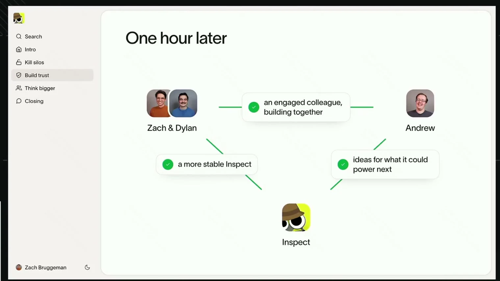

_截图 29  ·  录屏 07:39:51_

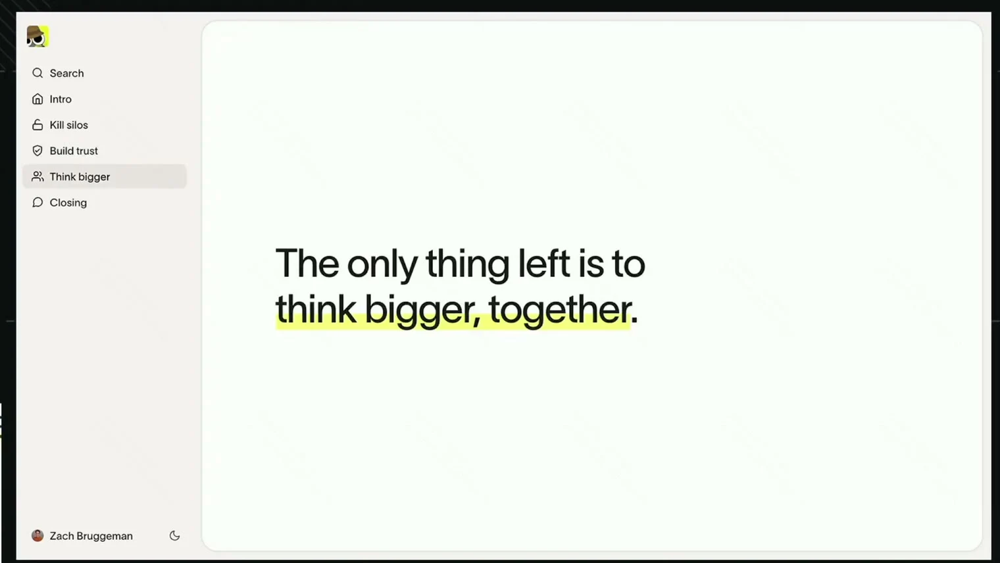

_截图 30  ·  录屏 07:40:04_

**07:40:11**　This is the last lesson I want to share. I think the only thing left is to think bigger together. Something that's pained me this year is how much reverence operator. It's great that we can all do more individually with the help of AI, but this can't be the end game in my opinion. If we don't build outwards, collaborate with other people, and continue to share the progress and learnings we make, I think this is all going to collapse in on itself.

这是我想分享的最后一课。我认为剩下的就只有共同思考更宏观的问题了。今年让我感到痛苦的是，人们对操作者的敬畏之情如此浓厚。虽然借助人工智能，我们每个人都能做出更多贡献，但在我看来，这不应成为最终目标。如果我们不向外拓展、不与其他人合作，也不继续分享彼此的进展和收获，我认为一切都会自行崩溃。

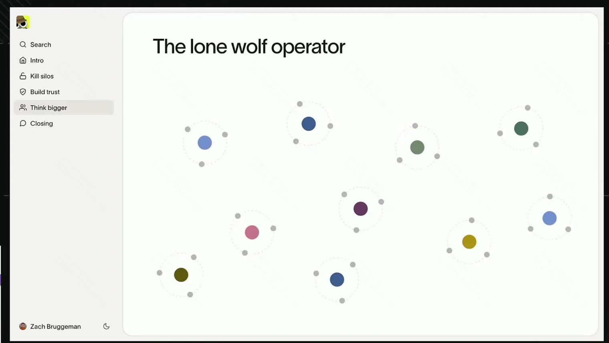

_截图 31  ·  录屏 07:40:20_

**07:40:39**　We'll only consider ourselves as our target audience and we won't grow through the consideration of others' perspectives and experiences. This is not to say I'm all doom and gloom about this. The fact we're all here hopefully is a testament to the value of connection. More importantly, though, I think we can shape our tools to enable these connections to flourish even stronger than before.

我们只会将自己视为目标受众，不会通过考虑他人的观点和经历来发展自己。但这并不意味着我对这件事感到绝望或消极。我们能够聚集在这里，无疑证明了人际联系的价值。更重要的是，我认为我们可以设计工具，让这些联系更加紧密、更充分。

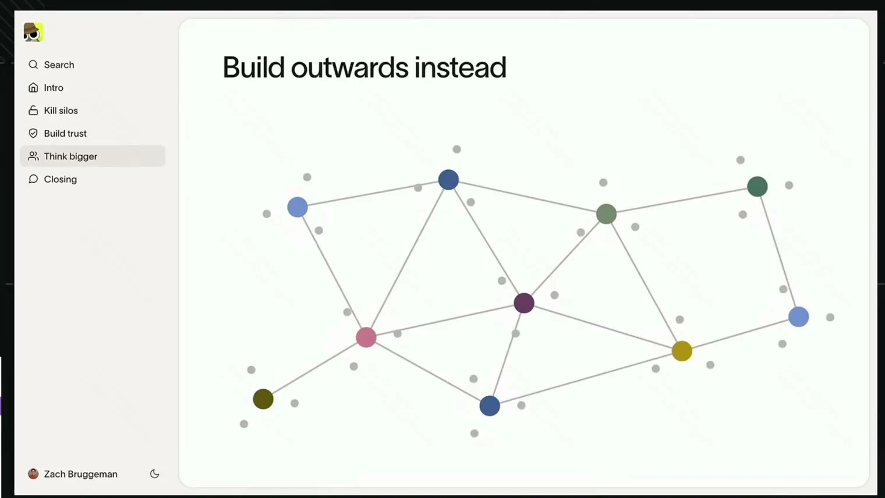

_截图 32  ·  录屏 07:40:54_

**07:41:00**　That story I told about Andrew has played out so many times within Ramp. It's probably the most inspiring thing about Inspect to me, honestly. Sure, it's a coding agent, but remarkably, it's become part of the culture. Everyone at Ramp knows its face. We dress it up on holidays, we throw in Easter eggs over time, and we evolve it as Ramp itself has evolved.

我讲的关于安德鲁的故事在Ramp中出现了很多次。说实话，这对我来说是最具启发性的东西。当然，这是一个编码智能体，但令人惊讶的是，它已经成为了文化的一部分。Ramp上的每个人都知道它的形象。我们在节日里给它装点装饰，还会在适当的时候放 Easter eggs，随着Ramp本身的发展，它也不断进化。

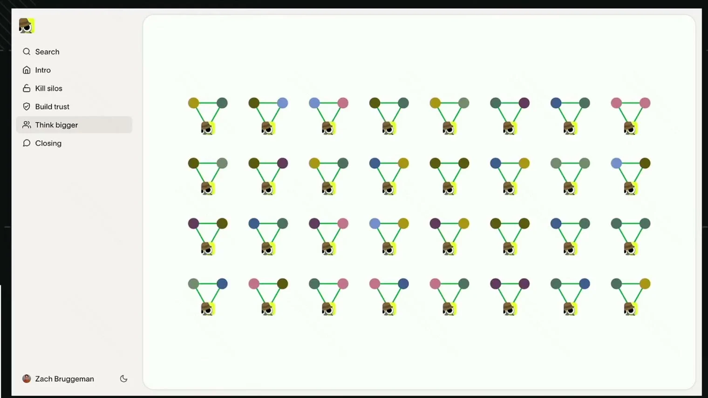

_截图 33  ·  录屏 07:41:02_

**07:41:22**　Not L iterations have been perfect, as any Ramp engineer could tell you, but I do think every iteration has been together. Going back to earlier this year, Inspect didn't have nearly the amount of functionality it has today. A great example is its code review agent. Before this, we were using various off-the-shelf code review products, frequently rotating between them to find a good At some point though, a couple engineers, Daniel and Frangel, realized that we could probably build it ourselves as Inspect already had automation triggers that fired from a variety of sources, including when a pull request was opened.

虽然 Not L 迭代版本并不完美，任何 Ramp 工程师都能告诉你这一点，但我确实认为每个迭代版本都取得了进步。回到今年早些时候，Inspect 的功能远不如现在这么丰富。一个很好的例子就是它的代码审查智能体。在此之前，我们使用各种现成的代码审查产品，经常更换使用这些产品来寻找合适的方案。不过，最终有几位工程师，包括 Daniel 和 Frangel，意识到我们或许可以自己构建它，因为 Inspect 已经具备从多种来源触发自动化的功能，包括当 Pull Request 被打开时。

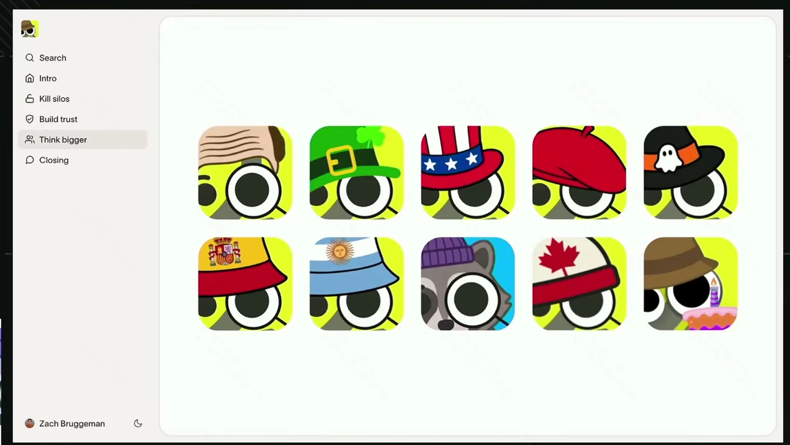

_截图 34  ·  录屏 07:41:23_

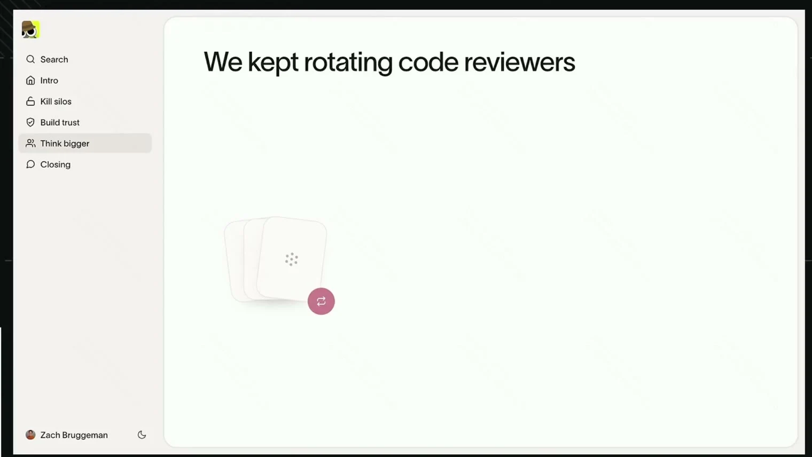

_截图 35  ·  录屏 07:41:35_

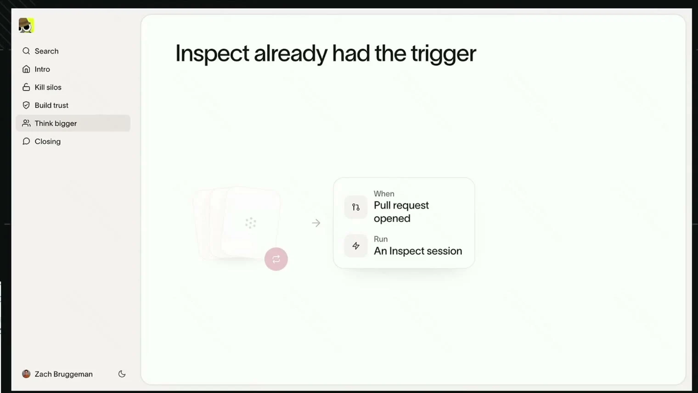

_截图 36  ·  录屏 07:41:52_

**07:41:58**　With just what we built already, they got to work building another beloved agent at Ramp, ReviewBuddy. And what was so cool about this is that, much like InSpec's own origins as a side project, these engineers were working on this, they didn't need to ask for permission to build it. They just challenged themselves to build something better, used InSpec to move faster, and quickly built an agent that was better for all of Ramp.

仅用我们已经构建的模型，他们就在 Ramp 的 ReviewBuddy 项目中继续打造另一个深受喜爱的智能体。最酷的是，就像 InSpec 作为副项目诞生之初那样，这些工程师在从事这项工作时，无需请求许可即可进行开发。他们只是挑战自己打造更优秀的产品，利用 InSpec 加速发展进程，最终打造出对 Ramp 整体更有帮助的智能体。

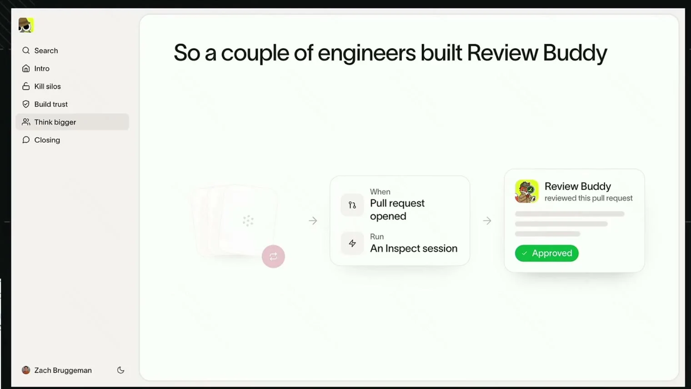

_截图 37  ·  录屏 07:42:09_

**07:42:22**　This really did force us working on Inspect to think about Inspect differently. At that point in time, we were pretty okay with Inspect quote-unquote just being a coding agent. But once we saw what others were pushing it to do, it got us thinking about how Inspect could become full circle. If this push didn't happen naturally, I think it would have taken the Inspect team a lot longer to get there.

这确实促使我们以不同的方式思考 Inspect 的设计。当时，我们对于 Inspect 仅仅作为一个编码智能体来说还挺满意的。但一旦看到其他人推动它做的事情，我们就开始思考 Inspect 如何能够实现完整的目标。如果这种推动不是自然而然发生的，我认为 Inspect 团队需要更长时间才能达到那个目标。

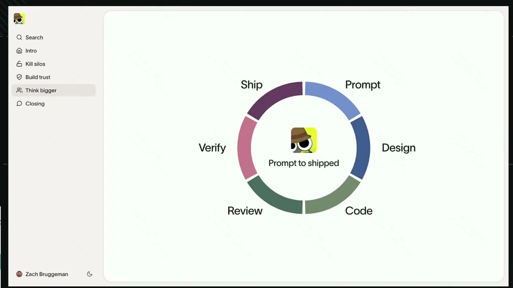

_截图 38  ·  录屏 07:42:42_

**07:42:48**　This is what I mean about thinking bigger together. Especially with the continued improvements in model performance, now's the time to push yourself and the people around you to think bigger. I encourage all of you to take some time in this coming week to ask everyone that you work with, what have we been waiting to do that we haven't done yet? And once you've found those things, try to build them together.

这就是我所说的“共同思考更大目标”的含义。尤其是随着模型性能的持续提升，现在正是激励自己和周围的人去追求更大目标的时刻。我鼓励大家在本周花些时间问问同事：我们还有哪些事情没有完成？一旦找到这些事情，就试着一起实现它们。

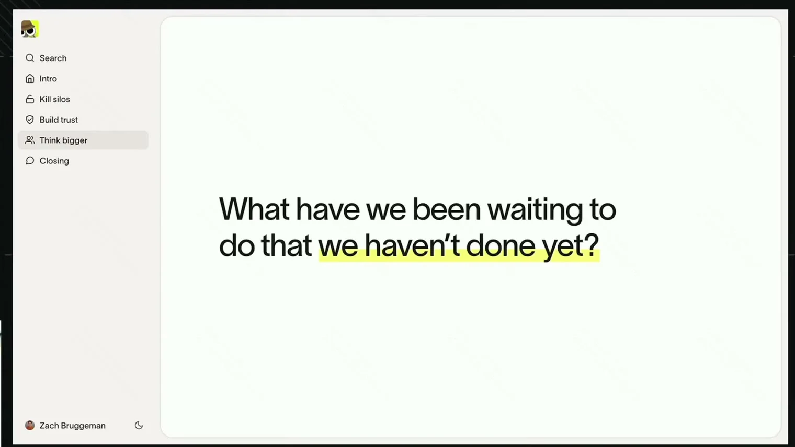

_截图 39  ·  录屏 07:43:07_

**07:43:12**　There's really not an excuse to not just try anymore. You have access to the same models as everyone else. You have to start somewhere. And I believe that there is so much potential in unlocking wins, not just for yourself, but for the people around you. Inspect itself was born this way, not only as something that I wanted to build and Jason wanted to build, but out of a want to build something for a team that I truly love and truly respect that would just make their jobs a little more enjoyable.

其实没有理由不再尝试了。你拥有和其他人一样的工具，总得从某处开始吧。我相信，解锁成功的机会巨大，不仅对你自己有益，对周围的人也有好处。《Inspect itself》就是这么诞生的——不仅是我想和Jason一起打造的东西，也是为了一个我真正喜爱并尊重的团队而创造的东西，让他们的工作更加愉快。

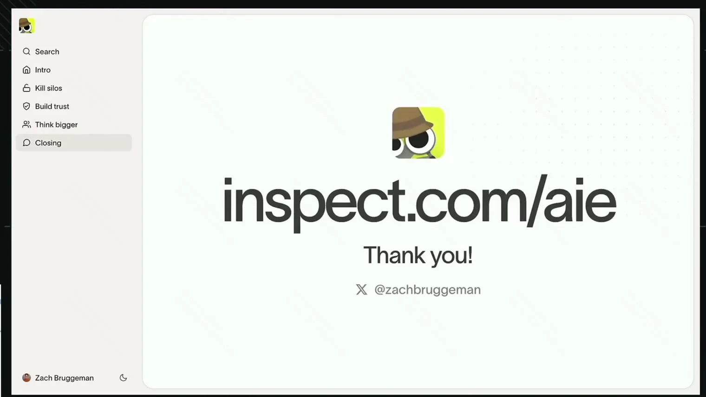

_截图 40  ·  录屏 07:43:40_

**07:43:41**　Now, if you'd like to use a coding agent that has embodied all these lessons that we've learned, I'm happy to say that Inspect is now available If you go to inspect.com slash AIE, we'll prioritize you and your team on the waitlist. We're actually moving through this waitlist pretty quickly, so expect to hear from us soon. But otherwise, I hope you've enjoyed hearing about our robotic friend Inspect.

现在，如果您想使用一个包含了我们所学到所有知识的编码智能体，我很高兴地告诉您，Inspect现已可用。如果您访问inspect.com/AIE，我们将优先安排您和您的团队加入等待名单。实际上，我们正在快速处理这个等待名单，所以请期待我们的消息。不过除此之外，希望您喜欢了解我们的机器人朋友Inspect。

**07:44:01**　If these topics interest you, feel free to reach out here or on X. But otherwise, thanks so much for listening.

如果这些话题让你感兴趣，欢迎在这里或 X 上联系我。否则，也感谢你的倾听。

---

[全部演讲](../README.md) · [选看索引](index.md) · [上一场](24-fabian-hedin.md) · [下一场](26-steve-yegge.md)
