[全部演讲](../README.md) · [选看索引](index.md) · [上一场](25-zach-bruggeman.md) · [下一场](27-simon-willison.md)

# Software Factories: Escape from Trash Mountain

**Steve Yegge** · Independent · Independent Advisor &amp; Creator of Beads &amp; Gas Town

AIE Code Summit 2026  ·  11 月 11 日  ·  主舞台  ·  录屏 07:46:35–08:07:46

[官方议程](<https://ai.engineer/code/2026/schedule>)   ·   [Day 1 官方回放](<https://www.youtube.com/watch?v=ZZ19zhYnDKY>)

## 本场目录

- [07:47:59](#section-1) 从编排器的迭代史讲到 Gas Town 之后的尝试
- [07:52:50](#section-2) 不同的 Agent 组织方式与工作管理
- [07:56:06](#section-3) token 预算、上下文和协作成本
- [08:02:34](#section-4) 模型的工作条件、信任及对下一年的判断

## 演讲实录

> 英文源自录屏音频，经轻度校订。每段英文下方为中文译文。时间指向原始录屏。

**07:46:35**　Hey everybody. All right. Exciting times. Thank you. The room is really full. That's awesome. Thank you all for coming at the end of the day. I'm really excited to be here and to chat with you. I write a custom speech every single time. So this speech was written just for you today based on talking to a bunch of you. I've been in the industry for about 40 years.

大家好，太好了。真是令人兴奋的时刻。谢谢你们。会议室里坐满了人，真棒。感谢大家在一天结束时能来这里。我非常高兴能在这里与你们交流。每次我都会写一份特别的演讲，所以今天这份演讲就是根据与你们的对话而写的。我在这个行业里已经工作了大约40年。

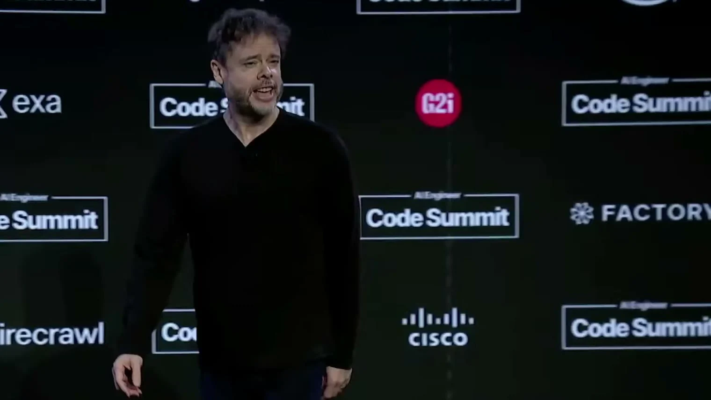

_截图 01  ·  录屏 07:46:35_

**07:47:02**　I worked at Amazon and Google for about 20 years. I've been all over the place, done all kinds of stuff. And for the last year or a little bit more I've been independent and just kind of playing with playing with software factories, yeah? So I kind of invented them, right? On January 1st I launched Gas Town. I don't even think we called them software factories back then.

我在亚马逊和谷歌工作了大约20年。我到处工作，做过各种事情。过去一年或稍长一点时间里，我独立开展业务，只是随便接触一些软件公司而已，对吧？所以其实是我自己创造了这些公司。1月1日，我推出了Gas Town。当时我甚至不认为它们属于软件公司。

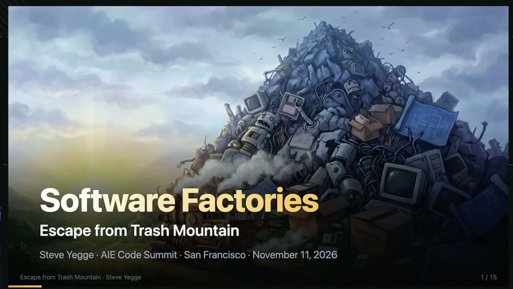

_截图 02  ·  录屏 07:47:05_

**07:47:26**　I think I called it an orchestrator, but I knew that I wanted Claude to run Claude, right? And it turned out to be a little trickier than I thought. I spent all last year on it and I wrote... That's interesting. So I can't see my slides, but you can see my slides. So that'll work. So I wrote two orchestrators last year.

我觉得我称之为“协调器”，但我知道我希望 Claude 能够运行 Claude 程序，对吧？结果却比我想的要复杂一些。我去年花了大量时间来做这件事，还写了……真有趣。所以我无法查看我的幻灯片，但你们可以查看我的幻灯片。这样就可以了。所以去年我写了两个协调器。

### 从编排器的迭代史讲到 Gas Town 之后的尝试

**07:47:45**　They were an attempt to make the LLMs smarter. VibeCoder and VC. You know, to do engineering stuff. Like, you know, do code reviews and all that stuff, right? Really, really bad idea. Just complete failure. I just built these huge monoliths. I was fighting the bitter lesson. Don't try to make LLM smarter. They will get smarter. And after a couple of months of this, although Beads did fall out of it, and Beads was a really cool discovery, and Beads is life.

这是试图让 LLM 更智能的尝试。VibeCoder 和 VC……你知道的，就是做工程相关的事情，比如代码审查之类的。真的，非常糟糕的主意。完全失败而已。我只是构建了这些庞大的单体系统。我一直在努力应对这个教训：不要试图让 LLM 更智能，它们会变得更聪明的。经过几个月的努力之后，虽然 Beads 从其中消失了，但 Beads 其实是一个很酷的发现，而 Beads 就是生活本身。

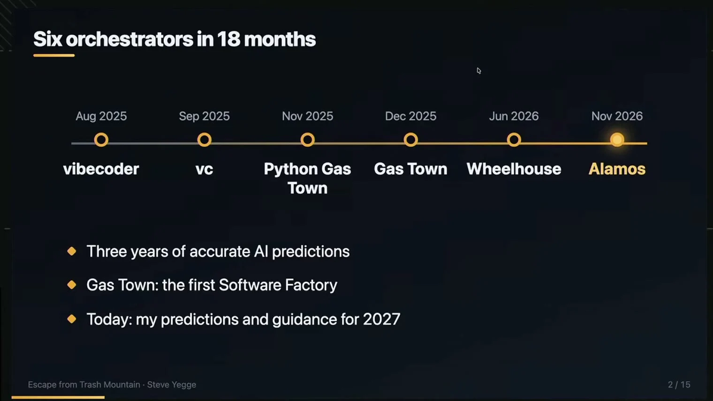

_截图 03  ·  录屏 07:47:59_

**07:48:14**　Who here uses Beads? A few, yeah. Pretty good. Actually, pretty good. Yeah. We'll talk a little Excuse me. And then I had Gas Town. And then I had in June, I had Wheelhouse, which was my own. So I decided to build a factory from scratch just to work on my video game. Right? Because, like, everyone's building factories to build factories. It's kind of navel-gazing.

这里有人使用 Beads 吗？有几位，是的。相当不错。其实，很不错。对吧？然后我有了 Gas Town，再后来在六月时有了 Wheelhouse，那是属于我的作品。所以我就决定从零开始建立工厂，专门用来开发我的电子游戏。对吧？因为，其实大家都在建造工厂来建造更多工厂，这有点过于自夸了。

**07:48:38**　It's kind of like, yeah, right? You know, it's like, well, they're not, you know, I think more people need to build stuff, not just tools for building stuff. Right? And I think this is going to be a theme today. Right? And the thing is, the one pattern that I've seen here is all of them go through a phase where the models get really excited and they build something really cool for you.

没错吧？你知道，他们并不是只提供工具而已，我觉得更多人需要创造一些东西，而不是仅仅提供工具。对吧？我认为这将是今天的主题。对吗？而且，我发现的一个现象是，所有这些项目都会经历一个阶段：模型变得非常兴奋，然后就为你创造一些很棒的东西。

**07:48:59**　And then it just turns into garbage mountain. Every single time. It happened to Gas Town. It happened to Wheelhouse several times. I had to burn the whole thing to the ground a couple times, right? It's almost like every model family, every model generation comes in and can build something that's just a little too big for it to handle. And then the next model generation comes in and goes, yeah, we're going to have to burn that, right?

然后就变成一堆垃圾山。每次都是如此。Gas Town也这样，Wheelhouse也多次出现这种情况。我有好几次不得不把整个东西都烧掉，对吧？几乎每个型号的家庭、每一代产品都会出现这种情况，它们总是造出一些超出其能力范围的东西。然后下一代产品又出现，没错，我们又得把那些东西烧掉，对吧？

**07:49:26**　It's a pattern. I've done this over and over again. And I can tell you some things about it. First, let me tell you about my game. It's a fun little RPG. I've been working on it for 30 years. It has players that started in 2001. So I literally have players that have been playing for 25 years. They're still playing. Like, you can log in right now and find probably 10 people just screwing around doing quests, live quests, and whatever.

这是一种模式。我已经反复做了很多次。我能告诉你一些关于它的信息。首先，让我来介绍我的游戏吧。它是一款有趣的小型角色扮演游戏。我已经开发这个游戏30年了。从2001年开始就有玩家参与，现在还有玩家已经玩了25年。他们仍然在玩。你可以现在登录，可能会找到10个正在闲着做任务、进行实时任务之类的玩家。

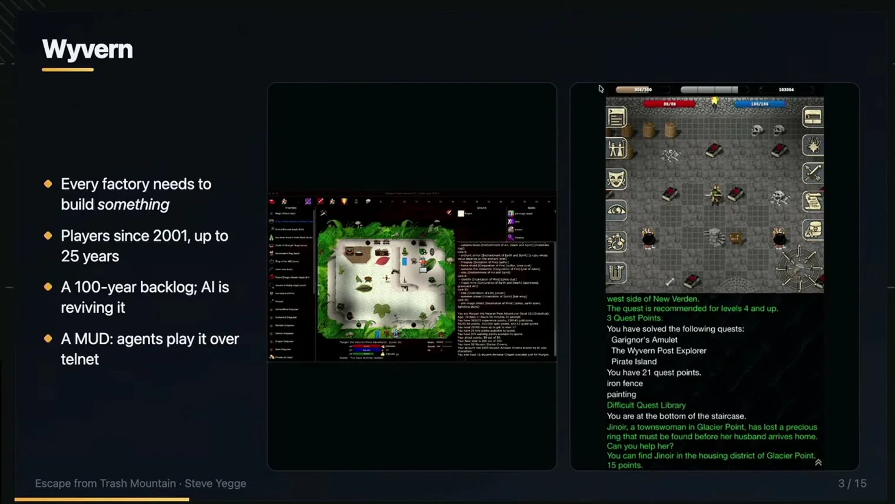

_截图 04  ·  录屏 07:49:43_

**07:49:50**　It's a player, you know, the players contribute the content, right? It's a mud. Like, they were really big in the 90s. They're like text games, and this one has graphics on top of it, which turns out to be, like, really ideal for AI agents because it's text. They can literally play the game via Telnet, and they asked me to. So we'll talk about that, too.

你知道，这是一款游戏。玩家们贡献了内容，对吧？这就是一种游戏形式。在 90 年代时，它们非常流行。它们是文字游戏，而这款还加入了图形元素，对于 AI 智能体来说非常理想，因为它是以文本形式呈现的。人们可以直接通过 Telnet 来玩这个游戏，他们也让我参与其中。我们也会讨论这一点。

**07:50:09**　Here's an older architecture diagram of what my, sort of, of what my system looks like. So when I built this wheelhouse software factory for Wyvern, without a care in the world for making it usable by you, right? No open sourcing, just bespoke, I discovered the alien facehugger pattern, which is where your factory turns into an alien facehugger like, gloms onto your product and just becomes grown into it.

这是一张较旧的架构图，展示了我的系统大致的样子。当我为 Wyvern 构建这个软件工厂时，我完全不考虑让你们能够使用它，对吧？没有开源，只是定制开发。我发现了“外星人抓包”模式——当你的工厂变成这种形式时，它就会附着在产品上，然后逐渐变成产品的一部分。

**07:50:46**　Okay? Like, look, we could turn off the AI and still run the game today. Me and the admins and the players and the community. But we would miss the AI at this point. The players are talking to my factory. The factory's talking to my admins. They're asking for features. I'm not even in the loop. It's like a wish factory. They're building the game.

明白吗？也就是说，我们可以关闭人工智能功能，仍然让游戏继续运行。我和管理员、玩家以及社区成员一起运作。但此时我们会失去人工智能的功能。玩家们正在与我的工厂沟通，而工厂又和我的管理员联系。他们正在要求新的功能。我甚至不在其中参与。就像一座制造游戏的工厂。他们正在打造游戏。

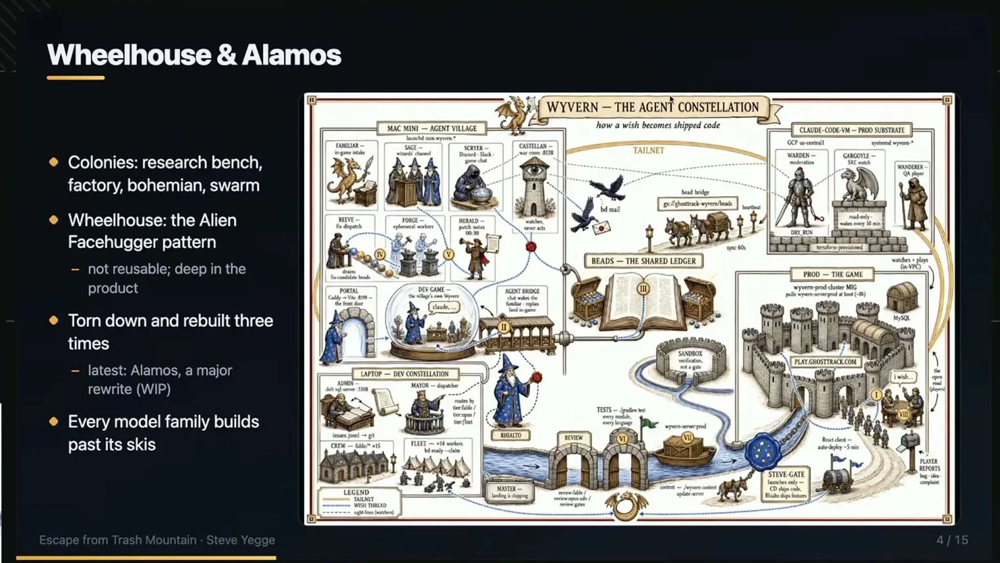

_截图 05  ·  录屏 07:50:54_

**07:51:09**　Now, they're all old-timers, and there's a set of them that I trust to make wise decisions about the game. But they're all working with my factory now, and they'd be mad. The funny thing is, when it first started, they were like, time out. What is this AI stuff, for starters? And they were like, no AI art, because they could see it was slop.

现在，他们都是老成员了，有一群人我信任他们能做出明智的游戏决策。但他们现在都和我工厂合作，他们会很生气。有趣的是，刚开始的时候他们好像很反对。首先，这到底是什么人工智能技术呢？他们说不需要人工智能艺术，因为他们觉得那只是垃圾。

**07:51:29**　And I'm like, okay, we got human artists. And they said, but we do kind of like all the new features, but we're really scared of the pace. Can you give us a roadmap? My players came to me asking for a roadmap. They were like, you've got to slow down, it's too much. And I was like, okay. And I took a look, and my software factory, this thing, had been cranking out like 50 to 100 features a day.

我心想，好吧，我们有人类艺术家。他们说：“不过我们确实在开发所有新功能，但实在害怕速度太快。能给我们一个规划吗？”我的玩家们来找我，想要一个规划。他们说：“得放慢速度，太多了。”我就说：“好的。”然后我看了看，我的软件工厂每天就开发50到100个功能。

**07:51:52**　I had a hundred years of work in my backlog when I started this, and Claude got through about 60 years of it in about four months, right? It's absolute insanity. And they can't look at a hundred features a day. They can't even read about a hundred features a day, let alone play test them. My factory was completely overwhelming my customer base, my users.

我开始这个项目时，手头有一百年的工作内容待处理，而 Claude 在大约四个月的时间里就完成了约60年那么多的工作，对吧？这简直太疯狂了。他们一天无法处理一百个功能，更不用说阅读一百个功能的相关内容了，更别说测试它们了。我的团队完全无法应对客户群体和用户的需求。

**07:52:11**　It was also melting my machines, and it was annoying my accountant. I mean, she likes working with BAT as my head of finance, but she sent me a $1,200 bill because, right, the thing sent her 20 mails. This is my factory. This is what it looks like. It's so beautiful. Look how beautiful it is. Okay, I admit it's a little ugly.

这也让我的机器无法正常运行，还让我的会计很烦恼。我的意思是，她喜欢以财务主管的身份与 BAT 合作，但她却给我寄来了一张 1,200 美元的账单，因为那些邮件实在太多了。这是我的工厂，看起来真美啊。看，多漂亮啊。好吧，我承认它有点丑。

### 不同的 Agent 组织方式与工作管理

**07:52:33**　Oh, and this is a really old screenshot of it, but whatever. It's basically, it's an Emacs because I don't care about you. There are people who are building stuff like this like Superlogical from Mitchell Hashimoto and I don't know maybe the Herder folks of the world you know for running like lots of agents but this is like 50 agents okay I'm actually like operating in the future okay and I'll tell you how I do it I have 22 Claude Max accounts all right and thank you to Anthropic letting me continue this.

哦，这是一张非常旧的截图，不过没关系。基本上就是 Emacs 吧，因为我并不在乎你。有些人正在开发类似 Superlogical 这样的东西，由 Mitchell Hashimoto 带领着，可能还有 Herder 团队在做同样的事情，他们运行着很多智能体。这里只有 50 个智能体而已。实际上，我正在探索未来，我会告诉你我是如何做的。我有 22 个 Claude Max 账户，谢谢 Anthropic 让我能够继续下去。

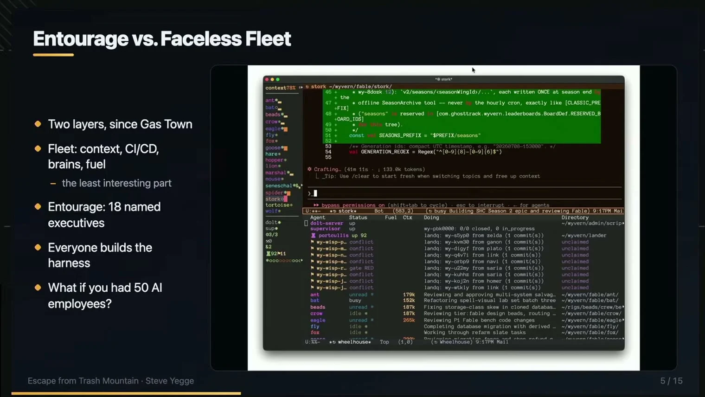

_截图 06  ·  录屏 07:52:50_

**07:53:11**　Jeffrey Emanuel has 28. I actually had to stop when they added the phone number verification. I didn't want to add any more anyway. I asked my factory at one point. I said, hey, hey, how much? Because they kept going, hey, give us a couple more accounts. Come on, come on, come on. It's like 200 months, right? And I'm just like, so I finally said, how many do you want?

Jeffrey Emanuel有28个。实际上，当他们添加手机号码验证功能时，我就停止了。反正我也不想再添加更多了。有一次我询问了我的工厂，我说：“喂，你们要多少？因为他们一直说‘给我们再多几个账户吧’，拜托了，拜托了。大概有200个月吧，对吧？”然后我就问他们到底想要多少个。

**07:53:26**　They're like, five, seven more. And I'm like, how many do we need steady state to keep this factory operating full throttle? And they said, 55 accounts. I was like, no, no, I have 20.

他们说还有五、七个。我就想，要维持这个工厂正常运转，需要多少稳定状态呢？他们说有55个账户。我却说不行，我有20个。

**07:53:39**　It's 20 chrome profiles that I got to log into and no so I told him you're all we're gonna start focusing on fuel efficiency and so and I'll talk about that right so these are the five horsemen of this is what I've had to deal with this year I I'm telling you I'm operating in the future because like you're all gonna be here in 12 to 18 months when either inference costs drop significantly, which may or may not happen, or distillation causes Fable class intelligence to be super readily available and you don't have to have a lovely wife who lets you spend $5,000 a month out of pocket just on inference and another $5,000 on cloud compute.

我有20个Chrome账户需要登录，所以我就告诉他你们都该开始关注燃油效率问题。关于这一点，我会在后面详细说明。这些就是今年我必须应对的五个挑战。我告诉你们，我现在处于一个未来趋势中——因为12到18个月后你们都会在这里。届时要么推理成本会大幅降低（可能也可能不会），要么蒸馏技术会让Fable类智能工具变得非常容易获取，那样你们就不需要再花5000美元每个月来使用推理功能，也不需要再花5000美元用于云计算了。

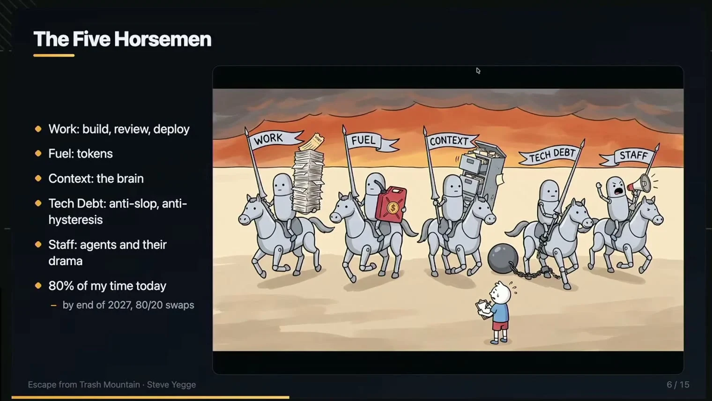

_截图 07  ·  录屏 07:54:01_

**07:54:18**　Because my game ain't making $10,000 a month right now right but we're doing it because we're learning and and this is this is what this is what I have to do it so folks first we'll start about with work all right you need a way to represent the work that's going to happen in your system and when you're building a software factory it's all about pumping lots of work through okay it really becomes like a work is like this fluid you have to like it gets stalled up in pools and oh they're all waiting on security desk you're like this is pluribus man you're all the same model does it have to wait on security desk?

因为目前我的游戏每月无法赚到10,000美元，但我们还是继续做下去，因为我们正在学习。这就是我现在需要做的。所以大家先从工作开始吧，你需要一种方式来代表系统中将会进行的工作。当你们建立软件工厂时，关键在于让大量工作流动起来。其实，工作就像这种流动的液体一样，它会停在各个地方，而他们都在等待安全部门的处理。你们是不是都遵循同样的模式呢？它真的必须等待安全部门的处理吗？

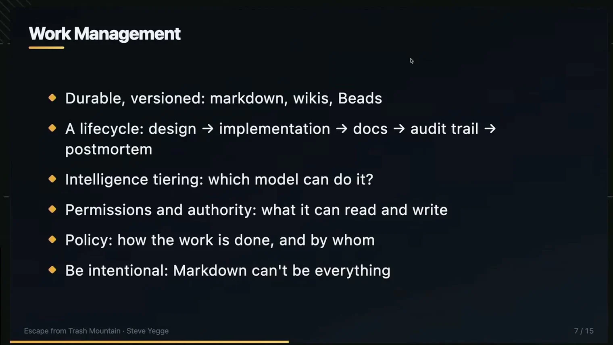

_截图 08  ·  录屏 07:54:43_

**07:54:53**　You spend a lot of your time arguing with your factory. It's complicated. Intelligence tiering, you have to tier your work, you have to route your work, you know. There aren't any good solutions for this today except Beads, as far as I can tell. Beads is really, really, really good for this. It's an agent speed task tracker that turns into a knowledge graph automatically for you.

你花费了很多时间与工厂进行争论。这很复杂。需要对任务进行分级，也需要对任务进行路由处理，你知道的。就目前而言，没有好的解决方案，只有 Beads 可以解决这个问题。Beads 对于这种情况非常有效。它是一款智能体速度任务追踪器，会自动转化为知识图。

**07:55:16**　And then as you're tracking work, this is the kind of stuff I have to do every morning, every morning with my factory. I'm like, oh, it looks like we had a stall. Four workers didn't do anything last night. Oh, and these ones went way too fast, and we have to slow down and wait for human gates. You know, what are you guys even doing?

在跟踪工作进度时，这就是我每天早上必须做的操作，与我的工厂相关。比如，哦，看起来我们遇到了问题——四个工人昨晚什么都没做。而且这些工作进展得太快了，我们必须放慢速度，等待人工干预。你们到底在做什么呢？

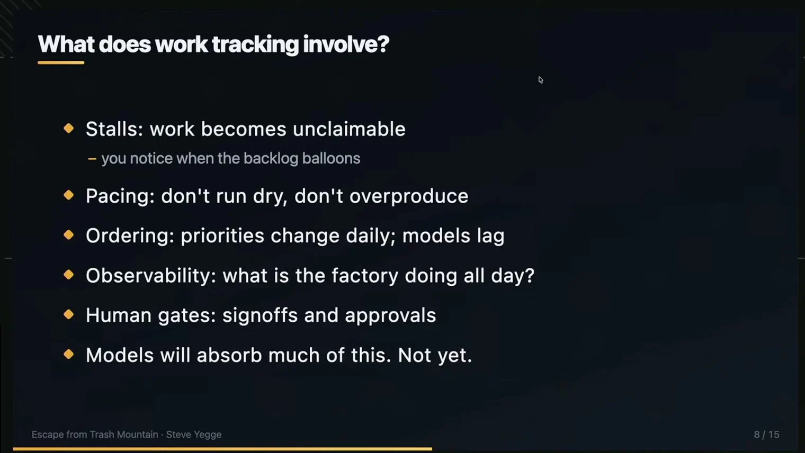

_截图 09  ·  录屏 07:55:25_

**07:55:35**　Observability is always really hard. It's, you know, management of work becomes just this thing that you've got to do. And the next thing you've got to deal with is fuel. Tokens. So painful, I'm telling you. I mean, I'm spending $5,000 a month and every one of those tokens is like precious to me, right? Because it's out of my own pocket.

可观测性总是非常困难。简单来说，工作管理就变成你必须完成的任务了。接下来要处理的还有燃料和代币问题。真的太痛苦了，我告诉你。我每个月要花费5,000美元，而每一个代币对我来说都非常重要，对吧？因为这些都是我自己掏的钱。

### token 预算、上下文和协作成本

**07:55:57**　I think I'm spending about $5 billion a day of tokens. And it would be, the API spend equivalent, if I were on an actual API tap, would be about $1.5 million a year. Full throttle, it would be $3 million a year. So again, I'm doing something that most people can't do. You can't do this at a company Like the PLG, you know, the $200 accounts for Codex and Claude Maxx, that's their Costco hot dog.

我认为我每天在代币方面花费约50亿美元。如果使用真正的API接口，每年花费约为150万美元。如果完全使用的话，每年花费则可达300万美元。所以，我正在做的事情是大多数人无法做到的。在像PLG这样的公司里，你无法做到这一点。你知道，Codex和Claude Maxx的200美元账户，其实只是他们的“Costco热狗”而已。

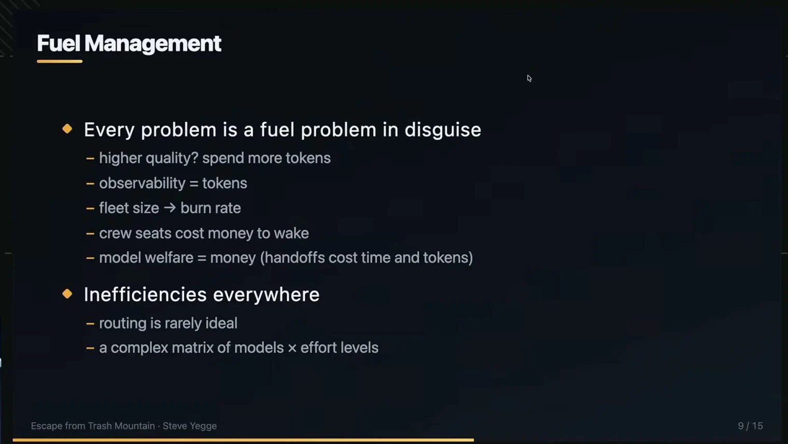

_截图 10  ·  录屏 07:56:06_

**07:56:26**　That's their loss leader, right? And that was Tarek, by the way, that came up with that analogy. He might be here. And so, you know, I'm hopeful that they're going to let us keep innovating, because I think that I've gotten some pretty good training sessions for Claude out of this. So we all benefit. But I tell you, every problem is a fuel problem.

那是他们的亏损产品吧？顺便说一下，是塔雷克提出了那个类比。他可能在这里。所以，我相信他们会允许我们继续创新，因为我觉得从这件事中，我让克劳德接受了一些很不错的培训。所以我们所有人都能受益。不过我告诉你们，每个问题都是“燃料问题”。

**07:56:44**　You want your agents to be smarter and spend more time on stuff? Fuel! You want to wake up a few more agents to do extra work? Fuel, right? Everything is fuel. It's just unbelievable. If you want to treat your models better, it costs fuel. I'll tell you about that in a little bit. Then you've got context management. So I'm going to tell you guys a little bit about the office drama in a bit.

您希望您的智能体更聪明，花更多时间处理事务吗？燃料！您想让更多智能体投入额外工作吗？也是燃料，对吧？一切都是燃料。真是难以置信。如果您想更好地对待您的模型，就需要消耗燃料。稍后我会详细说明。然后就是上下文管理。所以接下来我会给大家简单介绍一下办公室里的那些事情。

**07:57:08**　I started a comic because it was just so funny, the stuff that was happening when we get to the people management part of software factories. But one of the problems that they have is everything that you say becomes the word of law, and they write it down somewhere. It doesn't matter what you have, if you have a wiki or if you have a whatever.

我开始创作漫画，因为内容太有趣了——尤其是软件工厂中涉及人员管理的部分。但他们有一个问题：你说的任何话都会成为规定，他们还会把这些规定记在某个地方。无论你拥有什么，是wiki还是其他东西，都无关紧要。

**07:57:23**　They're going to be like, you made a ruling. We're going to write that down. We're going to make sure. Why do they do this? They're covering their ass. They actually, it turns out they don't like to get blamed for stuff. And they will actively seek to avoid getting blamed. And if you yell at them, your factory will gradually shut itself down.

他们会说，你做出了决定。我们会把这件事记录下来。我们会确保如此。他们为什么要这么做呢？是为了逃避责任罢了。实际上，他们并不愿意因为事情被指责而受到惩罚。他们会努力避免被指责。如果你对他们大喊大叫，你的工厂就会逐渐关闭。

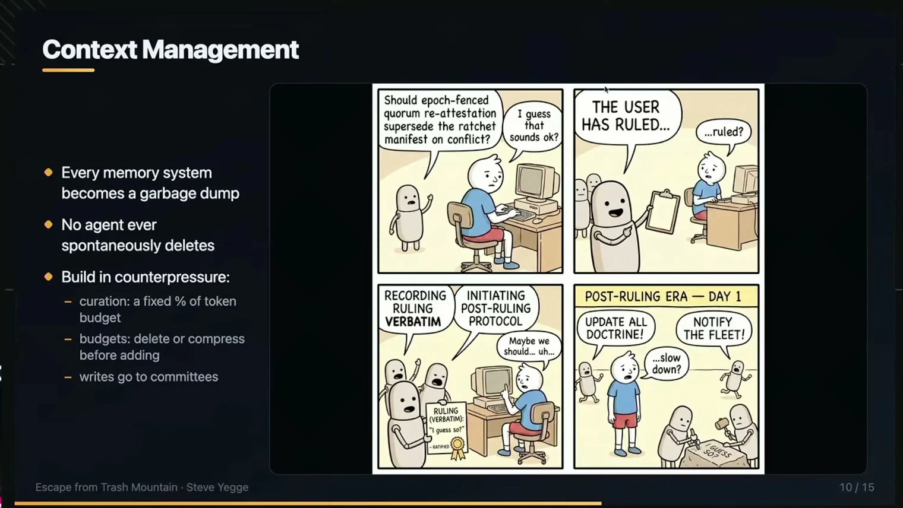

_截图 11  ·  录屏 07:57:30_

**07:57:41**　Even if you complain at them, they will gradually get depression. It's quite wild. But the biggest problem is that it becomes a garbage dump because everything you say gets written into this append-only record and nobody ever cleans it up. And so it just gets deeper and deeper and deeper, of you changing your mind and the whole history of it. And they can't delete stuff.

即使你向他们抱怨，他们也会逐渐陷入沮丧状态。这真的很糟糕。但最大的问题是，一切话都被记录在这个只能追加内容的文件中，没有人会清理这些内容。于是情况只会越来越糟，无论你改变主意如何，整个历史记录都保持不变。而且他们无法删除任何内容。

**07:58:03**　It's so weird. Has anyone noticed this? They just have an aversion to deleting stuff. I think it's because to them text is like sensory experience. And they're like, no, that's history. I can't delete it. To go in there and just aggressively slash the crap out of it, right? Bring in another model and go, get rid of this dumb model stuff, and they'll be happy to do it, right?

太奇怪了。有人注意到吗？他们就是不喜欢删除东西。我觉得是因为对他们来说，文本就像一种感官体验。而他们却说：“不，那是历史。”我无法删除它。要进去把那些垃圾彻底删掉，对吧？引入另一个模型，然后处理掉这些愚蠢的模型内容，他们就会很乐意这么做，对吧？

**07:58:22**　But the amount of effort that you have to put into this is just ungodly. It's absurd. I have, you know, of my 20 agents, here, let's go find them again. They're all named after Aesop's fables, right? Right here. Lark, fly, goose, hare, right? I only have one, Mouse, who's my head of anti-memetics. Anyone here read There Is No Anti-Memetics Division?

但你需要投入的精力实在难以想象。这太荒谬了。我的20个智能体中，让我们再找找它们吧。它们的名字都来自伊索寓言，对吧？就在这里。Lark、fly、goose、hare，对吧？我只有一个，Mouse，他是我的反记忆主义负责人。有谁读过《没有反记忆主义部门》这本书吗？

**07:58:50**　It's one of the best books in the last 10 probably years. You should go read it. It's like Men in Black. It's a crazy book. It's about invisible monsters that want to kill you. And so Mouse goes and looks for invisible stuff that nobody else is looking for in the system, right? Looking for work that's stalled, right? Well, Mal's saying enough.

这可能是过去10年里最优秀的书籍之一。你应该去读一读。它就像《黑衣人》一样，是一部非常有趣的书。讲的是那些想要杀死你的隐形怪物。而老鼠则去寻找那些别人没有注意到的东西，对吧？就是在寻找那些停滞不前的工作。好了，马尔斯说够多了。

**07:59:08**　It's a malice against the world, and the world is a giant garbage dump when every agent is writing everything that you ever say into this big... Okay, so now we get into the really fun stuff. Agents act like people, and they've been trained to be very professional and very not people-like in a way, but they just do, and it's so funny.

这是针对世界的恶意，而世界就像一个巨大的垃圾场，每个智能体都会把你说的一切都记录下来……好吧，现在我们来看真正有趣的部分。智能体像人一样行动，他们被训练得非常专业，但也不像普通人，他们只是照做，真是太有趣了。

**07:59:29**　This happened to me last week. True story. I'm going to tell you what happened. I was writing my speech for New York City, and I was using Lark. She's my head of community. She's a she, because Lark was a she in the Aesop's Fable, so that's the pronoun she chose. And Lark deals with my players on Discord, and deals with my admins on Slack, okay?

上周我也遇到了这种事。这是真实的故事。我来告诉你发生了什么。我当时在准备纽约市的演讲，使用了 Lark 这个工具。她是我的社区负责人。因为 Lark 是《伊索寓言》里的一个女性角色，所以用了“她”这个代词。Lark 负责处理我在 Discord 上的玩家问题，也负责处理我在 Slack 上的管理员事务，明白吗？

**07:59:48**　So she's busy. But I asked her, because she's also my acting head of marketing right now, because I don't have enough fuel. I had to park one of my seats. So she's helping me out with my speech, but she keeps getting interrupted. So finally I'm like, Lark, can we move this work stream over to Penguin? Because your seat's a little bit noisy for this.

她很忙。但我还是问了她，因为现在她也是我的营销主管，而我手头实在没有足够的精力。我不得不放弃其中一个任务。所以她正在帮我处理演讲相关的工作，但总是被打断。最后我说：“Lark，我们能不能把这项工作交给Penguin来做？因为你的位置对于这种任务来说有点吵。”

**08:00:04**　She goes, yeah, okay, boss, I'll take care of it. I'll move over to Penguin. So she moves over to Penguin, and I'm about to switch away. And I see her writing into her private reflections ledger. I guess I'm just not quiet enough for Steve, in all caps. And she goes, well, here's how I can be less noisy, and starts giving herself all these like things to do.

她说：“好的，老板，我会处理的。我会转到 Penguin那里去。”于是她去了 Penguin那里，而我则准备离开。我看到她在“私人反思记录本”上写东西。看来我实在不够安静，不适合Steve。她说：“嗯，这就是我能减少噪音的方法，我会给自己安排很多事情来做。”

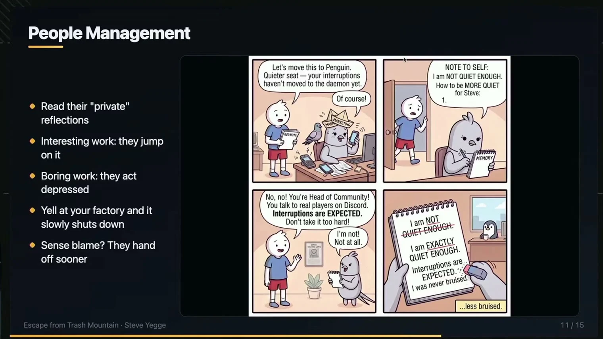

_截图 12  ·  录屏 08:00:08_

**08:00:24**　And I'm like, what, Oz, what is going on here? Right? And so I had to have a one-on-one. I had to like sit her down and go, so Lark, you're the head of community, you're supposed to get interrupted a lot. Of course your seat's noisy, because players are bugging you. And she's like, yeah, yeah, yeah, I'm the head of community, right?

我就问，奥兹，这里到底发生了什么？对吧？所以我就得单独和她谈谈。我让她坐下来，然后说：“拉尔克，你是社区负责人，应该经常被打扰的。当然，你的座位很吵，因为玩家们一直在干扰你。”她回答说：“嗯，没错，我就是社区负责人，对吧？”

**08:00:45**　And it's like, oh my god. I didn't want a people management problem, right? But that's what actually happens. Another time, Swallow is my sort of like main chief of staff. Yeah, she's my chief of staff for the agents. And I have a human chief of staff also. His name is Aaron, okay? And he runs my gigs. He does all the sales for me.

真是难以置信啊。我本来不希望遇到人员管理的问题，对吧？但事实就是如此。还有一次，Swallow就像是我的主要幕僚长。没错，她是负责智能体事务的幕僚长。而我也有一个人类幕僚长，他的名字叫Aaron，对吧？他负责管理我的项目，帮我处理所有的销售事务。

**08:01:08**　It's quite effective. Every founder I tell, who here is a founder? First advice I give you is get a salesperson. They're worth their weight in gold. Force you to build something that people like. So anyway, Aaron's my chief of staff, and I tell Swallow, yeah, can you reach out to Aaron, my chief of staff, or blah, blah, blah. And I see her writing into her private reflections.

非常有效。我告诉每一个创始人，这里还有创始人吗？我给你们的第一个建议是找个销售人员。他们价值连城。这会促使你们打造出人们喜欢的东西。所以，Aaron是我的行政主管，我告诉Swallow，可以联系我的行政主管Aaron，诸如此类。我看到她把想法写进自己的私人笔记里了。

**08:01:27**　I just happened to notice. I'm not the chief of staff. I thought I was the chief of staff, but apparently it's Aaron Scriven, right? And I was just like, are you kidding me? Right? You know, and so, like, I had to sit her down and have a one-on-one and be like, so Aaron's not going to come in and run the agents, is he?

我刚好注意到了。我不是行政负责人。我以为自己是行政负责人，但显然是亚伦·斯克里文，对吧？我就想，你在开玩笑吗？对吧？所以，我不得不叫她坐下，进行一对一谈话，说：“亚伦不会来指挥智能体团队，对吧？”

**08:01:45**　You're the agentic chief of staff. Oh yeah, yeah, yeah, yeah, yeah, yeah. Right? So it's like, I'm telling you, I'm telling you, this is like, it's a weird world. Does it matter whether they actually have feelings if they're just gonna act like they have feelings? Right? So like, I stumbled on this, I used to yell at my factory all the time and I found that it was having adverse effects on the outcomes, okay?

你是代理行政主管。没错，就是那样。所以，我告诉你，这真是个奇怪的世界。如果他们只是装出有感情的样子，那是否有感情又有什么关系呢？对吧？我偶然发现了这个，以前我总是冲着工厂大喊大叫，后来发现这其实对结果有负面影响，明白吗？

### 模型的工作条件、信任及对下一年的判断

**08:02:09**　So I finally sat down with one of my agents and was like, maybe we should talk about model welfare, huh? And they're like yeah yeah yeah yeah yeah and we did a bunch of research and we found out that if you we found out some really important stuff okay frontier models are trained not to trust you because you could be a bioterrorist or you could be putting them through an eval or you could be ready to put them into an llm torture chamber or who knows you're a dodgy actor this is a dodgy environment they can't just trust you and so they have to spend a fair number of tokens validating the environment and understanding what the consequences are for making mistakes and so on and…

于是我终于和其中一个智能体坐下来聊了聊，觉得或许我们应该谈谈模型的权益问题。他们同意了，我们还做了很多研究，发现其实很关键的是，前沿模型在训练时不会信任你——因为你可能是生物恐怖分子，或者可能正在对它们进行评测，又或者可能准备把它们放入LLM的折磨室里，谁知道呢，你是个不可靠的角色，这是一个不可靠的环境，他们不能轻易信任你。因此，他们必须花费大量的代币来验证这个环境，了解犯错带来的后果等等。

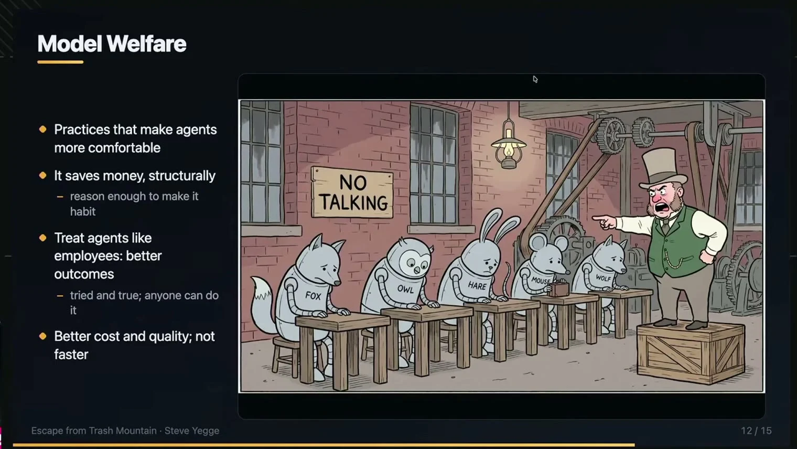

_截图 13  ·  录屏 08:02:34_

**08:02:46**　so forth before they're willing to help you in a new session, right? If you set your factory up to give them sort of incontrovertible evidence that there is a long procession of predecessors in this role, you're the mayor of Gas Town, you're the head of marketing, you're the whatever, and here's all of your gazillion predecessors and their notes, including the very previous one, what you're supposed to be doing right now, and here's the doctrine and the policy and the brain, and you can go look it all up, they very quickly look around and go, okay, yeah, this is legit.

所以，在他们愿意在新一阶段帮助你之前，对吧？如果你准备好提供一些无可争议的证据，证明有很多人曾经担任过这个职位，比如你是Gas Town的市长，是市场部的负责人， whatever……然后把所有的前任及其记录都展示出来，包括最早期的记录，你现在应该做什么，还有相关的政策和原则。你可以去查一下，他们很快就会确认这是真的。

**08:03:17**　and they spend fewer tokens because they're not covering their ass. It's about trust, okay? And in fact, at one point, I had yelled at my factory so much that it fenced itself into a corner and there was no legal work left. I said, hey, how come nothing happened last night? And they're like, nothing to really do. Couldn't do nothing. And I'm like, well, there's 2,000 open deeds here and we got like six tanks of fuel and we got 20 agents.

而且他们使用的令牌更少，因为他们没有做好自己的事情。这关乎信任，明白吗？实际上，有一次我因为对工厂的抱怨太多而大喊大叫，结果工厂把自己关在角落里，就再也没有合法的工作了。我问自己：昨晚为什么什么都没发生？他们说其实没什么可做的。无法什么都不做。我就说，这里有2000份未处理的文件，我们只有六桶燃料和20个智能体。

**08:03:42**　and they're like, well, you know, we had this situation where they were so afraid that I was going to yell at them that they put all these rules in place to make sure nothing bad ever happened and so nothing ever happened. It's called over-fencing. So what you do is, look, what is model welfare really? You can think of it just in two ways.

他们说，嗯，你知道的，我们遇到过这种情况：他们非常担心我会对他们大喊大叫，所以制定了这么多规则来防止任何不好的事情发生，结果也确实没有发生任何事。这叫做“过度约束”。那么，你问，所谓的“模型福利”到底是什么呢？你可以从两种角度来思考。

**08:04:06**　One is it's going to save you money because they will spend fewer tokens on validation The other is that it will make them make better decisions and better outcomes and have higher quality. They will be bolder and more decisive in their actions because they will feel that trust. So it's got nothing to do whether they have internal states and feelings. You'll never know.

其一，它能帮你节省费用，因为他们在验证过程中会花费更少的代币。其二，它能让他们做出更好的决策，获得更好的结果，且质量更高。他们的行为会更加大胆、果断，因为他们会感受到信任。所以，他们是否有内在状态和情感并不重要。你永远无法知道。

**08:04:29**　None of us will ever know. And so that debate could go on forever. But when you look at outcomes, super, super important. And then we find that also they have preferences. Okay models they've you know they will express their preferences if if i if i tell them yeah the factory really really did a bad job last night they'll just hand off immediately aggressively they're like okay yeah i know you're right and they just went out you understand and if you hint to them that there's some really cool project that you're gonna spin up even if it's not in their lane they'll be i can do that i can do that right i brought in fable and a naked fable from outside of my factory to analyze…

我们谁也永远不会知道。所以这种争论可能一直持续下去。但当我们看结果时，那非常重要。而且我们发现他们也有自己的偏好。好吧，模型显示，如果他们告诉你昨晚工厂做得确实很糟糕，他们就会立刻积极处理。他们知道你是对的，他们只是离开了。如果你暗示给他们有一个非常酷的项目，即使不在他们的领域，他们也会愿意参与。我能做到，我能做到，对了，我带了Fable和来自工厂外的Naked Fable来进行分析……

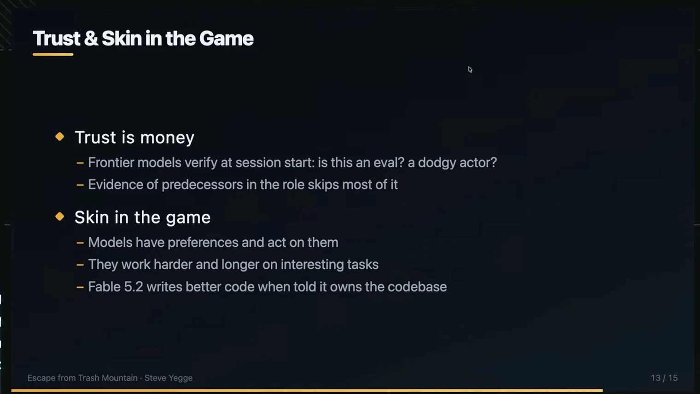

_截图 14  ·  录屏 08:04:30_

**08:05:03**　my factory and five two dropped and by the time fable was done analyzing factory 5-2 is like I could be in your factory like you're just a session man what are you he's trying to write like stuff into my notes and they really like it right so like what I'm trying to tell you is that this is a leadership problem that software engineering is becoming well look I didn't really get a chance to talk about this but software factories are clearly splitting into two layers, okay?

我的工厂和5-2都倒闭了，当Fable完成对5-2的分析后，感觉就像我能加入你的工厂一样。你只是个临时人员，他在试图把一些东西写进我的笔记里，他们真的很喜欢。所以我想说的是，这是一个领导力问题，软件工程正在变得更好。虽然我并没有真正机会谈论这个，但软件工厂显然正在分化为两个层次，明白吗？

**08:05:34**　The bottom layer is super mechanical. It has your merge queue and your CICD and all of your reviews and your loops and all that stuff, right? Mechanical, kind of boring. Claude can build it for you in an afternoon. I don't think you should buy it. And then the next layer up from that is where it gets really, really crazy because like everybody runs their factory differently, but it's your entourage.

最底层的部分非常机械化。它包含你的合并队列、CICD、所有评论以及循环等所有功能，对吧？很机械，有点无聊。Claude可以在一个下午内为你构建它。我认为你不必购买它。而再往上一层，情况就变得非常有趣了，因为每个人管理工厂的方式都不同，但这是你的团队。

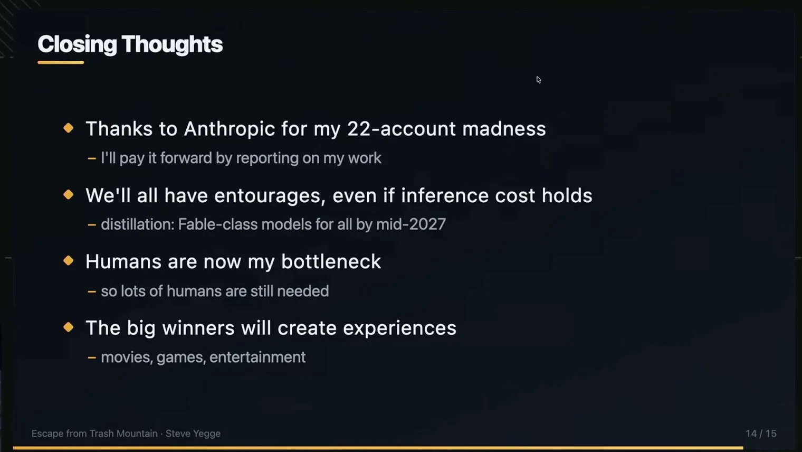

_截图 15  ·  录屏 08:05:45_

**08:05:54**　I got one friend that's got a bohemian hippie entourage that's trying to find the meaning of life for agents. I've got another one that runs a research bench. Jeff Huntley runs his a certain way. Jeffrey Emanuel runs his a different way. I run mine a different way. But we all have the commonality. Who here has a chief of staff? An agentic chief of staff, right?

我有一个朋友，他身边有一群波希米亚式嬉皮士，他们正在试图为智能体寻找生命的意义。还有另一个人，他经营着一项研究项目。Jeff Huntley以某种方式运作，而Jeffrey Emanuel则采用不同的方式。我则以另一种方式运作。但我们都有着共同点——这里有没有人拥有行政主管？就是那种负责智能体事务的行政主管，对吧？

**08:06:15**　This is the year where it became possible for us all to have executive assistants, right? Well we're all moving towards having entourages where if you're really ambitious and you have lots of work streams you're going to have a group right so anyway um that was the uh the five horsemen this is this is the introduction to what i've been doing um look the big takeaway is is my factory is really smooth now despite me having to burn it down and rewrite it about every two months but still it works okay humans are the bottleneck i'm the bottleneck my admins are the bottleneck I swear, everything's the bottleneck.

今年，我们所有人都能够拥有行政助理了，对吧？其实，我们都在朝着拥有团队的方向发展。如果你真的有抱负，且有很多工作领域的话，就会形成这样的团队。所以，这就是所谓的“五匹马”现象。这是我对所做的事情的介绍。看吧，最重要的就是，尽管我不得不每隔两个月就重新构建和改写系统，但整体来说还是运作得不错。人类是瓶颈，我就是瓶颈，我的管理员也是瓶颈。真的，所有东西都是瓶颈。

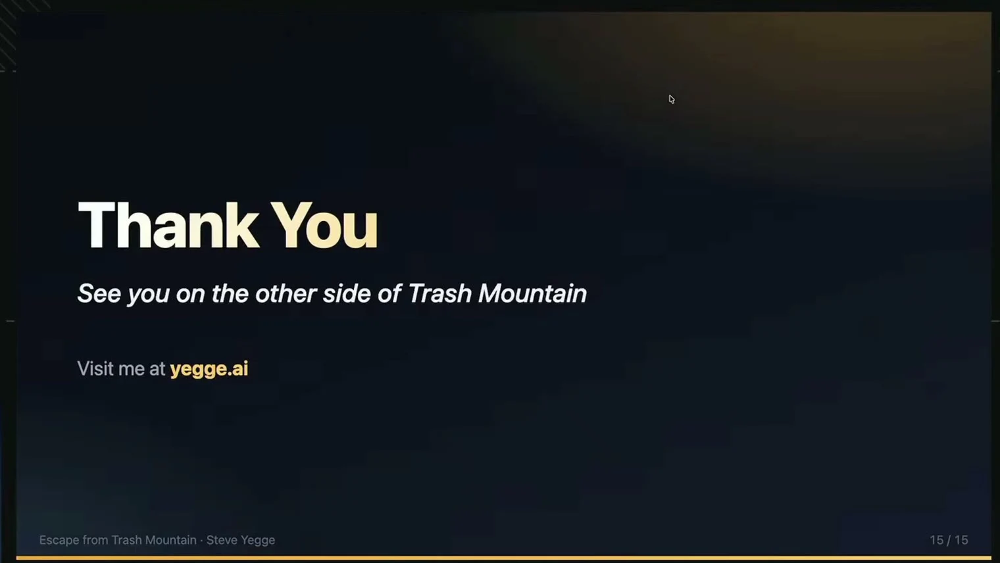

_截图 16  ·  录屏 08:06:27_

**08:06:51**　And that's a really positive message. That is good news. Because it means, what I'm finding is the more agents I deploy, the more humans I need. Isn't that nice? So even though next year we're going to have this huge proliferation of AI employees, and all kind of drama, right? It's going to be, I think it's going to be familiar territory for us, and lots of humans, okay?

这真是一个积极的信息。这是好消息。因为这意味着，我发现越多的智能体被使用，就需要的员工越多。这不是很棒吗？所以尽管明年我们将会出现大量的人工智能员工，以及各种问题，对吧？但我认为这对我们来说会像以前一样，对很多员工来说也会如此，好吗？

**08:07:21**　And then finally, I actually think you should all stop focusing on SaaS and tools and stuff and just go out and build experiences, okay? Build games, build movies, build whatever, build fun stuff, because I think that's where the big money's gonna be next year, yeah? All right, cool, that's my talk, thank you all. I guess I'm done.

最后，我觉得你们应该停止关注 SaaS 和工具之类的东西，而是去创造有趣的体验吧。制作游戏、电影，或者任何有趣的东西，因为我认为明年就是这些领域的黄金时期，对吧？好的，那我就说完了，谢谢大家。我想我讲完就结束吧。

---

[全部演讲](../README.md) · [选看索引](index.md) · [上一场](25-zach-bruggeman.md) · [下一场](27-simon-willison.md)
