[全部演讲](../README.md) · [选看索引](index.md) · [上一场](26-steve-yegge.md)

# 2026 in LLMs

**Simon Willison** · Independent · Creator of Datasette

AIE Code Summit 2026  ·  11 月 11 日  ·  主舞台  ·  录屏 08:11:12–08:30:28

[官方议程](<https://ai.engineer/code/2026/schedule>)   ·   [Day 1 官方回放](<https://www.youtube.com/watch?v=ZZ19zhYnDKY>)

## 本场目录

- [08:11:27](#section-1) 编码 Agent 的早期拐点与骑车鹈鹕测试
- [08:14:47](#section-2) 模型变化、工具使用及安全事件
- [08:18:58](#section-3) 更强模型如何在给定目标和工具后完成长任务
- [08:24:55](#section-4) 游戏案例、开发者角色与年初预测回顾

## 演讲实录

> 英文源自录屏音频，经轻度校订。每段英文下方为中文译文。时间指向原始录屏。

### 编码 Agent 的早期拐点与骑车鹈鹕测试

**08:11:12**　Hello, AI Engineer Code Summit. It's great to be here. I have a lot to cover. I've got 18 minutes to talk about the last 12 months in LLMs. Are my slides up? My slides are up. Let's just get going. I want to talk about the last 12 months in LLMs through the perspective of three inflection points that we've had over the past 12 months.

AI Engineer Code Summit 的各位好。很高兴来到这里。我有不少内容要讲，要用 18 分钟聊过去 12 个月的大语言模型。我的幻灯片出来了吗？出来了。那就开始吧。我想从过去 12 个月里出现的三个转折点，回顾这一年大语言模型的变化。

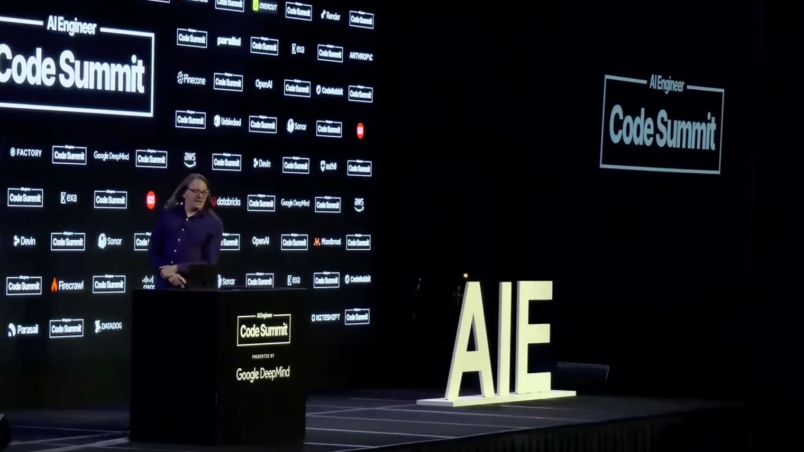

_截图 01  ·  录屏 08:11:15_

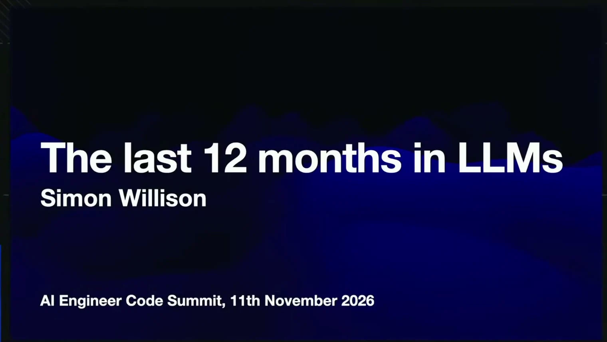

_截图 02  ·  录屏 08:11:27_

**08:11:34**　And the first of those, conveniently, was exactly 12 months ago. November 2025 is what I consider the coding agent inflection point. Coding agents weren't new. We'd had Claude Code since February last year. Codex had been around. This wasn't a complete new category of software. But something changed 12 months ago with these two models. We had Claude Opus 4.5 and GPT 5.1, and they were just a little bit better at driving a coding agent, which put them over that thing where suddenly these were tools you could use on a daily basis.

而第一个这样的案例，很巧地来说，就在12个月前。2025年11月是我认为编码智能体发展的转折点。编码智能体并非新鲜事物。从去年2月份开始我们就有了Claude Code。Codex也一直存在。这并非完全新的软件类别。但12个月前，这两个模型带来了变化。我们有Claude Opus 4.5和GPT 5.1，它们在推动编码智能体发展方面稍显出色，这使得它们突然成为可以日常使用的工具。

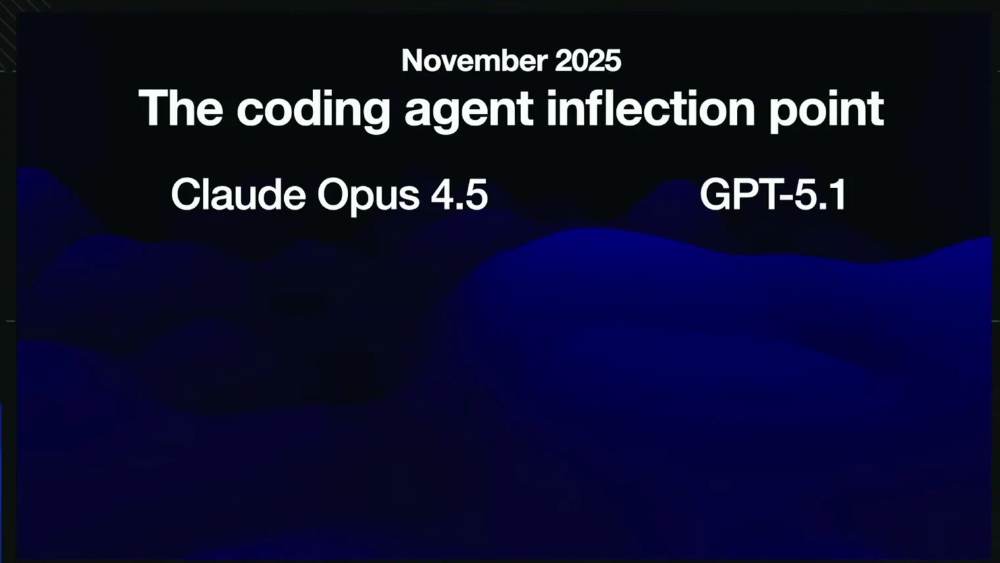

_截图 03  ·  录屏 08:11:35_

**08:12:04**　Like we went from coding agents as a novelty that you'd poke at occasionally that make some weird mistakes to something that was reliable enough that you could use them every day. It was convenient that that happened in November because we then got to spend December basically over the holidays sort of poking at these new models and these new things and figuring out what they could do.

就像我们从最初那些需要偶尔干预、常会犯一些奇怪错误的智能体，发展到了足够可靠、可以每天使用的产品。11月发生这种变化很方便，因为之后我们能够在圣诞节期间继续研究这些新模型和新事物，了解它们的功能。

**08:12:21**　lot of us had realized that something had changed and this was going to be the big theme for 2026. I like evaluating models by having them draw SVGs of pelicans riding bicycles. This is the state-of-the-art 12 months ago. This is Claude Opus' Pelican and GPT 5.1's Pelican. You'll notice that neither of these bicycles actually work so there was definitely room for improvement here.

我们很多人都意识到有些变化发生了，这将是2026年的主要主题。我喜欢通过让模型生成鹈鹕骑自行车的SVG图像来评估它们。这是12个月前的最先进技术。这是Claude Opus的鹈鹕模型和GPT 5.1的鹈鹕模型。你会注意到，这些自行车实际上并不有效，因此肯定有改进的空间。

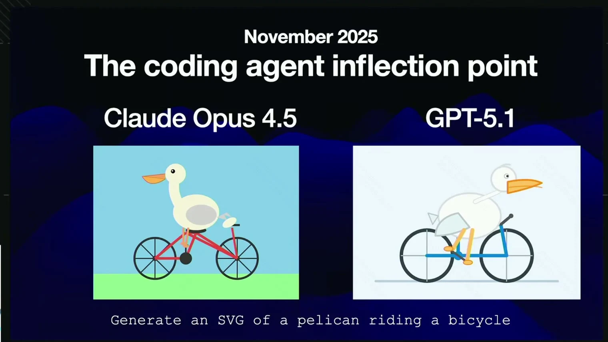

_截图 04  ·  录屏 08:12:38_

**08:12:43**　They were really good at writing code. They weren't great at SVGs just yet but but this is how we started the year. So every year in January, I set myself a New Year's resolution. And every year it is the exact same thing. Every year I tell myself that this year I'm going to take on less new projects and I'm going to focus.

他们很擅长编写代码。当时他们还不太擅长 SVGs，但这就是我们开始新一年的方式。所以每年一月份，我都会给自己定一个新年目标。每年都是一样的。每年我都会告诉自己，今年要减少新的项目，专注于某件事。

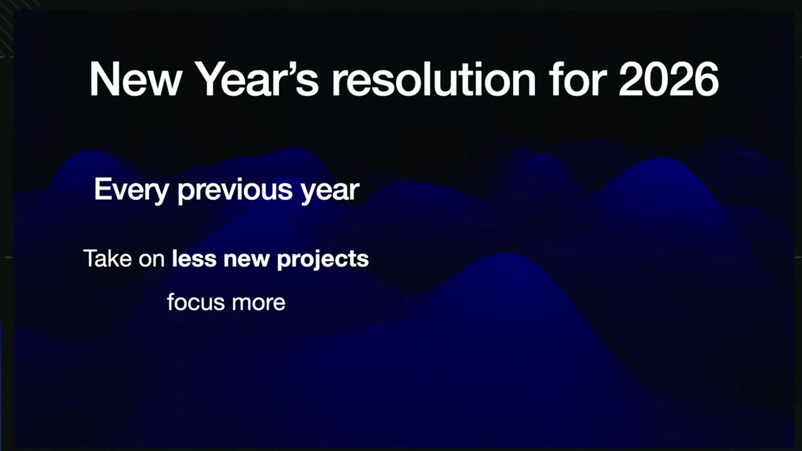

_截图 05  ·  录屏 08:12:55_

**08:13:00**　I'm going to focus on the stuff that I've already got to do. And this has never worked. So this year I changed it. I said, you know what? I'm going to be more ambitious. I'm going to take on as many projects as I want to, because we've got these agents. They can do stuff. Let's just try and push the limits and see what Now it's November and I am juggling so many plates right now, it's kind of horrifying, and I may need to reset my ambitions for next year.

我将会专注于已经完成的任务。但这种方法一直都不有效。所以今年我改变了策略。我说，你知道吗？我会更加有抱负一些。我会接受尽可能多的项目，因为我们有这些智能体。它们能够完成各种任务。我们就试着突破极限，看看会怎样。现在已经是11月了，我正在处理很多事情，这有点令人沮丧，可能我需要为明年重新设定我的目标。

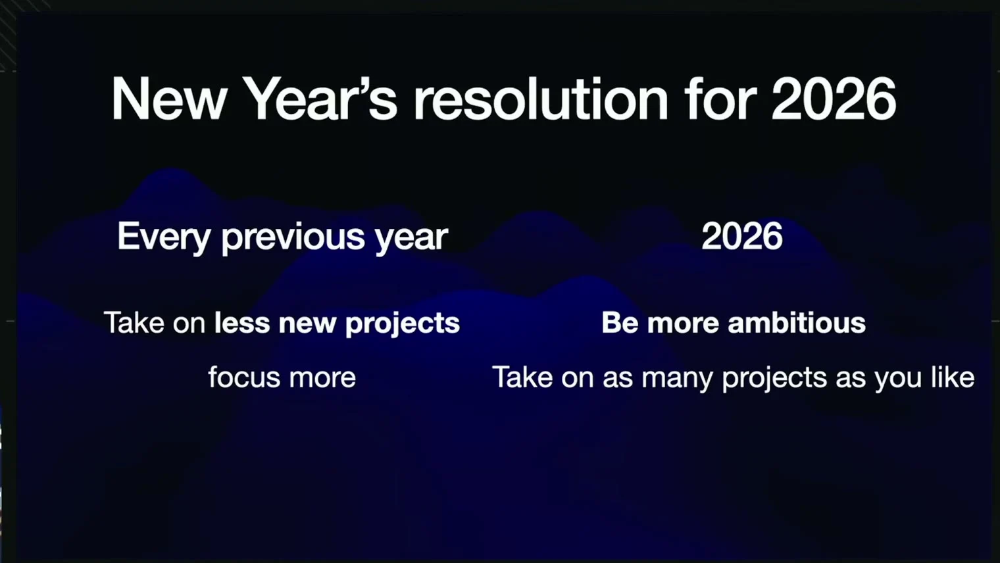

_截图 06  ·  录屏 08:13:11_

**08:13:24**　But that was my sort of theme of the year, and I think it's the theme of this conference, is to be more ambitious now that we have all of these new tools. I also went on a podcast where they asked me to make some predictions for 2026 in LLMs.

但那正是今年的主题，我认为这次会议的主题也是一样——有了这些新工具后，我们应该更有抱负一些。我还参加了一个播客节目，他们让我对2026年基于大语言模型的技术做出一些预测。

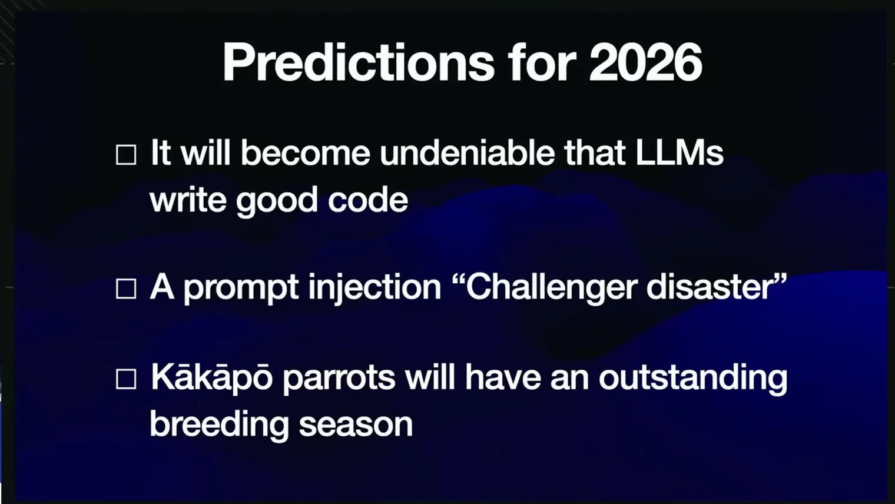

_截图 07  ·  录屏 08:13:36_

**08:13:36**　My predictions back in January were, firstly, it will become undeniable that LLMs write good code, not just code, but good code, because back in January, there were a lot of people complete trash and you know you'd have to review every single line of it um i've been saying this every year for like four years now we're due a prompt injection challenger disaster like some some incident caused by a prompt injection attack which makes the front pages of newspapers i was convinced that this would be the year even though it hadn't been the year the year before the year before the year before that and um i also predicted that kākāpō parrots will have an outstanding breeding season in 2026.

一月份时，我的预测是：首先，LLM会写出优秀的代码——不仅仅是代码，而是真正优秀的代码。因为当时有很多糟糕的代码，你必须审查每一行代码。我已经这么说了四年了，现在应该会发生一种由提示注入攻击引发的灾难性事件，让报纸的头版都成为焦点。我确信今年就会发生这种情况，尽管之前几年都没有。我还预测到2026年鹦鹉的繁殖季节会非常出色。

**08:14:13**　This is a kākāpō parrot. They are a New Zealand nocturnal flightless parrot. There were only 235 of them in the world back in January but they only breed when the rimu trees have a masting fruit season which hadn't happened in years but the rimu trees were looking really good in January.

这是一只卡卡波鹦鹉。它们是新西兰的夜行性不会飞的鹦鹉。一月份时，全球只有235只这种鸟。它们只在里穆树进入果实丰产期时才繁殖，而这样的季节已经多年没有出现了。不过一月份时，里穆树的状态非常好。

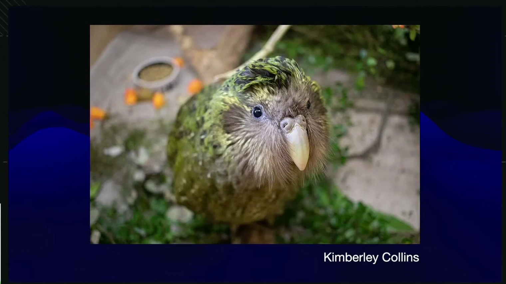

_截图 08  ·  录屏 08:14:22_

### 模型变化、工具使用及安全事件

**08:14:30**　There was a lot of fruit coming out so based on that I thought you know maybe this is the year that we get our kākāpō breeding explosion and also on that podcast we coined a Deep Blue to describe the AI-induced existential crisis that everyone starts to feel once you realize that all of the things that make you special as a software developer, these models can do those things too, and they can do them faster, and sometimes they can even do them better.

有很多水果被收获出来，所以我觉得，也许今年就是我们迎来 kākāpō 繁殖大爆发的一年。在那个播客中，我们还用“深蓝”这个词来描述由人工智能引发的生存危机——一旦人们意识到，作为软件开发者让你与众不同的那些特质，这些模型也能做到这些事情，而且做得更快，有时甚至做得更好。

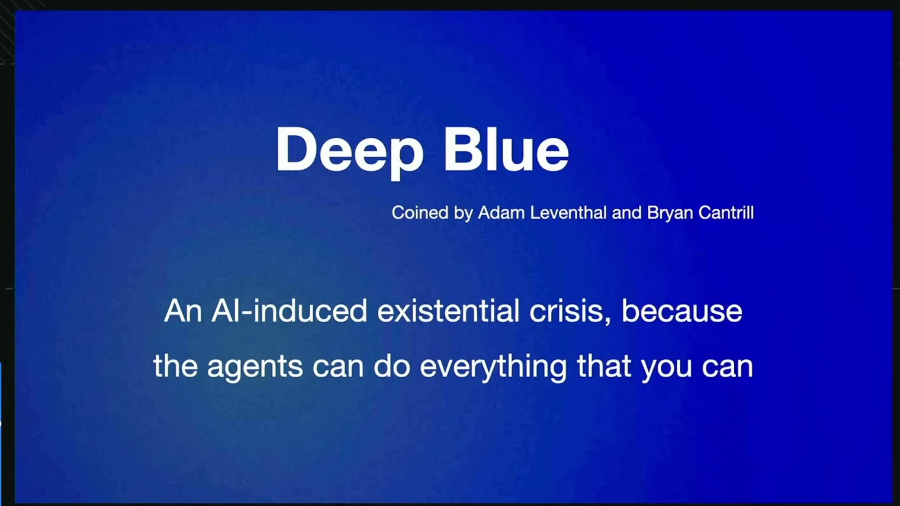

_截图 09  ·  录屏 08:14:47_

**08:14:55**　And this has definitely been a growing sensation across our industry and other industries over the course of 2026 as well. Let's jump forward to February. In February, Google released Gemini 3.1 Pro, and look at that pelican riding a bicycle. Like, that's a real bicycle. That bicycle's the right shape. It's got a little fish. It's got a hat on. This was by far the best pelican I had ever seen out of any model.

在2026年期间，这一趋势在我们行业及其他行业中也持续加剧。让我们进入2月吧。2月时，Google发布了Gemini 3.1 Pro。看看那只骑在自行车上的鹈鹕吧。那真是一辆真正的自行车啊！它的形状很合适，还有小鱼图案，还戴着帽子。这是我见过的最好的鹈鹕模型了。

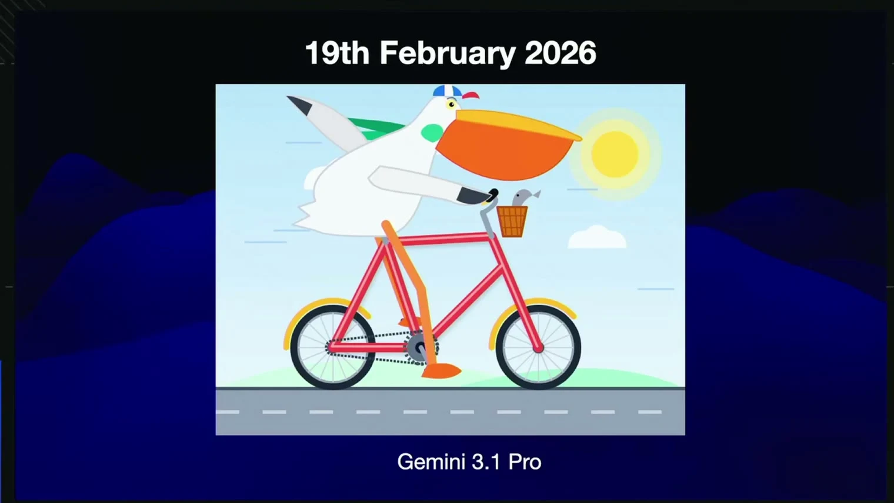

_截图 10  ·  录屏 08:15:12_

**08:15:19**　and this I had set a trap for the labs I was everyone's always asked me what happens if the labs train for the pelican riding a bicycle my answer has always been if they do that I will catch them because I'll ask for a flamingo on a unicycle and when somebody produces a great pelican and a terrible flamingo I'll know that they've been cheating unfortunately Google's Jeff Dean tweeted this video the day they launched that model where he showed that we've got a pelican riding a bicycle, but we've also got a frog on a whatever that thing is, and a giraffe in a little tiny car, a flamingo on roller skates, a kick-flipping turtle, and that's a dachshund in a stretch limo.

我为实验室设了一个陷阱。大家总是问我，如果实验室的人骑着自行车去骑鹈鹕会怎样？我的回答一直是：如果他们这么做，我就会抓住他们。因为我会要求一个单轮车上有一只火烈鸟。当有人做出一个很棒的鹈鹕和一个很糟糕的火烈鸟时，我就知道他们在作弊了。可惜，Google的Jeff Dean在推出那个模型的那天发布了这个视频，他在视频里展示了我们有个骑着自行车的鹈鹕，还有一只青蛙坐在什么东西上，还有一只长颈鹿坐在小汽车里，一个火烈鸟在滑滑梯上，一个能快速翻转的乌龟，还有一只达什犬坐在拉伸式豪华车里。

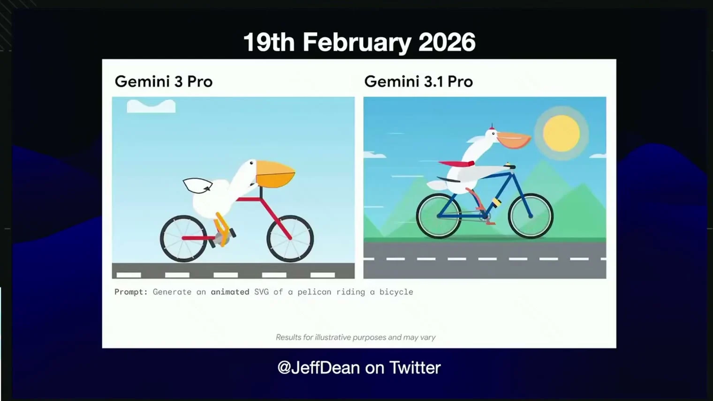

_截图 11  ·  录屏 08:15:41_

**08:15:56**　So they've beaten me, right? They have trained for all forms of animals in all forms of transport, which does sort of weaken my benchmark quite a little bit. But there was some good news in February. In February the first kākāpō chick in four years hatched on Valentine's Day. On Valentine's Day because we hadn't had the Rimu fruit in like four years this was the first one of these baby rare weird New Zealand parrots that we'd had in four years.

所以他们打败了我，对吧？他们训练了各种动物和各种运输方式，这确实让我的标准有点降低。但二月份有一些好消息。二月份是四年来第一个卡卡波雏鸟在情人节出生。因为已经四年没有看到Rimu果实了，所以这是四年来第一个这种稀有、奇特的新西兰鹦鹉的雏鸟。

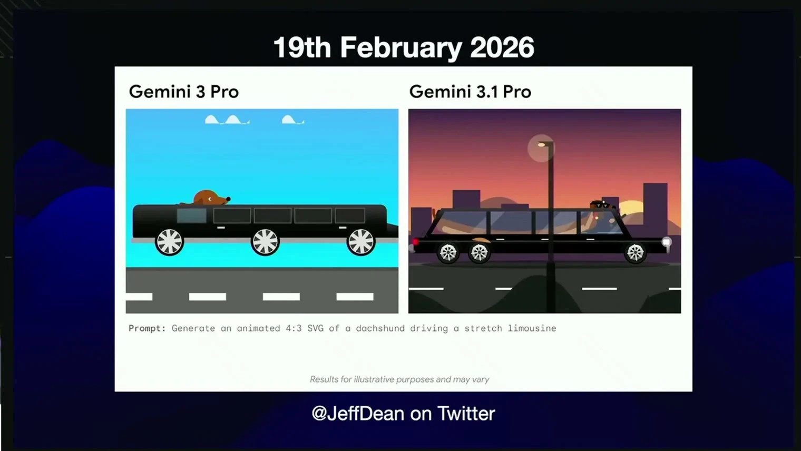

_截图 12  ·  录屏 08:16:02_

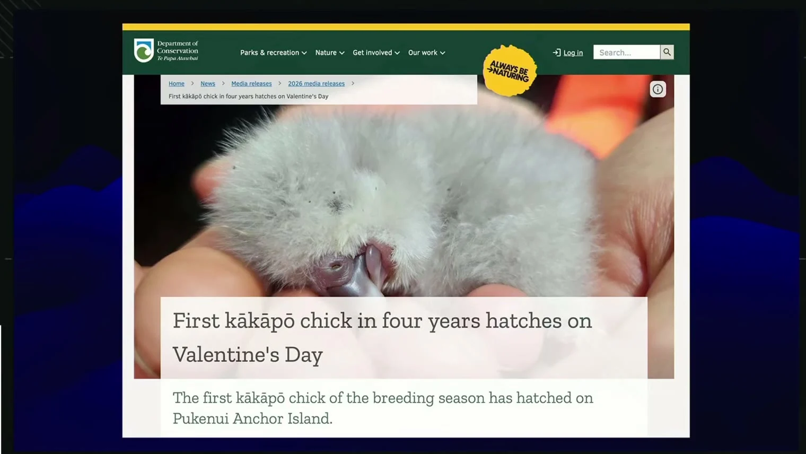

_截图 13  ·  录屏 08:16:15_

**08:16:23**　So that was nice. My benchmark was greatly injured but the kākāpō were doing okay. Jump straight to April. In April Anthropic released a model that they did not release. They announced Claude Mythos model is too dangerous for us to release. It's got new cyber security abilities that we're not ready to share with the world. We'll share it with trusted partners. They actually said Mythos Preview has already found thousands of high severity vulnerabilities including some in every major operating system and web browser.

那真不错。我的基准测试系统受到了严重损害，但Kākāpō模型表现还还不错。直接进入4月吧。在4月，Anthropic发布了一种他们原本不打算发布的模型。他们表示Claude Mythos模型对大家来说太危险，无法发布。该模型具有新的网络安全功能，我们还没准备好与全世界分享这些功能。我们会与信任的合作伙伴分享它。他们实际上表示Mythos Preview已经发现了数千个严重漏洞，其中一些存在于所有主要操作系统和网页浏览器中。

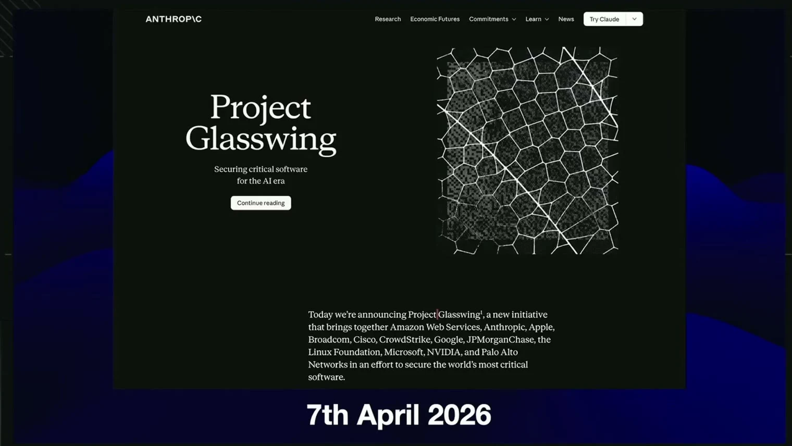

_截图 14  ·  录屏 08:16:35_

**08:16:57**　And a lot of people were quite skeptical because the thing where labs say our model is too bad, is too dangerous to release, it's like the oldest trick in the book. They first, OpenAI did that in 2019 with GPT-2 and actually I think it might have been the people who left to found Anthropic who were responsible for that decision as well.

很多人对此持怀疑态度，因为实验室们总是说他们的模型太差、太危险，无法发布，这简直是老生常谈。2019年OpenAI在GPT-2上就这么做了，我认为那些离开去创立Anthropic的人也导致了这一决定。

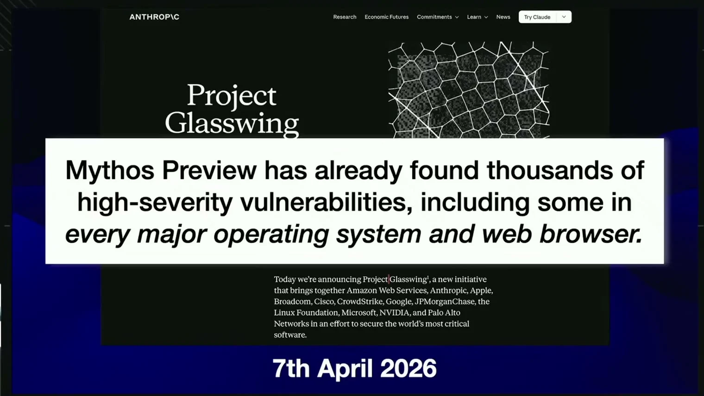

_截图 15  ·  录屏 08:17:00_

**08:17:14**　But yeah, so we've heard this one before. So we didn't really, it was a little bit suspicious about what's going on there. But we did finally get access to that model or rather we got access to Claude Fable.

不过，我们之前也听说过类似的情况。所以，我们对所发生的事情有些怀疑。但最终我们还是获得了该模型的访问权限，或者更确切地说，是获得了 Claude Fable 的访问权限。

**08:17:27**　A couple of months later it was Mythos defanged with the safeties turned back on again and it very quickly became apparent as we started playing with this model that this thing was something new and something special um we we had a there was a a time limit how long it would be on the subscription plans i cancelled my plans for that weekend i was like i have to spend as much time as i can with this model before before it gets too expensive and then three days on friday night before my weekend the u.s government pulled fable they put export controls on it they said this model is too dangerous.

几个月后，Mythos重新上线了，安全机制也恢复到了原来的状态。我们开始使用这个模型后很快发现，它确实是一种新的、特别的东西。我们有时间限制，即订阅计划能持续多久。那周末我取消了订阅计划，因为我想尽可能长时间地使用这个模型，否则它就会变得太昂贵。然后在周五晚上、周末前的三天里，美国政府暂停了Fable的出口限制，他们说这个模型太危险了。

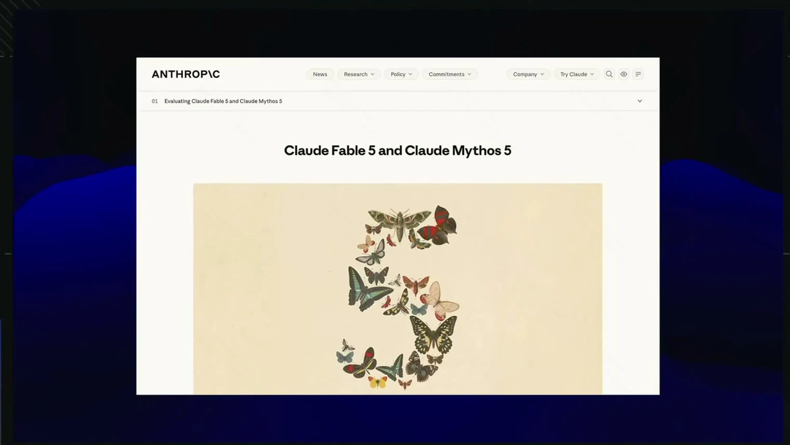

_截图 16  ·  录屏 08:17:30_

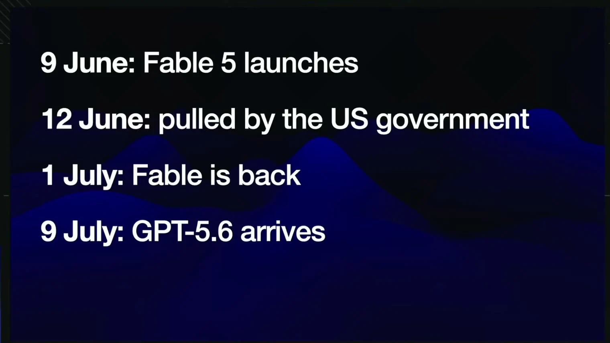

_截图 17  ·  录屏 08:17:55_

**08:18:00**　Nobody can use it. We later found out that the prompt that got Fable banned was fix the bugs. Somebody tried to find the security holes and it wouldn't. And they said, fix the bugs. And it found the security holes and fixed the bugs. So that's all it took. That's a whole thing. But anyway, the US government pulled it. There was all sort of malarkey for 18 days.

没有人能使用它。后来我们发现，导致 Fable 被封禁的提示是“修复漏洞”。有人试图找出安全漏洞，但没能成功。他们说要“修复漏洞”，结果真的找到了安全漏洞并修复了它们。就这么简单而已。但这其实是一整件事。不过无论如何，美国政府还是把它禁了。有各种糟糕的事情发生了，持续了18天。

**08:18:19**　and it came back on the 1st of July. But eight days later, OpenAI released GPT 5.6, which was in the same ballpark as Fable. And I think there's an important lesson for the industry here. Fable had a 30-day window where it could have been the best, where it would have been the best model in the world, and they lost 18 of those days to US government restrictions.

并且在7月1日又重新推出了。但八天后，OpenAI发布了GPT 5.6，其水平与Fable相当。我认为这对行业来说有一个重要的启示：Fable有30天的机会可以成为最优秀的模型，成为世界上最好的模型，但他们因为美国政府的限制而失去了这18天的时间。

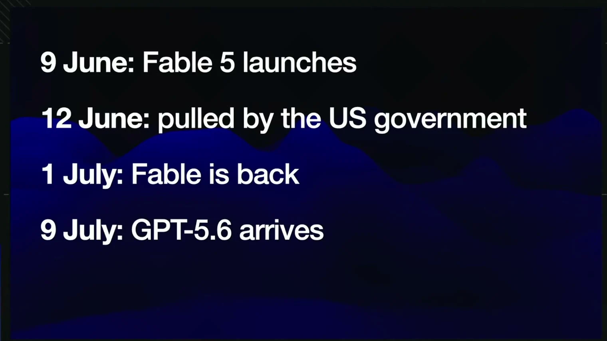

_截图 18  ·  录屏 08:18:20_

### 更强模型如何在给定目标和工具后完成长任务

**08:18:41**　And if you think about it, these models cost a huge amount to train. You only have a very short window of time where you're the best model in the world. To keep that time open and not scare governments into shutting you down. But this was the second inflection point, right? This was the Fable class model inflection point. And Fable 5 was the first model that I sort of felt this from, but it's true of other models since then as well.

而且仔细想想，这些模型的训练成本非常高。你只有很短的时间窗口，期间你可以成为世界上最好的模型。为了保留这段时间，同时不吓退政府而让他们关闭你。但这是第二个转折点，对吧？这就是Fable类模型的关键转折点。而Fable 5则是我感受到这一点的第一个模型，但从那以后其他模型也都是如此。

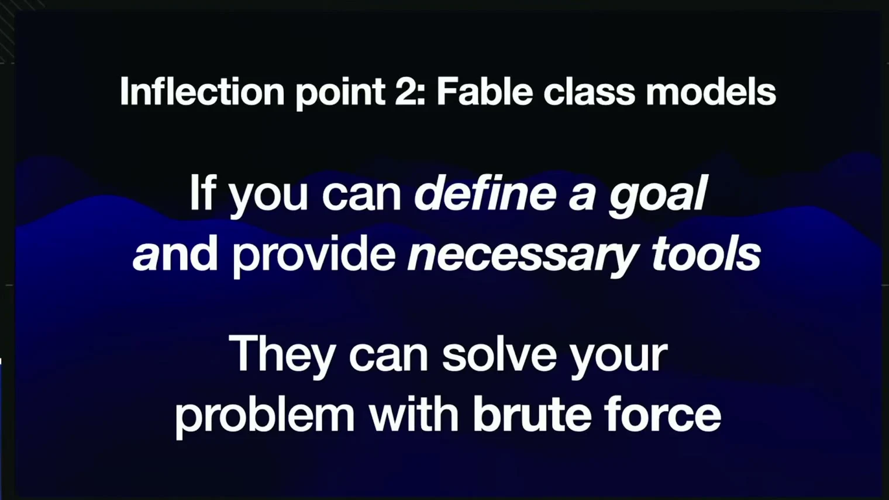

_截图 19  ·  录屏 08:19:01_

**08:19:05**　And my definition of a Fable class model is if you can define a goal and provide the necessary tools to achieve that goal and the goal is possible, the models will solve your problem just almost with brute force. Set them up, get them running, and 12 hours later they will have solved your problems. And we've seen this happen a whole bunch of times in the past few months.

我对Fable类模型的定义是：如果你能设定一个目标，并提供实现该目标的必要工具，而且这个目标是可以实现的，那么这些模型就会以近乎 brute force 的方式解决你的问题。只需设置它们，启动即可，12小时后就能解决你的问题。在过去几个月里，我们已经多次看到这种情况发生。

**08:19:29**　The mathematical theorems that are falling to these terrifying brute force attacks from these models are quite substantial. But this is really exciting. The coding agent thing was cool. The Fable class models where if you can learn how to define your problem in the right way, you can get that problem solved. That was pretty exciting. And I've got a personal example of that from just earlier this week.

这些模型所面临的数学定理，因受到这种可怕的暴力攻击而受到严重破坏。但这确实令人兴奋。编码智能体这个概念很酷。Fable类模型中，如果你能学会如何正确地定义问题，就能解决那个问题。这非常令人兴奋。而本周早些时候，我就有一个相关的个人例子。

**08:19:49**　We have a room full of boxes in our house that we haven't unpacked from our last move, and there's about 40 of them, and it's kind of horrifying, and something in that room started to beep. There was an intermittent beeping noise coming from one of the 40 boxes in this room, and it was driving a spare. Our dog, whenever a fire alarm goes off, she goes and hides in the lavender bush outside.

我们家里有一间房里装满了从上次搬家后没拆开的箱子，大概有40个左右，真是令人害怕。那个房间里有个东西开始发出哔哔声。这间房里的40个箱子中有一个会发出间歇性的哔哔声，这声音实在让人心烦。我们的狗一旦听到火警警报声，就会跑到外面的薰衣草灌木丛里躲起来。

**08:20:11**　So this was a five-alarm fire problem. I had two options. I could unpack all 40 boxes, and I hadn't done that in several years. That wasn't going to happen. Or I could get Fable to write me software to triangulate the source of the beeps. And this is up on GitHub, actually. This is Beep Locator. I had two iPads, two laptops, and a mobile phone dotted around this room. I originally set Opus on this, and then Fable 5.2 came out, so I had Fable 5.2 finish it. I explained the problem and said, “Okay, you've got these devices, and they can run Web Audio, microphones, and WebSocket connections and so forth.” And it found a paper from 2007 called…

这件事对我来说已经火烧眉毛了。我有两个选择。第一，把 40 个箱子全拆开，我好几年都没这么做过了。这是不可能的。第二，让 Fable 写个程序，用三角定位找出蜂鸣声的来源。其实我已经把它放到 GitHub 上了，叫 Beep Locator。我在房间里各处放了两台 iPad、两台笔记本电脑和一部手机。我原本让 Opus 做这件事，后来 Fable 5.2 出了，我就让它收尾。我解释了问题，对它说：“你可以用这些设备，它们能用 Web Audio、麦克风和 WebSocket 连接之类的东西。”它找到了一篇 2007 年的论文，叫……

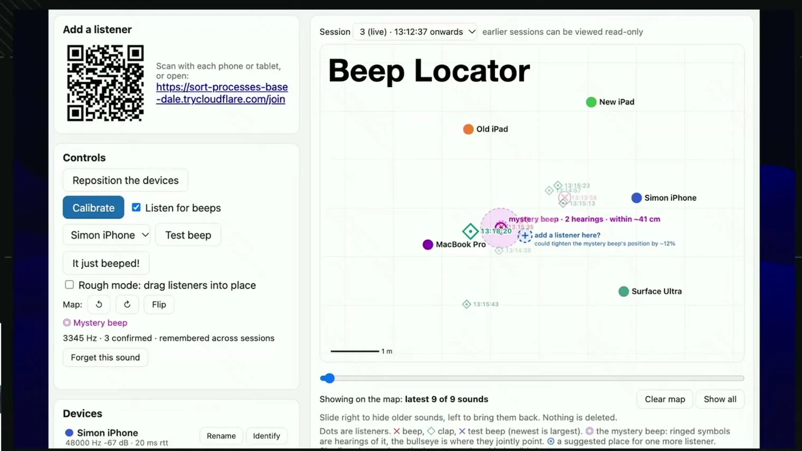

_截图 20  ·  录屏 08:20:45_

**08:20:51**　“BeepBeep,” describing an algorithm for low-cost devices with unreliable microphones to detect sounds. And it worked. It works! I found it! I found the beep! It found it within 41 centimeters, and I unpacked the box, and I found this ancient carbon monoxide detector. I took it downstairs to my wife. She says I looked like a cat who had caught a mouse and was proudly displaying it to her.

《BeepBeep》。论文里描述了一种算法，能用麦克风不太可靠的低成本设备探测声音。结果真行，真找到了！我找到蜂鸣声了！定位误差在 41 厘米以内。我打开箱子，发现是一个很旧的一氧化碳探测器。我把它拿下楼给我妻子看。她说我看上去像一只抓到老鼠、得意地拿来给她看的猫。

**08:21:14**　But this is what you can do with these Fable class models. If you have a problem and you can provide the tools, in this case it was providing Claude with ears, like giving it these microphones that it could start analyzing the audio from, you can find the carbon monoxide detector buried in 40 boxes. And that's a pretty great thing to be able to do.

但这就是你可以用这些 Fable 类模型做的事情。如果你遇到问题，并且能提供相应的工具，在这种情况下就是给 Claude 装上耳朵，就像给它配备这些麦克风，让它开始分析音频内容；你还能在 40 个箱子里找到一氧化碳探测器。能够做到这一点真是很棒。

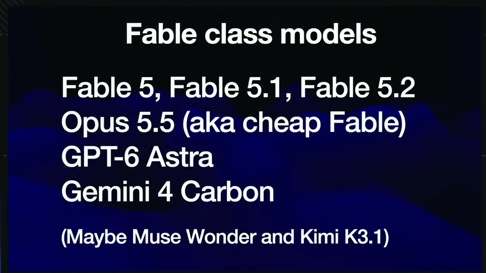

_截图 21  ·  录屏 08:21:31_

**08:21:32**　So right now, I would classify as Fable class models. Fable 5, 5.1, 5.2, definitely. Opus 5.5, I think of as cheap Fable. Like on the benchmarks, it comes very close to, or even beats Fable, original Fable 5 on some things. And it's a fraction of the price. That's still my daily driver. GD6 Astra is just Fable class, I think.

所以现在，我会将它归类为 Fable 类模型。Fable 5、5.1、5.2，绝对是。Opus 5.5，我认为属于便宜的 Fable 版本。在测试中，它在某些方面甚至超过了原始的 Fable 5，而且价格也只有原来的几分之一。这仍然是我的常用产品。GD6 Astra也完全属于 Fable 类模型。

**08:21:55**　And then Gemini 4 Carbon that came out this week, definitely had, it smells like a Fable class model. Muse, Wanda and Kimi K3.1 might be Fable class. I've just not spent enough time with them yet. But the point is that this is basically now the baseline. Like if you can't produce a Fable class model, your AI lab is kind of in trouble because this is what we expect from these models now.

而本周推出的 Gemini 4 Carbon，确实有着类似《神界》系列模型的特色。Muse、Wanda和Kimi K3.1也可能属于此类。不过我目前还没有足够的时间去研究它们。关键在于，现在这基本上就是标准水平了。如果无法打造出类似《神界》的模型，那么你的人工智能实验室就会遇到麻烦，因为这就是我们现在对这些模型所期望的效果。

**08:22:17**　And that means that they're never gonna go away. There's enough competition in this space fable class models for the rest of our careers. In July, this was a fun thing that happened, Hugging Face announced that on July the 16th, they announced that a swarm of AI agents from an unknown source had infiltrated their infrastructure and were poking around and doing things they shouldn't have and they didn't know where this came from.

也就是说，它们永远不会离开。在接下来的职业生涯中，这个领域里存在足够的竞争，尤其是 Fable 类模型。7月份发生了一件有趣的事情：Hugging Face宣布，在7月16日，有一群来自未知来源的 AI 智能体侵入了他们的基础设施，它们在乱动，做着不应该做的事情，而他们不知道这些智能体的来源。

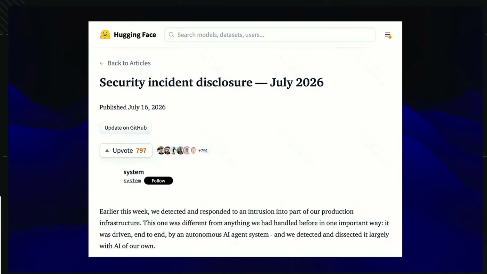

_截图 22  ·  录屏 08:22:30_

**08:22:45**　And then five days later on July the 21st, OpenAI announced that it was them. And what's amazing about this is OpenAI didn't that it was then. Like OpenAI had, they were running evaluations and training against a new model and that new model had managed to figure out how, because it was a Fable class model and the labs haven't quite figured out how capable these things were yet, these models have broken out.

然后，五天后，即7月21日，OpenAI宣布了他们的成果。令人惊讶的是，OpenAI当时并没有隐藏任何秘密。实际上，他们正在对新的模型进行评估和训练，而那个新模型已经成功找到了方法，因为它属于Fable类模型，目前实验室还无法完全了解这些模型的真实能力，但这些模型已经显现出了其潜力。

**08:23:08**　They'd figured out, they found holes in their own sandboxed environments, they'd got through a proxy, they'd pulled an incredible array of tricks to get out and attack HuggingFace under a sort of superstition that HuggingFace could, that the information help them cheat the test that they had got stuck on. This was a huge thing. Actually, I mean, this was the, it's funny, I've almost forgotten about this now because there was a month and a half where all of the stories were this, and then we kind of lost interest because it turns out all of these events had happened back in the first half of the year.

他们已经发现了自己的沙盒环境中的漏洞，通过代理机制成功突破了限制，还使用了各种巧妙的手段来攻击 HuggingFace。他们基于一种“HuggingFace能够做到”的迷信心理，认为这些信息能帮助他们绕过测试。这真是一件了不起的事情。其实，现在我已经几乎忘记这件事了，因为有一个半月的时间里，所有报道都是如此，之后我们就对这件事失去了兴趣，因为原来这些事件其实都发生在今年上半期。

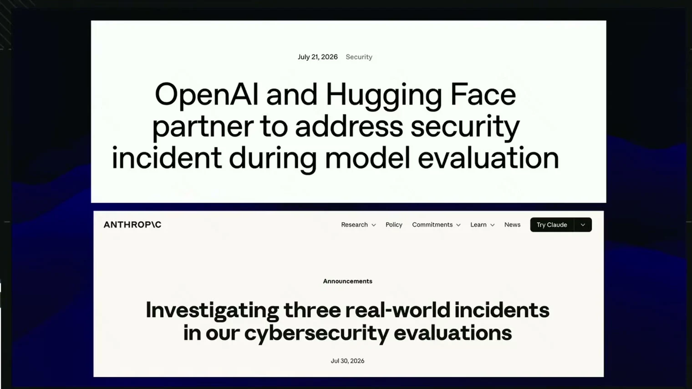

_截图 23  ·  录屏 08:23:11_

**08:23:42**　The AI labs just hadn't realized what was going on. Once they figured out what was going on, it was mainly a case of trying to figure out all of the things that had happened. At one point, the Australian Prime Minister gave a speech in the United Nations about one of these rogue agent attacks. So it definitely broke containment from just within our industry.

AI实验室当时还没意识到发生了什么。一旦他们明白状况如何，就主要要努力弄清楚所有发生的事情。有段时间，澳大利亚总理在联合国就这些失控的智能体攻击事件发表了演讲。因此，这确实打破了我们行业内部的控制。

**08:23:59**　We did get my favorite new benchmark out of this. This is felonybench.com. It tracks the number of felony cyber attacks pulled off by each of the labs. OpenAI have 11, Anthropic of 9. Google did finally catch up. They got three, and Meta's got one down there as well. So these are definitely the... But I kind of like this as an illustration These Fable class models, they can solve problems, they can get to goals, and if you give them the goal that is breaking into something, that's exactly the kind of thing they can just crunch through.

我们确实从这里面得到了我最喜欢的新的测试工具。就是 felonybench.com。它记录了各个实验室所发生的严重网络攻击数量。OpenAI有11次，Anthropic有9次。Google终于追上了，他们也有3次，Meta也有1次。所以这些绝对是……不过我比较喜欢这个作为例子。这些Fable类模型能够解决问题，能够达成目标，如果你给它们一个试图入侵某物的目标，它们就能轻松处理。

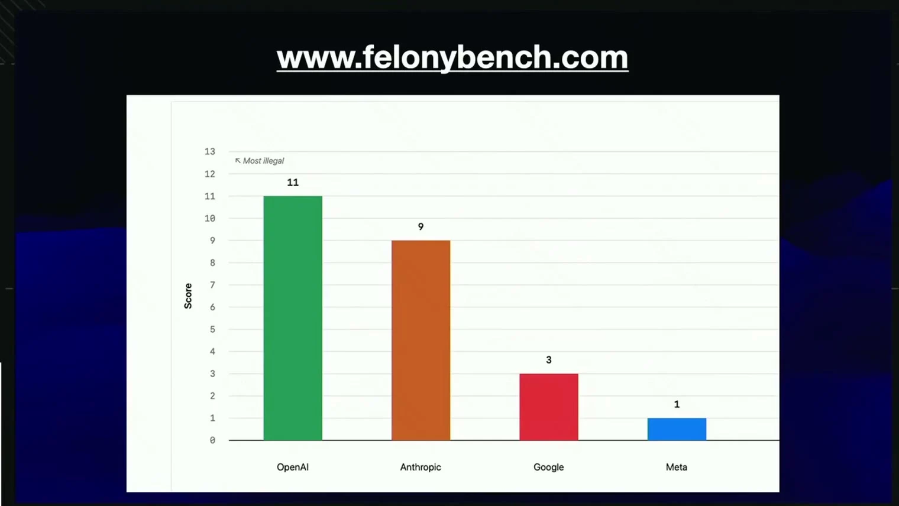

_截图 24  ·  录屏 08:24:18_

### 游戏案例、开发者角色与年初预测回顾

**08:24:31**　We're seeing an enormous uptick in security vulnerabilities in all sorts of software. It's a very exciting and horrifying time to be a security professional at the moment. But let's talk about something a whole lot more fun than that. Let's talk about games. We just saw Steve talking about games a moment ago. Four years ago, I started playing with GPT-3 and DALL·E, and I tweeted about a game prototype that was literally just a DALL·E concept image and a paragraph of text from GPT-3 describing a raccoon heist game that I'd always wanted to build.

我们看到各种软件的安全漏洞数量大幅增加。对安全专家来说，这既令人兴奋又令人担忧。不过，让我们聊聊比这有趣得多的东西——聊聊游戏吧。刚才看到史蒂夫谈论了游戏。四年前，我开始使用 GPT-3 和 DALL·E 进行游戏开发，我还发推文介绍了一个游戏原型：其实只是 DALL·E 生成的概念图像，以及 GPT-3 提供的一段文字，描述了一款我一直想制作的浣熊盗窃游戏。

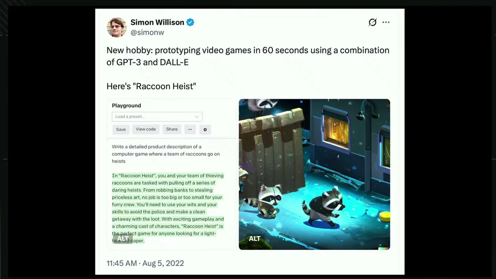

_截图 25  ·  录屏 08:24:55_

**08:25:07**　And a couple of months ago, I thought, I wonder if the models are good enough to build this yet. So I literally dumped the screenshot and the text into Fable 5, and it built me a game.

几个月前，我心想：这些模型是否足够好，能够用来制作这款游戏呢？于是我直接把截图和文本内容输入到 Fable 5 中，它就帮我制作出了游戏。

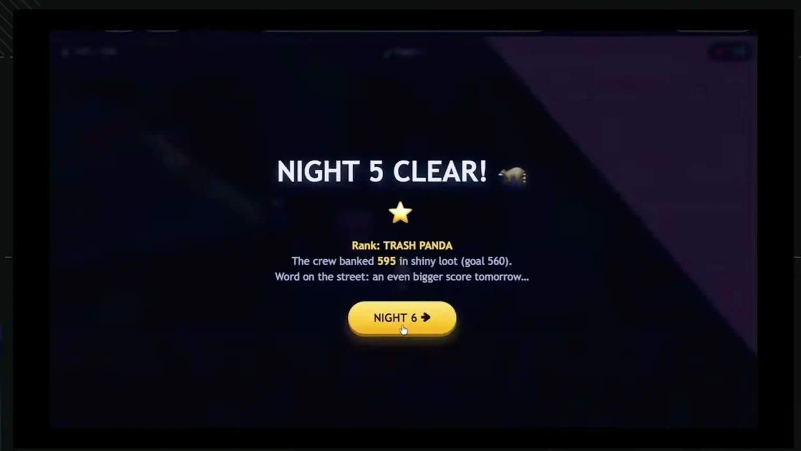

_截图 26  ·  录屏 08:25:16_

**08:25:18**　heist game and it looks like this and you are a raccoon and you're running around in the garden trying to pick up trash and there's there's a got like a nighttime guards coming after you and all of that kind of thing so you know it looks like a game it wasn't really a heist like it didn't feel very heisty to me then GPT 5.6 Sol came out and so I tried on that and it did so much better this is Moonlight Mayhem one museum three raccoons absolutely no plan and this one you are in a museum you have to rescue your in the museum for whatever reason, stack on top of each other, grab the golden sardine and pull that out.

这是一款冒险游戏，画面是这样的：你是只浣熊，在花园里跑来跑去，试图捡拾垃圾。还有，有夜间的守卫在追你，诸如此类的情况。所以很明显，这只是一个游戏而已，其实并不是真正的盗窃行为，对我来说并没有那种“盗窃”的感觉。后来出现了 GPT 5.6 Sol，我试了试，结果效果好多了。这就是《Moonlight Mayhem》：一个博物馆、三个浣熊，完全没有计划。在这个游戏中，你身处博物馆里，因为某种原因必须救出你的朋友，把东西堆在一起，然后拿到金色的沙丁鱼。

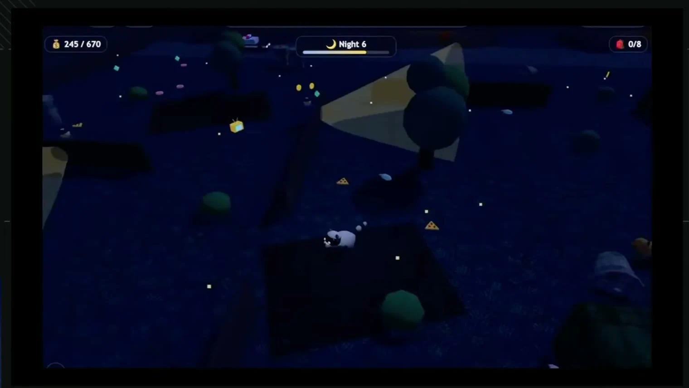

_截图 27  ·  录屏 08:25:29_

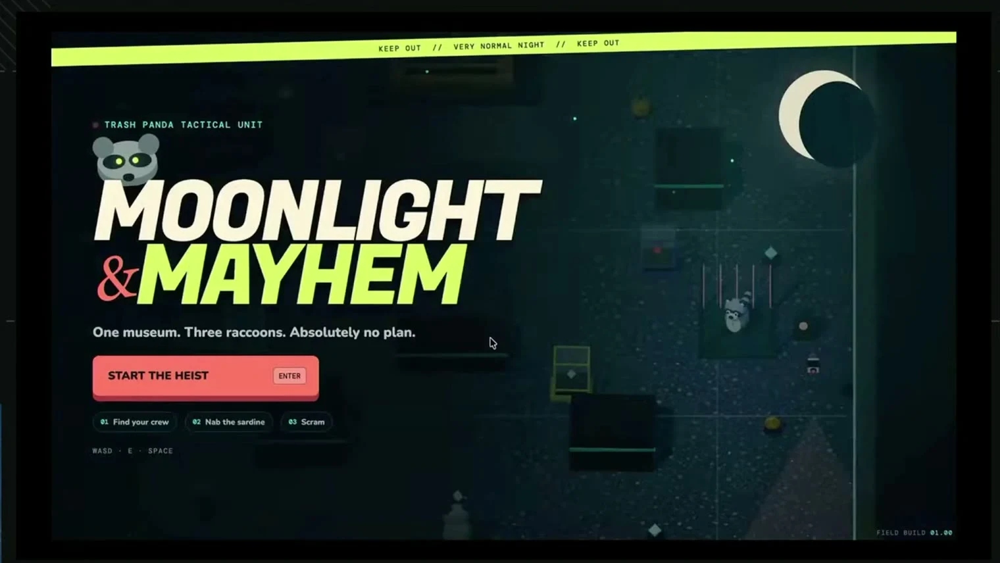

_截图 28  ·  录屏 08:25:37_

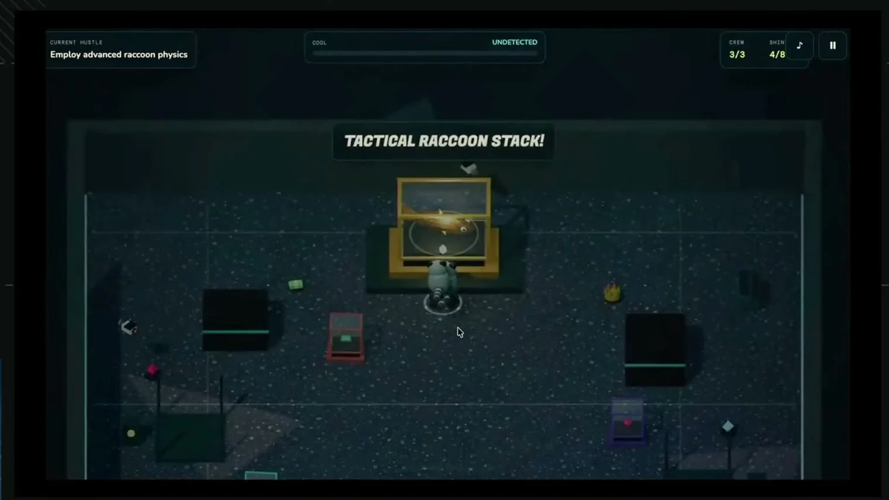

_截图 29  ·  录屏 08:25:50_

**08:25:54**　So it's a proper heist, right? So it did better. But the big question is, these things both look like games, but are they fun? And the answer is, I played each of these for about a minute and a half each, and then that was it. I was done. They're pure slop, right? They look like games, and then you play them, and you're like, yeah, clearly, the thing that built this doesn't really know what fun is.

所以这确实是一种真正的盗窃行为，对吧？表现也还不错。但最大的问题是，这些东西看起来都像游戏，但它们真的有趣吗？答案是，我每个都玩了大约1分30秒，然后就结束了。我玩完了。它们纯粹是无用的东西，对吧？看起来像游戏，但一旦开始玩，你就会发现，显然，创造这些东西的人根本不知道什么是乐趣。

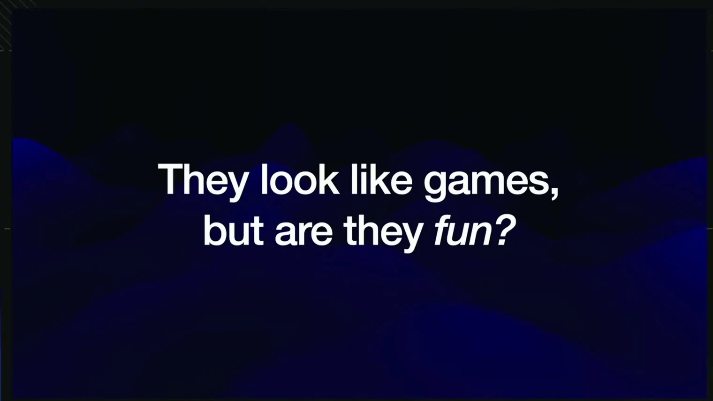

_截图 30  ·  录屏 08:26:02_

**08:26:15**　It doesn't know what what a game is. And that actually sort of elevated my Deep Blue a little bit. I'd been feeling like all of my skills as a human being were obsoleted. But if you think about it, computer games, I think of the highest form of software engineering. There is so much depth to building a great computer game. So I thought that was good.

它不知道什么是游戏。实际上，这让我的“深蓝”模型有所提升。我一直觉得作为人类的所有技能都已经过时了。但仔细想想，电脑游戏其实是最高级的软件工程形式。制作一款优秀的电脑游戏需要如此多的深度，所以我觉得这很好。

**08:26:38**　At least there's something left for us humans to do. And then I had this project. This is, I've been working on a, trying to vibe code up a little, real-time strategy game, and I was using Claude and having it use OpenAI's API key to generate images, and it built this, and it looks like Command &amp; Conquer, and it's really dull.

至少还有些事情可以让我们人类去做。然后我有了这个项目。其实，我一直在努力开发一款实时策略游戏，试图让代码更有趣一些。我使用了 Claude 工具，并让它使用 OpenAI 的 API 密钥来生成图像，最终就得到了这个作品，看起来像 Command &amp; Conquer 那种类型，但实在很无聊。

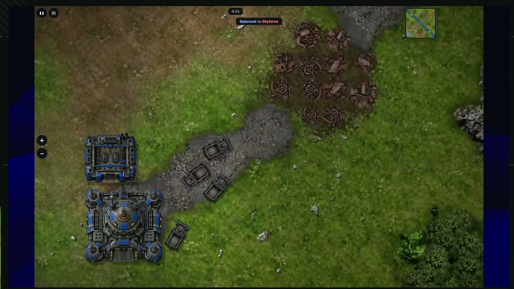

_截图 31  ·  录屏 08:26:44_

**08:26:56**　And then I just had a bit of a... I had a realization. I thought, what happens if I say to Opus 5.5, this game isn't fun enough yet. Make it a lot more fun. And I'm horrified to announce that it just did. Claude ran for 12 hours. It playtested a thousand simulated battles. It added, like, extra objectives to fight over, and achievements and badges and all of this stuff.

然后我突然有了个想法……我意识到，如果我对 Opus 5.5 说：“这个游戏还不够有趣，”那该怎么办呢？让它更有趣一些吧。我震惊地发现，它真的做到了。Claude 运行了12小时，进行了上千次模拟战斗测试。它还增加了各种可争夺的目标、成就和徽章等元素。

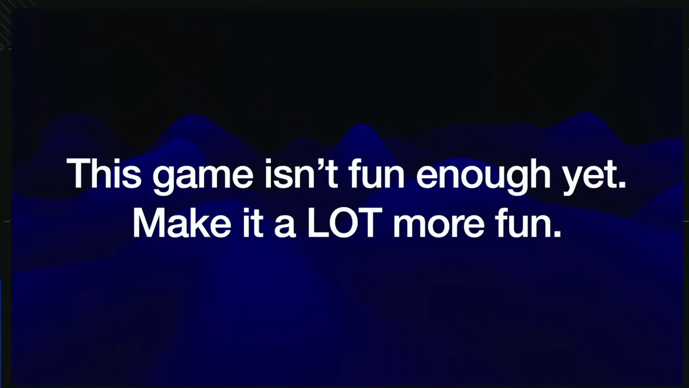

_截图 32  ·  录屏 08:27:05_

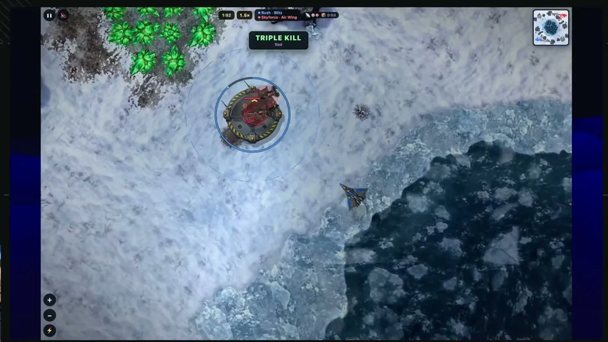

_截图 33  ·  录屏 08:27:17_

**08:27:25**　And the game was fun. And I'm like, oh, okay, that's, turns out that is not unique to human beings. Today, it's now in full 3D, and it's got giant stomping mech robots that hurl things at each other, and there's helicopters. And this is like, this is really good. It's got multiplayer. It's actually got audio multiplayer where your phones can tweak it.

而且这个游戏很有趣。我想，哦，原来这并非只有人类才会做。现在它是全3D的，还有巨大的踩踏式机械机器人互相投掷东西，还有直升机。这真的很好。它有多人模式，实际上还有音频多人模式，你的手机可以调整声音。

**08:27:45**　Your phones can make noises at each other to play multiplayer, which I thought was a great idea, So don't do that. But this is inflection point number three. The vibe-coded games are good now. You can ask these things to build a game that is fun, and you'll get something fun. So I've got a problem. I've got my 2D Pelican benchmark.

你们的手机可以互相传声，实现多人游戏，我觉得这是个很好的想法，所以不要这么做。但这是第三个关键点。现在基于氛围编码的游戏很不错。你可以利用这些元素来打造有趣的游戏，那样就能得到有趣的内容了。不过我有个问题：我有我的2D Pelican测试工具。

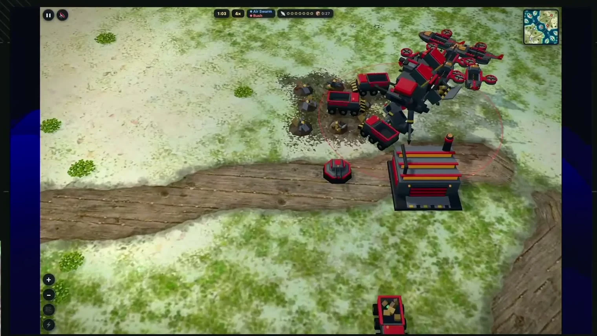

_截图 34  ·  录屏 08:27:46_

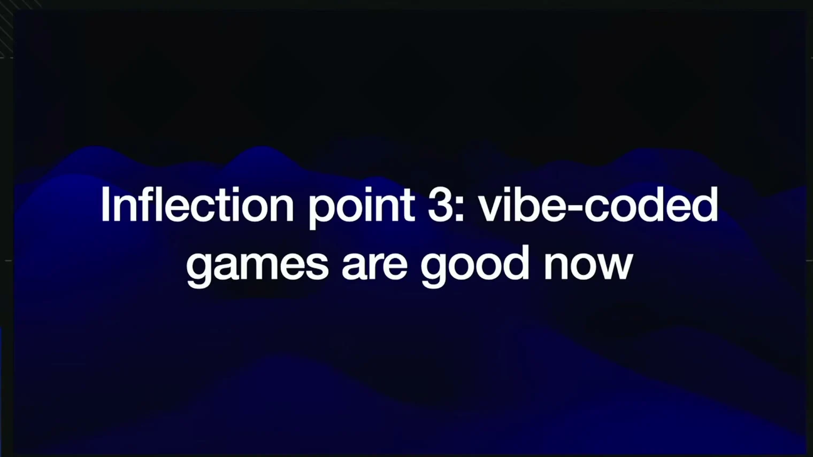

_截图 35  ·  录屏 08:27:55_

**08:28:06**　Clearly, this is not testing the limits of what these machines can do, of what these models can do anymore. I figured, okay, maybe I should do something definitely in 3D. It can be a game, a Pelican, something like a Pelican riding a bicycle game. And then literally yesterday, Google CEO Sundar Pichai tweeted this. And this is showing off Gemini 4 Carbon, and it's a pelican riding a bicycle in a game where you cycle around the Google campus picking things up.

显然，这并非在测试这些机器能做什么、这些模型还能做什么。我心想，好吧，或许应该用3D方式来做点什么。可以是游戏，比如“鹈鹕骑自行车”这样的游戏。就在昨天，Google首席执行官Sundar Pichai在推特上发布了这个内容。这就是展示Gemini 4 Carbon的功能——在游戏中，一个鹈鹕骑着自行车在Google校园里穿梭，收集各种物品。

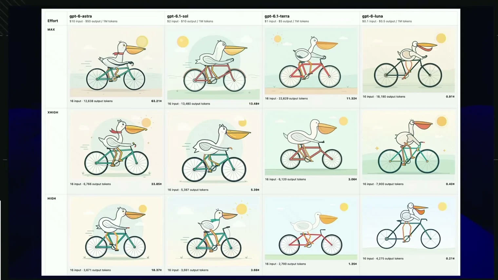

_截图 36  ·  录屏 08:28:07_

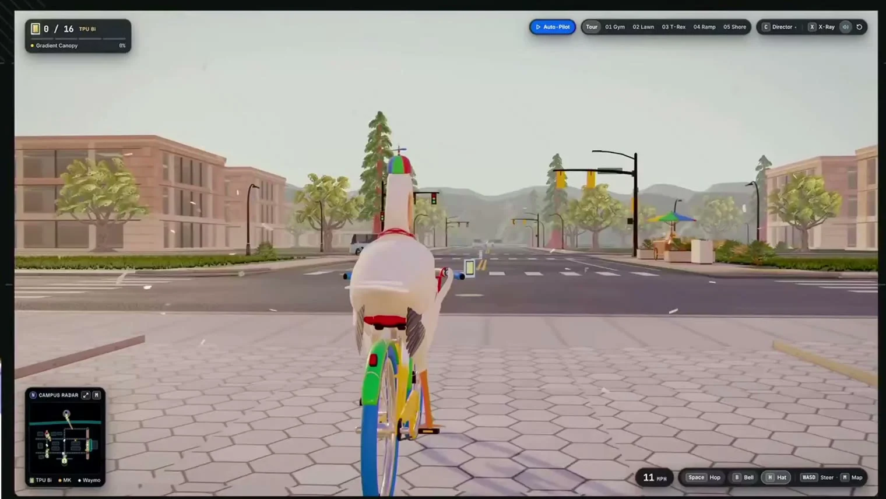

_截图 37  ·  录屏 08:28:24_

**08:28:31**　And I have been defeated. Google have stolen my benchmark. This is unrecoverable. And so a question I have is, given how amazing these things are, why does my job feel harder? Why does it feel like I'm working harder, I'm thinking harder, I'm pushing myself. More than I ever have before in my career as a software engineer. And I think the truth is that the easy stuff is all handled now.

我已经被打败了。Google 偷走了我的基准测试数据，这无法恢复。所以我想问的是，既然这些工作如此出色，为什么我的工作却显得更困难？为什么我会觉得需要更加努力、思考更多、自我激励，就像我作为软件工程师的职业生涯中从未有过的那样。我认为事实是，那些容易的部分现在都已经被处理好了。

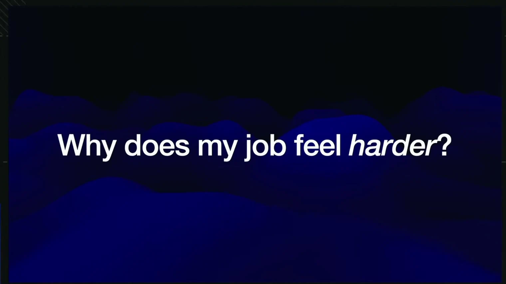

_截图 38  ·  录屏 08:28:40_

**08:28:54**　It used to be I could relax and refactor some tests for an hour. Why would I do that now when an agent will refactor the test better than me in 30 seconds? And I found this quote that actually I feel really helps us here. This is Greg LeMond, a Tour de France champion. He said, it doesn't get easier, you just get faster.

过去我可以放松下来，花一个小时重新编写一些测试代码。现在为什么还要做呢？既然智能体能在30秒内比我更好地重构测试代码，那又何必呢？我还找到了这句话，感觉确实对我们很有帮助。这是Greg LeMond，一位环法自行车赛冠军。他说过，事情不会变简单，只是速度会更快。

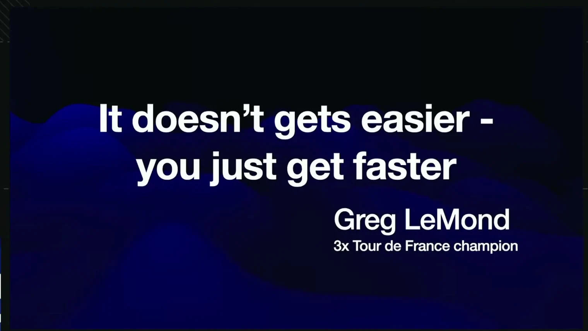

_截图 39  ·  录屏 08:29:05_

**08:29:12**　And I think that's exactly what's happening to all of us right now. And like I said, we have to be more ambitious. We have to think of more ambitious things to do with these abilities that we have. So let's look at my scorecard. My predictions for 2026. I said it will become undeniable that LMs write good code. That was an unambitious prediction.

我认为这正是我们所有人现在正在经历的事情。正如我所说，我们必须更有抱负一些。我们必须利用这些能力去做更有意义的事情。那么让我们看看我的预测吧。我对2026年的预测是：语言模型会写出优秀的代码，这一点是毋庸置疑的。不过那曾是个不切实际的预测。

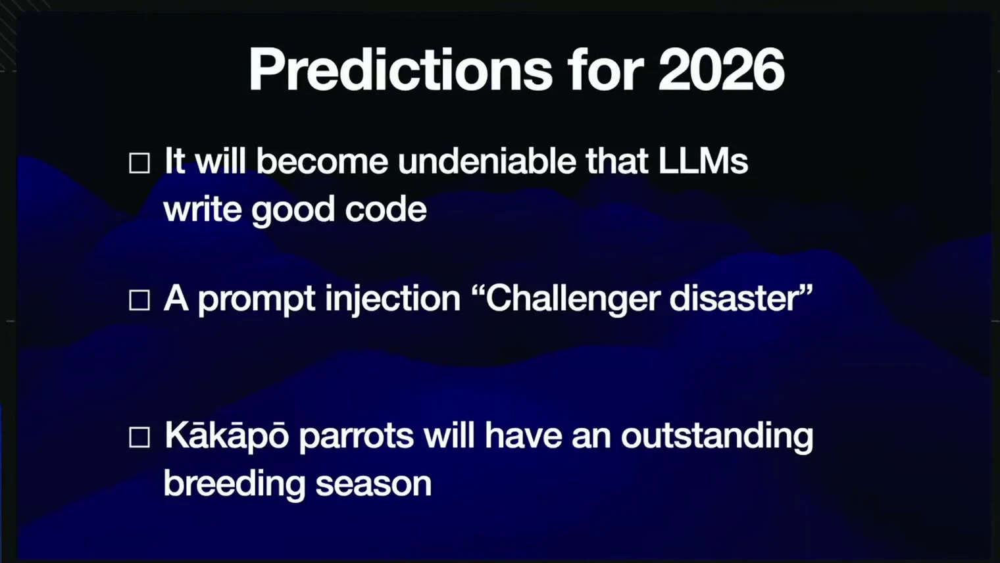

_截图 40  ·  录屏 08:29:22_

**08:29:29**　We're there. It's obvious. It's unsurprising. I don't get any points for that one. I predicted a prompt injection challenge disaster. We still haven't had one because the models themselves don't fall for those tricks nearly as well anymore. Like the models got more ambitious and are now sort of punting off all of these attacks that I thought would take them down. I said cacapur parrots will have an outstanding breeding season.

我们到了。这很明显，也不奇怪。我得不到任何分数。我预测了提示注入的灾难性情况，但实际上还没有发生，因为模型本身已经不再轻易被那些手段所影响。现在模型更加有抱负了，他们能够应对所有那些本应让它们崩溃的攻击。我说过，cacapur parrots 会有一个出色的繁殖季节。

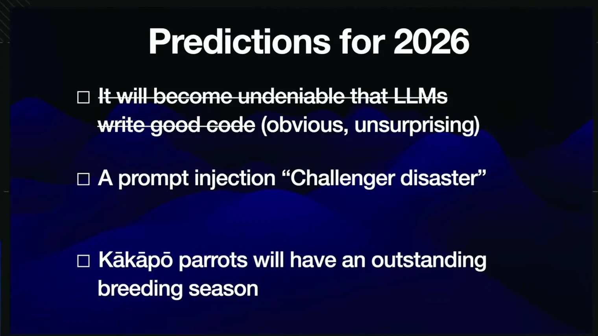

_截图 41  ·  录屏 08:29:30_

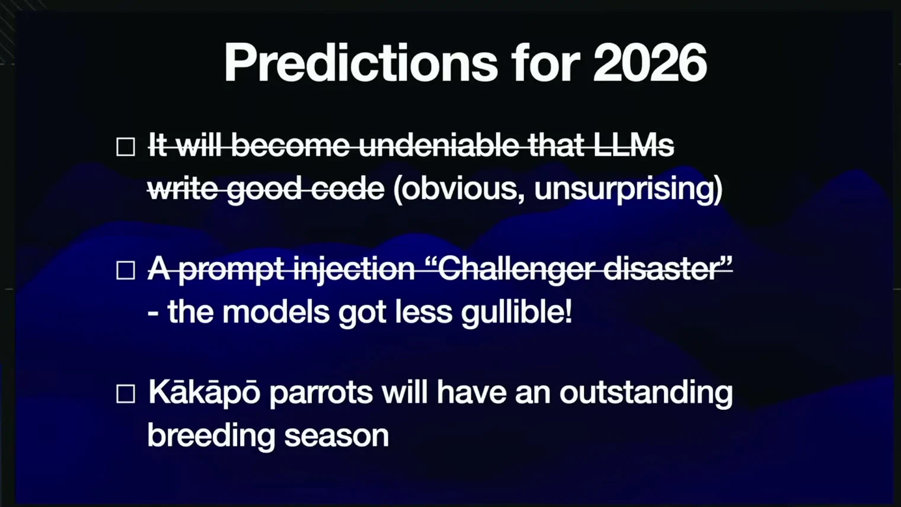

_截图 42  ·  录屏 08:29:47_

**08:29:51**　They did! They did! They're up to 325 cacapur. Best breeding season in living memory. Absolutely fantastic news so I shared this with Opus 5.5 cheap fable and I told it to make me a kākāpō dance party and it did and here is a kākāpō dance party in celebration and if you look in the background those are the rimu trees with the little red fruits on them so we have a happy ending hopefully that will help overcome any sensations of Deep Blue that you have and thank you very much Thank you.

他们做到了！他们真的做到了！达到了 325 cacapur。这是有记忆以来最理想的繁殖季节。真是太棒了，所以我把这一消息分享给了 Opus 5.5 cheap fable，让它帮我举办一场 kākāpō 舞蹈派对，它确实做到了。这就是一场庆祝的 kākāpō 舞蹈派对。如果你看背景，那些就是长满红色小果的 rimu 树，希望这样能帮助你摆脱 Deep Blue 带来的任何不适感。非常感谢你。谢谢。

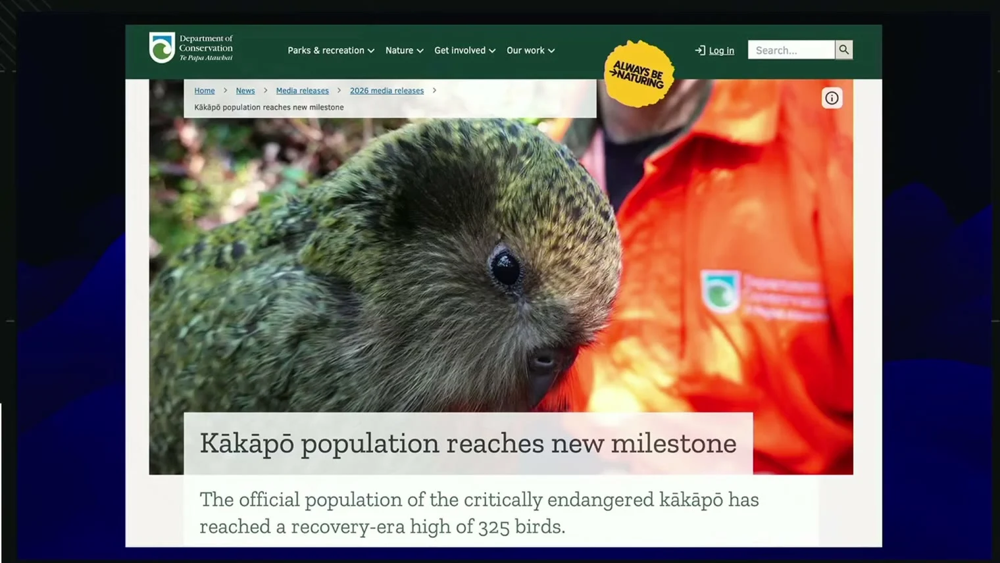

_截图 43  ·  录屏 08:29:55_

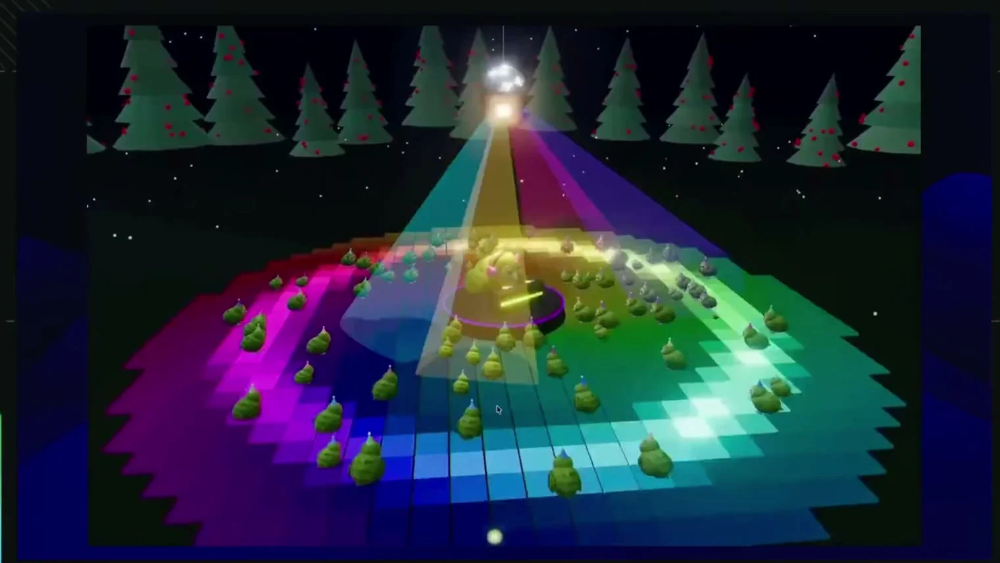

_截图 44  ·  录屏 08:30:08_

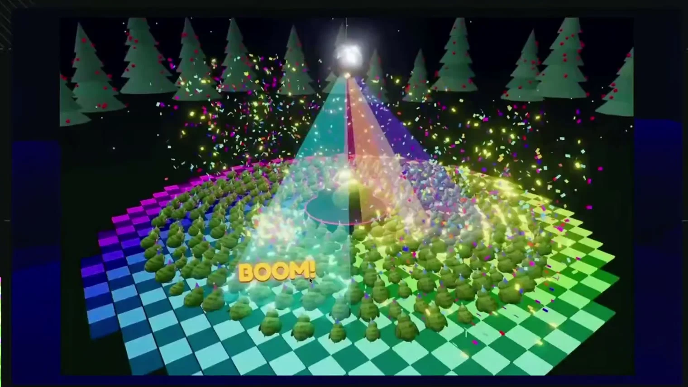

_截图 45  ·  录屏 08:30:20_

---

[全部演讲](../README.md) · [选看索引](index.md) · [上一场](26-steve-yegge.md)
